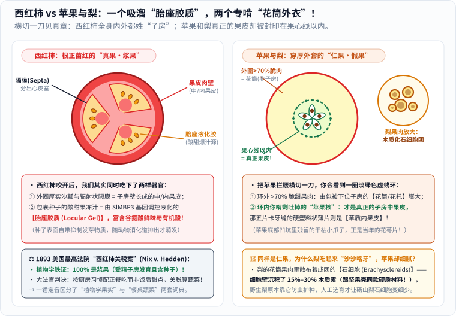
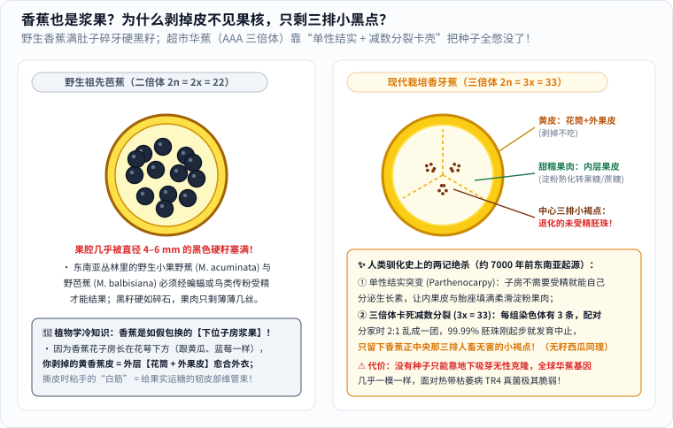
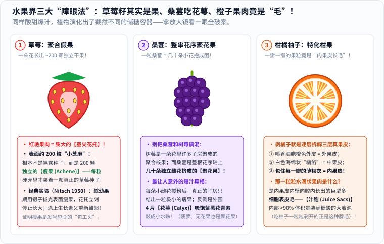
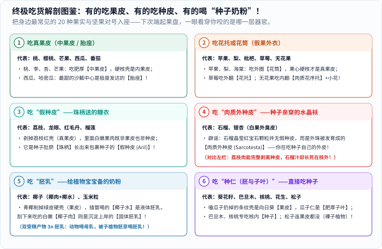

茶余饭后端上一盘切好的时令水果——红彤彤的西红柿、脆生生的苹果和雪花梨、软糯香甜的香蕉、撒着“小芝麻”的草莓、剥开晶莹剔透的橙子、荔枝与石榴，外加一碟嗑着玩的葵花籽和巴旦木。

如果这时候餐桌上坐着一位植物解剖学家，他指着果盘笑眯眯地问全家人一句话，保准能把所有人都问懵：

> **“同样是往嘴里塞一口甜津津的‘果肉’，你们知道自己刚刚分别咬下了植物身上的什么器官吗？有人在吃子房壁，有人在吸溜胎座胶，有人在啃花筒外衣，有人在嚼内果皮长出来的毛，有人在剥珠柄送的假种皮，有人在嚼种子亲穿的外种皮，还有人在喝给植物胚胎准备的液体奶粉！”**

是不是听着既不可思议又充满好奇？在植物的世界里，“结果子”从来不是为了无偿犒劳人类，而是被子植物与动物达成的一场精妙绝伦的**“用糖分换快递”交易**（关于树叶如何先造出糖分、春天枝条如何攒力开花，可对照阅读[《可视化理解光合作用》]()与[《植物春天开花的能量来源》]()）。为了引诱鸟兽帮自己把种子带向远方、同时又严防贪吃的动物把宝贵的种子一并嚼碎消化掉，不同家族的植物把花朵里的每一个零件都玩出了花！

今天，我们就拿出一把植物学解剖刀，把你最熟悉的西红柿、苹果、梨、香蕉、草莓、橙子、荔枝、石榴和椰子挨个切开，看清它们果肉与种子的全部秘密。

---

## 一、先认准花朵里的四张底牌：什么叫“真果”，什么叫“假果”？

### 1. 一朵花谢了之后，到底是谁在充水长肉？

要想看懂水果，永远得先退回一步看**花**。当蜜蜂帮一朵被子植物完成传粉受精后，漂亮的花瓣和雄蕊完成了历史使命，纷纷枯萎凋落；留下来的雌蕊底部那个鼓鼓的小肚子——**子房（Ovary）**，开始启动一场轰轰烈烈的扩建工程 [[1]](#ref-1)（见图 1 左栏）：

- **子房壁（Ovary Wall）**：按标准剧本，它会膨大发育成包裹在外面的**果皮（Pericarp）**，并从外到内分化为三层：**外果皮（Exocarp）**、**中果皮（Mesocarp）**与**内果皮（Endocarp）**——注意！植物学里说的“果皮”绝不只是你削掉的那层薄皮，**桃子厚厚的果肉本身就是“中果皮”**！
- **胎座与珠柄（Placenta & Funicle）**：子房内壁上负责拴住胚珠、给胚珠输送营养的“胎盘”与“脐带”；
- **胚珠（Ovule）**：受精后发育成真正的**种子（Seed）**，由外面的**种皮（Seed Coat / Testa）**、储存营养的**胚乳（Endosperm）**和未来的植物宝宝**胚（Embryo，含子叶）**三部分组成；
- **花托、花筒与花萼（Receptacle, Hypanthium & Calyx）**：原本只是托住花朵的底座、包在外围的花管和绿萼片。

### 2. 两条截然不同的长肉路线：桃子老实本分，苹果“外包扩建”

有趣的分歧就在这一刻发生了 [[1]](#ref-1)（见图 1 右栏单次动画）：

1. **路线 A——真果（True Fruit，如桃、樱桃、葡萄、西红柿）**：严守祖宗规矩，**100% 只靠“子房壁”自己膨大长成果实**。拿一颗水蜜桃来说：毛茸茸的薄桃皮是**外果皮**，甜美多汁的桃肉是**中果皮**，而你啃完果肉吐出来的那颗硬邦邦、带沟纹的**桃核外壳，根本不是种皮，而是高度木质化的“内果皮”**！只有拿锤子砸开硬桃核，里面露出来的那颗扁扁的“桃仁”，才是桃子真正的**种子**！（顺便破个案：过年常吃的**巴旦木 / 扁桃仁**其实就是桃子的亲兄弟，只不过它的中果皮成熟后干瘪开裂没法吃，人类干脆扔掉“桃肉”、砸开“桃核”专吃里面的“桃仁”种子！）
2. **路线 B——假果 / 附果（Accessory Fruit，如苹果、梨、草莓、桑葚）**：注意，“假果”可不是不良商贩造假的水果，而是正儿八经的植物学术语！意思是说，这朵花的子房觉得光靠自己长肉太慢，于是干脆发出激素信号，**拉拢原本不属于子房的“花托、花筒甚至花萼”一起疯狂吸水储糖**，最后反客为主，成了我们嘴里最好吃的那部分果肉！

*图 1：受粉花朵发育为真果与假果的器官分流单次动画（[单独打开大图](/assets/images/fruit-flesh-seeds/flower-to-fruit-true-vs-accessory.svg)，刷新可重播发育分流过程）。左栏标出受粉花的子房壁、胎座珠柄、胚珠与花托花筒四大模块；右栏对比仅由子房壁发育成三层果皮的真果（桃）与招募花筒或花托长成可食果肉的假果（苹果、草莓、桑葚）。*

---

## 二、西红柿 vs 苹果与梨：一个吸溜“胎座果冻”，两个专啃“花筒外套”！

搞懂了真果与假果，现在把菜板上的**西红柿**和果盘里的**苹果、梨**各拦腰横切一刀，你会立刻发现它们从里到外完全不是一路人（见图 2）！

### 1. 西红柿：全身上下根正苗红的“真果·浆果”，最好吃的那口汁竟是液化的胎座！

先看横切开的西红柿（图 2 左栏）[[2]](#ref-2)：

- 在植物学分类里，西红柿（以及葡萄、蓝莓、猕猴桃、茄子、辣椒！）全部属于最典型的**真果·浆果（Berry）**——整颗果实完完全全由受精后的上位子房发育而成；
- 当你一口咬破西红柿时，牙齿其实吃下了两样不同的植物结构：
  1. 外圈厚实的红色沙瓤肉壁，以及像车轮辐条一样把果腔隔成好几个房间的隔膜（Septa），是子房壁发育来的**中果皮与内果皮**；
  2. 而在每个心皮腔室里，严严实实裹在淡黄色扁平种子外面的那团**又酸又甜、像果冻一样顺着嘴角往下淌的半透明汁液**，既不是中果皮也不是种皮，而是子房内部的**胎座组织在成熟期主动自我溶解形成的“胎座液化胶质（Locular Gel）”**！2021 年中国农业大学与康奈尔大学团队在《自然·通讯》上查明了幕后总开关：正是一个名叫 `SlMBP3` 的转录因子专门指挥胎座细胞壁降解液化 [[2]](#ref-2)——如果敲除这个基因，西红柿腔室里就一滴果冻汁都没有，硬邦邦像块生萝卜！而且这团果冻胶里富含高浓度**游离谷氨酸**（味精的核心鲜味分子）与柠檬酸，这正是西红柿炒鸡蛋不用放味精也鲜得掉眉毛的原因！

说到西红柿，还得讲一段科学史上真实发生过的幽默公案 [[3]](#ref-3)：1883 年美国国会出台关税法，规定进口“水果”免税、进口“蔬菜”征收 $$10\%$$ 关税。纽约进口商尼克斯兄弟不服海关给西红柿收税，一路把官司打到了美国联邦最高法院（*Nix v. Hedden*, 1893）。庭审上原告律师搬出大厚本植物学词典铁证西红柿是浆果；没想到格雷大法官（Horace Gray）写下一份流传百年的判词：**从植物学解剖看，西红柿毫无疑问像黄瓜、豆角一样是果实；但在百姓日常餐桌上，它是配着主菜端上正餐桌而非当作饭后甜点享用的，因此按关税日常词义归为“蔬菜”**！从此，“植物学果实”与“厨房蔬菜”再也不打架了。

### 2. 苹果与梨：你啃掉的 `>70%` 脆甜果肉压根不是果皮，梨子咯牙的竟是“木质素小石头”！

现在把苹果（或梨）**横着拦腰切一刀**（别顺着果柄竖切，一定要横切！见图 2 右栏）[[4]](#ref-4)：

仔细端详切面正中央，除了漂亮的五角星种子仓之外，你一定能看到五角星外围有一圈淡淡的黄绿色圆环（上面还点缀着 $$10$$ 个针尖大的维管束小绿点）——植物学家管这条分界线叫**果心线（Core Line）**！

真相就在这条线两侧彻底反转 [[4]](#ref-4)：

- **果心线以内（占比不到 $$30\%$$，也就是你平时啃完嫌酸涩难嚼、顺手扔进垃圾桶的“苹果核”）**：**恰恰才是苹果真正的整个子房与三层真果皮！** 其中果核那圈紧实的肉是真中果皮，而经常卡进你牙缝里的那五片硬塑料片一样的透明薄壳，则是保护种子的**革质内果皮**；
- **果心线以外（占比超过 $$70\%$$，也就是你大口大口吃掉的全部脆甜苹果肉）**：根本不是子房壁长出来的果皮，而是当年包在苹果花下位子房外面的**花筒 / 花托（Floral Tube / Hypanthium）**受激素刺激膨大而成的“厚棉袄”！（不信你低头看一眼苹果屁股底下的凹坑，是不是还留着五片干枯的小黑爪子？那就是当年花筒顶端的花萼片！）这种花筒包着五心皮革质果核的假果，在植物学里拥有专属名字——**仁果（Pome，包括苹果、梨、山楂、枇杷、海棠）**。

紧接着解答大家吃水果时最直观的口感疑问：**既然苹果和梨是亲缘极近的同门仁果，为什么苹果咬起来细腻爽脆，梨（尤其是传统老品种梨、库尔勒香梨果心附近）嚼起来却有一粒粒“沙沙咯牙”的小颗粒？**

2013 年南京农业大学领衔破译梨基因组并发表于《基因组研究》（*Genome Research*）给出了分子级铁证 [[5]](#ref-5)（见图 2 右上放大镜）：原来，梨的花筒果肉薄壁细胞之间，星罗棋布地镶嵌着许多聚集成团的**石细胞（Stone Cells / Brachysclereids）**！这些石细胞在果实幼期拼命往自己的次生细胞壁里堆积高达 **$$25\%\text{–}30\%$$ 的木质素（Lignin）**与纤维素——没错，就是跟核桃硬壳、树干木头一模一样的超硬材料！细胞壁越积越厚，最后把细胞自己活活挤死，变成一粒粒微米级的“天然小砂砾”。在野外，这是梨树防止昆虫蛀穿果肉咬伤种子的防弹装甲；而人类几千年选育砀山酥梨、丰水梨的过程，本质上就是挑选木质素合成基因活性温和、石细胞团更小更稀疏的温柔突变株！

*图 2：西红柿（真果·浆果）与苹果、梨（仁果·假果）横切面解剖对比（[单独打开大图](/assets/images/fruit-flesh-seeds/tomato-berry-placental-gel-vs-pome.svg)）。左栏展示西红柿中内果皮肉壁与包裹种子的液化胎座胶质及 1893 年美国最高法院判例；右栏标出苹果横切面果心线内外的真假果皮分界，以及放大展示梨果肉中导致沙砾口感的木质化石细胞团。*

---

## 三、香蕉之谜：为什么剥掉皮不见核也不见籽，只剩中心三排小褐点？

聊完西红柿和苹果梨，立刻轮到果盘里最神秘的常客——**香蕉**！很多人一边剥香蕉一边纳闷：**西红柿有籽，苹果梨有核，桃子有硬壳；怎么香蕉剥掉黄皮之后，从头咬到尾全是软糯甜香的果肉？它到底算不算浆果？它的种子跑哪儿去了？正中间那三排小黑点又是什么？**

### 1. 去东南亚丛林咬一口野生香蕉，小心当场崩掉大牙！

第一个反直觉事实：**香蕉在植物学上也是如假包换的“下位子房浆果”！** [[6]](#ref-6) 因为香蕉花的子房长在花被下方，你随手剥掉扔进垃圾桶的那层黄色香蕉皮，其实是**外层花筒与外果皮愈合而成的外衣**（剥皮时偶尔粘在果肉上、吃起来有点涩嘴的那几根“白筋”，则是负责给果实抽水运糖的**韧皮部与木质部维管束**）；而你吃进嘴里的整根香甜果肉，正是香蕉肥厚的**内层果皮（中果皮内侧、内果皮与胎座愈合体）**！

那种子呢？如果你穿越回七千年前的东南亚或新几内亚热带雨林，摘下一根尚未被人类驯化的野生祖先——二倍体**野芭蕉（*Musa balbisiana*，$$2n = 2x = 22$$）**或野生**小果野蕉（*Musa acuminata*）**，兴冲冲咬上一大口，你多半会捂着腮帮子惨叫出声 [[6]](#ref-6)（见图 3 左栏）：

野生香蕉必须经过果蝠或太阳鸟传粉受精才会结果，切开一看，**整个果腔里密密麻麻塞满了上百颗直径 $$4\text{–}6\ \mathrm{mm}$$、像黑色小鹅卵石一样坚硬无比的野生香蕉籽**，真正的果肉只在黑籽缝隙里挤着薄薄一点点！

### 2. “单性结实 + 三倍体卡死减数分裂”：把碎牙黑籽变成中心三排退化小褐点！

那人类老祖先是怎么把“满嘴碎石子”变成今天超市里一根无籽华蕉（Cavendish 香牙蕉）的？靠的是植物驯化史上堪称教科书级的**双重遗传奇迹** [[6]](#ref-6)（见图 3 右栏）：

1. **第一步：抓住“单性结实（Parthenocarpy）”突变株**。大约七千年前，东南亚先民在野生小果野蕉丛里敏锐地发现了一两株罕见的基因突变个体——它们的子房根本不需要传粉受精，自己就能源源不断合成生长素与赤霉素，指挥内层果皮细胞填满超过 $$20\%$$ 的淀粉（采摘催熟时在乙烯唤醒下迅速水解转化为甜美的蔗糖、葡萄糖与果糖）！
2. **第二步：三倍体（$$2n = 3x = 33$$）彻底锁死种子发育**。更绝的是，一株二倍体偶尔产生了未减数的二倍配子（$$2x$$），与正常单倍配子（$$x$$）结合，生出了每组染色体都有 **$$3$$ 条**的**三倍体栽培香蕉（`AAA` 或 `AAB` 基因组，共 $$33$$ 条染色体）** [[6]](#ref-6)！
   学过中学遗传学就知道，细胞要制造精子和卵细胞必须经历“减数分裂”，同源染色体得**两两成双配对**平分到两边；可现在每组来了 **$$3$$ 条染色体**，怎么分都是 $$2 : 1$$ 乱成一锅粥！于是高达 $$99.99\%$$ 以上的胚珠刚准备发育就当场卡壳停工——**当你把一根香蕉横切成圆片（或者用手指顺着中心轻轻一掰分成三瓣）时，正中央沿三个心皮室整整齐齐排成三行的那些针尖大小棕褐色小点，既不是什么“蜘蛛虫卵”谣言，也不是能发芽的真种子，而是减数分裂受阻后提前夭折的“未受精退化胚珠（Aborted Ovules）”**！（夏天常吃的**三倍体无籽西瓜**，里面软软扁扁的白嫩空瘪籽，用的也是完全一模一样的三倍体卡壳原理！）

不过，彻底消灭种子也让全球香蕉产业背上了一把达摩克利斯之剑：因为没有种子，全世界超市里卖的几乎所有华蕉全都是靠母株地下钻出的“吸芽”一棵接一棵**无性克隆**出来的，基因相似度接近 $$100\%$$——一旦遇上专杀它的土壤真菌（如热带枯萎病 4 号生理小种 `TR4`），整片种植园都没有半点遗传抵抗力 [[6]](#ref-6)。

*图 3：野生二倍体有籽芭蕉与现代 `AAA` 三倍体栽培香牙蕉横切解剖对比（[单独打开大图](/assets/images/fruit-flesh-seeds/banana-triploid-parthenocarpy-anatomy.svg)）。左栏展示野生芭蕉果腔布满坚硬黑色种子；右栏展示现代三倍体（$$2n=3x=33$$）香蕉由花筒加外果皮构成蕉皮、内层果皮构成甜糯果肉，而中心三排小褐点实为减数分裂受阻退化的未受精胚珠。*

---

## 四、水果界三大“顶级伪装大师”：草莓、桑葚与柑橘

如果说苹果和香蕉已经让你重新认识了果盘，接下来这三位日常熟面孔，更是把植物器官“障眼法”玩到了炉火纯青的地步（见图 4）：

### 1. 草莓：红艳果肉全是茎尖底座，表面 $$200$$ 粒“小芝麻”才是真果实！

英文里管草莓叫 *Strawberry*，中文里也常有人把它归入“浆果类”，结果植物学家一拍桌子：**草莓既不是浆果，甚至连它那颗红扑扑的大胖肚子都不是真正的果实！** [[1]](#ref-1) [[7]](#ref-7)

一朵草莓花正中央长着一座圆锥形的小山包（茎尖**花托 Receptacle**），小山包上密密麻麻坐着大约 **$$200$$ 个彼此完全独立的迷你雌蕊子房**。传粉受精之后：

- 那 $$200$$ 个真正的子房根本没有变软变甜，而是各自结成了一粒米黄色或棕黄色的小硬壳干果——**瘦果（Achene，跟向日葵瓜子同属干果家族！）**，也就是镶嵌在草莓表面、吃起来偶尔塞牙缝的那一粒粒“小芝麻”！剥开这粒小硬壳，藏在最里面的微米级仁儿才是真正的草莓种子；
- 那为什么底下的花托会鼓成一颗鲜红多汁的大爱心呢？1950 年植物生理学家尼奇（J. P. Nitsch）做过一个载入教科书的绝妙实验（现代分子机制已由 2021 年《植物生理学》论文彻底解析 [[7]](#ref-7)）：趁草莓还是绿豆大的小青果时，用细镊子把表面的瘦果“小芝麻”全部拔光——底下的花托瞬间像泄了气的皮球一样彻底停止生长！如果拔光瘦果后再往光秃秃的花托上涂一层**生长素（Auxin）**，一颗没有半粒芝麻的光滑红草莓居然又神奇地鼓起来了！原来，表面那 $$200$$ 颗真正的小果实才是幕后“包工头”，它们一边发育种子一边往下泵送生长素与赤霉素，指挥脚下的花托拼命充水储糖替自己招揽鸟类！

### 2. 桑葚：看着像黑树莓，咬爆的紫黑水珠竟是变胖的“花萼片”！

初夏让人吃得满嘴乌紫的**桑葚（Mulberry）**，外貌跟树莓（覆盆子）像得宛如双胞胎，身世却天差地别 [[8]](#ref-8)（见图 4 中栏）：

- 树莓是一朵花里几十个子房挤成的“聚合核果”；而**每一粒桑葚，前身其实是整整一串花序上几十朵独立的迷你雌花**抱团长成的**聚花果（Multiple Fruit，菠萝和无花果也属于这一门派！）**；
- 更绝的是：每朵桑树小雌花授粉后，真正的子房只结出一粒极小的硬瘦果；反倒是包在每朵小花外面的 **$$4$$ 片原本绿色的花萼片（Calyx Sepals）**，在花谢后非但没掉，反而疯狂吸水、塞满紫黑色花青素，鼓成了四瓣晶莹欲滴的小水囊，把瘦果紧紧抱在怀里 [[8]](#ref-8)！所以你嚼桑葚爆出的满口酸甜紫汁，喝的居然是**花萼汁**！

### 3. 柑橘、橙子与柚子：一粒粒水滴状果肉，竟是内果皮往里长的“巨型毛”！

冬天剥砂糖橘或拆大柚子时，你正好亲手完成了一次标准的三层真果皮解剖 [[9]](#ref-9)（见图 4 右栏）：

1. 指甲掐破会喷出芳香柠檬烯油雾的橙黄色外皮，是**外果皮（黄皮层 Flavedo）**；
2. 紧贴在下面那层白花花、苦丝丝的海绵状软层和“橘络”，是**中果皮（白皮层 Albedo）**；
3. 把橘子掰成一瓣一瓣，包住每一瓣果肉的那层半透明韧皮（吃柚子时大家习惯撕掉的那层衣），正是**内果皮（Endocarp）**！

那问题来了：既然外、中、内三层果皮全都对上号了，橘子瓣里面那一粒粒晶莹饱满、一咬就爆汁的水滴状“果粒”又是什么东西？

植物发育解剖学在显微镜下拍下了它的诞生全过程 [[9]](#ref-9)：柑橘类植物属于芸香科独有的特化浆果——**柑果（Hesperidium）**。在幼果期，**内果皮的内表皮细胞突然向着心皮腔内部突起分裂，长出成百上千根带细柄的巨型多细胞表皮腺毛——汁胞（Juice Sacs）**！每根汁胞内部的中央大液泡占据了细胞体积的 **$$90\%$$ 以上**，像一只只微型高压水气球一样灌满了蔗糖、柠檬酸与维生素 C。没错，你剥柚子时一粒一粒掰下来吃得津津有味的“柚子米”，在植物学身份上其实是**内果皮向肚子里长出来的多细胞储水毛**！

*图 4：草莓、桑葚与柑橘三大特化果实解剖图解（[单独打开大图](/assets/images/fruit-flesh-seeds/strawberry-mulberry-citrus-disguises.svg)）。左栏展示草莓红肉为茎尖花托、表面约 $$200$$ 粒小颗粒为真正瘦果；中栏展示桑葚由整串花序发育且爆汁水囊为肉质花萼；右栏展示柑橘柚子瓣内的汁胞实为内果皮向腔内生长的多细胞储水毛状体。*

---

## 五、终极吃货解密：为什么有的吃果肉、有的吃种皮、有的吃种子？

读到这里，终于可以正面回答你在问题里敏锐捕捉到的那个核心趣味了——**“有的吃果肉，有的吃种子，它们到底有什么区别？”**

为什么植物不统一把所有好东西都塞进同一种果肉里，非要演化出五花八门的吃法？因为植物面临两套截然相反的生存算盘，而人类恰恰顺着这两套算盘开发出了完全不同的美食（见图 5 六宫格全景对照）：

### 1. 荔枝 vs 石榴：植物学最容易搞混的一对“水晶糖衣双胞胎”！

很多人把荔枝、龙眼和石榴放在一起，以为它们吃的都是同一种包在种子外面的肉。**大错特错！这恰恰是现代植物解剖学最精彩的一组对比** [[10]](#ref-10) [[11]](#ref-11)（见图 5 第 3 格与第 4 格）：

- **荔枝、龙眼、红毛丹与榴莲——吃的是“真·假种皮（Aril）”** [[10]](#ref-10)：当你剥开荔枝带疙瘩的红色硬壳（那是荔枝真正的整套外/中/内果皮！），里面露出一团白玉般晶莹多汁的荔枝肉；吃完荔枝肉，你会吐出一颗光滑油亮、棕褐色的荔枝核（那层棕褐色硬亮皮才是荔枝种子的**真种皮**！）。注意到了吗？**荔枝果肉既不连着外面的红果壳，也不粘死在里面的棕种皮上，只在蒂部肚脐眼处相连**！2025 年发表于《BMC 植物生物学》的发育研究清晰展示了它的身世 [[10]](#ref-10)：这层白肉是从连接种子的“脐带”——**珠柄（Funicle）**基部萌发出来、像披风一样往上长并把整颗种子包在中间的额外附属结构，所以叫**假种皮（Aril）**！（榴莲那一房一房金黄浓香的软糯果肉，同样也是包裹在大种子外面的肥厚假种皮！）
- **石榴——根本没有假种皮，你嚼的是种子亲生的“肉质外种皮（Sarcotesta）”** [[11]](#ref-11)！以前很多旧科普书误把石榴籽外面的红宝石果肉也叫做假种皮；但植物胚胎学切片早已铁证如山 [[11]](#ref-11)：石榴外面的黄色硬皮是果皮，里面那几百颗晶莹剔透的红石榴籽**压根没有假种皮（Exarillate）**！那层一咬就爆出红宝石甜汁的水晶层，是石榴胚珠自己的**外珠被**表皮细胞径向拉长数倍、充水膨胀直接变成的**肉质外种皮（Sarcotesta）**，而你嚼完吐掉（在软籽石榴里甚至可以直接嚼碎咽下）的小硬芯则是木质化的**内种皮 + 胚**！换句话说，吃荔枝是在剥种子借来的糖披风，而嚼石榴是真的在吃种子自己的外皮！

### 2. 喝椰子水、刮椰子肉：你其实在喝被子植物独步天下的“婴儿奶粉（胚乳）”！

夏天抱着一颗沉甸甸的海南青椰子，插根吸管猛吸一大口清甜冰爽的椰子水，喝完再拿勺子把雪白滑嫩的椰肉刮干净——你知道自己刚刚吃掉了椰子的哪一层吗 [[1]](#ref-1)？（见图 5 第 5 格）

**既不是果皮，也不是假种皮，而是椰子种子肚子里的“胚乳（Endosperm）”！**

- 椰子在植物学上其实是跟桃子同门的巨型**纤维核果（Drupe）**：树上掉下来的原生态大椰子，最外面绿色的光滑皮是**外果皮**，中间厚达好几厘米、能拿来搓绳做椰棕床垫的粗纤维层是**中果皮**（为了方便运输，超市里卖的棕色毛球椰子已经把外果皮和中果皮削掉了！），而你要拿大砍刀或电钻才能敲开的那个坚硬棕色椰壳，恰恰相当于桃核壳——**木质化内果皮**！
- 敲开内果皮硬壳，里面整颗大水球全是一粒超级巨型种子！被子植物比裸子植物高明的一大绝技叫**双受精**：花粉管送来两颗精子，一颗与卵细胞结合变成植物宝宝（**二倍体胚 $$2n$$**，躲在椰壳顶端三个“小眼睛”萌发孔之一的下面），另一颗与中央极核结合变成专职营养仓库——**三倍体胚乳（$$3n$$）**！
- 椰子胚乳的发育更是奇观：它一上来先只分裂细胞核、不筑细胞壁，化作一汪富含钾离子、细胞分裂素与糖分的清甜**游离核液体胚乳——这就是你吸管喝到的“椰子水”**！随着椰子逐渐成熟，液体里的细胞核纷纷往内壁靠岸、筑起细胞壁并囤积大量月桂酸油脂，凝结成一层雪白香浓的**细胞化固体胚乳——这就是你拿勺子挖着吃的“椰子肉”**！（我们每天吃的大米白饭、小麦面粉和爆米花主体，吃的也全都是禾本科种子的固体淀粉胚乳！）

### 3. 嗑瓜子、嚼巴旦木与松子：植物防你偷吃，人类偏要截胡“高能种仁”！

最后看干果盘里的**葵花籽、花生、核桃、巴旦木与松子** [[1]](#ref-1)（见图 5 第 6 格）：

为什么水果果肉（苹果、西红柿、西瓜）水分高达 $$85\%\text{–}92\%$$、热量极低，而瓜子仁、核桃仁一咬满嘴流油、每百克热量高达 $$550\text{–}650$$ 千卡？

因为两者的演化目的正好相反！

- **果肉（果皮 / 花托 / 假种皮）是植物发给动物快递员的“低成本跑腿小费”**：植物精明得很，只用廉价的水分加一点果糖、蔗糖和香气分子把体积撑得又大又诱人，吸引鸟兽吞下去帮种子搬家；
- **种仁（胚与两片肥厚子叶，或胚乳）则是植物妈妈攒给亲生骨肉在黑暗泥土里破土发芽的“高能量创业启动金”**：种子体积不能太大（否则飞不远、掉不进土缝），所以植物把碳水化合物高度浓缩成能量密度翻倍的**油脂与优质蛋白**（$$1$$ 克脂肪储能约 $$9$$ 千卡，是糖类的两倍多！），外面再套上硬果壳（如葵花籽的黑底白条瘦果果皮、核桃与巴旦木的木质内果皮）甚至苦杏仁苷毒素严防动物偷吃！
- 结果聪明的人类学会了使锤子、嗑门牙和高温炒制：**嗑向日葵瓜子**，嗑掉吐在桌上的硬壳是整套真果皮，吃进嘴里的香瓜子仁是整颗种子（种皮包着两片吸满葵花籽油的肥厚子叶）；而到了**松子**和**银杏（白果）**这儿就更彻底了——松树和银杏属于古老的**裸子植物**，压根还没演化出“子房”和“果实”这个器官！街边银杏树掉下来臭烘烘的黄色烂肉皮并不是果皮，而是银杏种子的**肉质外种皮**（含丁酸发臭防松鼠乱啃），洗净硬中种皮后烤熟剥吃的糯绿“白果仁”，就是彻头彻尾的裸子植物种子！

*图 5：身边 20 种常见水果与坚果的六大可食植物学器官分类图鉴（[单独打开大图](/assets/images/fruit-flesh-seeds/flesh-vs-seed-edible-parts-matrix.svg)）。按人类实际下嘴部位对比六类结构：真果中果皮或胎座（桃、西瓜）、假果花筒或花托（苹果、草莓）、珠柄假种皮（荔枝、榴莲）、种子肉质外种皮（石榴）、双受精固体与液体胚乳（椰肉与椰水）以及高油脂种仁子叶（葵花籽、巴旦木、裸子松子）。*

---

## 六、总结：果盘里的一张演化藏宝图

下次全家人围坐在一起切水果、嗑坚果时，不妨拿下面这张极简速查表考考身边的大小朋友——原来小小一个果盘，竟浓缩了植物演化一亿多年的全部生存智慧：

| 盘中美味 | 植物学果实类型 | 你真正吃进嘴里的器官 | 你吐掉/剥掉的是什么？ |
| :--- | :--- | :--- | :--- |
| **西红柿** | 真果·浆果 | **中/内果皮肉壁 + 液化胎座胶质**（连软籽一起吞） | 极薄外果皮（有时连皮吃） |
| **苹果 / 梨** | 假果·仁果 | **花筒 / 花托外衣**（梨含木质化石细胞团） | 果心线内的**真果皮果核**与黑褐种子 |
| **栽培香蕉** | 真果·三倍体无籽浆果 | **内层果皮与胎座**（中心小褐点是退化胚珠） | **花筒 + 外果皮**愈合蕉皮与维管束白筋 |
| **草莓** | 聚合假果 | **膨大茎尖花托**（顺带吞下表面约 $$200$$ 颗迷你瘦果） | 顶端绿色宿存花萼片 |
| **桑葚** | 聚花果（整串花序） | 几十朵雌花吸饱花青素的**肉质花萼** | 花序中央嫩轴 |
| **橙子 / 柚子** | 真果·柑果 | 内果皮向腔内长出的多细胞腺毛——**汁胞** | 外果皮（黄皮）、中果皮（橘络）、内果皮（瓣衣）与籽 |
| **荔枝 / 龙眼** | 真果（无患子科） | 从种子珠柄长出的糖披风——**真·假种皮** | 红色瘤状真果壳 + 光滑棕褐色真种子 |
| **石榴** | 特化浆果（千屈菜科） | 种子自己穿的水晶袄——**肉质外种皮** | 黄色革质果皮 + 木质内种皮硬芯 |
| **椰子** | 纤维核果 | **液体胚乳（椰水）+ 固体胚乳（椰肉）** | 绿外果皮、棕纤维中果皮与硬壳内果皮 |
| **葵花籽** | 干果·瘦果（连萼果） | **种仁（薄种皮 + 两片高油子叶与胚）** | 黑白条纹硬果皮外壳 |

看懂了这张表，你再咬下每一口酸甜或醇香时，品尝到的就不只是糖分与油脂，还有花朵与动物跨越亿万年的默契对话。

---

## 参考资料与核查来源

1. Nickrent, D. L. *Plant Anatomy Lecture 24: Fruits*. Southern Illinois University ([SIU Plant Anatomy 原页](https://nickrentlab.siu.edu/PlantAnatomyWeb/LecturesDLN/Lecture24_Fruits.html))；以及 Ha, M., Morrow, M., & Algiers, K. *Botany* §2.7.3: Fruits and Dispersal ([Biology LibreTexts 教材](https://bio.libretexts.org/Bookshelves/Botany/Botany_(Ha_Morrow_and_Algiers)/02:_Biodiversity_(Organismal_Groups)/2.07:_Angiosperm_Diversity/2.7.03:_Fruits_and_Dispersal))（支持：真果外/中/内三层果皮与假果定义、核果、浆果、瘦果、聚花果及双受精胚乳与种仁结构分类）
2. Rost, T. L. *Tomato Anatomy: Fruit & Seed*. University of California, Davis ([UC Davis 番茄解剖档案](https://labs.plb.ucdavis.edu/rost/tomato/Reproductive/anat.html))；以及 Huang, B., Hu, G., Wang, K., et al. (2021). SlMBP3, an AGAMOUS-subfamily MADS-box transcription factor, is a master regulator of locular gel formation in tomato fruit. *Nature Communications*, 12, 6892. [PMC8616914 全文](https://pmc.ncbi.nlm.nih.gov/articles/PMC8616914/)（支持：西红柿浆果解剖结构及包裹种子的液化胎座胶质由 `SlMBP3` 主控机制）
3. Supreme Court of the United States (1893). *Nix v. Hedden*, 149 U.S. 304. [Wikisource 判决书原文](https://en.wikisource.org/wiki/Nix_v._Hedden/Opinion_of_the_Court)（支持：1893 年美国最高法院确认西红柿在植物学上为果实，但在关税法日常饮食语境下归为蔬菜）
4. Jing, S., & Malladi, A. (2020). Higher growth of the apple (Malus × domestica Borkh.) fruit cortex is supported by resource intensive metabolism during early development. *BMC Plant Biology*, 20, 75. [PMC7020378 全文](https://pmc.ncbi.nlm.nih.gov/articles/PMC7020378/)（支持：苹果等仁果果心线以外超 $$70\%$$ 可食果肉源于非子房的花筒/花托皮层，果心线内果核才是真子房果皮）
5. Wu, J., Wang, Z., Shi, Z., et al. (2013). The genome of the pear (*Pyrus bretschneideri* Rehd.). *Genome Research*, 23(2), 396–408. [PMC3561880 全文](https://pmc.ncbi.nlm.nih.gov/articles/PMC3561880/)（支持：梨果肉中木质素高度沉积的石细胞团导致沙砾口感及其木质素合成基因演化机制）
6. Heslop-Harrison, J. S., & Schwarzacher, T. (2007). Domestication, Genomics and the Future for Banana. *Annals of Botany*, 100(5), 1073–1084 ([PMC2759213 全文](https://pmc.ncbi.nlm.nih.gov/articles/PMC2759213/))；以及 Perrier, X., De Langhe, E., Donohue, M., et al. (2011). Multidisciplinary perspectives on banana (*Musa* spp.) domestication. *PNAS*, 108(28), 11311–11318 ([PMC3136277 全文](https://pmc.ncbi.nlm.nih.gov/articles/PMC3136277/))（支持：香蕉下位子房浆果解剖、野生二倍体硬黑籽祖先与现代三倍体 $$2n=3x=33$$ 单性结实无籽驯化机制及克隆脆弱性）
7. Zhou, J., Sittmann, J., Guo, L., et al. (2021). Gibberellin and auxin signaling genes RGA1 and ARF8 regulate fertilization-induced auxiliary/receptacle fruit development in strawberry. *Plant Physiology*, 186(2), 1020–1035. [PMC8133647 全文](https://pmc.ncbi.nlm.nih.gov/articles/PMC8133647/)（支持：草莓表面瘦果为真正果实并分泌生长素与赤霉素驱动茎尖花托膨大成红色果肉，印证 Nitsch 1950 经典去瘦果实验）
8. International Dendrology Society. *Morus* L. — Trees and Shrubs Online. [官方植物志条目](https://www.treesandshrubsonline.org/articles/morus/)（支持：桑葚为整串雌花序发育而成的聚花果，其肥厚多汁可食部分实为宿存膨大的肉质花萼）
9. Sadka, A., Shlizerman, L., Kamara, I., & Blumwald, E. (2019). Primary Metabolism in Citrus Fruit as Affected by Its Unique Structure. *Frontiers in Plant Science*, 10, 1167. [Frontiers 全文](https://www.frontiersin.org/journals/plant-science/articles/10.3389/fpls.2019.01167/full)（支持：柑橘类柑果外、中、内三层果皮结构及内果皮向内发育形成大液泡多细胞汁胞机制）
10. Wan, Z., Lin, B., Zheng, X., et al. (2025). Comparative anatomical and transcriptomic analyses reveal key regulators of aril development in litchi. *BMC Plant Biology*, 25. [PMC12224751 全文](https://pmc.ncbi.nlm.nih.gov/articles/PMC12224751/)（支持：荔枝、龙眼等无患子科可食白色果肉是由珠柄基部发育包裹种子的真正假种皮 Aril）
11. Melgarejo, P., Núñez-Gómez, D., Martínez-Nicolás, J. J., et al. (2024). Pomegranate (*Punica granatum* L.) Seed Quality and Sarcotesta Characteristics. *Foods*, 13(3), 412. [PMC10814753 全文](https://pmc.ncbi.nlm.nih.gov/articles/PMC10814753/)（支持：石榴种子并无假种皮，红宝石多汁可食层实为胚珠外珠被特化而成的肉质外种皮 Sarcotesta）
