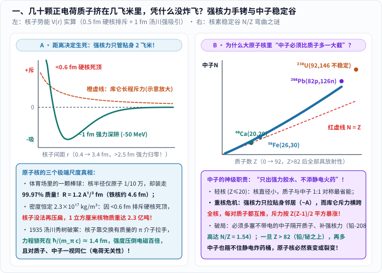
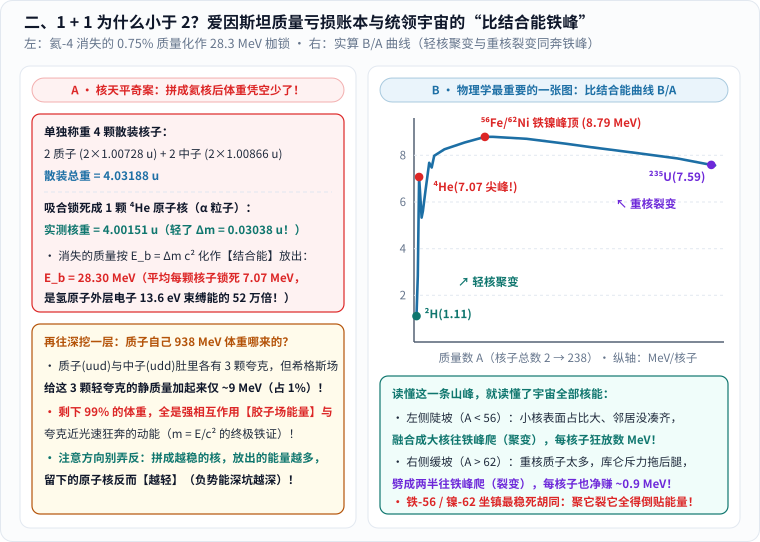
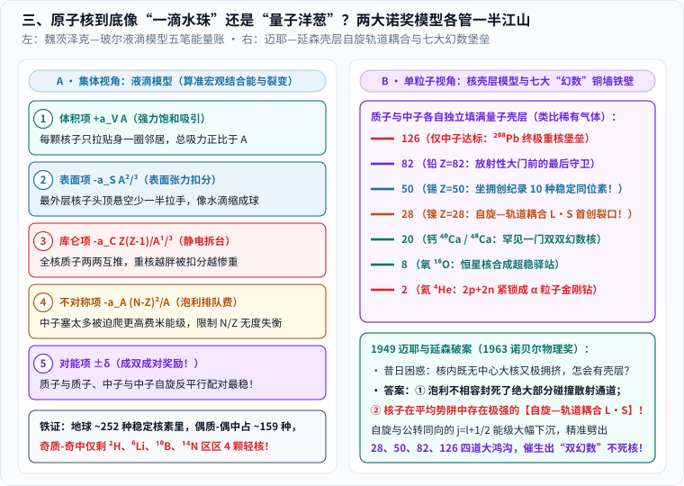
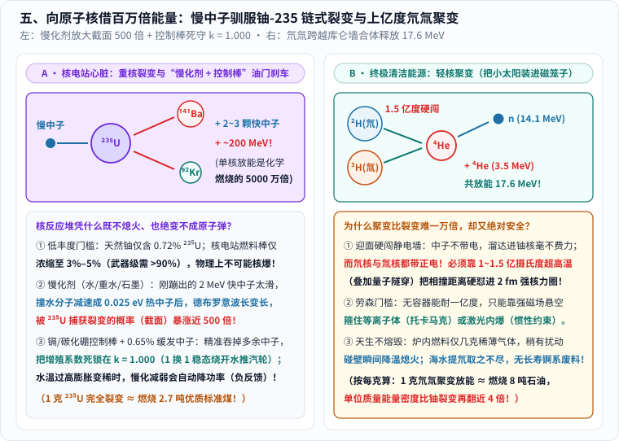

如果把你身体里的一颗铁原子等比例放大成一座能坐五万人的**职业棒球场**，绕核飞奔的 $$26$$ 颗电子就像看台顶棚外飞舞的几粒灰尘，而整座原子 **$$99.97\%$$ 的质量**，全都死死蜷缩在球场正中央草坪上——大小不过**一颗棒球**的**原子核**里！

一旦拿中学物理公式给这颗“棒球”算一笔静电账，任何第一次认真算完的人都会倒吸一口凉气：

在铁原子核（$$^{56}_{26}\text{Fe}$$）半径仅约 $$4.6\,\text{fm}$$（飞米，$$1\,\text{fm} = 10^{-15}\,\text{m}$$）的狭小空间里，硬生生塞进了 **$$26$$ 颗带正电的质子**（铅核更是塞进 $$82$$ 颗，铀核塞进 $$92$$ 颗）！两颗相邻质子中心只隔约 $$1.8\,\text{fm}$$，代入库仑定律 $$F_{\mathrm{e} } = k_{\mathrm{e} } e^2 / r^2$$ 一算，两颗小小的基本粒子之间竟然顶着高达 **$$71.2\,\text{N}$$** 的静电斥力——相当于在一粒微尘肩上压了一袋 **$$7$$ 公斤重的大米**！

这就像把几十根点燃引信的雷管绑在针尖上，引出一连串震撼物理学百年的终极追问：

1. **同性电荷明明拼命互推，是谁造出了比电磁力狠一百倍的“隐形手铐”，把几十颗质子死死箍在一起？为什么大原子核里“中子必须比质子多一大截”？**
2. **把 $$2$$ 颗质子和 $$2$$ 颗中子放上天平拼成氦核，为什么拼完总重量凭空少了 $$0.75\%$$？为什么把轻核“合起来（聚变）”能放能，把重核“劈开来（裂变）”居然也能放能——大自然难道允许两头通吃吗？**
3. **原子核到底像一滴软乎乎的水珠，还是像电子排布那样一层套一层的量子洋葱？为什么带 $$2, 8, 20, 28, 50, 82, 126$$ 颗核子的原子核格外金刚不坏？**
4. **铀-238 肚子里的 $$\alpha$$ 粒子能量明明比核外静电围墙矮了 $$6$$ 倍，凭什么能“穿墙越狱”？核内根本没藏电子，$$\beta$$ 衰变喷出的高速电子又是谁现场造出来的？**

今天，我们就潜入原子正中央这处不到十万分之一半径的极密禁区，把**原子核的底层运作法则**一层层剥开看透。

---

## 一、几十颗正电荷质子挤在几飞米里，凭什么没炸飞？强核力手铐与中子稳定谷

1911 年，欧内斯特·卢瑟福（Ernest Rutherford）用 $$\alpha$$ 粒子轰击金箔，看到极少数粒子竟像子弹撞上铁砧一样直直弹回，第一次揪出了藏在原子中心极小却极重的原子核；1932 年，他的学生詹姆斯·查德威克（James Chadwick，1935 年诺贝尔物理学奖）又找出了不带电的另一半房客——**中子（Neutron）**。至此，原子核的两位主角凑齐了：带 $$+e$$ 正电的**质子（Proton，数记为 $$Z$$，决定它是元素周期表第几号元素，见[元素周期表为什么有长有短]()）**与电中性的**中子（数记为 $$N$$）**，统称**核子（Nucleons，总数即质量数 $$A = Z + N$$）**。

### 1. 极端尺度与“只管贴身 2 飞米”的强核力手铐

通过高能电子散射给几百种原子核“量三围”，物理学家发现了一条极其工整的半径铁律（OpenStax 大学物理教材 [*University Physics Vol. 3* §10.1](https://openstax.org/books/university-physics-volume-3/pages/10-1-properties-of-nuclei)）：

$$
R \approx r_0 A^{1/3}, \qquad r_0 \approx 1.2\,\text{fm} = 1.2 \times 10^{-15}\,\text{m}
$$

把球体积 $$V = \frac{4}{3}\pi R^3 = \frac{4}{3}\pi r_0^3 A$$ 代进去，你会立刻发现质量数 $$A$$ 上下约掉了！也就是说，无论轻如碳核还是重如铀核，**所有原子核的内部密度几乎恒定在同一个恐怖天文数字上**：

$$
\rho_{\text{核} } = \frac{A \, m_{\mathrm{u} } }{\frac{4}{3}\pi r_0^3 A} \approx 2.3 \times 10^{17}\,\text{kg/m}^3
$$

**$$1$$ 立方厘米（一粒方糖大小）的纯原子核物质，足足重达 $$2.3$$ 亿吨**——相当于把全人类造过的所有远洋巨轮压缩进一粒骰子里！宇宙中只有大质量恒星坍缩留下的中子星，才是把这种核物质直接放大到了十公里直径。

为什么原子核既不会被自身吸引力塌缩成一个奇点，也不会被 $$71\,\text{N}$$ 的质子静电斥力炸得粉身碎骨？秘密全在宇宙四大基本力之首——**强核力（Strong Nuclear Force，准确说是强相互作用溢出核子外的“剩余强力”）**那张怪脾气的距离势能曲线 $$V(r)$$ 上：

顺着上图左栏的深青色势能曲线从左往右看，强核力在短短 $$3$$ 飞米内连变三副面孔：

1. **$$r < 0.6\,\text{fm}$$（极短程排斥硬核）**：一旦两颗核子挤得太近，势能陡然冲上正无穷！正是这颗压不扁的“钢珠硬核”，保证了核子只能一颗挨一颗堆叠，体积严格正比于人数 $$A$$，造就了 $$2.3$$ 亿吨/立方厘米的恒定核密度。
2. **$$r \approx 0.8\text{–}2.0\,\text{fm}$$（贴身强吸引深阱）**：在这个黄金距离上，强核力展现出约 $$-50\,\text{MeV}$$ 的惊人吸引深坑，**拉力比同距离质子间的静电斥力强出约 $$100$$ 倍**！而且它是个彻头彻尾的“电荷色盲”——质子拉质子（$$p\text{-}p$$）、中子拉中子（$$n\text{-}n$$）、质子拉中子（$$p\text{-}n$$），强核力一视同仁全紧锁！
3. **$$r > 2.5\text{–}3.0\,\text{fm}$$（超短臂长，瞬间归零！）**：这是决定原子核一切命运的死穴！电磁力靠没有质量的虚光子传递，臂长无限远（$$\propto 1/r^2$$）；而日本物理学家汤川秀树（Hideki Yukawa）在 1934–1935 年天才地指出（[1949 年诺贝尔物理学奖档案](https://www.nobelprize.org/prizes/physics/1949/yukawa/facts/)），核子之间的强核力靠交换有静止质量的 **$$\pi$$ 介子（$$m_\pi c^2 \approx 140\,\text{MeV}$$）** 来传球拉手！按量子不确定性原理 $$\Delta E \Delta t \sim \hbar$$，这颗借来的有质量介子最多只能跑出：

$$
r_\pi \approx \frac{\hbar}{m_\pi c} \approx 1.41\,\text{fm}
$$

一旦两颗核子隔开超过两三个飞米（中间隔了别的核子），强核力瞬间断联归零！

### 2. 为什么越重的原子核，“中子比例”必须越往上涨？

看懂了“强核力手短、静电斥力手长”，上图右栏那条著名的**核素稳定谷（Valley of Stability）**为什么往上翘，就迎刃而解了（OpenStax [*University Physics Vol. 3* §10.1](https://openstax.org/books/university-physics-volume-3/pages/10-1-properties-of-nuclei)）：

- **小原子核（$$Z \le 20$$，从氦-4、碳-12、氧-16 到钙-40）**：核直径才两三飞米，所有核子都在彼此强核力的手臂够得着的范围内。受泡利不相容原理支配（后面液滴模型第 4 项会细算），质子和中子两套座位平分秋色 **$$N = Z$$**（紧贴红色对角虚线）能量最低、最稳定。
- **重原子核危机（$$Z > 20$$）**：随着原子核越长越胖（直径达 $$10\text{–}15\,\text{fm}$$），每颗核子的强核力**只能拉住紧挨着自己的一圈邻居**（总吸引配对数只随 $$A$$ 线性增长）；可静电斥力是长程力——核东头的质子照样在死命推核西头的质子，**全核每一对质子都在互推，静电总拆台能按 $$\frac{Z(Z-1)}{2} \propto Z^2$$ 平方暴涨！**
- **中子的救场神技**：怎么压住平方暴涨的静电炸药桶？**多招收不带电的中子！** 中子分文正电荷不带，不添一分静电斥力，却能照出 $$100\%$$ 的强核力手铐，还能插在质子中间把质子间距撑远一点稀释库仑力！于是稳定谷一路向上弯曲：铁核 $$^{56}\text{Fe}$$ 需要 $$26$$ 质子配 $$30$$ 中子（$$N/Z = 1.15$$），到了最重的永久稳定双幻数核**铅-208（$$^{208}_{82}\text{Pb}$$）**，足足要 **$$126$$ 颗中子才镇得住 $$82$$ 颗质子（$$N/Z = 1.54$$）**！
- **稳定尽头（$$Z > 82$$）**：一旦跨过 $$82$$ 号铅（以及半衰期长达 $$1.9 \times 10^{19}$$ 年、比宇宙年龄长十亿倍的准稳定 $$83$$ 号铋 $$^{209}\text{Bi}$$），原子核实在太胖了，塞再多中子也拉不住横跨全核的静电推力——从 $$84$$ 号钋到 $$92$$ 号铀乃至人造超重元素，**无一例外全部具有天然放射性**！

---

## 二、1 + 1 为什么小于 2？爱因斯坦质量亏损账本与统领宇宙的“比结合能铁峰”

既然强核力把质子和中子锁得这么紧，我们要拿什么尺子来精确测量一个原子核到底锁得有多牢？答案是一架精密到小数点后第六位的**核质谱天平**，加上爱因斯坦最著名的质能方程 $$E = m c^2$$。

### 1. 核天平上的“失踪人口”：拼成氦核后体重凭空少了 0.75%！

让我们做一道教科书级实测算术（数据引自 OpenStax [*University Physics Vol. 3* §10.2](https://openstax.org/books/university-physics-volume-3/pages/10-2-nuclear-binding-energy) 及 CODATA 核质量表，$$1\,\text{u} = 931.494\,\text{MeV}/c^2$$）：

把 **$$2$$ 颗自由质子**和 **$$2$$ 颗自由中子**分开摆上天平称重：

$$
2 m_p + 2 m_n = 2 \times 1.007276\,\text{u} + 2 \times 1.008665\,\text{u} = \mathbf{4.03188\,\text{u} }
$$

现在松手让强核力把这 $$4$$ 颗核子咔嚓吸合锁死成一颗**氦-4 原子核（$$^4_2\text{He}$$，即 $$\alpha$$ 粒子）**，再放到同一架天平上称——读数竟然变成了：

$$
m(^4\text{He}\text{ 核}) = \mathbf{4.00151\,\text{u} }
$$

**四颗粒子一颗没少，总质量居然凭空消失了 $$\Delta m = 0.03038\,\text{u}$$（整整轻了 $$0.75\%$$）！**

这消失的 $$0.03038\,\text{u}$$ 质量去哪儿了？在四颗核子跌进强核力深井、咔嚓锁死的那一瞬间，它已经严格按照爱因斯坦的 **$$E_{\mathrm{b} } = \Delta m \, c^2$$**，变成 **$$28.30\,\text{MeV}$$** 的高能光子与动能狂喷了出去！反过来，今天你想拿撬棍把一颗氦-4 原子核重新撬散成 $$2$$ 质子 + $$2$$ 中子，就必须从外界倒贴 **$$28.30\,\text{MeV}$$**（平均每颗核子 **$$7.07\,\text{MeV}$$**）的赎身费——这就是**核结合能（Nuclear Binding Energy）**！

先看上图左栏的红色账本与琥珀色深挖卡片，这里藏着两个颠覆直觉的物理洞察：

1. **为什么核能天生是化学能的数百万倍？** 烧煤、点汽油或引爆 TNT 炸药，折腾的只是原子最外圈的电子，氢原子束缚一颗电子的电离能只有区区 **$$13.6\,\text{eV}$$**；而原子核里撬动一颗核子的平均结合能高达 **$$7\text{–}8.8\,\text{MeV}$$（七八百万电子伏）**——两者先天就不在一个量级，差出了整整 **$$50$$ 万到上百万倍**！
2. **质子和中子自己那 $$938\,\text{MeV}$$ 的体重又是哪来的？** 往质子（$$uud$$）和中子（$$udd$$）肚子里再看深一层：希格斯场赋予那 $$3$$ 颗上下轻夸克的固有静质量加起来其实只有 **$$\sim 9\,\text{MeV}$$（不到核子体重的 $$1\%$$）**！你站在体重秤上称出的全身重量，**$$99\%$$ 根本不是基本粒子的静质量，而是夸克近光速狂奔的动能与强相互作用胶子场的纯能量（$$m = E/c^2$$）**！而当核子结合成越稳固的原子核时，放掉的负势能越多，留下的原子核反而**越轻**！

### 2. 物理学最重要的一张图：为什么聚变和裂变“两头都能放能”？

不少读者学核物理时最大的心结是：**既然把小核合成大核（核聚变）能放出巨额能量，那反过来把大核劈成小核（核裂变）按理说应该吸热才对呀，怎么原子弹和核电站劈开铀核也放出巨额能量？难道能量不守恒吗？**

只要看一眼上图右栏按实验数据实算绘制的**比结合能曲线 $$B/A = E_{\mathrm{b} } / A$$**（即平均每颗核子分摊到的锁死深度，纵轴越高代表锁得越死、核子平均质量越轻），疑惑一秒烟消云散！

整条曲线并不是一路单调爬升的直线，而是一座**左陡右缓、在铁-56（$$^{56}\text{Fe}$$，$$8.790\,\text{MeV}$$）与镍-62（$$^{62}\text{Ni}$$，$$8.795\,\text{MeV}$$）处登顶的巍峨山峰**（关于恒星如何一路把氢烧到铁峰顶并在超新星里锻造黄金与铀，详见[宇宙元素形成与138亿年演化史]()）：

- **山峰左侧陡坡（轻核 $$A < 56$$，聚变区）**：氘核（$$^2\text{H}$$）只有 $$1$$ 质子拉 $$1$$ 中子，平均每核子才锁住可怜的 $$1.11\,\text{MeV}$$；一旦融合成四邻俱全的氦-4（$$^4\text{He}$$），比结合能火箭般蹿升到 **$$7.07\,\text{MeV}$$**！从左往铁峰顶爬坡叫**核聚变**，每颗核子一下子多跌进好几 $$\text{MeV}$$ 的深坑，释放出太阳般狂暴的能量；
- **山峰右侧缓坡（重核 $$A > 62$$，裂变区）**：过了铁镍峰顶再往右塞核子，长程库仑静电斥力越拖越沉重，比结合能一路滑坡——到了重核铀-235（$$^{235}\text{U}$$），每颗核子只锁住 **$$7.59\,\text{MeV}$$**；而中等个头的钡、氪、锡、氙碎片（$$A \approx 90\text{–}140$$）比结合能高达 **$$8.4\text{–}8.5\,\text{MeV}$$**！于是把 $$1$$ 颗铀-235 劈成两半往左爬回山腰，**全身 $$235$$ 颗核子平均每颗净赚约 $$0.85\,\text{MeV}$$，乘以 $$235$$ 人就是约 $$200\,\text{MeV}$$ 的裂变巨能！**
- **铁镍峰顶的“宇宙死胡同”**：无论聚变还是裂变，本质全都是**从山脚往铁镍最高峰攀登**！一旦到了 $$^{56}\text{Fe}$$ 和 $$^{62}\text{Ni}$$ 脚下，不管你把它合起来还是劈开来，都只能往山下走（必须倒贴能量吸热），这也是大质量恒星烧出铁核就会瞬间熄火坍缩的根本原因。

---

## 三、原子核到底像“一滴水珠”还是“量子洋葱”？两大诺奖模型各管一半江山

为了定量算出任意一颗原子核 $$(Z, N)$$ 的脾气，二十世纪物理学家一度吵成了两派：尼尔斯·玻尔（Niels Bohr）觉得核子挤得密不透风、一碰就全核集体晃动，像极了**一滴微小液珠**；而实验家们却发现某些特定核子数的原子核硬得像稀有气体一样，分明长着电子那样的**独立量子壳层**！

最终人们恍然大悟：**这两套看似矛盾的图像，恰好抓住了原子核“集体宏观行为”与“单粒子量子能级”的一体两面！**

### 1. 集体视角：魏茨泽克—玻尔“液滴模型”的五笔精算账

1935 年德国物理学家卡尔·冯·魏茨泽克（Carl Friedrich von Weizsäcker）仿照水滴（表面张力、不可压缩），写出了能一口气把两千多种原子核结合能算准到 $$1\%$$ 以内的**半经验质量公式**（上图左栏五张卡片）：

$$
E_{\mathrm{b} }(A, Z) = a_V A - a_S A^{2/3} - a_C \frac{Z(Z-1)}{A^{1/3} } - a_A \frac{(N - Z)^2}{A} \pm \delta(A, Z)
$$

每一项都对应着极其鲜活的物理机制：

1. **体积项 $$+a_V A$$（强力饱和吸引）**：核子只拉贴身一圈邻居，总吸力正比于人数 $$A$$（$$a_V \approx 15.8\,\text{MeV}$$）；
2. **表面项 $$-a_S A^{2/3}$$（表面张力扣分）**：跟水滴表面张力一模一样，核最外层的核子头顶悬空少了一半拉手，按表面积 $$\propto R^2 \propto A^{2/3}$$ 扣掉结合能——轻核表面占比大，所以比结合能低；
3. **库仑项 $$-a_C \frac{Z(Z-1)}{A^{1/3} }$$（静电拆台扣分）**：$$\frac{1}{2}Z(Z-1)$$ 对质子隔着核半径 $$R \propto A^{1/3}$$ 互相排斥——重核越胖扣分越狠，直接把比结合能曲线右侧压弯下来，并在 1939 年由玻尔与惠勒（John Archibald Wheeler）用来完美算出了铀核被中子撞成花生哑铃形断成两截的**核裂变全过程**；
4. **不对称项 $$-a_A \frac{(N-Z)^2}{A}$$（泡利排队扣分）**：质子和中子都是自旋 $$1/2$$ 的费米子，各自占据一套能量阶梯。如果为了稀释静电把太多种质子换成中子，多出来的中子就只能被迫爬到高得多的费米能级台阶上去，白白损失动能！这一项与库仑项对着干，共同划定了第一节那条弯曲的稳定谷；
5. **对能项 $$\pm \delta$$（成双成对奖励！）**：两颗同类核子（质子配质子、中子配中子）自旋一上一下反平行配成对时，空间波函数重叠最紧，强核力额外奖励一笔结合能！**铁证就在地球元素清单里**：自然界约 $$252$$ 种稳定核素中，质子数与中子数双双为偶数的**“偶—偶核”独占约 $$159$$ 种**；而两边都落单的**“奇—奇核”几乎全军覆没，只剩 $$^2\text{H}$$、$$^6\text{Li}$$、$$^{10}\text{B}$$、$$^{14}\text{N}$$ 区区 $$4$$ 颗轻核幸存！**

### 2. 单粒子视角：迈耶—延森“核壳层模型”与七大幻数铜墙铁壁

液滴模型虽妙，却解释不了比结合能曲线上像锯齿一样凸出的尖峰：实验物理学家发现，每当原子核里的**质子数 $$Z$$ 或中子数 $$N$$ 恰好等于以下七个神秘数字之一**时，原子核就像穿上了防弹衣一样异常稳固、极难剥离核子：

$$
\mathbf{2,\quad 8,\quad 20,\quad 28,\quad 50,\quad 82,\quad 126} \qquad (\text{核物理“七大幻数” Magic Numbers})
$$

这曾经让玻尔等泰斗百思不得其解：电子能安心绕着原子核分层跑，是因为原子内部空空荡荡且正中间有颗重核牵着；可原子核里根本没有“中心大核”，核子又挤得像早高峰地铁，凭什么不会撞成一锅粥，反而能安安静静分层绕行？

答案由两点共同促成，并在 1949 年由德裔美国物理学家**玛丽亚·格佩特-迈耶（Maria Goeppert Mayer）**与德国物理学家**汉斯·延森（J. Hans D. Jensen）**独立攻克（共享 [1963 年诺贝尔物理学奖](https://www.nobelprize.org/prizes/physics/1963/mayer/facts/)）：

- **第一，泡利不相容原理充当了“交通管制员”**：虽然核子密度极高，但低能级座位早就被占得满满当当！两颗核子就算迎面擦肩，想撞去的新状态十有八九已经有主了，碰撞被泡利原理直接禁止（Pauli Blocking），于是每颗核子都能在全核共同营造的平均势阱里顺畅滑行好几圈！
- **第二，极强的“自旋—轨道耦合（$$\mathbf{L}\cdot\mathbf{S}$$）”劈出了幻数大裂口**：只算普通三维谐振子势阱，只能凑出前三个幻数 $$2, 8, 20$$，后面全对不上。迈耶在恩里科·费米一句“有没有自旋轨道耦合迹象？”的点拨下茅塞顿开：核子在核内感受到的**自旋与轨道公转同向（$$j = l + \frac{1}{2}$$）和反向（$$j = l - \frac{1}{2}$$）的能量差极大**！高角动量的 $$j = l + \frac{1}{2}$$ 轨道大幅下沉跳进下一层壳，分毫不差地劈出了 **$$28, 50, 82, 126$$** 四道宽阔能隙！

看上图右栏：像 $$50$$ 号元素**锡（$$\text{Sn}$$）**因为质子占满 $$50$$ 幻数壳，一口气拥有全周期表最多的 **$$10$$ 种稳定同位素**；而质子数与中子数**同时踩中幻数的“双幻数核（Doubly Magic Nuclei）”**——**$$^4_2\text{He}(2,2)$$、$$^{16}_8\text{O}(8,8)$$、$$^{40}_{20}\text{Ca}(20,20)$$、$$^{48}_{20}\text{Ca}(20,28)$$、$$^{208}_{82}\text{Pb}(82,126)$$**，更是宇宙核版图上一座座屹立不倒的超级碉堡！

---

## 四、挤不下或偏科的原子核如何自救？α 量子穿墙术、β 夸克变身与 γ 泄压

如果一颗原子核不幸偏离了稳定谷——要么个头太胖（$$Z > 82$$），要么中子太多/质子太多，要么刚经历反应憋了一肚子火气，它该怎么自救？

大自然为原子核装上了三道精准各司其职的**放射性泄压安全阀：$$\alpha$$、$$\beta$$ 与 $$\gamma$$ 衰变**（1896 年贝克勒尔意外发现铀盐使黑纸包裹的底片感光后，由居里夫妇与卢瑟福在磁场偏转实验中逐一验明正身；详见 OpenStax [*University Physics Vol. 3* §10.3–10.4](https://openstax.org/books/university-physics-volume-3/pages/10-4-nuclear-reactions)）。

*（提示：可[单独打开动图](/assets/images/atomic-nucleus/alpha-tunneling-beta-weak-and-gamma-decays.svg)并在浏览器刷新重播 $$\alpha$$ 粒子量子穿墙动画；静态与减少动态效果模式下均完整显示核内起点、势垒内指数衰减波与穿墙逃逸终点。）*

### 1. $$\alpha$$ 衰变与伽莫夫量子隧穿（1928）：撞墙 $$10^{38}$$ 次赢一次越狱！

当重核（如铀-238）实在太臃肿时，最划算的减肥办法不是一颗颗往外扔散装质子，而是直接打包踢出一颗结合得像铁坨一样紧的双幻数 **$$\alpha$$ 粒子（$$^4_2\text{He}$$，$$2$$ 质子 + $$2$$ 中子）**：

$$
^{238}_{92}\text{U} \longrightarrow {}^{234}_{90}\text{Th} + {}^4_2\text{He}\;(\alpha) + 4.27\,\text{MeV}
$$

可这道公式当年曾把经典物理学家逼疯：拿 $$\alpha$$ 粒子从外面反向轰击钍-234 原子核，明明探测到核边界立着一堵高达 **$$\sim 26\,\text{MeV}$$** 的库仑静电摩天高墙；而铀核里飞出来的 $$\alpha$$ 粒子全身动能才 **$$4.27\,\text{MeV}$$**！一个只能跳 $$4$$ 米高的人，怎么可能翻过 $$26$$ 米高的实心城墙？

1928 年，年仅 $$24$$ 岁的俄裔物理学家乔治·伽莫夫（George Gamow，同时还有 Gurney 与 Condon）用刚诞生两年的薛定谔波动方程一举破案——这也是人类历史上**第一个成功解释自然界现象的量子隧穿效应**（同一招反向穿墙点燃了太阳核心，见[太阳核聚变全过程]()）：

对照上图顶栏的势阱与穿透波：微观 $$\alpha$$ 粒子不是经典钢珠，而是概率波！撞上 $$26\,\text{MeV}$$ 高墙时，波函数在墙体内部没有瞬间归零，而是按指数规律快速衰减 $$e^{-2G}$$；只要城墙厚度有限，墙外就会漏出一丝极微弱却非零的振荡尾巴！

- 核内的 $$\alpha$$ 团簇以约 $$10^7\,\text{m/s}$$ 的高速在几飞米宽的核势阱里来回猛撞核壁，**每秒钟撞墙高达 $$\sim 10^{21}$$ 次**！
- 因为穿墙概率在指数上对能量和墙厚极度敏感：在钋-212（$$^{212}\text{Po}$$，$$E_\alpha = 8.95\,\text{MeV}$$）里，能量高一倍、需要穿的墙薄得多，**半衰期短到只有 $$0.3$$ 微秒**；而在铀-238（$$E_\alpha = 4.27\,\text{MeV}$$）里，墙又厚又高，平均要苦苦撞墙 **$$10^{38}$$ 次**才撞大运穿出去 $$1$$ 次，把半衰期硬生生拉长到了 **$$44.7$$ 亿年**——恰好跟地球同寿，至今还在地幔深处源源不断衰变放热，驱动着地球板块漂移与火山温泉！

### 2. $$\beta$$ 衰变的弱力夸克手术：原子核里根本没藏电子！

当一颗原子核个头不算太大，只是偏离了稳定谷“偏科”了——比如考古神探**碳-14（$$^{14}_6\text{C}$$，$$6$$ 质子配 $$8$$ 中子，见[从同位素神探家族讲到碳十四]()）**中子嫌多，它就会启动第二种安全阀 **$$\beta^-$$ 衰变**，往外射出一颗高速电子！

早年曾有人以为“原子核里本来就藏着电子，中子就是质子抱住一颗电子”。但海森堡不确定性原理（OpenStax [*University Physics Vol. 3* §10.4](https://openstax.org/books/university-physics-volume-3/pages/10-4-nuclear-reactions)）当场判了这个想法死刑：如果把质量极轻的电子硬关进直径 $$\Delta x \approx 10\,\text{fm}$$ 的核笼子里，动量不确定度 $$\Delta p \gtrsim h/\Delta x$$ 算出的电子最低动能将超过 **$$12000\,\text{MeV}$$**——比整颗碳原子核的质量还大，且实测 $$\beta$$ 电子能量只有区区 $$0.1\text{–}3\,\text{MeV}$$！**所以原子核内部绝对不可能预先住着电子！**

那飞出来的电子是谁变的？是四大基本力里的第三位——**弱相互作用（Weak Nuclear Force）**在飞米之内做的一台“夸克变味微创手术”（1934 年费米创立理论，后经吴健雄实验精确验证）：

- **中子过多时（$$\beta^-$$ 衰变）**：中子（$$udd$$）肚子里的一颗下夸克 $$d$$ 吐出一颗虚 $$W^-$$ 玻色子，当场翻转为上夸克 $$u$$，把中子变成质子（$$uud$$）；而 $$W^-$$ 瞬间化作一颗**现场新造的电子 $$e^-$$** 和一颗**反电子中微子 $$\bar{\nu}_e$$** 夺门而出：

$$
n\;(udd) \longrightarrow p\;(uud) + e^- + \bar{\nu}_e \qquad (\text{例：}^{14}_6\text{C} \to {}^{14}_7\text{N} + e^- + \bar{\nu}_e)
$$

核子总数 $$A$$ 不变，质子数 $$Z$$ 加 $$1$$，原子核一步跨回稳定谷正中央！
- **质子过多时（$$\beta^+$$ 衰变或轨道电子俘获）**：反过来把核内一颗质子变成中子（$$p \to n + e^+ + \nu_e$$），吐出一颗正电子 $$e^+$$——今天大医院给肿瘤做精准定位的 **PET-CT（正电子发射断层显像，常用氟-18 $$^{18}_9\text{F}$$）**，靠的就是这台弱力手术刀！
- **$$\gamma$$ 衰变与辐射防护**：刚经历完 $$\alpha$$ 或 $$\beta$$ 衰变的子核往往还处在高激发壳层上，随后咔嗒跳回基态，吐出一颗兆电子伏级的高能光子（**$$\gamma$$ 射线**），核子数与元素种类分毫不变。对照上图右下角：$$\alpha$$ 粒子个大带双电荷，外照射时**一张白纸或人体皮肤角质层就能彻底挡住**（但切忌吸入或食入体内，否则贴着细胞近距离电离破坏极猛！）；$$\beta$$ 电子可穿透几毫米铝板；不带电的 $$\gamma$$ 光子穿透力最强，需靠几厘米厚的致密铅墙或厚混凝土屏蔽。

---

## 五、向原子核借百万倍能量：慢中子驯服铀-235 链式裂变与上亿度氘氚聚变

摸透了原子核的脾气，人类终于在 20 世纪拿到了打开比结合能曲线左右两座宝库的钥匙。

### 1. 核裂变反应堆：为什么慢悠悠的“热中子”反而比高速快中子猛 500 倍？

1938 年底，德国化学家奥托·哈恩（Otto Hahn）与斯特拉斯曼用中子轰击铀靶，惊讶地检出了质量只有铀一半的钡元素；流亡瑞典的物理学家**莉泽·迈特纳（Lise Meitner）**与外甥弗里施（Otto Frisch）在圣诞节雪地散步时用液滴模型与 $$E = \Delta m c^2$$ 当场算出：铀核被中子撬断成了两截，释放出约 **$$200\,\text{MeV}$$** 的惊人能量，并取名为**核裂变（Fission）**（OpenStax [*University Physics Vol. 3* §10.5](https://openstax.org/books/university-physics-volume-3/pages/10-5-fission)）：

$$
^1_0 n + {}^{235}_{92}\text{U} \longrightarrow {}^{236}_{92}\text{U}^* \longrightarrow {}^{141}_{56}\text{Ba} + {}^{92}_{36}\text{Kr} + 3\,{}^1_0 n + \sim 200\,\text{MeV}
$$

更关键的是：**进去 $$1$$ 颗中子，炸开后又蹦出 $$2\text{–}3$$ 颗新中子！** 这使得自我维持的**链式反应（Chain Reaction）**成为可能——$$1$$ 克铀-235 完全裂变放出的能量（约 $$8.2 \times 10^{10}\,\text{J}$$），抵得上整整燃烧 **$$2.7$$ 吨优质标准煤**！

经常有人担心：“核电站烧的也是铀-235，万一失控会不会像原子弹一样发生核爆炸？”看懂上图左栏的三道物理铁闸，你就知道**商用压水堆在物理定律上根本不可能变成原子弹**：

1. **丰度鸿沟**：天然铀矿里 $$99.28\%$$ 都是不易被慢中子直接裂变的铀-238，真正易裂变的**铀-235 仅占 $$0.72\%$$**。武器级核装药必须把铀-235 艰苦浓缩到 **$$90\%$$ 以上**，才能靠快中子在微秒内指数倍增（$$k > 1$$）；而商用核电站燃料棒的铀-235 丰度只有 **$$3\%\text{–}5\%$$**，好比啤酒永远点不着火药桶。
2. **反直觉的“慢化剂（Moderator）”神技**：裂变刚崩出来的快中子动能高达 $$2\,\text{MeV}$$（速度约 $$20000\,\text{km/s}$$），按直觉好像撞得越猛越容易砸碎铀核？**恰恰相反！** 快中子的量子德布罗意波长 $$\lambda = h/p$$ 极短，从铀-235 身边嗖地擦肩溜走，裂变有效靶面（截面）只有约 $$1.2\,\text{barn}$$（靶恩）；而让快中子先在普通水、重水或石墨慢化剂里跟轻原子核连撞几十下，减速成速度仅 $$2.2\,\text{km/s}$$（$$0.025\,\text{eV}$$）的**热中子（慢中子）**后，它的量子波包胖大了近千倍，被铀-235 笑纳裂变的概率瞬间暴涨近 **$$500$$ 倍**（高达 **$$585\,\text{barn}$$**）！更妙的是，压水堆里的水兼任冷却剂与慢化剂——万一反应堆温度异常升高，水受热膨胀变稀（甚至起泡），慢化能力立刻下降，裂变率自动跟着往下掉，形成天然的**负温度反应性反馈**！
3. **控制棒与 $$0.65\%$$ 缓发中子**：穿插在燃料棒之间的镉、铟、银或碳化硼**控制棒**是贪婪的“吃中子大胃王”，配合裂变碎片事后几秒才慢慢吐出的那 $$0.65\%$$ 宝贵“缓发中子”，让工程师有充裕的机械响应时间上下微调控制棒，把每一代中子的增殖系数稳稳锁死在 **$$k = 1.000$$**——不多不少 $$1$$ 换 $$1$$，安安静静烧开水推动汽轮机发电。

### 2. 可控核聚变：为什么把两颗氢核捏在一起这么难，却又是终极能源圣杯？

再看上图右栏：既然比结合能曲线左半边的聚变坡度比右半边的裂变陡得多，人类目前重点攻关的地面聚变反应选定了门槛最低的氢同位素组合——**氘（$$^2_1\text{H}$$）+ 氚（$$^3_1\text{H}$$）聚变**（OpenStax [*University Physics Vol. 3* §10.6](https://openstax.org/books/university-physics-volume-3/pages/10-6-nuclear-fusion)）：

$$
^2_1\text{H} + {}^3_1\text{H} \longrightarrow {}^4_2\text{He}\;(3.5\,\text{MeV}) + {}^1_0 n\;(14.1\,\text{MeV}) \qquad (\text{总放能 } 17.6\,\text{MeV})
$$

按单次反应看 $$17.6\,\text{MeV}$$ 似乎比铀裂变的 $$200\,\text{MeV}$$ 小，可别忘了氘+氚加起来才 $$5$$ 颗核子（$$3.52\,\text{MeV/核子}$$，是铀裂变 $$0.85\,\text{MeV/核子}$$ 的 **$$4$$ 倍多**）！**仅仅 $$1$$ 克氘氚混合燃料完全聚变，释放的能量就相当于烧掉约 $$8$$ 吨石油**，而一升普通海水里提取的氘聚变能量就抵得上 $$300$$ 升汽油！

那为什么核电站已经商用七十年了，可控核聚变却还要全世界科学家苦苦攻坚半个多世纪？

- **难度全在那堵静电墙**：裂变用的中子不带电，慢悠悠溜达过去就能钻进铀核；可氘核与氚核双双带正电，隔老远就拼命互推！太阳靠 $$33$$ 万倍地球质量的引力大锅把氢核闷炖在 $$1570$$ 万度里慢慢隧穿；地面没有恒星引力，要想获得高功率密度，就必须把氘氚等离子体硬生生加热到 **$$1\text{–}1.5$$ 亿摄氏度**（太阳核心温度的近 $$10$$ 倍），同时满足密度 $$n$$、温度 $$T$$ 与能量约束时间 $$\tau_E$$ 的**劳森判据三乘积门槛**！没有任何实体容器碰得了一亿度火球，人类只能造出超导环形磁笼子**托卡马克（Tokamak，如中国 EAST“人造太阳”与国际热核聚变实验堆 ITER）**悬空箍住它，或用上百束超级激光向心轰击靶丸（如美国国家点火装置 NIF 已实现靶丸级净能量增益 $$Q > 1$$）。
- **但越难实现，恰恰意味着它拥有无与伦比的固有安全性**：聚变堆膛里任何时刻只有区区几克极其稀薄的氘氚气体，绝不存在“堆芯熔毁”或失控链式倍增——磁笼稍有波动或外墙漏进一丁点冷空气，一亿度等离子体在毫秒内就会瞬间降温熄火；而且反应主产物是无毒无害的氦气，完全不产生需要封存十万年的超铀长寿命高放核废料！

---

## 六、全文收束：一张表读懂飞米王国的运作法则

从一粒棒球撑起整座体育场的质量，到恒星发光、碳十四断代、医院 PET 显像与万家灯火的核电，飞米尺度的原子核用一套极简而刚硬的量子与相对论规则驱动着宏观世界：

| 核心追问 | 底层物理机制与硬核公式 | 关键实测数字与现实回响 |
| :--- | :--- | :--- |
| **同性相斥的质子凭啥不炸飞？** | 汤川 $$\pi$$ 介子传递**剩余强核力**（$$<0.6\,\text{fm}$$ 硬核排斥，$$\sim 1\,\text{fm}$$ 强吸引，$$>2.5\,\text{fm}$$ 归零）；重核靠额外中子稀释长程库仑力 | 核半径 $$R = 1.2 A^{1/3}\,\text{fm}$$；恒定核密度 $$2.3 \times 10^{17}\,\text{kg/m}^3$$；铅-208 中质比达 $$1.54$$，$$Z>82$$ 全具放射性 |
| **$$1+1$$ 为何小于 $$2$$？核能哪来的？** | 结合放能带走**质量亏损** $$E_{\mathrm{b} } = \Delta m c^2$$；比结合能曲线 $$B/A$$ 在 **$$^{56}\text{Fe} / {}^{62}\text{Ni}$$（$$8.79\,\text{MeV}$$）** 登顶 | 氦-4 亏损 $$0.75\%$$ 体重（$$28.3\,\text{MeV}$$，电子束缚能的 $$52$$ 万倍）；轻核聚变与重核裂变双双朝铁峰爬坡放能 |
| **像液滴还是像洋葱壳层？** | **液滴模型**管宏观五笔能量账与裂变变形；泡利阻塞 + 强**自旋轨道耦合 $$\mathbf{L}\cdot\mathbf{S}$$** 劈出独立量子壳层 | 偶—偶稳定核占 $$159/252$$；七大幻数 **$$2,8,20,28,50,82,126$$** 铸就 $$^4\text{He}, {}^{16}\text{O}, {}^{40}\text{Ca}, {}^{208}\text{Pb}$$ 双幻数碉堡 |
| **不稳定核怎样泄压自救？** | **$$\alpha$$ 衰变**靠伽莫夫量子隧穿翻越静电墙；**$$\beta$$ 衰变**靠弱力将 $$d \leftrightarrow u$$ 夸克现场变身；**$$\gamma$$ 衰变**为核能级跃迁 | 铀-238 半衰期 $$44.7$$ 亿年供地球内热；碳-14 考古测年；氟-18 正电子 PET-CT 肿瘤显像 |
| **怎样安全借出核能？** | **裂变堆**靠 $$3\%\text{–}5\%$$ 低丰度 + 慢化剂放大截面 $$500$$ 倍 + 控制棒死锁 $$k=1.000$$；**聚变堆**靠 $$1.5$$ 亿度磁/激光约束氘氚 | $$1\,\text{g}$$ 铀-235 裂变 $$\approx 2.7$$ 吨煤；$$1\,\text{g}$$ 氘氚聚变 $$\approx 8$$ 吨石油且天生遇扰即熄、无堆芯熔毁风险 |

---

## 参考资料与核查来源

1. **OpenStax（莱斯大学开源大学物理教材）**，Samuel J. Ling, Jeff Sanny, and William Moebs, *University Physics Volume 3*, Chapter 10 *Nuclear Physics*：
   - [§10.1 Properties of Nuclei](https://openstax.org/books/university-physics-volume-3/pages/10-1-properties-of-nuclei)（核查核子组成、核半径公式 $$R = r_0 A^{1/3}$$ 与 $$r_0 \approx 1.2\,\text{fm}$$、铁-56 核半径 $$4.6\,\text{fm}$$ 与核物质密度 $$2.3 \times 10^{17}\,\text{kg/m}^3$$、核素稳定谷 $$N/Z$$ 弯曲成因）；
   - [§10.2 Nuclear Binding Energy](https://openstax.org/books/university-physics-volume-3/pages/10-2-nuclear-binding-energy)（核查质量亏损 $$\Delta m$$、质能关系 $$E_{\mathrm{b} } = \Delta m c^2$$、氘核与氦-4 结合能计算及比结合能 $$B/A$$ 铁峰曲线与电子电离能 $$13.6\,\text{eV}$$ 量级对比）；
   - [§10.3 Radioactive Decay](https://openstax.org/books/university-physics-volume-3/pages/10-3-radioactive-decay) & [§10.4 Nuclear Reactions](https://openstax.org/books/university-physics-volume-3/pages/10-4-nuclear-reactions)（核查指数衰变律与半衰期 $$T_{1/2} = \ln 2 / \lambda$$、海森堡不确定性原理排除核内预存电子 $$>12000\,\text{MeV}$$ 论证、费米与吴健雄 $$\beta$$ 衰变验证及 $$\alpha, \beta, \gamma$$ 穿透防护对比）；
   - [§10.5 Fission](https://openstax.org/books/university-physics-volume-3/pages/10-5-fission) & [§10.6 Nuclear Fusion](https://openstax.org/books/university-physics-volume-3/pages/10-6-nuclear-fusion)（核查 1938–1939 哈恩、斯特拉斯曼、迈特纳与弗里施发现铀裂变史实、玻尔—惠勒液滴裂变图像、铀-235 链式反应与恒星/地面轻核聚变能量核算）。
2. **诺贝尔物理学奖官方档案（NobelPrize.org）**：
   - [1949 年诺贝尔物理学奖：Hideki Yukawa – Facts](https://www.nobelprize.org/prizes/physics/1949/yukawa/facts/)（核查汤川秀树 1934–1935 年提出有质量介子传递短程强核力及力程质量关系史实）；
   - [1963 年诺贝尔物理学奖：Maria Goeppert Mayer – Facts](https://www.nobelprize.org/prizes/physics/1963/mayer/facts/)（核查 1949 年迈耶与延森建立自旋—轨道耦合核壳层模型并解释核幻数稳定性史实）。
3. **George Gamow** (1928), *"Zur Quantentheorie des Atomkernes"*, *Zeitschrift für Physik* 51, 204–212（及 R. W. Gurney & E. U. Condon 1928, *Nature* 122, 439）：核查 $$\alpha$$ 粒子穿越重核库仑势垒的量子隧穿模型及盖革—努塔尔半衰期指数跨度机制。
4. **C. F. von Weizsäcker** (1935), *"Zur Theorie der Kernmassen"*, *Zeitschrift für Physik* 96, 431–458；**N. Bohr & J. A. Wheeler** (1939), *"The Mechanism of Nuclear Fission"*, *Physical Review* 56, 426–450：核查半经验液滴质量公式五项物理构成与重核裂变势垒理论。
