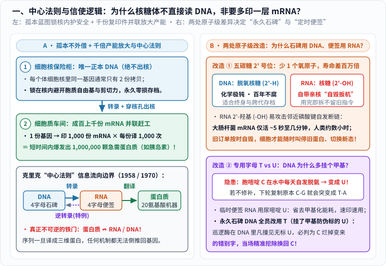
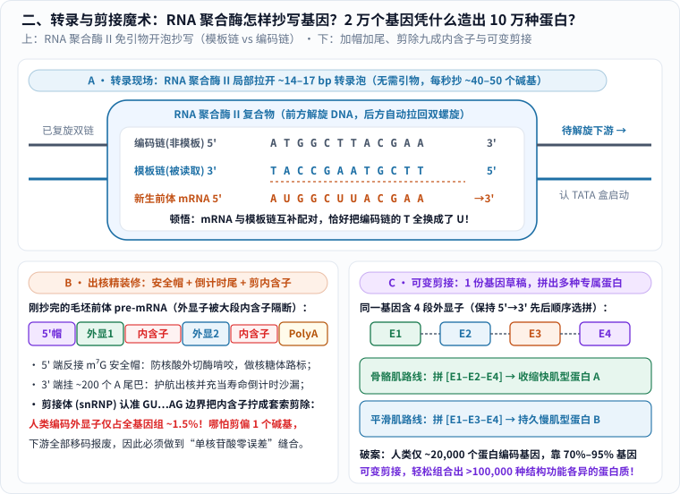
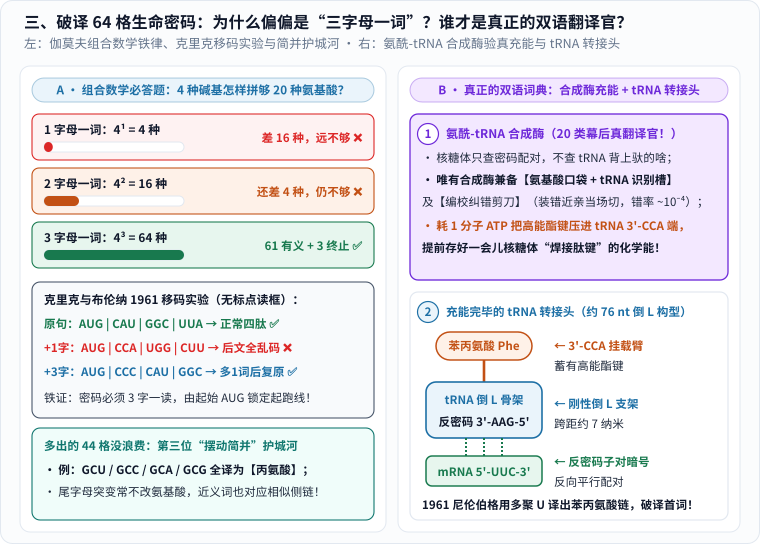
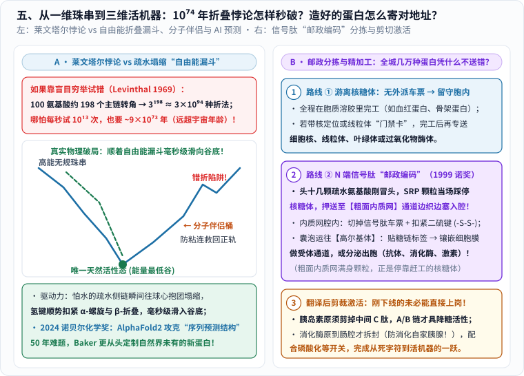

此时此刻，在你身体里的几十万亿颗活细胞内，正同步轰鸣着地球上最精密的纳米级制造工厂。

你血液里驮着氧气狂奔的**血红蛋白**、饭后涌进小肠把牛排剪碎的**消化酶**、肌肉收缩时一格格拉扯的**肌球蛋白马达**、眼睛里接住一颗光子就拉闸报警的**视紫红质**，乃至免疫系统精准锁死病原体的**抗体**——这些形态万千、本领通天的生命机器，全都是**蛋白质（Protein）** [[1]](#ref-1)[[5]](#ref-5)。

然而，指导制造这十万多种三维精密机器的总蓝图，居然只是锁在细胞核里、仅仅由 **`A、T、C、G` 四个化学字母**串成的一维长链 **DNA** [[1]](#ref-1)[[6]](#ref-6)。

如果把分子账本一页页摊开细算，你会接连撞上一串极其反直觉的工程谜题：

1. **既然核糖体是组装蛋白质的车间，为什么它偏偏不能直接去读 DNA，非要多此一举先印出一层短命的 `mRNA` 便签？** 同样是四字母核酸，为什么 DNA 少挂 $$1$$ 个氧原子就能保存几万年，而 RNA 多挂 $$1$$ 个氧原子却活不过几分钟到几小时？DNA 为什么还要专门耗费能量把 `U` 改成挂甲基的 `T`？
2. **人类基因组足足有 $$31$$ 亿对碱基，真正编码蛋白质的基因却只有约 $$20{,}000$$ 个，仅占全基因组的 $$1.5\%$$！** 更离谱的是，刚从基因上抄下来的初稿里，平均八九成都是不编码氨基酸的“内含子废话”——细胞凭什么一字不差地剪掉废稿，还能拿 $$2$$ 万个基因变出超过 $$100{,}000$$ 种蛋白质 [[4]](#ref-4)[[6]](#ref-6)？
3. **用 $$4$$ 种碱基去指定 $$20$$ 种氨基酸，为什么自然界偏偏锁定了“$$3$$ 个字母一词”？** 核糖体在组装时根本不检查运来的氨基酸长什么样，那究竟是谁在幕后同时看懂“核酸语”和“氨基酸语” [[2]](#ref-2)[[5]](#ref-5)？
4. **细菌核糖体每秒钟能焊接 $$20$$ 颗氨基酸，$$10$$ 秒钟就能吐出一条 $$200$$ 氨基酸的完整蛋白。** 可直到 2009 年诺贝尔化学奖把核糖体的几十万颗原子拍清楚，全世界的生物学家才倒吸一口凉气：在焊接肽键的核心周围 $$18\,\text{\AA}$$ 范围内，**连一根蛋白质侧链都没有**——这台制造天下所有蛋白质的母机，真正动刀催化的居然不是蛋白质 [[5]](#ref-5)[[10]](#ref-10)！
5. **一条 $$100$$ 颗氨基酸的珠串，如果靠盲目穷举去试三维折法，就算每秒试 $$10^{13}$$ 次也要试上 $$9\times 10^{73}$$ 年（比宇宙年龄长 $$10^{63}$$ 倍）！** 活细胞凭什么几毫秒就折进唯一正确的活性构象，又靠什么“邮政编码”把几万种新蛋白分毫不差地寄往细胞核、线粒体、细胞膜或血液 [[8]](#ref-8)[[11]](#ref-11)？

今天，我们就顺着一条基因指令从“开锁复印”到“剪裁、破译、焊接、折叠、派送”的真实旅程，把生命最底层的这套纳米制造流水线彻底拆开看个明白。

---

## 一、孤本不外借与两处原子级心机：为什么核糖体不直接读 DNA？

初学者第一次接触“DNA $$\to$$ RNA $$\to$$ 蛋白质”时，心里往往会冒出一个朴素的疑问：**直接让核糖体骑到 DNA 上照着造蛋白质不就省事了吗？干嘛非要在中间插一道信使 RNA（mRNA）？**

只要你站到细胞总工程师的视角算两笔账——一笔**产能与安全账**，一笔**化学寿命与防伪账**——就会发现这层“中间便签”简直是神来之笔。

### 1. 保险柜里的唯一正本 vs 车间里的百万倍产能放大

在你的每一颗体细胞核里（关于双螺旋在几微米细胞核里的极致折叠尺度，可参看[《DNA里面有多小的世界》]()），任何一个特定蛋白质的基因，通常总共只有**区区 $$2$$ 份拷贝**（一份来自爸爸，一份来自妈妈）[[6]](#ref-6)。

* **安全死穴**：细胞质是一片繁忙又凶险的化工厂，到处是活性氧自由基、代谢酸碱波动、机械剪切力和专门绞杀入侵病毒的核酸酶。如果把全基因组唯一的正本拖进细胞质流水线反复摩擦拉扯，一旦基因正本被切断或改错，这颗细胞及其所有后代就永久报废了。
* **产能死穴**：哪怕不考虑损伤，$$2$$ 份正本上就算挤满核糖体，一秒钟又能造几个蛋白？当你吃完一碗米饭血糖飙升，胰岛 $$\beta$$ 细胞必须在短短几分钟内倾泻出**数以亿计的胰岛素分子**；当红细胞前体成熟时，每颗细胞要塞满约 **$$2.7\times 10^8$$ 颗血红蛋白**！

加一层 `mRNA` 复印件，两个难题迎刃而解：唯一的 DNA 孤本永远锁在细胞核保险柜里绝不外借；需要某种蛋白质时，细胞核瞬间从这 $$1$$ 份基因上连印 **$$1{,}000$$ 份 `mRNA` 便签**撒向细胞质，而每一份便签又能被成串的核糖体轮番翻译 **$$1{,}000$$ 次**——

$$
1\text{ 份基因正本} \xrightarrow{\text{转录放大} } 10^3\text{ 份 mRNA} \xrightarrow{\text{翻译放大} } 10^6\text{ 颗蛋白质分子}
$$

短短几分钟，百万倍的产能洪峰就能凭空拉起 [[3]](#ref-3)[[5]](#ref-5)！

### 2. 少 1 个氧原子寿命差百万倍：脱氧核糖 vs 核糖的“自毁扳机”

既然 `mRNA` 是临时派工单，它除了要“印得快”，还必须具备一个同样致命的本领——**用完必须按时自毁！** 试想，如果餐后印出来的胰岛素 `mRNA` 永远不坏，核糖体没日没夜照单猛造胰岛素，你不到半天就会低血糖昏迷。

自然界只改动了**区区 $$1$$ 颗氧原子**，就把“百年不腐的石碑”和“定时自毁的便签”彻底分开了 [[1]](#ref-1)：

* **RNA 用的是核糖（Ribose）**：五碳糖环的 $$2'$$ 号碳上挂着一个活泼的**羟基（`-OH`）**。在水溶液里，这个 $$2'\text{-OH}$$ 就像装在骨架旁边的“亲核自毁扳机”，极易顺手攻击隔壁 $$3'$$ 位的磷酸二酯键，形成环状中间体并把整条 RNA 链咔嚓剪断！再加上细胞质外切酶的配合，大肠杆菌里一条 `mRNA` 的平均寿命只有 **约 $$5$$ 秒到几分钟**，哪怕在人类细胞里通常也只活**几十分钟到数小时** [[1]](#ref-1)[[4]](#ref-4)。旧订单准点化为乌有，细胞才能随时踩刹车切换工作状态。
* **DNA 用的是 $$2'$$-脱氧核糖（Deoxyribose）**：硬生生摘掉了 $$2'$$ 号碳上的那颗氧原子，只留下一根老实巴交的碳氢键（**`2'-H`**）。没了内部自毁扳机，再加上双螺旋把碱基藏在疏水内芯，DNA 骨架的水解速率骤降了数百万倍——甚至在冰冷致密的颞骨岩部里能留存数十万年（详见[《龟裂古骨与百万年冻土凭什么锁住生命密码》]()）。

### 3. 为什么 DNA 非要费劲把 U 换成 T？抓捕“胞嘧啶腐烂”的防伪甲基

很多读者背过“DNA 用 `A、T、G、C`，RNA 用 `A、U、G、C`”，却很少追问：**胸腺嘧啶 `T` 和尿嘧啶 `U` 与腺嘌呤 `A` 配对的氢键一模一样，造一个 `T` 还要专门耗费能量往 `U` 的 $$5$$ 号碳上贴一个甲基（`5-甲基尿嘧啶`）——DNA 干嘛花这冤枉钱？**

答案藏在一个每天都在你体温水环境里发生的化学事故中：**胞嘧啶（`C`）每天都在自发水解脱氨基，直接烂成尿嘧啶（`U`）**——平均每颗人类细胞每天要发生上百次 [[1]](#ref-1)！

* 假如 DNA 平时本来就合法使用 `U`：当某处的 `C` 悄悄烂成 `U` 时，DNA 修复巡逻酶路过一看，根本分不清这个 `U` 是“原本就写在这里的正牌字母”，还是“隔壁 `C` 腐烂变出来的错别字”！下一轮复制时，原本的 `C-G` 就会永久突变成 `U-A`（关于细胞如何把复制错字率压到百亿分之一，可参看[《错字率压到百亿分之一为什么每个新生儿还是自带60个新突变》]()）。
* 正因为永久档案 DNA **全员强制给正牌 `U` 贴上了甲基防伪标（变成 `T`）**：从此在 DNA 双链上，任何没贴标的裸 `U` **$$100\%$$ 是 `C` 腐烂变来的违章假货**！尿嘧啶-DNA 糖基化酶一撞见 `U` 就当场挖除并换回 `C`。而只活几小时的临时便签 `RNA` 就算个别字母脱氨也无伤大雅，自然省下甲基化成本，轻装上阵直接用 `U`。

### 4. 克里克“中心法则”真正的铁门：为什么蛋白质永远无法倒推回基因？

1958 年（并于 1970 年在《自然》撰文重申），弗朗西斯·克里克（Francis Crick）提出了分子生物学的**中心法则（Central Dogma）** [[2]](#ref-2)。许多人误以为中心法则是“信息只能从 DNA 单向流向 RNA 再到蛋白质”，一听说 HIV 等逆转录病毒能做 `RNA → DNA` 就以为中心法则破产了。

恰恰相反！克里克当年画出的核心边界异常精准：**信息在核酸家族内部（DNA 与 RNA 之间）完全可以双向流转，但一旦跨过翻译大门变成“蛋白质三维序列”，信息就永远无法再倒流回蛋白质或核酸！**

$$
\text{DNA} \;\rightleftharpoons\; \text{RNA} \;\longrightarrow\; \text{蛋白质} \quad (\text{铁律：蛋白质 } \nrightarrow \text{ RNA / DNA})
$$

原因非常直观：核酸之间靠严格的碱基互补氢键一对一拓印；而蛋白质折叠成三维球体后，不仅侧链千姿百态没有互补配对几何学，而且同一种氨基酸还对应好几个不同密码子（信息多对一压缩不可逆）。**你在健身房练出一身肌肉，肌肉蛋白绝不可能反过来改写生殖细胞里的 DNA**——这就是中心法则锁死的底层物理铁门。

> **图 1 怎么看（先左后右，读透 mRNA 存在的底层工程学）**：
> 1. **先看左栏 A**：细胞核保险柜锁住唯一 $$2$$ 份 DNA 正本，靠千份 `mRNA` 复印件在细胞质并联投产实现 $$10^6$$ 倍爆发；底部标明克里克中心法则中允许的逆转录虚线与绝对禁止的 `蛋白质 ↛ 核酸` 红线。
> 2. **再看右栏 B 上半框**：五碳糖 $$2'$$ 号碳多一颗氧原子（`2'-OH`），就给 RNA 装上了亲核攻击磷酸键的“自毁沙漏”，保证旧指令按时清零。
> 3. **最后看右栏 B 下半框**：DNA 给所有正牌 `U` 贴上甲基防伪标变成 `T`，从而让巡逻酶一眼揪出由 `C` 脱氨腐烂而成的假 `U`。

---

## 二、开泡抄写与剪接魔术：2 万个基因凭什么拼出 10 万种蛋白？

现在，细胞决定打印某张蛋白质订单了。第一步发生在细胞核内，叫做**转录（Transcription）**——把 DNA 石碑上的那一段基因，用核糖核苷酸重新誊写一遍 [[3]](#ref-3)。

### 1. 免引物局部开泡：RNA 聚合酶 II 与毒蘑菇鹅膏蕈碱的致命锁喉

负责为人类所有蛋白质基因抄写初稿的主力机器，是一尊由十几个亚基拼成的巨型分子马达——**RNA 聚合酶 II（RNA Polymerase II）**。美国生物化学家罗杰·科恩伯格（Roger D. Kornberg）历经二十余年用 X 射线晶体学拍清了它在原子尺度下抓握 DNA、筛选核苷酸的完整动态画面，斩获 **2006 年诺贝尔化学奖** [[9]](#ref-9)。（细胞核里另有 RNA 聚合酶 I 专印核糖体大骨架 rRNA，RNA 聚合酶 III 专印 tRNA 等小分子，三兄弟分工井然 [[3]](#ref-3)。）

它的开工与推进有三个极精妙的细节：

* **认准门牌号（启动子与 TATA 盒）**：长达 $$31$$ 亿对碱基的染色体缠在组蛋白线轴上，聚合酶怎么知道从哪一个字母下笔？在绝大多数真核基因起点上游约 $$-25$$ 到 $$-35$$ 个碱基处，写着一串富含 `T` 和 `A` 的路标序列（**TATA 盒**，`5'-TATAAA-3'`，双键比 `G-C` 三键更容易撬开）。通用转录因子 **TFIID** 先一步咬住 TATA 盒并把 DNA 狠狠折弯约 $$80^\circ$$，随后召齐整套起始复合物，给聚合酶尾部刷上一串磷酸基团“松开手刹”弹射起步 [[3]](#ref-3)。
* **无需引物、边拆边缝的“转录泡”**：与复制整条染色体不同，RNA 聚合酶不需要任何引物就能从零写出第一个核苷酸！它只在自己肚子里局部撬开一段长约 **$$14\text{–}17\,\text{bp}$$** 的微小**转录泡（Transcription Bubble）**，每秒钟沿着基因往前狂抄约 **$$40\text{–}50$$ 个核苷酸** [[3]](#ref-3)。遇到挡路的核小体组蛋白线轴时，专门的开路先锋 **FACT 复合物**会顺手把组蛋白拆下一半让聚合酶钻过去，背后立刻原样装回，连双螺旋拉链都自动重新拉拢！
* **毒蘑菇的精准锁喉**：臭名昭著的剧毒蘑菇“毁灭天使 / 毒鹅膏”（*Amanita phalloides*）里含有的环肽毒素 **$$\alpha$$-鹅膏蕈碱（$$\alpha$$-amanitin）**，正是科恩伯格在晶体照片里拍到的头号杀手——它对聚合酶 I 毫无反应，却能像一把死卡齿轮的铁楔子一样塞进 **RNA 聚合酶 II 的桥螺旋下方**，把移位速度从每分钟数千碱基生生卡死到每分钟仅几个碱基！全城 `mRNA` 停印，肝脏细胞在两三天后因蛋白质断供而成片坏死 [[3]](#ref-3)[[9]](#ref-9)。

### 2. 模板链 vs 编码链：为什么抄底片反倒抄出了和正片一模一样的句子？

在转录泡撬开的两股 DNA 单链中（双螺旋反向平行的解密史详见[《一张黑色X光斑和几块硬纸板凭什么破译DNA双螺旋》]()），聚合酶每次**只挑其中一股作为底片来读** [[3]](#ref-3)：

* 被聚合酶沿着 `3' → 5'` 方向一格格扫描读取的那股，叫**模板链（Template strand）**；
* 对面闲置不读、方向为 `5' → 3'` 的另一股，反倒被生物学家起名叫**编码链（Coding strand）**！

为什么“没被读的那股”反而叫编码链？看一眼下面这组真实的配对关系，你一秒钟就会恍然大悟：

* **DNA 编码链（非模板）**：`5' - A T G   G C T   T A C   G A A - 3'`
* **DNA 模板链（被读取）**：`3' - T A C   C G A   A T G   C T T - 5'`
* **新生前体 mRNA（互补）**：`5' - A U G   G C U   U A C   G A A - 3'`

因为“互补的互补就是它自己”！聚合酶照着模板链这版“负片”冲洗出来的 `5' → 3'` 新生 `mRNA`，除了把所有的 **`T` 统统换成了 `U`** 之外，字母顺序和方向竟然跟对面的**编码链一模一样** [[3]](#ref-3)！所以科学家平时在数据库里公布某个基因序列时，直接写编码链就等于写出了未来的 `mRNA` 草稿。

### 3. 出核前的三道精装修：安全帽、200A 倒计时尾巴与零误差剪内含子

如果在细菌里，没有细胞核膜阻隔，`mRNA` 刚从聚合酶屁股后面冒出个头，核糖体就已经扑上去边抄边翻译了 [[3]](#ref-3)。但在人类这样的真核细胞里，刚抄出来的**前体 mRNA（pre-mRNA）**只是一卷千疮百孔的“毛坯草稿”，必须边抄写边完成三道严苛的精装修，才拿得出细胞核大门 [[4]](#ref-4)：

1. **头顶反戴“安全帽”（`5'` 端 `7-甲基鸟苷` 帽）**：新链刚伸出二三十个核苷酸，加帽酶就以极其罕见的 **`5'-5'` 三磷酸桥**“倒扣”上一顶甲基化鸟苷帽（$$\text{m}^7\text{G}$$）。它既是防止核酸外切酶从头啃咬的钢盔，又是出核通行证和核糖体上车的招手路牌 [[4]](#ref-4)。
2. **屁股挂上“倒计时沙漏”（`3'` 端 `Poly-A` 尾）**：抄到基因末尾遇到 `AAUAAA` 信号后，内切酶咔嚓剪断，多聚腺苷酸聚合酶不看模板直接往 `3'` 端一口气接上约 **$$200$$ 个连续的 `A`**。这条长尾巴裹着结合蛋白护送 `mRNA` 穿过核孔；进到细胞质后，外切酶一粒粒啃短尾巴——等 `A` 尾巴啃光，`mRNA` 就寿终正寝，完美充当寿命沙漏 [[4]](#ref-4)。
3. **剪掉九成废稿的“套索手术”（RNA 剪接）**：1977 年，理查德·罗伯茨（Richard J. Roberts）与菲利普·夏普（Phillip A. Sharp）在电镜下把腺病毒成熟 `mRNA` 与原始基因 DNA 杂交，震惊地看到 DNA 鼓出了好几个无人配对的大圈（R-loop）——原来真核生物的基因根本不是连续的，而是碎成一段段短短的编码区**外显子（Exon）**，中间被大段大段不编码蛋白的**内含子（Intron）**隔断（两人因此荣获 **1993 年诺贝尔生理学或医学奖**）[[7]](#ref-7)！人类一个普通基因往往插着十几个乃至七十多个内含子，内含子总长度经常是外显子的十倍以上。由小核 RNA 与蛋白质组成的巨型**剪接体（Spliceosome / snRNP）**精准识别内含子首尾的 `GU ... AG` 边界，把内含子弯成一根“牛仔套索（Lariat）”切除降解，再把相邻外显子严丝合缝地焊在一起 [[4]](#ref-4)——**哪怕剪偏区区 $$1$$ 个核苷酸，下游所有密码就会集体错位报废，这台分子剪刀必须做到单核苷酸零误差！**

### 4. 可变剪接的乐高魔法：1.5% 的基因组怎样撑起十万种人体蛋白质？

2000 年前后人类基因组计划揭晓答案前，许多顶尖学者曾打赌复杂的人类至少得有 $$10$$ 万个基因；结果底牌一掀，人类蛋白质编码基因只有约 **$$20{,}000$$ 个**（跟一毫米长的秀丽隐杆线虫差不多！），外显子加起来只占 $$31$$ 亿碱基对的 **$$1.5\%$$** [[6]](#ref-6)。

那人体里超过 **$$100{,}000$$ 种**结构功能各异的蛋白质是从哪变出来的？核心功臣正是建立在内含子之上的**可变剪接（Alternative Splicing）** [[4]](#ref-4)：

同一个基因抄出来的同一份 `pre-mRNA` 毛坯（比如依次含有外显子 `E1 - E2 - E3 - E4`），在不打乱 `5' → 3'` 先后顺序的前提下，不同组织的剪接体可以像搭乐高模块一样按需选拼——在骨骼肌细胞里保留 `[E1 - E2 - E4]` 拼成爆发力强的快肌蛋白；在平滑肌细胞里改成 `[E1 - E3 - E4]` 拼成耐力持久的慢肌蛋白！在人类基因组中，**超过 $$70\%$$（多外显子基因中高达约 $$95\%$$）的基因都会进行可变剪接**，一份底稿轻松派生出几种甚至几十种专属定制蛋白 [[4]](#ref-4)。而剩下的非编码基因组也绝非全是垃圾：其间密布着调控何时何地开印的增强子开关，以及能派出 `21–24 nt` 微小 RNA（**miRNA**）到细胞质拦截特定 `mRNA` 踩刹车的精细调音台 [[4]](#ref-4)[[6]](#ref-6)。

> **图 2 怎么看（先上后下，看懂从基因底片到模块化成熟订单）**：
> 1. **先看上栏 A**：RNA 聚合酶 II 在双链中间撑开 `14–17 bp` 转录泡，顺着蓝色模板链（`3'→5'`）互补写出橙色 `mRNA`（`5'→3'`），对照上方灰色编码链可见正好把 `T` 换成了 `U`。
> 2. **再看左下栏 B**：毛坯 `pre-mRNA` 戴上反接 `5'` 帽、挂上 `~200 A` 尾，剪接体认准 `GU...AG` 切掉红色内含子，把外显子零误差焊合。
> 3. **最后看右下栏 C**：同一份四外显子草稿在不同肌肉里跳选不同组合，直观揭开“$$2$$ 万基因造出 $$10$$ 万种蛋白”的组合杠杆。

---

## 三、破译 64 格生命密码：为什么偏偏是“三字母一词”？谁才是真翻译官？

成熟 `mRNA` 穿过核孔来到细胞质后，迎面撞上了整条流水线上最核心的跨界难题：**`mRNA` 只是一串由 $$4$$ 种碱基（`A、U、G、C`）写成的字母带，而蛋白质却是由 $$20$$ 种侧链脾气截然不同的氨基酸拼成的——这两种完全不通的化学语言，怎么建立一一对应的词典？**

### 1. 组合数学必答题与 1961 移码铁证：为什么必须是 3 个字母一词？

1954 年，物理学家乔治·伽莫夫（George Gamow）最先用一道连小学生都能秒懂的组合数学题，算出了生命词典的最小字长 [[2]](#ref-2)：

* 如果 **$$1$$ 个碱基对应 $$1$$ 种氨基酸**：总共只能拼出 $$4^1 = 4$$ 个词，还差 $$16$$ 种氨基酸没人管，远不够用；
* 如果 **$$2$$ 个碱基拼成 $$1$$ 个词**：总共能拼出 $$4^2 = 16$$ 个词，比 $$20$$ 种标准氨基酸还是少了 $$4$$ 种，依然不够；
* 只有升级到 **$$3$$ 个碱基拼成 $$1$$ 个词（三联体密码子，Codon）**：瞬间拥有

$$
4^3 = 4 \times 4 \times 4 = 64\text{ 种不重复组合}
$$

第一次稳稳跨过了 $$20$$ 种氨基酸的门槛 [[2]](#ref-2)！

但数学够用不等于自然界真这么干。1961 年，克里克与悉尼·布伦纳（Sydney Brenner）利用原黄素（Proflavin）在 T4 噬菌体基因里做了一场载入史册的**移码突变（Frameshift）实验** [[2]](#ref-2)：这串分子句子中间没有任何逗号或空格，当他们往基因里**强行塞进 $$1$$ 个字母（`+1`）或 $$2$$ 个字母（`+2`）**时，插入点往后的所有蛋白质序列全部乱成一锅粥，噬菌体彻底报废；可一旦在附近**一口气塞进整整 $$3$$ 个字母（`+3`）或删掉 $$3$$ 个字母（`-3`）**，除局部多出或少掉 $$1$$ 颗氨基酸外，后面整条蛋白质瞬间奇迹般恢复正常功能！这记铁锤无可辩驳地证明：**遗传密码是无标点、不重叠、严格以 $$3$$ 个碱基为一拍连续往下读的！**

同年（1961 年），马歇尔·尼伦伯格（Marshall Nirenberg）与海因里希·马太（Heinrich Matthaei）在破碎大肠杆菌的无细胞试管里投下一条人工合成的纯 `UUUUUU...`（多聚尿苷酸），结果试管里真的吐出了一条纯由**苯丙氨酸（Phe）**串成的肽链——人类破译出了生命天书的第一个单词 `UUU = 苯丙氨酸`！随后哈·戈宾德·科拉纳（Har Gobind Khorana）用定制重复序列补齐全部词表，罗伯特·霍利（Robert W. Holley）测出第一个转运 RNA 序列，三人共享 **1968 年诺贝尔生理学或医学奖** [[2]](#ref-2)[[8]](#ref-8)。（注：本文聚焦标准遗传编码的 $$20$$ 种氨基酸；极少数特殊蛋白还会借上下文信号重编程终止密码子，嵌入第 $$21$$ 种硒代半胱氨酸或第 $$22$$ 种吡咯赖氨酸。）

### 2. 61 枚有义词 + 3 枚句号：多出来的 44 格竟是防突变的“简并护城河”

$$64$$ 个三联体格子，具体是怎么分给 $$20$$ 种氨基酸的 [[2]](#ref-2)？

* **$$1$$ 枚身兼起跑哨的有义密码子**：**`AUG`** 一面编码**甲硫氨酸（Met）**，一面充当全句的**起始密码子**——正是它一锤定音锁死了后面每 $$3$$ 个一拍的阅读框起跑线！
* **$$3$$ 枚只喊停不译词的终止密码子**：**`UAA`、`UAG`、`UGA`** 不对应任何氨基酸，专职充当句末的**句号（Stop Codon）**。
* **多出来的 $$44$$ 格全做了“同义防弹衣”（密码的简并性）**：除去 $$3$$ 个句号，剩下 **$$61$$ 个有义密码子**分给 $$20$$ 种氨基酸，绝大多数氨基酸都坐拥 $$2\text{–}6$$ 个同义词！更绝的是，同义密码子几乎总是**前两个字母完全相同、只在第 $$3$$ 个字母上摇摆（Wobble）**——例如 `GCU`、`GCC`、`GCA`、`GCG` 四个词清一色全译成**丙氨酸（Ala）** [[2]](#ref-2)。这意味着哪怕第 $$3$$ 位碱基意外突变，翻译出来的氨基酸往往分毫不变；就算前两位突变换成别的氨基酸，表里相邻密码子也大多对应亲疏水性相近的近亲侧链，把点突变的破坏力压到了统计极限！

更令人震撼的是演化账：把 $$64$$ 格分给 $$20$$ 种氨基酸和终止信号，数学上至少有约 **$$10^{84}$$ 种**完全不同的分配方案（比可观测宇宙里的原子总数还多！），但从深海热泉细菌、路边青草、蘑菇、果蝇一直到屏幕前的你，全地球生命（除线粒体等极少数微小细胞器方言外）**竟然共用着同一张密码表** [[2]](#ref-2)。把人类胰岛素基因塞进大肠杆菌，细菌核糖体能一字不差地造出救命的人类胰岛素——这就是地球万物同出一源最硬核的分子铁证。

### 3. 核糖体其实是“色盲”！真正的双语翻译官是 20 类氨酰-tRNA 合成酶

既然碱基链和氨基酸侧链在几何形状上根本对不上号，克里克当年敏锐预言：中间必定有一个两头跑的**“转接头分子”**——这就是长约 **$$76$$ 个核苷酸**、平面呈三叶草形、三维空间折成刚性**倒 L 形**（两端跨距约 $$7\,\text{nm}$$）的**转运 RNA（tRNA）** [[5]](#ref-5)[[8]](#ref-8)：

* 倒 L 的底端脚尖露着 $$3$$ 个碱基组成的**反密码子（Anticodon）**，负责按反向平行规则跟 `mRNA` 上的密码子对暗号（例如 `mRNA` 的 `5'-UUC-3'` 对准 `tRNA` 的 `3'-AAG-5'`）；
* 倒 L 的顶端 `3'-CCA` 悬臂上，则背着对应的那颗氨基酸。

但请千万注意一个连很多教科书读者都会忽略的关键真相：**核糖体在流水线上只检查底端“密码子—反密码子”配不配对，根本不低头检查 `tRNA` 背上驮的到底是哪颗氨基酸！** 经典实验早做过验证：如果人为把 `tRNA` 背上的半胱氨酸化学改造成丙氨酸，核糖体照样闭着眼睛把丙氨酸错焊进半胱氨酸的位置！

那么，全细胞里究竟是谁**唯一同时认识氨基酸长相和 `tRNA` 身份**？答案是幕后的 **$$20$$ 类氨酰-tRNA 合成酶（Aminoacyl-tRNA Synthetase，aaRS）** [[5]](#ref-5)！

每一种氨基酸都有专属的一类合成酶：它一手把特定氨基酸和 $$1$$ 分子 **ATP** 抓进口袋，切掉两个磷酸（$$\text{ATP} \to \text{AMP} + \text{PP}_\text{i}$$）激活氨基酸，再把它通过一根**高能酯键**死死压进对应 `tRNA` 的 `3'-CCA` 末端——**注意，这一步提前把一会儿在核糖体里“焊接肽键”所需的化学自由能存进了 `tRNA` 身上！** 遇到长相酷似的双胞胎氨基酸（如异亮氨酸与少一个亚甲基的缬氨酸），合成酶还自带第二个“编校纠错口袋”，一旦装错当场水解切掉，把错装率硬生生压到 **$$10^{-4}$$（万分之一）以下** [[5]](#ref-5)。

> **图 3 怎么看（左看密码表数学逻辑，右看双语转接头充能）**：
> 1. **先看左栏 A**：从上到下对比 $$4^1=4$$、$$4^2=16$$ 与 $$4^3=64$$ 的容量门槛；中框重现 `+1` 全乱 vs `+3` 复原的移码实验；底框展示第 $$3$$ 位“摆动简并”如何替基因挡住点突变子弹。
> 2. **再看右栏 B**：上半框点破真正的幕后翻译官是 **氨酰-tRNA 合成酶**（耗 ATP 压入高能酯键并编校纠错）；下半框展示长约 $$7\,\text{nm}$$ 的倒 L 形 `tRNA` 怎样顶背氨基酸、底对反密码子完成跨语言转接。

---

## 四、核糖体 A-P-E 纳米流水线：每秒焊 20 颗氨基酸，操刀手竟不是蛋白质！

万事俱备：`mRNA` 磁带已经送达，背满高能氨基酸的各路 `tRNA` 整装待发。现在，主角**核糖体（Ribosome）**正式合拢开机——这步把核酸密码译成多肽链的大戏，就叫**翻译（Translation）** [[5]](#ref-5)。

### 1. 为什么 40S + 60S 等于 80S？起跑线上的细菌暗号 vs 真核扫描

一颗大肠杆菌虽小，肚子里却挤着 **$$10{,}000\text{–}70{,}000$$ 台核糖体**（占细菌干重的四分之一！）[[5]](#ref-5)。每台核糖体平时都拆成“一上一下”两个亚基待命，只有在捉住 `mRNA` 开工时才像汉堡包一样上下扣紧：

* **小亚基（真核 `40S` / 细菌 `30S`）**：相当于“读卡器”，负责夹住 `mRNA` 磁带并核验密码子配对；
* **大亚基（真核 `60S` / 细菌 `50S`）**：相当于“焊接台”，负责催化肽键形成，并留出一条细长的出口隧道让新焊好的肽链钻出去 [[5]](#ref-5)。

看到这组数字，几乎每个人都会愣一下：**`40 + 60` 怎么等于 `80`？`30 + 50` 怎么等于 `70`？难道生物学家不会算加法？** 其实这里的 **`S`（斯维德伯格单位，Svedberg）**根本不是质量单位，而是超速离心机里的**沉降速率系数**——它不仅取决于质量，还反比于颗粒表面受到的流体摩擦阻力！大小两个亚基单独旋转时总表面积大、阻力大；一旦拼成一个紧凑的圆球整体，暴露表面积骤减、离心下沉更快，因此合体沉降系数并不是两者的算术和 [[5]](#ref-5)。

上车找起跑线时，细菌和人类各有绝招：细菌小亚基靠自身 `16S rRNA` 直接咬住起始 `AUG` 上游一段保守暗号（**Shine-Dalgarno 序列**，`AGGAGG`）一步到位；而真核 `40S` 小亚基则带着专门的**起始甲硫氨酰-tRNA** 先从 `5'` 安全帽登车，沿着 `5' UTR` 一路往右扫描，直到撞见嵌在 **Kozak 共识序列（`5'-gccRccAUGG-3'`）**里的第一个 **`AUG`**，大亚基才轰然扣合锁死起跑线 [[5]](#ref-5)。

### 2. A 位进站 → P 位嫁接 → E 位弹射：反直觉的“整链右嫁”四步循环

合拢后的核糖体内部，并排开着三个严丝合缝的工位——从右往左依次是 **A 位（Aminoacyl，氨酰进站位）**、**P 位（Peptidyl，肽酰持链位）**与 **E 位（Exit，退场位）** [[5]](#ref-5)。每往前读一个三字母词，流水线就高速运转一轮四步节拍：

1. **① A 位对暗号进站**：延伸因子护送着携新氨基酸的 `tRNA` 试探右侧 **A 位**；只有底部反密码子与 `mRNA` 当前密码子严丝合缝配对，几何构象锁才咔哒扣合放行（错配者毫秒内直接弹走）。
2. **② 整条旧链“连根嫁接”到右边新氨基酸头顶（最反直觉的一步！）**：很多人以为焊接是把右边的新氨基酸“粘到左边旧链尾巴上”——**真相刚好相反！** 大亚基切断 **P 位 `tRNA`** 末端那根高能酯键，释放出刚才合成酶预存的化学能，把挂在 P 位上的**整条旧多肽链连根拔起，一刀嫁接到右侧 A 位新氨基酸的氨基（$$-\text{NH}_2$$）头顶**，脱水缩合成坚固的**肽键（`—CO—NH—`）**！正因如此，所有蛋白质都严格按照**从氨基端（`N 端`，最早钻出隧道）向羧基端（`C 端`）**的方向一粒粒接长 [[5]](#ref-5)。
3. **③ 消耗 GTP 精准横移 $$3$$ 个碱基（移位）**：嫁接刚完成，延伸因子消耗 $$1$$ 分子 **GTP** 推动核糖体朝 `mRNA` 的 `3'` 端精准横移整整 **$$3$$ 个碱基**：原本空手留在 P 位的空载 `tRNA` 滑入左侧 **E 位**弹射回细胞质重装复用；原本在 A 位接过了整条肽链的 `tRNA` 平移坐进中间 **P 位**；右侧 **A 位**重新腾空迎接下一位！
4. **④ 撞上句号加水剪断（终止）**：当 `UAA`、`UAG` 或 `UGA` 三枚终止密码子之一滑进 A 位时，没有任何 `tRNA` 认领它；此时一个外形长得酷似倒 L 形 `tRNA` 的**蛋白质释放因子（Release Factor）**挤进 A 位，往催化中心塞进 **$$1$$ 颗水分子（$$\text{H}_2\text{O}$$）**代替新氨基酸，咔嚓水解剪断多肽链 `C 端` 与最后一个 `tRNA` 的连接——整条蛋白质完工出炉，大小亚基随之拆散重回起点 [[5]](#ref-5)！

*图 4：核糖体三工位焊接流水线与核酶真相（含单次无障碍短动画，[点此单独打开 SVG 图片刷新可重播单轮进站焊接演示](/assets/images/protein-synthesis/ribosome-ape-assembly-line-and-ribozyme.svg)；开启系统“减少动态效果”时自动定格在完整静态终态，不影响阅读）。上栏 A 展示 `E-P-A` 三工位如何把 P 位旧链整体向右嫁接到 A 位新氨基酸上；左下栏 B 展示多台核糖体串在同一条 `mRNA` 上并联量产；右下栏 C 揭示 2009 年诺奖拍到的 `rRNA` 核酶核心与抗生素靶点。*

### 3. 多聚核糖体并联量产与 2009 诺奖惊天反转：核糖体竟然是一台“核酶”！

这台纳米缝纫机到底有多快？在 $$37\,^\circ\text{C}$$ 的大肠杆菌里，核糖体每焊好 $$1$$ 颗氨基酸只需 **$$0.05$$ 秒**（即每秒钟狂焊 **$$20$$ 颗氨基酸**），织完一条 $$200$$ 个氨基酸的蛋白质只需短短 **$$10$$ 秒**！真核细胞核糖体因校对更精细，每秒也稳焊约 **$$5\text{–}6$$ 颗氨基酸** [[5]](#ref-5)。更妙的是，第一台核糖体刚沿着 `mRNA` 往前走出几十个碱基腾出起点，第二台、第三台、第十几台核糖体就紧跟着鱼贯登车，串成一串糖葫芦般的**多聚核糖体（Polysome）**同时赶工，每秒钟成批吐出成品蛋白 [[5]](#ref-5)！

然而，关于核糖体最震撼全科学界的秘密，直到 **2000 年前后才由文卡特拉曼·拉马克里希南（Venkatraman Ramakrishnan）、托马斯·施泰茨（Thomas A. Steitz）与阿达·约纳特（Ada E. Yonath）**用高分辨 X 射线晶体学揭晓（三人因此荣膺 **2009 年诺贝尔化学奖**）[[10]](#ref-10)：

核糖体本来就是由几十种核糖体蛋白与几条长链**核糖体 RNA（rRNA）**共同组成的。在此之前几十年，人们理所当然地认为：`rRNA` 不过是搭架子的绳子，真正动手催化肽键的一定是核糖体蛋白！可当施泰茨团队把大亚基数十万颗原子的三维坐标拍到 $$2.4\,\text{\AA}$$ 分辨率时，全场鸦雀无声——**在焊接肽键的“肽酰转移酶中心”周围足足 $$18\,\text{\AA}$$ 半径内，连一根蛋白质氨基酸侧链的影子都没有！** 核糖体蛋白质全挤在外围当固定脚手架，真正精准摆正底物、加速百万倍完成肽键焊接的操刀手，竟然是**大亚基自身的 `23S / 28S rRNA`** [[5]](#ref-5)[[10]](#ref-10)！

换句话说，**制造地球上一切蛋白质的母机，自己竟然是一台不折不扣的“核酶（Ribozyme，具有催化活性的 RNA）”！** 这一发现不仅直接终结了困扰生命起源几十年的“先有蛋白质酶还是先有核酸基因”死循环（铁证在 DNA 与蛋白质登场之前，远古地球曾经历过由 RNA 一肩挑起“遗传存档 + 催化干活”的 **RNA 世界**），还为人类医学立下奇功：因为细菌核糖体是 `70S`，而人类细胞质核糖体是结构不同的 `80S`，**四环素**能专堵细菌 `30S` 的 A 位不让 `tRNA` 进站，**氯霉素、红霉素**能专卡细菌 `50S` 的肽酰转移通道或出口隧道——精准废掉致病菌的蛋白工厂，却不伤人体自身细胞（至于为什么抗生素对根本没有核糖体的感冒病毒完全无效，可参看[《感冒发烧赶紧吃头孢管用吗？一文读懂细菌与病毒的区别》]()）[[5]](#ref-5)[[10]](#ref-10)！

---

## 五、从一维珠串到三维活机器：10⁷⁴ 年折叠悖论怎样秒破？造好的蛋白怎么寄对地址？

刚从大亚基隧道钻出来的多肽链，还只是一根软塌塌的一维氨基酸珠串，没有任何生理活性。唯有折叠成精确到原子埃米级的三维立体构象（锁孔、铰链、通道或钳子），并且投递到正确的车间岗位，它才能真正“活”过来 [[5]](#ref-5)[[11]](#ref-11)。

### 1. 莱文塔尔悖论 vs 自由能折叠漏斗：从 10⁷⁴ 年瞎试到毫秒级直落谷底

1969 年，分子生物学家赛勒斯·莱文塔尔（Cyrus Levinthal）算了一笔把物理学家吓出一身冷汗的账（**莱文塔尔悖论**）[[11]](#ref-11)：

假设一条很普通的小蛋白质只有 **$$100$$ 颗氨基酸**（含 $$99$$ 个肽键、约 $$198$$ 个可自由旋转的主链二面角 $$\phi, \psi$$）。就算每个转角只取区区 $$3$$ 种稳定角度，这根珠串可能折出的三维形状总数也高达：

$$
3^{198} \approx 2.95 \times 10^{94}\text{ 种构象}
$$

哪怕这根肽链以化学键热振动的极限速度——**每秒钟盲目穷举 $$10^{13}$$ 种折法**去撞大运，找遍所有折法也需要：

$$
\frac{2.95 \times 10^{94} }{10^{13}\text{ 次/秒} \times 3.156 \times 10^7\text{ 秒/年} } \approx 9.4 \times 10^{73}\text{ 年}
$$

而我们整个宇宙诞生至今也不过 $$1.38 \times 10^{10}$$ 年！如果靠随机试错，宇宙毁灭亿万亿次也折不出哪怕一颗血红蛋白！可现实中，你体内的蛋白质从出隧道到折叠完毕，往往只要**几毫秒到几秒钟** [[5]](#ref-5)[[11]](#ref-11)！

细胞凭什么作弊？现代统计热力学给出了漂亮答案——**蛋白质根本不是在平地上瞎摸，而是在顺着一口陡峭的“自由能折叠漏斗（Folding Funnel）”往下滑！**

* **疏水塌缩一秒定乾坤**：细胞内部全是水分子。$$20$$ 种氨基酸里有一大批油性怕水的非极性侧链（亮氨酸、缬氨酸、苯丙氨酸等），它们一露进水里就会在水分子热运动的挤压下，在微秒之内本能地抱团缩进蛋白球心，把亲水带电侧链留在表面——这一下就直接砍掉了亿万分之亿万的错误折法！
* **局部二级结构协同扣锁**：紧接着主链氢键顺势盘成弹簧状的 **$$\alpha$$-螺旋**或并排扣紧的 **$$\beta$$-折叠**，像顺着山坡滚石一样直落能量最低的唯一天然活性谷底；即便在拥挤胞质里偶尔卡进半山腰的“错折小坑”，套筒状的**分子伴侣（Chaperone，如 Hsp70 / GroEL）**也会消耗 ATP 把它隔离重折，防止露出的疏水表面互相粘连成致病淀粉样斑块（阿尔茨海默病、疯牛病正源于错折蛋白聚集）[[5]](#ref-5)。
* **2024 年诺贝尔化学奖的里程碑**：由于多体相互作用极度复杂，“只看一维氨基酸序列直接算出三维原子结构”曾困扰人类整整 $$50$$ 年；直到 **戴米斯·哈萨比斯（Demis Hassabis）与约翰·江珀（John Jumper）**开发的 **AlphaFold2** 借助共演化注意力深度学习破译了全地球已知 **$$2$$ 亿种蛋白质**的三维结构，而 **大卫·贝克（David Baker）**更反过来实现了“按目标三维功能倒推出全新氨基酸序列”，在实验室里造出了自然界亿万年演化从未诞生过的新型人工蛋白质，三人共同摘得 **2024 年诺贝尔化学奖** [[11]](#ref-11)！

### 2. 布洛贝尔的“邮政编码”（1999 诺奖）：粗面内质网上的小颗粒到底在干嘛？

一颗人类细胞就像一座拥有几万条街道的立体超级都市。刚下线的几万种蛋白质，凭什么血红蛋白乖乖留在细胞质、DNA 聚合酶精准钻进细胞核、呼吸链酶住进线粒体、胰岛素和抗体又被打包分泌到血液里，从不寄错包裹？

细胞生物学家冈特·布洛贝尔（Günter Blobel）揭开了这套严丝合缝的**细胞邮政编码系统**，独享 **1999 年诺贝尔生理学或医学奖** [[8]](#ref-8)：原来，每条需要跨膜或外派的蛋白质，自己身上就缝着一段十几到几十个氨基酸组成的**内在地址签——信号肽（Signal Peptide）**！

整座城市的核糖体其实都是一模一样的同款机器，只是按手头这张订单有没有“外派车票”分走两条路线 [[5]](#ref-5)[[8]](#ref-8)：

1. **游离核糖体路线（留守胞内或事后刷门禁卡）**：如果没有分泌型信号肽，核糖体就悬浮在细胞质溶胶里全程织完——胞质酶、细胞骨架直接就地上岗；若肽链中间带着“核定位信号”或“线粒体导肽”门禁卡，则完工后再由专职转运受体领进细胞核、线粒体、叶绿体或过氧化物酶体。
2. **粗面内质网共翻译外派路线（边织边塞的跨膜通道）**：凡是要镶嵌上细胞膜当受体/离子通道，或者要分泌到细胞外的激素、抗体与消化酶，它们的 **`N 端` 头十几颗疏水氨基酸就是一张“外派车票”**！这张车票刚从核糖体隧道冒出头，细胞质里的邮差 **信号识别颗粒（SRP）** 就一把抓住它并**当场踩停翻译**，押着整台核糖体停靠到内质网膜上的跨膜蛋白通道口——随后松开刹车，核糖体一边继续焊接，一边把新生的肽链直接顺着管道塞进内质网腔！（中学课本里画的**“粗面内质网”表面密密麻麻的小黑点**，其实就是成千上万台正在停靠塞货的核糖体！）[[5]](#ref-5)[[8]](#ref-8)
3. **内质网质检 $$\to$$ 高尔基体分拣站**：进到内质网腔后，信号肽酶剪掉使命完成的车票，二硫键异构酶给肽链扣上坚固的共价**二硫键（`—S—S—`）**加固（外派到血液风吹雨打的抗体和胰岛素全靠二硫键锁死骨架），再装进膜泡运往**高尔基体（Golgi）**贴上特定寡糖链分拣标签，最终融进细胞膜或吐向细胞外 [[5]](#ref-5)。

### 3. 翻译后剪裁与化学开关：为什么胰岛素和胰蛋白酶刚造出来时是“锁死”的？

走完折叠与分拣，不少蛋白质还要经历最后一道**翻译后修饰（Post-translational Modification）**才允许真正解锁上岗 [[5]](#ref-5)：

* **剪掉中间一段才激活**：刚焊好的**胰岛素原**其实是一条长 $$86$$ 个氨基酸的单链，必须先扣好三对二硫键，再由蛋白酶精准咔嚓剪掉中间长 $$31\text{–}35$$ 个氨基酸的 **C 肽**，剩下的 `A 链`（$$21$$ 个氨基酸）与 `B 链`（$$30$$ 个氨基酸）才变身真正有降血糖活性的成熟胰岛素！（医院抽血查糖尿病人的“C 肽水平”，正是借此精准推算病人自家胰岛到底造了多少真胰岛素。）
* **防自杀安全插销**：胰腺造出来的消化肉类的**胰蛋白酶原**，如果刚在胰腺细胞里造好就有活性，当场就会把你自己的胰腺活活消化穿孔（急性坏死性胰腺炎正是封条提前意外脱落的惨剧）！因此它出厂时必须挂着一段抑制肽封条，一直安全漂到十二指肠腔内，才被肠激酶一刀剪开封条瞬间亮剑。再配合激酶贴摘磷酸基团的毫秒级电子开关，以及给报废老蛋白贴上**泛素（Ubiquitin）**送进蛋白酶体拆回氨基酸循环再利用——整座生命工厂真正做到了滴水不漏、生生不息。

> **图 5 怎么看（左看三维折叠物理破局，右看细胞全城邮政派送）**：
> 1. **先看左栏 A**：红框算清 $$3^{198}\approx 3\times 10^{94}$$ 种折法盲试需 $$9\times 10^{73}$$ 年的莱文塔尔悖论；中间漏斗图展示疏水塌缩如何带着肽链毫秒级直滑最低能量活性谷底（分子伴侣负责把卡在右侧错折小坑里的半成品救回正轨），绿框串联 2024 诺奖 AlphaFold2 与人工从头设计蛋白。
> 2. **再看右栏 B**：顺着路线 ①（游离核糖体留守胞内）与路线 ②（`N 端` 信号肽被 SRP 押送至粗面内质网 $$\to$$ 高尔基体分拣外派）对比两条去向，底部橙框点明胰岛素剪除 C 肽与消化酶原拆封的安全智慧。

---

## 六、一张总表收拢全链路 + 亲手体验分子流水线

最后，我们用一张全景对照表，把一条基因指令从细胞核石碑变成三维活体机器的 **$$5$$ 大车间关卡、核心主力与关键硬核数字**一次收拢：

| 流水线关卡 | 所在车间 | 核心操刀机器 | 输入 $$\to$$ 输出 | 关键机制与硬核数字 |
| :--- | :--- | :--- | :--- | :--- |
| **① 信使隔离与防伪** | 细胞核 $$\leftrightarrow$$ 细胞质 | `2'-H` 脱氧核糖 + 胸腺嘧啶 `T` | 孤本正本 $$\to$$ 千份短命复印件 | 少 $$1$$ 氧原子防自发断链；`T` 挂甲基防伪揪出 `C→U` 脱氨错字；$$10^6$$ 倍产能放大 [[1]](#ref-1) |
| **② 转录与可变剪接** | 细胞核（真核） | RNA 聚合酶 II + 剪接体（snRNP） | 基因模板链（`3'→5'`）$$\to$$ 成熟 `mRNA`（`5'→3'`） | 局部开 `14–17 bp` 转录泡（`40–50 nt/s`）；戴 `m⁷G` 帽、加 `~200 A` 尾；剪内含子选拼外显子，$$2$$ 万基因造 $$>10$$ 万种蛋白 [[3]](#ref-3)[[4]](#ref-4)[[6]](#ref-6) |
| **③ 密码转接与充能** | 细胞质溶胶 | $$20$$ 类氨酰-tRNA 合成酶 + `tRNA` | 氨基酸 + ATP $$\to$$ 氨酰-`tRNA` | $$4^3=64$$ 密码子（`61` 有义 + `3` 终止）；合成酶耗 ATP 压入高能酯键并纠错（错率 $$<10^{-4}$$）[[2]](#ref-2)[[5]](#ref-5) |
| **④ 核糖体肽键焊接** | 细胞质 / 粗面内质网膜 | `80S`（真核）/ `70S`（细菌）核糖体 | `mRNA` + 氨酰-`tRNA` $$\to$$ 多肽链（`N→C`） | `A-P-E` 三工位把旧链向右嫁接；细菌每秒焊 `~20` 个；核心 $$18\,\text{\AA}$$ 无蛋白，纯靠大亚基 `rRNA` 核酶催化 [[5]](#ref-5)[[10]](#ref-10) |
| **⑤ 折叠、分拣与激活** | 胞质 / 内质网 / 高尔基体 | 分子伴侣 + SRP 颗粒 + 信号肽酶 / 蛋白酶 | 一维无规肽链 $$\to$$ 定点上岗的三维活蛋白 | 疏水塌缩沿自由能漏斗毫秒级折叠；`N 端` 信号肽邮政编码导航外派；剪除 C 肽 / 酶原封条精准解锁 [[5]](#ref-5)[[8]](#ref-8)[[11]](#ref-11) |

下一次当你摸到自己温热的皮肤、感受到饭后精力回涌或剧烈运动后的肌肉修复时，不妨想一想这幅壮丽的微观图景：**仅仅 `A、T、C、G` 四个沉默的化学字母，穿越了 38 亿年的地球演化洪流，此刻正以每秒几十个碱基与几十道肽键的节拍，在你每一颗细胞里不知疲倦地把自己翻译成鲜活跳动的生命本身。**

### 互动延伸：亲手在浏览器里开动转录与翻译机器

如果你想亲手拖拽核苷酸抄写基因、转动核糖体或三维旋转上面提到的诺奖晶体结构（需联网并开启浏览器 JavaScript；不打开外站完全不影响本文全部结论与图解阅读）：

1. **科罗拉多大学 PhET 官方互动实验《Gene Expression Essentials（基因表达精要）》**：[https://phet.colorado.edu/en/simulations/gene-expression-essentials](https://phet.colorado.edu/en/simulations/gene-expression-essentials) —— 可在单基因模式下亲手把转录因子和 RNA 聚合酶放到 DNA 启动子上印出 `mRNA`，再调动核糖体翻译荧光蛋白并观察 `mRNA` 降解速率对蛋白质产量的实时控制。
2. **RCSB PDB 蛋白质结构数据库官方教学馆《PDB-101: Ribosome（核糖体三维原子模型）》**：[https://pdb101.rcsb.org/motm/121](https://pdb101.rcsb.org/motm/121) —— 收录了 2009 年诺奖测定的真实核糖体原子坐标与配图导览，可直接在网页 WebGL 查看器中旋转放大 `A / P / E` 三工位里的 `tRNA` 与纯 `rRNA` 催化核心。

---

## 参考资料

1. Clark, M. A., Douglas, M., & Choi, J. (2018). *Biology 2e*, §3.5 "Nucleic Acids". OpenStax, Rice University. [https://openstax.org/books/biology-2e/pages/3-5-nucleic-acids](https://openstax.org/books/biology-2e/pages/3-5-nucleic-acids) （核查脱氧核糖 `2'-H` 与核糖 `2'-OH` 的原子级结构差异、DNA `A/T/G/C` 与 RNA `A/U/G/C` 碱基组成及 `5'–3'` 磷酸二酯键方向性。）
2. Clark, M. A., Douglas, M., & Choi, J. (2018). *Biology 2e*, §15.1 "The Genetic Code". OpenStax, Rice University. [https://openstax.org/books/biology-2e/pages/15-1-the-genetic-code](https://openstax.org/books/biology-2e/pages/15-1-the-genetic-code) （核查中心法则信息流向、三联体密码 $$4^1/4^2/4^3=64$$ 组合推导、`61` 个有义密码子与 `UAA/UAG/UGA` 终止密码子、1961 年克里克与布伦纳原黄素 `+1/+2` 与 `+3` 移码突变实验、密码简并性与第三位摆动，以及约 $$10^{84}$$ 种可能密码表映射对共同祖先的证明。）
3. Clark, M. A., Douglas, M., & Choi, J. (2018). *Biology 2e*, §15.2 "Prokaryotic Transcription" & §15.3 "Eukaryotic Transcription". OpenStax, Rice University. [https://openstax.org/books/biology-2e/pages/15-3-eukaryotic-transcription](https://openstax.org/books/biology-2e/pages/15-3-eukaryotic-transcription) （核查模板链 `3'→5'` 与非模板编码链 `5'→3'` 的互补对应关系、局部转录泡与约 `40–50 nt/s` 延伸速率、真核 RNA 聚合酶 I/II/III 分工及毒蘑菇 $$\alpha$$-鹅膏蕈碱对聚合酶 II 的特异抑制、TATA 盒 `-25` 至 `-35` 启动子识别与 FACT 复合物拆装组蛋白机制。）
4. Clark, M. A., Douglas, M., & Choi, J. (2018). *Biology 2e*, §15.4 "RNA Processing in Eukaryotes" & §16.5 "Eukaryotic Post-transcriptional Gene Regulation". OpenStax, Rice University. [https://openstax.org/books/biology-2e/pages/15-4-rna-processing-in-eukaryotes](https://openstax.org/books/biology-2e/pages/15-4-rna-processing-in-eukaryotes) （核查大肠杆菌 `mRNA` 约 `5 s` 寿命与真核数小时寿命对比、`5'` 端三磷酸桥反接 `7-甲基鸟苷` 帽、`AAUAAA` 切割信号与约 `200 A` 的 `Poly-A` 尾、`GU...AG` 剪接体 `snRNP` 单核苷酸精度切除内含子、超 `70%` 人类基因可变剪接及 `miRNA/RISC` 转录后调控。）
5. Clark, M. A., Douglas, M., & Choi, J. (2018). *Biology 2e*, §15.5 "Ribosomes and Protein Synthesis". OpenStax, Rice University. [https://openstax.org/books/biology-2e/pages/15-5-ribosomes-and-protein-synthesis](https://openstax.org/books/biology-2e/pages/15-5-ribosomes-and-protein-synthesis) （核查大肠杆菌每细胞 `10,000–70,000` 台核糖体、`30S+50S=70S` 与 `40S+60S=80S` 沉降系数非加和原理、氨酰-tRNA 合成酶耗 `ATP → AMP + PPi` 充能与纠错、Shine-Dalgarno 与真核 `5'` 帽扫描 Kozak `AUG`、`A/P/E` 三工位从 `N 端` 向 `C 端` 焊接肽键、`0.05 s/氨基酸` 速率、多聚核糖体、释放因子水解终止及分子伴侣折叠。）
6. National Human Genome Research Institute (NHGRI). "Human Genome Project" & "Non-Coding DNA", Talking Glossary of Genomic and Genetic Terms. [https://www.genome.gov/genetics-glossary/Non-Coding-DNA](https://www.genome.gov/genetics-glossary/Non-Coding-DNA) （核查人类单倍体基因组约 `31` 亿碱基对、蛋白质编码基因仅约 `20,000` 个、编码外显子仅占全基因组约 `1%–1.5%` 的权威基因组学数据。）
7. NobelPrize.org. "The Nobel Prize in Physiology or Medicine 1993 — Press Release (Richard J. Roberts & Phillip A. Sharp: Discovery of Split Genes)". Nobel Prize Outreach AB. [https://www.nobelprize.org/prizes/medicine/1993/press-release/](https://www.nobelprize.org/prizes/medicine/1993/press-release/) （核查 1977 年腺病毒电镜杂交实验独立发现真核断裂基因、外显子与内含子剪接及对可变剪接演化的奠基意义。）
8. NobelPrize.org. "The Nobel Prize in Physiology or Medicine 1968 (Holley, Khorana, Nirenberg)" & "The Nobel Prize in Physiology or Medicine 1999 — Press Release (Günter Blobel: Intrinsic Signals Governing Protein Transport)". Nobel Prize Outreach AB. [https://www.nobelprize.org/prizes/medicine/1999/press-release/](https://www.nobelprize.org/prizes/medicine/1999/press-release/) （核查遗传密码破译与首个 `tRNA` 结构测定史实，以及布洛贝尔信号肽“细胞邮政编码”与内质网跨膜通道分拣机制。）
9. NobelPrize.org. "The Nobel Prize in Chemistry 2006 — Press Release (Roger D. Kornberg: Molecular Basis of Eukaryotic Transcription)". Nobel Prize Outreach AB. [https://www.nobelprize.org/prizes/chemistry/2006/press-release/](https://www.nobelprize.org/prizes/chemistry/2006/press-release/) （核查真核生物 RNA 聚合酶 II 原子级 X 射线晶体结构测定及毒鹅膏毒素 $$\alpha$$-鹅膏蕈碱锁死转录机器的分子机制。）
10. NobelPrize.org. "The Nobel Prize in Chemistry 2009 — Popular Science Background & Press Release (Venkatraman Ramakrishnan, Thomas A. Steitz, Ada E. Yonath: Structure and Function of the Ribosome)". Nobel Prize Outreach AB. [https://www.nobelprize.org/prizes/chemistry/2009/press-release/](https://www.nobelprize.org/prizes/chemistry/2009/press-release/) （核查核糖体高分辨晶体结构证明肽酰转移酶活性中心周围 $$18\,\text{\AA}$$ 内无蛋白质侧链、大亚基 `rRNA` 充当核酶催化肽键及四环素/氯霉素等抗生素结合靶点。）
11. NobelPrize.org. "The Nobel Prize in Chemistry 2024 — Popular Science Background & Press Release (David Baker, Demis Hassabis, John Jumper: Computational Protein Design and Protein Structure Prediction)". Nobel Prize Outreach AB. [https://www.nobelprize.org/prizes/chemistry/2024/press-release/](https://www.nobelprize.org/prizes/chemistry/2024/press-release/) （核查莱文塔尔折叠构象组合爆炸悖论、疏水驱动折叠漏斗，以及 AlphaFold2 预测 `2` 亿种蛋白质三维结构与 Rosetta 从头设计全新人工蛋白质的科学突破。）
