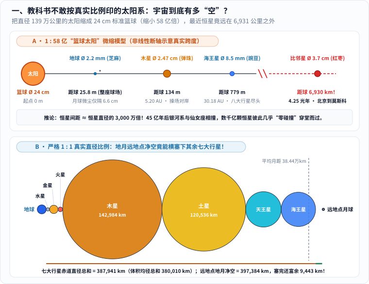
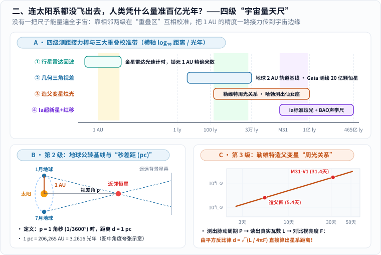
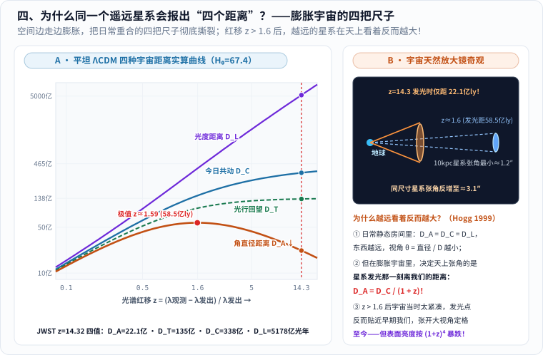
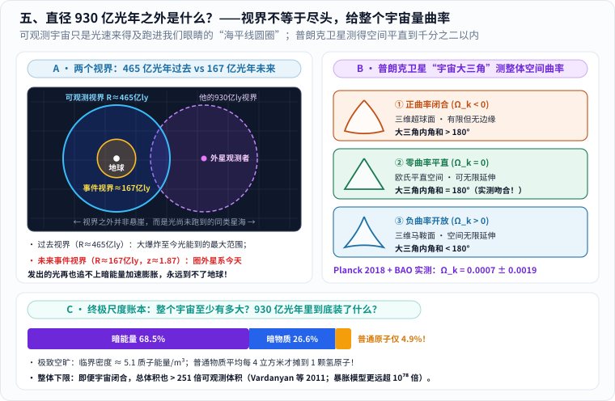

打开任何一本天文画册或教室墙上的挂图，太阳系总是热热闹闹的一家人：硕大的金黄色太阳旁边，水星、金星、地球、火星、木星、土星、天王星、海王星像一串紧挨着的彩色玻璃珠，整整齐齐排在同一页纸上[[3]](#ref-3)。

但只要稍微动笔算一算，你就会发现一个出版界心照不宣的“善意谎言”：**全世界没有任何一张普通尺寸的印刷品，敢同时按同一个真实比例画出太阳系行星的个头和它们之间的距离**——因为一旦按真实比例印在 A4 纸上，把海王星轨道画满整张纸宽（$$21\ \mathrm{cm}$$），太阳本身就会缩成一颗直径只有 **$$0.03\ \mathrm{mm}$$**（不到头发丝一半粗）的墨粉微粒，而地球更是只有 **$$0.0003\ \mathrm{mm}$$**，拿放大镜都找不着[[1]](#ref-1)[[3]](#ref-3)！

在之前的文章[《抬头看到的从来不是“现在”？138亿岁的宇宙凭什么宽达920多亿光年？》]()里，我们从相对论光锥与空间膨胀的角度解释过“138 亿年年龄与 930 亿光年直径”的时间账；而在[《连土星都够不着的火箭、23瓦冰箱灯泡信号，旅行者1号凭什么狂飙49年飞出1光日》]()中，我们也见过人类飞得最远的探测器拼尽半个世纪才堪堪跨出“1 光日”。今天，我们专门把镜头对准**宇宙纯粹的空间大小、空旷程度与测量标尺**，解开五个越算越让人头皮发麻的谜题：

1. **太阳系与恒星际到底有多“空”**：流传甚广的冷知识说“地球和月亮之间的缝隙，能把太阳系其余七大行星并排塞进去”，这是真的还是段子[[1]](#ref-1)？如果把太阳缩成一只标准篮球，最近的邻居恒星比邻星到底摆在多远的地方[[3]](#ref-3)？
2. **足不出户怎样量准百亿光年**：人类连最近的恒星都没去过，手里更没有百亿光年长的卷尺，天文学家到底靠哪**四级接力“量天尺”**，一步步把地球公转轨道的米数精度传到宇宙边缘的[[2]](#ref-2)[[4]](#ref-4)[[5]](#ref-5)[[6]](#ref-6)？
3. **20 个数量级的“宇宙收货地址”与套娃终点**：从地球 → 太阳系 → 银河系 → 本星系群 → 拉尼亚凯亚超星系团一路放大 **$$10^{20 }$$ 倍**，宇宙难道是无穷无尽的“星系套娃”吗？为什么一旦尺度跨过 **$$3.3\ \text{亿光年}$$**，宇宙突然迎来了著名的**“宏伟的终结（End of Greatness）”**[[7]](#ref-7)[[8]](#ref-8)[[9]](#ref-9)？
4. **同一个星系为什么会报出“四个距离”**：为什么韦布空间望远镜（JWST）发现一团早期星系时，论文里能同时算出 $$22\ \text{亿}$$、$$135\ \text{亿}$$、$$338\ \text{亿}$$ 和 $$5{,}180\ \text{亿光年}$$ 四个截然不同的距离？更离奇的是，为什么红移超过 $$z \approx 1.6$$ 后，**越遥远的星系在天空中看起来张角反而越大**[[11]](#ref-11)？
5. **直径 930 亿光年之外到底是什么**：可观测宇宙这颗直径 $$930\ \text{亿光年}$$ 的大球，外面是一堵墙，还是虚无？我们怎么隔着这扇有限的窗户，测出**整个宇宙（Whole Universe）**到底是弯曲闭合的，还是平直无限的[[9]](#ref-9)[[11]](#ref-11)？

---

## 一、教科书不敢按真比例印的太阳系：宇宙到底有多“空”？

人类的大脑是在东非稀树草原上为了估算“几十米外那头狮子有多远、几公里外那片水源怎么走”演化出来的。一旦距离跳上百万公里甚至光年，成串的“零”就会在脑海里糊成一团。想真正建立对宇宙尺度的直觉，最好的办法不是硬背天文数字，而是**亲手把整个太阳系按精确比例缩小到你熟悉的操场上**[[3]](#ref-3)。

### 1. 把太阳缩成一只 24 厘米的篮球：比邻星竟在北京到莫斯科之外

根据国际天文学联合会（IAU）2015 年第 B3 号决议定下的标称太阳半径 $$\mathcal{R}_\odot^{\mathrm{N} } = 695{,}700\ \mathrm{km}$$，太阳的真实直径约为 **$$1{,}391{,}400\ \mathrm{km}$$**（地球赤道直径 $$12{,}756\ \mathrm{km}$$ 的约 $$109$$ 倍）[[1]](#ref-1)[[2]](#ref-2)。

现在，我们按照美国 OpenStax 大学天文学教材《Astronomy 2e》的经典微缩实验，把空间里的每一把尺子统统缩小 **$$57.975\ \text{亿倍}$$（约 $$1 : 5.8 \times 10^9$$）**，让光芒万丈的太阳刚好缩成一只捧在手心里的**标准七号篮球（直径 $$24\ \mathrm{cm}$$）**[[3]](#ref-3)。把这只篮球摆在学校操场的起点线上，来看看太阳系其他成员变成了什么模样、又该摆去哪里：

- **地球（一粒白芝麻，远在整座篮球场对岸）**：按同一比例缩小后，地球直径只剩 **$$2.20\ \mathrm{mm}$$**——差不多是一粒饱满的白芝麻。它不能挨着篮球放，而必须搬到 **$$25.8\ \mathrm{m}$$** 之外（接近一整块 $$28\ \mathrm{m}$$ 标准篮球场的长度）！因为国际天文学联合会 2012 年第 B2 号决议已将日地平均距离——**1 天文单位（$$\mathrm{au}$$）**——精确锁定为[[2]](#ref-2)：

$$
1\ \mathrm{au} = 149{,}597{,}870{,}700\ \mathrm{m} \approx 1.496 \times 10^8\ \mathrm{km}
$$

  除以 $$57.975\ \text{亿}$$，恰好就是 $$25.80\ \mathrm{m}$$。而绕着地球转的月亮呢？它缩成了一颗直径 **$$0.60\ \mathrm{mm}$$** 的细灰尘，悬在这粒芝麻旁边仅 **$$6.63\ \mathrm{cm}$$**（大约一根小拇指长）的地方[[1]](#ref-1)[[3]](#ref-3)。
- **木星与海王星（操场尽头与两站路外的孤豆）**：太阳系最大的行星木星（赤道直径 $$142{,}984\ \mathrm{km}$$）缩成了一颗直径 **$$2.47\ \mathrm{cm}$$** 的玻璃弹珠，摆在距离篮球 **$$134\ \mathrm{m}$$** 外的跑道另一头；而八大行星最外围的海王星（赤道直径 $$49{,}528\ \mathrm{km}$$，平均日距 $$45.15\ \text{亿公里} \approx 30.18\ \mathrm{au}$$）只是一粒直径 **$$8.5\ \mathrm{mm}$$** 的青豌豆，孤零零地躺在 **$$779\ \mathrm{m}$$** 之外的街区尽头[[1]](#ref-1)[[3]](#ref-3)。
- **最近的恒星邻居比邻星（远在 6,931 公里之外！）**：跨过海王星这粒小豌豆，一直往外走，接下来有多空？光在真空中每秒狂飙 $$c = 299{,}792.458\ \mathrm{km/s}$$，走满一整年（儒略年 $$365.25\ \text{天} = 31{,}557{,}600\ \mathrm{s}$$）的路程定义为 **1 光年（$$\mathrm{ly}$$）**[[2]](#ref-2)：

$$
1\ \mathrm{ly} = 9{,}460{,}730{,}472{,}580.8\ \mathrm{km} \approx 9.46 \times 10^{12 }\ \mathrm{km} \approx 63{,}241\ \mathrm{au}
$$

  离太阳最近的恒星——半人马座 **比邻星（Proxima Centauri）** 是一颗红矮星，距离我们约 **$$4.2465\ \text{光年}$$**（约 $$40.17\ \text{万亿公里}$$）。在我们的“篮球太阳”模型里，比邻星本身只是一颗直径约 **$$3.7\ \mathrm{cm}$$** 的大红枣；但要把这颗红枣摆对位置，你得走出操场、走出城市、甚至走出国境，把它放到 **$$6{,}931\ \mathrm{km}$$** 之外——相当于**把篮球放在北京天安门，最近的第二颗球却远在莫斯科红场之外，中间整片欧亚大陆空无一星**[[3]](#ref-3)！

*图 1：怎么看这张图——先看上半部分 A 区：把直径 $$139.14\ \text{万公里}$$ 的太阳缩成 $$24\ \mathrm{cm}$$ 篮球后，地球只是 $$25.8\ \mathrm{m}$$ 外的 $$2.2\ \mathrm{mm}$$ 芝麻，海王星在 $$779\ \mathrm{m}$$ 外，而双斜杠断轴右侧的最近恒星比邻星竟跳到了 $$6{,}931\ \mathrm{km}$$ 之外。再看下半部分 B 区：这里横纵方向采用**严格的 $$1:1$$ 真实直径与距离比例**——地球与远地点月球（中心距 $$40.55\ \text{万公里}$$）之间的表面净空达 $$397{,}384\ \mathrm{km}$$，把水星、金星、火星、木星、土星、天王星、海王星按最宽的赤道直径肩并肩排进去（总和 $$387{,}941\ \mathrm{km}$$），居然还富余 $$9{,}443\ \mathrm{km}$$！*

这个惊人的微缩比例，顺手解开了另一个常让人困惑的天文奇观：天文学家测出约 **$$45\ \text{亿年后}$$**，我们的银河系将与邻居仙女座星系（M31）迎面相撞、合并成一个椭圆星系；既然两个星系各自拥有上千亿颗恒星，撞在一起岂不是星球乱撞、毁天灭地？**恰恰相反——恒星与恒星之间几乎连一次直接碰撞都不会发生！** 因为恒星间距大约是恒星自身直径的 **$$3{,}000\ \text{万倍}$$**（就像两只相隔 $$6{,}900\ \mathrm{km}$$ 的篮球），哪怕两群这样的“稀疏蚊群”迎头穿插而过，引力会把整个星系的旋臂扯成壮观的潮汐长尾，但单颗恒星撞上另一颗恒星的概率低到几乎为零[[3]](#ref-3)！

### 2. 严格验算网红冷知识：地月之间真能塞下其余七大行星吗？

既然宇宙这么空，就连我们抬头最熟悉的月亮，其实也比直觉远得多。很多人听过一个极反直觉的说法：**“地球到月亮的空隙里，能把太阳系其余七颗大行星全部塞进去。”** 木星和土星明明是庞然大物，这事儿到底靠不靠谱？我们直接调出美国宇航局国家空间科学数据中心（NASA NSSDCA）公布的行星几何实测表，现场列竖式验算[[1]](#ref-1)！

这里藏着一个绝大多数网帖漏掉的物理细节：**快速自转的气态巨行星是“扁”的**（比如木星每 $$9.9\ \text{小时}$$ 就自转一圈，赤道被离心效应甩得鼓起，赤道直径 $$142{,}984\ \mathrm{km}$$，两极直径却只有 $$133{,}708\ \mathrm{km}$$，体积等值平均直径为 $$139{,}822\ \mathrm{km}$$）[[1]](#ref-1)。我们按最严苛的标准——**把其余七大行星统统横着按最宽的“赤道直径”肩并肩排成一排**（土星光环是稀薄冰屑，不计固体直径），逐个相加[[1]](#ref-1)：

$$
\begin{aligned}
D_{\text{七星赤道总和} } &= 4{,}879_{\text{水} } + 12{,}104_{\text{金} } + 6{,}792_{\text{火} } + 142{,}984_{\text{木} } \\
&\quad + 120{,}536_{\text{土} } + 51{,}118_{\text{天} } + 49{,}528_{\text{海} } \\
&= 387{,}941\ \mathrm{km}
\end{aligned}
$$

（如果改用 NASA 的体积等值平均直径相加，总和则是 **$$380{,}010\ \mathrm{km}$$**[[1]](#ref-1)。）

现在再来量地球表面到月球表面的**真实净空（Surface-to-Surface Clearance）**——注意，地月距离通常报的是**球心到球心**的距离，必须扣掉地球半径（$$6{,}378.1\ \mathrm{km}$$）和月球半径（$$1{,}738.1\ \mathrm{km}$$），合计扣去 **$$8{,}116.2\ \mathrm{km}$$**[[1]](#ref-1)：

1. **在“平均地月距离”（半长轴 $$384{,}400\ \mathrm{km}$$）时**：地月表面净空为 $$384{,}400 - 8{,}116.2 = 376{,}283.8\ \mathrm{km}$$。瞧！在平均距离下，哪怕按体积均径（$$380{,}010\ \mathrm{km}$$）去塞，也还差了 **$$3{,}726\ \mathrm{km}$$**，海王星的半边身子会磕到月亮脑门上！
2. **在月球绕地椭圆轨道的“远地点”（Apogee，中心距 $$405{,}500\ \mathrm{km}$$）时**：每月月亮退到远地点那一刻，地月表面净空敞开到 **$$405{,}500 - 8{,}116.2 = 397{,}383.8\ \mathrm{km}$$**！把七大行星按最宽赤道直径（$$387{,}941\ \mathrm{km}$$）整整齐齐塞进去之后，**居然还宽宽松松富余出 $$9{,}443\ \mathrm{km}$$**——甚至够再塞进两颗水星，或者多塞进一整颗冥王星（直径 $$2{,}376\ \mathrm{km}$$）外加两颗谷神星[[1]](#ref-1)！

这笔账把“宇宙的空旷”展现得淋漓尽致：哪怕是在离地球最近、阿波罗飞船三天就能飞到的地月后院里，空间也宽阔到足以吞下太阳系全部巨行星的总和。

---

## 二、连太阳系都没飞出去，人类凭什么量准百亿光年？——四级“宇宙量天尺”

知道了宇宙有多空，第二个尖锐的问题立刻来了：既然连飞了快 50 年的旅行者 1 号都只走了不到千分之三光年，人类既不能派飞船去拉皮尺，也没法朝仙女座星系打一束激光等五百万年听回音——**天文学家报出的“比邻星 $$4.25\ \text{光年}$$”“仙女座 $$254\ \text{万光年}$$”“某超星系团 $$5\ \text{亿光年}$$”，到底是怎么量出来的？不会是瞎猜的吧？**

答案是：**宇宙里没有任何一把尺子能从家门口直接量到宇宙边缘；人类靠的是一套环环相扣、每一级都在“重叠区”严格校准下一级的四级接力系统——“宇宙距离阶梯（Cosmic Distance Ladder）”**[[3]](#ref-3)[[5]](#ref-5)[[6]](#ref-6)。

*图 2：怎么看这张图——先看 A 区对数轴：从 $$1\ \mathrm{au}$$（约 $$1.58 \times 10^{-5}\ \mathrm{ly}$$）到 $$465\ \text{亿光年}$$ 横跨 $$16$$ 个数量级，四根彩色横条代表四级测距方法，三块竖向浅色阴影则是性命攸关的**“重叠校准带”**——先用近处几何尺测准一批恒星，拿它们校准变星光度，再用变星所在的近邻星系去校准超新星。左下 B 区展示地球半年公转拉出 $$2\ \mathrm{au}$$ 基线定义“秒差距（$$\mathrm{pc}$$）”（角度为示意放大）；右下 C 区绘出勒维特发现的造父变星周期—光度直线，标出银河系内的造父四与哈勃在仙女座拍到的著名变星 M31-V1。*

### 1. 第一、二级阶梯：金星雷达锁死 1 AU，地球公转拉出 3 亿公里三角尺

前两级阶梯是**纯几何与光速计时**，不依赖任何复杂的恒星物理假设：

- **第一级：行星雷达回波（量准太阳系内部）**。20 世纪 60 年代起，天文学家用巨型射电望远镜向金星、水星和火星发射大功率微波脉冲，像蝙蝠听回声一样用原子钟精确记录电磁波往返的时间 $$\Delta t$$，乘上光速的一半 $$d = \frac{1}{2} c \Delta t$$，瞬间把金星离地球的距离测准到米级甚至厘米级；再代入开普勒第三定律的比例关系，整座太阳系的基本底尺——**$$1\ \mathrm{au} = 149{,}597{,}870{,}700\ \mathrm{m}$$**——就被死死钉在了岩石般的精度上[[2]](#ref-2)[[3]](#ref-3)。
- **第二级：三角视差与“秒差距”（从太阳系跨向银河系）**。我们在[《为什么汽车开得飞快，天上的太阳和月亮却一直跟着我们走？》]()里做过伸直手臂眨左右眼的实验：观测点左右挪动基线，近处的拇指就会相对远处墙壁左右跳动。地球自己不够宽，但地球每绕太阳公转半年（比如 1 月和 7 月），就会在太空中自动横移出一条长达 **$$2\ \mathrm{au} \approx 3\ \text{亿公里}$$** 的免费超长基线[[3]](#ref-3)！
  天文学家把**半条基线（$$1\ \mathrm{au}$$）**对近邻恒星张开的半视差角记为 $$p$$。当 $$p$$ 极小时，弧度近似有 $$\tan p \approx p$$。为了算账省事，天文学界干脆专门发明了一个硬核长度单位——**秒差距（parsec，缩写 $$\mathrm{pc}$$）**：如果一颗恒星的周年视差角 $$p$$ 恰好等于 **$$1\ \text{角秒}$$（$$1'' = \frac{1}{3600}^\circ = \frac{\pi}{648{,}000}\ \mathrm{rad}$$）**，它离太阳的距离就定义为 **$$1\ \mathrm{pc}$$**[[2]](#ref-2)[[3]](#ref-3)：

$$
1\ \mathrm{pc} = \frac{1\ \mathrm{au} }{\pi / 648{,}000} = \frac{648{,}000 }{\pi}\ \mathrm{au} \approx 206{,}264.8\ \mathrm{au} \approx 3.2616\ \text{光年}
$$

  只要测出恒星视差角 $$p$$（以角秒为单位），距离立马口算得出：**$$D(\mathrm{pc}) = \frac{1}{p('')}$$**！1838 年，德国贝塞尔（测天鹅座 61）、英国亨德森（测半人马座 $$\alpha$$）与俄国斯特鲁维（测织女星）几乎同时首次攻克恒星视差，人类历史上第一次量出了恒星的真实距离[[3]](#ref-3)。而比邻星的视差角最大，也只有 $$p = 0.768''$$（$$D \approx 1.30\ \mathrm{pc} \approx 4.25\ \mathrm{ly}$$）——相当于看 **$$2.7\ \mathrm{km}$$ 外一枚硬币的厚度**！
  地面望远镜受大气抖动干扰，只能测准几百光年内的星。直到欧洲空间局（ESA）发射**盖亚（Gaia）空间天体测量卫星**，在 2014 至 2025 年长达 11 年的科学巡天中完成了超过 **$$3\ \text{万亿次}$$**观测，才一口气把视差精度推到微角秒级，为银河系内**近 $$20\ \text{亿颗}$$恒星**（约占全银河系恒星总数的 $$1\%$$）画出了精确的三维立体星图，把几何直尺稳稳捅到了数万光年深处[[4]](#ref-4)！

### 2. 第三、四级阶梯：勒维特的“造父蜡烛”与白矮星标准核爆

可一旦飞出银河系，来到几百万光年外的其他星系，连盖亚卫星的三角视差角也会缩到测不出来。几何尺到头了，接力棒正式交给物理学里的**“标准烛光（Standard Candles）”**[[5]](#ref-5)[[6]](#ref-6)。

原理就像你在漆黑的高速公路上看车灯：如果你事先知道远处那盏灯泡的**出厂真实功率（光度 $$L$$，比如确凿无疑是 $$100\ \mathrm{W}$$）**，再用测光表量出落进你眼睛里的**视亮度（辐射通量 $$F$$）**，由于光向四面八方均匀铺满半径为 $$d$$ 的球面（面积 $$4\pi d^2$$），直接反解**平方反比律**就能算出灯泡离你有多远[[5]](#ref-5)：

$$
F = \frac{L}{4\pi d^2} \quad \Longrightarrow \quad d = \sqrt{\frac{L}{4\pi F} }
$$

难就难在：漫天繁星有的是近处的小烛火，有的是远处的探照灯，谁把“出厂瓦数 $$L$$”写在脑门上了？两位科学史上的关键发现，替全人类找到了两盏极其明亮的“自报瓦数神灯”：

- **第三级：勒维特的“造父变星周光关系”（撬开河外星系大门）**。1784 年，年仅 19 岁的英国聋哑青年天文学家约翰·古德利克（John Goodricke）发现仙王座 $$\delta$$（中文星名**“造父四”**）每隔 $$5.4\ \text{天}$$就会像呼吸一样规律地一明一暗膨胀收缩，这类脉动超巨星从此统称**造父变星（Cepheid Variables）**[[5]](#ref-5)。
  到了 1908–1912 年，哈佛大学天文台负责人工比对感光玻璃底片的失聪女计算员**亨丽爱塔·斯万·勒维特（Henrietta Swan Leavitt）**，在麦哲伦云中找出了 $$1{,}777$$ 颗变星。她敏锐地意识到：**同一团麦哲伦云里的变星离地球几乎一样远**！于是她把其中 25 颗造父变星的脉动周期 $$P$$ 和视星等画在一张图上，发现了震动整个宇宙学的**周期—光度关系（Period-Luminosity Relation）**——**造父变星呼吸得越慢（周期 $$P$$ 越长），它本身的真实绝对光度 $$L$$ 就严格按对数比例越高**[[5]](#ref-5)！
  这意味着：天文学家根本不用靠近它，只要拿秒表数一数它几天亮暗一次，就能从勒维特曲线上查出它的真实瓦数 $$L$$（再由盖亚卫星先用三角视差测准银河系内近邻造父变星的距离，把这把尺子的零点彻底锁死）！1923 年 10 月，埃德温·哈勃（Edwin Hubble）用威尔逊山 $$2.5\ \mathrm{m}$$ 望远镜在仙女座星云（M31）里拍到了编号 **M31-V1** 的造父变星（周期 $$31.4\ \text{天}$$，真实光度超过太阳上万倍），算出一看：它根本不是银河系里的一团小雾气，而是远在百万光年之外（当时哈勃因未区分两族造父变星初算约 $$90\ \text{万光年}$$，现代精准复刻为 **$$254\ \text{万光年}$$**）的另一座庞大“岛宇宙”[[5]](#ref-5)！一夜之间，人类认知的宇宙版图暴涨了上亿倍。
- **第四级：Ia 型超新星与重子声学振荡（直抵百亿光年深空）**。造父变星虽亮，过了约一亿光年也会淹没在星系背景光里。要想量到几十亿光年外，必须请出我们在[《你血液里的铁和手上的黄金是从哪炼出来的？》]()里讲过的宇宙级巨型礼花——**Ia 型超新星**[[6]](#ref-6)。
  当双星系统里的一颗碳氧白矮星不断偷吸伴星物质、体重逼近**钱德拉塞卡极限（约 $$1.4\ M_\odot$$，太阳质量的 $$1.4$$ 倍）**时，整颗致密星球会瞬间发生失控热核爆炸！因为每次引爆时的燃料质量几乎整齐划一，它的峰值亮度极其稳定，在几周内能爆发出约 **$$50\ \text{亿倍}$$太阳光度**——亮到足以跟它所在的整座宿主星系平分秋色[[6]](#ref-6)！先在同时拥有造父变星和 Ia 型超新星的近邻星系里完成校准，这盏“超级标准烛光”就能一口气照亮百亿光年深空。正是靠追踪遥远 Ia 型超新星比预期偏暗的微弱信号，珀尔马特（Saul Perlmutter）、施密特（Brian Schmidt）与里斯（Adam Riess）在 1998 年震惊世界地发现**宇宙膨胀不仅没减速，反而正在加速**，并摘下 2011 年诺贝尔物理学奖[[6]](#ref-6)！而在更宏大的宇宙学尺度上，天文学家还会配合早期宇宙等离子体声波冻结留下的**重子声学振荡（BAO，“标准直尺”，共动尺度约 $$4.9\ \text{亿光年}$$）**与哈勃红移定律交叉互验，把整座量天阶梯焊得严丝合缝[[11]](#ref-11)。

---

## 三、你的完整“宇宙收货地址”：横跨 20 个数量级的对数放大与“宏伟的终结”

手里握稳了这四级量天尺，现在我们可以坐上一艘虚拟的对数变焦飞船，从脚下的地球出发，每向右拨一格刻度就把视野放大 **$$100\ \text{倍}$$**，一路横跨 **$$20\ \text{个数量级}$$**（从 $$10^7\ \mathrm{m}$$ 到 $$8.8 \times 10^{26 }\ \mathrm{m}$$），完整填写一份属于全人类的**“宇宙收货地址”**[[7]](#ref-7)[[8]](#ref-8)[[9]](#ref-9)！

*图 3：怎么看这张图——上半部分 A 区是一把严格的**对数米标尺 $$\log_{10}(\text{跨度}/\mathrm{m})$$**（注意：这里不是均匀直尺，每往右走一小段，真实空间跨度就乘以 $$100$$ 倍！），红色扫描游标会从 $$10^7\ \mathrm{m}$$ 的地球单次扫过七座尺度里程碑，最终停在直径 $$930\ \text{亿光年}$$（$$8.8 \times 10^{26 }\ \mathrm{m}$$）的可观测视界终点（若系统开启“减少动态效果”则直接停在终点；也可）。下半部分六张卡片依次拆解每一层家园的真实边界，并重点标出超过 $$3.3\ \text{亿光年}$$ 后套娃结构终止的紫色“宏伟的终结”均匀区。*

### 1. 从太阳系、银河系、本星系群到 5.2 亿光年的“无尽天堂”拉尼亚凯亚

顺着图 3 的六张档案卡，我们一层一层往外拆开自己的宇宙门牌号：

1. **第一层：地球与太阳系真边界（$$1.28 \times 10^7\ \mathrm{m} \longrightarrow \sim 1.5 \times 10^{16 }\ \mathrm{m}$$）**
   海王星轨道（约 $$30\ \mathrm{au}$$）远不是太阳系的终点。太阳吹出的带电粒子风在约 **$$120\ \mathrm{au}$$** 处被星际介质顶住，形成旅行者 1 号与 2 号先后闯过的**日球层顶（Heliopause）**；再往外，还笼罩着一团由数万亿颗冰冻彗星核组成的球壳——**奥尔特云（Oort Cloud）**，一直延伸到距离太阳 **$$5\ \text{万}\text{–}10\ \text{万}\ \mathrm{au}$$（约 $$0.8\text{–}1.6\ \text{光年}$$）**的地方，那才是太阳引力真正管辖的边疆[[3]](#ref-3)。
2. **第二层：银河系（Milky Way，盘面直径约 $$10\ \text{万光年} \approx 9.5 \times 10^{20 }\ \mathrm{m}$$）**
   我们的太阳只是这座巨大棒旋星系里 **$$1{,}000\ \text{亿}\text{–}4{,}000\ \text{亿颗}$$**恒星中极其普通的一员[[3]](#ref-3)[[4]](#ref-4)。太阳并没有住在繁华拥挤、盘踞着 $$400\ \text{万倍}$$太阳质量超大黑洞（Sgr A*）的银河市中心，而是安居在距离银心约 **$$2.6\ \text{万光年}$$**的郊区——**猎户座支臂（Orion Spur）**上，带着地球以约 $$220\ \mathrm{km/s}$$ 的速度绕银心公转，转满一整圈（**1 个“银河年”**）需要大约 **$$2.25\text{–}2.3\ \text{亿年}$$**[[3]](#ref-3)。换句话说，上一次太阳转到今天这个银河位置时，地球上最早的恐龙才刚刚登上历史舞台！
3. **第三层：本星系群（Local Group，跨度约 $$1{,}000\ \text{万光年} \approx 3\ \mathrm{Mpc}$$）**
   飞出银河系，周围并不是均匀撒胡椒面，而是一座直径约 $$1{,}000\ \text{万光年}$$、靠引力紧紧抱团的“星系小村庄”——**本星系群**[[8]](#ref-8)。村里一共有 **$$60\ \text{多个}$$**成员，但两座巨无霸——**仙女座星系（M31）**和**银河系**（再加上老三**三角座星系 M33**）——就占走了全村绝大部分家当，连同外围庞大的暗物质晕在内，总质量约为 **$$4 \times 10^{12 }\ M_\odot$$**，其余几十个大多是像大小麦哲伦云那样绕着大星系打转的矮星系[[8]](#ref-8)。
4. **第四层：拉尼亚凯亚超星系团（Laniakea，跨度约 $$5.2\ \text{亿光年} \approx 160\ \mathrm{Mpc}$$）**
   本星系群往外靠向哪里？过去教科书常写“室女座超星系团（中心距我们约 $$5{,}400\ \text{万光年}$$）”[[8]](#ref-8)。直到 2014 年，夏威夷大学天文学家布伦特·塔利（R. Brent Tully）团队在《自然（Nature）》发表里程碑论文：他们测出了周围 $$8{,}000$$ 多个星系扣除宇宙整体膨胀后的**本动速度（Peculiar Velocity）**，就像地理学家顺着地面溪流往哪个盆地汇聚来划分“长江流域”和“黄河流域”的分水岭一样，第一次在三维太空中画出了我们真正所属的引力流域边界，并用夏威夷语为它取名 **Laniakea（拉尼亚凯亚，意为“无尽的天堂”）**[[7]](#ref-7)！
   这座庞然大物横跨 **$$1.6\ \text{亿秒差距}$$（约 $$5.2\ \text{亿光年}$$）**，总质量高达 **$$10^{17 }\ M_\odot$$**（银河系的近十万倍），囊括了约 **$$10\ \text{万个}$$大星系**；而我们的本星系群只是栖息在它边缘枝桠上的一粒小露珠，正顺着引力河床朝流域深处的引力谷底——**巨引源（Great Attractor）**缓缓滑行[[7]](#ref-7)。

### 2. 宇宙纤维网、“宏伟的终结”与新视野号改写的星系总数之争

顺着地球 → 太阳系 → 银河系 → 本星系群 → 拉尼亚凯亚一路看下来，每个人心里都会冒出一个大胆的猜想：**既然超星系团这么大，它外面是不是还有“超—超星系团”“超—超—超星系团”，像俄罗斯套娃一样永远套下去？**

斯隆数字巡天（SDSS）等上百万星系三维红移巡天给出的实测答案，让所有人大吃一惊：**不！套娃在大约 $$3\ \text{亿光年}$$ 处戛然而止！**[[8]](#ref-8)[[9]](#ref-9)

- **几亿光年尺度上的“宇宙肥皂泡”**：在 $$1\ \text{亿}$$ 到 $$10\ \text{亿光年}$$ 的局部切片上，星系在暗物质引力编织下排成恢弘的**宇宙网（Cosmic Web）**——约 **$$90\%$$** 的星系挤在占总体积**不到 $$10\%$$** 的细长纤维丝和扁平“星系长城”上（例如戈特 Gott 等人 2005 年在宇宙对数全景图中标出的**斯隆长城 Sloan Great Wall**，绵延达 **$$13.7\ \text{亿光年}$$**），而纤维网中间则围着一个个直径约 **$$1.5\ \text{亿光年}$$**、内部星系密度不到平均值十分之一的**宇宙巨洞（Cosmic Voids）**，活像一团切开的浴球海绵[[8]](#ref-8)[[9]](#ref-9)。
- **超过 3.3 亿光年的“宏伟的终结（End of Greatness）”**：2005 年，纽约大学宇宙学家大卫·霍格（David W. Hogg）团队统计了 SDSS 巡天中数万个明亮红星系（LRG），用半径为 $$R$$ 的球去数球内的平均星系数量 $$N(R)$$[[9]](#ref-9)。如果宇宙是永无止境的分形套娃，$$N(R)$$ 的增长幂次就会始终小于 $$3$$；但实测数据清晰地证明：一旦统计球半径跨过 $$R \sim 70\ h^{-1}\ \mathrm{Mpc} \approx 100\ \mathrm{Mpc}$$（约 **$$3.3\ \text{亿光年}$$**），星系数量就精准回归到均匀三维体积定律[[9]](#ref-9)：

$$
N(R) \propto R^3
$$

  在 $$3.3\ \text{亿光年}$$ 尺度上，各处密度起伏已经跌到仅约 **$$7\%$$**；放大到 $$30\ \text{亿光年}$$（$$1\ \mathrm{Gpc}$$）时，起伏更是只剩 **$$1\%$$** 不到[[9]](#ref-9)！就像你离近看海绵全是孔洞和细丝，退远到十米外看整块大海绵却极其均匀一样——宇宙在 $$3.3\ \text{亿光年}$$ 之上不再拼装任何更高阶的超级结构，爱因斯坦与现代宇宙学赖以立身的基石——**宇宙学原理（大尺度均匀且各向同性）**——在这里得到了铁证[[8]](#ref-8)[[9]](#ref-9)！

那么，在这颗直径 $$930\ \text{亿光年}$$ 的可观测宇宙大海绵里，**一共装了多少个星系**？这恰好是近十年天文学界最精彩的一场实测交锋[[10]](#ref-10)：

- 早年天文学家数完哈勃超深场（HUDF）里的光斑再乘上全天面积，给出的经典数字是约 **$$1{,}000\ \text{亿}\text{–}2{,}000\ \text{亿个}$$**可观测星系；
- 2016 年，英国诺丁汉大学康塞利斯（Christopher J. Conselice）团队在《天体物理学杂志（ApJ）》建模推算：如果把红移 $$z = 8$$ 以内、恒星质量低至 $$10^6\ M_\odot$$ 但暗到哈勃拍不清的早期微小矮星系全算上，总数可能高达 **$$2\ \text{万亿个}$$（$$2.0^{+0.7 }_{-0.6 } \times 10^{12 }$$）**[[10]](#ref-10)；
- 然而到了 2021 年，劳尔（Tod R. Lauer）团队动用了一位意想不到的裁判——正飞在距离太阳 **$$42\text{–}45\ \mathrm{au}$$**（冥王星轨道之外）的 **NASA“新视野号（New Horizons）”探测器**！因为在地球和哈勃所在的 $$1\ \mathrm{au}$$ 附近，行星际尘埃反射太阳光形成的“黄道光”太亮，盖住了深空背景；而新视野号在极暗的外太阳系拍下宇宙光学背景（COB）后发现：**远方所有看不见的暗弱星系加起来贡献的微光极其有限，可观测宇宙里的星系总数上限其实只有“几千亿个（Hundreds of Billions）”，并没有多出那近两万亿个隐形星系**[[10]](#ref-10)！看，这就是真正鲜活的科学：连星系总数都在探测器越飞越远的实测中不断挤掉水分、逼近真相。

---

## 四、为什么同一个遥远星系会报出“四个距离”？——膨胀宇宙的四把尺子

读天文新闻时，细心的读者常会撞见一个极其抓狂的混乱场面：比如韦布望远镜（JWST）拍到目前光谱确认最遥远的早期星系之一 **JADES-GS-z14-0**（光谱红移 $$z = 14.32$$），有的科普文章说它距离我们 **“$$135\ \text{亿光年}$$”**，有的专业解读说它现在远在 **“$$338\ \text{亿光年}$$”** 之外，可如果你去翻它发光时的视角推算又变成了 **“$$22.1\ \text{亿光年}$$”**，按亮度平方反比去套居然高达 **“$$5{,}180\ \text{亿光年}$$”**！

难道天文学家连算术都算不准了吗？**一点都没错——这四个数字全都千真万确！**[[11]](#ref-11)

### 1. 边走边拉长的跑道：把日常重合的四把尺子彻底撕裂

在你的客厅里量沙发有多远，不管你是拿卷尺量（共动/固有距离）、拿手电筒算光跑过去的时间（光行距离）、量沙发在你眼里的张角（角直径距离），还是看一盏台灯有多暗（光度距离），**四把尺子给出的数字分毫不差，全都是 $$3\ \mathrm{m}$$**——因为客厅地板是静止的[[11]](#ref-11)。

但在膨胀的宇宙里，当遥远星系发出的光子朝地球奔跑上百亿年时，**脚下的空间跑道本身正随着尺度因子 $$a(t)$$ 一刻不停地拉长**！光子波长被同步拉长的倍数定义为**宇宙学红移 $$z$$**：

$$
1 + z = \frac{\lambda_{\text{观测} } }{\lambda_{\text{发出} } } = \frac{a(t_0)}{a(t_{\text{发出} })}
$$

例如 $$z = 14.32$$，就意味着从那束光出发到今天钻进韦布望远镜，**整个宇宙的线性尺寸恰好膨胀了 $$1 + 14.32 = 15.32\ \text{倍}$$**！按照霍格（David W. Hogg 1999）经典的宇宙学距离综述与普朗克卫星 2018 年平坦 $$\Lambda\mathrm{CDM}$$ 实测参数（$$H_0 = 67.4\ \mathrm{km\,s^{-1}\,Mpc^{-1} }$$，物质占比 $$\Omega_m = 0.315$$，暗能量占比 $$\Omega_\Lambda = 0.685$$，记哈勃距离 $$D_H = c / H_0 \approx 145.1\ \text{亿光年}$$，无量纲膨胀率 $$E(z) = \sqrt{\Omega_m (1+z)^3 + \Omega_\Lambda}$$），原本合一的距离当场裂成了四把各司其职的尺子[[11]](#ref-11)：

1. **光行距离（Lookback Distance，$$D_T$$）——“光在路上跑了多久？”**
   把光子一路飞行的回望时间乘上光速：$$D_T = D_H \int_0^z \frac{dz'}{(1+z')E(z')}$$。因为宇宙总共只有 $$138\ \text{亿岁}$$，这把尺子的读数永远超不过 $$138\ \text{亿光年}$$（在 $$z = 14.32$$ 处约为 **$$135\ \text{亿光年}$$**）——媒体新闻最爱报它，但它既不是星系发光时的距离，也不是星系今天的距离[[11]](#ref-11)！
2. **今日共动距离（Comoving Distance，$$D_C$$）——“现在按下宇宙暂停键，拿卷尺量有多远？”**
   如果此刻让全宇宙的膨胀瞬间定格，从地球拉一把钢卷尺量到那团星系今天所在的位置，长度就是 $$D_C = D_H \int_0^z \frac{dz'}{E(z')}$$。对 $$z = 14.32$$ 的星系，它今天已经退到了 **$$338\ \text{亿光年}$$** 之外；而把积分上限推到宇宙大爆炸起点 $$z \to \infty$$（计入早期辐射项），得出的就是可观测宇宙的真实半径——**约 $$462\text{–}465\ \text{亿光年}$$（直径约 $$930\ \text{亿光年}$$）**[[9]](#ref-9)[[11]](#ref-11)！
3. **光度距离（Luminosity Distance，$$D_L$$）——“按它的暗淡程度换算有多远？”**
   遥远星系发出的光子除了铺满半径为 $$D_C$$ 的大球面，还挨了空间膨胀的**“双重削弱闷棍”**：每个光子波长拉长 $$1+z$$ 倍导致单光子能量缩水 $$1+z$$ 倍，同时前后相邻两个光子的间隔也被拉长 $$1+z$$ 倍导致每秒到达望远镜的光子数再少 $$1+z$$ 倍！能量通量 $$F$$ 额外暴跌 $$(1+z)^2$$ 倍，代入平方反比律 $$F = \frac{L}{4\pi D_L^2}$$，光度距离在平坦宇宙中就被硬生生撑大到了[[11]](#ref-11)：

$$
D_L = (1 + z) D_C
$$

   在 $$z = 14.32$$ 处，$$D_L = 15.32 \times 338\ \text{亿} \approx 5{,}180\ \text{亿光年}$$！这就是为什么早期星系暗得像幽灵一样难拍。
4. **角直径距离（Angular-Diameter Distance，$$D_A$$）——“按它在天上占多大视角换算有多远？”**
   如果一个星系的真实物理直径是 $$l$$，它在天空中张开的视角是 $$\theta$$，定义 $$D_A = l / \theta$$。在平坦宇宙中，它恰好等于**那束光刚刚离开星系那一刻，该星系与早期银河系物质之间的真实固有距离**[[11]](#ref-11)：

$$
D_A = \frac{D_C}{1 + z} = \frac{D_L}{(1 + z)^2}
$$

*图 4：怎么看这张图——左图 A 区严格按普朗克 2018 宇宙学参数数值积分绘出四条距离曲线（双对数坐标）：低红移时四线几乎重合，高红移时彻底分道扬镳；红色虚线标出 $$z = 14.32$$ 星系的四个真实距离读数，最下方的橙色实线 $$D_A$$ 在 **$$z \approx 1.59$$（约 $$58.5\ \text{亿光年}$$）** 处到达最高峰后竟掉头向下折返！右图 B 区解释这一奇观：同样直径 $$10\ \mathrm{kpc}$$（约 $$3.26\ \text{万光年}$$）的星系，在 $$z \approx 1.6$$ 处张角缩到最小（约 $$1.2''$$），到了更遥远的 $$z = 14.3$$ 反而因为发光时离我们只有 $$22.1\ \text{亿光年}$$ 而把视角撑大到约 $$3.1''$$！*

### 2. 红移超过 1.6 的宇宙天然放大镜：为什么越远的星系看着反而越大？

盯住图 4 左下角那条橙色曲线 $$D_A = D_C / (1+z)$$，你会看到整个宇宙学里最颠覆日常直觉的一幕[[11]](#ref-11)：

在日常生活里，一辆汽车开得越远，它在你视网膜上占的视角 $$\theta$$ 就一定越小，绝无例外。在宇宙近处（$$z < 1.59$$）也是如此：随着星系越来越远，$$D_A$$ 一路爬升，直到红移 **$$z \approx 1.59$$** 时达到全宇宙极值 **$$D_{A,\max} \approx 58.5\ \text{亿光年}$$**——此时一座直径 $$10\ \mathrm{kpc}$$（约 $$3.26\ \text{万光年}$$）的标准星系，在天空中张开的角度缩到了全宇宙最小的 **$$1.15'' \approx 1.2''$$**[[11]](#ref-11)。

**但只要继续往更古老、更遥远的深空看去（$$z > 1.59$$），分母 $$(1+z)$$ 的暴涨反超了分子 $$D_C$$ 的增长，$$D_A$$ 开始一路掉头变小！** 比如刚才那座今天远在 $$338\ \text{亿光年}$$ 外的 $$z = 14.32$$ 星系，当它在 $$135\ \text{亿年前}$$ 发出那束光时，整个宇宙比今天紧凑 $$15.32\ \text{倍}$$，那时它离早期的我们其实只有 **$$338 \div 15.32 \approx 22.1\ \text{亿光年}$$**！光子在那个贴脸的距离上按约 **$$3.05'' \approx 3.1''$$** 的宽阔夹角朝四面八方射出，此后在平直膨胀空间里沿着径向直线一路传播到地球，当初张开的夹角被原封不动地定格保留了下来[[11]](#ref-11)！

结果就是：**超过红移 $$1.6$$ 之后，整个膨胀宇宙变成了一面天然的“广角放大镜”——同样大小的星系，离我们越远，它在望远镜里占的像素张角反而越大！**（那为什么夜空没有被远古星系铺成一片耀眼白昼呢？因为单位立体角内的**表面亮度** $$I \propto F / \theta^2 \propto (D_A / D_L)^2 = (1+z)^{-4}$$，在 $$z = 14.32$$ 处表面亮度暴跌了 $$15.32^4 \approx 5.5\ \text{万倍}$$——这就是著名的**托尔曼表面亮度暗化效应**，没有韦布望远镜 $$6.5\ \mathrm{m}$$ 镀金红外主镜的聚光本领，肉眼连一丁点影子都瞧不见[[11]](#ref-11)！）

---

## 五、直径 930 亿光年之外是什么？——视界不等于尽头，给整个宇宙量曲率

现在，我们终于站到了对数标尺最右端的那座界碑前：**半径约 $$465\ \text{亿光年}$$、直径约 $$930\ \text{亿光年}$$ 的可观测宇宙（Observable Universe）**[[9]](#ref-9)[[11]](#ref-11)。几乎所有读到这里的人都会追问同一个终极问题：**在这颗直径 $$930\ \text{亿光年}$$ 的大球外面，到底是什么？如果整个宇宙比它更大，既然外面的光都还没跑到地球，科学家凭什么知道外面长什么样、又有多大？**

*图 5：怎么看这张图——左上 A 区把宇宙比作汪洋大海：蓝色大圆是我们半径 $$465\ \text{亿光年}$$ 的可观测视界，紫色虚线圆是一位遥远外星观测者自己的 $$930\ \text{亿光年}$$ 视界（两圆之外并非悬崖，而是同类星海），而里圈金色小圆则是半径约 **$$167\ \text{亿光年}$$ 的“未来宇宙事件视界”**。右上 B 区展示普朗克卫星怎样拿宇宙微波背景（CMB）上的已知声波尺寸当底边，搭出一座纵深四百多亿光年的“宇宙大三角”检验三维空间曲率 $$\Omega_k$$。下方 C 区给出宇宙能量账本与整个宇宙总体积至少超过可观测宇宙 $$251\ \text{倍}$$ 的实测统计下限。*

### 1. 海平线圆圈与残酷的 167 亿光年“失联红线”

首先必须打破一个最常见的误解：**“地球位于直径 930 亿光年可观测宇宙的正中心”，并不意味着地球是全宇宙尊贵的物理中心，更不意味着 $$465\ \text{亿光年}$$ 处砌着一堵宇宙围墙！**[[9]](#ref-9)

想象你坐在一艘轮船桅杆顶上环顾太平洋：由于地球表面弯曲，你四周最远只能看到半径约 $$20\ \mathrm{km}$$ 的一圈**海平线**，你当然位于自己这圈海平线的正圆心。但海平线外面是悬崖瀑布吗？不是，外面照样是波涛滚滚的太平洋！另一艘在 $$15\ \mathrm{km}$$ 外航行的船，也处在它自己那圈 $$20\ \mathrm{km}$$ 海平线的圆心，它能轻松看见你看不见的那片海域[[9]](#ref-9)。

同理，**可观测宇宙的边界叫做“粒子视界（Particle Horizon）”**——它只是因为宇宙诞生至今只有 $$138\ \text{亿年}$$，哪怕大爆炸第一秒发出的光拼命往地球跑，连带空间膨胀最多也只来得及从今日共动距离约 **$$465\ \text{亿光年}$$** 以内的地方跑进我们的望远镜[[9]](#ref-9)[[11]](#ref-11)。如果此刻有一位外星天文学家住在距离我们 $$300\ \text{亿光年}$$ 的一颗行星上，他抬头测出的可观测宇宙**同样是以他为圆心、直径 $$930\ \text{亿光年}$$ 的大球**——其中半边跟我们的视界重叠，另外半边则装满了我们今天因为光速还没赶到而暂时看不见的普通星系与纤维网！

更让人感慨万千的是图 5 左上角里圈那个半径仅约 **$$167\ \text{亿光年}$$（对应今日红移 $$z \approx 1.87$$）** 的金色圆圈——**宇宙事件视界（Cosmic Event Horizon）**：

$$
D_{\mathrm{eh} } = c \int_{t_0}^{\infty} \frac{dt}{a(t)} = D_H \int_{0}^{1} \frac{du}{\sqrt{\Omega_m u^3 + \Omega_\Lambda} } \approx 166.8\ \text{亿光年}
$$

因为占宇宙总能量 **$$68.5\%$$** 的暗能量正在推动空间加速膨胀，这个公式算出了一个极其冷酷的物理事实：**今天凡是位于共动距离 $$167\ \text{亿光年}$$（$$z \approx 1.87$$）以外的星系，它们在“此时此刻”发出的任何一束光、任何一条无线电问候，哪怕我们在地球上等上几千亿年、等到海枯石烂，都再也追不上膨胀拉长的跑道，永远不可能抵达地球了！**（我们今天之所以还能看到 $$167\ \text{亿}$$ 到 $$465\ \text{亿光年}$$ 之间的古老星系，仅仅是因为我们接住的是它们在**百亿年前离我们还很近时**寄出的“陈年旧信”！）换句话说，可观测宇宙里超过 **$$95\%$$** 共动体积内的星系，其实已经在因果律上与今天的我们彻底“失联”，我们只是在漫长的余晖里目送它们昔日的背影一点点红移变暗[[9]](#ref-9)[[11]](#ref-11)。

### 2. 平均 4 立方米才摊到一颗氢原子，整个宇宙究竟有没有尽头？

最后，我们把目光投向两笔决定宇宙终极面貌的硬核实测账本[[11]](#ref-11)：

第一笔是**“终极空旷账”**。前面在太阳系里我们已经觉得太空空得吓人了，可如果把整个可观测宇宙里的所有恒星、星云、黑洞和行星全部打碎摊匀，平均密度到底有多低？普朗克卫星 2018 年给出的宇宙临界密度 $$\rho_c = \frac{3H_0^2}{8\pi G}$$ 折合成质量密度仅为 **$$8.53 \times 10^{-27 }\ \mathrm{kg/m^3 }$$**（相当于每立方米仅含约 **$$5.1\ \text{颗}$$**质子的静质量能量）；其中暗能量占走 **$$68.5\%$$**，不发光的冷暗物质占走 **$$26.6\%$$**，**真正由元素周期表原子构成的普通重子物质（Baryonic Matter）只占区区 $$4.9\%$$**[[11]](#ref-11)！算下来，全宇宙平均**每 $$4\ \text{立方米}$$（差不多一间小储物间的体积）才孤零零地摊到 $$1\ \text{颗}$$普通氢原子**——地球上顶尖物理实验室抽出来的“超高真空”，粒子密度都比宇宙平均值浓密上万亿倍！

第二笔是**“整个宇宙到底有多大”的几何曲率账**。既然视界外面的光还没跑到地球，我们怎么知道整个宇宙是有限的还是无限的？就像一只困在太平洋小岛上的蚂蚁，没法走遍全球，却可以在沙滩上画一个大三角形量内角和（我们在[《过线外一点难道不只有一条平行线？顺着曲面平行线彻底读懂非欧几何》]()中详细推导过）：如果大地是弯曲球面，三角形内角和就会 **$$> 180^\circ$$**，凭多出来的角度就能反推出整颗地球的周长！

普朗克卫星干的正是同一件事：它拿大爆炸后 $$38\ \text{万年}$$（$$z \approx 1090$$，今日共动距离约 $$451\ \text{亿光年}$$）宇宙微波背景辐射（CMB）上已知物理尺寸的重子声波斑点当“三角形底边”，拿光线穿过四百多亿光年深空的路径当“两条腰”，以前所未有的精度量出了这座**横跨整个可观测宇宙的大三角形内角和**！2018 年普朗克团队联合重子声学振荡（BAO）给出的空间曲率参数是[[11]](#ref-11)：

$$
\Omega_k = 0.0007 \pm 0.0019
$$

在千分之二的极高精度之内，大三角形内角和稳稳等于 **$$180^\circ$$**（$$\lvert \Omega_k \rvert < 0.002$$）！这意味着整个宇宙的结局指向两条同样震撼的道路：

- **如果 $$\Omega_k$$ 严格等于 $$0$$（平直欧氏空间）或 $$> 0$$（负曲率马鞍空间，且拓扑单连通）**：那么整个宇宙在空间上是**真正无限大的**——$$930\ \text{亿光年}$$ 之外是无穷无尽的星系与纤维网，永远走不到边[[8]](#ref-8)[[11]](#ref-11)；
- **即便 $$\Omega_k$$ 其实是一个极其微小的负数（正曲率闭合三维超球面 $$S^3$$）**：那整个宇宙就像二维地球表面的三维升级版——**总体积有限，但没有任何边界或围墙**（你朝一个方向一直飞，最终会从反方向绕回起点）！那这颗“闭合超球”最小也得有多大，才会在 $$930\ \text{亿光年}$$ 的局部窗口里看起来平直到千分之二以内呢？牛津大学天体物理学家瓦尔达尼扬、特罗塔与西尔克（Vardanyan, Trotta & Silk 2011）用贝叶斯模型平均严格证出：即便宇宙闭合，其曲率半径在 $$99\%$$ 置信度下也大于 $$42\ \mathrm{Gpc}$$（约 $$1{,}370\ \text{亿光年}$$），**整个闭合宇宙包含的体积至少是可观测哈勃球体积的 $$251\ \text{倍}$$以上**（若代入普朗克 2018 更严苛的 $$\lvert \Omega_k \rvert < 0.002$$，闭合周长更直奔 $$2\ \text{万亿光年}$$ 量级，总体积达可观测宇宙的**上千倍**；而暴胀宇宙学模型预言的真实空间更是远超可观测宇宙的 **$$10^{78 }\ \text{倍}$$**）[[11]](#ref-11)！

---

## 六、一张表收好全篇：从地球到整个宇宙的尺度总账单

把这趟跨越 $$20\ \text{个数量级}$$ 的旅程叠回口袋前，我们把全篇核查过的每一级空间跨度、测量手段与最反直觉的事实汇总成一张速查表：

| 宇宙层级 / 核心概念 | 真实空间跨度（直径或距离） | 关键测量工具 / 物理定律 | 最值得记住的反直觉真相 |
| :--- | :--- | :--- | :--- |
| **地月系统** | 平均 $$38.44\ \text{万 km}$$（远地点 $$40.55\ \text{万 km}$$） | 激光测月 / 雷达回波 | 远地点表面净空 $$39.74\ \text{万 km}$$，横排塞完其余七大行星赤道直径（$$38.79\ \text{万 km}$$）还剩 $$9{,}443\ \mathrm{km}$$[[1]](#ref-1) |
| **太阳系全疆域** | 海王星 $$30.2\ \mathrm{au}$$；奥尔特云约 $$0.8\text{–}1.6\ \mathrm{ly}$$ | 金星雷达 + 开普勒定律 | 把太阳缩成 $$24\ \mathrm{cm}$$ 篮球，地球仅是 $$25.8\ \mathrm{m}$$ 外的 $$2.2\ \mathrm{mm}$$ 芝麻[[2]](#ref-2)[[3]](#ref-3) |
| **最近恒星（比邻星）** | $$4.2465\ \mathrm{ly} \approx 1.30\ \mathrm{pc} \approx 40.2\ \text{万亿 km}$$ | 地球公转 $$2\ \mathrm{au}$$ 三角视差 | 在篮球太阳模型里远在 $$6{,}931\ \mathrm{km}$$ 外；星系相撞时恒星几乎零碰撞[[3]](#ref-3) |
| **银河系（棒旋星系）** | 盘面直径约 $$10\ \text{万光年}$$（$$9.5 \times 10^{20 }\ \mathrm{m}$$） | Gaia 天体测量 + 射电巡天 | 含 $$1{,}000\text{–}4{,}000\ \text{亿颗}$$恒星；太阳距银心 $$2.6\ \text{万光年}$$，绕行一圈约 $$2.3\ \text{亿年}$$[[3]](#ref-3)[[4]](#ref-4) |
| **本星系群** | 直径约 $$1{,}000\ \text{万光年}$$（$$\sim 3\ \mathrm{Mpc}$$） | 造父变星周光关系（勒维特—哈勃） | 仙女座 M31、银河系、M33 领衔 $$60+$$ 星系引力抱团，约 $$45\ \text{亿年后}$$ 银仙合并[[5]](#ref-5)[[8]](#ref-8) |
| **拉尼亚凯亚超星系团** | 直径约 $$5.2\ \text{亿光年}$$（$$160\ \mathrm{Mpc}$$） | Ia 型超新星 + 本动速度流分水岭 | 囊括约 $$10\ \text{万个}$$大星系，正顺着引力河床流向“巨引源”盆地[[6]](#ref-6)[[7]](#ref-7) |
| **宏伟的终结（均匀阈值）** | 球半径 $$> 3.3\ \text{亿光年}$$（$$\sim 100\ \mathrm{Mpc}$$） | SDSS 红移巡天 $$N(R) \propto R^3$$ | 跨过此尺度后不再有更高一级“星系套娃”，宇宙变成各向同性的均匀海绵[[9]](#ref-9) |
| **高红移星系四把尺子** | 以 $$z = 14.32$$ 为例：$$22.1 / 135 / 338 / 5{,}180\ \text{亿 ly}$$ | 平坦 $$\Lambda\mathrm{CDM}$$ 积分 + 光谱红移 | $$z > 1.59$$ 后角直径距离折返减小，**越远的同尺寸星系在天上张角反而越大**[[11]](#ref-11) |
| **可观测宇宙 vs 整个宇宙** | 可观测直径约 $$930\ \text{亿光年}$$（事件视界 $$167\ \text{亿 ly}$$） | 普朗克 CMB + BAO 曲率大三角 | 普通物质平均每 $$4\ \mathrm{m^3 }$$ 仅 $$1\ \text{颗}$$氢原子；空间平直到 $$0.2\%$$ 内，整体体积远超可观测球百倍以上[[10]](#ref-10)[[11]](#ref-11) |

下次在晴朗的夜晚抬头望向月亮或银河时，不妨在心里做一次这趟 $$20\ \text{个数量级}$$ 的变焦：我们脚踩在一粒直径 $$1.27\ \text{万公里}$$ 的岩石微尘上，一生连 $$1\ \text{光秒}$$ 之外的月亮都少有人踏足；但就凭两只眼睛、地球每年绕日划出的 $$3\ \text{亿公里}$$ 圆弧、底片上呼吸闪烁的变星和严谨的数学物理定律，这粒微尘上的生命硬是把尺子伸进了 $$465\ \text{亿光年}$$ 深的时空海洋，甚至量出了视界之外整个宇宙的平坦脊梁。宇宙固然大得令人敬畏，但能读懂这副尺度的头脑，同样是这片空旷星海里最不可思议的奇迹。

---

## 参考资料与核查来源

1. **NASA National Space Science Data Coordinated Archive (NSSDCA)**, *Planetary Fact Sheet – Metric*, *Sun Fact Sheet*, & *Moon Fact Sheet*（Williams, D. R. 维护，NASA Goddard Space Flight Center）：核查八大行星赤道直径（水星 $$4{,}879\ \mathrm{km}$$、金星 $$12{,}104\ \mathrm{km}$$、地球 $$12{,}756\ \mathrm{km}$$、火星 $$6{,}792\ \mathrm{km}$$、木星 $$142{,}984\ \mathrm{km}$$、土星 $$120{,}536\ \mathrm{km}$$、天王星 $$51{,}118\ \mathrm{km}$$、海王星 $$49{,}528\ \mathrm{km}$$，其余七星赤道直径总和 $$387{,}941\ \mathrm{km}$$、体积均径总和 $$380{,}010\ \mathrm{km}$$）、海王星轨道半长轴 $$4{,}515 \times 10^6\ \mathrm{km}$$ 及月球轨道半长轴 $$384{,}400\ \mathrm{km}$$、近地点 $$363{,}300\ \mathrm{km}$$、远地点 $$405{,}500\ \mathrm{km}$$。[行星数据表](https://nssdc.gsfc.nasa.gov/planetary/factsheet/) ｜ [月球数据表](https://nssdc.gsfc.nasa.gov/planetary/factsheet/moonfact.html)
2. **NIST Special Publication 330 (2019 Edition)**, *The International System of Units (SI)*, Section 4 Table 8（引用 **IAU 2012 Resolution B2** 精确定义 $$1\ \mathrm{au} = 149{,}597{,}870{,}700\ \mathrm{m}$$ 与角秒 $$1'' = \pi / 648{,}000\ \mathrm{rad}$$），以及 **Prša, A. et al. (IAU 2015 Resolution B3, 2016)**, *Nominal Values for Selected Solar and Planetary Quantities*, *The Astronomical Journal*, 152(2), 41（定义标称太阳半径 $$\mathcal{R}_\odot^{\mathrm{N} } = 6.957 \times 10^8\ \mathrm{m}$$）。[NIST SP 330 官方页](https://www.nist.gov/pml/special-publication-330/sp-330-section-4) ｜ [IAU B3 论文 (arXiv:1510.07674)](https://arxiv.org/abs/1510.07674)
3. **Fraknoi, A., Morrison, D., & Wolff, S. (2022)**, *Astronomy 2e*, OpenStax (Rice University), §1.6 *A Tour of the Universe* & §19.2 *Surveying the Stars*：核查“篮球太阳”微缩比例模型、恒星极度稀疏与星系无碰撞穿插、奥尔特云与银河系尺度、雷达测距锁定天文单位、1838 年贝塞尔／亨德森／斯特鲁维首次测出恒星三角视差及秒差距定义。[§1.6 原文](https://openstax.org/books/astronomy-2e/pages/1-6-a-tour-of-the-universe) ｜ [§19.2 原文](https://openstax.org/books/astronomy-2e/pages/19-2-surveying-the-stars)
4. **European Space Agency (ESA, 2025)**, *Gaia Factsheet*：核查盖亚空间天体测量任务（2014–2025 年科学观测）累计超 $$3\ \text{万亿次}$$天体测量，精确绘制银河系近 $$20\ \text{亿颗}$$恒星（约占银河系恒星总数 $$1\%$$）的三维位置与运动地图。[ESA 官方档案页](https://www.esa.int/articles/about-us/directorates/science/gaia/gaia-factsheet)
5. **OpenStax *Astronomy 2e***, §19.3 *Variable Stars: One Key to Cosmic Distances* & §26.1 *The Discovery of Galaxies*：核查 1784 年古德利克发现造父四周期脉动、1908–1912 年亨丽爱塔·勒维特发现麦哲伦云造父变星周期—光度关系，以及 1923–1925 年哈勃在仙女座星系（M31）解析出造父变星终结“岛宇宙大论战”的史实与现代重标定距离（约 $$254\ \text{万光年}$$）。[§19.3 原文](https://openstax.org/books/astronomy-2e/pages/19-3-variable-stars-one-key-to-cosmic-distances) ｜ [§26.1 原文](https://openstax.org/books/astronomy-2e/pages/26-1-the-discovery-of-galaxies)
6. **The Royal Swedish Academy of Sciences (2011)**, *The Nobel Prize in Physics 2011 – Press Release: Written in the Stars*：核查碳氧白矮星热核爆炸产生 Ia 型超新星作为宇宙级标准烛光的物理机制，以及珀尔马特、施密特与里斯团队 1998 年发现宇宙加速膨胀的观测依据。[诺贝尔奖官方新闻稿](https://www.nobelprize.org/prizes/physics/2011/press-release/)
7. **Tully, R. B., Courtois, H., Hoffman, Y., & Pomarède, D. (2014)**, *The Laniakea supercluster of galaxies*, *Nature*, 513, 71–73：核查以本动速度场引力分水岭定义我们所属的拉尼亚凯亚超星系团，跨度约 $$160\ \mathrm{Mpc}$$（约 $$5.2\ \text{亿光年}$$）、总质量约 $$10^{17 }\ M_\odot$$、包含约 $$10\ \text{万个}$$大星系并朝巨引源汇聚。[arXiv:1409.0880 全文](https://arxiv.org/abs/1409.0880)
8. **OpenStax *Astronomy 2e***, §28.3 *The Distribution of Galaxies in Space* & §28.4 *The Challenge of Dark Matter*：核查本星系群跨度与总质量（约 $$4 \times 10^{12 }\ M_\odot$$）、室女座星系团、宇宙网纤维丝与直径约 $$1.5\ \text{亿光年}$$ 巨洞的体积占比（$$90\%$$ 星系集中于不到 $$10\%$$ 体积）及宇宙学原理。[§28.3 原文](https://openstax.org/books/astronomy-2e/pages/28-3-the-distribution-of-galaxies-in-space)
9. **Gott, J. R. III, Jurić, M., Schlegel, D., Hoyle, F., Vogeley, M., Tegmark, M., Bahcall, N., & Brinkmann, J. (2005)**, *A Map of the Universe*, *The Astrophysical Journal*, 624, 463–484（核查对数保角宇宙地图、斯隆长城 $$13.7\ \text{亿光年}$$ 跨度及可观测宇宙共动粒子视界），以及 **Hogg, D. W., Eisenstein, D. J., Blanton, M. R., Bahcall, N. A., Brinkmann, J., Gunn, J. E., & Schneider, D. P. (2005)**, *Cosmic homogeneity demonstrated with luminous red galaxies*, *The Astrophysical Journal*, 624, 54–58（实测证明超过 $$R \sim 70\ h^{-1}\ \mathrm{Mpc} \approx 100\ \mathrm{Mpc} \approx 3.3\ \text{亿光年}$$ 后星系计数严格满足 $$N(R) \propto R^3$$，确立“宏伟的终结”均匀阈值）。[Gott 2005 (astro-ph/0310571)](https://arxiv.org/abs/astro-ph/0310571) ｜ [Hogg 2005 (astro-ph/0411197)](https://arxiv.org/abs/astro-ph/0411197)
10. **Conselice, C. J., Wilkinson, A., Duncan, K., & Mortlock, A. (2016)**, *The Evolution of Galaxy Number Density at z < 8 and its Implications*, *The Astrophysical Journal*, 830(2), 83（外推早期暗弱矮星系估计总数约 $$2.0 \times 10^{12 }$$），以及 **Lauer, T. R. et al. (2021)**, *New Horizons Observations of the Cosmic Optical Background*, *The Astrophysical Journal*, 906(2), 77（利用新视野号在 $$42\text{–}45\ \mathrm{au}$$ 无黄道光干扰深空实测宇宙光学背景，将可观测星系总数上限重新约束回几千亿量级）。[Conselice 2016 (arXiv:1607.03909)](https://arxiv.org/abs/1607.03909) ｜ [Lauer 2021 (arXiv:2011.03052)](https://arxiv.org/abs/2011.03052)
11. **Hogg, D. W. (1999)**, *Distance measures in cosmology*（核查膨胀宇宙四种距离 $$D_T, D_C, D_L, D_A$$ 的精确积分公式、$$z \approx 1.6$$ 角直径距离极值反转及 $$(1+z)^{-4}$$ 表面亮度暗化）、**Planck Collaboration (2020)**, *Planck 2018 results. VI. Cosmological parameters*, *Astronomy & Astrophysics*, 641, A6（核查 $$H_0 = 67.4\ \mathrm{km\,s^{-1}\,Mpc^{-1} }$$、暗能量 $$68.5\%$$、暗物质 $$26.6\%$$、重子物质 $$4.9\%$$ 及空间曲率 $$\Omega_k = 0.0007 \pm 0.0019$$），以及 **Vardanyan, M., Trotta, R., & Silk, J. (2011)**, *Applications of Bayesian model averaging to the curvature and size of the Universe*, *MNRAS*, 413, L91–L95（给出闭合宇宙总体积大于 $$251$$ 倍哈勃体积的 $$99\%$$ 贝叶斯下限）。[Hogg 1999 (astro-ph/9905116)](https://arxiv.org/abs/astro-ph/9905116) ｜ [Planck 2018 VI (arXiv:1807.06209)](https://arxiv.org/abs/1807.06209) ｜ [Vardanyan 2011 (arXiv:1101.5476)](https://arxiv.org/abs/1101.5476)
