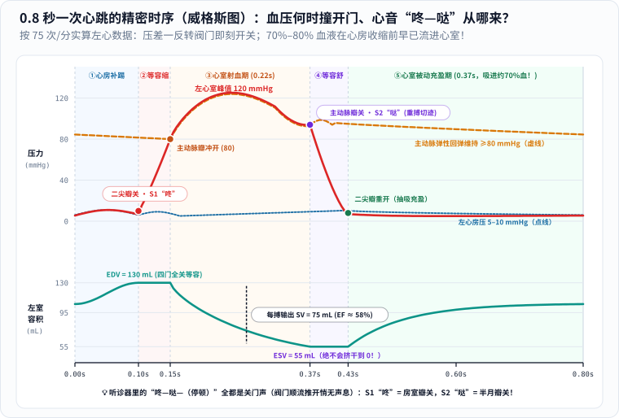
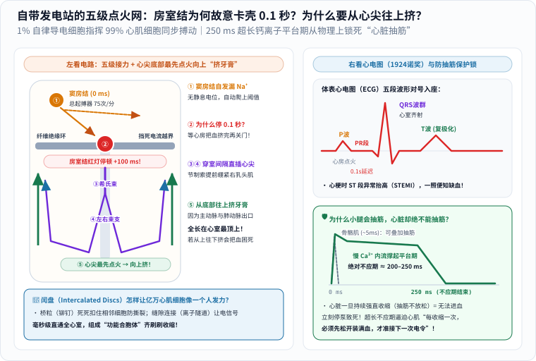
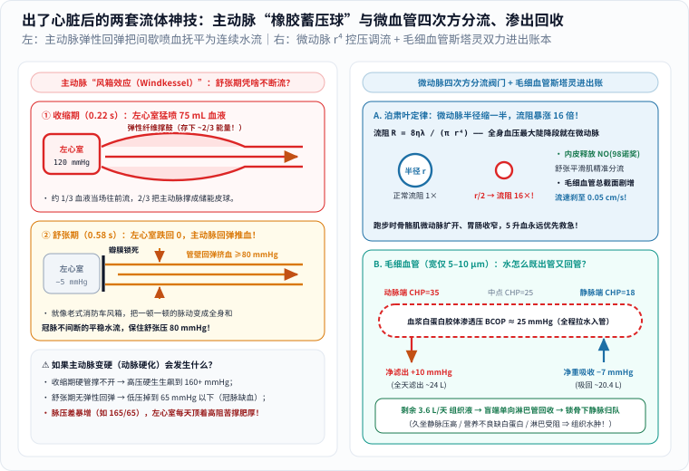
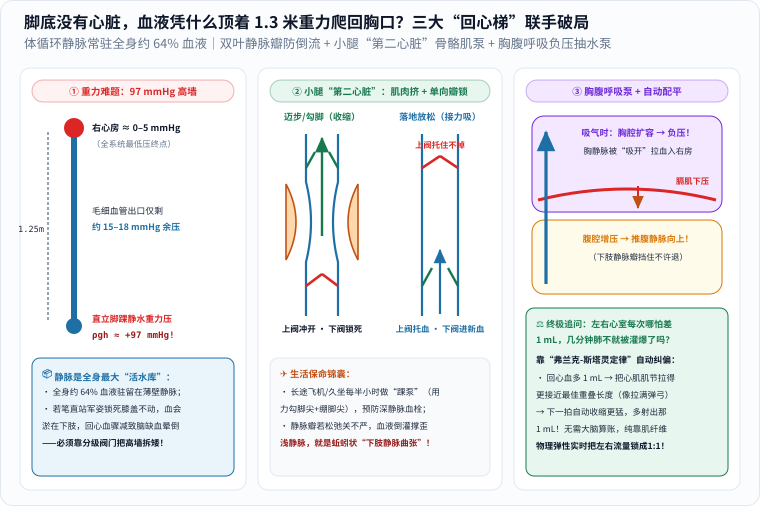

把食指和中指轻轻搭在自己手腕外侧的桡动脉上，静静感受两三下跳动。

每跳一下，大约是 **$$0.8\ \mathrm{s}$$**（按安静心率每分钟 $$75$$ 次计算）[[1]](#ref-1)[[3]](#ref-3)。在这短短五分之四秒里，你胸骨正后方那颗只有拳头大小、重量仅 **$$250\text{–}350\ \mathrm{g}$$** 的心脏，刚刚把约 **$$70\text{–}80\ \mathrm{mL}$$** 鲜血（差不多一小盒酸奶的三分之二）猛地推进主动脉[[1]](#ref-1)[[3]](#ref-3)。

在之前的文章[《拳头大的心脏凭什么一天泵血7吨？从人体四腔双循环、章鱼三颗心蓝血到南极透明血冰鱼》]()里，我们曾站到六亿年动物演化的高度，对比过人类、章鱼、昆虫和鳄鱼的供血蓝图。但只要把镜头拉近、真正钻进**我们自己这颗人类心脏和血管内部**，一连串让流体力学工程师都拍案叫绝的悬念就会扑面而来：

1. **四扇阀门“零肌肉操控”之谜**：心脏里有四扇每天开合超过 **$$10$$ 万次**的单向阀门（瓣膜），但瓣膜叶片上**连一根负责拉门或推门的肌肉都没有**——它们是怎么做到毫秒不差地自动开门、又在 $$120\ \mathrm{mmHg}$$ 高压暴击下绝不翻门漏水的[[1]](#ref-1)[[3]](#ref-3)？
2. **心脏自己“只能在休息时吃饭”的怪癖**：全身所有器官都是在心脏收缩射血时迎接着最猛的供血洪峰，唯独心脏自己的**冠状动脉**恰恰相反——心脏越用力收缩，冠脉血流越接近断流；**心肌居然全靠舒张放松的那半秒钟给自己“喂饭”**[[1]](#ref-1)！
3. **停泵半秒却不断流的戏法**：每一次 $$0.8\ \mathrm{s}$$ 的心跳里，左心室真正往主动脉射血的时间只有约 **$$0.22\ \mathrm{s}$$**，剩下近 **$$0.58\ \mathrm{s}$$** 左心室压力甚至跌回接近 $$0\ \mathrm{mmHg}$$[[3]](#ref-3)。可为什么你全身的血液没有变成“喷一下、停半秒”的顿挫水柱，血压计上的低压还能稳稳停在 **$$80\ \mathrm{mmHg}$$**[[4]](#ref-4)[[5]](#ref-5)？
4. **脚底无泵怎么爬上 $$1.3$$ 米高坡**：血液挤过全身毛细血管后，残余推力只剩可怜的 **$$15\text{–}18\ \mathrm{mmHg}$$**；当你笔直站立时，从胸口到脚踝那根 $$1.25\text{–}1.3\ \mathrm{m}$$ 高的血柱光靠地球重力就会压下近 **$$95\text{–}100\ \mathrm{mmHg}$$** 的静水压[[5]](#ref-5)[[6]](#ref-6)。脚底板里又没装第二颗心脏，全身 **$$64\%$$** 驻留在静脉里的血液凭什么逆着重力爬回胸口[[5]](#ref-5)？

其实，整套人类血液循环系统只遵守一条极其纯粹的底层铁律：

> **血液永远、且只从压强大的地方流向压强小的地方（$$\Delta P = P_1 - P_2 > 0$$）[[3]](#ref-3)[[5]](#ref-5)。**

心脏和血管所做的一切精妙设计——左右分家、四扇单向门、电信号故意延迟 $$0.1\ \mathrm{s}$$、从下往上拧毛巾、主动脉橡胶蓄能、微动脉四次方分流、再到小腿与呼吸抽水泵——全都是在**制造、接力和守护这道压强差 $$\Delta P$$**。今天，我们就跟着一滴血走完一整圈 **12 站闭环**，把它的流动原理拆个一清二楚。

---

## 一、一台外壳合体、内里彻底隔绝的“双联水泵”：跟一滴血走完 12 站

很多人第一次看医学解剖图都会懵一下：**“为什么图上左边的房间写着右心房、右边反而写着左心房？”**

道理很简单：医学标准解剖图永远采用**“医生面对面看着病人”的正面视角**——病人的右侧身体正好在图面左边，病人的左侧身体在图面右边[[1]](#ref-1)。弄清了这个左右方位，再看下面这张一滴血走完一圈的 **12 站路线图**，所有管道就瞬间顺畅了：

_先看左栏跟读一滴血的 12 站“8 字形”单向旅程（动画中小球演示完整闭环流动一次，静态箭头与虚实线始终保留完整路线：蓝色虚线为暗红缺氧血，红色实线为鲜红富氧血）；再看右栏对比两类纯压差驱动的单向瓣膜，以及主动脉瓣口袋上方在舒张期喂养冠状动脉的精巧布局。[单独打开大图（刷新可重播单次路线动画）](/assets/images/heart-blood-circulation/four-chambers-and-four-check-valves.svg)。_

### 1. 为什么非要把一颗心劈成“薄壁右泵 + 厚壁左泵”？

从流体回路上看，我们的血液循环绝不是一个单圈跑道，而是由**致密厚实的室间隔（Interventricular Septum）**严丝合缝隔开、串联成“8 字形”的**两台水泵**[[1]](#ref-1)：

- **右心系统 = 低压“肺部换气泵”（第 ①→⑥ 站）**：全身用完氧气的暗红色静脉血，经 **① 上、下腔静脉**（外加回收心脏自身静脉血的**冠状窦**）汇入全系统压强最低的终点 **② 右心房（约 $$0\text{–}5\ \mathrm{mmHg}$$）**[[1]](#ref-1)[[5]](#ref-5) $$\to$$ 推开 **③ 三尖瓣**流入 **④ 右心室** $$\to$$ 右心室轻轻一挤（峰值压强仅约 **$$25\ \mathrm{mmHg}$$**），冲开 **⑤ 肺动脉瓣**，把血送进 **⑥ 肺动脉与肺泡毛细血管网**排出二氧化碳、装满新鲜氧气[[1]](#ref-1)。
- **左心系统 = 高压“全身快递泵”（第 ⑦→⑫ 站）**：刚在肺里充好氧的鲜红血液，顺着 **⑦ 四条肺静脉**流回 **⑧ 左心房（约 $$5\text{–}10\ \mathrm{mmHg}$$）** $$\to$$ 推开 **⑨ 二尖瓣**进入 **⑩ 左心室** $$\to$$ 左心室爆发式收缩，把压强猛推到 **$$120\ \mathrm{mmHg}$$**（接近右心室的 **$$5$$ 倍**！），冲开 **⑪ 主动脉瓣**，经 **⑫ 主动脉干线**一口气送上头顶大脑、远至脚趾尖的全身毛细血管网，最后再回到第 ① 站[[1]](#ref-1)[[5]](#ref-5)。

看到这里，两个最容易搞混的生理学常识就不攻自破了：

第一，**为什么左心室的肌肉壁（约 $$12\text{–}15\ \mathrm{mm}$$）比右心室（约 $$3\text{–}5\ \mathrm{mm}$$）厚了足足三倍多，但两边每次挤出的血量却一模一样（都是约 $$70\text{–}80\ \mathrm{mL}$$）[[1]](#ref-1)[[3]](#ref-3)？**
因为两台水泵串联在同一条闭环管道上，每分钟流过右心的血量（约 $$5.25\ \mathrm{L/min}$$）必须严格等于流过左心的血量！但**右心室只负责把血送到紧挨着它的双肺**，肺部血管又短又宽、阻力极小，而且肺泡呼吸膜薄到只有约 $$0.5\ \mu\mathrm{m}$$——要是右心室也使出 $$120\ \mathrm{mmHg}$$ 的蛮力，薄如蝉翼的肺泡当场就会被高压血浆挤漏成急性肺水肿！反过来，**左心室要克服全身漫长血管网的巨大阻力**把血送上大脑，就必须练出一身三倍厚的螺旋状心肌[[1]](#ref-1)。

第二，**“动脉流鲜红血、静脉流暗红血”是个典型的半截话误区！**
在解剖学上，**凡是离开心脏往外走的血管一律叫“动脉（Artery）”，凡是朝心脏回流的血管一律叫“静脉（Vein）”**——名字只看流向，绝不看含氧量[[1]](#ref-1)[[4]](#ref-4)！因此在出生后的人体里，**肺动脉是全身唯一流淌暗红缺氧血的动脉，而四条肺静脉则是全身唯一流淌鲜红富氧血的静脉**[[1]](#ref-1)[[4]](#ref-4)。

顺便提一个救命的解剖细节：这颗四腔泵正好悬在胸腔正中偏左的纵隔里，**前面紧贴坚硬的胸骨（第 4 至第 9 胸椎高度），正后方顶着坚硬的胸椎骨**[[1]](#ref-1)。这就是为什么遇到心脏骤停时，外人双手叠放在胸骨下半段垂直往下按压至少 $$5\ \mathrm{cm}$$（心肺复苏 CPR），就能像夹核桃一样借胸骨与脊柱直接挤扁心室，人工制造压强差把救命血泵进大脑[[1]](#ref-1)！

### 2. 四扇“零电机”单向门：防翻降落伞绳 vs 三只燕子窝兜袋

既然心室一收缩压强暴涨，血液为什么不会原路倒灌回心房？射出去的血在心室放松时，又为什么不会从大动脉倒流回心室？

全靠守在心室进出口的**四扇纯机械单向止回阀（瓣膜）**[[1]](#ref-1)。最奇妙的是，这些瓣膜本身是由心内膜折叠外包结缔组织构成的柔韧薄片，**没有任何肌肉能主动把门拉开**——它们百分之百靠门两边的流体压强差 $$\Delta P$$ 自动开合[[1]](#ref-1)[[3]](#ref-3)，却演化出了截然不同的两套防倒流绝活（见上图右栏）：

1. **进口门——房室瓣（右三尖瓣、左二尖瓣）：带“防翻伞拉绳”的降落伞门**
   当心房压强略高于心室（$$P_{\text{房}} > P_{\text{室}}$$）时，血流顺势把柔顺的瓣叶往心室里推垂开来，毫无阻碍[[1]](#ref-1)。可一旦心室开始收缩、左心室压强瞬间飙向 $$120\ \mathrm{mmHg}$$（远高于左心房的 $$5\text{–}10\ \mathrm{mmHg}$$），倒冲的血液立刻把瓣叶往上顶合关门[[1]](#ref-1)。
   问题来了：狂风天打过雨伞的人都知道，这么猛的反向高压很容易把薄薄的瓣叶直接“吹翻面”捅进心房（医学上叫**瓣膜脱垂 / 返流**）[[1]](#ref-1)！演化是怎么解决的？在心室底部长出了几座肉柱叫**乳头肌（Papillary Muscles）**，用富含 $$80\%$$ 胶原纤维的坚韧细绳——**腱索（Chordae Tendineae，英文俗称“心弦 heart strings”）**死死系住瓣叶边缘[[1]](#ref-1)。心室收缩的同一毫秒，乳头肌同步收紧拽住腱索——**注意，乳头肌绝不是拉开门或关上门，而是像降落伞兵攥紧伞绳一样，死死拉住关好的门板不许它向心房翻过去**[[1]](#ref-1)！
2. **出口门——半月瓣（肺动脉瓣、主动脉瓣）：三只自锁“燕子窝口袋”**
   守在大动脉根部的两扇半月瓣，一根腱索都没有[[1]](#ref-1)！它们每一扇都由**三只像燕子窝（或衬衫胸袋）一样朝向大动脉开口的半月形兜袋**拼成[[1]](#ref-1)。心室射血时（$$P_{\text{室}} > P_{\text{动脉}}$$），急流把三只空口袋贴着管壁冲扁让路；等心室一舒张压强骤降（$$P_{\text{室}} < P_{\text{动脉}}$$），大动脉里的血刚想往回退半步，瞬间就会灌满这三只口袋——口袋一鼓胀，三个边缘在管道正中央严丝合缝地顶死自锁，滴水不漏[[1]](#ref-1)！

### 3. 反直觉彩蛋：劳苦功高的心脏，为什么只能在“休息时”给自己喂饭？

仔细看上图右下角的黄色放大框——在主动脉瓣那三只燕子窝口袋正上方，主动脉根部管壁微微向外鼓出三个小窝（主动脉窦），其中左后窦与前窦正好开着两个小孔：这就是喂养整颗心脏肌肉的**左、右冠状动脉开口**[[1]](#ref-1)！

这就引出了人体循环里最反直觉的一幕：**冠状动脉的血流并不是连续的，它在心脏最卖力收缩射血时几乎停滞，反而在心肌彻底放松的舒张期达到洪峰[[1]](#ref-1)！**

为什么会这样？两重物理原因叠在一起：
- **收缩期“自断粮道”**：左心室剧烈收缩产生 $$120\ \mathrm{mmHg}$$ 高压时，紧绷扭转的厚重心肌会把穿行在肌肉深处的冠状微血管硬生生挤扁压瘪，血流根本钻不进去[[1]](#ref-1)；
- **舒张期“回弹灌注”**：等左心室一放松，心肌松开血管，与此同时主动脉根部的血液回退灌满主动脉瓣三只口袋把大门锁死，**弹性回缩的主动脉壁保持着 $$80\ \mathrm{mmHg}$$ 以上的舒张压，刚好顺着瓣兜上方的两个开口，把富含氧气的鲜血源源不断灌进左、右冠状动脉**[[1]](#ref-1)！

这也解释了为什么心率不能无休止地狂飙：当心率过快（比如病理性心动过速突破 $$200$$ 次/分）时，被大幅压缩的恰恰是**舒张期时间**——心脏连喘口气给自己“喂饭”的空档都没了，心肌很快就会缺血缺氧[[1]](#ref-1)[[2]](#ref-2)。

---

## 二、拆解 0.8 秒一次心跳：70% 的血不用心房挤，“咚—哒”声全都是关门声！

理解了空间上的四房四门，接下来我们把时间放慢十倍，拿左心系统做标本，看看在一次标准心跳的 **$$0.80\ \mathrm{s}$$（$$800\ \mathrm{ms}$$）** 里，压强曲线和心室血量是怎么一步步咬合切换的——这就是心血管生理学最经典的**威格斯图（Wiggers Diagram）**[[3]](#ref-3)：

_上下两张图共用同一根 $$0.00\text{–}0.80\ \mathrm{s}$$ 时间轴：上图对比左心室压（红实线）、主动脉压（橙虚线）与左心房压（蓝点线），四颗圆点精准标出曲线交叉即阀门自动开关的瞬间；下图同步展示左心室血量在舒张末期容积 $$\mathrm{EDV}=130\ \mathrm{mL}$$ 与收缩末期容积 $$\mathrm{ESV}=55\ \mathrm{mL}$$ 之间的增减。[单独打开大图](/assets/images/heart-blood-circulation/cardiac-cycle-08s-wiggers-pressure.svg)。_

请顺着上图顶部的 **①→⑤ 五条彩色时段带**从左往右跟读，你会连破三个流传极广的常识误区：

### 1. 误区一：“心室里的血全靠心房挤进去”？错，70%–80% 早就自己流进去了！

很多人以为心房和心室是“一级泵喂二级泵”，如果心房不收缩，心室就装不满血。看一眼上图最右侧绿色的 **⑤ 心室被动充盈期（$$0.43\text{–}0.80\ \mathrm{s}$$）** 和最左侧蓝色的 **① 心房收缩期（$$0.00\text{–}0.10\ \mathrm{s}$$）** 就明白了[[3]](#ref-3)：

- 在漫长的心室舒张期里，左心房和左心室**同时处于放松状态**。因为肺静脉回流的血液让左心房压强（约 $$7\text{–}10\ \mathrm{mmHg}$$）高于彻底松弛的左心室（约 $$4\text{–}5\ \mathrm{mmHg}$$），二尖瓣早就大敞四开——**整整 $$70\%\text{–}80\%$$ 的血液，根本不需要心房费半点力气，就已经顺着斜坡哗啦啦被动流进了左心室**（下图青色容积曲线从 $$55\ \mathrm{mL}$$ 一路涨到约 $$105\ \mathrm{mL}$$）[[1]](#ref-1)[[3]](#ref-3)！
- 直到最后 **$$0.10\ \mathrm{s}$$（① 心房补踢 Atrial Kick）**，心房才轻轻收缩一下，把最后 **$$20\%\text{–}30\%$$（约 $$25\ \mathrm{mL}$$）** 血液补塞进心室，让心室装满到**舒张末期容积（$$\mathrm{EDV} \approx 130\ \mathrm{mL}$$）**[[3]](#ref-3)。这也是为什么临床上许多心房颤动（心房失去协调收缩）的老人，安静散步时依然能维持基本供血，只有在爬楼快跑需要那额外 $$20\%$$ 储备时才会明显气喘。

### 2. 误区二：“心室一用力门就开”？先熬过 0.05 秒“四门全关”的等容憋大招！

到了 $$t = 0.10\ \mathrm{s}$$，装满 $$130\ \mathrm{mL}$$ 鲜血的左心室接到电令开始猛烈收缩（进入 **② 等容收缩期，$$0.10\text{–}0.15\ \mathrm{s}$$**）[[3]](#ref-3)：

1. **第一毫秒：反超左心房，砰然关死二尖瓣（敲响第一心音 `S1`“咚”）**
   左心室压强刚从 $$6\ \mathrm{mmHg}$$ 窜过 $$10\ \mathrm{mmHg}$$（图中红线穿过蓝点线的红点），就瞬间反超左心房压，倒冲的血流“砰”地把二尖瓣（右侧同步把三尖瓣）顶合关死[[3]](#ref-3)！门板绷紧与血液湍流撞击胸壁，传进医生听诊器里的就是低沉浑厚的**第一心音 `S1`：“咚（lub）”**[[1]](#ref-3)。
2. **接下来 $$0.05\ \mathrm{s}$$：四扇门全都关着，体积一毫升不变，压强狂飙 8 倍！**
   此时二尖瓣已经关了，可门外主动脉里还顶着上一拍留下的 **$$80\ \mathrm{mmHg}$$** 高压（橙色虚线），主动脉瓣根本推不开！于是左心室成了一间**进出口四扇门全部锁死的密闭水舱**——因为液体不可压缩，心室容积死死卡在 $$130\ \mathrm{mL}$$ 水平线纹丝不动（所以叫**“等容”收缩期**），而心肌憋足全力猛勒，短短 $$50\ \mathrm{ms}$$ 就把舱内压强从 $$10\ \mathrm{mmHg}$$ 垂直拉升突破 **$$80\ \mathrm{mmHg}$$**[[3]](#ref-3)！

### 3. 射血与误区三：心脏每次会把血“挤干清零”吗？绝不，总要留近四成家底！

一旦在 $$t = 0.15\ \mathrm{s}$$ 冲破 $$80\ \mathrm{mmHg}$$ 门槛（图中橙点），主动脉瓣豁然洞开（顺流开门悄无声息！），进入 **③ 心室射血期（$$0.15\text{–}0.37\ \mathrm{s}$$）**[[3]](#ref-3)：

左心室压强继续冲上 **$$120\ \mathrm{mmHg}$$** 峰值，把血液猛射进主动脉。但请仔细看下图青色的左心室容积曲线：**它从 $$130\ \mathrm{mL}$$ 降到约 $$55\ \mathrm{mL}$$ 就停住了，绝对不会挤干到 $$0\ \mathrm{mL}$$**[[3]](#ref-3)！把这几个体检心脏彩超单上最常出现的指标算清楚：

$$
\mathrm{SV} = \mathrm{EDV} - \mathrm{ESV} = 130\ \mathrm{mL} - 55\ \mathrm{mL} = 75\ \mathrm{mL}, \qquad \mathrm{EF} = \frac{\mathrm{SV}}{\mathrm{EDV}} = \frac{75}{130} \approx 57.7\%.
$$

- **$$\mathrm{SV}$$（每搏输出量 Stroke Volume）**：每次心跳真正打出去的血量，安静时约 $$70\text{–}80\ \mathrm{mL}$$[[3]](#ref-3)；
- **$$\mathrm{ESV}$$（收缩末期容积 End-Systolic Volume）**：射完血还留在心室里的“战略储备血”，约 $$50\text{–}60\ \mathrm{mL}$$——等遇到危险狂奔、交感神经兴奋时，心肌收缩力增强，就能把这 $$55\ \mathrm{mL}$$ 家底再多挤出二三十毫升救急[[3]](#ref-3)！
- **$$\mathrm{EF}$$（射血分数 Ejection Fraction）**：打出去的血占装满时总血量的百分比。**健康成年人的正常射血分数恰恰是 $$54\%\text{–}62\%$$（绝不是 $$100\%$$！）**[[3]](#ref-3)。如果彩超报告写着 `EF 60%`，千万别吓一跳以为“心脏只剩六成功力”，那恰恰是满分健康的心脏！
- 顺手一乘每分钟心率 $$\mathrm{HR} = 75$$ 次/分，就得到**每分钟心输出量（Cardiac Output）**：

$$
\mathrm{CO} = \mathrm{HR} \times \mathrm{SV} = 75\ \text{次/分} \times 75\ \mathrm{mL} \approx 5.6\ \mathrm{L/min}.
$$

安静时约 $$5\text{–}5.6\ \mathrm{L/min}$$（正好把你全身总血量每一分钟完整洗牌循环一遍！），顶级耐力运动员冲刺时甚至能飙到 $$30\ \mathrm{L/min}$$ 以上[[1]](#ref-1)[[3]](#ref-3)。

到了 $$t = 0.37\ \mathrm{s}$$，左心室力气放尽开始松弛，舱内压强刚跌破主动脉压（约 $$94\ \mathrm{mmHg}$$，图中紫点），主动脉血液立刻往回微退灌满三只半月兜袋，“啪”地锁死主动脉瓣——敲响清脆短促的**第二心音 `S2`：“哒（dub）”**，同时在主动脉压力曲线上弹出一道标志性的小折弯，叫**重搏切迹（Dicrotic Notch）**[[3]](#ref-3)。紧接着经过 $$0.06\ \mathrm{s}$$ 四门全关的 **④ 等容舒张期（$$0.37\text{–}0.43\ \mathrm{s}$$）**，左心室压一路暴跌到 $$8\ \mathrm{mmHg}$$ 以下（绿点），二尖瓣重新推开，下一轮吸水开始[[3]](#ref-3)！

所以，下次把耳朵贴在家人胸口听到的 **“咚—哒—（停顿）—咚—哒—”**，**两声全都是单向门关死时的撞击声**：“咚”是房室瓣关门开始射血，“哒”是半月瓣关门开始休息；如果瓣膜关不严漏了缝，本该干净利落的“咚—哒”之间就会混进吹风一样的嘶嘶声——这就是医生用听诊器捕捉**心脏杂音（Heart Murmur）**的流体力学原理[[1]](#ref-1)[[3]](#ref-3)。

---

## 三、自带发电站的五级点火网：为什么要故意卡壳 0.1 秒、还要从心尖往上挤？

搞懂了水泵怎么动，下一个问题更神奇：**如果你把一块骨骼肌（比如青蛙腿肌肉）切离神经，它就瘫在那里一动不动；可外科移植手术中，一颗完全切断了大脑与外部神经连接的人类心脏，只要泡在温热富氧的营养液里，依然在自己砰砰跳动！电是从哪儿来的？**

秘密在于：心脏里除了 **$$99\%$$ 负责卖力拉绳子的工作心肌细胞**，还藏着 **$$1\%$$ 不干重活、专门负责发电与传令的“自律导电细胞”**[[2]](#ref-2)。它们在心脏内部铺设了一套堪比精密电子表的五级点火网：

_左栏按毫秒拆解从 ① 窦房结自发点火、② 房室结刻意停顿 $$100\ \mathrm{ms}$$、③④ 希氏束与左右束支穿室间隔直插心尖，到 ⑤ 浦肯野纤维自下而上“挤牙膏”的完整电路；右栏上图将电路与 1924 年诺奖心电图 `P–QRS–T` 波形逐段对齐，下图对比骨骼肌与心肌动作电位，解释 $$250\ \mathrm{ms}$$ 钙离子平台不应期如何从物理上杜绝“心脏抽筋”。[单独打开大图](/assets/images/heart-blood-circulation/electrical-pacemaker-av-delay-ecg.svg)。_

### 1. 漏钠离子的“天生节拍器”与两个绝妙的时空心机

普通神经和骨骼肌细胞不干活时，膜电位稳稳停在静息水平；唯独右心房顶部的**① 窦房结（SA Node）**细胞天生“关不严门”——它的细胞膜上有一批慢钠通道会不断往细胞里漏进 $$\mathrm{Na}^+$$，让膜电位从 $$-60\ \mathrm{mV}$$ 自动慢悠悠往上爬（起搏预电位）；一旦爬到 $$-40\ \mathrm{mV}$$ 阈值，钙通道轰然打开完成点火，随后钾通道外排 $$\mathrm{K}^+$$ 复位，周而复始[[2]](#ref-2)！因为窦房结爬坡最快（天生节律 $$80\text{–}100$$ 次/分，平时被迷走神经温柔踩着刹车维持在约 $$75$$ 次/分），它就成了统领全心的**天然总起搏器**[[2]](#ref-2)。

但光会发电还不够——如果电火花从右心房顶上一股脑往下乱窜，心房和心室同时收缩，或者心室上半截先收缩，这台水泵当场就废了！为此，心脏在电路上埋下了**两处天才级的工程巧思**（见上图左栏）：

1. **纤维骨骼绝缘墙 + 房室结故意“卡壳 $$0.1$$ 秒（$$100\ \mathrm{ms}$$）”**
   在心房和心室交界处，横亘着一圈完全不导电的致密结缔组织——**心脏纤维骨骼绝缘环**，把心房传下来的电流死死拦断[[1]](#ref-1)[[2]](#ref-2)。全心唯一的合法过境哨卡，就是心房底部的 **② 房室结（AV Node）**。而房室结的导电细胞故意长得极细、细胞间连接效率极低，硬生生把电信号拖慢了整整 **$$100\ \mathrm{ms}$$（$$0.1\ \mathrm{s}$$）**[[2]](#ref-2)！
   **为什么要故意卡这 $$0.1$$ 秒红灯？** 对照上一节威格斯图的第 ① 阶段就豁然开朗了：它是在**等双侧心房先把最后那 $$20\%$$ 的“临门一脚”血液彻底挤进心室、把房室门关好之后，才放行电信号去点燃心室**[[2]](#ref-2)！
2. **包着绝缘皮直插心尖，从最底下往上“挤牙膏”！**
   熬过 $$100\ \mathrm{ms}$$ 红灯后，电信号钻进 **③ 希氏束（Bundle of His）** 和 **④ 左、右束支**（仅耗时约 $$25\ \mathrm{ms}$$），顺着室间隔内部一路俯冲——注意，沿途它并**不提前引爆心室上半截**，而是直奔心脏最底端的尖尖（**心尖 Apex**），再通过高速 **⑤ 浦肯野纤维网（Purkinje Fibers）** 在约 $$75\ \mathrm{ms}$$ 内**由心尖最底部往心底上方席卷全心室**（同时右束支还分出一条“节制索”捷径，提前几毫秒叫醒右乳头肌把腱索绷紧！）[[1]](#ref-1)[[2]](#ref-2)。
   想想看你平时是怎么挤牙膏的？**因为肺动脉和主动脉这两个出口全都长在心室的“最顶上”**！如果心室从上往下收缩，就像捏住牙膏管脖子往下挤，血液全被困死在心尖盲端；唯有像拧毛巾、从牙膏管最底部往上推挤，才能把血液干脆利落地赶进顶部的两大动脉出口[[1]](#ref-1)[[2]](#ref-2)！

而亿万个普通心肌细胞之所以能像同一个人那样齐刷刷发力，靠的是细胞首尾相接处的**闰盘（Intercalated Discs）**：一面用**桥粒**像钢铆钉一样扣死相邻细胞防撕裂，一面用**缝隙连接**修通离子隧道，让电波畅行无阻[[2]](#ref-2)。1901–1903 年，荷兰生理学家**威廉·爱因托芬（Willem Einthoven）**发明弦线电流计，隔着皮肤在体表录下了这套微弱电流的合成轨迹——`P 波`（心房点火）、`PR 段`（房室结 $$0.1\ \mathrm{s}$$ 停顿）、`QRS 波群`（心室排山倒海齐射）与 `T 波`（心室充电复位），一举斩获 **1924 年诺贝尔生理学或医学奖**[[2]](#ref-2)[[7]](#ref-7)。

### 2. 为什么小腿跑猛了会抽筋，而你的心脏一辈子绝不会“抽筋”？

踢球跑步时，小腿肚子偶尔会突然僵硬缩成一团松不开——生理学上叫**强直收缩（Tetanus）**。这是因为骨骼肌的动作电位极窄（仅 $$2\text{–}5\ \mathrm{ms}$$），如果运动神经连续高频发令，上一次肌肉还没来得及松开，下一次收缩就叠加上去，最后锁死成一块硬疙瘩[[2]](#ref-2)。

试想一下：**要是心脏也来一次持续 10 秒钟的“抽筋缩死不松开”，会发生什么？** 心室一旦不舒张，静脉血一滴都进不来，泵血立刻归零，人几分钟就没命了[[2]](#ref-2)！

心脏是怎么在物理底层把这个致命漏洞焊死的？看上图右下角的绿色平台曲线：当心室肌细胞被快速 $$\mathrm{Na}^+$$ 内流点燃后，细胞膜上的**慢钙通道（L-type $$\mathrm{Ca}^{2+}$$ channels）**紧接着打开，让 $$\mathrm{Ca}^{2+}$$ 持续缓慢流进细胞，硬生生把高电位撑起一段长达约 **$$175\ \mathrm{ms}$$ 的平坦高原（平台期 Plateau Phase）**，使整个动作电位和**不应期长达约 $$250\ \mathrm{ms}$$**[[2]](#ref-2)！在这四分之一秒里，钠通道处于彻底锁死失活状态——哪怕外面再劈来十道异常电脉冲，心肌细胞也一律“拒收不理”，直到它老老实实收缩完并开始舒张进血为止[[2]](#ref-2)。这就是生命最硬核的硬件防死机锁！

---

## 四、出了心脏后的两套流体神技：主动脉“橡胶蓄压球”与微血管四次方分流

现在，$$75\ \mathrm{mL}$$ 鲜血已经被左心室一脚踹进了主动脉。接下来的两站，藏着整条管道最容易让人算错账的两个流体力学奇迹：

_左栏对比收缩期（$$0.22\ \mathrm{s}$$）主动脉弹性撑鼓储能与舒张期（$$0.58\ \mathrm{s}$$）管壁回弹维持 $$80\ \mathrm{mmHg}$$ 连续血流的风箱效应，并解释动脉硬化为何拉大脉压差；右栏展示微动脉泊肃叶四次方阻力阀门（半径缩半流阻飙升 $$16$$ 倍）与毛细血管动脉端滤出、静脉端白蛋白重吸收及淋巴回收的斯塔灵动态平衡。[单独打开大图](/assets/images/heart-blood-circulation/windkessel-aorta-and-poiseuille-microvessels.svg)。_

### 1. 主动脉“风箱效应（Windkessel）”：停泵半秒钟，为什么全身水流一秒不断？

回想一下用手动打气筒或者老式压水井抽水的画面：你压一下，水喷一股；你抬手吸气时，水管立刻断流。左心室在 $$0.80\ \mathrm{s}$$ 里只喷血 $$0.22\ \mathrm{s}$$，剩下 $$0.58\ \mathrm{s}$$ 主动脉瓣死死关着、左心室压跌回接近 $$0\ \mathrm{mmHg}$$——如果主动脉是一根硬邦邦的不锈钢管，那收缩期血压会瞬间飙破天际，而舒张期血压会直接掉到 $$0\ \mathrm{mmHg}$$，大脑每秒钟都要经历一次断流停供[[4]](#ref-4)！

演化的解法，是把直径大于 $$10\ \mathrm{mm}$$ 的主动脉和各大干线修成富含三层弹性蛋白纤维的**“弹性动脉（Elastic Arteries）”**，实现德国生理学家借老式消防车蓄压风箱命名的**“风箱效应（Windkessel Effect）”**[[4]](#ref-4)（见上图左栏）：

- **收缩期（$$0.22\ \mathrm{s}$$）充当蓄能皮球**：左心室猛喷出 $$75\ \mathrm{mL}$$ 血液时，大约只有 $$1/3$$ 当场顺着管道往前流，剩下约 $$2/3$$ 的体积把极具弹性的主动脉管壁往外撑鼓，把心脏做功的动能暂时转化成**管壁弹性势能**存起来（顺便缓冲了高压峰值，让收缩压停在温和的 $$120\ \mathrm{mmHg}$$）[[4]](#ref-4)；
- **舒张期（$$0.58\ \mathrm{s}$$）充当第二水泵**：主动脉瓣“啪”地锁死后，被撑鼓的主动脉壁像松开的厚橡皮筋一样**弹性回缩（Elastic Recoil）**，一面把存下的血液平稳往全身下游推，一面往回灌进冠状动脉，让整个舒张期的动脉压始终稳稳托在 **$$80\ \mathrm{mmHg}$$** 以上[[1]](#ref-1)[[4]](#ref-4)！

读懂了这个蓄压器，你就能秒懂家里长辈量血压时的两个核心数字[[5]](#ref-5)：
- 年轻柔软的血管：**收缩压 / 舒张压 $$\approx 120 / 80\ \mathrm{mmHg}$$**，两者之差叫**脉压（Pulse Pressure $$= 40\ \mathrm{mmHg}$$）**；由于舒张期占了约 $$2/3$$ 时间，推动全身器官灌注的**平均动脉压（$$\mathrm{MAP}$$）**不是两数简单平均的 $$100$$，而是更偏向舒张压[[5]](#ref-5)：

$$
\mathrm{MAP} \approx P_{\text{舒张}} + \frac{1}{3}\left(P_{\text{收缩}} - P_{\text{舒张}}\right) = 80 + \frac{1}{3}(120 - 80) \approx 93.3\ \mathrm{mmHg}.
$$

- **为什么老年人动脉硬化（Arteriosclerosis）后，常常测出 `165 / 65 mmHg` 这样“高压奇高、低压反而偏低”的大脉压差[[4]](#ref-4)[[5]](#ref-5)？** 因为弹性纤维老化钙化变成了“硬塑料管”——收缩期管壁撑不开，$$75\ \mathrm{mL}$$ 血硬挤进去让高压飙到 $$165\ \mathrm{mmHg}$$；到了舒张期又没有弹性回弹托底，低压唰地掉到 $$65\ \mathrm{mmHg}$$ 以下（连心脏自己的冠状动脉都跟着灌注不足）[[1]](#ref-1)[[5]](#ref-5)！

### 2. 微动脉四次方分流阀门（$$R \propto 1/r^4$$）与毛细血管急刹 700 倍

顺着主动脉分支一路往下，到了直径缩至 **$$30\ \mu\mathrm{m}$$ 以下的微动脉（Arterioles）**，我们迎来了整套血管网真正的**“压力总闸门与流量调度室”**[[4]](#ref-4)[[5]](#ref-5)。

法国医生兼物理学家**泊肃叶（Jean Léonard Marie Poiseuille）**推导出层流圆管里的血流量 $$Q$$ 与流阻 $$R$$ 定律[[5]](#ref-5)：

$$
Q = \frac{\pi \Delta P\, r^4}{8 \eta \lambda}, \qquad R = \frac{\Delta P}{Q} = \frac{8 \eta \lambda}{\pi r^4}.
$$

把公式里的符号对号入座：$$\eta$$ 是血液黏度，$$\lambda$$ 是血管长度，而分母上最惊心动魄的是**血管内半径 $$r$$ 的四次方（$$r^4$$）**[[5]](#ref-5)！这意味着什么？

- 假如某条微动脉外圈的平滑肌稍微收紧一点，让管腔**半径缩水一半（$$r \to \frac{1}{2}r$$）**，流阻不是增加 $$2$$ 倍，而是暴涨 **$$2^4 = 16\ \text{倍}$$**，血流量瞬间暴跌到原来的 **$$1/16$$**[[5]](#ref-5)！
- 反过来，当血管内皮细胞释放气体信使**一氧化氮（$$\mathrm{NO}$$，1998 年诺贝尔生理学或医学奖成果）**让平滑肌放松[[7]](#ref-7)，哪怕管腔**半径只扩宽 $$19\%$$（$$1.19^4 \approx 2.0$$）**，流向这块组织的血流量就能直接**翻一倍**！

全身只有约 $$5\ \mathrm{L}$$ 血液，根本不可能在同一时刻把所有器官的血管全部灌满。正是靠微动脉这把“四次方水龙头”：吃完午饭时，胃肠道微动脉扩开、骨骼肌微动脉微收；百米冲刺时，双腿骨骼肌微动脉大开、肠道微动脉收紧——好钢永远精准用在刀刃上[[4]](#ref-4)[[5]](#ref-5)！

紧接着，血液涌进内径只有 **$$5\text{–}10\ \mu\mathrm{m}$$**（刚好只容许直径约 $$7.5\ \mu\mathrm{m}$$ 的红细胞排成单列侧身挤过！）的亿万根**毛细血管（Capillaries）**[[4]](#ref-4)。奇怪的事情发生了：管道明明变细了，主动脉里每秒飙出 **$$30\text{–}40\ \mathrm{cm/s}$$** 的急流，到了毛细血管却瞬间急刹慢了近 **$$700$$ 倍**，变成每秒只挪动约 **$$0.05\ \mathrm{cm/s}$$（半毫米每秒）** 的慢镜头[[5]](#ref-5)！

这并不违背物理定律——因为流体满足连续性方程 $$Q = A_{\text{总}} \cdot v$$。虽然单根毛细血管极细，但全身数十亿根毛细血管并联铺开后的**总横截面积 $$A_{\text{总}}$$** 比主动脉截面积大了数百倍，就像湍急的峡谷江水突然散入无边无际的芦苇湿地，流速自然骤降，留出宝贵的 $$1\text{–}2$$ 秒让红细胞从容卸下氧气[[5]](#ref-5)！

### 3. 斯塔灵双力拉锯：每天滤出 24 升水送货，怎么保证人不会肿成气球？

毛细血管壁薄到只剩孤零零一层内皮细胞[[4]](#ref-4)。氧气和二氧化碳可以直接穿膜扩散，而携带着葡萄糖、氨基酸的大批水分想要高效进出组织，靠的是**“往外推的血压”与“往里吸的蛋白质渗透压”之间的拉锯战**（见上图右下角）[[6]](#ref-6)：

1. **往外推的力——毛细血管静水压（$$\mathrm{CHP}$$）**：刚从微动脉钻进毛细血管**动脉端**时，血压还有约 **$$35\ \mathrm{mmHg}$$**；一路摩擦消耗流到**静脉端**时，跌到只剩约 **$$18\ \mathrm{mmHg}$$**[[6]](#ref-6)。
2. **往里吸的力——血浆胶体渗透压（$$\mathrm{BCOP}$$）**：血液里悬浮着大量肝脏制造的**血浆白蛋白**，它们个头太大钻不出毛细血管壁，像海绵一样全程产生恒定约 **$$25\ \mathrm{mmHg}$$** 的吸水拉力[[6]](#ref-6)。

两边一减，算出**净滤过压（$$\mathrm{NFP} = \mathrm{CHP} - \mathrm{BCOP}$$，忽略极小的组织液静水与胶体压）**，奇迹出现了[[6]](#ref-6)：

- **前半程（动脉端）**：$$\mathrm{NFP} = 35 - 25 = +10\ \mathrm{mmHg}$$（推力赢！）$$\implies$$ 血浆水分携带着营养物质源源不断滤出血管，冲刷滋养周围细胞；全天累计滤出高达 **$$24\ \mathrm{L}$$**[[6]](#ref-6)！
- **正中点**：$$\mathrm{CHP} = \mathrm{BCOP} = 25\ \mathrm{mmHg} \implies \mathrm{NFP} = 0$$，进出平衡[[6]](#ref-6)。
- **后半程（静脉端）**：$$\mathrm{NFP} = 18 - 25 = -7\ \mathrm{mmHg}$$（白蛋白吸力赢！）$$\implies$$ 带着细胞代谢废物的组织液自动被吸回血管，全天重吸收约 **$$20.4\ \mathrm{L}$$**[[6]](#ref-6)！
- **剩下的 $$24 - 20.4 = 3.6\ \mathrm{L/\text{天}}$$ 去哪儿了？** 全部被守在组织间隙里的盲端单向**淋巴毛细血管**捡起来，一路过淋巴结安检杀菌后，从脖子根部的**左、右锁骨下静脉**分毫不差地倒回血液循环[[6]](#ref-6)！一旦久坐不动抬高了静脉端静水压、或者严重营养不良/肝病导致白蛋白过低（$$\mathrm{BCOP}$$ 拉不住水）、又或者淋巴管受阻，水分滞留在组织缝隙里，就是我们肉眼可见的**水肿（Edema）**[[5]](#ref-5)[[6]](#ref-6)！

---

## 五、终极悬念：脚底没有水泵，血液凭什么顶着 1.3 米重力爬回胸口？

现在，血液走到了全剧最凶险的返程路段——**体循环静脉**。

很多人不知道，静脉绝不只是几根回水软管，它是全身最大的**“活体储血水库”**：由于静脉管壁薄、管腔大、顺应性极高，你在安静状态下全身约 **$$64\%$$ 的总血量**其实都静静待在体循环静脉里[[4]](#ref-4)[[5]](#ref-5)！

可算一算力学账，你会替脚底的静脉血捏一把冷汗：血液走出脚部毛细血管进入微静脉时，心脏给它的初始推力已经被磨得只剩 **$$15\text{–}18\ \mathrm{mmHg}$$**[[5]](#ref-5)[[6]](#ref-6)。当你躺平睡觉时，全身和心脏在同一高度，这点余压推回 $$0\ \mathrm{mmHg}$$ 的右心房绰绰有余；**可一旦你早晨起床笔直站立**，从右心房到脚踝竖起了一根高约 $$h \approx 1.25\text{–}1.30\ \mathrm{m}$$ 的连续血柱（血液密度 $$\rho \approx 1060\ \mathrm{kg/m^3}$$）：

$$
\Delta P_{\text{重力}} = \rho g h \approx 1060 \times 9.81 \times 1.25 \approx 13{,}000\ \mathrm{Pa} \approx 97\ \mathrm{mmHg}!
$$

脚踝静脉壁要硬扛将近 **$$100\ \mathrm{mmHg}$$** 的地球重力坠压！没有脚底心脏，人体是靠哪三台隐形机关把血一节节提回胸口的？看下面这张回心三剑客图解：

_左栏算清直立时脚踝约 $$97\ \mathrm{mmHg}$$ 静水重力压挑战与静脉储存 $$64\%$$ 血量的特性；中栏图解小腿骨骼肌收缩“冲开上阀、锁死下阀”与放松“上阀托血、下阀进血”的分段提水梯；右栏展示吸气时膈肌下压形成的“胸腔负压抽吸 + 腹腔增压上推”呼吸泵，以及弗兰克-斯塔灵定律如何自动把左右心输出量锁死成 $$1:1$$。[单独打开大图](/assets/images/heart-blood-circulation/uphill-venous-return-calf-and-breath-pump.svg)。_

### 1. 第一剑客：小腿“第二心脏”（骨骼肌泵 + 双叶静脉瓣分段提水梯）

在四肢尤其是下肢静脉内壁每隔几厘米，就长着一对朝向心脏开口的**双叶单向静脉瓣（Venous Valves）**[[4]](#ref-4)[[5]](#ref-5)。这相当于把 $$1.3\ \mathrm{m}$$ 高的垂直悬崖，拆成了十几级带单向止回锁的“水闸台阶”，再配合包裹在深静脉四周的小腿腓肠肌与比目鱼肌，组成大名鼎鼎的**骨骼肌泵（Skeletal Muscle Pump，俗称“人体第二心脏”）**[[5]](#ref-5)：

- **迈步 / 踮脚收缩时**：鼓起的小腿肚肌肉把深静脉狠狠一挤，局部静脉压瞬间飙高——**上方的静脉瓣被冲开**，血液噌地往上窜一截进入大腿；与此同时**下方的静脉瓣被死死压紧锁死**，一滴血都不许往脚底漏[[5]](#ref-5)！
- **抬腿 / 落地放松时**：小腿肌肉一松，上方刚刚跑过去的血液刚想往下掉，**上方静脉瓣立刻合拢托住上层血柱的重量**，下段静脉管腔变低压，**下方静脉瓣顺势打开**，把脚底新流过来的血吸进这一格[[5]](#ref-5)！

这一下就打通了三个我们身边最真实的生活现象：
1. **为什么夏日军训站军姿时，教官反复叮嘱“膝盖微曲暗暗绷腿，千万别把膝关节彻底锁死”？** 因为一旦双腿笔直僵立不动，小腿骨骼肌泵彻底停工，大量血液顺着重力淤积在下肢静脉水库里，回流到右心房的血量骤减 $$\implies$$ 左心室无血可打 $$\implies$$ 几秒钟内大脑供血不足，人当场眼前发黑晕倒（体位性晕厥）[[5]](#ref-5)！（顺便一提：倒地躺平本身就是演化留下的保命保护——人一横过来，$$1.3\ \mathrm{m}$$ 重力高差瞬间归零，腿里的血立刻涌回心脏救醒大脑！）
2. **为什么坐十几个小时长途飞机经济舱或久坐写代码，每隔半小时要做几组“踝泵动作”（用力勾脚尖再绷脚尖）？** 因为勾绷脚尖能精准调动小腿骨骼肌泵给深静脉“洗管子”，防止静脉血长期淤滞凝结成凶险的**下肢深静脉血栓（DVT）**。
3. **为什么长期久站的人小腿容易鼓起青紫色蚯蚓状的“静脉曲张”？** 正是因为浅静脉里的双叶静脉瓣长期受压松弛关不严，上方血柱倒灌压垮了下段薄薄的静脉壁[[4]](#ref-4)[[5]](#ref-5)。

### 2. 第二剑客：每一次深呼吸都在抽血——胸腹“呼吸泵”

血液爬过大腿进入腹部下腔静脉后，再往上就没有骨骼肌包裹了，谁来接棒？答案是**你的每一次呼吸（Respiratory Pump）**[[5]](#ref-5)（见上图右栏上方）：

- **当你吸气时**：横隔在胸腹之间的圆顶状**膈肌向下收缩压平**，同时肋间外肌抬起胸廓[[5]](#ref-5)。这一动一举两得：**胸腔体积变大、气压变成负压**，不仅把空气吸进肺里，还顺手把穿行在胸腔里的上、下腔静脉和右心房“吸开”，使胸腔静脉压跌破腹腔静脉压；与此同时，**膈肌往下顶压腹腔脏器使腹腔增压**，挤压腹腔静脉——底下有下肢静脉瓣死死挡着退路，腹腔静脉血只能顺着“下推上吸”的巨大压差直奔右心房[[5]](#ref-5)！

### 3. 第三剑客（收官之问）：左右两台水泵每次哪怕只差 1 毫升，肺怎么没被撑爆？

最后，让我们回答一个细思极恐的控制论终极难题：

右心室负责往肺里灌血，左心室负责把肺里的血抽走打向全身。假如有哪几分钟，**右心室每次心跳只比左心室多打出区区 $$1\ \mathrm{mL}$$ 血液**——按每分钟 $$75$$ 次算，每分钟就有 $$75\ \mathrm{mL}$$ 血液滞留在肺里排不出去，**不出 $$10$$ 分钟你的双肺就会积满 $$750\ \mathrm{mL}$$ 血液彻底溺水窒息**！在长达八十年、$$30$$ 亿次搏动里，没有任何电子流量计的心脏是怎么把左右两台水泵的流量死死配平在 $$1:1$$ 的？

答案叫**弗兰克-斯塔灵心脏定律（Frank-Starling Law of the Heart）**[[3]](#ref-3)[[5]](#ref-5)（见上图右下角）：

在生理范围内，心肌纤维就像一根天然的智能橡皮弹弓——**舒张期流回心室的血越多（前负荷 Preload 越大），把心肌肌节里的肌动蛋白与肌球蛋白拉得越接近最佳发力重叠长度，下一拍心肌的收缩力就会自动变得越猛，把多进来的那点血原封不动地多打出去**[[3]](#ref-3)[[5]](#ref-5)！

一旦你在跑步时小腿肌泵和呼吸泵猛往右心室多塞了 $$15\ \mathrm{mL}$$ 静脉血：
1. 右心室肌纤维被多撑长一点 $$\implies$$ 下一拍右心室自动发力更猛，多打 $$15\ \mathrm{mL}$$ 进肺；
2. 几拍之后，这多出来的 $$15\ \mathrm{mL}$$ 血经肺静脉流进左心室，把左心室肌纤维也多撑长一点 $$\implies$$ 左心室下一拍同样自动发力更猛，把这 $$15\ \mathrm{mL}$$ 分毫不差地打向全身[[3]](#ref-3)！

不需要大脑列任何微积分方程，只靠肌小节蛋白丝最朴素的物理弹性，左右两颗心就这么一拍追一拍、严丝合缝地携手跳动三十亿次。

---

## 六、一张总账表收尾：把心脏血液流动的六大核心关卡装进口袋

下次再摸到自己的脉搏、量血压、看体检心电图或长途久坐勾脚尖时，不妨把下面这张一圈流动的六大物理关卡对照表翻出来回味一眼：

| 流动关卡 | 核心结构设计 | 解决什么流体力学难题？ | 关键生理数值与日常印证 |
| :--- | :--- | :--- | :--- |
| **1. 双泵串联分压** | 右心薄壁（$$\sim 4\ \mathrm{mm}$$）+ 左心厚壁（$$\sim 13\ \mathrm{mm}$$）+ 致密室间隔 | 既要用高压把血送上头顶，又绝不能撑破 $$0.5\ \mu\mathrm{m}$$ 薄的肺泡膜 | 右室峰值约 $$25\ \mathrm{mmHg}$$，左室峰值约 $$120\ \mathrm{mmHg}$$；两边每搏流量严格同为 $$70\text{–}80\ \mathrm{mL}$$ [[1]](#ref-1)[[3]](#ref-3) |
| **2. 四扇纯压差单向门** | 进口房室瓣（乳头肌+腱索防翻绳）+ 出口半月瓣（三只自锁燕子窝兜袋） | 零肌肉拉门，全靠 $$\Delta P$$ 毫秒级自动防倒流 | `S1`“咚”= 房室瓣关；`S2`“哒”= 半月瓣关；**冠状动脉只在舒张期灌血** [[1]](#ref-1)[[3]](#ref-3) |
| **3. 五级点火与防抽筋锁** | 窦房结自发漏 $$\mathrm{Na}^+$$ $$\to$$ **房室结停顿 $$0.1\ \mathrm{s}$$** $$\to$$ 心尖往上挤 + $$250\ \mathrm{ms}$$ $$\mathrm{Ca}^{2+}$$ 平台期 | 等心房排空后再关门；自底向上把血赶向顶部出口；物理杜绝心肌强直抽筋 | 心电图 `P–PR–QRS–T`（1924 诺奖）；心室约 $$70\%\text{–}80\%$$ 血液靠被动充盈流入 [[2]](#ref-2)[[3]](#ref-3)[[7]](#ref-7) |
| **4. 主动脉弹性蓄压** | 富含弹性纤维的大动脉（风箱效应 Windkessel） | 心室 $$0.8\ \mathrm{s}$$ 里停泵 $$0.58\ \mathrm{s}$$，全身与冠脉凭什么不断流？ | 收缩期撑鼓存能、舒张期回弹保住 $$80\ \mathrm{mmHg}$$；血管硬化则脉压差剧增 [[4]](#ref-4)[[5]](#ref-5) |
| **5. 微血管分流与换货** | 微动脉平滑肌（$$R \propto 1/r^4$$）+ 毛细血管总截面剧增 + 斯塔灵双力 | $$5\ \mathrm{L}$$ 血按需分配；急刹流速留足 $$1\text{–}2\ \mathrm{s}$$ 换气；水既出管送货又自动回管 | 半径缩半阻力涨 $$16$$ 倍；全天滤出 $$24\ \mathrm{L}$$ = 白蛋白吸回 $$20.4\ \mathrm{L}$$ + 淋巴回收 $$3.6\ \mathrm{L}$$ [[5]](#ref-5)[[6]](#ref-6)[[7]](#ref-7) |
| **6. 逆重力静脉回心** | 双叶静脉瓣 + 小腿骨骼肌泵 + 胸腹呼吸负压泵 + 斯塔灵心肌弹性定律 | 仅剩 $$15\ \mathrm{mmHg}$$ 余压的静脉血怎样翻越直立 $$97\ \mathrm{mmHg}$$ 重力高墙，且左右流量不失衡？ | 静脉存血 $$64\%$$；军姿锁膝易晕厥，长途久坐做“踝泵”防血栓 [[3]](#ref-3)[[5]](#ref-5) |

此刻，当你读完最后这一行字，胸口那台 $$300$$ 克重的小小双联引擎又已经悄无声息地跳动了大约两三百下——每一次“咚—哒”背后，都是四扇单向门、亿万根心肌纤维、十万级微血管水龙头与每一次呼吸迈步共同谱写的流体力学交响曲。

---

## 参考资料与核查来源

1. J. Gordon Betts 等，*Anatomy and Physiology 2e*（OpenStax，莱斯大学开源大学教材），**§19.1 Heart Anatomy**：核查心脏尺寸与重量（$$250\text{–}350\ \mathrm{g}$$）、纵隔胸骨—胸椎心肺复苏解剖位置、四腔双循环与肺动静脉定义、纤维骨骼环、房室瓣（腱索与乳头肌防脱垂机制）、半月瓣三口袋自锁结构，以及冠状动脉开口于主动脉窦并在心室舒张期达到供血峰值的生理机制。原文链接：<https://openstax.org/books/anatomy-and-physiology-2e/pages/19-1-heart-anatomy>
2. OpenStax *Anatomy and Physiology 2e*，**§19.2 Cardiac Muscle and Electrical Activity**：核查 $$99\%$$ 收缩心肌细胞（闰盘桥粒与缝隙连接）与 $$1\%$$ 自律导电细胞分工、窦房结慢 $$\mathrm{Na}^+$$ 自发预电位、五级传导精确时序（心房约 $$50\ \mathrm{ms}$$、**房室结关键延迟约 $$100\ \mathrm{ms}$$**、希氏束及束支约 $$25\ \mathrm{ms}$$、浦肯野纤维自心尖向上“挤牙膏”式激发约 $$75\ \mathrm{ms}$$），以及慢 $$\mathrm{Ca}^{2+}$$ 内流维持约 $$175\ \mathrm{ms}$$ 平台期与约 $$250\ \mathrm{ms}$$ 总不应期防止心肌强直收缩的机制。原文链接：<https://openstax.org/books/anatomy-and-physiology-2e/pages/19-2-cardiac-muscle-and-electrical-activity>
3. OpenStax *Anatomy and Physiology 2e*，**§19.3 Cardiac Cycle**：核查血液顺压强梯度流动原则、$$0.8\ \mathrm{s}$$ 心动周期各期切换、心室 **$$70\%\text{–}80\%$$ 被动充盈**先于心房收缩（心房补踢占 $$20\%\text{–}30\%$$）、$$\mathrm{EDV} \approx 130\ \mathrm{mL}$$、$$\mathrm{SV} \approx 70\text{–}80\ \mathrm{mL}$$、$$\mathrm{ESV} \approx 50\text{–}60\ \mathrm{mL}$$、正常射血分数 $$\mathrm{EF} \approx 54\%\text{–}62\%$$，以及等容收缩/舒张期与第一心音 `S1`、第二心音 `S2`、主动脉重搏切迹的对应关系。原文链接：<https://openstax.org/books/anatomy-and-physiology-2e/pages/19-3-cardiac-cycle>
4. OpenStax *Anatomy and Physiology 2e*，**§20.1 Structure and Function of Blood Vessels**：核查血管三层膜结构、大口径弹性动脉（$$>10\ \mathrm{mm}$$）扩张储能与弹性回缩维持连续压力梯度（Windkessel 机制）、肌性分配动脉、直径 $$\le 30\ \mu\mathrm{m}$$ 微动脉作为核心阻力血管、$$5\text{–}10\ \mu\mathrm{m}$$ 毛细血管分类及四肢双叶静脉瓣结构。原文链接：<https://openstax.org/books/anatomy-and-physiology-2e/pages/20-1-structure-and-function-of-blood-vessels>
5. OpenStax *Anatomy and Physiology 2e*，**§20.2 Blood Flow, Blood Pressure, and Resistance**：核查收缩压/舒张压（$$120/80\ \mathrm{mmHg}$$）、脉压与平均动脉压公式、**泊肃叶定律**（$$Q = \frac{\pi \Delta P r^4}{8\eta\lambda}$$，半径减半流阻增 $$16$$ 倍）、毛细血管总横截面积骤增使血流减速机制、动脉硬化导致顺应性下降与脉压增宽、体循环静脉容纳约 **$$64\%$$** 血量，以及**骨骼肌泵**（解释军姿锁膝晕厥）与**胸腹呼吸泵**促进静脉回心的机制。原文链接：<https://openstax.org/books/anatomy-and-physiology-2e/pages/20-2-blood-flow-blood-pressure-and-resistance>
6. OpenStax *Anatomy and Physiology 2e*，**§20.3 Capillary Exchange**：核查毛细血管群体流动（Bulk Flow）的斯塔灵力平衡数据——动脉端静水压 $$\mathrm{CHP} \approx 35\ \mathrm{mmHg}$$、静脉端 $$\mathrm{CHP} \approx 18\ \mathrm{mmHg}$$、血浆蛋白胶体渗透压 $$\mathrm{BCOP} \approx 25\ \mathrm{mmHg}$$，对应动脉端净滤过压 $$+10\ \mathrm{mmHg}$$（约 $$24\ \mathrm{L/\text{天}}$$）、静脉端净重吸收压 $$-7\ \mathrm{mmHg}$$（约 $$20.4\ \mathrm{L/\text{天}}$$）及淋巴系统每日回收 $$3.6\ \mathrm{L}$$ 归入锁骨下静脉。原文链接：<https://openstax.org/books/anatomy-and-physiology-2e/pages/20-3-capillary-exchange>
7. NobelPrize.org（诺贝尔奖官方档案），**1924 年诺贝尔生理学或医学奖（Willem Einthoven，“发现心电图机制”）** 与 **1998 年诺贝尔生理学或医学奖（Robert F. Furchgott, Louis J. Ignarro, Ferid Murad，“发现一氧化氮作为心血管系统信号分子”）**。官方页面：<https://www.nobelprize.org/prizes/medicine/1924/summary/> 与 <https://www.nobelprize.org/prizes/medicine/1998/summary/>
