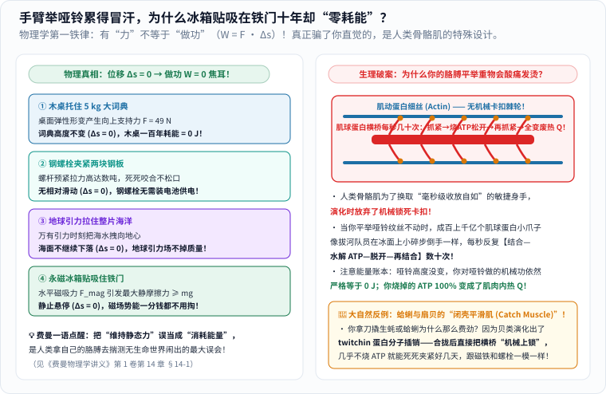
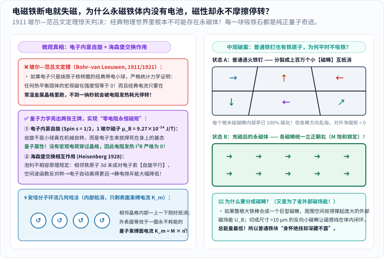
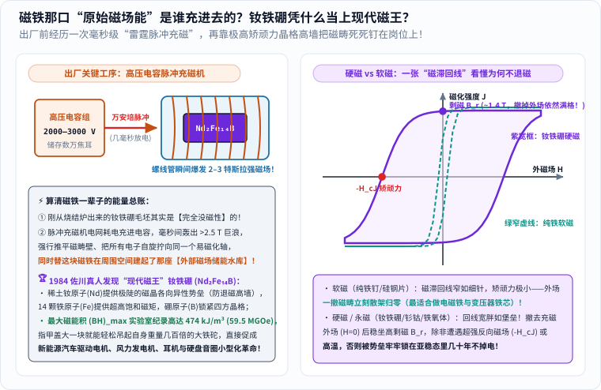
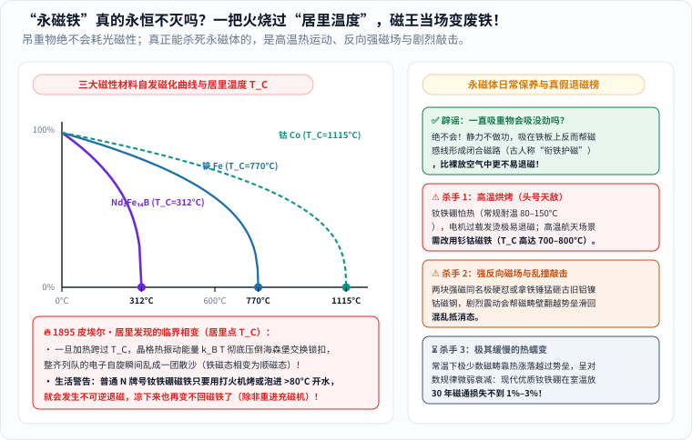

每个认真思考过**能量守恒定律**的人（关于力学做功与热力学内能的账本，可对照阅读[《从力学与热力学的能量守恒读懂状态参量》]()），几乎都在某个盯着冰箱门发呆的下午，脑子里突然冒出过这样一个让人抓耳挠腮的悖论：

1. 你伸直手臂平举一只 $$5$$ 公斤的哑铃，哪怕纹丝不动，不出三分钟胳膊就开始发酸、发烫、直哆嗦，拼命消耗体内的卡路里；
2. 废品站吊汽车的大电磁铁（或者磁悬浮列车的电磁铁，详见[《磁悬浮列车是怎么飘起来飞驰的》]()），也必须源源不断通电交电费，一旦拉闸断电，铁块当场哗啦掉一地；
3. **可凭什么一块既没插电线、也没塞电池的普通“永磁铁”冰箱贴，能年复一年死死吸在竖直铁门上对抗重力，十年二十年都不掉下来？甚至你把一枚铁钉放在桌面上，磁铁隔着几厘米远“啪”地一下就把铁钉加速吸飞过来撞出脆响——既然能量绝对守恒、永动机绝不可能存在，磁铁源源不断的吸力和动能到底是从哪儿掏出来的？！**

别不好意思，这绝不是一个幼稚的问题——诺贝尔物理学奖得主**理查德·费曼（Richard P. Feynman）**在《费曼物理学讲义》里专门花了好几个章节来拆解它 [[1]](#ref-1) [[2]](#ref-2) [[5]](#ref-5)！因为这个问题像剥洋葱一样，一层套着一层，藏着整整**四重物理真相**——直到剥到最核心那一层，你甚至会惊讶地发现：**按照牛顿和麦克斯韦的经典物理学，宇宙里根本不可能存在永磁铁！你家冰箱门上贴着的那块小黑疙瘩，是一件彻头彻尾的宏观量子力学艺术品！**

让我们一层一层把这颗洋葱剥开。

---

## 一、第一层破案：“有力”不等于“做功”！真正骗了你直觉的，是你自己的胳膊

### 1. 木桌托词典、螺栓夹钢板、冰箱贴吸铁门：位移为零，耗能严格等于 $$0$$ 焦耳！

先解开第一个心结：**一块磁铁吸在铁梁底下，常年吊着一颗 $$1$$ 公斤的大铁球不掉下来，它每秒钟需要消耗多少能量？**

物理学给出的标准答案干脆得让人一愣：**严格等于 $$0$$ 焦耳！一丁点能量都不消耗！** [[1]](#ref-1)

为什么？因为在物理学中，“**力（Force，$$\mathbf{F}$$）**”与“**能量 / 做功（Work，$$W$$）**”是两个截然不同的概念！力做功的严格定义是力乘以物体在力的方向上移动的距离：

$$
W = \int \mathbf{F} \cdot d\mathbf{s}
$$

看清那个微分位移 $$d\mathbf{s}$$：**哪怕力 $$\mathbf{F}$$ 大如泰山，只要物体纹丝不动（$$d\mathbf{s} = 0$$），乘出来做的机械功就永远是 $$W = 0$$！** [[1]](#ref-1)（见图 1 左栏）

不信你环顾四周，家里到处都是“一辈子持续发力、却一分钱能量都不花”的例子：

- **书桌托着厚词典**：词典受重力往下压，木桌面发生微小的弹性形变，产生向上的支持力持续顶住词典——木桌需要插电源吗？放一百年木桌也不会因为“托书太累”而变轻或耗尽能量！
- **钢螺栓锁紧桥梁钢板**：拧紧的高强度螺栓内部常年绷着好几吨的夹紧拉力，几十年不松口——螺栓里也没有装电池！
- **地球引力拉住整片太平洋**：地球每秒钟都在用万有引力死死拽着万亿吨海水不往太空飘走——地球从来不需要烧煤来维持引力！
- **冰箱贴吸在铁门上**：永磁铁对铁门施加水平磁吸力 $$F_{\text{磁}}$$，把接触面紧紧压在一起，从而产生大于等于重力的向上静摩擦力（$$f_{\text{静}} \ge mg$$）。只要冰箱贴悬停不动（$$d\mathbf{s} = 0$$），**它就跟木桌托书、挂钩挂衣服一模一样，根本没有对外输出半点能量，自然一辈子都不会违反能量守恒定律！**

### 2. 那为什么人手举着哑铃不动会累得满头大汗？怪你的肌肉没装“机械插销”！

这时候你肯定不服气：“不对呀！既然保持静止 $$d\mathbf{s} = 0$$ 不需要消耗能量，为什么我平举哑铃一动不动，三分钟就累得胳膊发烫、狂烧卡路里？还有电磁铁为什么吸住不动也得一直烧电？”

费曼在《物理学讲义》第 1 卷第 14 章一针见血地指出了人类这个根深蒂固的直觉错觉 [[1]](#ref-1)（见图 1 右栏）：

1. **为什么你的骨骼肌静止发力也会烧能量？因为人体演化为了追求“闪电般收放自如”，故意放弃了机械锁扣！**
   用显微镜看你手臂肌肉里的肌小节：成百上千亿个**肌球蛋白（Myosin）小横桥**像一排排划船的小爪子，钩住旁边的**肌动蛋白（Actin）细丝**往回拉。关键在于，人类的骨骼肌横桥**不能死锁卡住**——每个小爪子抓紧一瞬间后就会滑脱，必须立刻消耗一颗 **`ATP` 能量分子**松手复位、再重新往前抓一把，每秒钟反复循环几十次！这就好比一群拔河队员站在光滑的冰面上拉绳子，绳子虽然没动（**你对哑铃做的外部机械功依然是 $$0$$ 焦耳！**），但队员们脚底下每秒都在拼命原地倒小碎步，你烧掉的所有 `ATP` 化学能 **$$100\%$$ 全都转化成了你胳膊里的生理废热 $$Q$$**，让你满头大汗 [[1]](#ref-1)！
   （大自然里甚至有活生生的反例：你去海鲜市场拿刀撬一只闭紧的**蛤蜊、生蚝或扇贝**试试？贝类的闭壳平滑肌演化出了一种神奇的 `twitchin` 分子插销，叫**锁扣肌 Catch Muscle**——一旦把两片贝壳合拢，分子插销咔哒一锁，几乎不消耗任何 `ATP` 就能死死夹紧好几天，跟磁铁一模一样省电！）
2. **那普通电磁铁为什么一直费电？只怪铜导线有电阻！**
   电磁铁维持静止吸力时，对外机械功同样是 $$0$$！它费电纯粹是因为常温铜线有电阻 $$R$$，电流 $$I$$ 流过时白白在电线里烧掉了焦耳废热 $$P = I^2 R$$！如果你去医院核磁共振室（MRI）看一看里面的**超导电磁铁**：把铌钛超导线圈泡在液氦里让电阻降为 $$R = 0$$，充好一次电后直接拔掉外部电源把线圈短接闭环——**里面的超导电流能一圈圈跑上几十年不衰减，不花一度电持续产生比冰箱贴强几万倍的稳恒强磁场！**

*图 1：静态力零做功铁律与人类骨骼肌耗能假象对比（）。左栏展示木桌托书、螺栓夹紧、地球引力与永磁冰箱贴在位移 $$\Delta s=0$$ 时机械做功严格为零；右栏拆解人类骨骼肌横桥每秒数十次循环水解 ATP 产热的生理机制，以及贝类闭壳锁扣肌的节能反例。*

---

## 二、第二层破案：隔空把铁钉“啪”地吸飞过来，这股真动能是谁付的账？

### 1. 看不见的空间本身就是“储能水库”：$$1.2$$ 特斯拉磁场每立方米藏着 $$573$$ 千焦能量！

看到这儿，聪明的你一定会立刻追问第二个更犀利的问题：

> **“好，吸住不动 $$d\mathbf{s} = 0$$ 不做功我认了！可如果我把一枚铁钉放在离磁铁 $$3$$ 厘米远的桌面上，一松手，磁铁明明隔空把铁钉加速吸飞了 $$3$$ 厘米（$$d\mathbf{s} > 0$$！），‘啪’地一声撞在磁极上，既有动能又有声音还有撞击热——这回总算是实打实做正功了吧？这笔能量又是从谁兜里掏出来的？！”**

问到点子上了！这一次，磁铁确实对外做了货真价实的机械功！而替这笔动能买单的金主，就藏在磁铁周围看似空无一物的空气与真空里——**空间磁场能量（Magnetic Field Energy）** [[2]](#ref-2) [[3]](#ref-3)！（见图 2 上栏单次动画）

麦克斯韦电磁场理论早已严格证明：磁场绝不只是课本上画着玩的几根虚线，**只要空间某处存在磁感应强度 $$\mathbf{B}$$，那片空间本身就像被压紧的弹簧一样，实实在在储存着能量**！在真空或空气中（磁导率 $$\mu_0 = 4\pi \times 10^{-7}\ \mathrm{N/A^2}$$），单位体积储存的磁场能量密度 $$u_B$$ 精确等于 [[2]](#ref-2) [[3]](#ref-3)：

$$
u_B = \frac{B^2}{2\mu_0}
$$

我们来算一算这笔账有多可观：在一块强力钕铁硼磁铁磁极表面（$$B \approx 1.2\ \mathrm{T}$$），每立方米空间储存的磁场能量密度高达：

$$
u_B = \frac{1.2^2}{2 \times 4\pi \times 10^{-7}} \approx 5.73 \times 10^5\ \mathrm{J/m^3} = 573\ \mathrm{kJ/m^3}
$$

整整空间积分起来（$$U_B = \int \frac{B^2}{2\mu_0}\,dV$$），磁铁周围张开的那片发散外部磁场，就是一座货真价实的**便携式势能水库**！

那铁钉飞过来时，这座水库发生了什么变化 [[3]](#ref-3) [[4]](#ref-4)？

- 铁属于高磁导率铁磁材料（相对磁导率 $$\mu_r$$ 高达 $$1{,}000\text{–}5{,}000$$ 倍 [[4]](#ref-4)），对磁感线来说就像一条超低阻力的“绿色快速通道”；
- 当铁钉在远处时，磁铁外部的磁感线被迫大范围散开在空气里，外部空间总磁场能 $$U_B$$ 处于**高水位**；
- 当铁钉被吸近并最终贴在磁极上时，原本散在外部空气里的磁感线纷纷顺着铁钉内部集中收拢回去，**周围外部空间的杂散磁场大幅缩水，系统总磁场势能骤降了 $$-\Delta U_B$$** [[3]](#ref-3)！
- 减少的这笔磁场势能 $$-\Delta U_B$$，一分不少地转化成了**铁钉飞奔的动能 $$E_k$$**，并在“啪”地撞上磁极那一刻变成了清脆的声波与微小的热能！

### 2. 为什么抖音上的“磁铁永动机”全都是骗局？因为这是一锤子买卖！

一听说外部磁场能释放动能，历史上成千上万个民间发明家眼睛都绿了：“那我摆一圈磁铁轮流吸铁球，岂不是能造出不烧油不充电的磁力永动机？！”

只可惜，看一眼图 2 下栏的**磁势能曲线 $$U(x)$$**，永动机美梦一秒钟就会彻底粉碎 [[3]](#ref-3)：

磁铁吸铁钉，在物理本质上跟**“一颗石头从桌子边滚落到地板上砸出响声”**或者**“一根拉长的橡皮筋松手弹回原长”**完完全全是一回事！

1. 石头掉到地板上释放了一次引力势能，躺在地坑最底端（$$U_{\min}$$）——它还能自己跳回桌子上再砸第二次吗？绝不可能！
2. 同样道理，铁钉“啪”地吸死在磁极上之后，整套“磁铁 + 铁钉”已经掉进了**磁势能最低谷底（$$U_{\min}$$）**！静磁场是一个严格的**保守力场**，沿着任何闭合路径转一圈，磁力做的净功永远严格为零：

$$
\oint \mathbf{F}_{\text{磁}} \cdot d\mathbf{s} = 0
$$

3. 如果你想让这块磁铁再表演第二次“隔空吸铁钉”，怎么办？**你必须伸出自己的手（吃饱米饭烧掉体内的 `ATP`！），使劲把贴在磁极上的铁钉硬生生拽开拉回远处！** 你手指头往外拽铁钉所做的那份正功 $$W_{\text{人手}} \ge +\Delta U_B$$，恰好分毫不差地把刚才花掉的那笔磁场能量**重新充回了磁铁周围的空间水库里** [[3]](#ref-3)！网上所有转个不停的所谓“纯磁铁永动机”小视频，拆开底座一看，底下百分之百藏着纽扣电池和霍尔干簧管线圈！

*图 2：外部空间磁场能驱动铁钉加速单次动画与保守场闭环（，刷新可重播吸合能量转化动画）。上栏展示铁钉被吸向磁极时收拢杂散磁感线、空间总磁场能 $$U_B$$ 降低并转化为动能与声热；下栏绘制磁势能谷底曲线，证明掰开铁钉所需人手做功正好把能量充回磁场，粉碎永动机幻想。*

---

## 三、第三层破案：没有电池供电，为什么原子里的磁性永远不会被“电阻”磨停？

剥到这里，最深邃、最迷人的第三层问题浮出了水面：

> **“好，我懂了空间磁场像弹簧一样存着势能！可安培当年不是说‘一切磁性都来自电流’吗？普通铜线圈一断电，里面的电子不到一眨眼就被晶格电阻撞停了；永磁铁肚子里又没有装微型核电池，凭什么它里面的‘原子电流’能几十年如一日转个不停、一点都不被电阻发热耗光？！”**

给自己的好奇心鼓个掌吧——因为一百年前最顶尖的经典物理学家，在这个问题面前全军覆没了！

### 1. 玻尔—范吕文定理：在牛顿与经典电磁学世界里，永磁铁根本不可能存在！

1911 年尼尔斯·玻尔（Niels Bohr）在博士论文中提出，1919 至 1921 年荷兰女物理学家**亨德리카·约翰娜·范吕文（Hendrika Johanna van Leeuwen）**给出了无懈可击的严格证明，这就是统计物理学中大名鼎鼎的**玻尔—范吕文定理（Bohr–van Leeuwen Theorem）** [[5]](#ref-5)（见图 3 左栏上）：

如果世界严格遵守牛顿力学与经典麦克斯韦电磁学——把电子看成一颗颗绕着原子核旋转或自由穿梭的经典带电小球——由于磁场洛伦兹力永远垂直于速度方向、对电子不做功，放进玻尔兹曼热平衡积分里一算，边界项与内部项精确抵消，**任何处于热平衡状态的经典固体，宏观净磁化强度永远严格等于 $$0$$！** 更何况，任何真实宏观传导电流只要在常温金属晶格里流动，瞬间就会因散射发热停摆。

换句话说：**你手里拿着的每一块吸铁石，都是经典物理学大厦上的一道裂缝，是肉眼可见的纯正量子力学铁证！** [[5]](#ref-5) [[6]](#ref-6)

### 2. 电子内禀自旋 + 海森堡交换锁扣：基态量子属性，电阻严格等于零！

量子力学用两记漂亮的组合拳，造出了永不耗电的原子磁铁 [[6]](#ref-6)（见图 3 左栏中与下）：

1. **第一拳：电子生来就焊死在身上的“内禀自旋（Intrinsic Spin）”**。
   电子并不是一颗真在绕轴高速机械自转的小钢珠，而是天生自带角动量量子数 $$s = 1/2$$ 与**一倍玻尔磁子（$$\mu_B \approx 9.274 \times 10^{-24}\ \mathrm{J/T}$$）**的磁矩 [[6]](#ref-6)！就像电子生来就带着负电荷 $$e$$ 和静止质量 $$m_e$$ 不需要交电费维持一样，电子磁矩是它处于**最低能量量子基态**的固有本性——既然已经是最低基态，它连往下掉释放热量的地方都没有！而且这些电子乖乖束缚在各自原子的 `3d` 轨道云里，根本不需要跨过晶格长途跋涉，相邻原子内部环流彼此抵消，在磁铁外表面等效出一层**零电荷输运、零焦耳热损耗（$$I^2 R = 0$$）的安培束缚面电流 $$\mathbf{K}_m = \mathbf{M} \times \hat{\mathbf{n}}$$**！
2. **第二拳：1928 年海森堡破译的“量子交换相互作用（Exchange Interaction）”** [[6]](#ref-6)。
   光有单个电子自旋还不够——在铜、铝、木头或塑料里，成双配对的电子一个自旋朝上（$$\uparrow$$）、一个自旋朝下（$$\downarrow$$），原地抵消得干干净净；唯有**铁（Fe，平均每原子贡献约 $$2.22\,\mu_B$$）、钴（Co）、镍（Ni）以及钆、钕等稀土元素**，原子内层有没配对的单身电子，而且晶格间距恰到好处！1928 年维尔纳·海森堡证明 [[6]](#ref-6)：根据**泡利不相容原理**，当相邻两个铁原子的 `3d` 电子**自旋平行同向（$$\uparrow\uparrow$$）**时，它们的空间波函数必须反对称，相当于强迫两颗带负电的电子自动离得更远，从而大幅降低了两者之间的**静电库仑排斥能**！为了贪图这份更低的静电能量，亿万颗铁原子的自旋手挽手齐刷刷朝同一个方向立正站好！

### 3. 那为什么普通铁钉也有铁原子，平时却吸不起大头针？因为分裂成了“磁畴”！

紧接着解开一个小谜团：既然铁原子这么喜欢齐刷刷同向排队，为什么五金店买回来的普通铁钉、铁锅平时一点磁性都没有，两根铁钉碰在一起也互不吸引 [[6]](#ref-6)？（见图 3 右栏）

原因恰好又回到了前面讲的**外部空间磁场能 $$U_B$$**！如果整根铁钉从头到尾几十亿亿个原子全朝一个方向排成一个超级大磁铁，铁钉周围就得撑起很大一团高能量的外部磁场。为了偷懒省能量，尺寸超过约 $$10$$ 微米的普通铁块会自动把自己切割成千千万万个微米级的小领地——**磁畴（Magnetic Domains）** [[6]](#ref-6)：

- 在**每一个小磁畴内部**，铁原子其实早就 $$100\%$$ 自发磁化排好队了！
- 但是**隔壁磁畴朝左、楼上磁畴朝右、楼下磁畴朝下**，磁感线全在铁钉肚子里首尾相接转小圈圈，对外宏观总磁矩加起来刚好等于 $$0$$！只有当一块真磁铁靠近时，顺方向的磁畴瞬间吞并隔壁磁畴变大，铁钉才临时显出磁性，啪地被吸过去！

*图 3：玻尔—范吕文定理、量子自旋海森堡交换与铁磁磁畴机制（）。左栏说明经典物理热平衡磁化必为零，永磁体依赖零电阻损耗的电子内禀自旋与海森堡交换作用；右栏对比普通铁钉各向抵消的多磁畴结构与充磁后永磁体同向锁定的磁畴阵列。*

---

## 四、第四层破案：最初那口磁场能是谁充进去的？“现代磁王”钕铁硼强在哪？

### 1. 刚出炉的磁铁毛坯其实没磁性！全靠出厂前那几毫秒“雷霆脉冲充磁”

现在把前面所有账单合龙：**既然永磁铁周围的空间磁场里实打实存着一笔能量 $$U_B$$，能量又绝不能无中生有，那这第一桶金最初到底是谁掏钱充进去的？**

答案在磁铁工厂的最后一道工序车间里——**高压电容脉冲充磁机（Pulse Magnetizer）** [[7]](#ref-7)！（见图 4 左栏）

很多人不知道，刚从粉末冶金烧结炉里烤出来的“现代磁王”**钕铁硼（$$\mathrm{Nd_2Fe_{14}B}$$）**金属块，拿在手里其实是**完全没有宏观磁性的**（内部磁畴也是乱指抵消的）！只有把它塞进充磁机的厚铜螺线管中央：

1. 工厂电网先花真金白银的电费，把一组两三千伏的高压电容器充满数万焦耳电能；
2. 按下晶闸管开关，“砰”地一声闷响，**上万安培的恐怖脉冲大电流在短短几毫秒内冲过线圈，爆发出高达 $$2\text{–}3$$ 特斯拉（地球磁场的五万倍！）的超强瞬态磁场** [[7]](#ref-7)；
3. 这股电磁巨浪瞬间把毛坯内部所有乱七八糟的磁畴壁推平，强行把亿万电子自旋齐刷刷拧向同一个晶轴方向，**同时由充磁机电网买单，替这块磁铁在周围空间一次性建起了那座外部磁场储能水库 $$U_B$$**！

### 2. 软磁 vs 硬磁：为什么纯铁一撤电就散架，钕铁硼却能锁死几十年？

同样被强磁场充过一次磁，为什么普通铁钉拿开后几秒钟磁性就散光了，而 1984 年日本物理学家**佐川真人（Masato Sagawa）**发明的烧结**钕铁硼（$$\mathrm{Nd_2Fe_{14}B}$$）** [[7]](#ref-7) 却能化身指甲盖大小就吊起几十斤重物的“现代磁王”（实验室最大磁能积 $$(BH)_{\max}$$ 纪录高达惊人的 **$$474\ \mathrm{kJ/m^3}$$ / $$59.5\ \mathrm{MGOe}$$** [[7]](#ref-7)，直接撑起了今天新能源汽车永磁同步电机、风力发电机和手机无线耳机扬声器的半壁江山）？

秘密全画在图 4 右栏那张胖瘦分明的**磁滞回线（Hysteresis Loop）**里：

- **纯铁 / 硅钢片属于“软磁材料（Soft Magnet）”**：晶体内部干干净净、各方向阻力极小，磁滞回线窄得像一根绣花针（绿色虚线）。外磁场一撤（$$H = 0$$），磁畴壁刺溜一下就滑回多磁畴抵消状态，磁性瞬间归零——这种“拿得起放得下”的脾气，恰恰最适合拿来做每秒反复开关磁力的电磁铁和变压器铁芯！
- **钕铁硼 / 钐钴 / 铁氧体属于“硬磁材料（Hard / Permanent Magnet）”**：在 $$\mathrm{Nd_2Fe_{14}B}$$ 四方晶格里，$$14$$ 颗铁原子负责贡献磅礴磁矩，而稀土**钕原子（$$\mathrm{Nd}$$）**非球形的 `4f` 电子云与晶格电场死死咬合，筑起了一道极陡峭的**磁晶各向异性势垒（高矫顽力 $$H_{cJ}$$ 高墙）**，外加微米级晶界相把每个小晶粒牢牢钉死！一旦脉冲充磁机把所有自旋推过山顶翻进右侧深谷，哪怕撤掉外部磁场（$$H = 0$$），磁畴想往回退也根本翻不过那道高高的能量山墙，只能乖乖卡在高达 $$B_r \approx 1.2\text{–}1.45\ \mathrm{T}$$ 的剩磁高原上！

*图 4：高压电容脉冲充磁工序与硬磁对软磁磁滞回线对比（）。左栏展示烧结钕铁硼毛坯由脉冲螺线管施加 $$2\text{–}3\ \mathrm{T}$$ 强场一次性对齐磁畴并注入外部磁场能；右栏对比宽胖高矫顽力的钕铁硼硬磁回线与纤细易退磁的纯铁软磁回线。*

---

## 五、终章：“永磁铁”真的永生不灭吗？一把打火机就能让磁王当场变废铁！

最后，给全篇画上一个严谨的句号：**既然叫“永磁铁”，它的磁性真的能天荒地老永远不消失吗？什么事情会彻底杀死一块永磁铁？**

记住下面这张“真假杀手榜”（见图 5）：

1. **最大辟谣：常年吸在铁板上吊重物，绝对不会把磁性“吸干耗尽”！**
   恰恰相反！在老一辈物理实验室里，保存马蹄形磁铁时专门要在南北两极之间吸上一块软铁片（行话叫**“衔铁 Keeper”**）——因为吸住铁块帮磁感线构成了顺畅的内部闭合回路，削弱了磁铁体内试图把自己推散的“退磁场”，**吸在铁门上干活的磁铁，反而比孤零零扔在抽屉空气里的磁铁保磁更久！**
2. **头号真凶：高温烘烤跨过“居里温度（Curie Temperature, $$T_C$$）”！** [[7]](#ref-7) [[8]](#ref-8)
   1895 年玛丽·居里的丈夫**皮埃尔·居里（Pierre Curie）**发现：每种铁磁材料都有一条生死温度红线——**居里点 $$T_C$$**（纯铁为 **$$770\ ^\circ\mathrm{C}$$**，金属钴高达 **$$1{,}115\ ^\circ\mathrm{C}$$**，而磁王**钕铁硼 $$\mathrm{Nd_2Fe_{14}B}$$ 的居里温度只有 $$312\ ^\circ\mathrm{C}$$** [[7]](#ref-7) [[8]](#ref-8)，普通商用 `N` 系列钕铁硼甚至只要超过 **$$80\ ^\circ\mathrm{C}$$** 就会发生严重的不可逆局部退磁！）。一旦温度跨过居里点，原子剧烈乱撞的热运动能量 $$k_B T$$ 彻底冲垮海森堡交换锁扣，整齐列队的电子自旋瞬间乱成一盘散沙（相变为顺磁体）——哪怕你随后把它放凉到室温，磁畴也只会重新碎成互相抵消的混乱小块，**昔日威风凛凛的磁王当场变成一块连回形针都吸不起的普通金属块**（除非送回工厂充磁机重挨一发脉冲雷击）！
3. **二号与三号杀手：超强反向磁场硬怼、剧烈锤击与漫长的岁月热蠕变**。
   拿另一块更猛的强磁铁同名极（`N` 对 `N`）长期硬顶超过矫顽力 $$-H_{cJ}$$，或者拿大铁锤猛砸老式磁钢，机械震动与反向场会推着磁畴壁翻越势垒退磁；而在常温安静环境下，仅靠极其微弱的热涨落蠕变，现代优质钕铁硼或钐钴永磁体**静置 $$30$$ 年损失的磁通量还不到 $$1\%\text{–}3\%$$**——对人类一生而言，它确实配得上“永磁”二字！

*图 5：三大铁磁材料居里温度自发磁化衰减曲线与永磁体退磁机制（）。左栏定量展示钕铁硼（$$312\ ^\circ\mathrm{C}$$）、纯铁（$$770\ ^\circ\mathrm{C}$$）与钴（$$1{,}115\ ^\circ\mathrm{C}$$）跨越居里点时自发磁化归零的相变；右栏对比衔铁护磁常识与高温、反向强场敲击及长期热蠕变三大退磁因素。*

---

## 六、总结：四句话装进兜里，再也没人能用磁铁难倒你

下次再有人指着冰箱贴问你“它凭什么不耗电却一直有劲，是不是打破了能量守恒”，你可以微笑着用这四句话一次讲透：

1. **吸住不动零做功**：根据 $$W = \int \mathbf{F}\cdot d\mathbf{s}$$，静止悬停位移为零，磁铁跟托书的木桌一样消耗 $$0$$ 焦耳能量——人手举重物累纯粹是因为骨骼肌横桥没锁扣、原地空烧 `ATP` 发热；
2. **吸飞铁钉靠场能**：隔空把铁钉吸过来的动能，是由磁铁出厂脉冲充磁时储存在周围空间里的磁场势能 $$u_B = \frac{B^2}{2\mu_0}$$ 降低买单的；想吸第二次，你的手必须出力把铁钉掰开替磁场重新充值；
3. **不烧电池靠量子**：经典物理中不存在永磁体（玻尔—范吕文定理），永磁性来自电子基态内禀自旋与海森堡交换锁扣，无电荷穿晶格输运，电阻损耗严格为零；
4. **怕火不怕挂重物**：吊重物非但不耗磁反而护磁；唯独一把高温火焰跨过居里温度，才能瞬间震散量子自旋队列，让磁王卸甲归田。

---

## 参考资料与核查来源

1. Feynman, R. P., Leighton, R. B., & Sands, M. *The Feynman Lectures on Physics*, Vol. I, Chapter 14: Work and Potential Energy (§14-1 Work). [加州理工学院官方在线版](https://www.feynmanlectures.caltech.edu/I_14.html)（支持：静力在位移为零时做功严格为零 $$W=0$$，以及人类骨骼肌维持静态张力时因生理横桥循环消耗化学能发热的解释）
2. Feynman, R. P., et al. *The Feynman Lectures on Physics*, Vol. II, Chapter 17 (§17-8 Field energy and field momentum) & Chapter 27 (§27-3 Energy density and energy flow in the electromagnetic field). [Vol. II Ch. 17](https://www.feynmanlectures.caltech.edu/II_17.html) 及 [Vol. II Ch. 27](https://www.feynmanlectures.caltech.edu/II_27.html)（支持：空间磁场能量密度公式 $$u_B = B^2 / (2\mu_0)$$ 与电感/磁路机械做功能量来源）
3. Ling, S. J., Sanny, J., & Moebs, W. *University Physics Volume 2* §14.3: Energy in a Magnetic Field ([OpenStax 官方教材](https://openstax.org/books/university-physics-volume-2/pages/14-3-energy-in-a-magnetic-field))；以及 University of Illinois Urbana-Champaign Department of Physics, *Q&A: Magnets and Conservation of Energy* ([UIUC Physics Van](https://van.physics.illinois.edu/ask/listing/28998))（支持：磁铁吸引铁钉时外部总磁场势能降低转化为动能，拉开铁钉需外力做功充回磁场势能，保守场无法构成永动机）
4. Nave, C. R. *Magnetic Properties of Ferromagnetic Materials*. Georgia State University [HyperPhysics 数据库](http://hyperphysics.phy-astr.gsu.edu/hbase/Tables/magprop.html)（支持：纯铁等铁磁材料相对磁导率 $$\mu_r \sim 1{,}000\text{–}5{,}000$$ 数量级）
5. van Leeuwen, H.-J. (1921). Problèmes de la théorie électronique du magnétisme. *Journal de Physique et le Radium*, 2(12), 361–377. [DOI: 10.1051/jphysrad:01921002012036100](https://doi.org/10.1051/jphysrad:01921002012036100)；以及 Feynman Lectures Vol. II, Chapter 34 §34-6 ([The Paramagnetism of Bulk Materials](https://www.feynmanlectures.caltech.edu/II_34.html))（支持：玻尔—范吕文定理证明经典统计力学热平衡磁化恒为零，永磁性必为量子效应）
6. Heisenberg, W. (1928). Zur Theorie des Ferromagnetismus. *Zeitschrift für Physik*, 49, 619–636. [DOI: 10.1007/BF01328601](https://doi.org/10.1007/BF01328601)；NIST CODATA Bohr Magneton ([NIST 官方常数](https://physics.nist.gov/cgi-bin/cuu/Value?mub))；以及 Feynman Lectures Vol. II, Chapter 37 ([Magnetic Materials](https://www.feynmanlectures.caltech.edu/II_37.html))（支持：电子自旋玻尔磁子 $$\mu_B \approx 9.274 \times 10^{-24}\ \mathrm{J/T}$$、海森堡量子交换相互作用及铁磁磁畴形成原理）
7. Sagawa, M., Fujimura, S., Togawa, N., Yamamoto, H., & Matsuura, Y. (1984). New material for permanent magnets on a base of Nd and Fe. *Journal of Applied Physics*, 55(6), 2083–2087. [DOI: 10.1063/1.333572](https://doi.org/10.1063/1.333572)；NEOMAX 烧结钕铁硼世界纪录 $$474\ \mathrm{kJ/m^3}$$ ([Magnetics.jp 技术档案](https://www.magnetics.jp/tech-info/050915_050915_01/))；以及工业脉冲充磁技术综述 ([DOI: 10.3390/s16040569](https://doi.org/10.3390/s16040569))（支持：1984 年烧结 $$\mathrm{Nd_2Fe_{14}B}$$ 发明参数、居里温度 $$312\ ^\circ\mathrm{C}$$、最高磁能积纪录及电容脉冲充磁机制）
8. Nave, C. R. *Curie Temperatures of Ferromagnetic Materials*. Georgia State University [HyperPhysics 数据库](http://hyperphysics.phy-astr.gsu.edu/hbase/Tables/Curie.html)（支持：铁 $$770\ ^\circ\mathrm{C}\ (1043\ \mathrm{K})$$、钴 $$1{,}115\ ^\circ\mathrm{C}\ (1388\ \mathrm{K})$$、镍 $$354\ ^\circ\mathrm{C}\ (627\ \mathrm{K})$$ 等居里温度数据）
