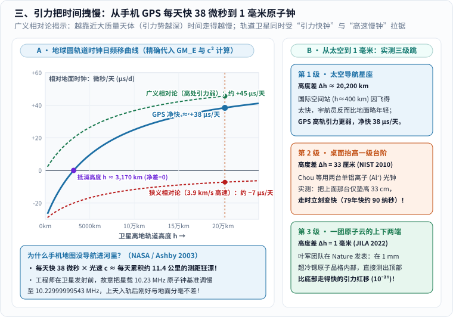
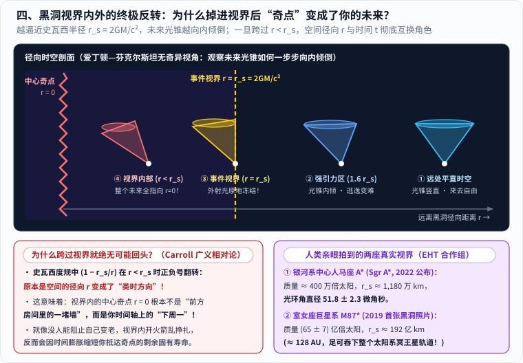
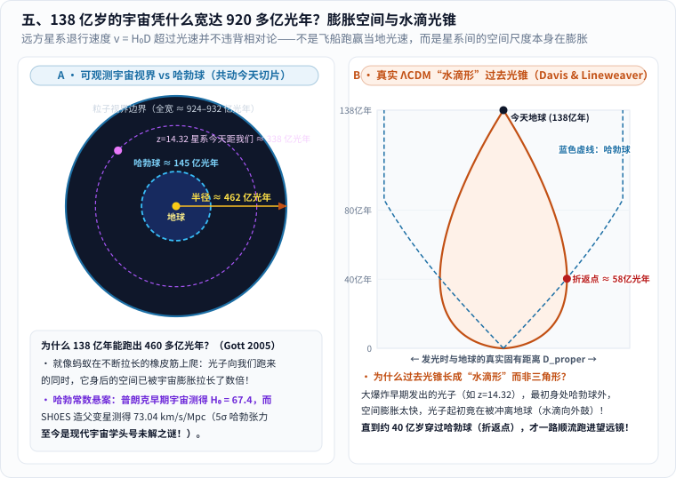

在日常生活的十几米方寸之间，人类对**“空间”**和**“时间”**有着一套坚不可摧的直觉：

- **空间**，就像一座巨大无比、纹丝不动的透明剧场，不管里面有没有演员、跑得多快，一米永远是一米；
- **时间**，就像悬在宇宙头顶的一口绝对大钟，“滴答、滴答”对全宇宙公平广播——此时此刻你在地球喝下一口热茶，遥远的仙女座星系里似乎也有一个完全同步的“此时此刻”。

这套牛顿式的常识帮人类造出了蒸汽机、跨海大桥和摩天大楼，几乎从未出过岔子。但只要你把视线抬向星空，或者把时钟的精度推到小数点后二十位，就会震惊地发现：**这套常识在宇宙尺度上连一秒钟都撑不住。**

在真实的宇宙里，**空间和时间根本不是两样独立的东西**：你在空间里跑得越快，属于你的时间就流逝得越慢；你脚下踩着一颗星球，连头顶与脚底的时间流速都不一样（哪怕只相差 **$$1$$ 毫米** 都能被现代原子钟当场抓获！）；一旦跨过黑洞的事件视界，空间方向甚至会直接变成时间方向；而在百亿光年的尺度上，空间本身像正在发酵的面团一样不断拉伸，让年仅 **$$138$$ 亿岁**的宇宙硬生生撑出了直径超过 **$$920$$ 亿光年**的可观测疆域！

今天，我们就一步步拆掉地球客厅的天花板，站到宇宙尺度，把**时间与空间的五重真实面目**彻底看清。

---

## 一、第一重颠覆：抬头从来没有“现在”，全宇宙也没有同一块表

### 1. 光速锁死的宇宙考古学：望远镜越强，看到的宇宙越年轻

在现代国际单位制（SI）中，真空光速早已不再是一个带有测量误差的近似值，而是定义长度单位“米”的精确自然常数 [[1]](#ref-1)（这段跨越四百年的追光传奇，详见[《一眨眼绕地球七圈半的光，人类是怎么测出速度的》]()）：

$$
c = 299{,}792{,}458\ \mathrm{m/s}
$$

一秒钟约 $$30$$ 万公里，在地球上快得像“瞬间抵达”；可一旦放进浩瀚太空，光速慢得就像一只在沙漠里一步步跋涉的蜗牛。正因为宇宙中任何信息与电磁波的传播速度都不能超过当地光速 $$c$$，**我们在空间中每一次向远处张望，本质上都是在接收来自过去的“历史遗照”**：

- **看月亮（均距约 $$38.44$$ 万公里）**：月光飞到你视网膜需要 **$$1.28$$ 秒**——你看到的永远是 $$1.28$$ 秒前的月亮，当年阿波罗宇航员与休斯敦地面通话时那段标志性的停顿，正是无线电波往返地月约 $$2.56$$ 秒的硬延迟；
- **晒太阳（$$1\ \mathrm{AU} \approx 1.496$$ 亿公里）**：阳光需要跑整整 **$$499$$ 秒（$$8$$ 分 $$19$$ 秒）**才能抵达地球 [[2]](#ref-2)——假如太阳在这一秒突然熄灭，地球上的人类在接下来的 $$8$$ 分多钟里依然会沐浴在灿烂阳光下，浑然不知头顶发生了什么；
- **看最近恒星比邻星（约 $$4.25$$ 光年）**：今晚望远镜里的那点微光，是 **$$4.25$$ 年前**出发的 [[2]](#ref-2)；请注意，**“光年（light-year）”是纯粹的长度单位**（光走一年约 $$9.46 \times 10^{12}\ \mathrm{km}$$），而不是时间单位，但它天然把空间距离与回望时间绑在了一起；
- **肉眼能看到的最远大星系仙女座 M31（约 $$250$$ 万光年）**：秋夜你用肉眼瞥见的那团朦胧光斑 [[2]](#ref-2)，出发时地球上还没有智人，非洲草原上的早期人属祖先刚刚学会把鹅卵石砸出锋利石片；
- **韦布空间望远镜（JWST）拍到的极远星系 `JADES-GS-z14-0`**：2024 年 5 月经光谱确认其红移高达 $$z = 14.32^{+0.08}_{-0.20}$$，那束红外光在太空里狂奔了约 **$$135$$ 亿年**，让我们直接亲眼目睹了宇宙大爆炸后仅约 **$$2.9$$ 亿年**（不到 $$3$$ 亿年）时的婴儿星系模样 [[3]](#ref-3) [[4]](#ref-4)；
- **宇宙微波背景辐射（CMB，红移 $$z \approx 1090$$，今日温度 $$2.7255\ \mathrm{K}$$）**：这是大爆炸后约 $$38$$ 万年宇宙第一次变得透明时释放出的余晖，回望时间直抵约 **$$138$$ 亿年前** [[15]](#ref-15)。

### 2. 彭罗斯的“仙女座悖论”：在街上散步 $$1\ \mathrm{m/s}$$，远方的“现在”就错开 $$3$$ 天！

听到这里，很多人会退一步说：“好吧，我承认光跑过来需要时间！但只要我把光走的时间扣掉——比如把今晚看到的仙女座星系图像往后推算 $$250$$ 万年——全宇宙总归还是有一个客观唯一、人人公认的**‘此时此刻’**吧？”

1905 年，年仅 26 岁的爱因斯坦在《论动体的电动力学》中投下了一颗重磅炸弹：**连这个扣掉光速延迟后的“绝对现在”，也是不存在的** [[5]](#ref-5)！这就是狭义相对论最反直觉的基石——**同时性的相对性（Relativity of Simultaneity）**。

英国数学物理学家罗杰·彭罗斯（Roger Penrose）曾设计过一个让人脊背发凉的思想实验——**“仙女座悖论”**：假设你和朋友在地球人行道上擦肩而过。在你们肩膀错开的那一瞬间，两人处于**完全相同的空间位置和时刻**：

- 你停下脚步原地站定（$$v = 0$$）；
- 朋友以普通散步速度 **$$v = 1\ \mathrm{m/s}$$**（约 $$3.6\ \mathrm{km/h}$$）朝着仙女座星系 M31（距离 $$L \approx 250$$ 万光年）的方向慢悠悠走去。

根据洛伦兹变换，两个相对速度为 $$v$$ 的观测者，对相距 $$L$$ 远处“什么事件与地球此刻同时发生”的判定，会出现严格的时间偏移：

$$
\Delta t \approx \frac{v L}{c^2}
$$

在地球上相隔几公里的两座城市之间，$$L$$ 太小，$$c^2$$ 又大得惊人，$$\Delta t$$ 只有百亿分之一秒，谁也察觉不到；可一旦把 $$L = 250$$ 万光年代入上式：

$$
\Delta t = \frac{1\ \mathrm{m/s}}{299{,}792{,}458\ \mathrm{m/s}} \times 2.5 \times 10^6\ \text{年} \approx 0.00834\ \text{年} \approx 3.05\ \text{天}
$$

仅仅因为朋友迈开腿走了两步，在他定义的“全宇宙此刻切片”里，$$250$$ 万光年外的仙女座星系已经比你定义的“此刻”**提前进入了 $$3$$ 天后的未来**；如果他转身往回走，他的“此刻切片”又会瞬间倒退回 **$$3$$ 天前的过去**！

这意味着什么？意味着宇宙根本不是一本全宇宙按同一秒钟“咔嚓”翻页的连环画，而是一整块早已被铺展在四维里的**“时空大面包”**——静止的人横着切一刀叫“现在”，运动的人斜着切一刀也叫“现在”，每一刀都是物理上完全平权的真实切片！

*图 1：宇宙六级光速回望时间阶梯与“仙女座悖论”同时切片倾斜示意（[单独打开大图](/assets/images/spacetime-cosmos/cosmic-lookback-time-ladder.svg)）。先看左栏按 $$\log_{10}(\text{秒})$$ 精确换算的六级回望标尺：从月球 $$1.28$$ 秒前一直望到大爆炸后 $$38$$ 万年的微波背景辐射；再看右栏四维时空面包切片——在地球上仅以 $$1\ \mathrm{m/s}$$ 散步，$$250$$ 万光年外的“同时面”就会上下倾斜约 $$3$$ 天。*

---

## 二、第二重颠覆：把时间与空间焊成一块铁板——闵可夫斯基光锥与“总速度预算”

### 1. 单独的空间与时间只是影子，真正不变的是“四维时空间隔”

既然不同观测者连“两件事是不是同时发生”（$$\Delta t$$）和“两地之间有多远”（$$\Delta x$$）都谈不拢，那物理学岂不是乱套了？

1908 年 9 月 21 日，曾教过爱因斯坦数学的赫尔曼·闵可夫斯基（Hermann Minkowski）在德国科隆自然科学家大会上发表了著名的《空间与时间》（*Raum und Zeit*）演讲，说出了物理学史上最铿锵有力的一段宣言 [[6]](#ref-6)：

> “从今往后，单独的空间和单独的时间注定要退化为纯粹的影子，只有两者结合成的那种统一体，才能保持独立的实在性！”

怎么理解“单独的空间与时间只是影子”？不妨拿你手里的一支铅笔做比方：把铅笔斜举在灯光下，墙面投影出一个“竖直高度 $$\Delta y$$”，桌面投影出一个“水平长度 $$\Delta x$$”。当你转动观察角度时，$$\Delta x$$ 和 $$\Delta y$$ 都会跟着变长变短；但无论你怎么转坐标轴，由勾股定理算出的**铅笔真实总长度平方 $$\Delta s^2 = \Delta x^2 + \Delta y^2$$** 永远分毫不差！

闵可夫斯基发现，我们的宇宙恰恰是一座把时间乘上光速（$$ct$$，让时间也变成以米为单位的第四个坐标！）后拼成的**四维时空（Spacetime）**。不过，四维时空里的“勾股定理”中间不是加号，而是一个决定宇宙因果命运的**减号**（此处采用 $$(+,-,-,-)$$ 符号约定）：

$$
\Delta s^2 = c^2 \Delta t^2 - \Delta x^2 - \Delta y^2 - \Delta z^2
$$

无论你是坐在地球摇椅上，还是驾驶着 $$0.99c$$ 的星际飞船呼啸而过，你们测出的时间差 $$\Delta t$$ 不一样、空间距离 $$\Delta x$$ 也不一样，但代入上面这道减法算出来的**四维时空间隔 $$\Delta s^2$$，全宇宙所有惯性观测者算出来的结果一模一样**！

这个神奇的减号，直接在每一个时空事件 $$O$$（“此时此地”）周围画出了一座上下对称的 $$45^\circ$$ 几何边界——**光锥（Light Cone）**（见图 2 左栏单次动画）：

1. **光锥表面（$$\Delta s^2 = 0$$，类光间隔）**：所有从 $$O$$ 点向四面八方射出的光线构成的 $$45^\circ$$ 锥面，满足 $$\lvert\Delta \mathbf{x}\rvert = c\lvert\Delta t\rvert$$；
2. **未来光锥与过去光锥内部（$$\Delta s^2 > 0$$，类时间隔）**：任何有质量的飞船、行星和人类（$$v < c$$），在四维时空里留下的轨迹（称为**世界线 Worldline**）永远被锁在光锥内部——只有落进未来光锥里的地方，你发射的飞船或信号才有可能赶到；只有过去光锥里的历史事件，才曾有机会影响今天的你；
3. **光锥外侧的广阔地带（$$\Delta s^2 < 0$$，类空间隔）**：哪怕此刻猎户座某颗超新星爆炸了，只要那个事件落在你此刻的光锥外侧，连光都还没来得及跑完这段距离，它在物理上与现在的你**绝对因果绝缘**——任何观测者都无法颠倒光锥内部事件的先后因果次序，这就是相对论守护“因必在果之前”的几何铁锁！

### 2. 为什么空间里跑得越快，手表就走得越慢？大自然用高空 $$\mu$$ 子当场作证

顺着四维时空间隔公式往下看一步，困扰无数初学者的“钟慢效应（时间膨胀）”瞬间变得像分蛋糕一样直观：

对于飞船上的宇航员自己来说，他低头看手腕上的表，手表跟他一起飞，相对他自己的空间位移 $$\Delta x' = 0$$，手表记录的是他自己的**固有时 $$\Delta \tau$$**；而地面观测者看到他在时间 $$\Delta t$$ 内飞过了空间距离 $$\Delta x = v \Delta t$$。既然两人算出的四维间隔 $$\Delta s^2$$ 必须严格相等：

$$
c^2 \Delta \tau^2 = c^2 \Delta t^2 - v^2 \Delta t^2 \quad \Longrightarrow \quad \left(\frac{\Delta \tau}{\Delta t}\right)^2 + \left(\frac{v}{c}\right)^2 = 1
$$

请仔细看右边变形后的式子——这不就是一个**半径等于 $$1$$ 的四分之一圆方程**吗（见图 2 右上）！我们可以把它形象地理解成宇宙发给万物的**“光速总运动预算”**：

- **当你静坐在椅子上（$$v = 0$$）**：你在空间方向不花一分钱预算，$$100\%$$ 的预算全花在了时间方向上，你的固有时间以最大速率流逝（$$\Delta \tau / \Delta t = 1$$）；
- **当你驾驶飞船以 $$v = 0.6c$$ 在空间狂奔**：空间运动分走了预算，留给自身时间流逝的比例顺着圆弧降到了 $$\sqrt{1 - 0.6^2} = 0.8$$（地面过 $$10$$ 年，飞船上只过 $$8$$ 年）；当加速到 $$0.866c$$ 时，你的时间流速只剩一半；
- **对于以 $$v = c$$ 飞行的光子**：它把全部预算 $$100\%$$ 砸在了穿越空间上，留给自身固有时 $$\Delta \tau$$ 的份额变成了严格的 **$$0$$**！在光子的极限退化视角里，哪怕它从 $$135$$ 亿年前的婴儿星系出发穿过茫茫宇宙撞上你的视网膜，它的“手表”连半秒钟都没有跳动过。

*图 2：闵可夫斯基四维光锥世界线单次动画、时间膨胀圆弧与宇宙线 $$\mu$$ 子大气穿透实测（[单独打开大图](/assets/images/spacetime-cosmos/minkowski-light-cone-and-time-budget.svg)，刷新可重播单次世界线动画）。左栏展示静止观测者、$$0.6c$$ 飞船与光线在四维光锥中的世界线走向及类空因果绝缘区；右栏用精确绘制的四分之一圆弧展示 $$\Delta \tau / \Delta t = \sqrt{1 - (v/c)^2}$$，并给出 1963 年华盛顿山 $$\mu$$ 子寿命拉长 $$8.8$$ 倍穿透大气层的经典实测。*

这套理论听起来像科幻小说，大自然每天都在你头顶十公里高空亲自给你做现场演示——主角叫**宇宙线 $$\mu$$ 子（Muon）**：

高能宇宙射线撞击地球高层大气时，会产生大批次级粒子 $$\mu$$ 子。物理学家在加速器里把正 $$\mu$$ 子停下来精确测量（MuLan 合作组 2011 年实验），测得它静止时的平均固有寿命只有短短的 **$$\tau_0 = 2.1969803\ \mu\mathrm{s}$$（约 $$2.20$$ 微秒）** [[8]](#ref-8)。按经典牛顿物理算一笔账：就算 $$\mu$$ 子以接近光速 $$c$$ 向下俯冲，$$2.20$$ 微秒最多也只能飞过：

$$
d_{\text{经典}} \approx c \tau_0 \approx 3 \times 10^8\ \mathrm{m/s} \times 2.20 \times 10^{-6}\ \mathrm{s} \approx 660\ \mathrm{m}
$$

也就是说，绝大多数高空诞生的 $$\mu$$ 子在半空中早就衰变光了，根本不可能活着落到海平面！

然而 1963 年，麻省理工学院的弗里施（David H. Frisch）与史密斯（James H. Smith）扛着闪烁体探测器爬上海拔 $$1{,}907\ \mathrm{m}$$ 的新罕布什尔州华盛顿山顶，筛选出速度介于 $$0.9954c$$ 到 $$0.9960c$$ 之间的 $$\mu$$ 子，每小时数出 $$563$$ 个；随后下山来到海拔仅 $$3\ \mathrm{m}$$ 的麻省剑桥实验室再测——按牛顿寿命算，跑完这 $$1{,}904\ \mathrm{m}$$ 下山路后每小时只该剩下约 $$27$$ 个幸存者，可探测器竟结结实实抓到了每小时 **$$412$$ 个**！实测时间膨胀因子高达 **$$8.8 \pm 0.8$$**，与爱因斯坦公式算出的 $$\gamma = 1/\sqrt{1 - v^2/c^2} \approx 8.4 \pm 2$$ 完美吻合 [[7]](#ref-7)！

更妙的是相对性原理的自洽：如果你骑在 $$\mu$$ 子背上往下看，你的手表确实只走了短短 $$2.2$$ 微秒，你并没有觉得自己“长寿了”；但在你眼里，迎面扑来的整座 $$1{,}904\ \mathrm{m}$$ 高山和大气层发生了**洛伦兹长度收缩（尺缩效应）**，厚度被压扁成了 $$1{,}904 / 8.8 \approx 216\ \mathrm{m}$$，花 $$0.7$$ 微秒多一点就能轻松穿透！地面说“时间拉长了”，$$\mu$$ 子说“高山压扁了”，两套账本算出来的存活率分毫不差。

---

## 三、第三重颠覆：质量让时空本身弯曲——从手机 GPS 到 $$1$$ 毫米内的时间差

### 1. 引力不是一根无形绳子，而是弯曲四维时空里的“最直路径”

狭义相对论统一了平直时空，但爱因斯坦紧接着又苦苦追问了十年：牛顿所说的“万有引力”，为什么能隔着 $$1.5$$ 亿公里真空拉住地球？难道太阳一动，引力真能无视光速限制瞬间传遍宇宙吗？

1915 年 11 月，爱因斯坦完成了人类智力史上最瑰丽的杰作——**广义相对论（General Relativity）**（关于电梯等效原理与 1919 年日全食星光弯曲观测，详见[《连光都会被太阳掰弯吗？读懂爱因斯坦光线弯曲的百年验证》]()；关于曲面几何与测地线，详见[《过线外一点难道不只有一条平行线？顺着曲面平行线彻底读懂非欧几何》]()）。物理学家约翰·惠勒（John Archibald Wheeler）曾用十二个字浓缩了整套爱因斯坦场方程的灵魂：

> **“物质告诉时空如何弯曲，时空告诉物质如何运动。”**

地球之所以绕着太阳转，并不是太阳伸出一根看不见的绳子拽着地球，而是太阳巨大的质量把周围的**四维时空几何**压弯了；地球只是在弯曲的四维时空里老老实实沿着最“直”的短程线（测地线）自由滑行！

但这里千万要避开科普插图最容易误导人的一个坑：很多画册喜欢画“一颗铁球压弯一张二维橡胶膜”，让人误以为只有**三维空间**弯了。恰恰相反！对于地球绕太阳、或者苹果从树上掉下来这类低速弱引力现象，空间弯曲贡献的比例微乎其微，**真正把苹果“推”向地面、决定行星轨道的，主要是“时间维度的弯曲”——也就是引力时间膨胀（Gravitational Time Dilation）**：

**离大质量天体越近（引力势越深），时间本身流逝得就越慢；离天体越远（高处引力越弱），时间就流逝得越快！**

### 2. 手机地图每天都在替你验证相对论：如果不调表，导航一天偏出 $$11$$ 公里！

你可能会笑：“高处时间走得快、低处时间走得慢，这种玄之又玄的效应跟我的日常生活有什么关系？”

关系大极了——**你每次打开手机叫网约车、查路口导航，全靠工程师提前在太空里给爱因斯坦交了“过路费”**！

全球卫星导航系统（以美国 GPS 为例）依靠运行在离地约 **$$h \approx 20{,}200\ \mathrm{km}$$** 中高地球轨道上的卫星星座，向地面手机广播带有纳秒级时间戳的无线电信号。光在 $$1$$ 纳秒（十亿分之一秒）内走约 $$30$$ 厘米；只要星载原子钟比地面时钟偏离 $$1$$ 微秒（百万分之一秒），测距误差就会立刻飙到 $$300$$ 米！

现在让我们给离地两万公里的 GPS 卫星算一笔硬核相对论总账 [[9]](#ref-9) [[10]](#ref-10)（见图 3 左栏精确计算的轨道频移曲线）：

1. **狭义相对论效应（跑得快 $$\to$$ 钟变慢）**：GPS 卫星以约 $$3.87\ \mathrm{km/s}$$ 的高速绕地球飞驰，相对地面观测者，星载时钟每天会**变慢约 $$7$$ 微秒（$$-7\ \mu\mathrm{s}/\text{天}$$）**；
2. **广义相对论效应（站得高、引力弱 $$\to$$ 钟变快）**：卫星高悬在两万公里太空，那里的地球引力势只有地表的约四分之一，时间流逝得比地表更快，导致星载时钟每天会**变快约 $$45$$ 微秒（$$+45\ \mu\mathrm{s}/\text{天}$$）**；
3. **两者叠加净结果**：广义相对论的“快钟效应”压倒了狭义相对论的“慢钟效应”（顺便一提，如果把卫星降到离地约 $$3{,}170\ \mathrm{km}$$、轨道半长轴 $$a \approx 9{,}545\ \mathrm{km}$$ 处，一快一慢刚好完美抵消为零 [[10]](#ref-10)；而在仅 $$400\ \mathrm{km}$$ 高的国际空间站上，速度效应占优，宇航员回到地面时反而比双胞胎兄弟年轻几毫秒！）。在 GPS 轨道高度，星载原子钟每天净比地面时钟**快约 $$38$$ 微秒（$$+38\ \mu\mathrm{s}/\text{天}$$）** [[9]](#ref-9)！

别小看每天 $$38$$ 微秒——乘上光速 $$c$$：

$$
\Delta d = 38 \times 10^{-6}\ \mathrm{s} \times 299{,}792{,}458\ \mathrm{m/s} \approx 11.4\ \mathrm{km}/\text{天}
$$

假如物理学家当年不相信相对论，不给星载原子钟做修正，单凭这一项原始伪距时间漂移，整个导航系统开机不到两分钟就会失准，**一天之内就会把你的汽车定位偏到 $$11$$ 公里外的河沟里去**！为此，工程师在卫星发射升空前，必须在地面工厂里故意把标称频率为 $$10.23\ \mathrm{MHz}$$ 的星载原子钟基准调慢约 $$4.465 \times 10^{-10}$$（预设为 $$10.22999999543\ \mathrm{MHz}$$）——在地面看它是一块“走慢了的表”，一发射进两万公里太空，弯曲时空自动给它加速，走时瞬间与地面精准同步 [[10]](#ref-10)！

### 3. 从一级楼梯（$$33$$ 厘米）到 $$1$$ 毫米原子云：你的头顶真的比脚底老得快！

进入 21 世纪后，光学原子钟的飞速跃进，把广义相对论从两万公里太空直接拉进了普通人的书房桌面（见图 3 右栏三级跳）：

- **2010 年：抬高 $$33$$ 厘米（一级楼梯台阶）就能测出时间变快**！美国国家标准与技术研究院（NIST）周钦华（C. W. Chou）团队造出了两台走时精度达“$$37$$ 亿年不差 $$1$$ 秒”的单铝离子（$$\mathrm{Al^+}$$）光钟，用 $$75\ \mathrm{m}$$ 光纤连起来对比——当实验人员仅仅把其中一台光钟的光学平台用千斤顶**垫高了 $$33\ \mathrm{cm}$$**（差不多一瓶矿泉水加半个拳头的高度），仪器立刻清晰读出了高处那台钟滴答得更快！折算成人类 $$79$$ 岁的一生，高出 $$33\ \mathrm{cm}$$ 的位置累计会多走约 **$$90$$ 纳秒（十亿分之九十秒）** [[11]](#ref-11)。这意味着你站着工作一辈子，**你的头顶真的比你的脚底老了几十纳秒**！
- **2022 年：人类在短短 $$1$$ 毫米厚度内拍到了弯曲时空的时间梯度**！美国 JILA 研究所叶军（Jun Ye）团队在《自然》发表里程碑实验：他们用激光把约十万个超冷锶（$$\mathrm{Sr}$$）原子囚禁成一团高度仅几毫米的光学晶格云，以高达 $$7.6 \times 10^{-21}$$ 的频率不确定度对同一团原子云成像，竟然直接测出了**相隔仅仅 $$1\ \mathrm{mm}$$ 的上层原子比下层原子钟频率更快**的引力红移斜率 [[12]](#ref-12)！

在宇宙的真实账本里，根本没有所谓“整齐划一的时间河流”——哪怕在你指尖这 $$1$$ 毫米的方寸之间，时间也是一层叠一层、高快低慢的精细流速场。

*图 3：地球圆轨道卫星时钟相对论频移曲线与光学原子钟三级实测阶梯（[单独打开大图](/assets/images/spacetime-cosmos/curved-spacetime-gps-and-mm-clock.svg)）。左栏代入地球引力常数 $$GM_E$$ 与 $$c^2$$ 精确绘出广义相对论快钟（绿虚线）、狭义相对论慢钟（红虚线）及净频移（蓝实线），清晰标出 $$h \approx 3{,}170\ \mathrm{km}$$ 抵消点与 $$h \approx 20{,}200\ \mathrm{km}$$ GPS 净快约 $$38\ \mu\mathrm{s}/\text{天}$$；右栏展示从太空导航星座到 $$33\ \mathrm{cm}$$ 台阶（NIST 2010）再到 $$1\ \mathrm{mm}$$ 锶原子云（JILA 2022）的实测突破。*

---

## 四、第四重颠覆：黑洞视界里的惊天反转——当“前方中心”变成“下周一”

### 1. 光锥一路向内倾倒：在史瓦西半径 $$r_s$$ 处，连向外射出的光都在原地踏步

既然离质量越近，时空弯曲越剧烈、时间走得越慢，那么如果我们把一整颗巨星的质量无限压缩进一个极小的球体里，把时空弯到极致，会发生什么？

1916 年初，正在一战东线炮火中服役的德国天文学家卡尔·史瓦西（Karl Schwarzschild）抱病求出了爱因斯坦场方程的第一个精确球对称真空解 [[13]](#ref-13)。在这个解中，任何质量为 $$M$$ 的不旋转球体都对应着一个临界半径——**史瓦西半径（Schwarzschild Radius）**：

$$
r_s = \frac{2GM}{c^2}
$$

如果把太阳压成黑洞，$$r_s$$ 大约是 $$3\ \mathrm{km}$$；如果把整个地球压成黑洞，$$r_s$$ 只有约 $$8.9\ \mathrm{mm}$$（一颗玻璃弹珠大小）。而在真实的宇宙深处，人类已经用遍布全球的射电望远镜阵列——**事件视界望远镜（Event Horizon Telescope, EHT）**——亲手给两座超大质量黑洞的视界阴影拍下了定妆照：

- **室女座巨椭圆星系中心黑洞 `M87*`**（2019 年公布人类首张黑洞照片）：质量高达 **$$(6.5 \pm 0.7) \times 10^9\ M_\odot$$（约 $$65$$ 亿倍太阳质量）**，光环角直径 $$42 \pm 3\ \mu\mathrm{as}$$ [[14]](#ref-14)，对应的史瓦西半径达 **$$r_s \approx 192$$ 亿公里（约 $$128\ \mathrm{AU}$$）**——大到足以把整个太阳系连同冥王星轨道一口吞进去还有富余！
- **我们银河系心脏的人马座 `Sgr A*`**（2022 年公布）：质量约 **$$4.0 \times 10^6\ M_\odot$$（约 $$400$$ 万倍太阳质量）**，史瓦西半径约 **$$1{,}180$$ 万公里**（约太阳半径的 $$17$$ 倍），光环角直径 $$51.8 \pm 2.3\ \mu\mathrm{as}$$ [[14]](#ref-14)。

为什么任何东西一旦跨进 $$r = r_s$$ 的**事件视界（Event Horizon）**，哪怕引擎动力再强、哪怕变成一束纯光，都绝对逃不出来？很多通俗读物会用牛顿式的语言解释：“因为引力太大，逃逸速度超过了光速。”

这个比喻虽然好懂，却漏掉了广义相对论最震撼的几何真相！如果我们不看枯燥的数字，而是顺着径向距离 $$r$$ 画出每一处的**未来光锥**（见图 4 上栏无坐标奇异性的爱丁顿—芬克尔斯坦视角），你会亲眼看到一幕令人窒息的几何剧变：

1. **在远离黑洞的平直太空（$$r \gg r_s$$）**：未来光锥笔直朝上张开，飞船既可以往左飞靠近黑洞，也可以往右飞远离黑洞；
2. **逼近强引力区（如 $$r = 1.6\,r_s$$）**：强烈的时空弯曲把整个未来光锥向黑洞内侧拽斜了！你想往外逃，必须把火箭推力开到接近外侧那条越来越陡的光锥边缘；
3. **恰好踏上事件视界表面（$$r = r_s$$）**：向外发射的光线恰好变成了竖直直线——也就是说，**在事件视界上全力朝外射出的一束手电筒光，只能在 $$r = r_s$$ 处像踩在反向跑步机上一样“原地冻结”**，半毫米都往外挪不动，而整个未来光锥已经全部倒向了视界内侧！

### 2. 跨过视界的那一刻：空间径向 $$r$$ 与时间 $$t$$ 彻底互换了身份！

真正颠覆三观的事情，发生在飞船跨进 **$$r < r_s$$（事件视界内部）**的那一瞬间。

让我们看一眼史瓦西度规（即弯曲球对称时空里的四维间隔公式）：

$$
ds^2 = \left(1 - \frac{r_s}{r}\right) c^2 dt^2 - \left(1 - \frac{r_s}{r}\right)^{-1} dr^2 - r^2 d\Omega^2
$$

注意看括号里的因子 $$(1 - r_s / r)$$：

- 当你在黑洞外面（$$r > r_s$$）时，$$(1 - r_s / r) > 0$$：$$dt^2$$ 前面是**正号（类时方向）**，$$dr^2$$ 前面是**负号（类空方向）**——时间是一直往前走的 $$t$$，空间是可以前后走动的半径 $$r$$；
- **一旦你掉进视界内部（$$r < r_s$$），$$(1 - r_s / r)$$ 瞬间变成了负数！** 于是 $$dt^2$$ 前面变成了**负号（类空！）**，而原本代表空间半径的 $$dr^2$$ 前面竟然变成了**正号（类时！）** [[13]](#ref-13) [[14]](#ref-14)！

正如理论物理学家肖恩·卡罗尔（Sean Carroll）在经典教材《广义相对论讲义》第 7 章中一针见血指出的那样：**在 $$r < 2GM/c^2$$ 的黑洞内部，$$t$$ 变成了类空坐标，而径向 $$r$$ 变成了类时坐标——你甚至不可能阻止自己朝 $$r$$ 减小的方向移动，因为“$$r$$ 变小”根本就是时间流逝的方向** [[14]](#ref-14)！

请把这句话反复品味三遍！很多人以为黑洞中心的奇点（$$r = 0$$）就像黑暗房间正中央的一口深井，心想：“我掉进房间后，赶紧把火箭发动机掉头朝正前方猛喷，难道还刹不住车吗？”

**完全错了！在视界内部，$$r = 0$$ 根本不是你正前方的一个“空间地点”，而是你时间轴上避无可避的一个“未来时刻”！**

在视界外面的世界里，你能开火箭阻止自己走向“下星期一”吗？不能！同样地，在黑洞视界内部，整个未来光锥已经彻底横躺过来指向 $$r = 0$$（图 4 上栏最左端）；无论你把飞船机头朝哪个方向乱拧、怎么踩满油门喷火，你的世界线只要还在未来光锥里，就必然一秒一秒驶向 $$r = 0$$。更绝望的冷知识是：根据前面讲过的四维间隔最大固有时原理，自由落体测地线反而是固有时最长的路径——**你在视界里面越是疯狂开动火箭发动机挣扎，时间膨胀效应反而会让你的手表走得更少，死得（撞上奇点）更快**！

*图 4：黑洞史瓦西视界内外未来光锥倾倒与空间—时间角色互换图解（[单独打开大图](/assets/images/spacetime-cosmos/black-hole-light-cone-tipping.svg)）。上栏展示从远处平直时空到视界内部 $$r < r_s$$，未来光锥一步步向内倾倒，直到跨过视界后完全指向中心奇点 $$r = 0$$；下栏总结度规符号翻转导致径向 $$r$$ 变成时间轴的物理机制，并对比事件视界望远镜（EHT）拍到的 `Sgr A*` 与 `M87*` 真实尺度。*

---

## 五、第五重颠覆：$$138$$ 亿岁的宇宙，凭什么宽达 $$920$$ 多亿光年？

### 1. 宇宙学头号直觉陷阱：不是星系像炮弹飞进虚空，而是空间网格自己在长大！

最后，让我们把镜头从一颗黑洞拉远亿万倍，俯瞰整个宇宙的时空全景。一翻开现代宇宙学观测报告，几乎所有细心的读者都会当场抓出一个看似“自相矛盾”的数字漏洞：

- 欧空局**普朗克（Planck）卫星**对宇宙微波背景辐射的最终精密测量给出：我们的宇宙年龄约为 **$$137.87\text{–}137.97$$ 亿年（通常简称为 $$138$$ 亿年）** [[15]](#ref-15)；
- 既然宇宙诞生才 $$138$$ 亿年，光速又是不可逾越的极限，按理说最远的光顶多跑 $$138$$ 亿光年，整个可观测宇宙的半径最多只能是 $$138$$ 亿光年、直径 $$276$$ 亿光年才对呀！
- 可为什么普林斯顿大学戈特（J. Richard Gott）团队绘制的宇宙全景图与普朗克标准宇宙学模型算出来，**今天可观测宇宙的共动粒子视界半径竟高达约 $$462\text{–}466$$ 亿光年（全直径约 $$924\text{–}932$$ 亿光年）** [[17]](#ref-17)？难道宇宙膨胀的速度超过了光速，公开违反了爱因斯坦的相对论吗？！

天体物理学家塔玛拉·戴维斯（Tamara M. Davis）与查尔斯·莱恩威弗（Charles H. Lineweaver）专门在经典论文《膨胀的困惑：常见的宇宙学误解》中彻底澄清了这个世纪误会 [[16]](#ref-16)：**远方星系的退行速度超过光速，不仅千真万确，而且连半点都没有违反狭义相对论！**

关键就在于严格区分两种截然不同的“运动”：

1. **狭义相对论禁止的，是“穿行于空间中的局部超光速”（Motion *through* space）**：在同一片局部时空里，任何飞船、粒子和信号绝对追不上身边擦肩而过的那束光；
2. **广义相对论完全允许的，是“空间度规本身的膨胀”（Expansion *of* space）**：星系并不是在大爆炸那一天从虚空某一点炸出去的弹片，而是像嵌在巨大葡萄干面团里的一颗颗葡萄干——葡萄干相对身边的面团几乎没怎么动，**是两颗葡萄干之间的空间网格尺度因子 $$a(t)$$ 本身在随宇宙时间不断拉伸**！

按照哈勃—勒梅特定律，距离我们固有距离为 $$D$$ 的星系，其空间膨胀退行速度为：

$$
v_{\text{rec}} = H_0 D
$$

其中普朗克卫星测得的哈勃常数约为 $$H_0 = 67.4 \pm 0.5\ \mathrm{km/s/Mpc}$$ [[15]](#ref-15)（百万秒差距 $$1\ \mathrm{Mpc} \approx 326.16$$ 万光年；顺便一提，里斯团队 SH0ES 项目用造父变星与 Ia 型超新星在近邻宇宙测出的结果却是 $$H_0 = 73.04 \pm 1.04\ \mathrm{km/s/Mpc}$$ [[15]](#ref-15)，两者之间高达 $$5\sigma$$ 的偏差被称为**“哈勃张力”**，至今仍是当代物理学最刺激的未解悬案！）。

把 $$v_{\text{rec}} = c$$ 代入上式，立刻就能算出一个临界球面——**哈勃球（Hubble Sphere）**：

$$
D_{\mathrm{HS}} = \frac{c}{H_0} \approx 145\ \text{亿光年}
$$

**凡是今天距离我们超过约 $$145$$ 亿光年（红移大约 $$z > 1.5$$）的所有星系，它们与我们之间的空间每秒钟新生长出来的长度都超过了 $$30$$ 万公里，即退行速度 $$v_{\text{rec}} > c$$** [[16]](#ref-16)！

### 2. 神奇的“水滴形过去光锥”：逆水行舟的光子，怎样从被冲远变成跑进望远镜？

新的疑问马上又来了：既然今天位于 $$145$$ 亿光年哈勃球外面的星系（比如韦布拍到的 `JADES-GS-z14-0`，红移 $$z = 14.32$$，今天已经位于约 **$$338$$ 亿光年**外；以及最外圈今天位于约 **$$462$$ 亿光年**处的微波背景辐射源）正在以超过光速的速度远离我们，**它们发出的光为什么还能被地球上的望远镜接收到？**

让我们把平坦 $$\Lambda\mathrm{CDM}$$ 宇宙模型（物质占比 $$\Omega_m \approx 0.315$$，暗能量占比 $$\Omega_\Lambda \approx 0.685$$）直接做数值积分，把“所有在今天 $$t_0 = 138$$ 亿年恰好抵达地球的光子”在历史上每一刻与地球的真实固有距离 $$D_{\text{proper}}(t)$$ 画出来——你会看到宇宙学中最迷人的一条曲线：**我们的过去光锥根本不是三角形，而是一颗上尖下尖、肚子鼓起的“水滴形（梨形）”**（见图 5 右栏）[[16]](#ref-16) [[17]](#ref-17)！

拿韦布望远镜看到的婴儿星系 `JADES-GS-z14-0`（$$z = 14.32$$）举个最直观的例子：

1. **出发时刻（宇宙约 $$2.9$$ 亿岁）**：当那团年轻星系朝地球方向射出一颗光子时，它当时离我们的真实固有距离其实只有约 **$$22$$ 亿光年**（$$338\ \text{亿光年} \div (1 + 14.32) \approx 22\ \text{亿光年}$$）；
2. **起初连光子都被空间膨胀“冲得往后退”**：在宇宙早期，膨胀速率 $$H(t)$$ 极大，当时的哈勃球非常小。那颗光子虽然在当地空间里拼命以光速 $$c$$ 朝地球游来，但脚下的“空间河水”流速比 $$c$$ 还快——于是在最初几十亿年里，**这颗光子与地球的真实距离不仅没缩短，反而一路被冲远到了约 $$58$$ 亿光年的最大折返点**（对应图 5 右栏水滴最宽的肚子）！
3. **哈勃球扩大完成逆袭**：随着宇宙引力减速让早中期哈勃球不断向外扩张，大约在宇宙 $$40$$ 亿岁前后，不断扩大的哈勃球终于追上并吞进了这颗坚持不懈往前游的光子（穿过蓝色虚线折返点）。从此以后，河水流速降到了 $$c$$ 以下，光子一路顺风顺水缩短距离，历经 $$135$$ 亿年跋涉撞进了韦布望远镜的镀金镜片——而在这 $$135$$ 亿年里，当年发出它的那座星系早已被膨胀的空间一路推到了今天 **$$338$$ 亿光年**之外！

就像一只蚂蚁在一条正在被双手不断拉长的橡皮筋上以每秒 $$1$$ 厘米爬行：蚂蚁相对脚下橡皮筋的速度从未超过 $$1\ \mathrm{cm/s}$$，可等它花了 $$10$$ 秒爬到终点时，身后的起点早就被拉到了五六十厘米开外。这就是为什么 $$138$$ 亿岁的宇宙，能堂堂正正拥有半径约 $$462\text{–}466$$ 亿光年、总宽度逾 $$920$$ 亿光年的壮丽可观测视界！

*图 5：可观测宇宙粒子视界与哈勃球比例对比及 $$\Lambda\mathrm{CDM}$$ 水滴形过去光锥数值积分图解（[单独打开大图](/assets/images/spacetime-cosmos/expanding-universe-horizon-paradox.svg)）。左栏按真实比例画出半径约 $$145$$ 亿光年的哈勃球、`JADES-GS-z14-0` 今日约 $$338$$ 亿光年位置及约 $$462$$ 亿光年可观测宇宙边界；右栏由平坦 $$\Lambda\mathrm{CDM}$$ 模型精确积分绘出水滴形过去光锥，展示早期光子如何先被空间膨胀冲远至约 $$58$$ 亿光年折返点、跨入哈勃球后再抵达今日地球。*

---

## 六、总结：站到宇宙高度，重新认识我们身处的“此时此地”

合上这张横跨 $$10^{-3}\ \mathrm{m}$$（$$1$$ 毫米原子云）到 $$10^{26}\ \mathrm{m}$$（近千亿光年可观测视界）的宇宙时空地图，回望窗外的阳光与星空，原本习以为常的“时间”与“空间”已经彻底换了一副恢弘面貌：

1. **没有绝对的“全宇宙现在”**：光速 $$c = 299{,}792{,}458\ \mathrm{m/s}$$ 把每一寸遥远空间都变成了历史档案馆，而同时性的相对性意味着不同运动状态会从四维时空里切出不同的“现在斜面”；
2. **空间与时间共享同一份四维预算**：单独的空间距离与时间间隔会随运动伸缩，唯有四维时空间隔 $$\Delta s^2 = c^2\Delta t^2 - \Delta \mathbf{x}^2$$ 永恒不变，大气层里成批落到海平面的短命 $$\mu$$ 子每天都在验证它；
3. **引力就是弯曲的时间与空间**：从两万公里高空每天快 $$38$$ 微秒的 GPS 卫星，到实验室里仅隔 $$33$$ 厘米乃至 $$1$$ 毫米就能测出的时间流速差，质量实实在在地拉慢了身边的时钟；
4. **在极端黑洞视界内，空间能变成时间**：跨过史瓦西半径 $$r_s = 2GM/c^2$$ 后，中心奇点不再是前方的空间位置，而变成了未来时间轴上不可逃避的一刻；
5. **空间本身是一张正在生长的动态织物**：正是空间度规自身的膨胀，让早期光子走出奇妙的水滴形轨迹，在 $$138$$ 亿年历史里铺展出宽逾 $$920$$ 亿光年的璀璨星海。

我们并不是住在一只冰冷僵硬的三维铁盒子里被动地看着挂钟变老；我们每一个人、每一颗原子，都是一条正在动态弯曲、不断膨胀的四维宇宙时空织锦上鲜活舒展的世界线。

---

## 参考资料与核查来源

1. Bureau International des Poids et Mesures (BIPM). SI base unit: metre (m). [BIPM 官方定义](https://www.bipm.org/en/si-base-units/metre)（支持：国际单位制将真空光速固定为精确常数 $$c = 299{,}792{,}458\ \mathrm{m/s}$$ 以定义长度单位“米”）
2. NASA Science. What is a light-year? [NASA 官方科普页](https://science.nasa.gov/exoplanets/what-is-a-light-year/)（支持：光年为光行进一年的距离单位，日地光行时间约 $$8$$ 光分即 $$499\ \mathrm{s}$$，比邻星约 $$4.25$$ 光年，仙女座星系约 $$250$$ 万光年）
3. NASA Webb Mission Team (2024-05-30). NASA's James Webb Space Telescope Finds Most Distant Known Galaxy. [NASA 官方通报](https://science.nasa.gov/blogs/webb/2024/05/30/nasas-james-webb-space-telescope-finds-most-distant-known-galaxy/)（支持：韦布光谱确认极远星系 `JADES-GS-z14-0` 红移 $$z = 14.32$$，对应大爆炸后约 $$2.9$$ 亿年，跨度超 $$1{,}600$$ 光年）
4. Carniani, S., Hainline, K., D'Eugenio, F., Eisenstein, D. J., et al. (2024). Spectroscopic confirmation of two luminous galaxies at a redshift of 14. *Nature*, 633, 318–322. [arXiv:2405.18485](https://arxiv.org/abs/2405.18485)（支持：`JADES-GS-z14-0` 光谱红移 $$z = 14.32^{+0.08}_{-0.20}$$ 与伴星系 $$z = 13.90$$ 实测数据）
5. Einstein, A. (1905). Zur Elektrodynamik bewegter Körper (On the Electrodynamics of Moving Bodies). *Annalen der Physik*, 322(10), 891–921. [Wikisource 英文译本](https://en.wikisource.org/wiki/On_the_Electrodynamics_of_Moving_Bodies)（支持：狭义相对论同时性的相对性、洛伦兹变换与时间膨胀原始推导）
6. Minkowski, H. (1908). Raum und Zeit (Space and Time), 1908 年 9 月 21 日科隆演讲. [Wikisource 文献页](https://en.wikisource.org/wiki/Space_and_Time_(Hermann_Minkowski))（支持：提出四维时空几何统一体与光锥因果结构）
7. Frisch, D. H., & Smith, J. H. (1963). Measurement of the Relativistic Time Dilation Using $$\mu$$-Mesons. *American Journal of Physics*, 31(5), 342–355. [OSTI 4712200 记录](https://www.osti.gov/biblio/4712200)（支持：华盛顿山至剑桥实测速度 $$0.9954c\text{–}0.9960c$$ 宇宙线 $$\mu$$ 子时间膨胀因子 $$8.8 \pm 0.8$$）
8. Webber, D. M., et al. (MuLan Collaboration) (2011). Measurement of the Positive Muon Lifetime and Determination of the Fermi Constant to Part-per-Million Precision. *Physical Review Letters*, 106, 041803. [arXiv:1010.0991](https://arxiv.org/abs/1010.0991)（支持：正 $$\mu$$ 子静止平均固有寿命精确测量值 $$\tau = 2.1969803(22)\ \mu\mathrm{s}$$）
9. NASA Physics of the Cosmos (2016). *A Century of General Relativity*. [NASA 官方手册 PDF](https://assets.science.nasa.gov/content/dam/science/astro/programs/physics-of-the-cosmos/documents/brochures-factsheets/april-2016-aps/GR_Centennial_Brochure-Mar2016-final.pdf)（支持：GPS 卫星时钟受狭义相对论变慢约 $$7\ \mu\mathrm{s}/\text{天}$$、广义相对论变快约 $$45\ \mu\mathrm{s}/\text{天}$$，净快约 $$38\ \mu\mathrm{s}/\text{天}$$）
10. Ashby, N. (2003). Relativity in the Global Positioning System. *Living Reviews in Relativity*, 6, 1. [PMC5253894 全文](https://pmc.ncbi.nlm.nih.gov/articles/PMC5253894/)（支持：GPS 星载时钟发射前工厂频偏修正机制及轨道半长轴 $$a \approx 9{,}545\ \mathrm{km}$$ 处狭义与广义相对论频移抵消分析）
11. National Institute of Standards and Technology (NIST) (2010-09-23). NIST Pair of Aluminum Atomic Clocks Reveal Einstein's Relativity at a Personal Scale (Chou et al., *Science* 329, 1630). [NIST 官方通报](https://www.nist.gov/news-events/news/2010/09/nist-pair-aluminum-atomic-clocks-reveal-einsteins-relativity-personal-scale)（支持：两台单铝离子光钟高度差仅 $$33\ \mathrm{cm}$$ 即可测出引力时间膨胀，相当于 $$79$$ 年快约 $$90\ \mathrm{ns}$$）
12. Bothwell, T., Kennedy, C. J., Aeppli, A., et al., & Ye, J. (2022). Resolving the gravitational redshift within a millimeter atomic sample. *Nature*, 602, 420–424. [arXiv:2109.12238](https://arxiv.org/abs/2109.12238)（支持：在 $$1\ \mathrm{mm}$$ 尺度超冷锶原子光晶格内以 $$7.6 \times 10^{-21}$$ 精度分辨出引力红移频率梯度）
13. Schwarzschild, K. (1916). Über das Gravitationsfeld eines Massenpunktes nach der Einsteinschen Theorie. *Sitzungsberichte der Königlich Preussischen Akademie der Wissenschaften*, 189–196. [arXiv:physics/9905030 英译存档](https://arxiv.org/abs/physics/9905030)（支持：球对称真空爱因斯坦场方程精确解与史瓦西半径 $$r_s = 2GM/c^2$$）
14. Carroll, S. M. (1997). *Lecture Notes on General Relativity*, Chapter 7 (The Schwarzschild Solution and Black Holes). [arXiv:gr-qc/9712019](https://arxiv.org/abs/gr-qc/9712019)；以及 Event Horizon Telescope Collaboration: First M87 Results I (*ApJL* 875, L1, 2019, [arXiv:1906.11238](https://arxiv.org/abs/1906.11238)) & First Sagittarius A* Results IV (*ApJL* 930, L15, 2022, [EHT 官方论文页](https://eventhorizontelescope.org/publications/first-sagittarius-event-horizon-telescope-results-iv-variability-morphology-and))（支持：视界内 $$r < 2GM/c^2$$ 时 $$r$$ 变为类时坐标而 $$t$$ 变为类空坐标，以及 `M87*` 与 `Sgr A*` 实测质量与环径）
15. Planck Collaboration (Aghanim, N., et al.) (2020). Planck 2018 results. VI. Cosmological parameters. *Astronomy & Astrophysics*, 641, A6. [arXiv:1807.06209](https://arxiv.org/abs/1807.06209)；对比 Riess, A. G., et al. (SH0ES) (2022). *ApJL*, 934, L7. [arXiv:2112.04510](https://arxiv.org/abs/2112.04510)（支持：$$H_0 = 67.4 \pm 0.5\ \mathrm{km/s/Mpc}$$、宇宙年龄 $$137.87\text{–}137.97$$ 亿年、$$T_0 = 2.7255\ \mathrm{K}$$ 及与近邻测量 $$73.04\ \mathrm{km/s/Mpc}$$ 的 $$5\sigma$$ 哈勃张力）
16. Davis, T. M., & Lineweaver, C. H. (2004). Expanding Confusion: Common Misconceptions of Cosmological Horizons and the Superluminal Expansion of the Universe. *Publications of the Astronomical Society of Australia*, 21(1), 97–109. [arXiv:astro-ph/0310808](https://arxiv.org/abs/astro-ph/0310808)（支持：哈勃球 $$D_{\mathrm{HS}} = c/H$$ 外超光速退行源于度规空间膨胀而非局部超光速运动，以及水滴形过去光锥光子传播机制）
17. Gott, J. R. III, Jurić, M., Schlegel, D., et al. (2005). A Map of the Universe. *The Astrophysical Journal*, 624(2), 463–484. [arXiv:astro-ph/0310571](https://arxiv.org/abs/astro-ph/0310571)（支持：共动粒子视界半径约 $$14.2\text{–}14.3\ \mathrm{Gpc}$$ 即约 $$462\text{–}466$$ 亿光年，解释 $$138$$ 亿年宇宙为何具有逾 $$920$$ 亿光年可观测直径）
