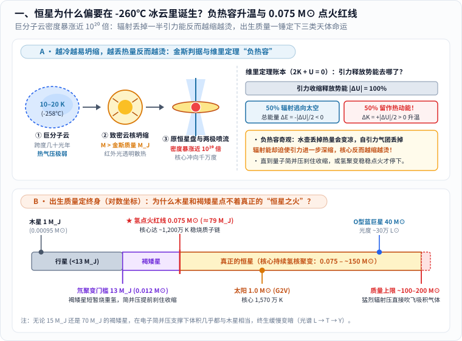
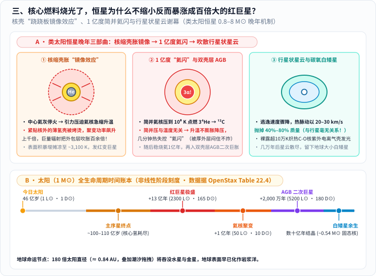
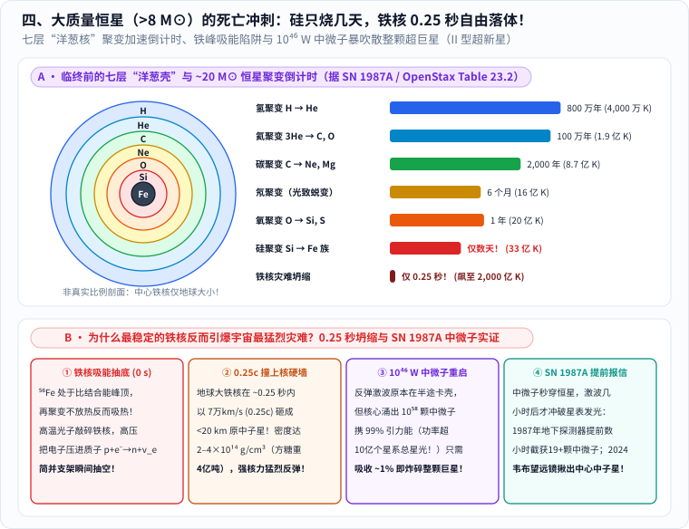
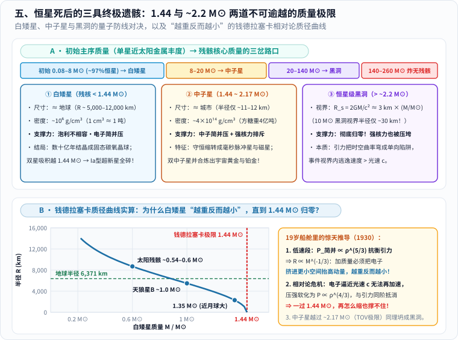

晴朗的夏夜，如果你抬头望向猎户座——左肩那颗暗红色的**参宿四（Betelgeuse）**已经步入风烛残年，随时可能在几十万年内的某一天炸成白昼可见的超新星；宝剑中间那团雾蒙蒙的猎户座大星云里，两千多颗刚满几十万岁的“恒星婴儿”正吹散胎盘尘埃；而在冬夜最耀眼的天狼星身旁，还藏着一颗只有地球大小、一立方厘米却重达一吨的炽热“恒星遗骸”天狼星 B [[1]](#ref-1)[[2]](#ref-2)[[5]](#ref-5)。

人类寿命不过百年，连太阳主序星寿命的一亿分之一都不到。但天体物理学家却像在森林里一次性拍到了种子、幼苗、参天大树和枯木的快照一样，把恒星横跨几百万年到上万亿年的生老病死完整拼了出来 [[2]](#ref-2)[[3]](#ref-3)。

真正把物理账算透之后，你会发现恒星的一生处处违背日常直觉：

1. **冰窖怀胎之谜**：恒星核心动辄上千万摄氏度，可为什么太空里温度高的气体云根本造不出恒星，反倒必须钻进 **$$-260\ ^\circ\mathrm{C}$$（仅比绝对零度高 $$10\text{–}20\ \mathrm{K}$$）** 的极寒暗云里才能怀胎？而且它往外辐射丢掉热量时，温度非但不降，反而越缩越烫？
2. **豪门短命悖论**：一颗质量是太阳 $$40$$ 倍的蓝巨星，自带的氢核燃料明明比太阳多 $$40$$ 倍，为什么太阳可以稳稳燃烧 $$100$$ 亿年，它却活不过区区 **$$100$$ 万年**？而小个子红矮星从宇宙大爆炸烧到今天，为什么全宇宙连一颗老死的都没有？
3. **断粮发胖怪象**：日常炉火烧尽煤炭只会熄灭变凉，为什么太阳中心把氢燃料烧光后，整颗星非但不缩小，外包层反而会疯狂膨胀 **$$160\text{–}180$$ 倍**，一路吞没水星与金星？
4. **铁核催命符**：铁（$$^{56}\mathrm{Fe}$$）明明是核物理世界里结构最稳固的原子核之一，为什么大质量恒星一旦在中心炼出地球大小的铁核，硅聚变只撑几天，铁核更会在 **$$0.25$$ 秒**内以四分之一光速崩塌，引爆亮过十亿个星系的超新星？

整部恒星史诗其实只围绕一场永恒的拔河展开：**向内死拽的万有引力**，对决**向外死顶的压强（热气体压强、辐射压与量子简并压）**。而每一颗恒星最终是化作太空里的“固态结晶晶球”、每秒狂转几百圈的城市级中子星，还是连光都逃不出的黑洞，早在它出生那一刻，就已经被它的**初始质量**一锤定音 [[5]](#ref-5)[[8]](#ref-8)[[9]](#ref-9)。

---

## 一、冰冷子宫里的引火术：为什么恒星偏要在 $$-260\ ^\circ\mathrm{C}$$ 极寒暗云里诞生？

_先看上半部左起三步：只有在 $$10\text{–}20\ \mathrm{K}$$ 的巨分子云里热气压才足够微弱，致密云核跨越金斯质量后坍缩成原恒星盘与两极喷流，密度暴涨近 $$10^{20}$$ 倍；右上维里定理账本揭示引力势能一半逃逸太空、一半把核心烤到上千万度；下半部对数质量轴标出 $$13\,M_J$$ 褐矮星烧氘门槛与 $$0.075\,M_\odot$$ 真正恒星点火红线。[单独打开大图](/assets/images/stellar-evolution/molecular-cloud-collapse-and-mass-threshold.svg)。_

### 1. 金斯判据：气体越热越抗拒抱团，只有零下两百多度才压得垮热气压

很多人直觉以为：“既然恒星是个大火球，那应该去宇宙里最热的地方点火才对！”恰恰相反——星际空间里那些几千度甚至上百万度的稀薄电离气体，原子和离子像受惊的马蜂一样高速乱撞，向外的热气压远远压过彼此微弱的万有引力，根本聚不拢 [[2]](#ref-2)。

想让一团星际气体在自身引力下向内坍缩，必须满足英国物理学家詹姆斯·金斯（James Jeans）在 1902 年推出的**金斯不稳定性判据**：云团总质量必须超过一个临界门槛——**金斯质量 $$M_J$$**。用物理量纲抓核心比例关系：

$$
M_J \propto \frac{T^{3/2} }{\rho^{1/2} }
$$

把式子里的两个主角看明白：

- $$T$$ 是气体云的热力学温度（单位 $$\mathrm{K}$$），在分子上而且带着 $$\frac{3}{2}$$ 次方；
- $$\rho$$ 是气体云的密度（单位 $$\mathrm{g/cm^3}$$），在分母上。

道理一下子透亮了：**温度 $$T$$ 越低、密度 $$\rho$$ 越高，门槛 $$M_J$$ 就越小，引力就越容易打赢热运动，把气体攥成团！**

正因如此，银河系真正的“恒星产房”，全是寒冷幽暗的**巨分子云（Giant Molecular Clouds）**——比如距离地球约 $$1,500$$ 光年、总质量达 $$20$$ 万倍太阳质量（$$M_\odot$$）的猎户座分子云 [[2]](#ref-2)（关于光年与宇宙尺度的量天尺换算，可参阅[《从篮球太阳到 930 亿光年视界彻底读懂宇宙的大小与尺度》]()）。在这些尘埃遮蔽星光的暗云深处，温度低至 **$$10\text{–}20\ \mathrm{K}$$（约 $$-263\ ^\circ\mathrm{C}$$ 到 $$-253\ ^\circ\mathrm{C}$$）**，氢原子得以两两结合成氢分子（$$\mathrm{H}_2$$）[[2]](#ref-2)。

当邻近大质量恒星吹来的星风或超新星冲击波轻轻推一把，冷云内部碎裂出上百个致密云核，一场跨度惊人的坍缩就此启动：从最初横跨零点几光年、每立方厘米只有几千到几万颗分子的稀薄云核，一路缩成半径几十万公里的**原恒星（Protostar）**，半径缩小约 $$10^7$$ 倍，**平均密度足足暴涨近 $$10^{20}$$ 倍** [[2]](#ref-2)！由于云核原本带着极其微弱的旋转，角动量守恒让外围来不及掉进中心的物质在赤道面摊成一张扁平的**原行星吸积盘**（未来行星的摇篮），而扭曲的磁场则顺着自转轴两极喷出时速数十万公里的**双极喷流**，把遮挡视线的胎盘尘埃一扫而空 [[2]](#ref-2)。

### 2. 维里定理与“负热容”奇观：为什么越往外丢热量，核心反而越缩越烫？

坍缩刚开始时，冷云对红外线几乎透明，引力收缩搓出来的热量顺着红外光子源源不断逃进太空 [[2]](#ref-2)[[3]](#ref-3)。按生活常识，一壶水往外散热肯定越来越凉；可原恒星偏偏上演了天体物理最迷人的反直觉戏法——**越往外丢能量，它的核心反而越烫！**

这背后站着引力束缚系统的铁律——**维里定理（Virial Theorem）**。对于一团处于准静力平衡附近的单原子理想气体球，内部粒子总热动能 $$K$$ 与总引力势能 $$U$$（取无穷远为零，故 $$U < 0$$）严格满足：

$$
2K + U = 0 \quad \Longrightarrow \quad K = -\frac{1}{2}U
$$

那么系统的总机械+热能量 $$E$$ 等于多少？把两者相加：

$$
E = K + U = \left(-\frac{1}{2}U\right) + U = \frac{1}{2}U = -K
$$

盯紧最后这个负号 **`$$E = -K$$`**！当原恒星向太空辐射红外光、损失掉一笔能量（$$\Delta E < 0$$）时：

1. 引力势能下降了两份（$$\Delta U = 2\Delta E < 0$$），也就是引力收缩总共释放了 $$\lvert \Delta U \rvert$$ 的势能；
2. 其中**恰好 $$50\%$$** 化作光子逃向宇宙深空（抵消掉损失的 $$\Delta E$$）；
3. **另外整整 $$50\%$$** 则留在了星体内部，转化成气体粒子的热运动动能 $$\Delta K = -\Delta E = +\frac{1}{2}\lvert \Delta U \rvert > 0$$！

物理学把这种“总能量减少、温度反而升高”的性质叫作**负热容（Negative Heat Capacity）**（这与人造卫星遭遇高层大气微弱阻力丢掉机械能后，掉向低轨道速度反而越来越快是同一个物理根源）。十九世纪的亥姆霍兹与开尔文爵士正是算出了这笔引力收缩账，只不过只靠引力势能最多只能让太阳亮几千万年；但在真正的恒星诞生记里，负热容扮演了不可或缺的**引火火柴**——正是它一路把原恒星中心从 $$10\ \mathrm{K}$$ 硬生生烤上 **$$1,200\text{ 万 K}$$** 以上，直至叩开原子核聚变的大门 [[3]](#ref-3)！

### 3. 出生质量的生死审判台：13 倍木星与 0.075 倍太阳质量两道红线

是不是所有坍缩的气团都能一路升温点着氢核聚变？并不是！太阳系里的木星同样主要由氢和氦组成，为什么木星没能变成第二颗太阳？

因为负热容升温有一个“量子刹车”对手——**泡利不相容原理（Pauli Exclusion Principle）**带来的**电子简并压**。量子力学规定，两个自旋状态相同的电子绝不允许挤进同一个微观相空间格子里。如果气团出生质量太小，核心还没热到一千万度，中心密度就已经先把电子挤到了“摩肩接踵”的量子极限。电子简并压直接替气体接管了支撑重任，引力再也压不动它，收缩戛然而止！

天体物理学家据此在出生质量轴上划出了两道泾渭分明的分界线 [[1]](#ref-1)[[3]](#ref-3)：

- **小于 $$13\,M_J$$（约 $$0.012\,M_\odot$$）：气态巨行星**。连最容易点着的重氢（氘）都烧不起来，比如我们熟悉的木星（$$1\,M_J \approx 0.00095\,M_\odot$$）。
- **$$13\,M_J$$ 到约 $$78\,M_J$$（$$0.012\text{–}0.075\,M_\odot$$）：失败的恒星——褐矮星（Brown Dwarfs）**。它们在百余万度下能短暂点燃极其稀有的氘核（$$^2\mathrm{H}$$，大于 $$65\,M_J$$ 还能烧掉锂），但很快耗尽库存，核心永远摸不到普通氢（质子-质子链）持续点火的门槛 [[1]](#ref-1)。更奇妙的是，受电子简并压支配，无论一颗褐矮星重 $$15\,M_J$$ 还是 $$70\,M_J$$，**它们的半径几乎全都跟木星差不多大**，只能在随后几十亿年里一路变冷变暗，光谱依次滑过 `M → L → T → Y`（最冷的 Y 型褐矮星表面甚至只有室温 $$250\text{–}300\ \mathrm{K}$$！）[[1]](#ref-1)。
- **大于约 $$0.075\,M_\odot$$（约 $$78.6\,M_J$$，即太阳质量的 $$\frac{1}{13}$$ 左右）：真正的恒星！** 核心温度突破约 $$1,200\text{ 万 K}$$，四个氢原子核（质子）在量子隧穿效应协助下持续聚变成一颗氦核（$$^4\mathrm{He}$$），亏损的 $$0.7\%$$ 质量化作狂暴能量（$$E = \Delta m c^2$$）稳稳顶住万有引力 [[3]](#ref-3)[[4]](#ref-4)（关于 $$1,570\text{ 万 K}$$ 如何靠量子穿墙点着质子链、光子又如何在太阳内部走十万年迷宫，可参阅[《彻底读懂太阳核聚变全过程》]()）。
- **上限约 $$100\text{–}200\,M_\odot$$：爱丁顿辐射压天花板**。如果胚胎恒星贪吃得太猛，核心核反应释放的紫外光辐射压就会像狂风吹跑落叶一样，把外围还没掉下来的吸积气体直接吹飞，给单颗新生恒星封死了约一两百倍太阳质量的体重上限 [[2]](#ref-2)[[3]](#ref-3)。

---

## 二、赫罗图与寿命“挥霍悖论”：为什么越庞大的恒星越短命？

_左图是天文学头号导航图“赫罗图”（注意横轴温度向左升高）：斜向虚线是按斯特藩-玻尔兹曼定律精确算出的等半径线（$$0.01\,R_\odot$$ 至 $$1000\,R_\odot$$），橙色单次动画演示 $$1\,M_\odot$$ 太阳从 ① 主序星出发，经 ② 红巨星顶氦闪、③ 稳烧氦核、④ 渐近巨星支、⑤ 行星状星云裸核，最终滑入左下角 ⑥ 白矮星冷却弧；右栏对比不同质量主序星寿命，揭示“越大越短命”的质光幂律（刷新页面可重播轨迹动画；开启系统“减少动态效果”时直接展示完整终态）。[单独打开大图](/assets/images/stellar-evolution/hr-diagram-sun-vs-massive-evolution-tracks.svg)。_

### 1. 一张图装下百亿年人生：赫罗图（H–R 图）为什么要把温度横轴反着画？

1911 年丹麦天文学家埃纳·赫茨普龙（Ejnar Hertzsprung）与 1913 年美国天文学家亨利·诺里斯·罗素（Henry Norris Russell）各自独立做了一件看似简单、却彻底改写天体物理的事：把天上恒星的**真实发光功率（光度 $$L$$）**画在纵轴上，把恒星的**表面有效温度 $$T_{\mathrm{eff} }$$（或光谱型）**画在横轴上 [[2]](#ref-2)。

刚看赫罗图的人十有八九会愣一下：**为什么横轴温度偏要反着画——左边是四万度的蓝白色高温星，右边反而是三千度的暗红色低温星？** 这源自哈佛大学天文台以安妮·坎农（Annie Jump Cannon，一生肉眼分类约 $$50$$ 万颗恒星光谱、最快每分钟辨认 $$3$$ 颗的传奇女天文学家）为代表的团队整理的恒星光谱序列 **`O – B – A – F – G – K – M`** [[1]](#ref-1)。早期观测按颜色指数（蓝光星等减黄光星等 $$B - V$$）从左小右大排布，高温蓝星自然落在了最左侧，这一传统便沿用至今 [[1]](#ref-1)[[2]](#ref-2)。

把两万颗恒星点上去后，点位并没有乱撒一地，而是高度聚集在四个街区，背后的几何钥匙正是黑体辐射的**斯特藩-玻尔兹曼定律（Stefan–Boltzmann Law）**——球形恒星总光度等于表面积 $$4\pi R^2$$ 乘以单位面积辐射功率 $$\sigma T^4$$：

$$
\frac{L}{L_\odot} = \left(\frac{R}{R_\odot}\right)^2 \left(\frac{T_{\mathrm{eff} } }{T_\odot}\right)^4
$$

两边取以 $$10$$ 为底的对数：

$$
\log_{10}\!\left(\frac{L}{L_\odot}\right) = 2\log_{10}\!\left(\frac{R}{R_\odot}\right) + 4\log_{10}\!\left(\frac{T_{\mathrm{eff} } }{T_\odot}\right)
$$

这就解释了左图里那几条漂亮的斜虚线：

- **斜贯左上到右下的金黄色“主序星带（Main Sequence）”**：宇宙中约 **$$90\%$$** 正在稳定烧氢的成年恒星都住在这条对角线上（我们的太阳就是一颗表面 $$5,772\ \mathrm{K}$$ 的 `G2` 型主序星）[[1]](#ref-1)[[4]](#ref-4)；
- **右上角（红巨星与超巨星区）**：表面温度只有三四千开尔文（偏冷发红，单位面积发光弱），总光度却高达太阳的几千到几十万倍！代入上面的公式立刻算出：它们的半径 $$R$$ 必定膨胀到了太阳的 **几十倍乃至上千倍** [[2]](#ref-2)；
- **左下角（白矮星墓园区）**：表面温度高达一两万开尔文（滚烫发白蓝光，单位面积极亮），总光度却只有太阳的千分之一到万分之一——说明它们的半径缩到了只有 **$$0.01\,R_\odot$$（地球大小）** [[2]](#ref-2)[[6]](#ref-6)！

### 2. 主序星的自动恒温器与 $$L \propto M^{3.5}$$ 败家定律

恒星一旦点燃核心氢聚变踏上“零龄主序（ZAMS）”，就会开启长达一生 $$90\%$$ 时间的稳态岁月 [[4]](#ref-4)。为什么太阳不会像氢弹那样一秒钟炸光所有氢，而是能稳稳当当烧上 $$100$$ 亿年？

因为它内置了一套精妙绝伦的**热-引力负反馈恒温器**：

- 假如核心核反应某瞬间稍微烧猛了一点 $$\to$$ 核心温度微升、气体热压强增大 $$\to$$ 核心向外微微膨胀 $$\to$$ 根据理想气体与维里调节，膨胀让核心密度与温度回落 $$\to$$ 对温度极其敏感的核反应速率立刻降回原位；
- 反之，假如核反应稍微变弱 $$\to$$ 引力把核心往里压紧一点 $$\to$$ 压缩升温重新把核聚变火苗催旺 [[3]](#ref-3)[[4]](#ref-4)。

然而，不同体重的主序星，过日子的俭省程度简直天壤之别！恒星质量 $$M$$ 越大，压在核心头顶的引力重量就越恐怖，核心必须维持高得多的温度和压强才能撑住不塌（超过约 $$1.3\,M_\odot$$ 的恒星更会切换成对温度高达 $$T^{16}\text{–}T^{18}$$ 次方极度敏感的碳氮氧循环 `CNO cycle`）。观测与恒星结构模型共同给出主序星著名的近似**质光关系** [[4]](#ref-4)：

$$
\frac{L}{L_\odot} \approx \left(\frac{M}{M_\odot}\right)^{3.5}
$$

现在我们来算一算恒星的主序寿命 $$\tau_{\mathrm{MS} }$$：恒星可烧的核燃料库存正比于质量 $$M$$，而每秒钟挥霍燃料的速率正比于光度 $$L$$，两者相除：

$$
\tau_{\mathrm{MS} } \propto \frac{M}{L} \propto \frac{M}{M^{3.5} } = M^{-2.5} \quad \Longrightarrow \quad \tau_{\mathrm{MS} } \approx 100\text{ 亿年} \times \left(\frac{M}{M_\odot}\right)^{-2.5}
$$

这就是大质量恒星宿命般的**“挥霍悖论”** [[4]](#ref-4)：

| 光谱型 | 典型初始质量（$$M_\odot$$） | 主序星光度（约 $$L_\odot$$） | 主序星寿命（OpenStax 实算量级） | 宇宙时间直观对照 |
| :--- | :--- | :--- | :--- | :--- |
| **O5 蓝巨星** | $$40\,M_\odot$$ | $$\sim 3\times 10^5\,L_\odot$$ | **约 $$100$$ 万年** | 恐龙灭绝（$$6,600$$ 万年前）至今足够换 $$66$$ 代！ |
| **B0 蓝白星** | $$16\,M_\odot$$ | $$\sim 1.6\times 10^4\,L_\odot$$ | **约 $$1,000$$ 万年** | 喜马拉雅山刚隆起时它还没出生，今天就已临终 |
| **A0 白星** | $$3.3\,M_\odot$$ | $$\sim 60\,L_\odot$$ | **约 $$5$$ 亿年** | 寒武纪生命大爆发时诞生，如今已化作白矮星 |
| **G2 黄矮星（太阳）** | $$1.0\,M_\odot$$ | $$1\,L_\odot$$ | **约 $$100\text{–}110$$ 亿年** | 现年 $$46$$ 亿岁，正值精力充沛的壮年 |
| **K0 橙矮星** | $$0.8\,M_\odot$$ | $$\sim 0.4\,L_\odot$$ | **约 $$140$$ 亿年** | 刚够从宇宙大爆炸初年一口气活到今天 |
| **M0 红矮星** | $$0.4\,M_\odot$$ | $$\sim 0.03\,L_\odot$$ | **约 $$2,000$$ 亿年** | 寿命是当前宇宙年龄（$$138$$ 亿年）的 $$14$$ 倍以上！ |

看清那个对比了吗？一颗 $$40\,M_\odot$$ 的 O 型巨星就像中了 $$40$$ 倍彩票却每秒钟刷爆 $$30$$ 万倍账单的超级败家子，刚满一百万岁就破产谢幕 [[4]](#ref-4)！

### 3. 宇宙至今 138 亿岁，全宇宙还没死过任何一颗红矮星！

更让人拍案叫绝的是表格最底下的 **M 型红矮星**（质量约 $$0.075\text{–}0.4\,M_\odot$$，占银河系恒星总数的七成以上，比如距离我们最近的邻居比邻星 `Proxima Centauri`）。

像太阳这样的恒星，只有最中心约 $$10\%$$ 质量的氢够得着聚变温度，外围 $$90\%$$ 的氢直到太阳死去都没进过核心炉膛 [[4]](#ref-4)。而低质量红矮星内部温度较低、不透明度高，整颗星从中心到表面处于**全对流状态（Fully Convective）**——就像一口慢火熬煮、上下不停翻滚的小砂锅，外层的氢燃料源源不断翻进核心，烧出来的氦灰又均匀翻到外层，能把整颗星几乎 $$100\%$$ 的氢烧得干干净净！一颗 $$0.1\,M_\odot$$ 红矮星的寿命甚至长达 **$$1$$ 万亿到 $$10$$ 万亿年**。既然宇宙诞生至今才 $$138$$ 亿年，这意味着：**有史以来诞生过的每一颗红矮星，今天全都还活在主序星的童年里，全宇宙至今没有一颗红矮星自然老死过** [[4]](#ref-4)！

---

## 三、太阳的晚年剧本（$$0.8\text{–}8\,M_\odot$$）：核心断粮为什么反而暴涨百倍？

_按上半部 ① → ② → ③ 顺读类太阳恒星晚年三大关口：① 中心氦核熄火收缩反而把外围薄氢壳烤进狂暴超频，吹大百余倍成红巨星；② 核心压到 $$1$$ 亿度触发电子简并“氦闪”，随后进入碳氧核外包氦壳与氢壳的双壳层渐近巨星（AGB）；③ 低逃逸速度抛掉近半质量，裸露超 $$10$$ 万度热核紫外电离气壳点亮行星状星云；下半部列出太阳未来 $$80$$ 亿年的定量命运节点。[单独打开大图](/assets/images/stellar-evolution/red-giant-mirror-effect-and-planetary-nebula.svg)。_

### 1. 核壳“跷跷板镜像效应”：中心氦灰越缩越烫，外包层反而吹成百倍红巨星

再过大约 $$50\text{–}60$$ 亿年，太阳中心那 $$10\%$$ 的氢将全部烧成氦（$$^4\mathrm{He}$$）[[4]](#ref-4)[[5]](#ref-5)。氦原子核带 $$2$$ 个质子，彼此库仑静电排斥力是氢核的 $$4$$ 倍，在区区一两千万摄氏度下根本点不着——太阳中心瞬间沦为一团发不出核能的“惰性氦灰球” [[5]](#ref-5)。

既然中心停火了，太阳为什么不干脆熄灭缩成一团，反而会膨胀成一颗直径 $$165$$ 倍的**红巨星（Red Giant）** [[5]](#ref-5)？天体物理学把这一奇特现象称作恒星结构的**“核壳镜像效应（Mirror Principle）”**：

1. **核心向内急缩升温**：中心氦核失去了核聚变新增热能，万有引力立刻占上风把氦核往里猛压；第 `一、2` 节讲过的维里“负热容”再度发威——氦核越压越小，温度从 $$1,500\text{ 万 K}$$ 一路飙升到五六千万开尔文 [[4]](#ref-4)！
2. **薄氢壳被烤得“暴力超频”**：紧贴在滚烫氦核外围的，恰恰是一层还富含新鲜氢燃料的薄壳！被底下收缩的氦核一烤，这层**氢燃烧壳层（Hydrogen-burning Shell）**的温度和密度急剧攀升，核聚变功率非但没有停，反而比主序星时期猛增几十倍乃至**两千多倍** [[4]](#ref-4)[[5]](#ref-5)！
3. **外包层被吹成巨大低温红球**：壳层倾泻而出的天量辐射能撞进上方厚重的氢外包层，剧烈的辐射压与对流传输迫使外包层大幅向外膨胀吸热。太阳直径将暴涨到如今的 **$$165$$ 倍左右**，光度飙至约 **$$2,300\,L_\odot$$**；但因为表面积暴增了 $$165^2 \approx 27,000$$ 倍，摊到每平方米上的热流反而下降，表面温度从 $$5,772\ \mathrm{K}$$ 跌到约 **$$3,100\ \mathrm{K}$$**，颜色由黄白转为凄艳的橘红色 [[5]](#ref-5)！

一句话记住镜像效应：**以燃烧壳层为支点，核心往里缩，外包层就往外胀；核心如果膨胀，外包层反而往回缩！**

### 2. 1 亿度简并“氦闪”：几分钟释放整个银河系功率，为什么没把恒星炸碎？

在红巨星顶端，氢壳源源不断把新烧出来的氦灰往下倒进中心氦核。对于初始质量在 $$0.8\text{–}2.0\,M_\odot$$ 之间的类太阳恒星，中心氦核密度已被压到每立方厘米几十万克，外层电子彻底进入**量子简并态** [[5]](#ref-5)。

当氦核温度终于跨过 **$$1\text{ 亿 K}$$（$$10^8\ \mathrm{K}$$）** 大关时，三个氦核近乎同时碰撞融合生成一颗碳核（$$3\,{}^4\mathrm{He} \to {}^{12}\mathrm{C}$$，即著名的 **$$3\alpha$$ 反应**）骤然点火 [[5]](#ref-5)！

换作正常理想气体（$$P \propto \rho T$$），点火升温会立刻让核心膨胀降温，稳住火势；**偏偏电子简并压只认密度、几乎完全不随温度变化！** 于是可怕的正反馈失控发生了：

$$
3\alpha\text{ 点火放热} \;\longrightarrow\; \text{温度 } T \text{ 暴涨} \;\longrightarrow\; \text{简并压不涨、核心不膨胀！} \;\longrightarrow\; \text{高达 } T^{40}\text{ 敏感度的 } 3\alpha \text{ 速率狂飙百万倍！}
$$

在短短**几分钟到几秒钟**内，氦核爆发出一场惊心动魄的热核失控——**氦闪（Helium Flash）**，瞬时核功率最高可达 $$10^{11}\,L_\odot$$，相当于整座银河系所有恒星发光功率的总和 [[5]](#ref-5)！

奇妙的是，如果你站在外面拿望远镜盯着这颗红巨星，居然完全看不到爆炸火光！因为这股狂暴能量全部砸在了把简并电子重新“烤化”回正常热气体、把紧缩的核心重新撑大膨胀这项重力苦力活上，被外围厚达上亿公里的包层严严实实闷在了肚子里 [[5]](#ref-5)。核心一旦解除简并恢复正常膨胀，镜像效应反过来生效——核心一胀，外包层反而收缩变热，恒星退回赫罗图左方的“水平支／红团簇区”，安安静静在中心烧上约 **$$1$$ 亿年**的氦（顺手通过 $${}^{12}\mathrm{C} + {}^4\mathrm{He} \to {}^{16}\mathrm{O}$$ 把核心炼成**碳-氧混合核**）[[5]](#ref-5)。

等中心氦也烧光，碳氧核再度收缩（但小于 $$8\,M_\odot$$ 的恒星永远攒不够点燃碳所需的 $$6\text{–}8\text{ 亿 K}$$），外围架起“内层氦壳 + 外层氢壳”交替闪燃的双层炉灶，把恒星第二次吹上赫罗图右上巅峰——**渐近巨星支（AGB）**，太阳届时光度将高达 **$$5,200\,L_\odot$$**，直径扩张至约 **$$180$$ 倍太阳直径（约 $$0.84\ \mathrm{AU}$$）** [[5]](#ref-5)！

> **地球到时候会被太阳吞进肚子里吗？**
> 在第一轮红巨星阶段，水星和金星必将被红巨星火海彻底吞没气化；到了 AGB 阶段，虽然太阳抛掉约四分之一到近半质量会让地球公转轨道向外松开一点，但红巨星外层掀起的强烈潮汐拖拽又会把地球往回拽——最新动力学模型表明地球大概率也会在临终前被太阳外大气吞噬。至于地球生物圈根本等不到 $$50$$ 亿年后：随着太阳核心氦灰累积、主序光度每 $$10$$ 亿年自然爬升约 $$10\%$$，再过约 **$$10\text{–}15$$ 亿年**，失控温室效应就会把地球海洋彻底蒸干 [[4]](#ref-4)[[5]](#ref-5)。

### 3. 跟行星毫无关系的“行星状星云”，与太空里的巨型“固态结晶钻球”

膨胀到一两亿公里宽的 AGB 巨星，表面引力微弱得像漏风的蒲公英。剧烈的热脉动与辐射压以每秒 **$$20\text{–}30\ \mathrm{km/s}$$** 的星风，把外包层一层接一层吹向星际空间——哪怕出生时重达 **$$8\,M_\odot$$** 的中等质量恒星，也能在这一阶段硬生生甩掉八成以上体重，把残留的碳氧核心压进 $$1.4\,M_\odot$$ 安全线以内 [[5]](#ref-5)[[6]](#ref-6)！

当外衣彻底剥落，中心那颗高达 **$$100,000\text{–}140,000\ \mathrm{K}$$** 的炽热裸核暴露出来，倾泻出的高能紫外光子瞬间把周围约 $$1$$ 光年宽的抛射气壳电离点亮：二次电离氧（$$\mathrm{O}^{2+}$$）泛着翡翠蓝绿光，电离氮与氢泛着玫瑰红光——化作天琴座环状星云（M57）、蝴蝶星云（M2-9）那样绚烂夺目的**行星状星云（Planetary Nebula）** [[5]](#ref-5)。顺便澄清一个延续两百多年的命名乌龙：**行星状星云跟行星半毛钱关系都没有**，纯粹因为十八世纪威廉·赫歇尔用早期小望远镜看它们圆乎乎带点蓝绿色，随口觉得像天王星圆盘才留下了这个名字 [[5]](#ref-5)。

几万年后，星云气壳散入星际空间，中心留下一颗只有地球大小、质量约 $$0.54\text{–}0.6\,M_\odot$$ 的碳氧**白矮星（White Dwarf）** [[6]](#ref-6)。它体内再无任何核聚变，只能靠生前攒下的余温在宇宙中静静冷却几十亿年。2019 年，英国华威大学皮埃尔-埃马纽埃尔·特朗布莱（Pier-Emmanuel Tremblay）团队利用欧空局**盖亚空间望远镜（Gaia）**对太阳周围 $$300$$ 光年内超过 $$15,000$$ 颗白矮星做高精度测距与测光，首次实锤了五十年前的理论预言 [[11]](#ref-11)：当白矮星核心冷却到约 **$$1,000\text{ 万 }^\circ\mathrm{C}$$** 时，极高压力下的碳离子与氧离子会发生液-固相变（就像 $$0\ ^\circ\mathrm{C}$$ 的水结冰），整齐排列结晶成一颗**巨型太空固态碳氧晶体硬球**！相变释放的结晶潜热甚至能把白矮星的变暗速度拖慢整整 **$$20$$ 亿年** [[11]](#ref-11)。

---

## 四、大质量恒星（$$>8\,M_\odot$$）的末日冲刺：硅只烧几天，铁核 0.25 秒崩塌！

_上半部左图展示大质量恒星临终前“氢→氦→碳→氖→氧→硅→铁”七层同心洋葱壳（注意中心铁核真实尺寸仅地球大小），右栏按大麦哲伦云超新星 SN 1987A 前身星（$$\sim 20\,M_\odot$$）模型列出从氢聚变 $$800$$ 万年一路狂飙到硅聚变仅剩数天、铁核坍缩仅 $$0.25$$ 秒的倒计时；下半部四步拆解铁核电子俘获、核密度反弹、$$10^{46}\ \mathrm{W}$$ 中微子重启激波与 1987 年中微子提前报信铁证。[单独打开大图](/assets/images/stellar-evolution/massive-star-onion-shells-and-core-collapse.svg)。_

### 1. 七层“洋葱核”与死亡加速表：为什么硅聚变只剩最后几天？

银河系里大约 $$97\%$$ 的恒星（初始质量 $$<8\,M_\odot$$）都会像太阳一样体面退场变成白矮星 [[6]](#ref-6)[[11]](#ref-11)；但那仅占 $$3\%$$、初始质量超过 **$$8\text{–}10\,M_\odot$$** 的大质量恒星，走的却是一条轰轰烈烈的亡命不归路 [[7]](#ref-7)[[9]](#ref-9)！

它们的引力实在太沉重了——当碳氧核心收缩时，电子还没来得及深度简并，核心温度就已经轻松冲破 $$6\text{–}8\text{ 亿 K}$$，平稳点燃碳核聚变（生成氖 $$^{20}\mathrm{Ne}$$、钠、镁）；碳烧完再压到 $$16\text{ 亿 K}$$ 拆解并聚变氖；接着在 $$20\text{ 亿 K}$$ 点燃氧核（生成硅 $$^{28}\mathrm{Si}$$、硫）（细心的读者会发现氖居然比原子序数更小的氧先烧掉——因为氧核 $${}^{16}\mathrm{O}$$ 拥有 $$8$$ 个质子、$$8$$ 个中子的“双幻数”超稳满壳层结构，比 $${}^{20}\mathrm{Ne}$$ 更耐高温拆解！）；最后在 **$$33\text{ 亿 K}$$** 下启动硅聚变链，一路合成到铁族元素（$$^{56}\mathrm{Ni}$$、$$^{56}\mathrm{Fe}$$）[[7]](#ref-7)[[8]](#ref-8)！

临终前夕，这颗超巨星表面看着风平浪静，肚子深处却像俄罗斯套娃一样长出了**七层同心“洋葱壳”**：外层是上亿公里的氢包层，往里依次套着正在同时燃烧的氦壳、碳壳、氖壳、氧壳、硅壳，最中心包裹着一颗只有地球大小的滚烫铁核 [[7]](#ref-7)。

最骇人听闻的是每一轮聚变的**倒计时速度**——以 1987 年爆炸的 `SN 1987A` 前身星（初始质量约 $$20\,M_\odot$$）实算演化表为例 [[8]](#ref-8)：

- **氢聚变**（$$4,000\text{ 万 K}$$）：稳烧 **$$800\text{ 万年}$$**；
- **氦聚变**（$$1.9\text{ 亿 K}$$）：只够烧 **$$100\text{ 万年}$$**；
- **碳聚变**（$$8.7\text{ 亿 K}$$）：骤缩到 **$$2,000\text{ 年}$$**；
- **氖聚变**（$$16\text{ 亿 K}$$）：只剩 **$$6\text{ 个月}$$**；
- **氧聚变**（$$20\text{ 亿 K}$$）：只撑 **$$1\text{ 年}$$**；
- **硅聚变**（$$33\text{ 亿 K}$$）：**只剩最后几天（$$1\text{–}5\text{ 天}$$）** [[7]](#ref-7)[[8]](#ref-8)！

**为什么碳以后的阶段会从几百万年断崖跌到只剩几天？** 两个致命漏洞同时打开了：

1. **核能油箱见底**：氢聚变成氦释放了高达 $$0.7\%$$ 的静质量能（约每核子 $$7.1\ \mathrm{MeV}$$），而越往元素周期表中间走，原子核越接近能量谷底，每一步新聚变榨出来的边际结合能不到氢聚变的十分之一；
2. **热中微子“穿墙漏油”**：当核心温度跨过 $$5\text{ 亿 K}$$ 后，滚烫的高能光子碰撞会凭空激发出海量正负电子对，其中一部分直接湮灭成**正反中微子对（$$e^+ + e^- \to \nu + \bar{\nu}$$）**！普通光子在恒星肚子里走十万年迷宫才能挪到表面，可中微子根本无视上亿公里厚的星体物质，以接近光速一秒钟穿透整颗巨星扬长而去！在碳、氧、硅燃烧期，恒星通过**中微子漏掉的功率是表面可见光光度的几万到上百万倍**——核心不得不疯狂猛踩核聚变油门来填补这个无底洞，几天就把全核心的硅烧成了铁 [[7]](#ref-7)[[9]](#ref-9)！

### 2. 铁核吸能陷阱与 0.25 秒自由落体：方糖重 4 亿吨的核硬墙反弹

当硅聚变把中心铁核堆到接近 **$$1.4\,M_\odot$$**（钱德拉塞卡极限）的那一刻，死神终于敲门了 [[7]](#ref-7)。

翻开核物理的比结合能曲线就会看到，铁族原子核（$$^{56}\mathrm{Fe}$$、$$^{62}\mathrm{Ni}$$）稳稳坐在全宇宙核结合能的最高峰顶（关于元素周期表从氢氦到铁峰再到金铂合成的完整元素史，可参阅[《你血液里的铁和手上的黄金是从哪炼出来的》]()）。比铁轻的原子核融合放热，比铁重的原子核裂变放热，唯独**铁核不管再怎么往上融合，不但一分钱能量吐不出来，反而要倒贴吸收大量能量** [[7]](#ref-7)！

更致命的是，在超过 $$30\text{–}50\text{ 亿 K}$$ 和 $$4\times 10^{11}\ \mathrm{g/cm^3}$$ 的极端炼狱里，两记重锤同时砸断了铁核最后的承重柱 [[7]](#ref-7)：

- **第一锤（光致蜕变抽热）**：狂暴的高能伽马光子像大锤一样把刚攒了几百万年才炼出的铁核生生敲碎回氦核与自由中子（$${}^{56}\mathrm{Fe} + \gamma \to 13\,{}^4\mathrm{He} + 4n$$），瞬间吸干核心热压；
- **第二锤（电子俘获抽底）**：极高密度迫使原本撑住铁核的简并电子被强行塞进质子肚子里，发生逆 $$\beta$$ 衰变反应：

$$
p + e^- \longrightarrow n + \nu_e
$$

撑天柱一样的自由电子一瞬间成批消失，变成了中子和夺路而逃的电子中微子！

失去支撑的地球大小铁核当场进入近乎无阻力的自由落体——外缘下落速度飙到 **$$70,000\ \mathrm{km/s}$$（接近光速的四分之一 $$0.23\text{–}0.25c$$！）** [[7]](#ref-7)[[8]](#ref-8)！此时外围的氧壳、碳壳和上亿公里外的红／蓝超巨星表面甚至还来不及收到“核心塌了”的声波信号，像冲出悬崖的卡通人物一样悬在半空；而中心重达一个多太阳质量的铁核，在短短 **零点二几秒** 内就从地球大小（半径约 $$6,000\ \mathrm{km}$$）猛砸成一颗半径不到 **$$20\ \mathrm{km}$$** 的原中子星核 [[7]](#ref-7)[[8]](#ref-8)！

直到中心密度飙升到 **$$2\text{–}4\times 10^{14}\ \mathrm{g/cm^3}$$**——超过原子核内部密度的两倍，相当于**把全人类七八十亿人的总体重硬塞进 $$1\ \mathrm{cm^3}$$ 的一颗小方糖里（约 $$4$$ 亿吨）** [[7]](#ref-7)！核子之间的短程**强核力排斥墙**骤然变硬，不可压缩的内核猛烈反弹，迎头撞上正以四分之一光速往里砸的外核物质，激起一道排山倒海的向外激波 [[7]](#ref-7)[[8]](#ref-8)！

### 3. $$10^{46}\ \mathrm{W}$$ 中微子洪流重启激波，与 SN 1987A 提前数小时的“幽灵电报”

早期超新星计算机模拟曾遇到一个著名的谜团：这道核反弹激波往外冲出一两百公里后，因为一路敲碎下落的铁核耗光了力气，居然在半途“卡壳停滞”了！那到底是谁重新推了激波一把，把整颗超巨星炸上天的？

答案是平时最透明、此刻却在核密度高温（核心温度飙至惊人的 **$$2,000\text{ 亿 K}$$** [[8]](#ref-8)！）下被短暂困住几秒钟的 **$$10^{58}$$ 颗中微子**！

算一笔震撼宇宙的能量账：把 $$1.4\,M_\odot$$ 铁核压缩成 $$10$$ 公里级中子星，释放出的引力结合能高达 $$\Delta E_{\mathrm{grav} } \approx \frac{3GM^2}{5R} \approx 3\times 10^{46}\ \mathrm{J}$$。在这笔天文数字般的能量里 [[7]](#ref-7)[[8]](#ref-8)：

- 我们肉眼看到的璀璨超新星火光（哪怕亮过整座星系百亿颗恒星），其实只占总能量的 **不到 $$0.1\%$$（千分之一）**；
- 炸碎并以 $$10,000\text{–}20,000\ \mathrm{km/s}$$ 抛飞整颗恒星外层的动能，只占约 **$$1\%$$**；
- **整整 $$99\%$$ 的能量，全都在最初几秒内由中微子暴带走——瞬时中微子光度高达 $$10^{46}\ \mathrm{W}$$，在那一秒钟里压过了可观测宇宙中超过 $$10$$ 亿个星系所有星光的总和** [[7]](#ref-7)[[8]](#ref-8)！

在密度高达 $$10^{11}\text{–}10^{14}\ \mathrm{g/cm^3}$$ 的核心外围，连中微子也会频繁撞上核子；只要这 $$99\%$$ 的中微子洪流里有区区 **$$1\%$$** 被停滞激波后方的物质吸收加热，掀起剧烈的三维中微子驱动对流，就足以把激波彻底复活，在几小时后冲破恒星表面，绽放成壮丽的**核心坍缩超新星（II 型及 Ib/Ic 型超新星）** [[7]](#ref-7)[[8]](#ref-8)！

这不是纸面空谈，人类已经在 1987 年亲手截获了这份“来自崩塌地心的幽灵电报” [[8]](#ref-8)[[10]](#ref-10)：

- **1987 年 2 月 23 日世界时 07:35**，距离地球 $$16$$ 万光年的大麦哲伦云超新星 **`SN 1987A`** 光学火光还没冲破恒星外包层，日本神冈探测器（Kamiokande-II，小柴昌俊团队，获 2002 年诺贝尔物理学奖 [[10]](#ref-10)）与美国 IMB 地下纯水探测器（外加苏联巴克桑探测器）就已经先一步在 $$13$$ 秒内抓到了穿破整颗地球飞来的 **$$19+$$ 颗超新星中微子**（当时每平方厘米地球表面实际穿过了约 $$300$$ 亿颗超新星中微子！）[[8]](#ref-8)[[10]](#ref-10)；
- 几个小时后，复活的激波才冲破蓝超巨星表面，被天文学家伊恩·谢尔顿（Ian Shelton）在智利肉眼看见 [[8]](#ref-8)；
- 随后数月，`SN 1987A` 的光变曲线精准贴合爆炸瞬间新合成的约 $$0.07\,M_\odot$$ 放射性镍-56 衰变链（$$^{56}\mathrm{Ni} \xrightarrow{6\text{ 天} } {}^{56}\mathrm{Co} \xrightarrow{77\text{ 天} } {}^{56}\mathrm{Fe}$$）释放的伽马射线加热速率 [[8]](#ref-8)；
- 而在等待了整整 $$37$$ 年后，**2024 年**斯德哥尔摩大学克拉斯·弗兰松（Claes Fransson）领衔的国际团队利用**詹姆斯·韦布空间望远镜（JWST）**的红外光谱穿透浓密尘埃，在 `SN 1987A` 最中心探测到被高能辐射剥掉 $$5$$ 个电子的强电离氩与硫原子，首次确认尘埃深处真的藏着那颗 $$1987$$ 年刚刚诞生的年轻**中子星** [[8]](#ref-8)！

---

## 五、三具终极遗骸与两道生死极限：为什么白矮星“越重反而越小”？

_上半部先给出单星初始主序质量通往白矮星、中子星、恒星级黑洞与对不稳定全毁灭的四条分支，再并列对比三具恒星遗骸的尺寸、密度与量子防线；下半部按瑙恩伯格-钱德拉塞卡相对论费米气体方程实算绘出白矮星“质量越大半径越小”的反常曲线，直抵 $$1.44\,M_\odot$$ 钱德拉塞卡极限归零墙。[单独打开大图](/assets/images/stellar-evolution/three-stellar-corpses-degeneracy-and-limits.svg)。_

当一切核火熄灭、外衣散尽，留在原地的恒星残骸核心不再有热膨胀替它撑腰，只剩万有引力与量子力学面对面硬碰硬。**残留核心的质量**（而非出生时的总质量，因为星风与抛壳已经甩掉了大量外层 [[9]](#ref-9)）越过哪道红线，决定了它最终化作哪一具遗骸 [[6]](#ref-6)[[9]](#ref-9)[[12]](#ref-12)：

### 1. 19 岁船舱里的惊天推导：钱德拉塞卡 $$1.44\,M_\odot$$ 极限与白矮星反常缩骨功

日常经验里，往面团上多加一倍面粉，面团体积自然大一倍（$$R \propto M^{1/3}$$）。但如果你往一颗白矮星上加质量，**它不但不会变胖，反而会越重越缩水！**

1930 年夏天，年仅 **19 岁**的印度青年苏布拉马尼扬·钱德拉塞卡（Subrahmanyan Chandrasekhar，1983 年诺贝尔物理学奖得主 [[6]](#ref-6)）在从马德拉斯乘船前往英国剑桥留学的漫长航程中，把狄拉克的量子费米统计与爱因斯坦的狭义相对论结合起来，算出了震惊天文学界的两步结论 [[6]](#ref-6)：

- **第一步（低质量非相对论区：越重越小）**：在质量较小的白矮星里，电子运动速度远低于光速，非相对论电子简并压满足 $$P_e \propto \rho^{5/3} \propto \frac{M^{5/3} }{R^5}$$；而向内挤压的引力中心压强满足 $$P_{\mathrm{grav} } \propto \frac{GM^2}{R^4}$$。令两者相等：

$$
\frac{M^{5/3} }{R^5} \propto \frac{M^2}{R^4} \quad \Longrightarrow \quad R \propto M^{-1/3}
$$

看清这个负三分之一次方：**质量 $$M$$ 越大，白矮星必须把体积缩得更小，才能把电子挤进更狭窄的空间、逼出更高的费米动量来顶住暴涨的引力！** 按精确相对论方程实算（见上图下半部蓝色实线）：一颗 $$0.6\,M_\odot$$ 的太阳残骸白矮星半径约 $$8,700\ \mathrm{km}$$（比地球略大），而 $$1.0\,M_\odot$$ 的天狼星 B 半径已缩至约 $$5,500\ \mathrm{km}$$（比地球还小），到了 $$1.35\,M_\odot$$ 时半径更缩到只有约 $$2,300\ \mathrm{km}$$（接近月球大小）！

- **第二步（逼近 $$1.44\,M_\odot$$ 相对论崩盘：退无可退）**：随着白矮星越压越小，电子费米动量越来越高，电子运动速度无限逼近宇宙速度上限——**光速 $$c$$**！狭义相对论不允许电子再继续超光速加速，简并压对密度的依赖被迫从硬朗的 $$\rho^{5/3}$$ 软化成相对论极限下的 **`$$P_e \propto \rho^{4/3} \propto \frac{M^{4/3} }{R^4}$$`**！再拿它跟引力压强 $$P_{\mathrm{grav} } \propto \frac{M^2}{R^4}$$ 一比——**两边的半径 $$R^4$$ 竟然完完全全约掉了！**

这意味着，一旦残骸质量触及临界值——**钱德拉塞卡极限（Chandrasekhar Limit，对碳氧白矮星约为 $$1.44\,M_\odot$$）**：

$$
M_{\mathrm{Ch} } \approx \frac{5.83}{\mu_e^2}\,M_\odot \approx 1.44\,M_\odot \quad (\mu_e \approx 2)
$$

无论白矮星再怎么拼命缩小半径 $$R$$，电子简并压永远比万有引力矮一截，平衡彻底瓦解 [[6]](#ref-6)！（顺带一提，如果一颗碳氧白矮星在双星系统里偷吸伴星气体或与另一颗白矮星并合撞上 $$1.44\,M_\odot$$ 红线，整颗高密度碳氧球会在瞬间发生失控热核引爆，炸得连渣都不剩——这就是峰值光度极其统一、帮人类发现宇宙暗能量加速膨胀的“宇宙标准烛光” **Ia 型超新星** [[8]](#ref-8)！）

### 2. 城市大小的中子星与 TOV 极限（$$\sim 2.17\,M_\odot$$）：强核力的最后防线

当大质量恒星（初始质量约 $$8\text{–}20\,M_\odot$$ [[9]](#ref-9)）的核心跨过 $$1.44\,M_\odot$$ 坍缩下来，电子被压进质子化作中子，接力棒就交到了宇宙最后一道物质防线手里：**中子简并压 + 核子间短程强核力排斥** [[6]](#ref-6)[[7]](#ref-7)。

因为中子质量是电子的约 $$1,838$$ 倍，同样简并机制对应的平衡半径比白矮星小了近千倍——整整 $$1.4\text{–}2.0$$ 个太阳的质量，被压缩进一颗**半径仅 $$11\text{–}12\ \mathrm{km}$$（只够放进北京市三环或上海市内环以内！）** 的超致密球体里，这就是**中子星（Neutron Star）** [[7]](#ref-7)！

坍缩过程中，原本恒星核心微弱的自转角动量与磁通量被压缩了几十亿倍（就像花样滑冰运动员把双臂猛收进怀里）：新生中子星一秒钟就能狂转几十到高达 **$$716$$ 圈**，磁场飙到地球磁场的上万亿倍，两极射出的电磁波束像海上灯塔一样扫过地球，成为精准堪比原子钟的**脉冲星（Pulsar，1967 年乔斯琳·贝尔首次发现）** [[7]](#ref-7)（关于角动量守恒怎样造出每秒 $$716$$ 圈脉冲星，可参阅[《从金星西升东落讲到每秒 716 圈的脉冲星》]()）。

那么中子星有没有自己的“钱德拉塞卡极限”？有！奥本海默（J. Robert Oppenheimer）与沃尔科夫（George Volkoff）结合托尔曼（Richard Tolman）的广义相对论流体静力学方程推导出：**在广义相对论里，连抵抗引力的压强本身也携带能量密度，从而反过来替引力“帮倒忙”加重时空弯曲！** 结合 2017 年双中子星并合引力波与千新星多信使事件 **`GW170817`** 的严苛限制，不靠高速自转硬撑的冷中子星质量上限——**奥本海默-沃尔科夫极限（TOV Limit）**约为 **$$2.17\text{–}2.3\,M_\odot$$** [[12]](#ref-12)（目前已测得最重的脉冲星如 `PSR J0740+6620` 约为 $$2.08\,M_\odot$$，已逼近悬崖边缘）。

### 3. 恒星级黑洞与“炸得渣都不剩”的对不稳定超新星

一旦坍缩或回落到中心的残骸核心质量越过约 **$$2.2\text{–}2.3\,M_\odot$$** 的 TOV 极限（对应近太阳金属丰度下初始质量约 $$20\text{–}25\,M_\odot$$ 以上的巨星 [[9]](#ref-9)），已知物理定律中再没有任何一种力能挡住万有引力！

核物质一路坍缩穿过广义相对论预言的**史瓦西半径（Schwarzschild Radius）**：

$$
R_s = \frac{2GM}{c^2} \approx 2.95\ \mathrm{km} \times \left(\frac{M}{M_\odot}\right)
$$

比如一颗 $$10\,M_\odot$$ 的恒星级黑洞，它的**事件视界（Event Horizon）**半径只有区区 **$$30\ \mathrm{km}$$**！一旦跨进这道单向时空边界，向内倾斜的光锥让逃逸速度超过光速 $$c$$，连光也永远无法再向外传出半条消息 [[6]](#ref-6)[[9]](#ref-9)。

最后还要补上一幕鲜为人知却极其震撼的极端结局：是不是初始质量越大的恒星，死后留下的黑洞就一定越大？亚历山大·赫格尔（Alexander Heger）与斯坦·伍斯利（Stan Woosley）的演化图谱揭示了一个惊天反转 [[9]](#ref-9)——如果宇宙早期低金属丰度恒星出生质量落在约 **$$140\text{–}260\,M_\odot$$**（氦核质量 $$65\text{–}135\,M_\odot$$）区间，在它还没炼出铁核之前，巨大氧核里十几亿度的高能伽马光子就会成批变成**正负电子对（$$\gamma + \gamma \to e^+ + e^-$$）**！支撑核心的光辐射压瞬间塌陷，核心猛烈收缩把几十个太阳质量的氧和硅一次性全部热核引爆——爆发出的核能比整个恒星的引力结合能还要大，把整颗百倍太阳质量的巨星**炸得粉身碎骨，连一颗中子星或黑洞残骸都不留**（这正是引力波天文学著名的“对不稳定黑洞质量断档”的物理起源）[[9]](#ref-9)！

---

## 结语：你身体里的每一颗碳、氧、钙、铁，都曾经历过亿度星心的淬炼

合上这张从 $$-260\ ^\circ\mathrm{C}$$ 暗云跨越到黑洞视界的恒星生命全图，我们不妨低头看一眼自己的双手：

宇宙大爆炸最初三分钟只给这个世界留下了氢、氦和极微量的锂；而构成你DNA骨架的**碳**，大都来自几十亿年前某颗类太阳恒星在 AGB 晚年吹散的行星状星云；你每一次呼吸吸入肺泡的**氧**、骨骼与牙齿里的**钙**、血液血红蛋白里抓牢氧分子的**铁**，全都是某颗大于 $$8\,M_\odot$$ 的大质量恒星在最后几千年到最后几天的洋葱核里拼死炼出、再由 $$10^{46}\ \mathrm{W}$$ 中微子驱动的超新星激波撒回冰冷分子云的遗赠 [[6]](#ref-6)[[8]](#ref-8)。

小恒星用百亿至万亿年的耐心守护行星上的液态海洋与漫长演化，大恒星用百万年的绚烂燃烧和零点二五秒的悲壮崩塌替全宇宙锻造生命原料——恒星的生与死从不是遥远天边的风景，它正是我们得以在此仰望星空的全部来路。

---

## 六、参考资料与延伸阅读

1. Andrew Fraknoi, David Morrison & Sidney C. Wolff, *Astronomy 2e*, OpenStax (Rice University, 2022), **§17.3 The Spectra of Stars (and Brown Dwarfs)**：[https://openstax.org/books/astronomy-2e/pages/17-3-the-spectra-of-stars-and-brown-dwarfs](https://openstax.org/books/astronomy-2e/pages/17-3-the-spectra-of-stars-and-brown-dwarfs)（支持安妮·坎农 `O B A F G K M` 及 `L T Y` 光谱分类、$$0.075\,M_\odot$$ 氢核聚变恒星下限与 $$13\,M_J$$ 氘核聚变褐矮星判据）。
2. OpenStax *Astronomy 2e*, **§18.4 The H–R Diagram** & **§21.1 Star Formation**：[https://openstax.org/books/astronomy-2e/pages/18-4-the-h-r-diagram](https://openstax.org/books/astronomy-2e/pages/18-4-the-h-r-diagram) 与 [https://openstax.org/books/astronomy-2e/pages/21-1-star-formation](https://openstax.org/books/astronomy-2e/pages/21-1-star-formation)（支持赫罗图构造、斯特藩-玻尔兹曼等半径关系、$$10\text{–}20\ \mathrm{K}$$ 巨分子云、猎户座分子云参数、近 $$10^{20}$$ 倍密度坍缩跨度、原恒星盘双极喷流与 $$100\text{–}200\,M_\odot$$ 恒星质量上限）。
3. OpenStax *Astronomy 2e*, **§21.2 The H–R Diagram and the Study of Stellar Evolution**：[https://openstax.org/books/astronomy-2e/pages/21-2-the-h-r-diagram-and-the-study-of-stellar-evolution](https://openstax.org/books/astronomy-2e/pages/21-2-the-h-r-diagram-and-the-study-of-stellar-evolution)（支持原恒星引力收缩在赫罗图上的演化轨迹、红外透明快坍缩与不透明慢收缩升温及 $$1,200\text{ 万 K}$$ 主序点火判据）。
4. OpenStax *Astronomy 2e*, **§22.1 Evolution from the Main Sequence to Red Giants**：[https://openstax.org/books/astronomy-2e/pages/22-1-evolution-from-the-main-sequence-to-red-giants](https://openstax.org/books/astronomy-2e/pages/22-1-evolution-from-the-main-sequence-to-red-giants)（支持零龄主序 `ZAMS`、Table 22.1 从 $$40\,M_\odot$$ 约 $$100$$ 万年到 $$0.4\,M_\odot$$ 约 $$2,000$$ 亿年的主序寿命对比，以及核心氢耗尽后氦核收缩烤热氢壳吹胀红巨星机制）。
5. OpenStax *Astronomy 2e*, **§22.4 Further Evolution of Stars**：[https://openstax.org/books/astronomy-2e/pages/22-4-further-evolution-of-stars](https://openstax.org/books/astronomy-2e/pages/22-4-further-evolution-of-stars)（支持 $$10^8\ \mathrm{K}$$ 三阿尔法反应、简并氦核失控“氦闪”、Table 22.4 太阳红巨星 `2300 L⊙ / 165 D⊙` 与 AGB `5200 L⊙ / 180 D⊙` 定量参数，以及行星状星云成因与赫歇尔命名史）。
6. OpenStax *Astronomy 2e*, **§23.1 The Death of Low-Mass Stars** & The Nobel Prize in Physics 1983 Press Release (Subrahmanyan Chandrasekhar & William A. Fowler)：[https://openstax.org/books/astronomy-2e/pages/23-1-the-death-of-low-mass-stars](https://openstax.org/books/astronomy-2e/pages/23-1-the-death-of-low-mass-stars) 与 [https://www.nobelprize.org/prizes/physics/1983/press-release/](https://www.nobelprize.org/prizes/physics/1983/press-release/)（支持初始 $$\lesssim 8\,M_\odot$$ 恒星经质量损失演化为白矮星、$$10^6\ \mathrm{g/cm^3}$$ 密度、白矮星质量越大半径越小的简并压性质及 1930 年钱德拉塞卡极限推导与 1983 年诺奖背景；曲线计算对照 M. Nauenberg 1972, *ApJ* 175, 417）。
7. OpenStax *Astronomy 2e*, **§23.2 Evolution of Massive Stars: An Explosive Finish**：[https://openstax.org/books/astronomy-2e/pages/23-2-evolution-of-massive-stars-an-explosive-finish](https://openstax.org/books/astronomy-2e/pages/23-2-evolution-of-massive-stars-an-explosive-finish)（支持洋葱壳核聚变分层、铁峰吸热危机、$$4\times 10^{11}\ \mathrm{g/cm^3}$$ 电子俘获、约 $$0.25c$$ 铁核毫秒级坍缩、核密度反弹及 $$10^{46}\ \mathrm{W}$$ 中微子暴重启激波机制）。
8. OpenStax *Astronomy 2e*, **§23.3 Supernova Observations**：[https://openstax.org/books/astronomy-2e/pages/23-3-supernova-observations](https://openstax.org/books/astronomy-2e/pages/23-3-supernova-observations)（支持历史客星 `SN 1006 / 1054 / 1572 / 1604`、Ia 型与 II 型超新星对比、Table 23.2 `SN 1987A` 前身星各阶段温度密度与持续时间、$$^{56}\mathrm{Ni}\to{}^{56}\mathrm{Co}\to{}^{56}\mathrm{Fe}$$ 衰变光变曲线、中微子占 $$99\%$$ 能量及 2024 年 JWST 确认 `SN 1987A` 中心新生中子星）。
9. A. Heger, C. L. Fryer, S. E. Woosley, N. Langer & D. H. Hartmann (2003), *How Massive Single Stars End Their Life*, *The Astrophysical Journal* 591, 288–300（预印本 `arXiv:astro-ph/0212469`）：[https://arxiv.org/abs/astro-ph/0212469](https://arxiv.org/abs/astro-ph/0212469)（支持单星初始质量与金属丰度对白矮星、中子星、回落黑洞、直接坍缩黑洞及 $$140\text{–}260\,M_\odot$$ 正负电子对不稳定全毁灭超新星的定量映射）。
10. The Nobel Prize in Physics 2002 Press Release (Raymond Davis Jr., Masatoshi Koshiba & Riccardo Giacconi)：[https://www.nobelprize.org/prizes/physics/2002/press-release/](https://www.nobelprize.org/prizes/physics/2002/press-release/)（支持 1987 年 2 月 23 日神冈探测器截获 `SN 1987A` 宇宙中微子与中微子天文学开创史）。
11. Pier-Emmanuel Tremblay et al. (2019), *Core crystallization and pile-up in the cooling sequence of evolving white dwarfs*, *Nature* 565, 202–205；ESA Gaia 官方科学公报：[https://www.esa.int/Science_Exploration/Space_Science/Gaia/Gaia_reveals_how_Sun-like_stars_turn_solid_after_their_demise](https://www.esa.int/Science_Exploration/Space_Science/Gaia/Gaia_reveals_how_Sun-like_stars_turn_solid_after_their_demise)（支持银河系约 $$97\%$$ 恒星终老为白矮星、盖亚观测 $$15,000+$$ 颗白矮星实证千万度碳氧核心相变结晶及潜热延缓冷却约 $$20$$ 亿年）。
12. Ben Margalit & Brian D. Metzger (2017), *Constraining the Maximum Mass of Neutron Stars From Multi-Messenger Observations of GW170817*, *The Astrophysical Journal Letters* 850, L19（`arXiv:1710.05938`）：[https://arxiv.org/abs/1710.05938](https://arxiv.org/abs/1710.05938)（支持结合双中子星并合引力波与电磁千新星观测给出的非自转中子星最大质量上限 $$M_{\max} \lesssim 2.17\,M_\odot$$）。
