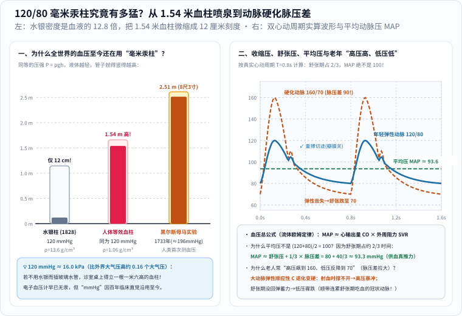
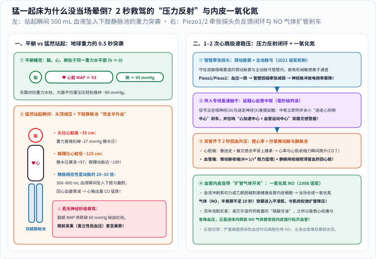
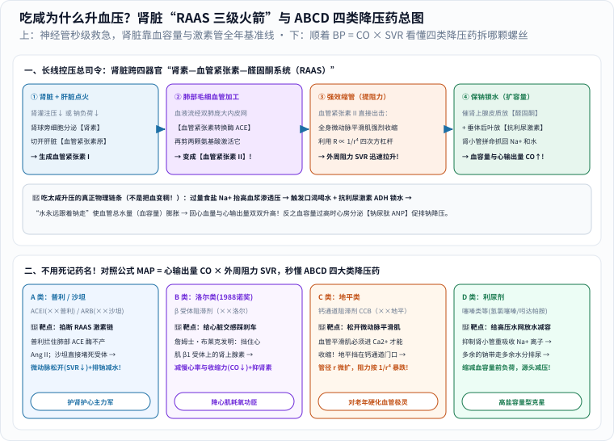
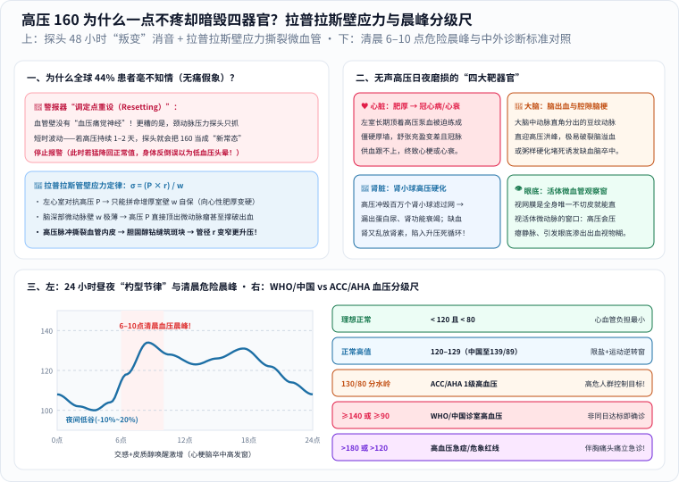

去医院体检，或者给家里长辈量血压时，最熟悉的动作莫过于把上臂伸进一只布袖带。气泵“嗡嗡”打气勒紧胳膊，十几秒后缓缓放气，屏幕上跳出一串再熟悉不过的数字：**$$120 / 80\ \mathrm{mmHg}$$**[[1]](#ref-1)[[6]](#ref-6)。

在上一篇[《心脏明明只收缩三分之一时间，为什么全身血流一秒不断、脚底的血还能顶着重力爬回胸口？》]()里，我们拆解过心脏四扇单向瓣膜和整圈循环回路。可一旦把目光聚焦到血管壁每天承受几十亿次冲击的**“血压（Blood Pressure）”**本身，五个平时习以为常、细想却满是反直觉的谜题立刻浮了上来：

1. **奇怪的“水银单位”与脉压之谜**：如今诊室和家庭早就普及了无汞电子血压计，为什么全世界的化验单还非要写“毫米汞柱（$$\mathrm{mmHg}$$）”？$$120\ \mathrm{mmHg}$$ 到底是多大一股劲？为什么很多老人年纪大了，**高压（收缩压）一路飙到 $$160$$，低压（舒张压）非但不跟着涨，反而跌到了 $$65\text{–}70$$**[[1]](#ref-1)[[4]](#ref-4)？
2. **隔着皮肉“盲测”管内水压的戏法**：不往血管里扎压力表，医生拿听诊器在肘窝听到的“咚、咚”声明明**不是心跳声**，那究竟是什么声音[[1]](#ref-1)[[4]](#ref-4)？更神的是，**你家里的电子血压计连麦克风都没装**，它什么声音都听不见，凭什么算出高压和低压[[5]](#ref-5)？
3. **起床 2 秒防晕厥的救命闪电战**：早晨闹钟一响你猛地坐起站直，地球重力会在半秒内把 **$$300\text{–}800\ \mathrm{mL}$$** 鲜血往下拽进双腿静脉，高居心脏上方 $$35\ \mathrm{cm}$$ 的大脑眼看就要断供发黑——是谁在 **1 到 2 次心跳内**力挽狂澜[[3]](#ref-3)[[8]](#ref-8)？
4. **“吃太咸升血压”的真相与降压药密码**：老话总说少吃盐，难道吃盐是把血液“腌稠了”才升压吗？医院里名字五花八门的“普利、沙坦、洛尔、地平、利尿剂”，到底各自在拧松人体水网上的哪颗螺丝[[3]](#ref-3)[[6]](#ref-6)[[8]](#ref-8)？
5. **“飙到 160 却一点不疼”的无声杀机**：手指扎根小刺都疼得钻心，为什么血管长期顶着 $$160 / 100\ \mathrm{mmHg}$$ 的高压冲击，全球近一半患者却**浑然不觉、毫无痛感**，直到某天清晨突然脑出血或心梗发作[[3]](#ref-3)[[6]](#ref-6)？

其实，整个人体的血压调控，就是一场在**流体力学欧姆定律**、**地球重力静水压**与**神经—肾脏双层自动控制网**之间24小时不眠不休的精密博弈。今天，我们就从一根两米半高的玻璃血柱讲起，把人体血压的全部秘密拆个水落石出。

---

## 一、120/80 毫米汞柱究竟有多猛？1.54 米血柱喷泉与“高压高、低压低”之谜

在物理学里，标准压强单位明明是帕斯卡（$$\mathrm{Pa}$$ 或 $$\mathrm{kPa}$$），气象台报台风用的是百帕（$$\mathrm{hPa}$$），给汽车轮胎打气看的是 $$\mathrm{bar}$$ 或 $$\mathrm{psi}$$——唯独全世界所有医院测血压，至今铁板一块地通用 **$$\mathrm{mmHg}$$（毫米汞柱）**[[1]](#ref-1)[[6]](#ref-6)。这背后藏着一段跨越近三百年的真实实验史。

_先看左栏按流体静力学 $$P = \rho g h$$ 对比同等压强下的液柱高度：水银密度是血液的 $$12.8$$ 倍，把原本需要 $$1.54$$ 米高的血柱微缩成桌面 $$12$$ 厘米刻度；再看右栏按真实心动周期绘制的双周期动脉压波形，理解为什么平均动脉压 $$\text{MAP} \approx 93.3\ \mathrm{mmHg}$$ 而不是 $$100$$，以及老年硬化动脉为何脉压差暴涨。_

### 1. 1733 年那根两米半高的玻璃血柱：为什么非得请“水银”出山？

人类历史上第一次真正测出动物血压，发生在 **1733 年**[[4]](#ref-4)。英国牧师兼博物学家**斯蒂芬·黑尔斯（Stephen Hales）**在《血液静力学》（*Haemastaticks*）中记录了一次惊世骇俗的实验：他将一根黄铜细管插进一匹老母马的腿部大动脉，再用鹅气管接上一根垂直竖起的超长玻璃管[[4]](#ref-4)。

松开动脉夹的瞬间，鲜红的马血顺着玻璃管呼啸直上，一直窜到**高于左心室水平面 8 英尺 3 英寸（约 $$2.51\ \mathrm{m}$$）**的高度，还随着每次心跳上下起伏[[4]](#ref-4)！

这下麻烦来了：根据流体静力学公式 $$P = \rho g h$$，人体全血密度约为 $$\rho_{\text{blood} } \approx 1{,}060\ \mathrm{kg/m^3}$$（只比纯水重 $$6\%$$）。如果我们今天不用水银、直接拿一根装满水或血液的透明管子给一位血压 **$$120\ \mathrm{mmHg}$$** 的健康成年人测压，液柱会冲到多高？我们来算一笔实打实的账（液态水银密度高达 $$\rho_{\mathrm{Hg} } = 13{,}595\ \mathrm{kg/m^3}$$，是人体血液的 **$$12.83$$ 倍**）：

$$
h_{\text{blood} } = 0.120\ \mathrm{m} \times \frac{\rho_{\mathrm{Hg} } }{\rho_{\text{blood} } } = 0.120 \times \frac{13{,}595}{1{,}060} \approx 1.54\ \mathrm{m}
$$

整整 **$$1.54$$ 米高**（接近一个成年人的肩膀到头顶；而黑尔斯那匹受惊母马 $$2.51\ \mathrm{m}$$ 的血柱，折算成今天的单位大约是 **$$196\ \mathrm{mmHg}$$**）[[4]](#ref-4)！换算成国际单位制，$$120\ \mathrm{mmHg} \approx 16.0\ \mathrm{kPa}$$——注意，医学上的血压一律是**“表压（Gauge Pressure）”**，意思是血管内部的血液压强**比我们身外的大气压还要净高出约 $$0.16$$ 个标准大气压**！这就是为什么一旦大动脉不幸破裂，鲜血绝不是像静脉那样汩汩渗出，而是真的能喷出一米多高的血柱！

试想一下，如果每次门诊量血压都得在医生办公桌上竖起一根两米多高、快捅破天花板的玻璃水管，那画面有多荒诞！直到 **1828 年**，法国医生兼物理学家**让·莱昂纳尔·玛丽·普瓦泽伊（Jean Léonard Marie Poiseuille）**在博士论文中灵机一动，把玻璃管里的水换成了重达 $$13.6\ \mathrm{g/cm^3}$$ 的液态金属**水银（汞）**，造出了第一台 U 型水银测压计[[1]](#ref-1)[[4]](#ref-4)：两米多高的通天血柱，瞬间被微缩成了桌面上**只有十几厘米高**的精巧刻度尺！尽管今天为了环保防汞中毒，医院和家庭已全面换用电子压力传感器，但历经近两百年沉淀下来的“$$120/80$$”临床直觉早已深入全球医学骨髓，$$\mathrm{mmHg}$$ 这把“水银标尺”也就作为法定医学压力单位一直沿用至今[[4]](#ref-4)[[6]](#ref-6)。

### 2. 血压总公式与两个反直觉真相：为什么平均压不是 100？为什么老人“高压高、低压低”？

看懂了单位，再看屏幕上的两个数字：**$$120 / 80\ \mathrm{mmHg}$$**[[1]](#ref-1)：

- **收缩压（Systolic BP，俗称“高压”，正常 $$<120\ \mathrm{mmHg}$$）**：左心室猛烈收缩射血时，一股血浪冲进大动脉撑开管壁，在血管内激起的**波峰最高压**[[1]](#ref-1)[[6]](#ref-6)；
- **舒张压（Diastolic BP，俗称“低压”，正常 $$<80\ \mathrm{mmHg}$$）**：左心室放松休息、主动脉瓣关门后，靠大动脉橡胶管壁弹性回缩继续推血前行时，降到的**波谷最低压**[[1]](#ref-1)[[6]](#ref-6)；
- **脉压（Pulse Pressure，简称脉压差）**：两者之差 $$PP = P_{\text{收缩} } - P_{\text{舒张} } = 120 - 80 = 40\ \mathrm{mmHg}$$，你搭在手腕桡动脉上摸到的“脉搏跳动感”，本质上就是这 $$40\ \mathrm{mmHg}$$ 的压力涨落幅度[[1]](#ref-1)！

这里紧接着就有**第一个极易算错的误区**：既然最高 $$120$$、最低 $$80$$，那真正推动全身器官灌注的**平均动脉压（Mean Arterial Pressure，$$\text{MAP}$$）**，难道不就是 $$(120 + 80) \div 2 = 100\ \mathrm{mmHg}$$ 吗？

**错！真正在血管里做功的平均动脉压只有约 $$93.3\ \mathrm{mmHg}$$**[[1]](#ref-1)！
看看上图右栏的真实压力波形就明白了：在安静心率（比如 $$0.8\ \mathrm{s}$$ 跳一次）下，心脏收缩冲波峰的时间只占约 **$$\frac{1}{3}$$**，而舒张滑向波谷的时间占了整整 **$$\frac{2}{3}$$**[[1]](#ref-1)！血压在低位停留的时间比高位长了一倍，按时间加权积分算下来：

$$
\text{MAP} \approx P_{\text{舒张} } + \frac{1}{3}\left(P_{\text{收缩} } - P_{\text{舒张} }\right) = 80 + \frac{120 - 80}{3} \approx 93.3\ \mathrm{mmHg}
$$

正常人的 $$\text{MAP}$$ 稳稳落在 **$$70\text{–}110\ \mathrm{mmHg}$$** 之间；一旦长时间跌破 **$$60\ \mathrm{mmHg}$$**，推力就不足以把血挤进大脑和肾脏毛细血管，当场引发组织缺血缺氧[[1]](#ref-1)。

那么，到底是什么决定了你的平均血压高低？把整套体循环血管网看作一条闭合水路（终点右心房中心静脉压 $$\text{CVP} \approx 0\ \mathrm{mmHg}$$），流体力学里的“欧姆定律”结合普瓦泽伊公式[[1]](#ref-1)，直接给出了统领一切血压现象与降压药原理的**黄金总方程**：

$$
\text{MAP} \approx \underbrace{\text{CO} }_{\text{心输出量} } \times \underbrace{\text{SVR} }_{\text{外周血管总阻力} } = \left(\text{心率 HR} \times \text{每搏量 SV}\right) \times \frac{8\eta\lambda}{\pi r^4}
$$

公式里的每一个字母都是活生生的生理旋钮[[1]](#ref-1)：
- **$$\text{CO}$$（每分钟泵血量，安静约 $$5\ \mathrm{L/min}$$）**：受心率快慢、心肌收缩力强弱，以及血管里总共有多少水（**血容量**）决定[[1]](#ref-1)；
- **$$\text{SVR}$$（全身外周阻力）**：血液黏度 $$\eta$$ 和全身血管总长 $$\lambda$$ 平时几乎不变（除非严重脱水、红细胞增多症，或体重每增加几公斤多长出大批脂肪血管网），真正瞬息万变的是全身数千万根**微动脉（Arterioles）的内半径 $$r$$**——因为它带着恐怖的**四次方反比（$$1/r^4$$）**！微动脉平滑肌只要轻轻收紧让管径变窄 $$16\%$$，流阻就会直接**翻一倍**[[1]](#ref-1)[[3]](#ref-3)！

顺着这套物理图像，困扰无数家庭的**第二个怪现象**也瞬间豁然开朗：**为什么很多爷爷奶奶量血压，常出现“高压飙到 $$160\ \mathrm{mmHg}$$，低压却掉到 $$65\text{–}70\ \mathrm{mmHg}$$”（单纯收缩期高血压，脉压差拉大到 $$90$$ 以上）[[1]](#ref-1)？**

答案只有四个字：**顺应性丧失（血管变硬了）**[[1]](#ref-1)[[2]](#ref-2)！
脉压差近似满足 $$PP \approx \frac{\text{SV} }{C}$$，其中 $$C = \frac{\Delta V}{\Delta P}$$ 是大动脉的**弹性顺应性**[[1]](#ref-1)。年轻人的主动脉富含弹性纤维，像一只柔韧的厚橡胶气球：左心室射入 $$75\ \mathrm{mL}$$ 血液时，管壁顺势鼓胀卸力，高压被温柔地压在 $$120\ \mathrm{mmHg}$$；心室休息时，鼓起的橡胶管壁回弹蓄压，把低压稳稳托在 $$80\ \mathrm{mmHg}$$[[1]](#ref-1)。
而随着年龄增长与动脉硬化，弹性纤维断裂钙化，主动脉变成了缺乏弹性的**“硬铁管”**（顺应性 $$C$$ 腰斩）[[1]](#ref-1)：
- **收缩期硬碰硬**：同样射入 $$75\ \mathrm{mL}$$ 血液，硬管子撑不开，水锤效应让收缩压瞬间直冲 **$$160\ \mathrm{mmHg}$$**（参见上图右栏橙色虚线）；
- **舒张期没后劲**：心室一停泵，硬管子没有橡胶回弹力替心脏兜底，舒张压唰地掉到 **$$70\ \mathrm{mmHg}$$** 以下！更要命的是，心脏自己的**冠状动脉全靠舒张压给自己灌血**——“高压太高累坏心室、低压太低饿着冠脉”，这就是为什么脉压差长期过大（尤其接近或超过 $$60\text{–}100\ \mathrm{mmHg}$$）是心血管老化的重要警讯[[1]](#ref-1)！

---

## 二、不扎针怎么隔着肉测准血压？听诊器“柯氏音湍流” vs 家用电子表“示波包络”

在黑尔斯和普瓦泽伊之后的整整一百多年里，想测血压都得切开皮肤把管子插进动脉，根本没法用于日常看病[[4]](#ref-4)。直到 **1896 年**意大利医生**希皮奥内·里瓦-罗奇（Scipione Riva-Rocci）**发明上臂充气袖带，外加 **1905 年**俄国军医**尼古拉·柯罗特科夫（Nikolai Korotkoff）**在圣彼得堡帝国军事医学院把听诊器贴到袖带下方的肘窝里，人类才终于拥有了无创测血压的百年绝技[[1]](#ref-1)[[4]](#ref-4)[[5]](#ref-5)！

可你仔细想过没有：**平时把听诊器直接贴在胳膊动脉上，你是一点声音都听不见的！**那袖带一勒、一放，听诊器里清脆的“咚、咚、咚”到底是什么声音？而根本没装听诊器麦克风的家用电子血压计，又是怎么“盲猜”出高压和低压的？

_先看上图跟读袖带从 $$160\ \mathrm{mmHg}$$ 匀速放气穿过动脉压力波（$$120/80\ \mathrm{mmHg}$$）的三个声学区间（橙色圆点单次演示匀速放气扫描过程，静态分界线与读数完整保留）；再看中图严格对齐同一时间轴的电子血压计气囊压力脉动波形，看清“先抓包络最高峰 $$\text{MAP}$$、再反推高低压”的示波算法；最后看底栏居家测压高度误差。_

### 1. 医生听诊器听的不是心跳，而是血管被挤扁时的“湍流拍门声”！

流体力学里把流动分成两副面孔：流速平缓、管径规整时，血液一层套一层顺滑前进，叫**层流（Laminar Flow）**——层流是**完全静音**的；可一旦管道被外力突然捏成一道极窄的扁缝，血液被迫高速喷射穿过狭口，雷诺数骤升，流体瞬间翻滚起无数漩涡并猛拍下游松弛管壁，就会爆发出清脆声响——这叫**湍流射流与管壁拍击声（Turbulent Flow）**[[1]](#ref-1)！

柯罗特科夫 1905 年发现的**“柯氏音（Korotkoff Sounds）”**，正是利用充气袖带在肱动脉上人为制造的一场三幕流体声学开关（对照上图顶部三色分区）[[1]](#ref-1)[[5]](#ref-5)：

1. **第 ① 幕（$$P_{\text{袖带} } > 120\ \mathrm{mmHg}$$，例如打气到 $$160$$）：死死夹扁，绝对无声**
   袖带气压高于动脉最高峰值压，上臂肱动脉整段被彻底压瘪截断，一滴血都过不去——听诊器里一片死寂[[1]](#ref-1)[[5]](#ref-5)。
2. **第 ② 幕（$$120 \ge P_{\text{袖带} } \ge 80\ \mathrm{mmHg}$$）：波峰冲缝，“咚、咚”作响！**
   拧开气阀以每秒 $$2\text{–}3\ \mathrm{mmHg}$$ 缓缓放气。当气压刚降破 **$$120\ \mathrm{mmHg}$$** 的那一刹那，心脏收缩射血的**波峰尖尖**第一次有力气顶开袖带，在被压扁的血管里冲开一线窄缝！一股高速湍流喷薄而出，拍响血管壁——医生耳朵里听到的**第一声清脆“咚”响（柯氏音第 I 期），就是你的收缩压（高压 $$120$$）**[[1]](#ref-1)[[5]](#ref-5)！随后每次心跳波峰冲过、波谷又被袖带重新压扁，断续湍流一路敲出“咚、咚、咚”的节拍。
3. **第 ③ 幕（$$P_{\text{袖带} } < 80\ \mathrm{mmHg}$$）：全程畅通，重归寂静！**
   当袖带气压继续降到低于动脉波谷压（**$$80\ \mathrm{mmHg}$$**）时，哪怕在心脏放松的最低谷，袖带也再压不扁肱动脉了！血管恢复全程圆润畅通，狂暴的湍流瞬间变回安静丝滑的层流——**最后一声响动彻底消失的那一刻（柯氏音第 V 期），就是你的舒张压（低压 $$80$$）**[[1]](#ref-1)[[5]](#ref-5)！

### 2. 拆开家用电子血压计：连麦克风都没有，它凭什么算出高压和低压？

很多人把家里的电子血压计拆开一看会大吃一惊：里面只有一只微型气泵、一只电磁放气阀，以及一颗连在充气软管上的**固态压力传感器**——**压根就没有贴皮肤的麦克风**[[5]](#ref-5)！不听柯氏音，它怎么知道 $$120$$ 和 $$80$$？

秘密就在上图中间那条紫色的纺锤形波形——**示波法（Oscillometric Method）**[[5]](#ref-5)！

每当肱动脉里滚过一次脉搏波，上臂体积就会发生微乎其微的胀缩，反过来轻轻挤压外圈的充气袖带，在气囊气压上叠加出幅度仅约 **$$1\text{–}3\ \mathrm{mmHg}$$** 的微小压力涟漪[[5]](#ref-5)。英国与爱尔兰高血压学会的技术指南把它的物理精髓讲得极为透彻[[5]](#ref-5)：

- 袖带太紧（$$>120$$）时，血流截断，气囊只有微弱冲击；袖带太松（$$<80$$）时，气囊快脱离手臂，感应到的搏动也很微弱[[5]](#ref-5)。
- **什么时候血管壁拍打袖带的胀缩幅度达到巅峰？** 恰恰是**袖带外压正好等于血管平均动脉压（$$P_{\text{袖带} } \approx \text{MAP} \approx 93.3\ \mathrm{mmHg}$$）**的时刻！此时血管内外的跨壁压归零（$$P_{\text{跨壁} } = P_{\text{管内} } - P_{\text{袖带} } \approx 0$$），动脉管壁处于最松软、弹性顺应性最大的“卸载状态”，每一次脉搏都能激起**全过程最大的体积与气压振幅峰值**[[5]](#ref-5)！

换句话说：**水银听诊法是直接测出高压和低压，再算出平均压；而家用电子血压计正好反过来——它真正测得最准的是包络最高峰对应的“平均动脉压 $$\text{MAP}$$”**，然后微处理器再根据包络上升沿和下降沿的特征振幅比例算法，**反推出收缩压与舒张压**[[5]](#ref-5)！

一懂这个底层原理，你在家量血压遇到的所有“怪事”就全有了科学解释：

1. **为什么房颤（心房颤动）或早搏频繁的老人，用普通电子血压计常常连测三次跳出三个天差地别的数？**
   因为示波法全靠寻找一条**平滑隆起再平滑回落**的脉冲包络线[[5]](#ref-5)！房颤患者每次心跳间隔乱七八糟、每搏射血量忽大忽小，画出来的振幅包络像锯齿一样残缺不全，芯片的比例算法当场“抓瞎”（同理，测压时说话、咳嗽、抖手，或者心率慢于 $$50$$ 次/分导致放气期内采不到足够脉搏点，都会把包络搅乱）[[5]](#ref-5)[[6]](#ref-6)。
2. **为什么手腕或上臂比胸口心脏低了 $$10\ \mathrm{cm}$$，血压就会平白“假性升高”近 $$8\ \mathrm{mmHg}$$？**
   回到第一节的 $$P = \rho_{\text{blood} } g \Delta h$$！袖带位置每比右心房水平面**垂低 $$10\ \mathrm{cm}$$**，地球重力就会在血管里多压上一段 $$10\ \mathrm{cm}$$ 高的静水血柱：

   $$
   \Delta P = 100\ \mathrm{mm} \times \frac{1{,}060}{13{,}595} \approx +7.8\ \mathrm{mmHg}
   $$

   要是你坐着量血压时没把胳膊平托在桌面上，而是让手臂自然下垂在身体一侧（袖带比心脏低 $$25\ \mathrm{cm}$$），读数会凭空飙高近 **$$+20\ \mathrm{mmHg}$$**——明明是标准的 $$120/80$$，硬生生量成了吓人的“$$140/100$$ 高血压”[[6]](#ref-6)！反过来，要是拿腕式血压计举过头顶量，读数又会严重偏低[[1]](#ref-1)[[6]](#ref-6)。此外，翘二郎腿挤压下肢血管、憋尿激活交感神经、刚喝完浓茶咖啡，乃至在医院面对白大褂紧张（约三分之一诊室血压偏高者属于**“白大衣效应”**），都会让读数显著跑偏[[4]](#ref-4)[[6]](#ref-6)。

---

## 三、早晨猛一起床为什么没当场晕倒？2 秒救驾的“压力反射”与内皮一氧化氮

如果把人体当成一套装满水的封闭软管，每天清晨你掀开被子猛然站起来的那 **0.5 秒**，其实都是一场惊心动魄的流体力学危机。

在之前[《为什么蚂蚁放大一百倍会当场骨折、参天巨树永远长不过130米？》]()里我们聊过长颈鹿高达 $$250\ \mathrm{mmHg}$$ 的恐怖血压；哪怕是身高一米七的人类，一从水平躺姿变成垂直站立，地球重力也会立刻打出两记重拳（见下图左栏）：

_左栏对比平躺（脑、心、脚等高）与猛然站立时地球重力带来的双重暴击：头顶扣减 $$-27\ \mathrm{mmHg}$$ 静水压，同时 $$300\text{–}800\ \mathrm{mL}$$ 血液坠入高顺应性下肢静脉池；右栏按 ①→④ 拆解颈动脉窦与主动脉弓 Piezo1/2 探头在 1–2 秒内稳住脑供血的负反馈闭环，以及血管内皮释放一氧化氮 $$\mathrm{NO}$$ 气体的局部扩管刹车。_

### 1. 站起瞬间的双重暴击：头顶扣水压 + 双腿静脉“截走半升血”

当你平躺在床上时，大脑、心脏和脚踝处于同一水平面，心脏只要维持 $$\text{MAP} \approx 93\ \mathrm{mmHg}$$，脑部动脉就能舒舒服服拿到约 $$90\ \mathrm{mmHg}$$ 的灌注压。

可你一猛站起来：
- **第一拳砸向头顶**：大脑瞬间高出心脏约 $$35\ \mathrm{cm}$$，光是克服重力爬坡，脑部动脉压就要先白白扣掉 $$\rho g h \approx 27\ \mathrm{mmHg}$$！与此同时，比心脏低 $$125\ \mathrm{cm}$$ 的脚踝血管却要额外硬扛 $$+97\ \mathrm{mmHg}$$ 重力水柱，脚踝动脉平均压飙升到近 $$190\ \mathrm{mmHg}$$！
- **第二拳掏空回心血量**：静脉管壁又薄又软，顺应性（延展度）是同级动脉的 **20 到 30 倍**[[2]](#ref-2)。重力往下一拽，下肢和腹盆腔静脉瞬间像软皮水袋一样鼓胀起来，一口气兜走了 **$$300\text{–}800\ \mathrm{mL}$$** 血液！流回右心房的血量骤减，下一秒左心室射出的血量（$$\text{CO}$$）跟着跳水！

要是身体没有任何自动调节，两拳叠加之下，大脑平均灌注压会在两三秒内跌穿 **$$60\ \mathrm{mmHg}$$** 的缺氧红线[[1]](#ref-1)——这就是久蹲猛起时偶尔“眼前发黑、金星乱冒”（**直立性低血压**）的物理根源[[4]](#ref-4)！

### 2. 守在进脑咽喉要道的 Piezo 机械探头：1–2 次心跳完成绝地反击

为什么绝大多数时候你起床连晃都不晃一下？全靠守在大脑供血咽喉要道上的两座“特种哨所”——**颈动脉窦（Carotid Sinus，就在颈总动脉分叉进脑的根部）**和**主动脉弓（Aortic Arch）**[[3]](#ref-3)！

这两处动脉壁格外柔薄，里面密布着对管壁拉伸极其敏感的**压力感受器（Baroreceptors）**[[3]](#ref-3)。过去一百多年科学家只知道管壁一拉紧神经就放电，却一直没抓到把“机械拉力”翻译成“生物电流”的分子开关——直到阿德姆·帕塔普蒂安（Ardem Patapoutian）团队揪出细胞膜上形似三叶螺旋桨的**机械敏感离子通道蛋白 $$\text{Piezo1}$$ 与 $$\text{Piezo2}$$**（希腊语 *píesi* 意为“压力”），一举斩获 **2021 年诺贝尔生理学或医学奖**[[8]](#ref-8)！

看看这套秒级闭环负反馈有多干脆利落（上图右栏 ①→③）[[3]](#ref-3)[[8]](#ref-8)：

1. **探头报信**：站起瞬间动脉压微跌 $$\to$$ 颈动脉窦与主动脉弓管壁回缩，$$\text{Piezo1/Piezo2}$$ 通道张开减少 $$\to$$ 顺着舌咽神经（第 IX 脑神经）和迷走神经（第 X 脑神经）发往脑干的脉冲频率骤降[[3]](#ref-3)[[8]](#ref-8)；
2. **延髓变脸**：脑干里的**延髓心血管中枢**一收到“放电变慢 = 血压掉了”的急报，毫秒级做出双向切换——关小“心抑制中心”的迷走神经刹车，同时拉满“心加速中心”和“血管运动中心”的交感神经油门[[3]](#ref-3)；
3. **水泵与水管齐发力**：交感神经末梢释放去甲肾上腺素，一边让**心率瞬间加快、心肌收缩更有力**（拉回 $$\text{CO}$$），一边拧紧全身内脏与皮肤的**微动脉**（借 $$1/r^4$$ 迅速托住外周阻力 $$\text{SVR}$$），并同步收紧下肢与腹腔**静脉平滑肌**，把滞留的血液硬挤回心脏[[3]](#ref-3)！前前后后只用 **1 到 2 次心跳**，大脑供血就被稳稳托住！（顺带提个冷知识：正因为颈动脉窦是总探头，千万不能双侧同时用力按压脖子上的颈动脉窦，也没法把衣领勒得死紧——否则探头误以为“血压爆表了”，反手一记强迷走刹车，真会把心跳和血压按到当场晕厥！）

### 3. 诺贝尔拒绝服用的“炸药救心丸”：血管内皮自带的一氧化氮气体开关

有交感神经负责“踩油门缩血管”，就必须有局部机制负责“松绑扩血管”，让真正干活缺氧的肌肉和心脏优先拿到血[[3]](#ref-3)。谁在干这件细活？

答案在 **1998 年诺贝尔生理学或医学奖**揭晓时震惊了整个科学界[[7]](#ref-7)：过去被当成光滑“塑料内衬”的**血管内皮细胞（Endothelium）**，居然会自己合成汽车尾气里常见的污染物——**一氧化氮气体（$$\mathrm{NO}$$）**来当信使[[2]](#ref-2)[[7]](#ref-7)！

药理学家罗伯特·佛契哥特（Robert Furchgott）在 1980 年发现，只有保留完整的血管内皮层，乙酰胆碱才能让血管舒张；路易斯·伊格纳罗（Louis Ignarro）与费里德·穆拉德（Ferid Murad）进一步证实，内皮在受到血流冲刷剪切力或局部缺氧信号刺激时，当场释放的“内皮舒张因子”就是 **$$\mathrm{NO}$$ 气体**[[3]](#ref-3)[[7]](#ref-7)！这团寿命**不足 10 秒**的小分子气体直接穿过细胞膜钻进外圈平滑肌，关掉收缩开关，令血管瞬间舒张降压，还能顺带防止血小板凝集长血栓[[7]](#ref-7)。

最富戏剧性的一幕发生在诺贝尔奖创始人**阿尔弗雷德·诺贝尔（Alfred Nobel）**自己身上[[7]](#ref-7)：诺贝尔靠驯服烈性炸药**硝酸甘油（Nitroglycerin）**发明硅藻土炸药发了大财；晚年他患上严重心脏病心绞痛，医生给他开的救命药偏偏就是**口服硝酸甘油**！诺贝尔死活不信炸药能治胸痛，还在信里苦笑吐槽：“真讽刺，医生居然命令我把硝酸甘油吃进肚子里！”[[7]](#ref-7) 整整一百年后科学界才搞明白：动脉硬化患者的受损内皮造不出足够的 $$\mathrm{NO}$$，而舌下含服的硝酸甘油一进人体就会释放出 **$$\mathrm{NO}$$ 气体**，几分钟内替受损内皮强行松开冠状动脉与全身静脉，既救心绞痛又能紧急降压[[7]](#ref-7)！（反过来，要是遭遇严重细菌感染引发**败血症休克**，全身白细胞失控狂喷海量 $$\mathrm{NO}$$，又会让全身微动脉彻底瘫软扩张，导致血压灾难性崩盘[[3]](#ref-3)[[7]](#ref-7)！）

---

## 四、吃太咸为什么升血压？肾脏“RAAS 三级火箭”与 ABCD 四大类降压药总图

既然颈动脉窦的压力反射能在 2 秒内精准稳压，一个关键漏洞来了：**为什么世界上还会有 14 亿慢性的高血压患者[[6]](#ref-6)？神经反射为什么不把他们的血压调回 120/80？**

因为神经反射只管**几秒到几分钟的短跑救急**；真正拍板决定你全年 365 天**长期血压基准线**的总司令，其实是腰后那对拳头大的器官——**肾脏**[[3]](#ref-3)！

_上半部分拆解肾脏球旁器跨肝、肺、肾上腺与垂体四器官的“RAAS 激素三级火箭”，以及高盐饮食靠渗透压锁水扩充血容量的真实物理链条；下半部分顺着 $$\text{MAP} = \text{CO} \times \text{SVR}$$ 总方程，把临床最常用的 ABCD 四大类降压药精准对应到各自的生理螺丝上。_

### 1. 吃咸升压真不是“把血变稠”，而是“水跟着钠走”撑爆了血容量！

很多人以为吃咸菜、重油重盐火锅升血压，是因为盐进血管把血液变黏稠了——其实恰恰相反，**吃咸是把血管里的总水量（血容量）给“泡胀”了**[[1]](#ref-1)[[3]](#ref-3)！

人体细胞对细胞外液的钠离子浓度（渗透压）极其苛刻。世界卫生组织建议成人每天摄入钠不超过 **$$2\ \mathrm{g}$$**（约合食盐 $$5\ \mathrm{g}$$，不到一平啤酒瓶盖）[[6]](#ref-6)。当你一顿重口味大餐吃下超标几倍的食盐（$$\mathrm{NaCl}$$）后：
1. 血液和组织液里的 $$\mathrm{Na^+}$$ 浓度刚一抬头，渗透压升高立刻刺激下丘脑产生两个无法抗拒的反应：**一是让你口干舌燥猛找水喝，二是命令垂体后叶释放抗利尿激素（$$\text{ADH}$$，又称血管加压素）**，通知肾脏把本该排进尿液的水死死截留回血液里[[3]](#ref-3)；
2. 生理学里有一条铁律叫**“水永远跟着钠走（Water follows sodium）”**[[3]](#ref-3)：为了把偏咸的血浆重新稀释回标准渗透压，身体每多留住几克钠，就必须配套锁住几百毫升水！
3. 封闭管道里的总水量（**血容量**）一涨，就像给自行车内胎多打了好几筒气——回心血量增加 $$\to$$ 心输出量 $$\text{CO}$$ 升高 + 血管壁被撑紧 $$\to$$ 血压水涨船高[[1]](#ref-1)[[3]](#ref-3)！（如果肾脏排钠能力完好，血压一高肾脏就会加速排钠排水把血压降回来；可随着年龄增长、高盐负荷或肾小管排钠迟钝，身体就不得不靠维持更高的长期血压，才能硬把每天吃进去的盐挤进尿液排走！）

### 2. 跨四器官接力的激素核武器：肾素—血管紧张素—醛固酮系统（RAAS）

反过来，一旦遇到失血、脱水，或者肾动脉狭窄导致流进肾脏的血压偏低，肾脏入球小动脉壁上的**球旁细胞（Juxtaglomerular Cells）**就会以为“全身要断水了”，当场点燃人体最强悍的一套跨器官升压接力棒——**RAAS 系统**（见上图上半部分 ①→④）[[3]](#ref-3)：

1. **第一棒（肾 + 肝）**：肾脏球旁细胞向血液分泌蛋白水解酶**肾素（Renin）**，精准剪开肝脏常年合成投放进血浆的**血管紧张素原**，生成十肽前体**血管紧张素 I**[[3]](#ref-3)；
2. **第二棒（肺毛细血管点火）**：血管紧张素 I 顺血流冲进双肺庞大的毛细血管网，守在内皮表面的**血管紧张素转换酶（ACE）**咔嚓再剪掉两颗氨基酸，把它变成人体最强烈的缩血管物质之一——八肽**血管紧张素 II（Angiotensin II）**[[3]](#ref-3)！
3. **第三棒（缩血管 + 锁水钠双面合围）**：血管紧张素 II 一边直接令全身微动脉猛烈收缩，借 $$1/r^4$$ 瞬间拉爆外周阻力 $$\text{SVR}$$；一边飞去肾上腺皮质催发**醛固酮（Aldosterone）**，联手下丘脑口渴中枢与垂体 **$$\text{ADH}$$**，命令肾脏“保钠、排钾、锁水”，把血容量也一步步垫高[[3]](#ref-3)！（当然，为了防止这套火箭失控把血管撑炸，心脏心房壁在被过多血量撑得太紧时，也会分泌反制激素**心房钠尿肽 $$\text{ANP}$$**，专门对抗血管紧张素 II，催肾脏排钠放水降压[[3]](#ref-3)）。

### 3. 一眼看懂 ABCD 四大类一线降压药：不用死记硬背药名！

很多长辈看着药盒上绕口的“××普利、××沙坦、××洛尔、××地平、××噻嗪”一头雾水。其实只要把前面的总方程 **$$\text{MAP} = \text{CO} \times \text{SVR}$$** 摆在桌上，现代医学花了半个多世纪打磨出的 **ABCD 四大类降压药**，全都是在精准拆解刚才讲过的四颗螺丝（对照上图下半部分）[[6]](#ref-6)[[8]](#ref-8)：

- **A 类——掐断 RAAS 激素链：普利类（ACEI，如依那普利）与沙坦类（ARB，如氯沙坦、替米沙坦）**[[6]](#ref-6)
  - **普利类**直接堵住第 ② 步肺和血管里的 **ACE 转换酶**，不让身体造出血管紧张素 II；**沙坦类**更干脆，直接占住靶细胞上的**血管紧张素 II 受体**让它扑空[[6]](#ref-6)。一举两得：既松开微动脉降阻力（$$\text{SVR}\downarrow$$），又停掉醛固酮排钠减水，还能给高压力下的肾小球卸压护肾[[6]](#ref-6)！
- **B 类——给心脏踩慢交感油门：洛尔类（$$\beta$$ 受体阻滞剂，如美托洛尔、普萘洛尔）**[[8]](#ref-8)
  - 这是英国药理学家**詹姆士·布莱克爵士（Sir James W. Black）**于 1964 年研发成功并荣获 **1988 年诺贝尔生理学或医学奖**的里程碑杰作[[8]](#ref-8)！它精准挡住心肌细胞 $$\beta_1$$ 受体上的肾上腺素/去甲肾上腺素信号，让狂跳的心脏慢下来、每次收缩省点力（**降低心输出量 $$\text{CO}$$ 与心肌耗氧**），同时抑制肾脏球旁器释放肾素[[8]](#ref-8)。
- **C 类——松开微动脉平滑肌箍圈：地平类（钙通道阻滞剂 CCB，如氨氯地平、非洛地平）**[[6]](#ref-6)
  - 全身几千万根微动脉外圈的平滑肌要想收缩变窄，必须先打开细胞膜大门放**钙离子（$$\mathrm{Ca^{2+} }$$）**进屋。“地平类”直接守在血管平滑肌的钙通道门口限流，平滑肌缺钙松弛，微动脉半径 $$r$$ 哪怕只扩宽一成，外周阻力 $$\text{SVR}$$ 就会按 **$$1/r^4$$** 大幅下降[[1]](#ref-1)[[6]](#ref-6)——对血管偏硬的老年高血压患者尤为得力！
- **D 类——给高压管网“开闸排钠放水”：利尿剂（如氢氯噻嗪、氯噻酮、吲达帕胺）**[[6]](#ref-6)
  - 直接作用在肾小管上，抑制钠离子重吸收；多余的钠带着多余的水排进尿液，从源头把膨胀的**血容量**缩回正常水位[[6]](#ref-6)！

> **重要安全提醒**：不同降压药有严格的适应证与禁忌证（例如孕期禁用普利/沙坦类以免伤及[胎儿肾脏发育]()，支气管哮喘或严重心动过缓慎用部分洛尔类等），具体选药、联用与调量务必由临床医生评估决定，切忌自行停药或换药[[6]](#ref-6)。

---

## 五、终极追问：为什么飙到 160 却一点都不疼，却成了头号“无声杀手”？

世界卫生组织 2025 年发布的全球统计揭示了一组触目惊心的数字：全球 30–79 岁成年人中有高达 **14 亿人**患有高血压，但其中 **44%（约 6 亿人）根本不知道自己得了高血压**[[6]](#ref-6)！很多壮年人甚至把“我血压 160 也没头晕头疼，不用管它”挂在嘴边——殊不知，**“不疼”恰恰是高血压最阴险的生理圈套**！

_左上揭示压力感受器在 1–2 天内发生“调定点重设”导致的无症状假象，以及拉普拉斯壁应力公式 $$\sigma = \frac{P \cdot r}{w}$$；右上汇总心、脑、肾、眼四大靶器官的慢性力学损伤；左下绘制 24 小时昼夜杓型血压曲线与清晨 6–10 点危险晨峰；右下对照中外临床分级与急诊红线。_

### 1. 警报器 48 小时“叛变”：为什么高压不痛，降回正常起初反而会晕？

为什么皮肤被针扎一下立刻剧痛，血管长期承受 $$160\ \mathrm{mmHg}$$ 却毫无感觉？
第一，我们的动脉管壁里只有感应拉伸的机械感受器，**压根没有进化出感知“慢性管内水压偏高”的痛觉神经末梢**（除非血管已经发生撕裂夹层，或飙到 $$>180/120\ \mathrm{mmHg}$$ 引发急性脑水肿、视网膜出血、心绞痛，才会出现剧烈头痛、胸痛、视物模糊等危象警报）[[6]](#ref-6)。

第二，更致命的是**压力感受器的“调定点重设（Baroreceptor Resetting）”**：颈动脉窦那套 Piezo 探头天生是个“抓短跑波动、不管长线慢涨”的哨兵！一旦你的血压因为高盐、肥胖或动脉硬化，连续 **1 到 2 天**维持在 $$160/100\ \mathrm{mmHg}$$，压力感受器和延髓中枢就会自动发生适应性重设——**把 $$160$$ 错误地当成了新的“标准合格线”**，从此彻底闭嘴不再降压！
这甚至解释了一个临床上极常见的现象：有些长期 $$170\ \mathrm{mmHg}$$ 的患者刚开始吃降压药，如果头几天把血压降得太猛太快（比如一下降回 $$115$$），已经习惯高压灌注的脑血管自我调节和“叛变探头”一时反应不过来，反而会拉响假低血压警报，让人觉得头晕乏力——所以慢性降压讲究**平稳缓降（数周达标）**，让调定点一步步退回正常区！

### 2. 拉普拉斯壁应力定律：水压静悄悄磨碎“心、脑、肾、眼”四大器官

你不觉得疼，物理定律可一秒钟都没停手！对于任何半径为 $$r$$、管壁厚度为 $$w$$、内部承受压强为 $$P$$ 的圆筒或球腔，管壁材料内部承受的撕裂拉应力 $$\sigma$$ 服从著名的**拉普拉斯定律（Law of Laplace）**：

$$
\sigma = \frac{P \cdot r}{w}
$$

当内部血压 $$P$$ 长期居高不下时，全身四个最娇贵、血管最密集的**靶器官**就会沿着这条公式走向两种截然不同却同样致命的结局[[1]](#ref-1)[[3]](#ref-3)[[6]](#ref-6)：

1. **心脏（拼命增厚 $$w$$ $$\to$$ 练成“僵硬死肌肉”）**：左心室每次射血都要顶着 $$160$$ 甚至 $$180\ \mathrm{mmHg}$$ 的巨大后负荷硬推。为了不被高压撕裂（维持壁应力 $$\sigma$$ 不超标），心肌细胞只能被迫把室壁厚度 $$w$$ 越练越厚（**左心室向心性肥厚**）。可心肌变厚变硬后，舒张期充血越来越难，毛细血管供氧跟不上肥厚肌肉，最终滑向冠心病、心房颤动与心力衰竭[[1]](#ref-1)[[6]](#ref-6)！
2. **大脑（薄壁 $$w$$ 硬扛冲击 $$\to$$ 脑出血与脑梗死）**：大脑深部从粗大的大脑中动脉近乎直角分出的细小穿支（如**豆纹动脉**），管壁 $$w$$ 极薄却毫无缓冲地正面硬接大动脉高压洪峰！日积月累不仅会在薄弱处鼓出微动脉瘤（一旦情绪激动或用力排便血压骤升便撑破引发**脑出血**），高压脉动还会不断撕裂血管内皮，让低密度脂蛋白胆固醇（$$\text{LDL}$$）钻进内膜筑起粥样硬化斑块，堵死血管引发**缺血性脑卒中（脑梗）**甚至血管性痴呆[[3]](#ref-3)[[6]](#ref-6)！
3. **肾脏（滤网冲毁 $$\to$$ 越坏越高的恶性循环）**：双肾里约两百万个由毛细血管团缠成的**肾小球**长期泡在高压里硬化坏死，先是漏出微量白蛋白尿，继而发展为慢性肾衰竭；更糟的是，受损缺血的肾单位又会疯狂分泌肾素激活 RAAS，把血压推得更高，形成“高血压 $$\leftrightarrow$$ 肾损伤”死循环[[3]](#ref-3)[[6]](#ref-6)！
4. **眼底视网膜（全身唯一能隔着瞳孔直视活体微血管的窗户）**：医生拿眼底镜往瞳孔里一照，就能亲眼看见高血压怎样把视网膜微动脉压得变细反光增强（银丝/铜丝样改变）、压瘪交叉处的静脉，重度时甚至直接渗血水肿导致视力受损！

### 3. 清晨 6–10 点“血压晨峰”与一张尺子看清中外诊断线

最后看一眼上图左下角那条 **24 小时昼夜血压曲线**：健康人的血压绝不是一条死板的直线，而是标准的**“两峰一谷杓型曲线（Dipper Pattern）”**——夜间熟睡时迷走神经当家，血压会比白天自然回落 **$$10\%\text{–}20\%$$** 给心脑肾放假修复；而每天清晨 **6:00 到 10:00** 醒来前后，为了迎接起床活动，交感神经与肾上腺皮质醇、RAAS 同步猛踩油门，血压会在短时间内陡峭跃升，称为**清晨血压晨峰（Morning Surge）**！这就是为什么心源性猝死、心肌梗死和脑出血最爱在**清晨刚起床的头几个小时**集中爆发（也是为什么长效降压药提倡每天清晨一起床就服药、牢牢压住全天及次日晨峰的核心原因）！

那么，到底量出多少算正常、多少算高血压？临床上主要并行着两套完全透明的参考标尺（均要求安静规范测量、非同日多次核实）[[3]](#ref-3)[[6]](#ref-6)：

- **理想正常血压**：无论哪国指南，公认最健康的安全区都是 **收缩压 $$<120\ \mathrm{mmHg}$$ 且 舒张压 $$<80\ \mathrm{mmHg}$$**[[3]](#ref-3)[[6]](#ref-6)；
- **国际 WHO 与中国现行诊室高血压诊断线**：非同日测量 **收缩压 $$\ge 140\ \mathrm{mmHg}$$ 和/或 舒张压 $$\ge 90\ \mathrm{mmHg}$$** 确诊高血压（家庭自测血压因少了白大衣紧张效应，通常以 **$$\ge 135/85\ \mathrm{mmHg}$$** 为对应界值）[[6]](#ref-6)；
- **美国 ACC/AHA 严格前移标准与高危治疗目标**：将 **$$130\text{–}139$$ 或 $$80\text{–}89\ \mathrm{mmHg}$$** 即划入 1 级高血压提前预警；同时 WHO 与各国指南一致建议，合并冠心病、脑卒中、糖尿病或慢性肾病的高危人群，应努力把血压控制在 **$$<130/80\ \mathrm{mmHg}$$**[[3]](#ref-3)[[6]](#ref-6)；
- **急诊红线**：一旦血压冲过 **$$>180\ \mathrm{mmHg}$$ 和/或 $$>120\ \mathrm{mmHg}$$**，且伴有胸痛、气短、剧烈头痛、半身麻木无力、说话含糊或视物模糊中的任何一条，属于随时危及生命的**高血压急症（Hypertensive Emergency）**，必须立即拨打急救电话送医[[6]](#ref-6)！

---

## 六、一张总表收尾：把人体血压的五大核心原理装进口袋

下一次再看到袖带屏幕上的数字时，不妨对照这张浓缩总表——那不再是两个冷冰冰的体检指标，而是你体内精妙绝伦的水利工程实时仪表盘：

| 核心问题 | 关键数值与物理/生理公式 | 一句话看透底层机制 |
| :--- | :--- | :--- |
| **为什么用 $$\mathrm{mmHg}$$ 与平均压 $$\text{MAP}$$？** | $$120\ \mathrm{mmHg} \approx 16.0\ \mathrm{kPa} \approx 1.54\ \mathrm{m}$$ 血柱；$$\text{MAP} \approx P_{\text{舒} } + \frac{1}{3}PP \approx 93.3$$ | 水银比血重 $$12.8$$ 倍，把一米五血柱微缩成 $$12\ \mathrm{cm}$$；舒张期占 $$\frac{2}{3}$$ 时间使平均压偏向低压；老年大动脉变硬令高压飙升、低压反降[[1]](#ref-1)[[4]](#ref-4)。 |
| **不扎针怎么测准高低压？** | 柯氏音 $$120\to 80$$ 湍流窗；袖带低 $$10\ \mathrm{cm}$$ 虚高 $$+7.8\ \mathrm{mmHg}$$ | 听诊器听的是半压扁血管的**湍流射流声**（首声高压、消音低压）；家用电子表无麦克风，靠气囊脉动**最大振幅抓 $$\text{MAP}$$** 反推高低压[[1]](#ref-1)[[5]](#ref-5)。 |
| **猛一起床为什么不晕倒？** | 站立下肢滞留 $$300\text{–}800\ \mathrm{mL}$$ 血；内皮 $$\mathrm{NO}$$ 半衰期 $$<10\ \mathrm{s}$$ | 颈动脉窦与主动脉弓 $$\text{Piezo1/2}$$ 探头在 **1–2 秒内**提心率、借 $$1/r^4$$ 缩微动脉稳住脑灌注；内皮释放 $$\mathrm{NO}$$ 气体负责局部松绑扩管[[3]](#ref-3)[[7]](#ref-7)[[8]](#ref-8)。 |
| **吃咸升压与降压药怎么干活？** | $$\text{MAP} = \text{CO} \times \text{SVR}$$；WHO 限钠 $$<2\ \mathrm{g/d}$$（盐 $$<5\ \mathrm{g}$$） | 高盐靠渗透压锁水撑大**血容量**；肾脏 **RAAS** 掌管全年基准压；**ABCD 四类降压药**分别掐断 RAAS、慢心率、扩微动脉、排钠减水[[3]](#ref-3)[[6]](#ref-6)[[8]](#ref-8)。 |
| **为什么 160 不疼却伤全身？** | 拉普拉斯壁应力 $$\sigma = \frac{P \cdot r}{w}$$；全球 $$44\%$$ 患者不知情 | 压力探头 **1–2 天重设调定点**掩盖症状，高压却日夜迫使心肌肥厚、撕裂脑肾眼微血管，尤需警惕清晨 6–10 点血压晨峰[[3]](#ref-3)[[6]](#ref-6)！ |

---

## 参考资料与核查来源

1. Betts JG, Young KA, Wise JA, et al. *Anatomy and Physiology 2e*, Section 20.2: **Blood Flow, Blood Pressure, and Resistance**. OpenStax, Rice University (2022). [https://openstax.org/books/anatomy-and-physiology-2e/pages/20-2-blood-flow-blood-pressure-and-resistance](https://openstax.org/books/anatomy-and-physiology-2e/pages/20-2-blood-flow-blood-pressure-and-resistance)（核查支持：收缩压、舒张压、脉压 $$PP$$、平均动脉压 $$\text{MAP} \approx P_{\text{dia} } + \frac{1}{3}(P_{\text{sys} } - P_{\text{dia} }) \approx 93.3\ \mathrm{mmHg}$$ 与 $$60\ \mathrm{mmHg}$$ 缺血阈值、大动脉弹性顺应性与脉压增宽、柯氏音听诊法及普瓦泽伊阻力定律 $$R = \frac{8\eta\lambda}{\pi r^4}$$）。
2. Betts JG, Young KA, Wise JA, et al. *Anatomy and Physiology 2e*, Section 20.1: **Structure and Function of Blood Vessels**. OpenStax, Rice University (2022). [https://openstax.org/books/anatomy-and-physiology-2e/pages/20-1-structure-and-function-of-blood-vessels](https://openstax.org/books/anatomy-and-physiology-2e/pages/20-1-structure-and-function-of-blood-vessels)（核查支持：动静脉三层管壁结构、内皮细胞释放一氧化氮与内皮素、弹性动脉与阻力微动脉及高顺应性静脉差异）。
3. Betts JG, Young KA, Wise JA, et al. *Anatomy and Physiology 2e*, Section 20.4: **Homeostatic Regulation of the Vascular System**. OpenStax, Rice University (2022). [https://openstax.org/books/anatomy-and-physiology-2e/pages/20-4-homeostatic-regulation-of-the-vascular-system](https://openstax.org/books/anatomy-and-physiology-2e/pages/20-4-homeostatic-regulation-of-the-vascular-system)（核查支持：延髓心血管中枢三核团、颈动脉窦与主动脉弓压力感受器反射、肾素—血管紧张素—醛固酮系统 RAAS、抗利尿激素 ADH 与心房钠尿肽 ANP 拮抗、肌源性与代谢性自身调节及运动血压重分配）。
4. Rader F, Victor RG. **The Slow Evolution of Blood Pressure Monitoring: But Wait, Not So Fast!** *JACC: Basic to Translational Science*. 2017;2(6):643–645. PMCID: PMC6059006. [https://pmc.ncbi.nlm.nih.gov/articles/PMC6059006/](https://pmc.ncbi.nlm.nih.gov/articles/PMC6059006/)（核查支持：血压测量史关键节点——1733 年斯蒂芬·黑尔斯在母马腿动脉测得左心室上方 8 英尺 3 英寸血柱、1828 年普瓦泽伊发明水银测压计、1896 年里瓦-罗奇充气袖带、1901 年宽袖带改进、1905 年柯罗特科夫听诊法，以及白大衣高血压、隐匿性高血压与 24 小时动态血压监测）。
5. Lewis PS; on behalf of the British and Irish Hypertension Society's Blood Pressure Measurement Working Party. **Oscillometric measurement of blood pressure: a simplified explanation**. *Journal of Human Hypertension*. 2019;33(5):349–351 (Open Access correction 2020; PMCID: PMC8076036). [https://pmc.ncbi.nlm.nih.gov/articles/PMC8076036/](https://pmc.ncbi.nlm.nih.gov/articles/PMC8076036/)（核查支持：自动电子血压计无听诊麦克风的示波法原理——固态传感器检测气囊微弱容积压力振荡、以最大振荡幅度对应平均压并由包络变化率算法推算收缩压与舒张压，以及心房颤动、早搏、心动过缓 $$<50\ \mathrm{bpm}$$ 或肢体移动造成示波失真的机制）。
6. World Health Organization (WHO). **Hypertension Fact Sheet** (25 September 2025): [https://www.who.int/news-room/fact-sheets/detail/hypertension](https://www.who.int/news-room/fact-sheets/detail/hypertension)；以及 U.S. Centers for Disease Control and Prevention (CDC). **About High Blood Pressure** & **Measuring Your Blood Pressure** (13 October 2026): [https://www.cdc.gov/high-blood-pressure/about/index.html](https://www.cdc.gov/high-blood-pressure/about/index.html) 、[https://www.cdc.gov/high-blood-pressure/measure/index.html](https://www.cdc.gov/high-blood-pressure/measure/index.html)（核查支持：全球 30–79 岁成人 14 亿患者及 44% 不知晓率、WHO $$\ge 140/90\ \mathrm{mmHg}$$ 诊断标准与高危人群 $$<130/80\ \mathrm{mmHg}$$ 目标、ACC/AHA 分级表及 $$>180/120\ \mathrm{mmHg}$$ 急症红线、每日钠摄入 $$<2\ \mathrm{g}$$ 建议、四类一线降压药及规范居家测压姿势与白大衣效应比例）。
7. The Nobel Assembly at Karolinska Institutet. **The Nobel Prize in Physiology or Medicine 1998 — Press Release** (Robert F. Furchgott, Louis J. Ignarro and Ferid Murad: *for their discoveries concerning nitric oxide as a signalling molecule in the cardiovascular system*). NobelPrize.org (1998). [https://www.nobelprize.org/prizes/medicine/1998/press-release/](https://www.nobelprize.org/prizes/medicine/1998/press-release/)（核查支持：血管内皮合成释放一氧化氮 $$\mathrm{NO}$$ 气体舒张平滑肌、$$\mathrm{NO}$$ 半衰期不足 10 秒、诺贝尔本人拒服硝酸甘油治疗心绞痛史实与硝酸甘油释放 $$\mathrm{NO}$$ 机制，以及败血症休克时过量 $$\mathrm{NO}$$ 引发血管扩张低血压）。
8. The Nobel Assembly at Karolinska Institutet. **The Nobel Prize in Physiology or Medicine 1988 — Press Release** (Sir James W. Black: propranolol $$\beta$$-receptor blockers): [https://www.nobelprize.org/prizes/medicine/1988/press-release/](https://www.nobelprize.org/prizes/medicine/1988/press-release/)；以及 **The Nobel Prize in Physiology or Medicine 2021 — Press Release** (David Julius and Ardem Patapoutian: TRPV1 and Piezo1/Piezo2 receptors): [https://www.nobelprize.org/prizes/medicine/2021/press-release/](https://www.nobelprize.org/prizes/medicine/2021/press-release/)（核查支持：1964 年首个临床 $$\beta$$ 受体阻滞剂普萘洛尔降低心肌耗氧与治疗高血压原理，以及机械敏感离子通道 $$\text{Piezo1/Piezo2}$$ 将细胞膜机械压力转导为电信号并参与血压调控的分子机制）。
