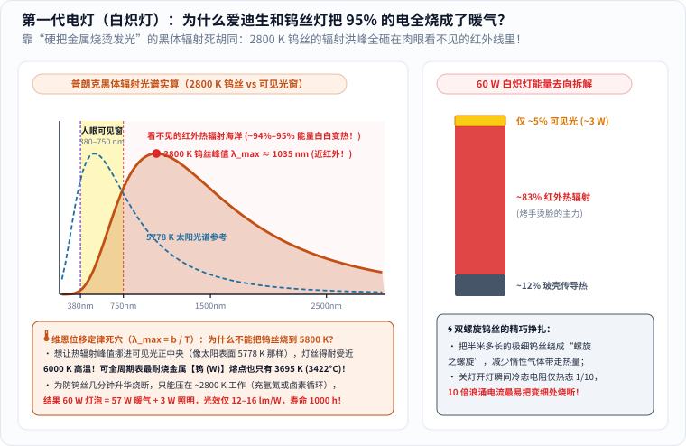
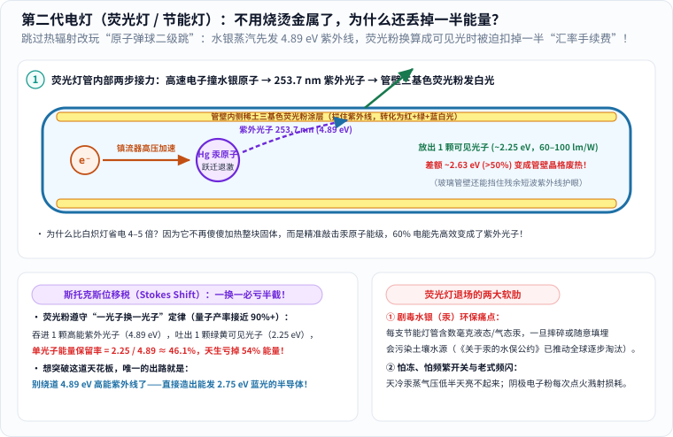
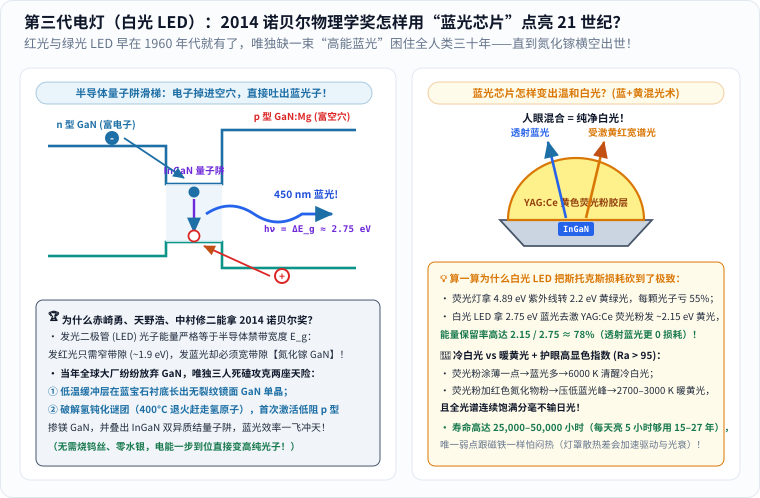
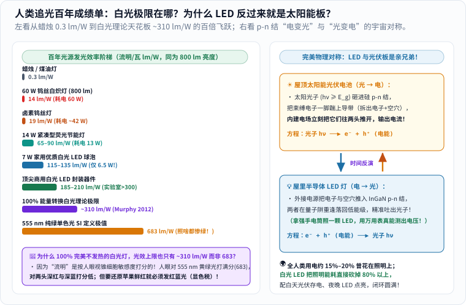

每天晚上回到家，你伸手在玄关墙上“啪”地按下一枚塑料开关。几乎在同一瞬间——快到你连眨眼都来不及——头顶五米开外的客厅吸顶灯立刻洒下满屋温暖明亮的白光。

这件事我们从小做了几万次，习以为常得像呼吸一样。但如果有人在开关旁边拦住你，连追问四个看似小学生都敢问、细想却能让许多理工科毕业生都突然卡壳的问题，你会发现这盏最普通的电灯里，藏着大半部现代物理学最颠覆直觉的奇迹：

1. **第一桩怪事（蜗牛电子与瞬间亮灯之谜）**：很多人以为电线就像一根“送电子的煤气管道”，按下开关，电子就以光速从墙角嗖地冲进头顶的灯泡里发光。可要是拿物理公式真刀真枪算一算，你会惊掉下巴——家用铜电线里自由电子定向爬行的平均漂移速度，**每秒钟只有约 $$0.05\ \mathrm{mm}$$（一小时才爬 $$18$$ 厘米，比花园里的蜗牛还慢几十倍！）** [[1]](#ref-1)！更绝的是，咱们家插座通的是每秒来回换向 $$100$$ 次的 $$50\ \mathrm{Hz}$$ 交流电，铜线里的电子一辈子都在原地左右哆嗦 **$$\pm 0.22\ \mu\mathrm{m}$$**，连一毫米门都没出过！既然墙上开关里的电子根本没跑到屋顶，**是谁在一眨眼间把能量送进灯泡里的？每个月交电费，发电厂到底卖给了你什么？**
2. **第二桩怪事（95% 能量打水漂的钨丝死胡同）**：从爱迪生改良白炽灯算起，钨丝灯泡陪伴了人类一百多年。为什么你买一颗 $$60\ \mathrm{W}$$ 的老式白炽灯泡，点亮三分钟去摸烫得能烤熟鸡蛋，真正变成肉眼可见光的电能居然**还不到 $$5\%$$**，剩下 $$95\%$$ 全白白当了“红外小浴霸” [[2]](#ref-2) [[3]](#ref-3)？工程师为什么不能干脆换一种金属、把灯丝烧得跟太阳表面一样烫来省电？
3. **第三桩怪事（为什么全人类苦等一束“蓝光”等了整整三十年？）**：早在上世纪六十年代，计算器和电视机指示灯上就已经亮起了红色和绿色的发光二极管（LED）。既然红灯、绿灯早就满大街都是，为什么造出一颗能照亮房间的**白光 LED** 却难倒了全球半导体巨头整整三十年，直到三位科学家死磕出一块微米厚的**氮化镓蓝光芯片**，才一举拿下 **2014 年诺贝尔物理学奖** [[4]](#ref-4) [[5]](#ref-5)，让今天 $$7\ \mathrm{W}$$ 的小灯泡顶替当年 $$60\ \mathrm{W}$$ 的大白炽灯？
4. **第四桩怪事（100% 不发热的完美白光灯，为什么也绝不可能达到 $$683\ \mathrm{lm/W}$$？）**：物理课本上写着发光效率的国际单位制极值是每瓦 $$683$$ 流明 [[6]](#ref-6)。可就算未来外星科技造出一盏“零电阻、零发热、$$100\%$$ 电能全部变成白光光子”的神仙台灯，它的发光效率也会在 **$$310\ \mathrm{lm/W}$$ 左右撞上一堵永远穿不过去的铁墙** [[7]](#ref-7)！是谁给白光锁死了这道天花板？而当你把屋里的 LED 灯泡和屋顶上的太阳能光伏板拆开对比时，为什么会发现它们竟是同一枚量子硬币的正反两面 [[8]](#ref-8)？

今天，我们就顺着墙里那根铜电线一路钻进灯丝、水银蒸汽与纳米量子阱里，把**电、光与能量**这三者之间跨越百年的接力密码，一层层拆得明明白白。

---

## 一、第一幕反转：电子爬得比蜗牛还慢，电能根本不是在铜线“肚子”里跑过去的！

要看懂电灯怎么发光，第一步得先把我们脑海里那个流传最广的“运煤车误解”彻底掀翻——**千万别把铜线里的电子想象成端着一筐筐火炭往灯泡里跑的快递员！**

### 1. 算笔硬核物理账：如果等开关里的电子爬到屋顶，你得摸黑傻等 28 小时！

金属铜之所以导电，是因为每颗铜原子最外层都有 $$1$$ 颗不被原子核死死拴住的自由电子。平时没通电时，这些自由电子其实一点也不闲着——在室温热运动驱动下，它们正像一群没头苍蝇一样以每秒约 **$$1.57\times 10^6\ \mathrm{m/s}$$（每秒一千五百多公里！）** 的费米热速率向四面八方乱撞 [[1]](#ref-1)。只可惜往左撞和往右撞的人数严格相等，互相抵消，宏观上没有净电流。

当你合上开关加上电压后，导线里建立起微弱的纵向电场，这群乱撞的电子才在跌跌撞撞中多出了一丁点儿“整体往一个方向挪”的平均速度——物理学上叫做**电子漂移速度（Drift velocity, $$v_d$$）**。它到底有多快？我们直接拿家里墙内最标准的 **$$1.5\ \mathrm{mm}^2$$** 铜芯照明线（截面积 $$A = 1.5\times 10^{-6}\ \mathrm{m}^2$$），通上 **$$I = 1\ \mathrm{A}$$** 的可观电流（在 $$220\ \mathrm{V}$$ 下足足对应 $$220\ \mathrm{W}$$ 的大吊灯！）来实算一下 [[1]](#ref-1)：

已知金属铜的密度约 $$8.94\ \mathrm{g/cm^3}$$、摩尔质量 $$63.546\ \mathrm{g/mol}$$，每立方米铜里挤着高达 **$$n \approx 8.47\times 10^{28}$$ 颗**自由电子 [[1]](#ref-1)，单颗电子电荷量 $$e = 1.602\times 10^{-19}\ \mathrm{C}$$。根据电流微观定义式 $$I = n e A v_d$$：

$$
v_d = \frac{I}{n e A} = \frac{1\ \mathrm{A}}{(8.47\times 10^{28}\ \mathrm{m^{-3}})\times(1.602\times 10^{-19}\ \mathrm{C})\times(1.5\times 10^{-6}\ \mathrm{m}^2)} \approx 4.91\times 10^{-5}\ \mathrm{m/s} \approx 0.049\ \mathrm{mm/s}
$$

看清这个数字了吗？**每秒钟 $$0.05$$ 毫米！** 哪怕通的是单向直流电，一分钟它才挪动 $$3$$ 毫米，一小时才爬 $$17.7$$ 厘米！如果非要等墙上开关里那颗电子亲自跋涉 $$5$$ 米电线爬进屋顶灯泡才算通电，你晚上八点进门按开关，得在漆黑的客厅里**干坐整整 $$28.3$$ 个小时**，等到第二天半夜十二点半灯才会亮！

那如果是咱们家插座里真实的 **$$50\ \mathrm{Hz}$$ 交流电**呢？电流每 $$0.01$$ 秒就掉一次头，电子做简谐振动的单次最大摆幅 $$x_{\max}$$ 只有：

$$
x_{\max} = \frac{\sqrt{2}\,v_d}{2\pi f} = \frac{1.414 \times 4.91\times 10^{-5}\ \mathrm{m/s}}{2\pi \times 50\ \mathrm{Hz}} \approx 2.21\times 10^{-7}\ \mathrm{m} = 0.22\ \mu\mathrm{m}
$$

**$$0.22$$ 微米——还不到一根头发丝直径的三百分之一！** 也就是说，你家吊灯装上去十年，灯丝或芯片里的电子从来没离开过灯泡，开关里的电子也从来没离开过开关，远在几百公里外水电站发电机里的电子更是一颗都没流进过你家大门！

_先看上栏单次动画（在启用减少动态效果设置时直接定格完整能流态）：按下开关合闸瞬间，建立起来的电场 $$E$$ 与磁场 $$B$$ 沿着导线【外部周围空间】组成坡印廷能流 $$\mathbf{S}$$，以接近光速（约 $$2\times 10^8\ \mathrm{m/s}$$，$$5$$ 米仅需约 $$25$$ 纳秒）直扑灯泡并从侧面垂直灌入灯丝；再看下栏两组实算数字，铜线内部电子在直流下每秒仅蠕动 $$0.05$$ 毫米，在 $$50\ \mathrm{Hz}$$ 交流下更是只原地微颤 $$\pm 0.22\ \mu\mathrm{m}$$。[单独打开大图（刷新可重播）](/assets/images/light-electricity-energy/snail-electrons-vs-poynting-energy-flow.svg)。_

### 2. 坡印廷能流大揭秘：电线只是“铁轨”，真正的能量是在电线外面的空气里狂飙！

既然电子本身慢如蜗牛、甚至原地踏步，为什么开关一按，$$5$$ 米外的灯泡在几十纳秒内就亮了？

第一层粗浅类比很容易懂：就像连接水塔的消防水管里**原本就装满了水**。你在这一头拧开阀门，“水压波”以水中声速（约 $$1{,}480\ \mathrm{m/s}$$）瞬间传到管口，管口原本待命的水立刻喷涌而出，根本不需要等水塔里的第一滴水亲自流过来。同样，整条铜线和灯丝里原本就塞满了自由电子，合上开关时，**电磁场波以接近光速（在绝缘外皮导线周围约为真空光速的 $$60\%\text{–}90\%$$，即 $$2\times 10^8\ \mathrm{m/s}$$ 量级 [[9]](#ref-9)）**扫过整条电路，沿途所有电子几乎同时原地起立开始晃动做功（关于光速本身是怎样被人类一步步测出来的，可以联动阅读[《一眨眼绕地球七圈半的光，人类是怎么测出速度的？》]()）。

但如果你再深挖半步，去翻诺贝尔奖得主理查德·费曼（Richard Feynman）在经典教材《费曼物理学讲义》第 2 卷第 27 章里专门写下的那段著名剖析，你会看到一个比水管比喻还要震撼十倍的电磁学真相 [[9]](#ref-9)：**电能压根儿不是在铜线“肚子”里面流过去的，而是在铜线外面的空气与绝缘层空间里飞过去的！**

1884 年，英国物理学家约翰·亨利·坡印廷（John Henry Poynting）从麦克斯韦方程组严格推导出了电磁场的能量守恒定律：空间任何一点电磁能量流动的方向和功率密度，由电场强度 $$\mathbf{E}$$ 与磁场强度 $$\mathbf{B}$$ 的叉乘决定——这就是大名鼎鼎的**坡印廷矢量（Poynting vector）** [[9]](#ref-9)：

$$
\mathbf{S} = \frac{1}{\mu_0}\left(\mathbf{E}\times\mathbf{B}\right)
$$

用右手定则比划一下上图的电路，奇迹立刻浮现：
- 电源和导线表面微量的正负电荷，在两根导线之间的**外部空间**里撑开了从火线指向零线的**电场 $$\mathbf{E}$$**；
- 导线里流动的电流，在导线周围空间绕出了一圈圈环形的**磁场 $$\mathbf{B}$$**；
- 伸出右手让四指顺着 $$\mathbf{E}$$ 弯向 $$\mathbf{B}$$，大拇指指向的坡印廷能流 $$\mathbf{S}$$，**分毫不差地沿着导线外面的空间，从墙上开关一路笔直指向屋顶灯泡**！
- 更奇妙的是，在灯泡的钨丝（或芯片）处，因为存在电阻压降，钨丝内部和贴近表面处多出了一股沿着电流方向的纵向电场 $$\mathbf{E}_{\parallel}$$。你再用 $$\mathbf{E}_{\parallel}\times\mathbf{B}$$ 一叉乘——**能流箭头 $$\mathbf{S}$$ 竟然在灯泡四周拐了个直角弯，从四面八方的空气里“垂直扎进”灯丝内部**，把电磁场能转化成灯丝里的热能和光能 [[9]](#ref-9)！

所以，两根铜电线真正扮演的角色，不是运送煤炭的卡车，而是**引导空间电磁场乖乖沿着墙壁拐弯、别乱跑散开的“导轨”**！发电厂没有卖给你一颗电子；发电厂卖给你的，是通过整张电网空间源源不断泵进你家灯具里的**电磁场能量（千瓦时 $$\mathrm{kWh}$$，$$1\ \mathrm{kWh} = 3.6\times 10^6\ \mathrm{J}$$ 焦耳）**！

---

## 二、第一代电灯（白炽灯）：用“把铁棍烧红”的笨办法发光，95% 电能冤枉变成红外线

能量在几十纳秒内冲进了灯泡。接下来最核心的工程难题来了：**怎样逼着这股电能乖乖变成我们眼睛看得见的“光”？**

人类想到的第一个办法，朴素而暴烈——**硬烧！** 打铁匠早就知道，把一块生铁塞进炉火里烧到 $$800\ ^\circ\mathrm{C}$$ 会泛起暗红光，烧到 $$1{,}200\ ^\circ\mathrm{C}$$ 变橙黄，烧得越烫光越亮、越发白。1879 年爱迪生团队用炭化棉线与竹丝做出实用高阻白炽灯，二十世纪初威廉·库利奇（William Coolidge）又换上了耐高温的金属**钨丝（Tungsten, $$\mathrm{W}$$）**——只要让电流挤过一根细得像蜘蛛丝一样的双螺旋钨丝，电子频繁撞击钨原子晶格产生焦耳热（$$P = I^2 R$$），瞬间就能把钨丝烧到约 **$$2{,}750\text{–}2{,}800\ \mathrm{K}$$（约 $$2{,}500\ ^\circ\mathrm{C}$$）** 的白热高温 [[2]](#ref-2)。

为什么这么高的温度，白炽灯还是成了“费电大王”？答案写死在量子力学的开山鼻祖公式——**普朗克黑体辐射定律**与**维恩位移定律（Wien's displacement law）**里 [[3]](#ref-3)。

_先看左栏实算黑体光谱曲线：人眼能看见的彩虹窗口只有窄窄一条 $$380\text{–}750\ \mathrm{nm}$$（浅黄高亮带），而 $$2{,}800\ \mathrm{K}$$ 钨丝的热辐射洪峰却落在 $$1{,}035\ \mathrm{nm}$$ 的近红外区，绝大部分曲线面积全淹没在右侧红色红外海洋里；再看右栏能量账本，一颗 $$60\ \mathrm{W}$$ 白炽灯只有约 $$3\ \mathrm{W}$$ 变成可见光，其余 $$57\ \mathrm{W}$$ 全成了烫手的废热。[单独打开大图](/assets/images/light-electricity-energy/tungsten-blackbody-infrared-waste.svg)。_

### 1. 维恩位移定律的无情审判：辐射洪峰全砸在看不见的红外海洋里

任何靠“高温发热”发光的物体，吐出来的光子波长都不是单一的，而是一条宽广的连续山峰曲线。山峰最高点的峰值波长 $$\lambda_{\max}$$ 与绝对温度 $$T$$ 成严格反比——这就是维恩位移定律（维恩位移常数 $$b \approx 2.8978\times 10^{-3}\ \mathrm{m\cdot K}$$ [[3]](#ref-3)）：

$$
\lambda_{\max} = \frac{b}{T}
$$

我们把太阳表面和钨丝灯丝同时代进去一对比，高下立判：
- **太阳表面（$$T \approx 5{,}778\ \mathrm{K}$$）**：$$\lambda_{\max} = \dfrac{2.8978\times 10^{6}\ \mathrm{nm\cdot K}}{5{,}778\ \mathrm{K}} \approx 502\ \mathrm{nm}$$——正巧稳稳砸在人眼可见光窗口（$$380\text{–}750\ \mathrm{nm}$$）的正中央青绿黄区！所以阳光里足足有近四成能量都是明亮的可见光（关于人眼视锥细胞怎样演化出匹配太阳光谱的感光曲线，可参看前文[《我们是如何看到的》]()）。
- **白炽灯钨丝（$$T \approx 2{,}800\ \mathrm{K}$$）**：$$\lambda_{\max} = \dfrac{2.8978\times 10^{6}\ \mathrm{nm\cdot K}}{2{,}800\ \mathrm{K}} \approx 1{,}035\ \mathrm{nm}$$！

**$$1{,}035$$ 纳米在哪里？远远甩在 $$750\ \mathrm{nm}$$ 红光边界之外，一头扎进了人眼完全看不见的近红外线深海里！** 把左栏 $$2{,}800\ \mathrm{K}$$ 普朗克曲线下的面积做个积分就会发现：加上灯泡内惰性气体传导带走的热量，一颗 $$60\ \mathrm{W}$$ 的白炽灯泡，**高达 $$94\%\text{–}95\%$$ 的电能（约 $$57\ \mathrm{W}$$）全都变成了红外热辐射和传导废热**，真正挤进 $$380\text{–}750\ \mathrm{nm}$$ 可见光窄缝里的光功率还不到 **$$3\ \mathrm{W}$$**，发光效率（流明/瓦）凄惨地卡在 **$$12\text{–}16\ \mathrm{lm/W}$$** [[2]](#ref-2) [[10]](#ref-10)！毫不夸张地说，白炽灯本质上是一台“顺便漏了一点点光出来的微型电暖器”。

### 2. 为什么不能干脆把钨丝烧到 $$5{,}800\ \mathrm{K}$$？全周期表最耐烧的金属也扛不住！

你肯定会问：既然温度越高峰值越往可见光挪，把灯丝烧到 $$5{,}800\ \mathrm{K}$$ 不就成了人造小太阳吗？

物理规律直接判了死刑：**翻遍整张元素周期表，全宇宙熔点最高的纯金属就是钨（$$\mathrm{W}$$），而钨的熔点也只有 $$3{,}695\ \mathrm{K}$$（$$3{,}422\ ^\circ\mathrm{C}$$）**！别说烧到 $$5{,}800\ \mathrm{K}$$ 会当场化成钨蒸汽爆炸，哪怕只烧到 $$3{,}200\ \mathrm{K}$$，固态钨表面的钨原子也会剧烈升华蒸发，几小时就把玻璃泡熏得漆黑、灯丝某处越变越细，“啪”一声在开灯瞬间的 $$10$$ 倍冷态浪涌电流冲击下烧断！

为了给钨丝续命，工程师往玻壳里充入氩气、氮气压制升华，把半米长的细钨丝绕成“双螺旋”，后来又发明了充入微量碘或溴的**卤素灯（Halogen lamp）**——让蒸发出来的钨原子在石英管壁附近被卤素抓回来、飘回高温灯丝上重新分解沉积回去，勉强把色温推到 $$3{,}000\text{–}3{,}200\ \mathrm{K}$$、光效挤到 **$$16\text{–}20\ \mathrm{lm/W}$$** [[10]](#ref-10)。但只要还困在“靠高温热辐射发光”这条死胡同里，九成能量打水漂的宿命就绝无翻盘可能。

---

## 三、第二代电灯（荧光灯 / 节能灯）：不烧铁棍改打“原子台球”，却被扣掉一半汇率税

怎样才能不把整块材料烧到几千度，就单独造出能量够高的光子呢？二十世纪三十年代走向成熟的**荧光灯（Fluorescent lamp，包括后来卷成螺旋管的紧凑型节能灯 CFL）**，完成了一次漂亮的概念跃迁：**跳过热辐射，直接敲击单个气体原子的量子能级！**

### 1. 水银蒸汽 + 稀土荧光粉的“两棒接力赛”

拆开一支长条日光灯管（千万别在屋里真砸碎它！原因马上讲），你会看到管壁内侧涂着一层雪白的粉末，管芯几乎抽成低压真空，只充了一点点氩气和**几毫克微量的汞（水银，$$\mathrm{Hg}$$）蒸气** [[2]](#ref-2)。

_按上栏 ①→②→③ 追踪荧光灯管内的两步量子转换：镇流器驱动高速自由电子撞击低压汞原子，汞原子外层电子跃迁退激，高效吐出波长 $$253.7\ \mathrm{nm}$$（单光子能量 $$4.89\ \mathrm{eV}$$）的不可见紫外线；紫外线撞上管壁稀土三基色荧光粉，一比一转换成红绿蓝白光（约 $$2.25\ \mathrm{eV}$$），省电四五倍的同时也付出了下栏算出的“斯托克斯位移”半数能量税。[单独打开大图](/assets/images/light-electricity-energy/fluorescent-mercury-uv-stokes-relay.svg)。_

通电之后，灯管里上演的是一场精妙的两棒接力：
1. **第一棒（电子撞汞发紫外线）**：两端电极发射出的自由电子在电场加速下，像母球一样精准撞上管内的气态汞原子（$$\mathrm{Hg}$$），把汞原子的核外电子一杆撞上高能激发态。仅仅一亿分之几秒后，这颗电子跳回低能级，干净利落地吐出一颗波长严格固定在 **$$253.7\ \mathrm{nm}$$**（外加少量 $$185\ \mathrm{nm}$$）的**短波紫外线光子**！这一步完全不用加热固体晶格，竟然能把约 **$$60\%$$** 的输入电能直接变成紫外光子！
2. **第二棒（荧光粉吞紫外吐白光）**：$$253.7\ \mathrm{nm}$$ 的短波紫外线人眼不仅看不见，还会灼伤角膜和皮肤（医院里的紫光杀菌灯就是故意去掉荧光粉、换用透紫外石英玻璃的裸奔版汞灯！）。好在日光灯管内壁涂满了**稀土三基色荧光粉**——荧光粉分子一口吞下一颗紫外光子，先在内部激发态滚下几级小台阶，随后吐出一颗红光、绿光或蓝光可见光子！红绿蓝三色在人眼里一混，就成了清爽明亮的白光（玻璃管壁顺便把漏网的短波紫外线死死拦在管内）。

靠着这套“原子发光”，一支仅 **$$13\text{–}15\ \mathrm{W}$$** 的荧光节能灯就能发出与 $$60\ \mathrm{W}$$ 白炽灯相当的 $$800$$ 流明亮度，发光效率一下子翻了五倍，冲到了 **$$60\text{–}100\ \mathrm{lm/W}$$**，寿命也延长到了 $$8{,}000\text{–}10{,}000$$ 小时 [[2]](#ref-2) [[10]](#ref-10)！

### 2. 斯托克斯位移税（Stokes Shift）：为什么“一光子换一光子”天生要亏掉 54% 能量？

既然第一棒能把六成电变成紫外光，荧光粉的量子转换率（吞 $$100$$ 颗紫外光子吐出超过 $$90$$ 颗可见光子）也高得惊人，为什么荧光灯摸上去还是温热的，光效死活冲不过 $$100\ \mathrm{lm/W}$$ 大关？

拿普朗克光子能量公式 $$E = \dfrac{hc}{\lambda} \approx \dfrac{1{,}239.84\ \mathrm{eV\cdot nm}}{\lambda(\mathrm{nm})}$$ 一算单颗光子的“面值”，漏洞无所遁形：
- 汞原子发出的 **$$253.7\ \mathrm{nm}$$ 紫外光子**，单颗怀揣着高达 **$$E_{\mathrm{UV}} \approx 4.89\ \mathrm{eV}$$** 的能量；
- 荧光粉吐出的 **$$550\ \mathrm{nm}$$ 黄绿可见光子**，单颗面值却只有 **$$E_{\mathrm{vis}} \approx 2.25\ \mathrm{eV}$$**（$$620\ \mathrm{nm}$$ 红光更是只有 $$2.00\ \mathrm{eV}$$）！

注意！普通荧光转换严格遵守**“一颗高能光子最多换一颗低能光子”**的规矩，绝不会把一张 $$4.89$$ 元的大钞找零成两张 $$2.25$$ 元的小钞！结果每完成一次发光，单颗光子的能量保留率只有：

$$
\eta_{\mathrm{Stokes}} = \frac{E_{\mathrm{vis}}}{E_{\mathrm{UV}}} = \frac{2.25\ \mathrm{eV}}{4.89\ \mathrm{eV}} \approx 46.0\%
$$

那凭空蒸发的 **$$4.89 - 2.25 = 2.64\ \mathrm{eV}$$（超过 $$54\%$$ 的能量！）** 去哪儿了？在荧光粉分子内部滚台阶时，**当场全部化作管壁晶格的微小振动——也就是废热**！物理学把波长变长带来的这笔硬性折损叫做**斯托克斯位移损耗（Stokes loss）**。再加上每支灯管里那几毫克剧毒水银带来的破碎吸入与土壤污染隐患（联合国《关于汞的水俣公约》已推动全球逐步淘汰含汞普通照明），人类急需一场彻底甩掉钨丝、也彻底甩掉水银与紫外线的终极革命。

---

## 四、第三代电灯（白光 LED）：2014 诺贝尔奖怎样靠一块“蓝光半导体”改写人类文明？

怎样才能不烧钨丝、也不用 $$4.89\ \mathrm{eV}$$ 的高能紫外线绕远路，而是**通上电就直接吐出面值刚好的可见光光子**？

答案藏在固态半导体芯片的 **$$\mathrm{p\text{-}n}$$ 结（p-n junction）** 里。在半导体晶体中，低能量的**价带（Valence band）**与高能量的**导带（Conduction band）**之间，隔着一道宽度固定为 $$E_g$$ 的禁区——叫做**禁带宽度（Bandgap）**。

如果我们在左半边掺杂造出富余自由电子的 **$$\mathrm{n}$$ 型半导体**，在右半边掺杂造出富余“空座位”（带正电的**空穴，Hole**）的 **$$\mathrm{p}$$ 型半导体**，通上正向电压往中间一推：导带上的电子就像站在滑梯顶端的小球，“啪”地纵身一跃，直接掉进价带的空穴里复合！只要选用合适的直接带隙半导体材料，电子落差释放的能量 $$\Delta E \approx E_g$$ 就不会去摇晃晶格发热，而是**一步到位化作一颗波长纯粹的光子飞射而出** [[4]](#ref-4) [[5]](#ref-5)！这就是**发光二极管（Light-Emitting Diode, LED）**。

_先看左栏能带滑梯图：$$\mathrm{n}$$ 型氮化镓注入电子、$$\mathrm{p}$$ 型掺镁氮化镓注入空穴，两者掉进中间极薄的 $$\mathrm{InGaN}$$ 量子阱复合，跨过 $$2.75\ \mathrm{eV}$$ 带隙直接辐射出 $$450\ \mathrm{nm}$$ 纯正蓝光；再看右栏白光封装剖面，部分蓝光直接透出，其余蓝光激发 $$\mathrm{YAG:Ce}$$ 黄色荧光粉发出黄红宽谱光，斯托克斯保留率跃升至约 $$78\%$$，合成温和省电的白光。[单独打开大图](/assets/images/light-electricity-energy/blue-ingan-led-quantum-well-nobel.svg)。_

### 1. 困住全球科学界三十年的“蓝光魔咒”：为什么红灯绿灯早有了，偏偏造不出蓝灯？

既然原理这么干脆，为什么直到你我小时候，LED 还只能当电视机右下角那颗暗淡的小红点指示灯，没法挂上天花板照亮客厅？

因为**想合成白光，红、绿、蓝三原色缺一不可（或者至少得有最高能量的蓝光去激发黄红荧光粉）**！
- 早在上世纪 1960 年代，科学家就已经用砷化镓（$$\mathrm{GaAs}$$）、磷化镓（$$\mathrm{GaP}$$）造出了红光 LED（$$\sim 650\ \mathrm{nm}$$，带隙只需 $$1.9\ \mathrm{eV}$$）和暗黄绿光 LED（$$\sim 565\ \mathrm{nm}$$，带隙 $$\sim 2.2\ \mathrm{eV}$$） [[4]](#ref-4)。
- 可偏偏到了**蓝光（$$\lambda \approx 450\ \mathrm{nm}$$）**，光子面值飙升到了 **$$E_g \approx 2.75\ \mathrm{eV}$$**！自然界里能扛住这么宽直接带隙的主力候选材料**氮化镓（$$\mathrm{GaN}$$）**，脾气倔得像块茅坑里的石头，拦在所有人面前两座几乎绝望的天险 [[4]](#ref-4) [[5]](#ref-5)：
  1. **第一座天险（长不出好晶体）**：地球上没有天然氮化镓大单晶衬底，只能在蓝宝石（$$\mathrm{Al_2O_3}$$）上硬长，可两者晶格尺寸差了足足 $$16\%$$！长出来的 $$\mathrm{GaN}$$ 薄膜布满每平方厘米上百亿条位错裂纹，电子还没来得及发光就掉进缺陷陷阱里变成热了。
  2. **第二座天险（死活造不出 $$\mathrm{p}$$ 型氮化镓！）**：没有 $$\mathrm{p}$$ 型层就没有空穴，$$\mathrm{p\text{-}n}$$ 结根本搭不起来！当时全世界实验室往 $$\mathrm{GaN}$$ 里掺镁（$$\mathrm{Mg}$$）想造空穴，结果长出来的晶体永远是高阻绝缘体。到了八十年代中期，欧美日几乎所有大公司和顶尖高校全都心灰意冷，集体宣布放弃氮化镓转向硒化锌（$$\mathrm{ZnSe}$$）。

就在整个学术界认定这是一条死路时，只有三位孤勇者顶着嘲笑死磕到底——日本名城大学与名古屋大学的**赤崎勇（Isamu Akasaki）**与博士生**天野浩（Hiroshi Amano）**，以及当时在日本四国岛一家乡镇小化工企业（日亚化学）地下室单枪匹马自己动手焊反应炉的年轻工程师**中村修二（Shuji Nakamura）** [[4]](#ref-4) [[5]](#ref-5)：
- **1986 年（攻克晶体天险）**：赤崎勇与天野浩用低温氮化铝（$$\mathrm{AlN}$$）缓冲层（中村修二随后独立研发出更简洁的低温 $$\mathrm{GaN}$$ 自缓冲层），像在蓝宝石和氮化镓之间垫了一层柔性海绵垫，一举长出了像镜面一样平整透明的高品质 $$\mathrm{GaN}$$ 单晶！
- **1989–1992 年（破解 $$\mathrm{p}$$ 型氢钝化悬案）**：天野浩和赤崎勇在扫描电镜下偶然发现电子束轰击过的掺镁 $$\mathrm{GaN}$$ 突然导电发光了；紧接着中村修二一针见血揪出了幕后真凶——原来生长晶体时氨气（$$\mathrm{NH_3}$$）分解出的**氢原子（$$\mathrm{H}$$）钻进晶格，和镁结成了 $$\mathrm{Mg\text{-}H}$$ 复合物，把空穴死死锁住了**！中村修二只用在氮气里做一次简单的 **$$400\ ^\circ\mathrm{C}$$ 热退火**把氢原子赶跑，低阻 $$\mathrm{p}$$ 型氮化镓瞬间打通！
- **1993–1994 年（量子阱一锤定音）**：两支团队乘胜追击，在 $$\mathrm{n}$$ 型和 $$\mathrm{p}$$ 型氮化镓中间夹进一层只有几纳米厚的**氮化铟镓（$$\mathrm{InGaN}$$）量子阱（Quantum Well）**——像挖了一个微型小水坑，把涌进来的电子和空穴高密度圈禁在一起强行配对复合，**刺眼夺目的高亮度纯正蓝光（$$450\ \mathrm{nm}$$）终于照亮了实验室** [[5]](#ref-5)！2014 年，瑞典皇家科学院将诺贝尔物理学奖授予这三位科学家，盛赞：“白炽灯点亮了 20 世纪，而 21 世纪将由 LED 灯点亮！” [[4]](#ref-4)

### 2. 一颗蓝光芯片怎么变出满屋温馨白光？把斯托克斯税砍到仅剩两成！

今天你拧开家里任何一盏正规白光 LED 吸顶灯或球泡灯（关于 LED 在手机电视背光与 Micro-LED 屏幕里的另一场革命，可以联动阅读[《龟背大屁股老彩电凭什么压扁成毫米薄屏？》]()），往往并不是把红、绿、蓝三颗芯片笨重地拼在一起，而是用了一招极度聪明低成本的**“蓝光芯片 + 黄色荧光粉（$$\mathrm{YAG:Ce^{3+}}$$）”混光术** [[4]](#ref-4) [[10]](#ref-10)：

1. 芝麻粒大小（约 $$1\ \mathrm{mm}^2$$）的 $$\mathrm{InGaN}$$ 芯片通电发出 **$$450\ \mathrm{nm}$$ 蓝光（$$2.75\ \mathrm{eV}$$）**；
2. 芯片上方盖着一滴掺杂了铈离子的钇铝石榴石黄色荧光粉胶层：**大约三分之一的蓝光直接穿过胶层透射出来**（这部分蓝光**零荧光转换损耗**！）；
3. 其余三分之二的蓝光被荧光粉吸收，激发放出宽广连续的黄绿—橙红光（中心能量约 **$$2.15\ \mathrm{eV}$$**）。看这次的汇率账本：$$\dfrac{2.15\ \mathrm{eV}}{2.75\ \mathrm{eV}} \approx 78.2\%$$！相比荧光灯拿 $$4.89\ \mathrm{eV}$$ 紫外线去换可见光亏掉 $$54\%$$，**白光 LED 把斯托克斯汇率损耗直接压低到了两成左右**！
4. 透射出来的蓝光与受激产生的黄红宽谱光在空中完美互补混合，进入人眼三种视锥细胞后，就成了自然纯净的白光！想调成书房清醒的 $$5{,}000\ \mathrm{K}$$ 日光白，荧光粉就配薄一点；想调成卧室温馨护眼的 $$2{,}700\text{–}3{,}000\ \mathrm{K}$$ 暖黄光且让红苹果鲜艳欲滴（高显色指数 $$R_a > 95$$），就在黄色荧光粉里再添一点氮化物红色荧光粉！

结果是碾压级的：今天超市里十几块钱一颗的 **$$7\ \mathrm{W}$$ 家用白光 LED 球泡**，就能轻松发出 $$800\text{–}900$$ 流明的光通量（整灯光效 **$$115\text{–}135\ \mathrm{lm/W}$$**，顶尖商用 LED 灯珠封装更是突破 **$$185\text{–}210\ \mathrm{lm/W}$$** [[10]](#ref-10) [[11]](#ref-11)），比 $$60\ \mathrm{W}$$ 白炽灯省电近 **$$90\%$$**，寿命长达 **$$25{,}000\text{–}50{,}000$$ 小时**（每天亮 $$5$$ 小时能用 $$15$$ 到 $$27$$ 年），而且零水银、抗震不怕摔、毫秒级瞬亮！

---

## 五、终极视野：白光的天花板锁在哪儿？为什么 LED 倒过来就是太阳能板？

一路从蜡烛火把（$$0.3\ \mathrm{lm/W}$$）、白炽灯（$$14\ \mathrm{lm/W}$$）、荧光灯（$$70\ \mathrm{lm/W}$$）狂飙到白光 LED（$$130\text{–}200+\ \mathrm{lm/W}$$），人类的造光效率在短短一百年里暴涨了近千倍！那么顺着这条阶梯再往上抬头看，尽头究竟在哪里？

_左栏按真实流明/瓦比例尺对比从蜡烛（$$0.3\ \mathrm{lm/W}$$）到单色绿光 SI 定义极值（$$683\ \mathrm{lm/W}$$）的八级台阶，标出高显色白光的物理硬上限（约 $$310\ \mathrm{lm/W}$$）；右栏展示太阳能光伏板（光拆电子空穴发电）与白光 LED（电子空穴复合发光）在同一个半导体 $$\mathrm{p\text{-}n}$$ 结上的可逆时间反演闭环。[单独打开大图](/assets/images/light-electricity-energy/lamp-efficacy-ladder-and-pv-symmetry.svg)。_

### 1. 为什么 100% 电能变白光的“神仙电灯”，也绝不可能摸到 $$683\ \mathrm{lm/W}$$？

翻开国际单位制（SI）对基本单位“坎德拉（$$\mathrm{cd}$$）”和光通量“流明（$$\mathrm{lm}$$）”的法定定义（NIST [[6]](#ref-6)），上面白纸黑字写着一个神奇常数：**频率为 $$540\times 10^{12}\ \mathrm{Hz}$$（真空波长约 $$555.016\ \mathrm{nm}$$ 的黄绿单色光）的辐射，其最大光谱光视效能严格定义为 $$K_{\mathrm{cd}} = 683\ \mathrm{lm/W}$$**！

既然物理极值是 $$683\ \mathrm{lm/W}$$，为什么物理学家托马斯·墨菲（Thomas W. Murphy Jr.）在 2012 年发表于《应用物理学杂志》（*Journal of Applied Physics*）的经典计算里证明：**哪怕未来造出一盏电光能量转换效率 $$100\%$$、一丝一毫废热都不产生的绝对理想白光灯，只要你要求它照出来的物体颜色正常好看（显色指数 $$\mathrm{CRI}\ge 85\text{–}90$$），它的理论极限也只能停在约 $$250\text{–}370\ \mathrm{lm/W}$$（典型值约 $$310\ \mathrm{lm/W}$$）** [[7]](#ref-7)？

答案不在灯泡身上，而在**你我的眼睛里**！
- “瓦特（$$\mathrm{W}$$）”是纯粹客观的物理功率，无论什么波长的光子都一视同仁；
- 但“流明（$$\mathrm{lm}$$）”却是按**人眼明视觉视锥细胞的敏感度曲线 $$V(\lambda)$$ 加权打分**后的主观亮度单位！人眼只对正中间 $$555\ \mathrm{nm}$$ 的黄绿光给满分（$$100\% \times 683 = 683\ \mathrm{lm/W}$$）；到了 $$450\ \mathrm{nm}$$ 蓝光或 $$650\ \mathrm{nm}$$ 深红光，人眼视锥细胞的敏感度已经跌到了峰值的 **$$4\%\text{–}10\%$$**！
- 如果为了刷高分，把家里台灯做成纯 $$555\ \mathrm{nm}$$ 绿光激光器，理论光效确实能冲上 $$683\ \mathrm{lm/W}$$——但屋里老婆孩子的脸、餐桌上的红烧肉和红苹果，全都会变成恐怖片里惨绿惨绿的黑白灰影！为了讨好眼睛看清五彩世界，一盏好灯**必须心甘情愿分出相当一部分瓦特去发射人眼打分很低的深红光与蓝紫光**——这笔近一半的折扣，就是白光永远绕不开的**“显色视觉税”** [[7]](#ref-7)！而今天实验室里最顶尖的白光 LED 器件已经突破 $$250\text{–}300\ \mathrm{lm/W}$$ [[11]](#ref-11)，意味着人类正在逼近宇宙物理定律允许的终极天花板！

### 2. 宇宙级浪漫闭环：把 LED 倒过来放，它就是屋顶上的太阳能光伏板！

文章最后，让我们站远一步，看看这颗小小半导体 $$\mathrm{p\text{-}n}$$ 结最令人拍案叫绝的对称之美 [[8]](#ref-8)：

- **夜晚在屋里（LED 电致发光：电 $$\longrightarrow$$ 光）**：你给 $$\mathrm{p\text{-}n}$$ 结通上电流，把电子推上导带、让它掉回空穴，跨越带隙吐出一颗颗光子照亮书桌：
  $$\mathrm{e}^- + \mathrm{h}^+ \text{（电能）} \longrightarrow h\nu \text{（光子）}$$
- **白天在屋顶（太阳能电池光生伏特效应：光 $$\longrightarrow$$ 电）**：太阳跨越 $$1.5$$ 亿公里洒下一颗能量 $$h\nu \ge E_g$$ 的光子，一头撞进屋顶硅太阳能板的 $$\mathrm{p\text{-}n}$$ 结里，“啪”地把价带里的一颗束缚电子一脚踹上导带（重新拆成一颗自由电子 + 一个空穴！），紧接着 $$\mathrm{p\text{-}n}$$ 结自带的内建电场顺势把电子和空穴往两极推开，源源不断输出电流存进储能电池 [[8]](#ref-8)：
  $$h\nu \text{（光子）} \longrightarrow \mathrm{e}^- + \mathrm{h}^+ \text{（电能）}$$

你不信的话，甚至可以在家亲手做个一分钟小实验：找一颗普通的透明外壳插件式红光或黄光 LED 灯珠，别接电池，而是把它的两根引脚接到数字万用表的直流毫伏/伏特挡上，然后拿手机闪光灯或强光手电贴近猛照这颗 LED——**你会亲眼看见万用表跳出了 $$1.2\text{–}1.6\ \mathrm{V}$$ 的真实光生电压！** LED 天生就是一片袖珍太阳能电池，而一片优秀的太阳能电池在暗室里通上电，在红外相机下也同样会幽幽发光！

过去在火焰和钨丝时代，全人类发出来的电曾有接近五分之一被低效照明白白烧掉；而今天，白天屋顶上的半导体 $$\mathrm{p\text{-}n}$$ 结安静地接住太阳核心核聚变送来的光子，把它们存成化学能与电磁能；夜幕降临时，你轻轻按下玄关开关，电磁能流沿着墙内铜导线外的空间以近光速掠过客厅，钻进头顶另一块氮化镓 $$\mathrm{p\text{-}n}$$ 结量子阱里，重新化作满屋温柔明亮的星光。从太阳到电线，再到一盏小小的电灯——能量一分未少，只是换了几件最优雅的衣裳。

---

## 参考资料与延伸阅读

1. Georgia State University, *HyperPhysics*: **Microscopic View of Ohm's Law & Electron Drift Velocity in Copper**（给出室温金属铜自由电子数密度 $$n = 8.47\times 10^{28}\ \mathrm{m^{-3}}$$、费米速率 $$\sim 1.57\times 10^6\ \mathrm{m/s}$$ 及 $$I = n e A v_d$$ 定量计算模型）：<http://hyperphysics.phy-astr.gsu.edu/hbase/electric/ohmmic.html>
2. Edison Tech Center, **Incandescent Lamps & Fluorescent Lamps Engineering History**（详述双螺旋钨丝在 $$2{,}700\text{–}2{,}800\ \mathrm{K}$$ 工作时超过 $$90\%\text{–}95\%$$ 能量转化为红外热辐射及低压汞蒸气 $$253.7\ \mathrm{nm}$$ 紫外荧光转换机制）：<https://edisontechcenter.org/incandescent.html> 与 <https://edisontechcenter.org/Fluorescent.html>
3. National Institute of Standards and Technology (NIST), **CODATA Internationally Recommended Values: Wien Wavelength Displacement Law Constant $$b$$**（$$b = 2.897\,771\,955\times 10^{-3}\ \mathrm{m\cdot K}$$，支持 $$2{,}800\ \mathrm{K}$$ 钨丝黑体辐射峰值波长 $$\lambda_{\max}\approx 1{,}035\ \mathrm{nm}$$ 计算）：<https://physics.nist.gov/cgi-bin/cuu/Value?bwien>
4. The Royal Swedish Academy of Sciences (NobelPrize.org), **Popular Science Background: New light to illuminate the world — The Nobel Prize in Physics 2014**（赤崎勇、天野浩与中村修二发明高效氮化镓蓝光 LED 及白光 LED 混光原理官方科普背景）：<https://www.nobelprize.org/prizes/physics/2014/popular-information/>
5. The Royal Swedish Academy of Sciences (NobelPrize.org), **Scientific Background on the Nobel Prize in Physics 2014: Efficient blue light-emitting diodes leading to bright and energy-saving white light sources**（详述蓝宝石低温缓冲层、镁掺杂 $$\mathrm{p}$$ 型 $$\mathrm{GaN}$$ 氢钝化退火突破与 $$\mathrm{InGaN/GaN}$$ 双异质结量子阱物理机制）：<https://www.nobelprize.org/prizes/physics/2014/advanced-information/>
6. National Institute of Standards and Technology (NIST), **SI Redefinition — Candela ($$\mathrm{cd}$$)**（国际单位制将频率 $$540\times 10^{12}\ \mathrm{Hz}$$ 即约 $$555\ \mathrm{nm}$$ 单色辐射的光谱光视效能严格固定为 $$K_{\mathrm{cd}} = 683\ \mathrm{lm/W}$$）：<https://www.nist.gov/si-redefinition/candela>
7. Murphy, T. W. Jr. (2012). **Maximum spectral luminous efficacy of white light**. *Journal of Applied Physics*, 111(10), 104909（严格计算在保证显色指数 $$\mathrm{CRI}$$ 前提下，$$100\%$$ 能量转换白光光源受人眼视见函数 $$V(\lambda)$$ 制约的理论发光效率上限约为 $$250\text{–}370\ \mathrm{lm/W}$$）：<https://arxiv.org/abs/1309.7039>
8. U.S. Department of Energy (DOE), **Solar Photovoltaic Technology Basics**（阐述半导体 $$\mathrm{p\text{-}n}$$ 结吸收太阳光子拆出电子—空穴对输出电流的光生伏特效应，与 LED 电致发光构成逆过程）：<https://www.energy.gov/eere/solar/solar-photovoltaic-technology-basics>
9. Feynman, R. P., Leighton, R. B., & Sands, M., *The Feynman Lectures on Physics*, Vol. II, Chapter 27: **Field Energy and Field Momentum**（经典推导坡印廷矢量 $$\mathbf{S}=\frac{1}{\mu_0}(\mathbf{E}\times\mathbf{B})$$，阐明电路中电磁能量沿导线外部空间传播并从侧面垂直汇入电阻发热体）：<https://www.feynmanlectures.caltech.edu/II_27.html>
10. U.S. Department of Energy (DOE), **LED Lighting — Energy Saver & Solid-State Lighting Basics**（对比白炽灯、卤素灯、CFL 节能灯与家用白光 LED 的流明能效、功耗与额定寿命）：<https://www.energy.gov/energysaver/led-lighting>
11. U.S. Department of Energy (DOE), **2022 Solid-State Lighting R&D Opportunities**（汇总商用高光效白光 LED 封装 $$185\text{–}210+\ \mathrm{lm/W}$$ 进展与实验室极限路线图）：<https://www.energy.gov/sites/default/files/2022-02/2022-ssl-rd-opportunities.pdf>
