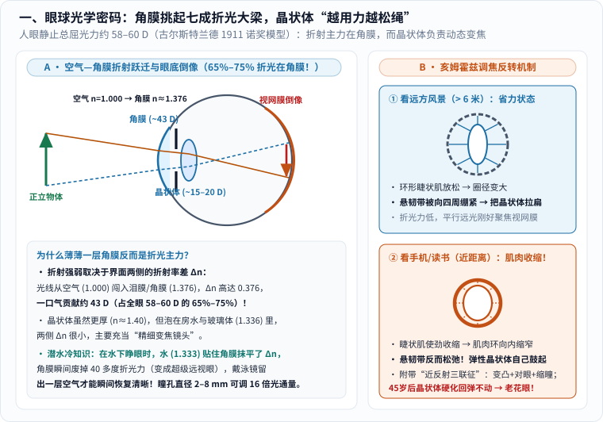
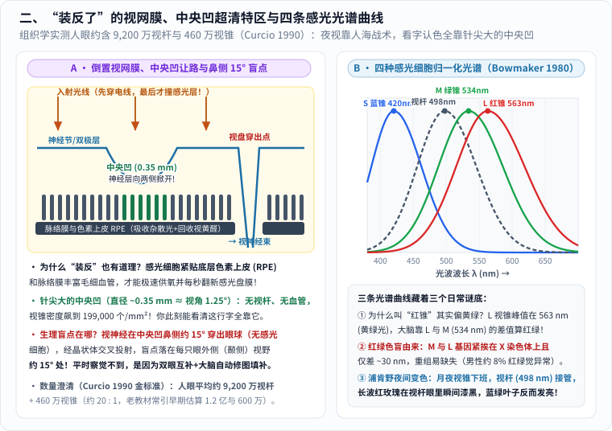
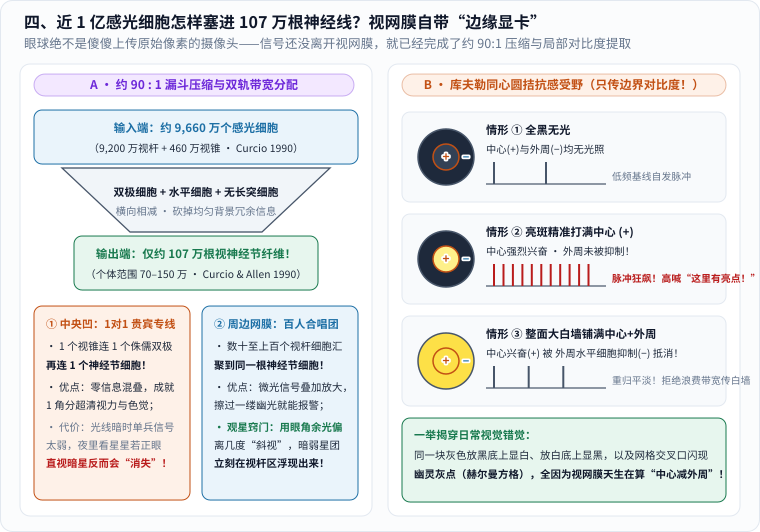
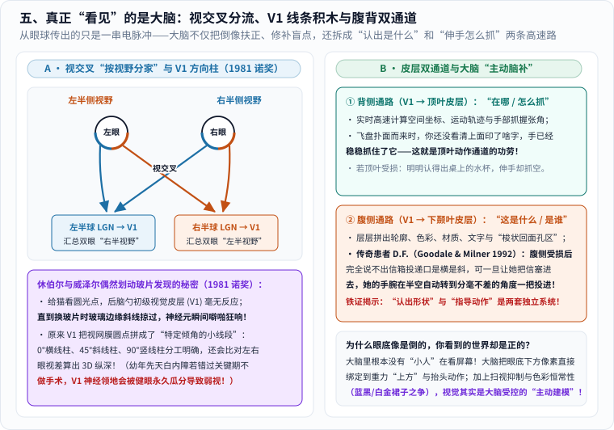

此时此刻，当你低头看清屏幕上的这一行黑字、余光瞥见桌角的水杯与窗外的绿树时，这一切显得再自然不过——就像打开了一扇透明窗户，外面的世界原封不动地流进了你的脑海里。

但如果让一位光学工程师和神经生物学家把你的眼球到后脑勺拆开检查一遍，他们一定会惊掉下巴：**你以为的“原封不动”，其实是全身上下最离谱、最精密的一场接力魔术！**

先看四件完全违背日常直觉的铁一般的事实：

1. **负责把光线掰弯聚焦的头号功臣根本不是“晶状体”**，而是眼球最外面那层薄得不起眼的透明**角膜**（独占了全眼约 $$65\%\text{–}75\%$$ 的折光力！）；
2. **人类的视网膜竟然是“装反了”的**：光线进眼后，必须先穿过好几层乱麻般的神经电线和毛细血管，最后才能撞上贴在眼底最深处的感光细胞——而且为了把电线引出眼球，每只眼视野外侧约 $$15^\circ$$ 处都破着一个完全看不见的**大盲洞**；
3. **感光细胞的工作逻辑跟普通光电传感器完全相反**：在伸手不见五指的漆黑夜里，你的视杆细胞正忙得热火朝天、源源不断往外喷射神经递质；反倒是光子撞上来的那一刹那，细胞当场**“拉闸断电”停止喊叫**！
4. **投在眼底的图像不仅上下颠倒、左右相反，而且清晰区只有针尖大小**：全靠视网膜先把近 $$1$$ 亿像素压缩成约 $$107$$ 万根神经信号，再由大脑后枕叶与颞叶、顶叶联手“实时修图建模”，才变出了你眼前稳如泰山的三维彩色世界！

一颗光子从闯进眼角膜，到变成你脑海里的一朵红玫瑰或一行文字，中间到底闯过了哪五道关卡？今天我们就顺着光的脚印，从前到后彻底走完这趟奇妙旅程。

---

## 一、第一关：眼球光学——角膜挑起七成大梁，晶状体“越使劲绳子越松”

### 1. 为什么薄薄一层角膜占了七成折光力？潜进泳池睁眼瞬间揭晓答案

很多人小时候学自然课，都听过“眼睛里的晶状体就像照相机的凸透镜”。这话只说对了一小半——如果你真把晶状体当成眼睛里唯一的凸透镜，就彻底低估了最前面那层透明**角膜（Cornea）**！

1911 年诺贝尔生理学或医学奖得主、瑞典眼科学家阿尔瓦·古尔斯特兰德（Allvar Gullstrand）通过精密的眼光学数学模型测算揭示 [[1]](#ref-1)：一颗处于放松看远状态的正常人眼，总屈光力大约为 **$$58\text{–}60\ \mathrm{D}$$**（屈光度 Diopter，$$1\ \mathrm{D}$$ 等于焦距 $$1\ \mathrm{m}$$ 的倒数；$$60\ \mathrm{D}$$ 意味着等效焦距只有约 $$17\ \mathrm{mm}$$）。而在这近 $$60\ \mathrm{D}$$ 的总折光本领里：

- **最外层的空气—泪膜/角膜前表面**：单枪匹马就贡献了约 **$$43\ \mathrm{D}$$（占全眼总屈光力的 $$65\%\text{–}75\%$$）** [[2]](#ref-2)！
- **藏在瞳孔后面的晶状体（Lens）**：放松看远时只贡献了区区 **$$15\text{–}20\ \mathrm{D}$$** [[2]](#ref-2)！

为什么更厚、更像放大镜的晶状体，折光能力反而还不如薄薄一片角膜的一半？

秘密全在光学折射定律里的**“折射率跳变 $$\Delta n$$”**！光线拐弯有多猛，不仅看透镜表面弯不弯，更看界面两边的介质折射率差多少：

- 当光线从**空气（$$n = 1.000$$）**一头扎进**泪膜与角膜基质（$$n \approx 1.376$$）**时，折射率陡然跳变了 **$$\Delta n \approx 0.376$$**，光线在这里发生了最剧烈的向内弯折；
- 等光线穿过角膜进入眼内，晶状体（平均 $$n \approx 1.40$$）前有**房水（$$n \approx 1.336$$）**、后有**玻璃体（$$n \approx 1.336$$）**——两边全是折射率跟水差不多的液体，折射率差只剩下可怜的 **$$\Delta n \approx 0.06$$**，掰弯光线的力道自然小了一大截！

不信你可以回想一下**在游泳池水下直接睁开眼睛**的体验：为什么水明明清澈见底，你在水下不戴泳镜睁眼看自己的手指却糊成一团重影？因为池水的折射率（$$n = 1.333$$）几乎跟角膜一模一样，一旦水直接贴上角膜，空气与角膜之间那 $$0.376$$ 的折射率台阶瞬间被抹平，你的角膜当场损失了 $$40$$ 多度折光力（相当于瞬间变成了四千多度的超级远视眼）！而只要戴上一副几十块钱的平光泳镜，在角膜前面重新留出一层薄薄的空气，水下世界立刻恢复纤毫毕现。

紧跟在角膜后面的是虹膜围成的圆孔——**瞳孔（Pupil）**。它就像相机镜头的物理光圈，直径可以在强光下的约 **$$2\ \mathrm{mm}$$** 与暗夜里的约 **$$8\ \mathrm{mm}$$** 之间伸缩：半径差 $$4$$ 倍，进光面积就能调节整整 **$$4^2 = 16$$ 倍** [[2]](#ref-2)。穿过瞳孔和晶状体后，外界正立的景物在眼球后壁视网膜上结结实实投下了一幅**上下颠倒、左右相反的缩小实像**（见图 1 左栏）。

### 2. 亥姆霍兹变焦反转：看近处手机时，拉住晶状体的绳子居然是“松开”的！

既然角膜把七成折光活儿都干完了，为什么我们还需要晶状体？因为角膜的曲率是固定死的！要想既看清六米外的路牌，又在一转眼间看清三十厘米外的书页，必须靠晶状体改变胖瘦来动态调焦——生理学上称为**调节（Accommodation）**。

这里藏着一个连很多医学生初学时都会猜反的精巧机械结构（由德国科学巨匠赫尔曼·冯·亥姆霍兹提出）[[2]](#ref-2)（见图 1 右栏上下对比）：

- **当你抬头远眺青山（$$> 6\ \mathrm{m}$$，省力休息态）**：围绕在晶状体四周的一圈环形肌肉——**睫状肌（Ciliary Muscle）处于完全放松状态**，肌肉环直径较大，把连接晶状体赤道部的成千上万根细丝（**悬韧带 Zonular Fibers**）向四周拽得紧紧的，从而把富有弹性的晶状体**拉得扁平**，折光力降到最低，平行光线恰好聚焦在视网膜上；
- **当你低头刷手机或看书（近距离，肌肉发力态）**：环形**睫状肌使劲向内收缩**！肌肉圈一缩小，原本绷紧的**悬韧带反而松弛了下来**；失去了周围绳索的拉扯，年轻富有弹性的晶状体靠自身的囊膜弹性“噗”地一下**回弹变厚、前后表面变凸**，屈光力瞬间暴涨十几个屈光度，把近处发散的光线重新按回视网膜上！与此同时，大脑还会自动触发**“近反射三联征”**：晶状体变凸 + 双眼向内对眼汇聚 + 瞳孔微微缩小（增大景深减少球差）。

看懂了这个“拉紧变扁、松绳鼓起”的机械原理，生活中两个最常见的视力烦恼瞬间水落石出：

- **为什么盯着手机看两小时眼眶酸胀，去阳台看远处绿树就舒服了？** 因为看近处需要环形睫状肌一直绷紧收缩不撒手，跟举着哑铃不放一样会肌肉疲劳；看 $$6$$ 米以外则是睫状肌彻底松手下班！
- **为什么人一过 45 岁，哪怕一辈子视力极好也会得“老花眼”？** 并不是睫状肌没力气了，而是晶状体内部的蛋白质随年龄增长越变越硬、逐渐失去弹性——哪怕睫状肌拼命收缩把悬韧带松得稀里哗啦，变硬的晶状体也鼓不起来了！而青少年常见的轴性**近视**，则是眼轴长得比正常约 $$24\ \mathrm{mm}$$ 略长了一两毫米，平行光还没走到视网膜就提前在半空聚焦了，所以需要戴一片凹透镜先把光线往外扩一扩。

*图 1：眼球光学折射分工、眼底倒像与亥姆霍兹调焦机制（）。左栏展示空气—角膜界面因巨大折射率差贡献全眼 $$65\%\text{–}75\%$$ 屈光力并在视网膜形成倒立缩小实像；右栏对比看远时睫状肌放松拉扁晶状体，与看近时睫状肌收缩反而松开悬韧带、让弹性晶状体自己鼓起变凸。*

---

## 二、第二关：“装反了”的视网膜奇观——近 $$1$$ 亿感光大军与针尖大的超清中央凹

### 1. 为什么脊椎动物的视网膜“把电线铺在镜头前面”？中央凹与盲点的取舍

光线穿过透明的玻璃体，终于抵达眼球后壁那层厚仅约 $$0.2\text{–}0.3\ \mathrm{mm}$$ 的薄膜——**视网膜（Retina）**。如果换作人类工程师设计数码相机 CMOS 传感器，肯定会把感光二极管放在最迎光的第一层，把导电铜线藏在芯片背后。

可包括人类在内的所有脊椎动物（章鱼等头足类除外！），视网膜偏偏长成了一副让强迫症抓狂的**“倒置结构（Inverted Retina）”** [[3]](#ref-3)（见图 2 左栏）：

光线射到视网膜表面时，迎面撞上的第一层竟然是负责汇总输出信号的**视神经节细胞与神经纤维层**，接着是双极细胞、水平细胞与无长突细胞，**最后在眼底最深处、紧贴着黑色视网膜色素上皮（RPE）的地方，才排列着真正的感光细胞（视杆与视锥细胞）！**

演化为什么会留下看似“装反了”的设计？其实它有一个生死攸关的后勤理由：感光细胞外段每秒钟都在承受海量光子轰击，内部装满视色素的膜盘每天都有约 $$10\%$$ 老化脱落，是全身代谢最疯狂、最怕缺氧的组织之一！把感光外段直接贴在底层的**色素上皮（RPE）与脉络膜毛细血管网**上，既能让黑色素一口吞掉穿透的杂散反光（相当于相机暗盒涂黑漆），又能让 RPE 细胞秒级吞噬废旧膜盘、把耗尽的视黄醛重新充电再生送回感光细胞！

那挡在前面的几层神经元和血管岂不是会模糊视线？脊椎动物用了一招极其聪明的**“局部特区清场”**——在视轴正中央开辟出了一块直径仅约 **$$1.5\ \mathrm{mm}$$** 的黄斑中心凹，尤其是正中心直径仅 **$$0.35\ \mathrm{mm}$$（对应视角仅约 $$1.25^\circ$$，差不多伸直手臂看大拇指指甲盖的一半宽！）的无视杆中央小凹（Foveola）** [[4]](#ref-4)：在这里，挡路的毛细血管完全退避，内层双极细胞与神经节细胞像掀开舞台大幕一样向四周斜着拨开，让光线毫无遮挡地直击高密度视锥细胞！

但也正因为神经电线铺在最内层，一百多万根神经纤维总得找个出口钻出眼球壁通往大脑吧？这个扎堆穿出的洞口位于视网膜中央凹**向鼻侧偏约 $$15^\circ$$** 处，称为**视盘（Optic Disc）** [[3]](#ref-3)。视盘上密布血管与神经束，**连半个感光细胞都没有**！经过眼球晶状体的交叉投射，这个洞口在每只眼的**外侧（颞侧）视野约 $$15^\circ$$** 处形成了一块货真价实的**生理盲点（Blind Spot）**——你此刻闭上左眼，用右眼死死盯住屏幕左边一个字，把右手竖起的大拇指往右侧慢慢横移到约一拃远，大拇指的指头会像变魔术一样凭空消失，而背景却被大脑无缝填平，连个黑窟窿都看不出来！

### 2. $$9{,}200$$ 万夜视兵 vs $$460$$ 万彩色兵：为什么红玫瑰在月光下会变成纯黑色？

1990 年，美国华盛顿大学克里斯蒂娜·库尔西奥（Christine A. Curcio）团队对人类整张视网膜做了迄今最权威的显微组织学精准点数（修正了早期教科书常引用的粗略估算值“$$1.2$$ 亿与 $$600$$ 万”），确立了现代视觉科学的金标准账本 [[4]](#ref-4)：

1. **视杆细胞（Rods）：人眼平均约 $$9{,}200$$ 万个**（个体范围 $$7{,}790$$ 万–$$1.073$$ 亿）！它们对微光极其敏感，但只有一种视紫红质（吸收峰值在蓝绿光 **$$498\ \mathrm{nm}$$** [[5]](#ref-5)），完全分不清颜色，而且全部驻扎在周边视网膜，正中心的中央小凹里一个视杆都没有；
2. **视锥细胞（Cones）：人眼平均仅约 $$460$$ 万个**（范围 $$408$$ 万–$$529$$ 万），数量虽只有视杆的二十分之一，却包揽了我们白天一切高清细节与五彩斑斓的色觉！在中央小凹正中心，视锥细胞像蜂巢一样紧密挤在一起，平均峰值密度高达惊人的 **$$199{,}000\ \text{个/mm}^2$$** [[4]](#ref-4)——偏离中心仅仅 $$10^\circ$$，你的视力锐度就会断崖式暴跌八成以上！这也是为什么读书时你的眼球必须每秒钟做三四次高速跳动（扫视 Saccade），轮流把每个词挪进这 $$0.35\ \mathrm{mm}$$ 的黄金特区里。

为什么区区 $$460$$ 万个视锥细胞就能分辨出上百万种色调？1980 年，鲍梅克（J. K. Bowmaker）与达特诺尔（H. J. A. Dartnall）用显微光度计单细胞实测出了人类三类视锥细胞的真实吸收光谱峰值 [[5]](#ref-5)（见图 2 右栏，这也是手机电脑屏幕只需排列 `R/G/B` 三色子像素就能骗过人眼的生理根源，详见[《读懂液晶显示与百年屏幕进化史》]()，以及为什么紫光散射更强天空却显蓝的[《一步步读懂天空的颜色密码》]()）：

- **短波蓝敏视锥（S-cone）**：峰值在蓝紫光 **$$420\ \mathrm{nm}$$**（仅占视锥总数约 $$5\%\text{–}10\%$$）；
- **中波绿敏视锥（M-cone）**：峰值在绿光 **$$534\ \mathrm{nm}$$**；
- **长波视锥（L-cone，俗称“红敏视锥”）**：峰值其实根本不在大红光（$$650\ \mathrm{nm}$$），而在黄绿光 **$$563\ \mathrm{nm}$$**！

看一眼图 2 右栏那四条实测曲线，三个有趣的生活谜团当场迎刃而解：

- **没有一个细胞单独认识“橙色”或“紫色”**：单颗视锥细胞其实是“色盲”，它只能报告自己被激活的强弱；大脑是通过**比较 S、M、L 三种通道的激活比例与差值**（尤其是用 L 减去相隔仅约 $$30\ \mathrm{nm}$$ 的 M 算出红—绿拮抗信号！）来合成万紫千红的；
- **为什么男性红绿色觉异常高达约 $$8\%$$，女性却不到 $$0.5\%$$？** 因为编码 M 与 L 视蛋白的两个基因是灵长类祖先在演化中刚复制分家不久的“孪生兄弟”，头尾相连排在 **X 染色体**上，序列相似度高达 $$98\%$$，减数分裂时极易发生错位重组丢失其一；男性只有一条 X 染色体，一旦中招没有备份！
- **夏夜花园里的“浦肯野位移”**：傍晚夕阳下鲜艳夺目的大红玫瑰，到了只有月光的深夜会突然变成死气沉沉的**纯黑色**，反倒是旁边的绿叶显得银白发亮！因为暗夜里三类视锥细胞低于阈值集体下班，峰值在 $$498\ \mathrm{nm}$$ 的视杆细胞全面接管——在 $$498\ \mathrm{nm}$$ 曲线的右端（$$>620\ \mathrm{nm}$$ 红光区），视杆细胞的吸收率几乎等于零！

*图 2：脊椎动物倒置视网膜、中央凹让路机制及四类感光细胞实测光谱曲线（）。左栏展示光线穿过内层神经到达紧贴色素上皮的感光外段、$$0.35\ \mathrm{mm}$$ 中央凹掀开神经层以及鼻侧 $$15^\circ$$ 视盘形成颞侧视野盲点；右栏按 Bowmaker 与 Dartnall（1980）绘制 $$420$$、$$498$$、$$534$$、$$563\ \mathrm{nm}$$ 四条吸收曲线。*

---

## 三、第三关：$$200$$ 飞秒分子扳机与“见光反而拉闸”的量子放大器

### 1. 一颗光子怎样在 $$200$$ 飞秒内扣动扳机？胡萝卜与夜盲症的真正联系

现在把镜头推近一百万倍，钻进一根视杆细胞外段的膜盘上，看看**一颗没有静止质量的电磁波光子，究竟是怎么变成生物电信号的**——这个过程叫**光转导（Phototransduction）**。

1967 年诺贝尔生理学或医学奖得主乔治·沃尔德（George Wald）揭开了隐藏在视紫红质（Rhodopsin）正中央的那枚微小分子扳机 [[6]](#ref-6)：它是由视蛋白口袋紧紧抱住的一根维生素 A 衍生物——**$$11$$-顺式视黄醛（11-*cis*-retinal）**。

在完全黑暗中，这根由碳链组成的 $$11$$-顺式视黄醛在第 11 号双键处弯折成一个别扭的拐角，像一根压紧上膛的捕鼠夹弹簧。一旦一颗波长合适的光子撞上来被它吸收，1991 年美国伯克利劳伦斯实验室尚莱因（Robert W. Schoenlein）团队用飞秒脉冲激光实测发现：这根弯折分子会在短短 **$$200\ \mathrm{fs}$$（$$200$$ 飞秒 $$= 2 \times 10^{-13}$$ 秒，光在这么短时间里连一根头发丝宽度都走不完！）**内“啪”地一下弹直，异构化为笔直的**全反式视黄醛（all-*trans*-retinal）** [[7]](#ref-7)——这是自然界已知最快的光化学反应之一！

胡萝卜和动物肝脏富含胡萝卜素与维生素 A，正是合成这枚 $$11$$-顺式视黄醛扳机的必需原料：如果长期严重缺乏维生素 A，视杆细胞凑不齐足够的视紫红质，一到傍晚暗处眼睛就会像没装胶卷一样抓瞎（**夜盲症**）；但反过来说，只要营养正常、扳机满仓，哪怕狂吃十筐胡萝卜也不会让你变成超视力千里眼！

### 2. 最违反常识的“暗电流”：黑夜里狂放电，见光时反而关门静音！

分子扳机弹直之后，如果只关掉 $$1$$ 个离子通道，微弱电流瞬间就会淹没在细胞热噪声里。视杆细胞为此配备了一套令人叹为观止的**三级生化雪崩放大器** [[3]](#ref-3) [[8]](#ref-8)（见图 3 左栏）：

1. **第一级**：$$1$$ 个被光子弹直激活的视紫红质分子，在脂质盘膜上一边快速滑行一边疯狂碰撞，在短短零点几秒内连续激活约 **$$800$$ 个转导蛋白（Transducin，一种异源三聚体 G 蛋白）**；
2. **第二级**：每个转导蛋白再去激活一个**磷酸二酯酶（PDE）**催化亚基，PDE 像一台高速旋转的碎纸机，把细胞质里的信使小分子**环磷酸鸟苷（$$\mathrm{cGMP}$$）**飞快剪碎水解（单颗光子即可在峰值前切碎数千个、约 $$4{,}800$$ 个 $$\mathrm{cGMP}$$ 分子）；
3. **第三级**：细胞外膜上约 **$$200$$ 个依赖 $$\mathrm{cGMP}$$ 撑开的阳离子通道**（约占暗态全部开放通道的 $$2\%$$）因为失去钥匙，“啪啪啪”成批锁死关闭！

等等——**见光之后通道不是打开，反而是关闭？！**

没错！这就是整个视觉生理学最让人拍案叫绝的反转设计（见图 3 右栏单次动画）：

- **在伸手不见五指的黑夜里（忙得冒烟）**：视杆细胞内的 $$\mathrm{cGMP}$$ 浓度很高，外膜上的 $$\mathrm{Na^+/Ca^{2+}}$$ 通道敞开大门，带正电的钠离子和钙离子一刻不停地往细胞里涌，形成一股持续不断的**“暗电流（Dark Current）”**，把细胞膜电位维持在相对较高的去极化水平（约 **$$-40\ \mathrm{mV}$$**）；受此驱动，细胞底部的突触终端一刻不停地往外喷射兴奋性神经递质——**谷氨酸（Glutamate）**，相当于扯着嗓子二十四小时大喊：“报告总部，现在一片漆黑！一片漆黑！”
- **当光子击中细胞的那一刻（拉闸静音）**：$$\mathrm{cGMP}$$ 被切碎，阳离子通道成批关闭，正电荷进不来了，而外排钾离子的通道还在照常工作——于是细胞膜电位不升反降，顺着波形图陡然向下跌向更负的水平（单颗光子即可引起约 **$$1\ \mathrm{mV}$$** 的清晰压降 [[8]](#ref-8)，强光饱和时一路跌到约 **$$-65\ \mathrm{mV}$$**），生理学上称为**超极化（Hyperpolarization）**！随着电位变负，突触口瞬间**减少乃至停止释放谷氨酸**——下游双极细胞一听：“咦？上面那家伙怎么突然闭嘴不喊黑了？说明**来光了**！”

这套“高基线减法报信”机制灵敏到了什么地步？1942 年，赫克特（Selig Hecht）、施莱尔与皮伦在暗室里让受试者彻底暗适应 $$30\text{–}40$$ 分钟后做极限闪光测试，算出只要有 $$54\text{–}148$$ 颗蓝绿光子射到角膜表面（扣除角膜反射、眼内介质吸收损耗后，真正被视网膜不同视杆细胞各自吸收 **$$5\text{–}14$$ 颗单光子**），人就能百发百中报告“看见了一道闪光” [[9]](#ref-9)！到了 2016 年，维也纳大学与洛克菲勒大学廷斯利（Jonathan N. Tinsley）团队更搬出量子光学的**自发参量下转换（SPDC）预示单光子源**，每次严格只往人眼发射 **$$1$$ 颗光子**：结果在高置信度试次中，受试者的判断正确率达到 $$60\% \pm 3\%$$（$$P = 0.001$$，总体双迫选正确率 $$51.6\% \pm 1.0\%$$，且前几秒若有另一颗光子先行抵达还会短暂提升回路增益），证实人类视觉系统的物理极限真的摸到了**单颗量子**的门槛 [[10]](#ref-10)！

*图 3：视紫红质 $$200$$ 飞秒光异构化放大链、暗电流拉闸波形单次动画与人类单光子极限（，刷新可重播电位响应动画）。左栏展示 $$1$$ 颗光子在 $$200\ \mathrm{fs}$$ 内掰直视黄醛，经约 $$800$$ 个转导蛋白与 PDE 切碎数千 $$\mathrm{cGMP}$$、关闭约 $$200$$ 个阳离子通道；右栏展示暗态 $$-40\ \mathrm{mV}$$ 持续喷射谷氨酸与见光后超极化跌向 $$-65\ \mathrm{mV}$$ 的反转机制。*

---

## 四、第四关：$$90 : 1$$ 极速瘦身——视网膜根本不是傻瓜镜头，而是“边缘检测显卡”

### 1. 近 $$1$$ 亿像素塞进 $$107$$ 万根电线：中央凹贵宾专线 vs 周边夜视合唱团

算到这里，一道严峻的布线难题摆在了眼球面前：整张视网膜上有 $$9{,}200\ \text{万} + 460\ \text{万} \approx 9{,}660$$ 万个感光细胞；如果像傻瓜摄像头那样给每个像素单独拉一根电缆通向大脑，视神经得粗得像一根大拇指，眼球根本转不动！

库尔西奥与艾伦（Kimberly A. Allen）1990 年对人类视神经节细胞的精密计数表明：真正离开每只眼球、组成视神经束通往大脑的输出电线（视神经节细胞轴突），平均只有约 **$$107$$ 万根**（个体范围 $$70\text{–}150$$ 万根）[[11]](#ref-11)！

将近 $$1$$ 亿个输入像素，居然要压缩进区区 $$107$$ 万根神经线里——平均压缩比高达 **$$90 : 1$$**！视网膜是怎么做到既不丢掉看书细节、又不漏掉暗夜微光的？答案是**“看人下菜碟”的双轨带宽分配**（见图 4 左栏）：

- **在针尖大的中央凹（$$1 : 1$$ 贵宾专线）**：每一个视锥细胞单独连向自己的侏儒双极细胞与侏儒神经节细胞，绝不跟邻居拼车混线，从而保住了 $$1$$ 角分的超清空间分辨率；代价是单兵作战没有信号叠加，夜里看一颗极暗的星星时，如果你正眼死死盯住它（星光落在纯视锥中央凹），星星反而会凭空消失！天文爱好者都知道一个绝招叫**“余光斜视法（Averted Vision）”**——把视线稍微往旁边挪开几度，让暗弱星光落到周边视杆区，星星立刻又亮了起来；
- **在广阔的周边视网膜（数十至上百对一的“合唱团汇聚”）**：几十甚至上百个视杆细胞把信号汇总到同一个神经节细胞上！虽然牺牲了看清笔画的锐度，却把微弱的单光子信号叠加放大了几十倍，黑夜草丛里哪怕有一丝风吹草动也能瞬间报警。

### 2. 库夫勒的同心圆感受野：大白墙不值得浪费带宽，眼睛天生只抓“反差边界”！

除了空间汇聚，视网膜内部的双极细胞、水平细胞与无长突细胞还在做一件更聪明的事——**图像边缘预处理**！

1953 年，神经生物学家斯蒂芬·库夫勒（Stephen W. Kuffler）把微电极贴在猫的视神经节细胞上，用小光斑一点点扫描视网膜，结果发现了一个奇妙的现象 [[12]](#ref-12)（见图 4 右栏三组脉冲对比）：

每个视神经节细胞管辖的一小片圆形区域（**感受野 Receptive Field**），居然分成了脾气完全相反的**“中心区”与“外周环”**！以最典型的**给光中心（ON-center）细胞**为例：

1. **全黑无光时**：细胞偶尔慢吞吞蹦出两声自发背景脉冲；
2. **一束小亮斑精准打满中心区（外周仍是黑暗）**：细胞瞬间像机关枪一样噼里啪啦高频狂放电！
3. **把灯光调大，让整面均匀大白墙同时照亮中心区和外周环**：按理说光更强了，细胞应该叫得更欢吧？恰恰相反——外周环受光后通过水平细胞发出了强烈的**侧向抑制（$-$）**，把中心区的兴奋（$$+$$）抵消得干干净净，细胞的放电瞬间又萎靡回了平淡无奇的低频！

你想明白这有多绝了吗？如果让你盯着一面毫无花纹的大白墙，几千万像素全都一模一样，把这些重复数据原封不动传给大脑纯粹是浪费宝贵的代谢能量！视网膜在眼球内部就直接算完了**“中心亮度减去外周亮度”**——**均匀不变的大片背景一律静音过滤，只有明暗交界处的轮廓边缘、反差跳变点，才会触发震耳欲聋的脉冲风暴传向大脑！**

这也顺手揭穿了无数风靡网络的“明暗视错觉”：为什么完全相同的一小块中灰色纸片，放在黑底上看起来亮白刺眼，放在白底上却显得乌黑发暗？为什么看黑白方格十字路口时眼角总闪现并不存在的幽灵灰点（赫尔曼方格错觉）？全因为你的视网膜从第一秒起就不是一台测光表，而是一块专抓局部反差的硬件显卡！

*图 4：视网膜约 $$90:1$$ 带宽压缩漏斗与库夫勒同心圆拮抗感受野（）。左栏展示 $$9{,}660$$ 万感光细胞汇聚为约 $$107$$ 万视神经节轴突及中央凹 $$1:1$$ 专线与周边汇聚分工；右栏展示给光中心细胞如何对中心亮斑狂飙脉冲、对整片均匀大白墙侧向抑制抵消。*

---

## 五、第五关：真正“看见”的是后脑勺——V1 线条积木、腹背双通道与主动脑补

### 1. 视交叉“按半边世界分家”与一次拉错玻片意外拿下的诺贝尔奖

压缩打包好的 $$107$$ 万路电脉冲顺着视神经冲出眼眶，首先在颅底迎来了一次极其精巧的立交桥换线——**视交叉（Optic Chiasm）**（见图 5 左上）：

并不是“左眼归右脑、右眼归左脑”那么简单！在视交叉处，来自每只眼**鼻侧半视网膜**的神经纤维会交叉穿到对侧半球，而来自每只眼**颞侧半视网膜**的纤维则留在同侧不交叉。这样一换线，奇迹发生了：

- **你整个左半边视野的画面**（无论左眼看到的还是右眼看到的），分毫不差全部汇进了**右脑半球**；
- **你整个右半边视野的画面**，全部汇进了**左脑半球**！

经过丘脑外侧膝状体（LGN）中转站后，信号直奔你后脑勺最末端（枕叶）的**初级视觉皮层（V1）**——难怪古人摔跤磕到后脑勺会觉得“眼前金星乱冒”，因为你的视觉主机根本不在前额眼眶后面，而在后脑勺！

V1 皮层里的上亿个神经元又是怎么读懂这些圆点脉冲的？1958 年深夜，约翰斯·霍普金斯大学的两位年轻学者大卫·休伯尔（David H. Hubel）和托斯坦·威泽尔（Torsten N. Wiesel）正对着麻醉猫的 V1 神经元一筹莫展：无论他们在屏幕上打多亮的圆光斑、多暗的黑圆点，监听扬声器里都死一般沉寂。就在两人换投影片、把一块透明玻璃载玻片从幻灯机槽口斜着抽出来的那一瞬间——**“噼里啪啦啪啦！”** 扬声器突然爆发出震耳欲聋的脉冲咆哮！

两人激动得连夜反复抽插那块玻璃片，最终揭开了大脑视觉解码的第一块基石（两人因此共享 1981 年诺贝尔生理学或医学奖 [[13]](#ref-13)）：原来玻璃片边缘投下的那条**淡淡的斜向黑影线**才是钥匙！V1 皮层把来自外侧膝状体的一排同心圆点串联起来，组装成了专门识别**特定倾角线条与边缘**的检测器——这一列神经元只对 $$0^\circ$$ 水平横线放电，隔壁一列只对 $$45^\circ$$ 斜线放电，再隔壁只认 $$90^\circ$$ 竖线，并且开始把左右两眼微小的水平视差比对换算成**三维立体纵深**！他们还发现，幼年视觉皮层存在严格的发育关键期：如果先天性白内障患儿在幼年关键期内挡住一只眼不及时手术，V1 里原本属于这只眼的神经领地就会被好眼永久侵占，长大后再换上再透亮的人工晶体也恢复不了视力（剥夺性弱视）。

### 2. “认出是什么”和“伸手怎么抓”居然是两条路！为什么眼底像是倒的你却不觉得倒？

从后脑勺 V1 拼出基础线条与轮廓之后，视觉洪流兵分两路，沿着大脑皮层奔向两个截然不同的终点站——这就是神经科学家梅尔文·古德尔（Melvyn A. Goodale）与戴维·米尔纳（A. David Milner）1992 年确立的著名**视觉双流假说（Two-Streams Hypothesis）** [[14]](#ref-14)（见图 5 右栏）：

1. **背侧通路（Dorsal Stream，从 V1 向上通往顶叶皮层）——“在哪儿 / 怎么抓（Where / How）”动作高速路**：负责以极低延迟实时解算物体相对你手脚的三维坐标、飞行速度和手指该张开多大角度去抓握。棒球或飞盘迎面飞来时，你往往还没看清上面印了什么商标，手已经本能地一把接住了它！
2. **腹侧通路（Ventral Stream，从 V1 向下通往下颞叶皮层）——“这是什么（What）”识别博物院**：一层层把短线条拼成几何形状、表面材质、色彩、文字，直到在颞叶底部的“梭状回面孔区”一秒认出人群中妈妈的笑脸！

这两条通道独立到什么程度？古德尔与米尔纳追踪研究过一位因一氧化碳中毒损伤了腹侧通路的著名患者 `D.F.` [[14]](#ref-14)：医生拿一块带狭缝的圆盘问她“这道缝是横的、竖的还是斜 $$45^\circ$$ 的？”，她两眼看着狭缝却完全说不出来（严重的视觉形态失认症）；**可一旦递给她一张明信片说“请直接塞进缝里去”，她的手刚一抬起，手腕就在半空中丝滑转动到分毫不差的角度，一把将卡片精准插进了狭缝！** 她的意识“看不懂”形状，她的顶叶运动皮层却“看得清清楚楚”！

*图 5：视交叉按视野分流、初级视觉皮层 V1 方向柱与皮层腹背双通道图解（）。左栏展示左右半侧视野在视交叉处重组汇入对侧半球 V1，以及休伯尔与威泽尔发现的线条倾角方向柱；右栏对比通往顶叶的“怎么抓”背侧动作通路与通往下颞叶的“是什么”腹侧识别通路。*

最后，让我们回答那个每个人小时候都问过爸爸妈妈的终极问题：**“既然眼底视网膜上的像是倒立的，为什么我看到的天空还是在上面、地板还是在下面？”**

因为**你脑袋里根本没有坐着一个“微型小人”，在拿另一双眼睛偷看视网膜屏幕**！对大脑神经元来说，“上面”还是“下面”只是一组空间坐标编码：视网膜上半部像素的电脉冲，从你一出生伸手摸头顶、感受内耳重力前庭信号的那一刻起，就被大脑硬连线绑定到了“需要抬头、伸手向上够”的真实物理下方/上方对应关系里（光学颠倒使现实上方的光投到视网膜下方，大脑直接把“视网膜下方神经元放电”定义为“外在世界上方”！）。

不仅如此，你的眼球每秒钟都在剧烈跳动三四次，大脑会在跳动那几十毫秒主动掐断模糊拖影（**扫视抑制**），让你完全不觉得天旋地转；你视网膜外侧破着两个 $$15^\circ$$ 大盲洞，大脑直接拿周围花纹无缝修补；甚至连曾经吵翻全网的**“蓝黑裙子还是白金裙子”**，也是因为大脑腹侧通路在自动猜测环境光源是“偏蓝阴影”还是“偏黄逆光”、试图替你做自动白平衡（色彩恒常性）时做出了不同假设！

---

## 六、总结：每一眼凝望，都是一场跨越飞秒与亿万神经元的奇迹

下次当你迎着晨光眨一眨眼、在一瞬间认出亲人的面庞时，不妨在心里为自己精密绝伦的视觉系统鼓一次掌：

- **角膜与晶状体**先用折射率台阶与松绳回弹机械，把万千光线聚焦成眼底倒像；
- **倒置视网膜**用 $$0.35\ \mathrm{mm}$$ 的中央凹清场保住极致锐度，让 $$9{,}200$$ 万视杆与 $$460$$ 万三色视锥各司黑白微光与万紫千红；
- **视紫红质**在短短 $$200$$ 飞秒内掰直视黄醛，通过三级生化放大给持续放电的“暗电流”拉闸静音，灵敏到连单颗量子都不放过；
- **视网膜回路**先把近 $$1$$ 亿像素按 $$90:1$$ 压缩成反差边缘信号，再经**视交叉、后脑勺 V1 方向柱与顶叶/颞叶双通道**层层重构，最终在漆黑封闭的颅骨之内，为你点亮了整座辽阔、鲜活而明亮的人间。

所以，从来不是眼球单纯“拍下了”世界——是我们用眼球捕捉光子，再用整颗大脑与一生的经验，“读懂”了世界。

---

## 参考资料与核查来源

1. The Nobel Prize in Physiology or Medicine 1911 — Allvar Gullstrand. [NobelPrize.org 官方档案](https://www.nobelprize.org/prizes/medicine/1911/summary/)（支持：古尔斯特兰德建立人眼屈光精密光学模型，测算全眼静止总屈光力约 $$58\text{–}60\ \mathrm{D}$$）
2. Sridhar, M. S. / StatPearls, Anatomy, Head and Neck, Eye Cornea ([NBK470340](https://www.ncbi.nlm.nih.gov/sites/books/NBK470340/)) 及 Physiology, Eye ([NBK470322](https://www.ncbi.nlm.nih.gov/sites/books/NBK470322/))（支持：角膜空气—泪膜界面贡献全眼约 $$65\%\text{–}75\%$$ 约 $$43\ \mathrm{D}$$ 屈光力、瞳孔 $$2\text{–}8\ \mathrm{mm}$$ 面积变化 $$16$$ 倍及亥姆霍兹睫状肌收缩悬韧带松弛调焦机制）
3. Purves, D., Augustine, G. J., Fitzpatrick, D., et al. (Eds.). *Neuroscience* (2nd ed., Sinauer Associates): Anatomical Distribution of Rods and Cones ([NBK10848](https://www.ncbi.nlm.nih.gov/sites/books/NBK10848/)) & Phototransduction ([NBK10806](https://www.ncbi.nlm.nih.gov/sites/books/NBK10806/))（支持：倒置视网膜结构、鼻侧约 $$15^\circ$$ 视盘形成颞侧视野盲点、视杆暗电流约 $$-40\ \mathrm{mV}$$ 持续释放谷氨酸及单光子激活约 $$800$$ 转导蛋白与关闭约 $$200$$ 通道）
4. Curcio, C. A., Sloan, K. R., Kalina, R. E., & Hendrickson, A. E. (1990). Human photoreceptor topography. *The Journal of Comparative Neurology*, 292(4), 497–523. [DOI: 10.1002/cne.902920402](https://doi.org/10.1002/cne.902920402)（支持：人类视网膜组织学精确计数平均 $$9{,}200$$ 万视杆细胞与 $$460$$ 万视锥细胞、无视杆中央小凹直径 $$0.350\ \mathrm{mm}$$ 及视锥峰值密度平均 $$199{,}000\ \text{个/mm}^2$$）
5. Bowmaker, J. K., & Dartnall, H. J. A. (1980). Visual pigments of rods and cones in a human retina. *The Journal of Physiology*, 298(1), 501–511. [DOI: 10.1113/jphysiol.1980.sp013097](https://doi.org/10.1113/jphysiol.1980.sp013097)（支持：单细胞显微光度实测人类视杆峰值 $$498\ \mathrm{nm}$$ 及 S/M/L 三类视锥峰值 $$420$$、$$534$$、$$563\ \mathrm{nm}$$）
6. The Nobel Prize in Physiology or Medicine 1967 — Ragnar Granit, Haldan Keffer Hartline, George Wald. [NobelPrize.org 官方档案](https://www.nobelprize.org/prizes/medicine/1967/summary/)（支持：沃尔德阐明维生素 A 衍生物 $$11$$-顺式视黄醛至全反式视黄醛光异构化初级视觉化学机制）
7. Schoenlein, R. W., Peteanu, L. A., Mathies, R. A., & Shank, C. V. (1991). The first step in vision: femtosecond isomerization of rhodopsin. *Science*, 254(5030), 412–415. [DOI: 10.1126/science.1925597](https://doi.org/10.1126/science.1925597)（支持：飞秒激光光谱实测视紫红质中 $$11$$-顺式视黄醛光异构化在 $$200\ \mathrm{fs}$$ 内完成）
8. Baylor, D. A., Lamb, T. D., & Yau, K.-W. (1979). Responses of retinal rods to single photons. *The Journal of Physiology*, 288(1), 613–634. [DOI: 10.1113/jphysiol.1979.sp012716](https://doi.org/10.1113/jphysiol.1979.sp012716)（支持：吸管电极直接记录视杆细胞对单颗光子的量化超极化电响应）
9. Hecht, S., Shlaer, S., & Pirenne, M. H. (1942). Energy, Quanta, and Vision. *Journal of General Physiology*, 25(6), 819–840. [DOI: 10.1085/jgp.25.6.819](https://doi.org/10.1085/jgp.25.6.819)（支持：暗适应人眼角膜入射 $$54\text{–}148$$ 颗光子、视网膜不同视杆吸收 $$5\text{–}14$$ 颗单光子即可引起闪光觉察）
10. Tinsley, J. N., Molodtsov, M. I., Prevedel, R., et al. (2016). Direct detection of a single photon by humans. *Nature Communications*, 7, 12172. [PMC4960318 全文](https://pmc.ncbi.nlm.nih.gov/articles/PMC4960318/)（支持：量子纠缠预示单光子源实验证实人眼在高置信度试次中以 $$60\% \pm 3\%$$ 显著高于随机概率感知单光子及数秒内双光子增益效应）
11. Curcio, C. A., & Allen, K. A. (1990). Topography of ganglion cells in human retina. *The Journal of Comparative Neurology*, 300(1), 5–25. [DOI: 10.1002/cne.903000103](https://doi.org/10.1002/cne.903000103)（支持：人类每只眼视神经节细胞平均约 $$107$$ 万个、个体范围 $$70\text{–}150$$ 万个）
12. Kuffler, S. W. (1953). Discharge patterns and functional organization of mammalian retina. *Journal of Neurophysiology*, 16(1), 37–68. [DOI: 10.1152/jn.1953.16.1.37](https://doi.org/10.1152/jn.1953.16.1.37)（支持：发现哺乳动物视网膜神经节细胞给光中心/撤光中心同心圆中心—外周拮抗感受野）
13. Hubel, D. H., & Wiesel, T. N. (1959). Receptive fields of single neurones in the cat's striate cortex. *The Journal of Physiology*, 148(3), 574–591. [PMC1363130 全文](https://pmc.ncbi.nlm.nih.gov/articles/PMC1363130/) 及 [1981 年诺贝尔奖公报](https://www.nobelprize.org/prizes/medicine/1981/summary/)（支持：初级视觉皮层 V1 方位选择性简单/复杂细胞、功能柱与视觉发育关键期）
14. Goodale, M. A., & Milner, A. D. (1992). Separate visual pathways for perception and action. *Trends in Neurosciences*, 15(1), 20–25. [DOI: 10.1016/0166-2236(92)90344-8](https://doi.org/10.1016/0166-2236(92)90344-8)（支持：提出通往下颞叶的腹侧“识别是什么”通路与通往后顶叶的背侧“指导动作怎么抓”通路及患者 `D.F.` 双分离证据）
