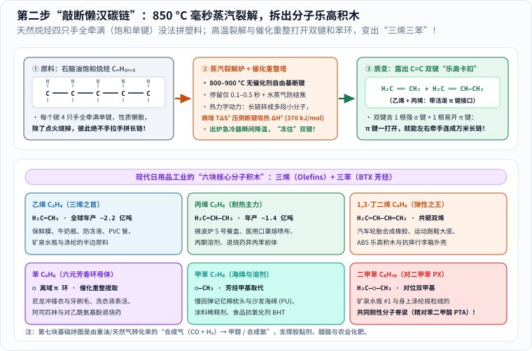
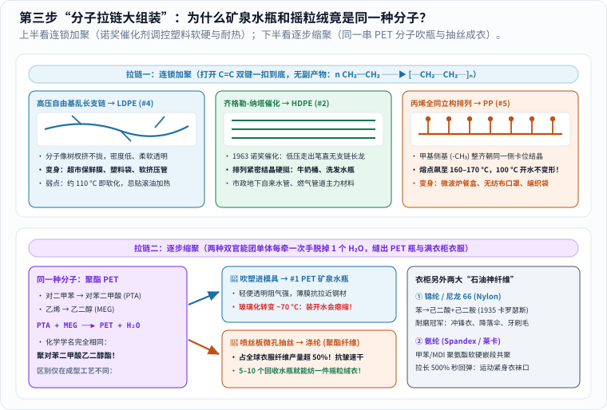
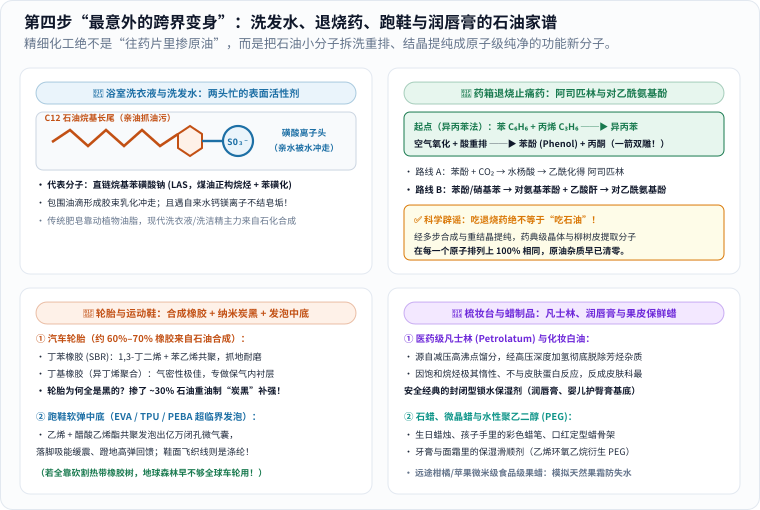
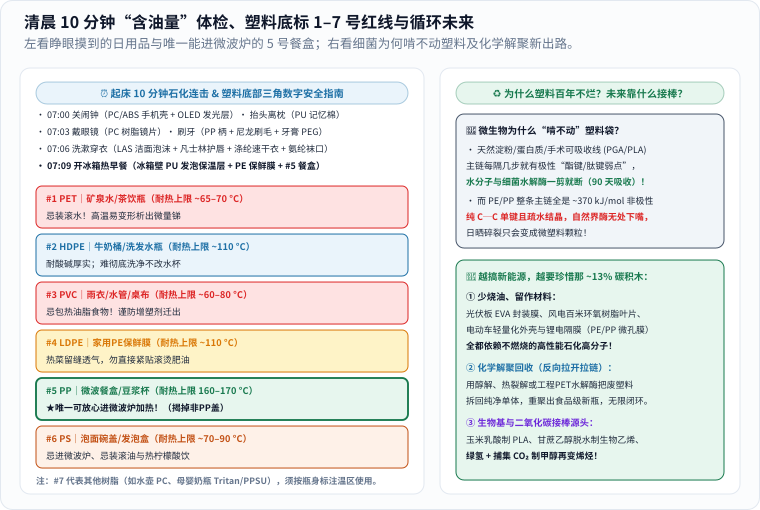

提起“石油”两个字，大多数人脑海里浮现的画面，往往是沙漠里磕头的抽油机、海上巨型油轮，或者加油站油枪跳表时让人肉疼的数字。哪怕平时完全不开车、出门只坐地铁或骑电动车的人，也常常觉得：“石油涨价跌价，大概只跟加油站和物流货车有关吧？”

可如果此刻你在房间里做一次假想实验——**把屋里所有跟石油沾边的东西，在同一秒钟全部变没**——接下来的一幕会让你瞬间怀疑人生：

你手里握着的智能手机外壳与屏幕有机发光层瞬间消失，只剩几片裸露的金属硅片掉在地上；你身上穿的速干 T 恤、保暖摇粒绒外套、冲锋衣和瑜伽裤原地蒸发大半；脚下柔软回弹的跑鞋中底、鼻梁上轻薄防碎的树脂眼镜片、床上的记忆棉枕头、浴室里的牙刷、洗发水、洗衣液、润唇膏，厨房冰箱门后厚实的保温泡沫层、保鲜膜、外卖餐盒，甚至连家庭小药箱里那板最常见的阿司匹林和退烧药（对乙酰氨基酚），全都跟着一起凭空消失！

更让人惊掉下巴的，是藏在这场大变身背后的四桩反直觉真相：

1. **第一桩怪事（“13% 边角料”撑起整个人造物质世界，且越炼体积越大）**：根据国际能源署（IEA）与美国能源信息署（EIA）的统计，人类抽上来的原油里，大约 **$$85\%$$** 都被装进汽车、飞机、轮船和锅炉里“一把火烧掉”了；真正没被烧掉、送进精细化工管线当原材料的石油，只占全球石油总需求的约 **$$12\%\text{–}14\%$$** [[1]](#ref-1) [[2]](#ref-2)！而且一桶标准原油明明只有 **$$42$$ 美制加仑（约 $$159\ \mathrm{L}$$）**，从现代炼油厂管线末端接出来的各类成品加起来，居然变成了 **$$44.7$$ 加仑** [[1]](#ref-1)——**凭空多出来的 $$2.7$$ 加仑是从哪儿变出来的？**
2. **第二桩怪事（手里的硬脆矿泉水瓶，和身上毛茸茸的摇粒绒外套，竟是一模一样的分子！）**：把一只装满冰镇饮料的透明塑料瓶（瓶底印着数字 `1`），和你冬天穿在身上又轻又暖的抓绒衣一起送进化学实验室化验，分析仪会吐出完全相同的化学学名——**聚对苯二甲酸乙二醇酯（$$\mathrm{PET}$$）** [[3]](#ref-3) [[4]](#ref-4)！同一种石油变出来的同一种长链分子，凭什么一会儿硬挺得能锁住碳酸气泡，一会儿又柔软蓬松得能贴身穿在身上？
3. **第三桩怪事（为什么满厨房的塑料盒里，唯独印着 `5` 号的餐盒敢进微波炉？）**：同样是从炼化厂出来的透明塑料，为什么矿泉水瓶倒进一壶刚烧开的 $$100\ ^\circ\mathrm{C}$$ 滚水就会当场烫瘪变形，而盒底三角箭头里写着 **`5`（$$\mathrm{PP}$$ 聚丙烯）** 的外卖餐盒却能在沸汤和微波炉里稳如泰山 [[3]](#ref-3) [[5]](#ref-5)？两位化学家到底给分子链施了什么排队魔法，竟因此捧走了 **1963 年诺贝尔化学奖** [[5]](#ref-5)？
4. **第四桩怪事（洗发水和退烧止痛药也姓“油”？那吃药难道等于“喝石油”吗？）**：原油明明是地下几千米深处埋藏上亿年的海洋古生物遗骸热解黑泥，又黑又臭还黏手；它究竟经历了怎样的脱胎换骨，才变成清香起泡的洗衣液 [[6]](#ref-6)、医药级凡士林润唇膏，乃至纯白晶莹的阿司匹林与对乙酰氨基酚（扑热息痛）药片 [[7]](#ref-7) [[8]](#ref-8)？

今天，我们就换上工程师的安全帽，跟着一滴刚从海底油井抽上来的黑褐色原油，一关一关走完现代工业最伟大的“炼金流水线”——**物理分馏 $$\longrightarrow$$ 毫秒蒸汽裂解 $$\longrightarrow$$ 高分子聚合拉链 $$\longrightarrow$$ 精细化工跨界合成**，亲眼看看这滴黑泥是如何摇身变成你手边万物的。

---

## 一、第一关“物理按身高分楼层”：一根化学键都不断，怎样把一桶黑泥拆成六层清亮油品？

刚从油田管道抽进炼油厂的**原油（Crude Oil）**，根本不是一种单一纯净物，而是一锅极其混乱的“碳氢化合物大杂烩” [[3]](#ref-3) [[9]](#ref-9)：里面既有只有 $$1\text{–}4$$ 个碳原子、脾气暴躁随时想往天上飞的超轻气体分子，也有挂着 $$5\text{–}16$$ 个碳原子的清亮液体分子，更有拖着五六十个碳原子与稠环结构、黑沉得像凝固糖浆一样的重质巨无霸分子。

要把这锅黑粥变成日用品，炼油厂绝对不会一上来就乱下猛药，而是严格遵循**“分离（Separation）$$\to$$ 转化（Conversion）$$\to$$ 精制调合（Treatment）”**三大步 [[9]](#ref-9)。第一关的规矩非常优雅：**一根化学键都不打断，纯粹按分子“个头高矮”让它们自己站队分楼层！**

### 1. 先算一笔大账：$$42$$ 加仑原油进炼油厂，为什么流出来变成 $$44.7$$ 加仑？

在走进分馏塔之前，我们先看一眼美国能源信息署（EIA）公布的一桶标准原油“拆箱账单” [[1]](#ref-1)。国际石油贸易通用的“$$1$$ 桶（Barrel）”，严格等于 **$$42$$ 美制加仑（约 $$158.99\ \mathrm{L}$$，差不多装满浴缸大半缸）**。但在现代大型炼油厂经过分馏与重油裂解加工后，这 $$42$$ 加仑原油最终产出的各类油品与原料总体积，平均高达 **$$44.65$$ 加仑** [[1]](#ref-1)！

难道炼油厂打破了质量守恒定律？当然没有！**总质量连一克都没多（除去极少量外加氢气外严格守恒），多出来的 $$+6.3\%$$ 纯粹是“体积膨胀增益（Processing Gain）”** [[1]](#ref-1)：

- 原油里原本藏着大量碳链极长、分子抱团极紧、密度高达 $$0.95\text{–}1.02\ \mathrm{g/cm^3}$$ 的重油大分子；
- 当后续裂化装置把这些沉甸甸的大分子“咔嚓”剪碎成密度只有 $$0.72\text{–}0.78\ \mathrm{g/cm^3}$$ 的轻质小分子液体时，因为 $$\text{体积 } V = \frac{m}{\rho}$$，同样的质量 $$m$$ 除以更小的密度 $$\rho$$，总体积自然像把一整块实心大冰砖敲碎成一满筐碎冰碴一样鼓了起来！

在这 $$44.65$$ 加仑产出物里，大约 $$19.6$$ 加仑成了汽车油箱里的汽油（关于汽油标号、抗爆震异辛烷与油箱碳罐呼吸的奥秘，可以延伸阅读本站的[《为什么跳枪硬凑整能吸瘪油箱？92的车加95反交智商税？》]()），$$12.5$$ 加仑成了货车轮船烧的柴油，$$4.4$$ 加仑成了客机烧的航空煤油 [[1]](#ref-1)。而真正逃过“葬身火海”命运、沿着另一条秘密通道走进日常生活的，主要是那占全球石油需求约 **$$12\%\text{–}14\%$$ 的石化轻烃与石脑油原料**，外加少许石蜡、润滑油与铺路沥青 [[1]](#ref-1) [[2]](#ref-2)。

### 2. 碳链越长沸点越高：分子间色散力怎样充当分馏塔的“天然筛子”？

既然原油里成百上千种烷烃分子全都只由碳（$$\mathrm{C}$$）和氢（$$\mathrm{H}$$）两种元素组成，分馏塔凭什么能把它们一层层干净分开？答案藏在分子间最基础的**伦敦色散力（London Dispersion Forces）**里 [[3]](#ref-3)（关于共价键与分子间作用力的底层物理差异，可参看本站的[《剧毒氯气遇上遇水爆炸的钠凭什么变成救命食盐？一文读透化学键的底层密码》]()）：

烷烃碳链越短，分子电子云越小，彼此之间一点儿也不黏糊，稍微给点热量就挣脱束缚飞成气体；碳链越长，两条长链像两根煮熟的长面条一样贴在一起的接触面积越大，瞬时偶极吸引（色散力）成倍增强，必须烧到高得多的温度才能把它们拆开沸腾 [[3]](#ref-3)！看看大学化学教材（OpenStax *Chemistry 2e*）实测的直链正构烷烃沸点阶梯，规律整齐得像用尺子量出来一样 [[3]](#ref-3)：

| 烷烃名称 | 分子式 | 碳原子数 | 常压沸点（$$1\ \mathrm{atm}$$） | 室温（$$25\ ^\circ\mathrm{C}$$）状态与日常身影 |
| :--- | :--- | :---: | :---: | :--- |
| 甲烷 / 乙烷 | $$\mathrm{CH_4}$$ / $$\mathrm{C_2H_6}$$ | $$1\text{–}2$$ | $$-161.5\ ^\circ\mathrm{C}$$ / $$-88.6\ ^\circ\mathrm{C}$$ | 气体：管道天然气、裂解制乙烯主力原料 |
| 丙烷 / 正丁烷 | $$\mathrm{C_3H_8}$$ / $$\mathrm{C_4H_{10}}$$ | $$3\text{–}4$$ | $$-42.1\ ^\circ\mathrm{C}$$ / $$-0.5\ ^\circ\mathrm{C}$$ | 气体（加压即液化）：一次性打火机透明液体、露营气罐 |
| 正戊烷 / 正己烷 | $$\mathrm{C_5H_{12}}$$ / $$\mathrm{C_6H_{14}}$$ | $$5\text{–}6$$ | $$36.1\ ^\circ\mathrm{C}$$ / $$68.7\ ^\circ\mathrm{C}$$ | 极易挥发清亮液体：**石脑油（化工母液）**与轻汽油核心组分 |
| 正辛烷 / 正癸烷 | $$\mathrm{C_8H_{18}}$$ / $$\mathrm{C_{10}H_{22}}$$ | $$8\text{–}10$$ | $$125.7\ ^\circ\mathrm{C}$$ / $$174.0\ ^\circ\mathrm{C}$$ | 液体：重石脑油、车用汽油与煤油过渡区 |
| 二十烷以上 | $$\mathrm{C_{20}H_{42}}$$ 及更长 | $$\ge 20$$ | $$> 340\ ^\circ\mathrm{C}$$ | 固态蜡或黏稠重油：生日蜡烛、凡士林、柏油沥青 |

### 3. 常压与减压两座塔接力：为什么重油不敢硬烧，而“石脑油”成了万物之母？

抓住了这道沸点阶梯，炼油厂建起了一座高达五六十米、内部装满几十层带泡罩塔盘（Bubble-cap trays）的钢铁巨塔——**常压分馏塔（Atmospheric Distillation Tower）** [[3]](#ref-3) [[9]](#ref-9)：

脱盐脱水后的原油先在管式加热炉里被猛火烧到约 **$$370\text{–}425\ ^\circ\mathrm{C}$$**，化作滚烫的气液混合浓雾从塔底冲进去 [[3]](#ref-3)。整座分馏塔**下面火热、越往上越凉**。热油气顺着塔盘上的小孔一路往上冒，每爬高几层温度就降一截：个头偏大的柴油分子爬到 $$250\text{–}350\ ^\circ\mathrm{C}$$ 楼层就冻得撑不住了，凝结成液体被接走；中等个头的航空煤油爬到 $$150\text{–}250\ ^\circ\mathrm{C}$$ 楼层落盘；而个头轻巧、沸点落在 **$$30\text{–}180\ ^\circ\mathrm{C}$$** 之间的 **`C5–C10` 石脑油（Naphtha，又称化工轻油）** 一口气冲上塔顶下方，凝成清澈如水的透明液体——**请死死记住“石脑油”这三个字，它就是全人类塑料、化纤衣服、橡胶与合成药物最核心的“第一滴母乳”！** [[2]](#ref-2) [[9]](#ref-9)

_先看左栏：一桶 $$42$$ 加仑原油经裂解体积膨胀产出约 $$44.7$$ 加仑成品，约 $$85\%$$ 作为交通与工业燃料烧掉，仅约 $$12\%\text{–}14\%$$ 化工母液与高沸点馏分留下来变成日常万物。再看右栏常减压分馏塔（含单次上升油气与分层凝结动画，偏好减少动态效果时直接展示静态完整分层）：约 $$400\ ^\circ\mathrm{C}$$ 油气自下而上冷却，不打断任何化学键，纯粹按碳链长短与沸点高低依次接出液化气、**石脑油（日用品第一母液）**、煤油、柴油、减压石蜡凡士林与塔底沥青。[单独打开大图（刷新可重播）](/assets/images/petroleum-everyday-products/barrel-split-and-distillation-tower.svg)。_

这时一个工程难题冒了出来：塔底还剩下一大摊沸点超过 $$450\ ^\circ\mathrm{C}$$ 的重质渣油，里面藏着做**发动机润滑油、医药级凡士林润唇膏和生日蜡烛石蜡**的宝贝长链分子。为什么工程师不干脆把炉火拧到 $$550\ ^\circ\mathrm{C}$$ 把它们蒸出来？

因为碳碳单键承受不了这么粗暴的慢烤！一旦常压加热超过约 $$380\text{–}400\ ^\circ\mathrm{C}$$，重油分子还没来得及蒸发，就会先在炉管壁上劈里啪啦热裂解结焦，烧成一锅铲都铲不下来的硬黑炭！于是工程师用上了我们在高原烧水时学过的物理妙招——**气压越低，液体沸点越低**。他们把塔底重油抽进第二座抽成半真空（压力降到常压的二十分之一以下）的**减压分馏塔（Vacuum Distillation Unit）** [[9]](#ref-9)：原本要 $$500\ ^\circ\mathrm{C}$$ 才沸腾的润滑油馏分和石蜡，在 $$300\ ^\circ\mathrm{C}$$ 出头就乖乖气化分层跑了出来！再经过高压加氢把里面残留的硫、氮和有味道的稠环芳烃彻底洗净，就得到了晶莹雪白的**石蜡（蜡烛、蜡笔）**与化学性质极度温和稳定的**医药级白凡士林（润唇膏、护手霜基底）**；最后真正蒸不动的塔底残渣，则直接运去铺成我们每天开车踩过的**高速公路黑色柏油路面（沥青）** [[1]](#ref-1) [[9]](#ref-9)。

---

## 二、第二关“敲断懒汉碳链”：$$850\ ^\circ\mathrm{C}$$ 毫秒级蒸汽裂解，拆出化工界的“六块母体乐高积木”

拿到了分馏塔送来的头号宝贝——清澈透明的 **`C5–C10` 石脑油**（再加上油气田伴生的乙烷、丙烷），我们能不能直接往石脑油里加点胶水，把它倒进模具冻成一只塑料洗脸盆或一件涤纶外套？

**绝对不行！哪怕你把它冻到零下几十度，一旦回温它照样化作一滩挥发刺鼻的汽油味液体。**

### 1. 为什么石脑油不能直接捏成塑料碗？饱和烷烃“四只手全满”的死局

原因就出在石脑油主要成分——**饱和烷烃（Alkanes，通式 $$\mathrm{C}_n\mathrm{H}_{2n+2}$$）** 的分子结构上 [[3]](#ref-3)。

碳原子最外层有 $$4$$ 颗价电子，相当于长着 **$$4$$ 只手**。在正己烷（$$\mathrm{C_6H_{14}}$$）或正辛烷（$$\mathrm{C_8H_{18}}$$）分子里，每一个碳原子的 $$4$$ 只手全都已经死死抓满了邻居碳原子或氢原子（清一色的 $$\sigma$$ 单键） [[3]](#ref-3)。想象一下幼儿园里十几个小朋友，每个人左右两只手全都塞满了玩具球，谁也腾不出一只空手去牵旁边小朋友的手——这样的分子脾气极其“佛系懒散”（古称石蜡烃 Paraffin，拉丁语原意就是“亲和力极小”！），除了遇到氧气点火烧成二氧化碳和水，它们彼此之间绝不会连成结实的固体长链 [[3]](#ref-3)。

要想让小分子手拉手拼成坚韧的塑料和衣服纤维，化工厂必须干一件看似暴烈、实则精确到毫秒的活儿：**硬生生敲断长烷烃碳链、扯掉多余氢原子，逼相邻两个碳原子之间多牵起一根活泼易开的“碳碳双键（$$\mathrm{C=C}$$）”或围成“芳香六元苯环”！**

### 2. $$850\ ^\circ\mathrm{C}$$ 停留 $$0.2$$ 秒再瞬间急冷：用热力学“熵增”硬生生掰出双键

这就是整座石油化工城真正的心脏——**蒸汽裂解炉（Steam Cracker）** [[2]](#ref-2) [[10]](#ref-10)。

把石脑油与高温水蒸气按比例混在一起，以接近音速的狂飙气流冲进高达 **$$800\text{–}900\ ^\circ\mathrm{C}$$** 的特种耐热合金炉管里，**完全不放任何催化剂** [[10]](#ref-10)。为什么这么高的温度能把结实的碳链震碎？大学有机化学教材（McMurry *Organic Chemistry*）用吉布斯自由能方程给出了一针见血的解释 [[10]](#ref-10)：

$$
\Delta G^\circ = \Delta H^\circ - T\Delta S^\circ
$$

这里藏着一场精彩的“能量拔河”：

- 敲断一根碳碳单键（$$\mathrm{C-C}$$，键能高达约 **$$370\ \mathrm{kJ/mol}$$**）并脱氢生成双键，是一个强烈**吸热**的过程（焓变 $$\Delta H^\circ > 0$$），在常温下根本不会自发发生 [[10]](#ref-10)；
- 但当 $$1$$ 个庞大的八碳或十碳长分子，在炉管里“啪”地碎裂成 $$3\text{–}4$$ 个乙烯、丙烯和氢气小分子时，系统的分子总数翻了好几倍，微观混乱度——也就是**熵变 $$\Delta S^\circ$$ 大幅为正** [[10]](#ref-10)！
- 一旦炉温 $$T$$ 推高到 $$850\ ^\circ\mathrm{C}$$（约 $$1123\ \mathrm{K}$$）以上，右边的 $$-T\Delta S^\circ$$ 负项就彻底压倒了左边的 $$+\Delta H^\circ$$ 吸热项，使 $$\Delta G^\circ < 0$$——长碳链在自由基链式反应中纷纷均裂断碎，吐出大量带着 $$\mathrm{C=C}$$ 双键的小分子烯烃 [[10]](#ref-10)！

更绝的是炉子里的两道工程保命符：第一，为什么要掺大量**水蒸气**？水蒸气在这里不参与主反应，而是负责稀释油气、降低烃类分压，防止刚裂解出来的活泼分子撞在一起缩合成焦炭堵死炉管；第二，油气在 $$850\ ^\circ\mathrm{C}$$ 炉管里停留的时间必须死死卡在 **$$0.1\text{–}0.5$$ 秒（一眨眼的时间！）**，一出炉口立刻冲进急冷换热器，在零点零几秒内骤降到几百度以下，把刚刚诞生的宝贵双键瞬间“冻住”，不给它继续碎成积碳和甲烷的机会！

### 3. 集齐“三烯三苯”：支撑整个人类日用品帝国的六块母体乐高积木

经过蒸汽裂解炉（主产小分子烯烃）与另一套铂催化剂坐镇的**催化重整装置（Catalytic Reformer，专门把六碳至八碳链烃脱氢环化成六元芳香环）** [[9]](#ref-9)，再送进零下上百度的深冷分离塔按沸点精馏提纯，原本面目模糊的黑色原油，终于被人类拆解成了整整齐齐的**“六块母体分子乐高积木”——化工界俗称“三烯三苯”** [[2]](#ref-2) [[3]](#ref-3) [[10]](#ref-10)：

_上半部分拆解“从懒汉烷烃到活泼积木”的三步质变：石脑油全单键烷烃在 $$800\text{–}900\ ^\circ\mathrm{C}$$ 蒸汽裂解炉中停留 $$0.1\text{–}0.5\ \mathrm{s}$$，靠高温熵增（$$T\Delta S^\circ > \Delta H^\circ$$）打断单键并瞬间急冷，露出含一根易开 $$\pi$$ 键的 $$\mathrm{C=C}$$ 双键接口；下半部分列出撑起日常万物的六大核心积木——**三烯（乙烯、丙烯、1,3-丁二烯）**与**三苯（苯、甲苯、二甲苯）**，外加合成气/甲醇第七块基础拼图。[单独打开大图](/assets/images/petroleum-everyday-products/steam-cracking-seven-lego-bricks.svg)。_

- **三烯（Olefins，带 $$\mathrm{C=C}$$ 双键的链状积木）**：
  1. **乙烯（$$\mathrm{H_2C=CH_2}$$）**——当之无愧的“世界化工之王”，全球每年产量高达约 **$$2.2$$ 亿吨** [[10]](#ref-10)！一个国家的乙烯产能，历来被直接拿来衡量它的制造业家底：保鲜膜、牛奶瓶、自来水管、防冻液、牙膏保湿剂、PVC 雨衣全都靠它起家；
  2. **丙烯（$$\mathrm{H_2C=CH-CH_3}$$）**——全球年产约 **$$1.4$$ 亿吨** [[10]](#ref-10) 的耐热多面手：微波炉 `5` 号餐盒、外科口罩熔喷布、汽车保险杠、玻璃胶与退烧药前体全指望它；
  3. **1,3-丁二烯（$$\mathrm{H_2C=CH-CH=CH_2}$$）**——身上连挂两根共轭双键的“弹性冠军”：没有它，全球汽车轮胎和运动跑鞋大底立刻停摆，连乐高积木与行李箱的 $$\mathrm{ABS}$$ 工程塑料里那股抗摔韧劲儿也是它给的！
- **三苯（BTX Aromatics，带六元离域 $$\pi$$ 电子环的刚性积木）** [[2]](#ref-2) [[3]](#ref-3)：
  4. **苯（$$\mathrm{C_6H_6}$$）**——尼龙冲锋衣、泡沫保温箱（聚苯乙烯）、洗衣液表面活性剂、防弹头盔聚碳酸酯以及阿司匹林/扑热息痛药片的总源头 [[7]](#ref-7) [[11]](#ref-11)；
  5. **甲苯（$$\mathrm{C_7H_8}$$）**——沙发海绵与慢回弹记忆棉枕头（聚氨酯 $$\mathrm{TDI}$$）以及食品抗氧化剂 $$\mathrm{BHT}$$ 的主力前体 [[7]](#ref-7) [[12]](#ref-12)；
  6. **二甲苯（$$\mathrm{C_8H_{10}}$$，核心是对位双甲基的“对二甲苯 $$\mathrm{PX}$$”）**——正是它撑起了矿泉水瓶和全世界一半以上衣服面料的刚性分子脊梁 [[12]](#ref-12)！

（如果再加上由重油或天然气转化生成的**合成气 $$\mathrm{CO + H_2} \to$$ 甲醇/合成氨**，这“$$6+1$$”块最简单的基础小分子，就像《我的世界》里的七种基础方块一样，衍生出了现代超市货架上超过 **$$7$$ 万种**终端日用品 [[2]](#ref-2)！）

---

## 三、第三关“分子拉链大组装”：塑料盆、保鲜膜与满衣柜衣服是怎么“扣”出来的？

现在，乙烯、丙烯、对二甲苯这些小分子积木已经排好队了。可是室温下的乙烯和丙烯都只是轻飘飘的无色气体 [[3]](#ref-3)，化工厂怎么把一罐看不见的气体，瞬间变成结实得能装十斤牛奶的塑料桶，或者织成保暖柔软的抓绒外套呢？

答案叫做**高分子聚合反应（Polymerization）** [[3]](#ref-3) [[11]](#ref-11)。化学家手握两套截然不同的“分子拉链”，一套叫**连锁加聚**，一套叫**逐步缩聚**。

### 1. 第一套拉链——连锁加聚（Chain-Growth）：诺奖催化剂怎样把同一种气体变成软保鲜膜和硬水管？

先看乙烯分子（$$\mathrm{H_2C=CH_2}$$）中间那根碳碳双键：它并不是两根一模一样的绳子，而是由 **$$1$$ 根极结实的头碰头 $$\sigma$$ 键**，加上 **$$1$$ 根比较松散、电子云露在外面的肩并肩 $$\pi$$ 键** 组成的 [[3]](#ref-3)。

只要往反应器里丢进一点点引发剂或金属催化剂，轻轻拍开乙烯身上的 $$\pi$$ 键，神奇的多米诺骨牌就启动了——第一个乙烯伸出半只空闲的手抓住第二个乙烯，第二个又劈开双键抓住第三个……短短几秒钟内，成千上万个乙烯小分子就像拉上一条一万节长的拉链一样，首尾相连扣成了一条分子量高达几万乃至几十万的实心碳链 **聚乙烯（Polyethylene, $$\mathrm{PE}$$）**，全程**零副产物、一粒原子都不浪费** [[3]](#ref-3) [[11]](#ref-11)：

$$
n\,\mathrm{CH_2=CH_2} \xrightarrow{\text{催化剂 / 引发剂}} \bigl[\!\mathrm{-CH_2-CH_2-}\!\bigr]_n
$$

最奇妙的地方来了：**明明原料 $$100\%$$ 全是乙烯这一种气体，为什么做出来的超市保鲜膜软趴趴一扯就变形，而装洗发水和牛奶的白塑料桶却硬邦邦摔都摔不裂？**

- **高压自由基“乱长树杈” $$\longrightarrow$$ 低密度聚乙烯（$$\mathrm{LDPE}$$，`#4` 号塑料）**：1930 年代最早工业化的工艺需要上千个大气压与自由基引发。反应太狂野，长链在生长途中经常回头“咬”自己一口，侧面乱七八糟长出许多长短不一的树杈支链。就像把一堆带树杈的树枝往箱子里塞，怎么也压不紧实，链与链之间空隙很大、密度低（约 $$0.91\text{–}0.93\ \mathrm{g/cm^3}$$），所以做出来的薄膜**极其柔软透明**——正是我们厨房天天撕的**`4` 号 $$\mathrm{PE}$$ 保鲜膜**和洗面奶软管！代价是它结晶度低，一过 $$110\ ^\circ\mathrm{C}$$ 就彻底软化瘫塌。
- **齐格勒-纳塔诺奖催化“立正走直线” $$\longrightarrow$$ 高密度聚乙烯（$$\mathrm{HDPE}$$，`#2` 号塑料）与聚丙烯（$$\mathrm{PP}$$，`#5` 号塑料）**：1953–1954 年，德国化学家卡尔·齐格勒（Karl Ziegler）与意大利化学家朱利奥·纳塔（Giulio Natta）先后发明了神奇的钛—铝过渡金属配位催化剂，因此共同斩获 **1963 年诺贝尔化学奖** [[5]](#ref-5)！这套催化剂像一位铁面教官，在常压或低压下把每一个走过来的乙烯分子精准按住再接进主链，合成出来的聚乙烯**几乎一根侧枝都没有**！笔直的长链肩并肩紧密排成高度结晶阵列（密度升至 $$0.94\text{–}0.97\ \mathrm{g/cm^3}$$），立刻变身坚硬强韧的**`2` 号牛奶桶、洗发水瓶与地下市政自来水管**！
- **更神的一笔发生在丙烯（$$\mathrm{H_2C=CH-CH_3}$$）身上**：以前没有纳塔的立体定向催化剂时，丙烯聚合出来的侧链甲基（$$\mathrm{-CH_3}$$）东倒西歪乱朝向（无规立构），做出来的东西像一团黏糊糊的口香糖，毫无用处；而纳塔用催化剂逼着成千上万个甲基**整齐划一全部朝向主链同一侧（全同立构 Isotactic $$\mathrm{PP}$$）** [[5]](#ref-5)！侧面的甲基像齿轮卡扣一样彼此锁死，结晶熔点一举飙升到 **$$160\text{–}170\ ^\circ\mathrm{C}$$**——这正是为什么**盒底印着 `#5 PP` 的塑料餐盒，哪怕倒进 $$100\ ^\circ\mathrm{C}$$ 刚出锅的滚汤、推进微波炉加热也稳如泰山**，更是外科医用口罩最核心那层静电驻极**熔喷无纺布**的真身！

_上半部分对比连锁加聚三兄弟：同样打开 $$\mathrm{C=C}$$ 双键，自由基支化长出柔软的 `#4 LDPE` 保鲜膜，1963 年诺奖齐格勒-纳塔催化剂排出笔直紧实的 `#2 HDPE` 硬瓶，而全同立构甲基卡位则造出耐热 $$160\text{–}170\ ^\circ\mathrm{C}$$ 的 `#5 PP` 微波餐盒；下半部分揭开逐步缩聚的最大彩蛋：对苯二甲酸（源自对二甲苯）与乙二醇（源自乙烯）每牵一次手脱掉 $$1$$ 个水分子，生成的同一种 **$$\mathrm{PET}$$ 聚酯分子**，吹进模具就是 `#1` 矿泉水瓶，挤过喷丝板微孔抽丝就是占全球衣服面料过半的**涤纶与摇粒绒**！[单独打开大图](/assets/images/petroleum-everyday-products/polymer-zipper-plastics-and-clothes.svg)。_

### 2. 第二套拉链——逐步缩聚（Step-Growth）：矿泉水瓶与摇粒绒外套，竟然是同一个分子的“双胞胎分身”！

现在我们来揭晓开头那个最不可思议的悬念：**你手里喝水的透明 `1` 号矿泉水瓶，和你身上穿的保暖抓绒外套，为什么在化学家眼里完完全全是同一种分子？**

这要靠第二种拉链——**逐步缩聚反应（Step-Growth Polymerization）** [[12]](#ref-12) [[13]](#ref-13)。它不再靠掰开双键，而是找来两种“两头都长着官能团抓手”的小分子，每牵一次手，就现场脱掉 $$1$$ 个水分子（或甲醇分子），用结实的**酯键（$$\mathrm{-COO-}$$）**把彼此缝在一起 [[12]](#ref-12)：

1. **左手抓手**：把“三苯”里的**对二甲苯（$$\mathrm{PX}$$）**用空气氧化，把苯环两头的甲基变成两个羧基，得到白色粉末**精对苯二甲酸（$$\mathrm{PTA}$$，$$\mathrm{HOOC-C_6H_4-COOH}$$）**；
2. **右手抓手**：把“三烯”之首的**乙烯**氧化成环氧乙烷再喝一口水，得到清甜黏稠的液体**乙二醇（$$\mathrm{MEG}$$，$$\mathrm{HO-CH_2-CH_2-OH}$$，顺便一提，它也是汽车水箱防冻液的主角！）** [[10]](#ref-10)；
3. **缩聚缝合**：让 $$\mathrm{PTA}$$ 和 $$\mathrm{MEG}$$ 在高温真空反应釜里交替排队牵手，每连接一次脱掉一分子 $$\mathrm{H_2O}$$，一路串成米粒大小的白色透明颗粒——**聚对苯二甲酸乙二醇酯（Polyethylene Terephthalate，简称 $$\mathrm{PET}$$，民间俗称“聚酯切片”）** [[3]](#ref-3) [[12]](#ref-12)！

接下来，奇迹在工厂分岔路口发生了——**同一种 $$\mathrm{PET}$$ 白色塑料米，走左边门变成水瓶，走右边门变成衣服**：

- **左边门（注塑拉吹成型 $$\longrightarrow$$ `#1` 矿泉水瓶/可乐瓶）**：把 $$\mathrm{PET}$$ 颗粒加热融化注成一根像厚壁试管一样的“瓶坯”，趁着半软不硬送进瓶子模具，拿高压洁净空气往里“噗”地一吹！分子链沿纵横双向拉伸取向，瞬间定型成晶莹透亮、抗拉强度逼近钢膜 [[12]](#ref-12)、连二氧化碳小分子都钻不出去的 **`1` 号饮料瓶**！（注意：非结晶态瓶口与瓶肩的玻璃化转变温度只有约 **$$65\text{–}70\ ^\circ\mathrm{C}$$**，一旦倒进滚水，被强行吹胀拉紧的分子链立刻发生热松弛缩回原形，瓶子就会当场烫歪瘪缩！）
- **右边门（熔融喷丝与热牵伸 $$\longrightarrow$$ 涤纶 Polyester / 摇粒绒）**：把**一模一样的 $$\mathrm{PET}$$ 颗粒**加热到约 $$280\ ^\circ\mathrm{C}$$ 化成糖浆状熔体，用高压泵挤过一块布满成百上千个微米级针眼的金属板（**喷丝板**，原理就像压饸饹面或蜘蛛吐丝！）。流出来的极细透明塑料丝在冷风中瞬间凝固，再经过几道滚筒高速拉伸 $$3\text{–}5$$ 倍，让刚性的苯环顺着丝线方向整齐排队结晶，最后切短加捻织布或拉毛起绒——**它就是服装吊牌上出镜率第一名的“聚酯纤维（涤纶）”！**

今天全球纺织工业每生产 $$10$$ 件衣服，就有**超过 $$5$$ 件**的纤维主体是涤纶！这也是为什么户外品牌常写“本件摇粒绒外套由 $$8$$ 个回收塑料水瓶制成”绝不是营销噱头——因为把喝完洗净的矿泉水瓶碾碎、过滤熔融，直接送进喷丝板抽成超细纤维再梳出蓬松绒毛，锁住一层静止空气保温，**从头到尾连分子化学式都没变过！**

### 3. 衣柜另外两位石油大将：取代蚕丝造降落伞的尼龙 66，与拉长五倍秒回弹的氨纶

翻开你家衣柜的水洗标，除了聚酯纤维（涤纶），另外两位高频登场的常客同样根正苗红出自炼油厂：

- **锦纶 / 尼龙 66（Nylon 66，聚酰胺纤维）**：1930–1935 年，杜邦公司青年化学家华莱士·卡罗瑟斯（Wallace Carothers）团队模仿天然蚕丝蛋白质里的酰胺键（肽键），用石油苯衍生出的 **$$6$$ 碳己二酸** 与 **$$6$$ 碳己二胺** 逐步缩聚，拉出了人类历史上**第一根完全不靠种地养蚕的全合成纤维——尼龙 66**（两个“6”正代表两种原料各自含 $$6$$ 个碳原子！） [[4]](#ref-4) [[12]](#ref-12) [[13]](#ref-13)。1939 年纽约世博会尼龙丝袜一亮相便引发万人疯抢，二战中更全面顶替亚洲蚕丝做成盟军空降兵降落伞 [[4]](#ref-4)；今天你穿的防风耐磨冲锋衣外层面料、双肩包帆布，乃至每天早上刷牙那一把柔韧耐磨的**牙刷刷毛**，主力全都是尼龙家族！
- **氨纶（Spandex / 莱卡，聚氨酯弹性纤维）**：由甲苯/苯衍生的二异氰酸酯与聚醚二醇拼成“刚性硬段固定锚点 + 柔性软段自由卷曲”的嵌段共聚物 [[12]](#ref-12) [[13]](#ref-13)。平时分子链像一团放松的弹簧，轻轻一拉能伸长 **$$500\%$$ 以上**，一松手瞬间弹回原长——哪怕牛仔裤或袜口只掺进 **$$2\%\text{–}5\%$$** 的氨纶，就再也不会穿成松松垮垮的布袋子。

---

## 四、第四关“最意外的跨界变身”：洗发水、退烧药、汽车轮胎与润唇膏里的石油家谱

如果说塑料盆和化纤衣服还能看出一点“人工高分子材料”的影子，那么当石油小分子走进精细化工反应釜，摇身变成浴室里的洁白泡沫和药箱里的白色救命药片时，许多读者第一反应往往是难以置信。我们把这四条最精彩的跨界加工链逐一拆开看个明白：

_四宫格追踪石油在浴室、药箱、马路与梳妆台里的精细合成路线：左上看煤油正构烷烃接上苯环并磺化制成的直链烷基苯磺酸钠（$$\mathrm{LAS}$$），一头抓油一头抓水且不怕自来水硬水结垢；右上看苯与丙烯经异丙苯法制苯酚，分两路合成阿司匹林与对乙酰氨基酚，并阐明药典级纯品安全性；左下看丁苯橡胶、补强炭黑与 $$\mathrm{EVA}$$ 跑鞋底；右下看深度加氢脱杂质的医药级凡士林与石蜡制品。[单独打开大图](/assets/images/petroleum-everyday-products/tires-detergents-cosmetics-pharma-tree.svg)。_

### 1. 浴室里的“两面派特工”：为什么石油做的洗衣液，在硬水里比老肥皂更好洗？

领口蹭上了红油火锅汤，为什么单拿清水怎么搓都洗不掉，滴一泵洗衣液或洗洁精一揉就干干净净？

因为水是强极性分子，而火锅油脂是非极性长碳链，两者“话不投机半句多”，油滴死活不肯溶进水里 [[6]](#ref-6)。几千年来，古人用草木灰碱水熬煮猪油牛油做**传统肥皂（硬脂酸钠 $$\mathrm{C_{17}H_{35}CO_2^-Na^+}$$）**，靠它的非极性碳链尾巴扎进油滴、极性羧酸根离子头拽住水分子来去油 [[6]](#ref-6)。但老肥皂有个让人头疼的毛病：一旦遇到北方或矿物质偏高的自来水（含钙离子 $$\mathrm{Ca^{2+}}$$、镁离子 $$\mathrm{Mg^{2+}}$$ 的硬水），羧酸根立刻跟钙镁结合成白花花、黏糊糊的水不溶沉淀——也就是洗完衣服发硬发黄、洗手池边挂满一圈的**“皂垢”** [[6]](#ref-6)！

现代石油化工完美解决了这个痛点 [[6]](#ref-6)：工程师从煤油馏分里筛出直链十二碳烷烃，挂到苯环上，再用三氧化硫磺化中和，造出了全球洗衣液与洗洁精的头号当家功臣——**直链烷基苯磺酸钠（$$\mathrm{LAS}$$）**（洗发水沐浴露里常用的月桂醇聚醚硫酸酯钠 $$\mathrm{SLES}$$ 同样大量用到石油环氧乙烷乙氧基化工艺）：

- 它的**左半身**是一条长长的石油碳氢链（**亲油疏水手**），一进洗衣机就拼命往火锅油渍肚子里钻；
- 它的**右半身**是一颗带负电的磺酸根离子头 **$$\mathrm{-SO_3^-}$$**（**亲水离子手**），牢牢抓住外围水分子，成百上千个分子把油滴团团围住裹成纳米级**胶束（Micelle）**，水流一冲就干干净净带走 [[6]](#ref-6)；
- 最关键的是，**磺酸钙、磺酸镁在冷水硬水里照样痛快溶解，绝不结成白腻皂垢** [[6]](#ref-6)！而且专门选用“直链”而非支链烷烃，是为了让下水道里的微生物能顺畅把碳链一节节吃掉降解，不留泡沫污染。

### 2. 家庭药箱里的救命药片：苯和丙烯怎样变身阿司匹林与对乙酰氨基酚？吃药等于“吃石油”吗？

再看一眼更颠覆认知的家庭小药箱。古人发烧头痛喝柳树皮煎汤（含天然水杨苷），可如果今天全人类每年吃掉的几百亿片**阿司匹林（乙酰水杨酸）**和**对乙酰氨基酚（扑热息痛 / 泰诺林活性成分）**全去剥柳树皮提取，地球上的柳树三天就被剥光了！

现代制药工业是怎么把它们平价、管够地造出来的？源头正是前面裂解炉送来的两块最基础石油积木——**苯（$$\mathrm{C_6H_6}$$）+ 丙烯（$$\mathrm{C_3H_6}$$）** [[7]](#ref-7) [[8]](#ref-8)：

1. **第一步“一箭双雕”的异丙苯法（Cumene Process）**：让苯和丙烯先牵手合成异丙苯（Cumene），再通入空气氧化成过氧化物并用酸催化重排——反应釜一步同时吐出两种黄金化工原料：**苯酚（Phenol，$$\mathrm{C_6H_5OH}$$）** + **丙酮（Acetone，实验室清洁剂与有机玻璃原料）**，原子利用率极高 [[7]](#ref-7)！
2. **分路 A $$\longrightarrow$$ 阿司匹林**：让苯酚钠在加压下吃进一个二氧化碳（$$\mathrm{CO_2}$$，科尔贝-施密特反应）变成**水杨酸**，再与乙酸酐（同样源自石油乙烯/甲醇羰基化）完成乙酰化，就结出了洁白的**乙酰水杨酸（阿司匹林）**晶体！
3. **分路 B $$\longrightarrow$$ 对乙酰氨基酚（退烧药主力）**：从苯或苯酚出发经硝化还原制得**对氨基苯酚**，在缓冲液中脱色除杂后与乙酸酐精准酰化，冷却重结晶析出熔点精准卡在 **$$169\text{–}170.5\ ^\circ\mathrm{C}$$** 的单斜晶系纯白晶体——它就是全球儿童与成人发烧时最常服用的**对乙酰氨基酚** [[8]](#ref-8)！（另一款常用止痛药**布洛芬 Ibuprofen**，工业上同样以石油异丁基苯为起点经三步绿色催化合成。）

看到这里，很多人心里一定会咯噔一下：**“天哪，原来退烧药是石油造的！那我吞药片岂不是在吃原油？”**

**请把心彻彻底底放回肚子里——这正是化学最美妙的基本铁律：一个纯净物分子的性质，$$100\%$$ 只由它的原子种类和化学键连接方式决定，跟它的碳原子“上辈子住在哪里”毫无关系！** 就像你把一栋旧红砖房彻底拆散成单块干净红砖，刷洗得一尘不染后按医院图纸重新砌成一间无菌手术室，它里面早就没有半点旧房子的灰尘了。经过多步定向合成、活性炭脱色、多次溶剂重结晶与药典级色谱质检（纯度通常 $$\ge 99.5\%$$）后，从石油苯合成出来的阿司匹林分子，跟从千年柳树皮里千辛万苦提取纯化出来的分子，**在每一颗碳、氢、氧原子的空间坐标上 $$100\%$$ 分毫不差**，原油里的稠环杂质早已在好几代反应前就彻底归零了 [[8]](#ref-8)！

### 3. 脚下的轮胎、跑鞋中底与嘴唇上的凡士林：为什么全世界的轮胎都是黑色的？

顺着视线往下看你的双脚与马路，还有三件每天默默立大功的石油杰作：

- **为什么汽车轮胎全是黑的？60% 以上的橡胶其实长在化工厂里**：天然橡胶树割出来的胶乳干了以后其实是淡黄色偏白的，但全世界的天然橡胶林加起来也喂不饱十几亿辆汽车。今天一只轿车轮胎里约 **$$60\%\text{–}70\%$$** 的橡胶来自石油合成——外层耐磨抓地胎面靠 **1,3-丁二烯 + 苯乙烯** 共聚成的**丁苯橡胶（$$\mathrm{SBR}$$）**，内层死死锁住胎压不漏气的气密层靠异丁烯在 $$-80\ ^\circ\mathrm{C}$$ 聚合出的**丁基橡胶** [[11]](#ref-11)！那为什么所有轮胎都乌漆嘛黑？因为工程师专门往橡胶里揉进了约 **$$30\%$$ 的纳米级“炭黑（Carbon Black）”**（由石油重芳烃油不完全燃烧制得）：这些纳米碳颗粒像无数微型锚点一样拉住橡胶分子链，不仅挡住阳光紫外线防开裂，更让轮胎的**耐磨寿命直接翻了好几倍**！
- **踩屎感跑鞋中底（$$\mathrm{EVA}$$ / $$\mathrm{TPU}$$）**：你脚下运动鞋那层又轻又软弹的白色泡沫中底，多半是乙烯与醋酸乙烯酯共聚后再经超临界氮气发泡吹出来的 **$$\mathrm{EVA}$$** 或热塑性聚氨酯 **$$\mathrm{TPU}$$**——几亿个微米级闭孔小气囊替你的膝盖扛下了每一步落地的冲击力。
- **嘴唇上的凡士林与生日蛋糕上的蜡烛**：还记得第一关减压分馏塔请出来的长链烷烃吗？经过高压深度加氢把不饱和芳烃杂质脱除到百万分之几以下后，**医药级凡士林（Petrolatum）**恰恰因为饱和碳氢链“谁也不搭理、绝不钻进活细胞捣乱、不致敏不腐败”的极致化学惰性，成了全世界皮肤科医生最信赖的物理封闭型锁水保湿霜！

---

## 五、清晨起床 10 分钟体检、塑料底标 `1–7` 号保命指南，与不烧油的循环未来

走完了整条炼化与合成流水线，现在让我们回到每天早上闹钟响起的那一刻，给日常生活做一次硬核又实用的总结。

### 1. 睁开眼头 10 分钟：你已经跟石油打了十几次照面

- **07:00**：手指按下手机屏幕关掉闹钟（手机边框或保护壳是抗摔的 $$\mathrm{PC/ABS}$$ 合金或 $$\mathrm{TPU}$$，$$\mathrm{OLED}$$ 屏幕正是由有机小分子通电发光），脑袋离开慢回弹记忆棉枕头（甲苯/苯衍生的聚氨酯 $$\mathrm{PU}$$ 软泡 [[13]](#ref-13)）；
- **07:03**：摸起眼镜戴上（镜片不是沉重易碎的玻璃，而是双酚 A 缩聚出的高抗冲**聚碳酸酯 $$\mathrm{PC}$$** 或高折射率树脂 [[13]](#ref-13)），拿起牙刷挤牙膏（牙刷柄是 `#5 PP`，刷毛是**尼龙 610/66**，牙膏不干裂结块靠的是乙烯衍生的**聚乙二醇 $$\mathrm{PEG}$$ 保湿剂**）；
- **07:06**：洗脸涂润唇膏（洁面乳泡沫来自石化表面活性剂，唇膏基底是微晶蜡与凡士林），套上不起球速干运动衫与弹力袜（**涤纶 + 氨纶**）；
- **07:09**：拉开冰箱门热早餐——冰箱之所以省电保冷，全靠门板夹层里那几厘米厚的**硬质聚氨酯（$$\mathrm{PU}$$）闭孔发泡绝热层**；撕开菜碗上的 **`#4 PE` 保鲜膜**，把 **`#5 PP` 餐盒**推进微波炉……仅仅起床 $$10$$ 分钟，那 $$13\%$$ 没被烧掉的石油分子，已经把你的衣食住行照顾得妥妥帖帖！

### 2. 餐盒底下三角箭头 `1–7` 号实用速查表：为什么只有 `5` 号能放心进微波炉？

既然塑料每天都要接触我们的嘴巴和热饭菜，学会看懂瓶底或盒底那个**带三个顺时针箭头的三角形数字（树脂识别码 `#1–#7`）** [[3]](#ref-3)，就是每个人最直接的厨房安全课：

| 底部标号 | 缩写与中文名 | 石油母体来源 | 常见日常物品 | 安全耐热上限与厨房保命铁律 |
| :---: | :--- | :--- | :--- | :--- |
| **`1`** | **$$\mathrm{PET}$$** 聚对苯二甲酸乙二醇酯 | 对二甲苯 + 乙烯 | 矿泉水瓶、碳酸饮料瓶、食用油瓶 | **约 $$65\text{–}70\ ^\circ\mathrm{C}$$**。**严禁装滚水、严禁进微波炉**，别长期放在暴晒汽车中控台或反复装醋油酒。 |
| **`2`** | **$$\mathrm{HDPE}$$** 高密度聚乙烯 | 乙烯（诺奖催化线性链） | 鲜牛奶大白桶、洗发水瓶、洗衣液桶 | **约 $$110\ ^\circ\mathrm{C}$$**。结实耐酸碱，但内壁易残留细菌污垢难彻底洗净，不建议长期改装成喝水杯。 |
| **`3`** | **$$\mathrm{PVC}$$** 聚氯乙烯 | 乙烯 + 氯气 | 雨衣、下水硬管、部分廉价软桌布 | **约 $$60\text{–}80\ ^\circ\mathrm{C}$$**。**严禁包裹热油脂肉菜进微波炉！** 软质 $$\mathrm{PVC}$$ 遇热遇油易析出增塑剂，家用保鲜膜认准 `PE`。 |
| **`4`** | **$$\mathrm{LDPE}$$** 低密度聚乙烯 | 乙烯（高压支化软链） | 家用 `PE` 保鲜膜、超市连卷袋 | **约 $$110\ ^\circ\mathrm{C}$$**。本身无毒安全，但**滚烫肥肉油脂远超 $$110\ ^\circ\mathrm{C}$$ 会烫化薄膜**！热菜覆膜进微波炉务必留透气缝、别贴菜面。 |
| **`5`** | **$$\mathrm{PP}$$** 聚丙烯 | 丙烯（全同立构高结晶） | **微波炉餐盒、奶茶热饮杯、豆浆杯** | **高达 $$160\text{–}170\ ^\circ\mathrm{C}$$**！**全场唯一能放心装沸水、进微波炉加热的黄金标号！**（切记：很多外卖盒**盒身是 `5` 号，透明盒盖却是 `1` 号或 `6` 号**，进微波炉前一定要把盖子拿掉！） |
| **`6`** | **$$\mathrm{PS}$$** 聚苯乙烯 | 苯 + 乙烯 | 泡面碗硬塑料盖、一次性脆透明水杯 | **约 $$70\text{–}90\ ^\circ\mathrm{C}$$**。**严禁进微波炉**，避免盛装滚烫热油或高浓度热柠檬茶（芳香烃单体会加速溶出）。 |
| **`7`** | **$$\mathrm{Other}$$** 其他树脂类 | 苯/丙烯等多元单体 | 运动太空杯（$$\mathrm{PC}$$）、母婴奶瓶（$$\mathrm{Tritan}$$ / $$\mathrm{PPSU}$$） | 家族庞杂！老式含双酚 A 的 $$\mathrm{PC}$$ 壶勿装沸水；现代母婴级 $$\mathrm{PPSU}$$ / $$\mathrm{Tritan}$$ 无双酚 A 可耐沸水，**务必看清杯身标注温区**。 |

### 3. 为什么细菌 $$90$$ 天能吃掉可吸收手术缝合线，却几百年啃不动一只聚乙烯塑料袋？

石油高分子给人类带来了无与伦比的便利、轻便与低成本无菌医疗（一次性注射器、输液袋与无菌手套挽救了数以亿计的生命），但它的硬币反面同样刺眼——**白色污染与微塑料** [[2]](#ref-2) [[3]](#ref-3)。为什么一片菜叶、一根棉线埋进土里几个月就被细菌吃得干干净净，而一只薄薄的聚乙烯塑料袋埋在地下几百年都不腐烂？

答案依然写在主链的化学键上 [[12]](#ref-12)：

- 自然界演化了几十亿年的天然高分子——比如淀粉和纤维素（糖苷键）、蛋白质和蚕丝（酰胺/肽键），乃至医院外科给病人缝伤口不用拆线的**可吸收缝合线（聚乙醇酸/聚乳酸共聚物 $$\mathrm{PGA/PLA}$$）**——它们的主链上每隔几个碳原子，就嵌着一个极性的**碳氧酯键（$$\mathrm{-COO-}$$）或碳氮酰胺键** [[12]](#ref-12)。这些极性节点就像大衣上预留好的暗扣，水分子和微生物分泌的水解酶一眼就能认出来，一剪刀下去就能把长链拆回小分子吃掉（手术缝合线在人体内约 $$90$$ 天就能完全水解吸收 [[12]](#ref-12)）！
- 反观聚乙烯（$$\mathrm{PE}$$）和聚丙烯（$$\mathrm{PP}$$），整条几万个原子长的主链上**清一色全是键能高达 $$\sim 370\ \mathrm{kJ/mol}$$ 的非极性纯 $$\mathrm{C-C}$$ 单键** [[10]](#ref-10)，表面还高度疏水结晶，连水分子都沾不上去！地球微生物在过去三十多亿年里几乎没见过这种合成高结晶纯碳链，绝大多数细菌的水解酶面对它根本“无处下嘴”；塑料在野外风吹日晒，只是被紫外线打碎成肉眼难见的**微塑料颗粒**，并没有真正回到生物碳循环里。

_左栏复盘清晨睁眼 $$10$$ 分钟接触到的日常石油制品，并给出 `1–7` 号塑料底标耐热上限与微波加热铁律（重点认准 `#5 PP` 并取下非 `PP` 盒盖）；右栏对比含极性酯键的可吸收材料与全非极性 $$\mathrm{C-C}$$ 单键（$$\sim 370\ \mathrm{kJ/mol}$$）塑料的微生物降解差异，并展示新能源材料依赖、化学解聚闭环回收与生物基/二氧化碳制烯烃的新路线。[单独打开大图](/assets/images/petroleum-everyday-products/everyday-room-audit-and-circular-future.svg)。_

### 4. 越普及电动车与光伏，人类越要珍惜那 $$\sim 13\%$$ 不拿来烧的碳氢积木

聊到这里，很多读者会问最后一个终极问题：**既然全世界都在大力推广电动汽车、风力发电和太阳能光伏，未来是不是就彻底不需要石油了？**

恰恰相反！国际能源署（IEA）在《石油化工的未来》报告中指出了一个极其深刻的趋势 [[2]](#ref-2)：**人类越是推动绿色能源转型，就越应该停止把宝贵的石油“一把火烧掉”，把碳氢分子省下来留给不可替代的材料世界！**

想想看：屋顶上的太阳能电池板，必须靠透明耐老化的 **$$\mathrm{EVA}$$ / $$\mathrm{POE}$$ 光伏封装胶膜**才能在风吹日晒下发电 $$25$$ 年；海上百米长的巨型风力发电机叶片，全靠轻质高强的**环氧树脂与聚酯复合材料**才转得起来；而纯电动汽车为了省电增加续航，整车用了比传统燃油车更多的轻量化工程塑料，锂电池正负极之间那层薄如蝉翼却生死攸关的防短路**微孔隔膜**，更恰恰是超高纯度的 **$$\mathrm{PE/PP}$$ 多层薄膜** [[2]](#ref-2)！把地下亿万年沉淀下来的精密碳氢分子直接塞进气缸烧成二氧化碳排掉，其实就像拿珍贵的红木家具当柴火烧水一样可惜。

而在分子积木的另一端，化学家们也正在打通三条真正的闭环新路 [[2]](#ref-2) [[12]](#ref-12)：

1. **物理再生与化学解聚（Depolymerization，“反向拉开拉链”）**：不仅把干净的废 $$\mathrm{PET}$$ 瓶抽丝织成衣服，更利用醇解、热裂解或人工进化的高效 $$\mathrm{PET}$$ 水解酶，把混杂脏污的废塑料一路精准拆回最初的 $$\mathrm{PTA}$$、乙二醇或烯烃单体——去除色素杂质后重新拉上拉链，真正做到**食品级塑料无限次原级循环**；
2. **生物基单体接棒（用当季阳光种出塑料积木）**：用玉米淀粉发酵制乳酸缩聚成可堆肥**聚乳酸（$$\mathrm{PLA}$$）**吸管与包装 [[12]](#ref-12)，或用甘蔗乙醇催化脱水直接制取与石油乙烯一模一样的**生物基乙烯**；
3. **绿氢 + 捕集二氧化碳（$$\mathrm{CO_2}$$）合成甲醇制烯烃（$$\mathrm{MTO}$$）**：用风电光伏发出的绿电电解水制氢，再把工厂烟囱捕集下来的 $$\mathrm{CO_2}$$ 加氢变成绿色甲醇，进一步催化转化为乙烯和丙烯！

下次当你拧开一瓶矿泉水、披上温暖的抓绒外套、往洗衣机里倒进一盖洗衣液，或者把印着数字 **`5`** 的便当盒放进微波炉时，不妨低头多看它们一眼——你手里握着的，不仅是远古海洋阳光留给地球的一封亿万年信件，更是现代化学用分馏塔、$$850\ ^\circ\mathrm{C}$$ 毫秒裂解炉与诺奖分子拉链，一针一线编织出来的日常生活奇迹。

---

## 参考资料

1. U.S. Energy Information Administration (EIA). *Oil and Petroleum Products Explained: Refining Crude Oil — Inputs and Outputs*. 官方统计与工程说明：给出 $$1$$ 桶标准原油（$$42$$ 美制加仑）经现代炼厂转化后平均产出约 $$44.65$$ 加仑成品油与化工原料（约 $$+6.3\%$$ 体积加工增益）及汽油、柴油、航煤、石化原料、石蜡与沥青的具体份额。[https://www.eia.gov/energyexplained/oil-and-petroleum-products/refining-crude-oil-inputs-and-outputs.php](https://www.eia.gov/energyexplained/oil-and-petroleum-products/refining-crude-oil-inputs-and-outputs.php)
2. International Energy Agency (IEA). *The Future of Petrochemicals: Towards More Sustainable Plastics and Fertilisers*. 国际能源署专题报告：核实石化原料约占全球石油需求 $$12\%\text{–}14\%$$、蒸汽裂解制高价值化学品（乙烯、丙烯、BTX 芳烃）的核心地位及其在清洁能源装备与塑料循环中的前景。[https://www.iea.org/reports/the-future-of-petrochemicals](https://www.iea.org/reports/the-future-of-petrochemicals)
3. Flowers, P., Theopold, K., Langley, R., & Robinson, W. R. *Chemistry 2e*, Section 20.1: Hydrocarbons (OpenStax, Rice University). 大学普通化学教材：支持 $$\mathrm{C_1\text{–}C_{10}}$$ 直链烷烃精确沸点表、分子间色散力与约 $$425\ ^\circ\mathrm{C}$$ 分馏塔分层原理、乙烯加聚制聚乙烯、芳香烃苯环离域结构及塑料回收代码制度。[https://openstax.org/books/chemistry-2e/pages/20-1-hydrocarbons](https://openstax.org/books/chemistry-2e/pages/20-1-hydrocarbons)
4. Science History Institute. *Wallace Hume Carothers*. 科学史研究所人物与技术档案：核实华莱士·卡罗瑟斯团队于 1930–1939 年在杜邦实验室发明氯丁橡胶与世界上第一种全合成纺织纤维尼龙（Nylon 66）的研发历程。[https://www.sciencehistory.org/education/scientific-biographies/wallace-hume-carothers/](https://www.sciencehistory.org/education/scientific-biographies/wallace-hume-carothers/)
5. NobelPrize.org. *The Nobel Prize in Chemistry 1963 — Karl Ziegler and Giulio Natta*. 诺贝尔奖官方档案：核实齐格勒与纳塔因发明高聚物低压配位与立体定向聚合催化剂（实现线性高密度聚乙烯 $$\mathrm{HDPE}$$ 与高熔点全同立构聚丙烯 $$\mathrm{PP}$$ 工业化）获 1963 年诺贝尔化学奖。[https://www.nobelprize.org/prizes/chemistry/1963/summary/](https://www.nobelprize.org/prizes/chemistry/1963/summary/)
6. Flowers, P., et al. *Chemistry 2e*, Section 11.5: Colloids — Soaps and Detergents (OpenStax, Rice University). 大学化学教材：支持两亲表面活性剂胶束去污机理，以及合成洗涤剂（非极性长烃链 + 磺酸根 $$\mathrm{-SO_3^-}$$ / 硫酸酯根）相比传统脂肪酸盐肥皂在含钙镁硬水中不结皂垢的化学原因。[https://openstax.org/books/chemistry-2e/pages/11-5-colloids](https://openstax.org/books/chemistry-2e/pages/11-5-colloids)
7. McMurry, J. *Organic Chemistry*, Section 17.9: Phenols and Their Uses (OpenStax / Chemistry LibreTexts). 大学有机化学教材：支持工业异丙苯法（Cumene process：苯与丙烯制异丙苯，经空气自由基氧化与酸催化重排同时生产苯酚和丙酮）机理及下游酚类树脂与抗氧剂合成。[https://chem.libretexts.org/Bookshelves/Organic_Chemistry/Organic_Chemistry_(OpenStax)/17%3A_Alcohols_and_Phenols/17.09%3A_Phenols_and_Their_Uses](https://chem.libretexts.org/Bookshelves/Organic_Chemistry/Organic_Chemistry_(OpenStax)/17%3A_Alcohols_and_Phenols/17.09%3A_Phenols_and_Their_Uses)
8. Chemistry LibreTexts. *Synthesis of Acetaminophen (Experiment)*. 大学有机化学实验讲义：支持由对氨基苯酚与乙酸酐酰化、活性炭脱色及水重结晶制备纯品对乙酰氨基酚（扑热息痛，熔点 $$169\text{–}170.5\ ^\circ\mathrm{C}$$）的反应与提纯原理。[https://chem.libretexts.org/Ancillary_Materials/Laboratory_Experiments/Wet_Lab_Experiments/Organic_Chemistry_Labs/Experiments/2:__Synthesis_of_Acetaminophen_(Experiment)](https://chem.libretexts.org/Ancillary_Materials/Laboratory_Experiments/Wet_Lab_Experiments/Organic_Chemistry_Labs/Experiments/2:__Synthesis_of_Acetaminophen_(Experiment))
9. U.S. Energy Information Administration (EIA). *Oil and Petroleum Products Explained: Refining Crude Oil — The Refining Process*. 官方炼油流程详解：支持现代炼油厂“分离（常压与减压分馏）$$\to$$ 转化（催化裂化、加氢裂化、催化重整、烷基化）$$\to$$ 精制调合”三大工序框架。[https://www.eia.gov/energyexplained/oil-and-petroleum-products/refining-crude-oil-the-refining-process.php](https://www.eia.gov/energyexplained/oil-and-petroleum-products/refining-crude-oil-the-refining-process.php)
10. McMurry, J. *Organic Chemistry*, Section 7.1: Industrial Preparation and Use of Alkenes (OpenStax / Chemistry LibreTexts). 大学有机化学教材：支持全球乙烯（约 $$2.2$$ 亿吨/年）与丙烯（约 $$1.38$$ 亿吨/年）产能规模、$$850\text{–}900\ ^\circ\mathrm{C}$$ 无催化剂蒸汽裂解自由基断键机理，以及 $$\Delta G^\circ = \Delta H^\circ - T\Delta S^\circ$$ 熵增主导裂解热力学分析（$$\mathrm{C-C}$$ 单键离解能约 $$370\ \mathrm{kJ/mol}$$）。[https://chem.libretexts.org/Bookshelves/Organic_Chemistry/Organic_Chemistry_(OpenStax)/07%3A_Alkenes-_Structure_and_Reactivity/7.01%3A_Industrial_Preparation_and_Use_of_Alkenes](https://chem.libretexts.org/Bookshelves/Organic_Chemistry/Organic_Chemistry_(OpenStax)/07%3A_Alkenes-_Structure_and_Reactivity/7.01%3A_Industrial_Preparation_and_Use_of_Alkenes)
11. McMurry, J. *Organic Chemistry*, Section 31.1: Chain-Growth Polymers (OpenStax / Chemistry LibreTexts). 大学有机化学教材：支持乙烯基单体自由基、阳离子（如 $$-80\ ^\circ\mathrm{C}$$ 聚合异丁烯制轮胎内胎橡胶）与阴离子连锁加聚机理。[https://chem.libretexts.org/Bookshelves/Organic_Chemistry/Organic_Chemistry_(OpenStax)/31:_Synthetic_Polymers/31.01:_Chain-Growth_Polymers](https://chem.libretexts.org/Bookshelves/Organic_Chemistry/Organic_Chemistry_(OpenStax)/31:_Synthetic_Polymers/31.01:_Chain-Growth_Polymers)
12. McMurry, J. *Organic Chemistry*, Section 21.9: Polyamides and Polyesters — Step-Growth Polymers (OpenStax / Chemistry LibreTexts). 大学有机化学教材：支持尼龙 66、聚对苯二甲酸乙二醇酯（$$\mathrm{PET}$$ / 涤纶 Dacron / 薄膜 Mylar）逐步缩聚反应，以及可生物降解聚酯（$$\mathrm{PGA/PLA/PHB}$$ 手术可吸收缝合线酯键水解）与碳链高分子的对比。[https://chem.libretexts.org/Bookshelves/Organic_Chemistry/Organic_Chemistry_(OpenStax)/21%3A_Carboxylic_Acid_Derivatives-_Nucleophilic_Acyl_Substitution_Reactions/21.09%3A_Polyamides_and_Polyesters_-_Step-Growth_Polymers](https://chem.libretexts.org/Bookshelves/Organic_Chemistry/Organic_Chemistry_(OpenStax)/21%3A_Carboxylic_Acid_Derivatives-_Nucleophilic_Acyl_Substitution_Reactions/21.09%3A_Polyamides_and_Polyesters_-_Step-Growth_Polymers)
13. McMurry, J. *Organic Chemistry*, Section 31.4: Step-Growth Polymers (OpenStax / Chemistry LibreTexts). 大学有机化学教材：支持尼龙 6、双酚 A 型聚碳酸酯（$$\mathrm{PC}$$ 防碎镜片与头盔）及二异氰酸酯与二醇反应制聚氨酯（$$\mathrm{PU}$$ 海绵泡沫与氨纶弹性体）的分子结构与工艺。[https://chem.libretexts.org/Bookshelves/Organic_Chemistry/Organic_Chemistry_(OpenStax)/31:_Synthetic_Polymers/31.04:_Step-Growth_Polymers](https://chem.libretexts.org/Bookshelves/Organic_Chemistry/Organic_Chemistry_(OpenStax)/31:_Synthetic_Polymers/31.04:_Step-Growth_Polymers)
