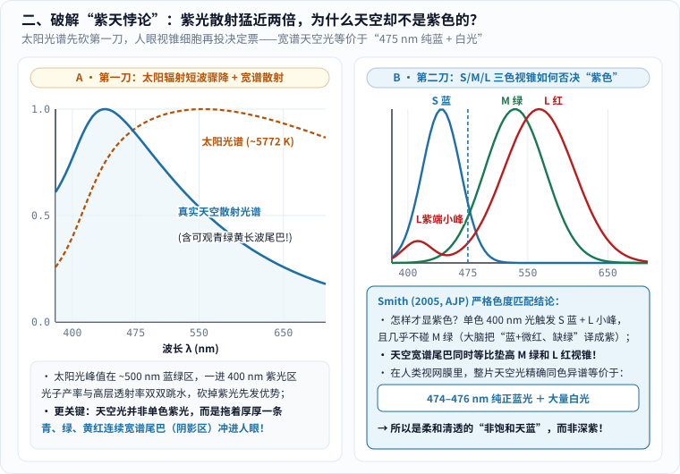
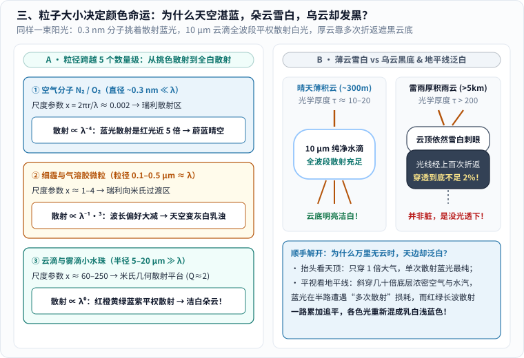
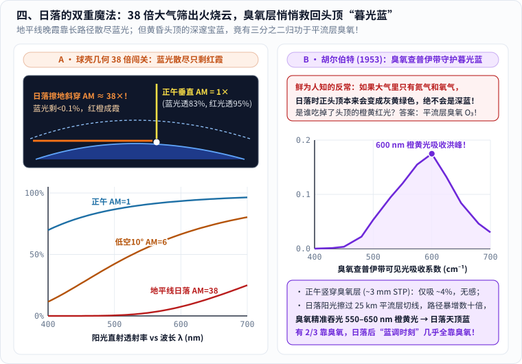
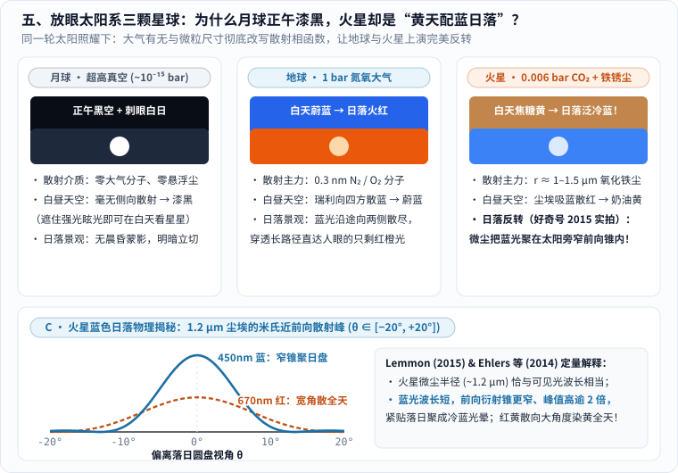

拿一只透明玻璃杯在空气里舀一满杯空气，或者吹鼓一只透明保鲜袋扎紧袋口——不管你凑得多近看，里面的氮气和氧气都**彻彻底底无色透明**。假如你坐飞船登上没有空气的月球，哪怕正午太阳明晃晃挂在头顶，只要避开刺眼的眩光往旁边看，整片天空照样是漆黑如墨的深渊。

可偏偏回到地球上，只要晴天一抬头，无色透明的大气层却在所有人的头顶铺开了一整片深邃清透的蔚蓝色天幕。

从小到大，几乎每个好奇的孩子都问过那句经典老问题——**“天为什么是蓝色的？”** 但大人随口给出的两个最常见答案，在物理学上却全都站不住脚：

- **误解一：“天空是蓝色，是因为反射了蓝色的大海？”** 完全反了！远离任何海洋几千公里的塔克拉玛干沙漠、撒哈拉腹地和青藏高原，非但没有丢掉蓝天，反而拥有全世界最纯粹、最深邃的钴蓝色晴空；反倒是平静的海面之所以显得湛蓝，很大一部分是在反射头顶的蓝天（深水本身的微蓝则来自水分子对红光微弱的羟基振动泛音吸收，机制截然不同）。
- **误解二：“是因为空气里飘着肉眼看不见的灰尘和小水滴？”** 这条误解甚至骗过了 19 世纪鼎鼎大名的实验物理学家廷德尔 [[1]](#ref-1)！事实上，空气里的灰尘和水滴越多（比如潮湿闷热的桑拿天或雾霾天），天空反而越发**灰白浑浊**；越是雨雪刚刚洗净尘埃、水汽极度稀薄的高山之巅，天空才越蓝得发暗。

更有趣的是，哪怕有人背出了课本上的标准名词——**“瑞利散射，波长越短散射越强”**，只要再往下追问四步，十有八九也会当场卡壳：

1. **为什么偏偏是“波长四次方反比”？** 为什么波长只短了不到一半，散射本领却猛增近 **10 倍**？而且爱因斯坦在 1910 年证明过：假如空气分子真的一动不动均匀排好队，白天的天空居然会重新变成**伸手不见五指的黑夜** [[5]](#ref-5)——这又是怎么回事？
2. **头号悬案“紫天悖论”**：可见光里波长最短的并不是蓝光，而是 **紫光（约 $$400\ \mathrm{nm}$$）**！按波长四次方公式一算，紫光的散射强度明明是 $$470\ \mathrm{nm}$$ 蓝光的 **$$1.90$$ 倍**、深红光的 **$$9.38$$ 倍**——**为什么我们抬头看见的天空是天蓝色，而不是紫罗兰色？** [[6]](#ref-6)
3. **白云与乌云的反差**：天空和云朵都在同一束太阳白光照耀下，为什么晴空是蓝的、朵云是雪白的，而暴风雨前的积雨云底部却黑得像锅底？万里无云的大晴天，为什么地平线附近的天边总是泛白？
4. **日落与外星反转**：大多数人以为日落晚霞和黄昏天空全归瑞利散射管；可大气物理学家胡尔伯特（E. O. Hulburt）在 1953 年算出，**如果没有 25 公里高空的臭氧层，日落时你正头顶的天空会变成灰黄绿色，绝不会是迷人的深蓝** [[9]](#ref-9)！而 NASA“好奇号”火星车在火星上拍到的照片更像开了反转滤镜：**白天满天焦糖黄，日落时太阳周围却泛起一片冷艳的蓝色** [[11]](#ref-11)[[12]](#ref-12)！

今天我们不背死板教条，顺着一束阳光闯进大气层的真实旅程，配合五幅由物理公式精确计算生成的分步图解，把这连环五问一层一层彻底拆开。

---

## 一、从玻璃管人造蓝天到四次方铁律：无色气体分子怎样筛出蓝光？

### 1. 廷德尔的玻璃管实验（1869）与瑞利勋爵的三十年破案（1871–1899）

人类第一次把“蓝天”装进实验室玻璃管，发生在 **1869 年 1 月** 的伦敦英国皇家学会。爱尔兰物理学家**约翰·廷德尔（John Tyndall）**在一根长玻璃管里充入极稀薄的亚硝酸戊酯（amyl nitrite）等有机蒸汽，再用一束强白光顺着管轴照过去 [[1]](#ref-1)。

奇迹出现了：光化学反应在管内刚刚凝结出极其微小的初生颗粒时，原本透明的玻璃管从侧面看去，忽然泛起了一抹堪比意大利晴空的迷人蔚蓝色！更关键的是，廷德尔拿偏振片贴在管壁垂直方向（与光束成 $$90^\circ$$）一转，发现这抹蓝光竟然是**高度线偏振**的——跟真正在户外测到的晴空偏振特征一模一样 [[1]](#ref-1)。

但廷德尔在最后一步跨错了方向：既然玻璃管里靠的是初生微粒，他便断定地球蓝天也必定靠高空漂浮的**微尘或极细水滴**散射而成 [[1]](#ref-1)。这个说法看似顺理成章，却解释不了一个致命矛盾：为什么无论在赤道海洋、干旱沙漠还是海拔数千米的雪山之巅，只要天气晴朗，天顶蓝色的光谱纯度高度一致，丝毫不随当地尘埃浓度剧烈摇摆？

真正揭晓谜底的人，是英国物理学家**瑞利勋爵（Lord Rayleigh，本名 John William Strutt）**：

- **1871 年**，年仅 28 岁的瑞利先用量纲分析，随后用电磁理论严格证明：只要散射颗粒的尺寸远小于光波波长，它向四周散射的光强就必定与**波长的四次方（$$\lambda^4$$）成反比** [[2]](#ref-2)；
- **1899 年**，瑞利在《哲学杂志》发表决定性论文《论光穿过含悬浮微粒大气的透射及天空蓝色的起源》[[3]](#ref-3)。他把实验室测得的纯净空气折射率（$$n \approx 1.000293$$）代入麦克斯韦电磁方程组，一笔一划算出：**哪怕把大气里的灰尘和小水滴一粒不剩全部抽光，单靠占空气 $$99\%$$ 的氮气分子（$$\mathrm{N_2}$$）和氧气分子（$$\mathrm{O_2}$$）本身，就足以散射出我们头顶整片明亮的蓝天！** [[3]](#ref-3)

### 2. 不用微积分也能懂：为什么偏偏是“波长四次方反比”？

很多科普书只让你死记硬背“散射正比于 $$\frac{1}{\lambda^4}$$”，却从不讲那个古怪的 **$$4$$ 次方** 到底是从哪儿蹦出来的。其实只要用高中的弹簧受迫振动常识，两步就能把它推出来！

太阳发出的可见光本质上是横波电磁场，波长 $$\lambda$$ 大约在 **$$400\ \mathrm{nm}$$（紫）到 $$700\ \mathrm{nm}$$（深红）** 之间；而空气里的氮气、氧气分子直径只有约 **$$0.3\ \mathrm{nm}$$**——比光波波长小了整整 **$$1{,}500$$ 多倍**！这就好比一头百米长的巨浪拍向软木塞：在任意时刻，整颗气体分子的电子云感受到的阳光电场几乎完全均匀，分子被交变电场来回摇晃，变成了一根微型的**电偶极子发射天线**。

现在看电子被摇晃时的两级放大账单：

1. **第一级平方（电子受迫加速度 $$\propto \frac{1}{\lambda^2}$$）**：分子里的束缚电子就像拴在硬弹簧上的小球，它们自身的紫外固有共振频率 $$\omega_0$$ 远高于可见光角频率 $$\omega$$。因此，无论红光还是蓝光扫过，同等电场幅度 $$E_0$$ 拉动电子偏离平衡位置的最大振幅 $$x_0 \approx \frac{e E_0}{m \omega_0^2}$$ 都差不多大。但是别忘了简谐运动的基本公式——**最大加速度等于振幅乘以角频率的平方**：

$$
\lvert a \rvert = \omega^2 x_0 = \left(\frac{2\pi c}{\lambda}\right)^2 x_0 \propto \frac{1}{\lambda^2}
$$

   光速 $$c$$ 恒定不变，波长 $$\lambda$$ 缩短一半，振荡频率就快 $$2$$ 倍，电子在原地来回急停折返的**加速度就猛增到 $$2^2 = 4$$ 倍**！
2. **第二级平方（天线辐射光强 $$\propto \lvert a \rvert^2 \propto \frac{1}{\lambda^4}$$）**：根据经典电动力学（拉莫尔辐射原理），振荡电荷向外辐射的电磁波电场幅度 $$\lvert E_{\text{rad}} \rvert$$ 正比于电荷的加速度 $$\lvert a \rvert$$；而人眼和探测器接收到的**光强 $$I$$（单位面积功率）又正比于电场幅度的平方 $$\lvert E_{\text{rad}} \rvert^2$$**！把刚才的平方再平方一次：

$$
I_{\text{scat}} \propto \lvert E_{\text{rad}} \rvert^2 \propto \lvert a \rvert^2 \propto \left(\frac{1}{\lambda^2}\right)^2 = \frac{1}{\lambda^4}
$$

把分子数密度和散射角度一并写全，就得到大气光学的基石——**瑞利散射公式** [[2]](#ref-2)[[3]](#ref-3)：

$$
I(\lambda, \theta) = I_0 \, \frac{8\pi^4 N \alpha^2}{\lambda^4 r^2}\bigl(1 + \cos^2\theta\bigr)
$$

把公式里每个符号和单位对号入座：

- $$I_0$$ 是入射太阳光在波长 $$\lambda$$ 处的光强（单位 $$\mathrm{W/m^2}$$），$$r$$ 是散射分子到观测者的距离（单位 $$\mathrm{m}$$）；
- $$N$$ 是单位体积内的气体分子个数（海平面标准大气下高达 $$2.5 \times 10^{25}\ \mathrm{m^{-3}}$$），$$\alpha$$ 是单个分子的电极化率（衡量电子云有多容易被拽偏）；
- $$\theta$$ 是散射光线偏离阳光原前进方向的**散射角**，$$\bigl(1 + \cos^2\theta\bigr)$$ 描绘出花生壳形状的前后对称辐射图样；
- **最霸道的就是分母里的 $$\lambda^4$$**：如果我们把 $$700\ \mathrm{nm}$$ 深红光的散射本领定为基准 **$$1.00\times$$**，那么：
  - $$650\ \mathrm{nm}$$ 鲜红光：$$(700 / 650)^4 \approx \mathbf{1.35\times}$$；
  - $$550\ \mathrm{nm}$$ 黄绿光：$$(700 / 550)^4 \approx \mathbf{2.62\times}$$；
  - $$470\ \mathrm{nm}$$ 天蓝光：$$(700 / 470)^4 \approx \mathbf{4.92\times}$$（比 $$650\ \mathrm{nm}$$ 红光强了整整 **$$3.66$$ 倍**！）；
  - $$400\ \mathrm{nm}$$ 紫罗兰光：$$(700 / 400)^4 \approx \mathbf{9.38\times}$$！

红橙长波光子像大步流星的长腿巨人，几乎不理睬微小的氮氧分子直奔地面；蓝紫短波光子却一步三撞，被大气分子向四面八方弹开，把原本漆黑的太空背景染成了明亮的天幕。

### 3. 10 秒偏振墨镜实验，与爱因斯坦 1910 年补上的“密度涨落”最后一环

瑞利公式里还藏着两个极精彩的物理彩蛋，第一个你今天下午出门就能亲手验证。

阳光是横波，原本包含垂直、水平等各个横截方向的电场振动（非偏振光）。当阳光水平射过头顶的大气分子，而你站在正下方抬头以 **$$\theta = 90^\circ$$** 观察时（此时 $$\cos 90^\circ = 0$$，$$1+\cos^2\theta = 1$$）：分子电子云沿上下方向的分振动正好对着你的视线“戳过来”，而偶极天线沿自身轴线方向辐射为零！因此，传进你眼睛的散射蓝光，只剩下**垂直于“太阳—天顶—你”平面的单一方向横振动**——也就是强烈的**线偏振光** [[1]](#ref-1)[[2]](#ref-2)！（由于氮氧双原子分子并非完美圆球，存在约 $$4\%$$ 的各向异性去偏振效应，加上低空多次散射，晴空 $$90^\circ$$ 处的实测偏振度约为 **$$75\%\text{–}85\%$$**。）

只要戴上一副合格的偏振太阳镜（或拿起相机圆偏振镜 CPL），背对侧方与太阳拉开约 $$90^\circ$$ 夹角，慢慢把镜片歪头旋转 $$90^\circ$$——你会亲眼看见头顶的蓝天在**明亮湛蓝**与**深邃暗蓝**之间戏剧性地明暗切换！蜜蜂和沙漠箭蚁的复眼里天生自带紫外偏振感光器，哪怕太阳被云朵挡住，只要露出一小块蓝天，它们就能靠这套“天空偏振罗盘”精准认路回家。

第二个彩蛋则深藏不露，直到 **1908 年波兰物理学家斯莫卢霍夫斯基（Marian Smoluchowski）** 与 **1910 年爱因斯坦（Albert Einstein）** 才彻底解开 [[4]](#ref-4)[[5]](#ref-5)：

> **灵魂反问**：纯净液态水和无瑕水晶里的分子密度，比空气高出近千倍！按理说分子越多散射越强，为什么一束激光射穿纯净水或光学玻璃时，侧面几乎看不见散射光？反过来，如果空气真的绝对均匀，天空为什么不会相消成黑夜？

爱因斯坦一针见血地指出：在波长 $$\lambda \approx 500\ \mathrm{nm}$$ 的立方小盒子里，哪怕是稀薄空气也挤着约 **$$300$$ 万个** 气体分子！假如这些分子像士兵做广播操一样**完全均匀等距排列**，那么对于任意一颗向侧面散射光波的分子 $$A$$，总能在半个波长（$$\frac{\lambda}{2}$$）开外精确找到另一颗分子 $$B$$，它发出的散射波刚好晚半拍（相位差 $$180^\circ$$），波峰填波谷，**两束侧向散射光严丝合缝同归于尽，只剩原方向的透射光继续前进！**

真正拯救地球蓝天的，是气体分子永不停息的**无规则热运动** [[4]](#ref-4)[[5]](#ref-5)！因为理想气体高度可压缩，微观小体积里的分子数每时每刻都在发生泊松随机涨落（这会儿左边挤了 $$300.2$$ 万个，右边只剩 $$299.8$$ 万个），波峰与波谷再也没法完全抵消。爱因斯坦在 1910 年《物理学年鉴》论文中严格证明：正是这种**微观热力学密度涨落**，让每颗理想气体分子的散射光强得以直接相加 [[5]](#ref-5)！更妙的是，散射总强度直接反比于阿伏伽德罗常数 $$N_A$$——20 世纪初物理学家甚至仅仅测量头顶蓝天有多亮，就独立算出了 $$1\ \mathrm{mol}$$ 气体里大约有 $$6 \times 10^{23}$$ 个分子！

_先看左图 A：入射太阳白光摇晃 0.3 nm 氮氧分子电子云，按 $$1+\cos^2\theta$$ 花生形包络散射，并在 $$90^\circ$$ 方向滤出强线偏振光（图中淡蓝波环播放两次示意散射波扩散，开启系统减少动态效果后自动静默且完整保留全部静态光线与标注）；底部说明爱因斯坦 1910 年密度热涨落如何打破相消干涉。再看右图 B：按 $$(700/\lambda)^4$$ 精确绘出的相对散射曲线，$$470\ \mathrm{nm}$$ 蓝光为深红光的 $$4.92$$ 倍，而 $$400\ \mathrm{nm}$$ 紫光飙升至 $$9.38$$ 倍，直接引出“紫天悖论”。_

---

## 二、破解头号悬案：400 纳米紫光散射猛近两倍，为什么天空不是紫罗兰色？

盯着上一张图右半边的实算曲线，任何一个较真的读者都会立刻抓住破绽：

$$
\left(\frac{470}{400}\right)^4 \approx 1.903
$$

**$$400\ \mathrm{nm}$$ 紫光被大气散射的本领，明明接近 $$470\ \mathrm{nm}$$ 蓝光的两倍！** 如果天空颜色只由瑞利散射谁更强来决定，我们每天早上推开窗户，看到的本该是一片梦幻的紫罗兰色天空才对！

为什么现实里的晴空偏偏是清澈柔和的天蓝色？这桩困扰无数初学者的“**紫天悖论**”，其实是由**太阳物理**与**人类视网膜生理学**联手砍下的两刀共同决定的——美国佐治亚理工学院物理学家格伦·史密斯（Glenn S. Smith）在 2005 年《美国物理学杂志》（*American Journal of Physics*）上用严格的色度学积分算清了全账 [[6]](#ref-6)。

### 1. 第一刀：5772 K 太阳光谱在紫光区的“先天跳水”与宽谱长尾巴

第一刀砍在源头：**太阳并不是一盏在所有波长上均匀发光的“平谱白炽灯”！**

我们在[《太阳核聚变全过程》]()与[《四百年追光史》]()中讲过，太阳光球层表面有效温度约为 **$$5772\ \mathrm{K}$$**。按照普朗克黑体辐射定律，太阳辐射能量峰值落在 **$$500\ \mathrm{nm}$$ 左右的蓝绿光区**；一旦往短波方向跨进 $$430\ \mathrm{nm}$$ 以下的紫光区，太阳自身的辐射强度就会像坐滑梯一样陡峭跌落，再加上太阳大气层里钙离子夫琅禾费吸收暗线（$$393\ \mathrm{nm}$$ 与 $$397\ \mathrm{nm}$$ 强吸收谷）和高层大气衰减，到达对流层的紫光光子先天就比蓝绿光子少了一大截 [[6]](#ref-6)。

把“太阳入射光谱 $$I_{\odot}(\lambda)$$”乘上“瑞利散射因子 $$\lambda^{-4}$$”，就得到了**真实晴空的物理散射光谱**（见下图左半边实算蓝色曲线）：

1. 原本在 $$400\ \mathrm{nm}$$ 处高高翘起的 $$9.38\times$$ 散射优势，被太阳光谱的短波跳水狠狠压了下去，整条散射光谱的最高峰被推到了 **$$450\text{–}460\ \mathrm{nm}$$ 的紫蓝交界处**；
2. **更关键但常被忽略的一点**：真实的天空散射光**绝不是单一波长的单色紫光或单色蓝光**！由于太阳本身在青光（$$490\ \mathrm{nm}$$）、绿光（$$540\ \mathrm{nm}$$）、黄橙光（$$580\text{–}620\ \mathrm{nm}$$）波段火力极猛，即便乘上较小的散射系数，晴空光谱右边依然拖着一条**相当敦实的青、绿、黄红连续宽谱大尾巴** [[6]](#ref-6)！

### 2. 第二刀：人眼 S/M/L 三色视锥细胞如何投出否决票，拼出“搀白纯蓝”？

光有第一刀还不够——因为如果拿光谱仪单看峰值（$$450\ \mathrm{nm}$$ 附近），那依然偏靛紫。真正把“紫色”彻底否决掉的第二刀，藏在你眼球后壁的**三种视锥细胞**里 [[6]](#ref-6)（关于色素吸收光谱与人眼色彩合成的互补逻辑，也可以对照[《红叶与黄叶的形成原理》]()）。

人类视网膜上并没有专门负责看紫色的“紫视锥细胞”，只有三种分工明确的感光细胞：

- **S 视锥（短波／蓝敏，峰值约 $$442\ \mathrm{nm}$$）**；
- **M 视锥（中波／绿敏，峰值约 $$534\ \mathrm{nm}$$）**；
- **L 视锥（长波／红敏，主峰值约 $$564\ \mathrm{nm}$$）**。

那么问题来了：**既然没有紫视锥，我们平时看三棱镜折射出的 $$400\ \mathrm{nm}$$ 单色激光时，大脑为什么能看见鲜艳的紫罗兰色？**

秘密藏在下图右半边红线左端那个不起眼的“**L 视锥短波小隆起**”里！负责看红光的 L 视锥视蛋白在 $$400\text{–}420\ \mathrm{nm}$$ 紫端有一截微弱的次级感光尾巴，而负责看绿光的 M 视锥在 $$400\ \mathrm{nm}$$ 处几乎彻底失明。于是，当一束**纯净的单色 $$400\ \mathrm{nm}$$ 光**照进眼睛时，它会同时敲响 **“强烈 S 蓝信号 ＋ 微弱 L 红信号，且几乎没有 M 绿信号”**——我们的大脑视觉皮层一旦收到“有蓝又有红、唯独缺了绿”的组合暗号，就会把它翻译成高贵神秘的**紫色**！

现在，把真实天空那条“**蓝紫高峰 ＋ 青绿黄厚尾巴**”的宽谱散射光放进眼睛，看看会发生什么反转 [[6]](#ref-6)：

- 尾巴里海量的青光、绿光和黄光一拥而上，把原本沉默的 **M 绿视锥** 大幅唤醒，并且让 **M 绿视锥与 L 红视锥受到几乎 $$1 : 1$$ 等比例的均衡激励**！
- 在人类色觉系统里，“等量的 L 红 ＋ 等量的 M 绿 ＋ 一部分配套的 S 蓝”合在一起是什么颜色？**恰恰是毫无偏色的纯净白光！**

史密斯（2005）将真实晴空光谱与国际照明委员会（CIE）人眼三刺激值积分比对后，得出了一个漂亮得令人拍案叫绝的**同色异谱等价定理（Metamerism）** [[6]](#ref-6)：

$$
\text{正午晴空宽谱散射光} \;\equiv\; \underbrace{\text{波长 } 474\text{–}476\ \mathrm{nm}\text{ 的纯正单色蓝光}}_{\text{决定色调（Hue）}} \;+\; \underbrace{\text{约四成能量的宽谱白光}}_{\text{冲淡饱和度（Unsaturated）}}
$$

真相大白！天空之所以不是深邃刺眼的紫罗兰色，是因为宽谱长波尾巴把 M 绿视锥和 L 红视锥一块儿垫高，彻底抹平了触发“紫感”所需的红绿落差，顺便给 $$475\ \mathrm{nm}$$ 纯正蓝光兑进了一大勺柔和的白光——这才调出了地球独一无二、百看不厌的**清透非饱和“天蓝色”（Sky Blue）**！

顺便补一句有趣的跨物种视角：许多鸟类、爬行类和蜜蜂拥有第四种**紫外／紫敏视锥细胞（峰值 $$360\text{–}410\ \mathrm{nm}$$）**。在山雀和蜜蜂的眼睛里，同一个正午晴空确实泛着人类永远无法亲眼目睹的绚丽紫外—紫罗兰光泽！

_左图 A 对比 $$5772\ \mathrm{K}$$ 太阳光谱（橙虚线）与乘上 $$\lambda^{-4}$$ 后的真实晴空散射光谱（蓝实线及浅蓝阴影区），展示紫端受太阳辐射跌落压制，且右侧保留宽厚的青绿黄连续尾巴；右图 B 绘出人眼 S、M、L 三色视锥灵敏度曲线（注意红线左端的 L 紫端小峰），说明宽谱尾巴等比垫高 M 与 L 视锥，使整片天空光在人眼内精确等价于“$$474\text{–}476\ \mathrm{nm}$$ 纯蓝光 ＋ 白光”。_

---

## 三、粒子长胖五万倍：为什么白云雪白、乌云漆黑、天边泛白？

抬头看蓝天时，几乎总有几朵白云悠然飘过。既然照亮云朵和照亮空气的是同一束太阳光，为什么水蒸气还没有凝结时天空是蓝的，一旦凝结成云滴小水珠，云朵就立刻变成了纯白色？而暴风雨来临前，原本洁白的云为什么又会变成黑压压的“乌云”？

### 1. 米氏散射（1908）：当微粒尺寸追上并超过光波长，挑色筛子当场失效

1908 年，德国物理学家**古斯塔夫·米（Gustav Mie）**求出了麦克斯韦电磁方程组对任意尺寸均匀球形微粒散射的严格解析解——这就是与瑞利散射并驾齐驱的**米氏散射理论（Mie Scattering）** [[7]](#ref-7)[[8]](#ref-8)（若高空水汽直接凝华成百微米级六角冰晶，还会进一步演变成几何光学折射并造出 $$22^\circ$$ 日晕，详见[《雪花与冰晶的数学物理原理》]()）。

在大气光学里，决定散射“挑不挑颜色”的唯一裁判，是一个无量纲比值——**尺度参数 $$x$$**：

$$
x = \frac{2\pi r}{\lambda}
$$

其中 $$r$$ 是散射粒子的半径，$$\lambda$$ 是光波波长。顺着粒子半径从小到大跨越 **5 个数量级**，天空的颜色会经历三次截然不同的相变：

1. **气体分子区（$$r \approx 0.15\ \mathrm{nm}$$，$$x \approx 0.002 \ll 1$$）**：整颗分子同步振荡，散射效率严格服从 $$Q_{\text{sca}} \propto \lambda^{-4}$$，专挑蓝紫短波散射，造出**蔚蓝晴空**；
2. **细霾与气溶胶过渡区（$$r \approx 0.1\text{–}0.5\ \mu\mathrm{m}$$，$$x \approx 1\text{–}4$$）**：硫酸盐、硝酸盐吸湿霾粒的个头正好跟可见光波长打平手！此时颗粒内部不同部位的电子振动开始出现相位差，波长选择性急剧退化（散射大致只按 $$\lambda^{-1.3}$$ 缓慢变化），红绿光也被大量散射出来——于是高纯度蓝天褪色成灰蒙蒙、乳白色的**霾天**；
3. **云滴与雾滴大颗粒区（$$r \approx 5\text{–}20\ \mu\mathrm{m}$$，$$x \approx 60\text{–}250 \gg 1$$）**：一滴普通云水珠的半径比氮氧分子足足**长胖了五万到十万倍**，包含上千亿亿个水分子！当阳光撞上这么大的透明水球时，散射截面直接进入米氏几何光学平台（消光效率因子恒定在 $$Q_{\text{ext}} \approx 2 \propto \lambda^0$$ 附近）：**无论是 $$700\ \mathrm{nm}$$ 红光、$$550\ \mathrm{nm}$$ 绿光还是 $$450\ \mathrm{nm}$$ 蓝光，全都一视同仁、不偏不倚地按同等比例散射！** [[7]](#ref-7)[[8]](#ref-8) 红橙黄绿蓝紫原封不动重新混在一起，云朵自然呈现出耀眼的**雪白色**！（同理，牛奶、盐粒、白糖粉末和雪堆明明由透明脂肪球、透明食盐晶体或透明冰晶组成，凑在一起却雪白一片，靠的全都是这套全波段无差别散射机制！）

### 2. 乌云绝不是“吸饱了脏灰”，晴朗天边为什么越看越发白？

搞懂了米氏散射，日常两个最容易让人犯迷糊的现象也就迎刃而解了：

- **为什么雷雨前的乌云底黑得吓人？** 很多人小时候以为乌云里裹满了煤灰或脏土。其实哪怕最凶猛的雷暴积雨云，里面的云滴照样是干干净净的纯水！真正的差别在于**云层几何厚度与光学厚度（$$\tau$$）**：
  - 晴天好天气的淡积云只有 **$$200\text{–}500\ \mathrm{m}$$ 厚**（光学厚度 $$\tau \approx 10\text{–}20$$），阳光在云滴间折返十几次后，仍有充足的白光穿透云底照进你眼里，所以整朵云通体洁白；
  - 而盛夏的强对流积雨云是一座耸立 **$$6{,}000\text{–}12{,}000\ \mathrm{m}$$ 高** 的摩天水塔（光学厚度 $$\tau > 200$$）！超过 $$90\%$$ 的太阳光在云顶头几百米内经过上百次米氏散射后，直接被弹回了太空，等光线跌跌撞撞漏到几公里下的云底时，透射率已经跌破 **$$1\%\text{–}2\%$$**！你站在地面失去背景照亮，自然觉得云底乌黑如墨；可如果你此刻正坐在飞越 $$10{,}000\ \mathrm{m}$$ 高空的客机舷窗旁往下看，同一团“大乌云”的云顶依然白得晃眼！
- **为什么万里无云的大晴天，越靠近地平线天空越发白？** 当你仰头 $$90^\circ$$ 直视天顶时，视线只穿过 $$1$$ 倍垂直大气厚度，进入眼睛的几乎全是干净利落的**单次瑞利散射光**，蓝色最浓最纯；而当你平视远方地平线时，视线在稠密的近地面大气里横穿了几十上百公里！沿途原本散向你的蓝光在半路上又撞上其他空气分子和水汽气溶胶，遭遇**多次散射（Multiple Scattering）**被弹飞损耗；与此同时，原本散射较弱的红光、绿光却靠着超长路径一路积少成多追平比分——等抵达你的眼睛时，红绿蓝比例再次趋于均衡，天边便化作了一抹温柔的乳白浅蓝色 [[8]](#ref-8)。

_左图 A 纵向对比三类大气粒子：$$0.3\ \mathrm{nm}$$ 氮氧分子（$$\lambda^{-4}$$ 挑色造蓝天）、亚微米霾粒（$$\lambda^{-1.3}$$ 灰白霾天）与 $$10\ \mu\mathrm{m}$$ 云滴（$$\lambda^0$$ 米氏平权散射造白云）；右图 B 对比薄积云与厚积雨云的光学厚度差异，说明乌云黑底源于超过 $$98\%$$ 阳光在云顶折返耗尽而非水质变脏，并解释晴天地平线因长路径多次散射而泛白。_

---

## 四、日落与黄昏的双重反转：38 倍大气筛出火烧云，臭氧层悄悄救回头顶暮光蓝

到了傍晚五六点钟，白天的蓝白主角开始退场，西方地平线燃起漫天金红的火烧云，而当你收回目光仰望正头顶时，天幕却呈现出一种比正午还要沉静深邃的宝石蓝色（摄影师最痴迷的“**蓝调时刻**” Blue Hour）。

如果你以为这两件事“全靠瑞利散射一句话就能解释完”，那可就漏掉了 20 世纪大气光学最出人意料的一场大反转！

### 1. 地平线 38 倍球壳大气闯关：你眼里的红日落，正是别人头顶的蓝天

先看低空火红的太阳和晚霞——这一半确实是瑞利散射的拿手好戏。我们在[《两小儿辩日的现代原理》]()里详细算过地球球壳大气的几何账：

设正午太阳直射头顶穿过的大气质量（Air Mass）为基准 **$$\mathrm{AM} = 1$$**（等效标准大气厚度约 $$8.5\ \mathrm{km}$$）。根据比尔—朗伯指数衰减定律，波长 $$\lambda$$ 的直射阳光穿透大气的比例为：

$$
T(\lambda) = \exp\bigl(-\mathrm{AM}\cdot \tau_R(\lambda)\bigr)
$$

其中标准海平面 $$1$$ 个大气压的瑞利垂直光学厚度在 $$470\ \mathrm{nm}$$ 蓝光处约为 $$\tau_R \approx 0.19$$，在 $$650\ \mathrm{nm}$$ 红光处仅为 $$\tau_R \approx 0.05$$：

- **正午（$$\mathrm{AM} = 1$$）**：约 **$$83\%$$** 的蓝光和 **$$95\%$$** 的红光都能轻松穿透大气直达地面，只抽走了不到两成蓝光去涂蓝头顶的天空，所以正午太阳看起来洁白刺眼略带微黄；
- **日落擦地平线（$$\mathrm{AM} \approx 38$$）**：由于地球和大气层都是弯曲球壳，傍晚擦着地平线斜射过来的阳光，要在浓密大气里斜穿相当于正午 **约 $$38$$ 倍** 的漫长路程！放进指数公式一算，差距触目惊心：
  - $$470\ \mathrm{nm}$$ 蓝光透射率：$$\exp(-38 \times 0.19) \approx \mathbf{0.07\%}$$——超过 **$$99.9\%$$** 的蓝紫光在半路上就已经被散射得一干二净（它们并没有消失，而是变成了此刻你西边几千公里外人们头顶的蓝天！）；
  - $$650\text{–}700\ \mathrm{nm}$$ 红橙光透射率：依然顽强保留了 **$$15\%\text{–}25\%$$**！

于是，活着抵达你眼前的直射阳光只剩下最耐撞的红光和橙光，顺便从下方照亮中高空的云底，铺开千里绚烂的火烧云。

### 2. 胡尔伯特的 1953 年惊人发现：如果没有臭氧层，黄昏头顶竟是灰黄绿色！

现在，请把脖子往后仰，看看日落那一刻以及太阳刚刚沉入地平线后（民用晨昏蒙影，太阳位于地平线下 $$0^\circ\text{–}6^\circ$$）你**正头顶的天顶（Zenith）**——那儿明明是一片浓郁纯净的深蓝色！

1952 年前后，美国海军研究实验室的著名光学家**爱德华·胡尔伯特（Edward O. Hulburt）**拿刚由高空探测火箭测准的大气密度剖面，认认真真算了一遍日落天顶的纯瑞利散射积分，结果算出一身冷汗 [[9]](#ref-9)：

> **瑞利散射在黄昏头顶失灵了！** 因为日落时斜着照进你头顶高空的那束太阳光，在抵达你头顶之前，已经在大气层里横穿了几百公里——里面的蓝紫短波早就快被沿途散光了，剩下的是一束**高度偏红偏橙的残余光**！哪怕你头顶的氮氧分子再怎么努力按 $$\lambda^{-4}$$ 挑蓝光散射，“巧妇难为无米之炊”，用红橙残光乘上 $$\lambda^{-4}$$ 算出来的黄昏天顶，竟然是一片难看的**灰黄绿色（grayish-greenish-yellow）**，绝不可能是深蓝色 [[9]](#ref-9)！

是谁在暗中出手，吃掉了黄昏头顶的橙黄红光，救回了深邃的暮光蓝？

胡尔伯特于 **1953 年** 在《美国光学学会志》（*JOSA*）发表经典论文揭晓答案：**幕后真英雄，是距地面 $$15\text{–}35\ \mathrm{km}$$ 平流层里的臭氧层（$$\mathrm{O_3}$$）！** [[9]](#ref-9)

平时我们只知道臭氧能挡紫外线（哈特莱带与哈金斯带），却很少有人知道，臭氧其实本身是一种**淡蓝色气体**——它在可见光正中央拥有一条宽阔的弱吸收带，叫作**查普伊吸收带（Chappuis band，覆盖 $$500\text{–}700\ \mathrm{nm}$$，吸收最高峰恰恰钉在 $$600\ \mathrm{nm}$$ 橙黄光处！）** [[9]](#ref-9)：

- **大白天太阳高照时**：阳光几乎竖直穿过臭氧层（全部臭氧压到标准状态只有薄薄 **$$3\ \mathrm{mm}$$** 厚），查普伊带对 $$600\ \mathrm{nm}$$ 橙黄光的吸收率还不到 **$$4\%$$**，完全可以忽略不计，所以白天的蓝天确实 $$99\%$$ 靠瑞利散射；
- **日落与暮光时刻**：太阳光以近乎平行于地面的切线角度，斜着擦过 $$25\ \mathrm{km}$$ 高空的臭氧层球壳，穿行路径暴增 **$$30\text{–}40$$ 倍**！在这段漫长的平流层隧道里，臭氧分子像精准的滤色海绵，大口吞掉了 **$$550\text{–}650\ \mathrm{nm}$$ 的黄光与橙红光**，唯独对 $$450\ \mathrm{nm}$$ 附近的蓝光网开一面放行！

胡尔伯特给出了一组改写教科书的定量比例 [[9]](#ref-9)：

- **日落瞬间正头顶的蓝色**：只有约 **$$\frac{1}{3}$$** 来自瑞利散射，其余 **$$\frac{2}{3}$$ 全靠平流层臭氧吸收橙黄光**；
- **太阳落山后的“蓝调时刻（暮光期）”**：正头顶那抹令无数画家与摄影师沉醉的深邃宝蓝，**几乎 $$100\%$$ 是臭氧层赐予地球的礼物**——如果地球大气只有氮气和氧气而没有臭氧，全人类将永远失去黄昏的蓝色夜幕！

_左图 A 结合球壳大气几何与比尔—朗伯定律，绘出 $$\mathrm{AM}=1$$、$$6$$、$$38$$ 时的阳光直射透射率，展示日落 $$38$$ 倍路径滤尽蓝光留下红霞；右图 B 依据 Hulburt (1953) 实测数据绘出臭氧 $$500\text{–}700\ \mathrm{nm}$$ 查普伊吸收带（$$600\ \mathrm{nm}$$ 橙黄光处达峰值），解释为什么黄昏天顶蓝有三分之二乃至全部归功于臭氧层滤除橙黄光。_

---

## 五、跳出地球验算：为什么月球正午漆黑，火星却是“焦糖黄天配蓝色日落”？

检验一套物理理论够不够硬核，最好的办法就是带着它离开地球，去太阳系其他星球上验算一遍！同样沐浴在同一轮太阳光下，月球、地球和火星的天空竟然演出了三幕截然不同的戏剧。

### 1. 月球与空间站外：没有散射介质，正午也是漆黑的深空

在月球表面，大气压强只有约 **$$10^{-15}\ \mathrm{bar}$$**（超高真空）。把分子数密度 $$N = 0$$ 代回瑞利公式与米氏公式，散射光强 $$I_{\text{scat}} = 0$$：除了太阳圆盘本身和脚下反光的月壤之外，头顶没有任何微粒帮你把阳光拐弯送进眼睛，所以**哪怕正午十二点，月球的天空照样漆黑如夜**。

顺便澄清一个常被误传的摄影小细节：为什么阿波罗登月照片里，漆黑的白昼天空上看不见满天繁星？这绝不是星星消失了，而是纯粹的**相机曝光宽容度限制**——宇航员身穿洁白宇航服站在烈日暴晒的月面上，相机快门必须设到 $$1/250\ \mathrm{s}$$、光圈缩到 $$f/11$$ 才不会过曝成白板，这么短的曝光时间根本来不及收集暗弱星光；如果宇航员站进登月舱阴影里遮住地面反光，大白天肉眼照样能看见星星！

### 2. 火星的奇幻反转：1.2 微米铁锈尘怎样造出“焦糖黄白天 ＋ 冷蓝色落日”？

更绝的对照实验发生在火星上（关于火星稀薄大气对探测器着陆与起飞的严苛挑战，可参看[《为什么人类至今没从火星带回一克土》]()）。

火星表面大气几乎全是二氧化碳（$$\mathrm{CO_2}$$），气压只有地球海平面的 **约 $$0.6\%$$（约 $$600\ \mathrm{Pa}$$）**——单靠这点稀薄气体分子做瑞利散射，微弱得连天空底色都撑不起来。真正主宰火星天空颜色的，是常年悬浮在火星大气里、永远落不干净的**细微氧化铁尘埃（铁锈微尘，有效半径 $$r \approx 1.0\text{–}1.5\ \mu\mathrm{m}$$）** [[10]](#ref-10)[[12]](#ref-12)！

**2015 年 4 月 15 日**（第 956 个火星日），NASA“好奇号”火星车在盖尔撞击坑用经过严格人眼白平衡校准的桅杆相机（Mastcam），拍下了一组震撼全世界的火星日落照片 [[11]](#ref-11)——火星天空的颜色规律，竟然跟地球**完全颠倒了过来**：

- **火星的白天是“奶油焦糖黄”**：氧化铁微尘自带铁锈化学本色——它强烈吸收短波蓝光，同时把红光、橙黄光以很大的散射角（$$\theta > 20^\circ$$）洒向四面八方，把整片白昼火星天空染成了温暖的黄褐色 [[10]](#ref-10)[[12]](#ref-12)；
- **火星的日落却是“冷艳蓝白色”**！当火星太阳快要落山、尘埃路径拉长时，紧贴着落日圆盘四周约 **$$\pm 5^\circ\text{–}10^\circ$$** 的天空，非但没有变红，反而亮起了一圈清冷迷人的**蓝白色光晕** [[11]](#ref-11)！

行星大气学家马克·莱蒙（Mark T. Lemmon）[[10]](#ref-10)[[11]](#ref-11) 与光学家库尔特·埃勒斯（Kurt Ehlers）等人在 2014 年《应用光学》（*Applied Optics*）论文 [[12]](#ref-12) 中，用米氏近前向衍射公式揭开了谜底：

原来，火星铁锈尘的半径（$$r \approx 1.2\ \mu\mathrm{m}$$）不偏不倚，刚好跟可见光波长处在同一个数量级！当光线擦过微米级尘埃边缘发生**前向夫琅禾费／米氏衍射**时，前向散射锥的峰值强度正比于尺度参数的平方 $$(2\pi r / \lambda)^2$$，而光锥张角正比于 $$\lambda / r$$（见下图底部精确计算的贝塞尔函数 $$J_1$$ 前向散射峰）：

- **$$450\ \mathrm{nm}$$ 蓝光**波长短（$$x \approx 16.8$$），它的前向散射能量被高度收拢成一根**又尖又窄的聚光锥**，正前方向强度比 $$670\ \mathrm{nm}$$ 红光高出 **$$2.2$$ 倍以上**，死死簇拥在落日圆盘四周；
- **$$670\ \mathrm{nm}$$ 红橙光**波长长（$$x \approx 11.3$$），前向散射峰又矮又胖，光能早早散向大角度外围天空！

顺便一提，地球上偶尔也会短暂借来同款魔法：当森林大火或火山喷发（如 1883 年喀拉喀托火山、1950 年加拿大阿尔伯塔森林大火）把半径恰好卡在 **$$0.5\text{–}0.8\ \mu\mathrm{m}$$ 窄窗口** 的均匀油滴或烟尘送上高空时，米氏散射会出现罕见的“反常消光”——烟雾对红橙光的散射损耗反而比蓝光更大！穿过烟幕的满月或太阳就会真的变成一轮奇异的**蓝月亮（Blue Moon）**——英语俗语 *“once in a blue moon”*（千载难逢）最初正是由这类极其挑剔的米氏气溶胶散射奇观而得名 [[12]](#ref-12)！

_上图横向对比月球（真空零散射黑空）、地球（$$0.3\ \mathrm{nm}$$ 氮氧瑞利散射：蓝天配红日落）与火星（$$1\text{–}1.5\ \mu\mathrm{m}$$ 氧化铁微尘：焦糖黄天配冷蓝日落）；下图 C 精确计算 $$1.2\ \mu\mathrm{m}$$ 微尘在落日附近 $$\pm 20^\circ$$ 内的米氏近前向散射峰，直观展示 $$450\ \mathrm{nm}$$ 蓝光如何聚拢成窄而高的前向光锥包住落日，而 $$670\ \mathrm{nm}$$ 红光宽角散开染黄外围天空。_

---

## 六、一张总表带走：抬头可见的八种天空色彩，背后各是谁在掌勺？

把整趟追光之旅收拢在一张表里，今后无论在晴天、阴天、黄昏还是看外星探测器传回的照片，你一眼就能认出背后的物理推手：

| 天空场景 | 肉眼看到的颜色 | 散射／吸收主角与粒径 | 核心物理机制 |
| :--- | :--- | :--- | :--- |
| **地球正午天顶** | 清透天蓝色（非紫） | $$\mathrm{N_2}/\mathrm{O_2}$$ 分子（$$\sim 0.3\ \mathrm{nm}$$）＋ 人眼三色视锥 | 密度热涨落瑞利散射 $$\propto \lambda^{-4}$$；宽谱尾巴垫高 M/L 视锥等价于 $$475\ \mathrm{nm}$$ 纯蓝＋白光 |
| **晴空低处地平线** | 乳白浅蓝色 | 厚层空气 ＋ 近地面水汽气溶胶 | 几十倍水平视线引发蓝光多次散射损耗，红绿散射累加重新混白 |
| **晴天薄积云** | 明亮雪白色 | 洁净云滴小水珠（$$r \approx 5\text{–}20\ \mu\mathrm{m}$$） | 米氏散射平台 $$\propto \lambda^0$$，红橙黄绿蓝紫全波段平权散射且云底透光充足 |
| **暴风雨厚积雨云底** | 乌黑深灰色 | 同样的纯净云滴（云厚 $$6\text{–}12\ \mathrm{km}$$） | 光学厚度 $$\tau > 200$$，超 $$90\%$$ 阳光在云顶折返太空（云顶仍雪白），穿透云底不足 $$2\%$$ |
| **地球日落低空晚霞** | 橙红火烧云 | $$38$$ 倍球壳斜穿路径上的气体分子与微粒 | 比尔—朗伯衰减滤尽 $$>99.9\%$$ 蓝紫短波，仅剩 $$650\ \mathrm{nm}$$ 红橙长波穿透照亮云底 |
| **日落与暮光正天顶** | 深邃宝石蓝 | 平流层臭氧 $$\mathrm{O_3}$$（$$15\text{–}35\ \mathrm{km}$$ 高空） | 切线长路径触发臭氧 $$500\text{–}700\ \mathrm{nm}$$ 查普伊带精准吞掉橙黄光（贡献日落天顶蓝 $$\frac{2}{3}$$） |
| **月球正午天空** | 漆黑如墨 | 超高真空（$$\sim 10^{-15}\ \mathrm{bar}$$，无介质） | 散射分子数密度 $$N \approx 0$$，除太阳圆盘与月面反光外零侧向散射 |
| **火星白昼 vs 日落** | 黄褐白天 ／ 冷蓝落日 | 悬浮氧化铁微尘（$$r \approx 1.0\text{–}1.5\ \mu\mathrm{m}$$） | 微尘吸蓝散红染黄全天；日落时 $$450\ \mathrm{nm}$$ 蓝光米氏近前向散射锥窄而高，聚在日盘四周 |

下次带着孩子在晴朗的午后或黄昏散步时，不妨掏出太阳镜对着头顶歪头转一转：这一片看似平平无奇的蓝色天幕里，既回荡着氮氧分子每秒近千万亿次的偶极振荡与热涨落，也藏着太阳五千多度光谱、人类三色视锥细胞以及二十五公里高空臭氧层的精妙默契。

---

## 参考资料与核查说明

1. **John Tyndall (1869)**, *On the blue colour of the sky, the polarization of skylight, and on the polarization of light by cloudy matter generally*, *Proceedings of the Royal Society of London*, **17**, 223–233. [皇家学会原始论文页 (DOI: 10.1098/rspl.1868.0033)](https://doi.org/10.1098/rspl.1868.0033) —— 支持正文中 1869 年廷德尔利用有机蒸汽玻璃管实现“人造蓝天”及 $$90^\circ$$ 线偏振观测，以及他当时将天空蓝色归因于悬浮微粒的历史事实。
2. **John William Strutt [Lord Rayleigh] (1871)**, *On the light from the sky, its polarization and colour*, *The London, Edinburgh, and Dublin Philosophical Magazine and Journal of Science*, Series 4, **41**(271), 107–120. [期刊原始论文页 (DOI: 10.1080/14786447108640452)](https://doi.org/10.1080/14786447108640452) —— 支持正文中 1871 年瑞利勋爵首次导出亚波长微粒散射光强反比于波长四次方（$$\lambda^{-4}$$）及 $$1+\cos^2\theta$$ 偏振分布定律。
3. **Lord Rayleigh (1899)**, *On the transmission of light through an atmosphere containing small particles in suspension, and on the origin of the blue of the sky*, *Philosophical Magazine*, Series 5, **47**(287), 375–384. [期刊原始论文页 (DOI: 10.1080/14786449908621276)](https://doi.org/10.1080/14786449908621276) —— 支持正文中 1899 年瑞利利用空气折射率定量证明无需悬浮尘埃、纯净氮氧气体分子自身散射即可产生地球蓝天。
4. **Marian Smoluchowski (1908)**, *Molekular-kinetische Theorie der Opaleszenz von Gasen im kritischen Zustande, sowie einiger verwandter Erscheinungen*, *Annalen der Physik*, **330**(2), 205–226. [期刊原始论文页 (DOI: 10.1002/andp.19083300203)](https://doi.org/10.1002/andp.19083300203) —— 支持正文中气体微观分子数密度涨落打破均匀介质侧向相消干涉的物理机制。
5. **Albert Einstein (1910)**, *Theorie der Opaleszenz von homogenen Flüssigkeiten und Flüssigkeitsgemischen in der Nähe des kritischen Zustandes*, *Annalen der Physik*, **338**(16), 1275–1298. [期刊原始论文页 (DOI: 10.1002/andp.19103381612)](https://doi.org/10.1002/andp.19103381612)；可并参大学统计力学教材讲义 [Physics LibreTexts: Critical Opalescence — From Einstein's Theory to Correlation Functions](https://phys.libretexts.org/Bookshelves/Thermodynamics_and_Statistical_Mechanics/Fluctuations_Near_Equilibrium/03%3A_Critical_Opalescence-_From_Einsteins_Theory_to_Correlation_Functions) —— 支持正文中爱因斯坦 1910 年严格证明热力学密度涨落产生瑞利散射并与阿伏伽德罗常数 $$N_A$$ 定量关联。
6. **Glenn S. Smith (2005)**, *Human color vision and the unsaturated blue color of the daytime sky*, *American Journal of Physics*, **73**(7), 590–597. [AJP 原始论文页 (DOI: 10.1119/1.1858479)](https://doi.org/10.1119/1.1858479)（可参阅公开教学复本 [SMU Physics PDF](https://www.physics.smu.edu/scalise/P3374/notes/skyblue/blueSkyHumanResponse.pdf)）—— 支持正文中破解“紫天悖论”的两步定量计算：太阳短波跌落叠加宽谱散射尾巴等比激励人眼 M 与 L 视锥，使正午晴空同色异谱等价于 $$474\text{–}476\ \mathrm{nm}$$ 单色蓝光混合白光（非饱和天蓝色）。
7. **Gustav Mie (1908)**, *Beiträge zur Optik trüber Medien, speziell kolloidaler Metallösungen*, *Annalen der Physik*, **330**(3), 377–445. [期刊原始论文页 (DOI: 10.1002/andp.19083300302)](https://doi.org/10.1002/andp.19083300302) —— 支持正文中任意尺度参数 $$x = 2\pi r / \lambda$$ 球形微粒电磁散射严格解及大云滴全波段等比散射（$$\propto \lambda^0$$）造就白云的原理。
8. **NASA Space Place**, *Why Is the Sky Blue?* [NASA 官方科普页](https://spaceplace.nasa.gov/blue-sky/en/) —— 支持正文中地球大气分子散射、白云散射、晴空低处地平线多次散射泛白以及火星天空对比的权威科普说明。
9. **Edward O. Hulburt (1953)**, *Explanation of the Brightness and Color of the Sky, Particularly the Twilight Sky*, *Journal of the Optical Society of America*, **43**(2), 113–118. [Optica 原始论文页 (DOI: 10.1364/JOSA.43.000113)](https://opg.optica.org/josa/abstract.cfm?uri=josa-43-2-113) —— 支持正文中纯瑞利大气在日落时天顶呈灰黄绿色的计算反例，以及平流层臭氧 $$500\text{–}700\ \mathrm{nm}$$ 查普伊吸收带贡献日落天顶蓝约 $$\frac{2}{3}$$ 及暮光期深蓝色的核心结论与吸收系数曲线。
10. **Mark T. Lemmon et al. (2004)**, *Atmospheric Imaging Results from the Mars Exploration Rovers: Spirit and Opportunity*, *Science*, **306**(5702), 1753–1756. [Science 原始论文页 (DOI: 10.1126/science.1104474)](https://doi.org/10.1126/science.1104474) —— 支持正文中火星大气悬浮氧化铁微尘有效粒径（$$r_{\text{eff}} \approx 1.0\text{–}1.5\ \mu\mathrm{m}$$）及白昼黄褐色天空观测数据。
11. **NASA Scientific Visualization Studio (SVS #11875, 2015)**, *NASA's Curiosity Sees Blue Sunset On Mars*. [NASA SVS 官方发布页](https://svs.gsfc.nasa.gov/11875) —— 支持正文中 2015 年 4 月 15 日（Sol 956）“好奇号”桅杆相机在盖尔撞击坑实拍火星冷蓝色日落及莱蒙团队的光学解释。
12. **Kurt Ehlers, Rajan K. Chakrabarty & Hans Moosmüller (2014)**, *Blue moons and Martian sunsets*, *Applied Optics*, **53**(9), 1808–1819. [Optica 原始论文页 (DOI: 10.1364/AO.53.001808)](https://doi.org/10.1364/AO.53.001808) —— 支持正文中火星微尘近前向米氏散射锥在短波蓝光处更窄更高从而形成火星蓝日落，以及地球森林大火／火山特定粒径烟雾（$$r \approx 0.5\text{–}0.8\ \mu\mathrm{m}$$）反常消光产生“蓝月亮”的统一定量分析。
