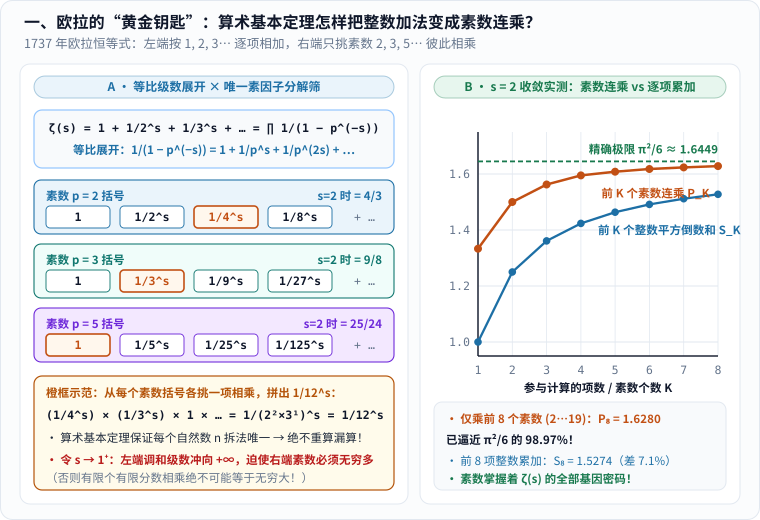
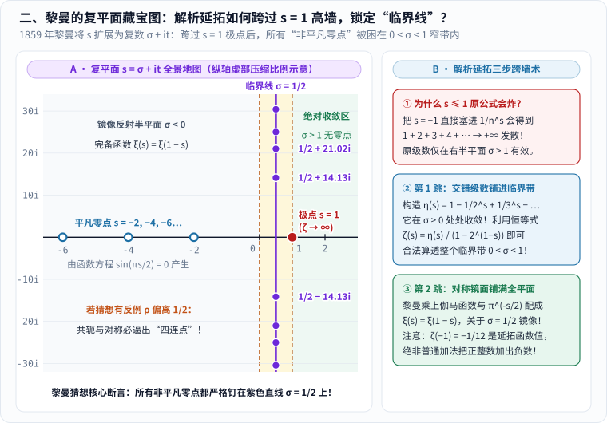
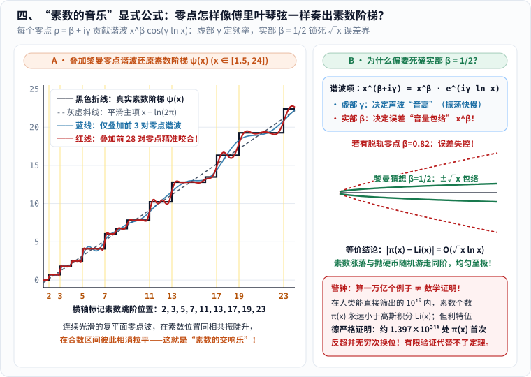
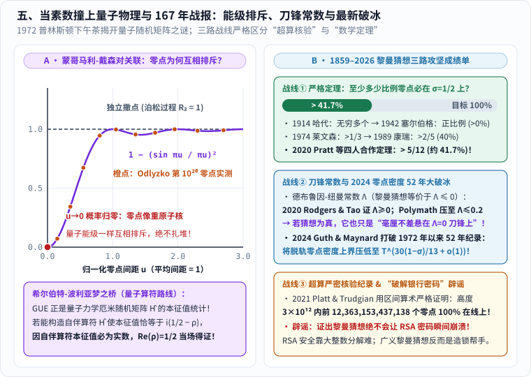

把自然数排成一列，挑出那些除了 $$1$$ 和它自己之外再也除不开的“原子积木”——**素数（质数）**：

$$
2,\ 3,\ 5,\ 7,\ 11,\ 13,\ 17,\ 19,\ 23,\ 29,\ 31,\ 37,\ 41,\ 43,\ 47,\ \dots
$$

哪怕小学生盯上五分钟，也会觉得这串数的脾气古怪到了极点：有时候两个素数肩并肩只差 $$2$$（比如 $$11$$ 和 $$13$$、$$41$$ 和 $$43$$，甚至上百位的大数里照样冷不丁冒出孪生素数）；有时候却突然陷入荒漠，连续几百个自然数全都能被拆成合数，半个素数的影子都见不着。数学家扎吉尔（Don Zagier）曾感叹：素数就像自然数丛林里最桀骜不驯的野草，没人说得准下一株究竟从哪块石头缝里钻出来。

可偏偏在 **1859 年 11 月**，33 岁的德国数学家**波恩哈德·黎曼（Bernhard Riemann，1826–1866）**为答谢当选柏林科学院通信院士，随信寄去了一篇只有短短 **8 页** 的论文——《论小于给定值的素数个数》（*Ueber die Anzahl der Primzahlen unter einer gegebenen Grösse*）[[1]](#ref-1)。在这篇他生前唯一发表过的数论文章里，黎曼顺手写下了一句看似轻描淡写的猜测：某个复变函数的所有“非平凡零点”，实部大概全都等于 **$$\frac{1}{2}$$** [[1]](#ref-1)[[2]](#ref-2)。

就是这半句话，成了此后 **167 年** 里整座数学大厦最耀眼也最折磨人的灯塔：

- **1900 年**，大卫·希尔伯特在巴黎国际数学家大会开出著名的“23 个数学问题”，把黎曼猜想郑重列为**第 8 问题**；传说有人问他：“如果您沉睡一千年后醒来，第一句话会问什么？”希尔伯特脱口而出：**“黎曼猜想证出来了吗？”**
- **2000 年**，美国克雷数学研究所（Clay Mathematics Institute）公布七大“千禧年大奖难题”，为黎曼猜想挂出 **100 万美元** 悬赏 [[2]](#ref-2)。在数学文献库里，今天已经有上千条重要命题写着同一个前提——“若黎曼猜想成立，则……”。

然而大多数普通读者第一次查“黎曼猜想”时，往往不出三分钟就会撞上**三堵让人头晕的高墙**：

1. **第一堵墙（怎么扯上分数的？）**：素数是 $$2, 3, 5, 7\dots$$ 这些孤立的正整数，怎么会突然变成一个无穷分数求和 $$\zeta(s) = 1 + \frac{1}{2^s} + \frac{1}{3^s} + \dots$$？
2. **第二堵墙（怎么塞进虚数甚至负数的？）**：把负数 $$s = -1$$ 代进去明明是 $$1 + 2 + 3 + \dots$$ 无穷大，网上为什么到处传“等于 $$-\frac{1}{12}$$”？把 $$s = \frac{1}{2} + 14.1347i$$ 代进去连收敛都不收敛，什么叫**解析延拓**与**非平凡零点**？
3. **第三堵墙（关素数和银行密码什么事？）**：就算那些零点真的老老实实排在实部等于 $$\frac{1}{2}$$ 的竖线上，**为什么偏偏必须是 $$\frac{1}{2}$$？** 超级计算机已经验证了前 **12.36 万亿** 个零点一个都没跑偏，为什么还不算证完？如果明天真有人证出来，全世界的银行与手机密码真会像传言那样“一夜崩盘”吗？

今天我们不甩高深黑话，从初中就会的等比数列出发，顺着五幅由真实数值计算生成的分步图解，把这三堵墙一层层拆得明明白白。

---

## 一、第一把钥匙（1737）：欧拉怎样把“整数加法”变成“素数连乘”？

### 1. 先算一个小账本：等比级数与算术基本定理的魔术

故事的起点比黎曼早了一百多年。**1737 年**，瑞士大数学家**莱昂哈德·欧拉（Leonhard Euler）**研究了一串看起来平平无奇的无穷倒数幂次和（后来黎曼用希腊字母 $$\zeta$$ 把它命名为 **Zeta 函数**）[[1]](#ref-1)[[2]](#ref-2)：

$$
\zeta(s) = 1 + \frac{1}{2^s} + \frac{1}{3^s} + \frac{1}{4^s} + \frac{1}{5^s} + \frac{1}{6^s} + \dots = \sum_{n=1}^{\infty} \frac{1}{n^s}
$$

只要指数 $$s > 1$$（比如 $$s = 2$$，也就是全体自然数平方的倒数和 $$1 + \frac{1}{4} + \frac{1}{9} + \frac{1}{16} + \dots$$），后面加上的项缩小得飞快，总和会稳稳停在一个有限的数字上。

看式子左端，$$1, 2, 3, 4, 5, 6\dots$$ 是**全体自然数挨个相加**，里面既有素数也有合数，乱成一锅粥。欧拉却一眼看穿了一个惊天魔术——只要借用中学课本里的**无穷等比数列求和公式**（当公比 $$\lvert q \rvert < 1$$ 时，$$1 + q + q^2 + q^3 + \dots = \frac{1}{1 - q}$$），把 $$q$$ 换成某个素数的倒数幂 $$\frac{1}{p^s}$$，每一个素数 $$p$$ 都能单独撑起一个括号：

- 素数 $$p = 2$$ 的括号：$$\frac{1}{1 - 2^{-s} } = 1 + \frac{1}{2^s} + \frac{1}{4^s} + \frac{1}{8^s} + \frac{1}{16^s} + \dots$$
- 素数 $$p = 3$$ 的括号：$$\frac{1}{1 - 3^{-s} } = 1 + \frac{1}{3^s} + \frac{1}{9^s} + \frac{1}{27^s} + \dots$$
- 素数 $$p = 5$$ 的括号：$$\frac{1}{1 - 5^{-s} } = 1 + \frac{1}{5^s} + \frac{1}{25^s} + \frac{1}{125^s} + \dots$$

现在请你想一想：**如果把所有素数 $$p = 2, 3, 5, 7, 11\dots$$ 的大括号全都乘在一起，展开之后会发生什么？**

先看图 1 左半边，顺着橙色高亮方框亲手挑一项乘乘看：

_图 1：先看左栏（A），把每个素数因子 $$\frac{1}{1 - p^{-s} }$$ 展开成等比级数后，从 $$p=2$$ 括号挑出 $$\frac{1}{4^s}$$、从 $$p=3$$ 括号挑出 $$\frac{1}{3^s}$$、其余所有素数括号都挑 $$1$$，乘起来正好拼出 $$\frac{1}{12^s}$$；再看右栏（B），在 $$s=2$$ 巴塞尔问题中，仅把前 $$8$$ 个素数（$$2$$ 到 $$19$$）乘起来得到的 $$P_8 = 1.6280$$，就已经逼近精确极限 $$\frac{\pi^2}{6} \approx 1.6449$$ 的 $$98.97\%$$，把慢吞吞的普通整数累加 $$S_8 = 1.5274$$ 远远甩在身后。[单独打开图片](/assets/images/riemann-hypothesis/euler-golden-key-sieve.svg)_

按照乘法分配律，把无穷多个素数括号乘开，相当于**从每个素数的括号里各挑出一项乘在一起**：

- 如果从每个括号里都挑 $$1$$：$$1 \times 1 \times 1 \times \dots = 1$$；
- 如果从 $$p=2$$ 挑 $$\frac{1}{2^s}$$、从 $$p=3$$ 挑 $$\frac{1}{3^s}$$、其余全挑 $$1$$：乘出来就是 $$\frac{1}{(2 \times 3)^s} = \frac{1}{6^s}$$；
- 如果像图 1 橙框那样，从 $$p=2$$ 挑 $$\frac{1}{4^s} = \frac{1}{(2^2)^s}$$、从 $$p=3$$ 挑 $$\frac{1}{3^s}$$、其余全挑 $$1$$：乘出来就是 $$\frac{1}{(2^2 \times 3^1)^s} = \frac{1}{12^s}$$！

会不会漏掉某个自然数 $$n$$？绝不会，因为任何大于 $$1$$ 的整数都能拆成素数相乘；会不会把 $$\frac{1}{12^s}$$ 算重两遍？**更不可能！** 因为数论基石**算术基本定理（唯一分解定理）**铁板钉钉地保证：$$12$$ 除了拆成 $$2^2 \times 3^1$$ 之外，天底下再也没有第二种素数拆法！

于是，欧拉写下了被后世数学史家称为**“黄金钥匙”**的**欧拉乘积公式（Euler Product Formula，1737）**（适用前提：实数 $$s > 1$$，或复数实部 $$\operatorname{Re}(s) > 1$$）[[1]](#ref-1)[[2]](#ref-2)：

$$
\sum_{n=1}^{\infty} \frac{1}{n^s} = \prod_{p\text{ 为素数} } \frac{1}{1 - p^{-s} }
$$

这把钥匙之所以石破天惊，是因为等号左边是**连续可微的分析学级数**（只管把自然数无脑往上加），等号右边却是**纯粹的素数家族名册**（合数被筛得干干净净，只剩素数连乘）。从此以后，素数再也不是一盘散沙——它们每一次呼吸和起伏，都被死死烙进了 $$\zeta(s)$$ 这个函数的骨血里！

### 2. 一箭双雕：顺手证出“素数无穷多”，再看高斯猜出的宏观账本

手握这把黄金钥匙，欧拉当场做了一个漂亮得让人拍案叫绝的操作：**把指数 $$s$$ 从右边一步步逼近 $$1$$（即 $$s \to 1^+$$）。**

当 $$s = 1$$ 时，公式左端变成大名鼎鼎的**调和级数** $$1 + \frac{1}{2} + \frac{1}{3} + \frac{1}{4} + \dots$$。别看加上的分数越来越小，把它们按 $$2$$ 的幂次分块打包：$$\frac{1}{3} + \frac{1}{4} > \frac{1}{2}$$，$$\frac{1}{5} + \frac{1}{6} + \frac{1}{7} + \frac{1}{8} > \frac{1}{2}$$……无穷多个 $$\frac{1}{2}$$ 叠起来，左端总和会直接冲向**正无穷大 $$+\infty$$**！

现在看公式右端：每一个素数 $$p$$ 贡献的因子 $$\frac{1}{1 - 1/p}$$ 都是一个有限的数（比如 $$\frac{1}{1-1/2} = 2$$，$$\frac{1}{1-1/3} = \frac{3}{2}$$）。假如全宇宙的素数只有**有限个**，那么有限个有限的分数乘在一起，结果必然是个有限数，怎么可能等于左端的无穷大？**唯一的可能是：右端的素数括号有无穷多个——素数必定无穷无尽！** 这是自古希腊欧几里得之后两千年里，人类第一次用微积分与无穷级数的眼光看穿素数的无穷性。

哪怕在完全收敛的 $$s = 2$$ 处（欧拉成名的巴塞尔问题 $$\zeta(2) = \frac{\pi^2}{6} \approx 1.644934$$），素数连乘的威力也肉眼可见：如图 1 右栏实测，把前 $$8$$ 个普通整数的平方倒数加起来，$$S_8 = 1 + \frac{1}{4} + \dots + \frac{1}{64} \approx 1.5274$$，离终点还差 $$7.1\%$$；而只拿前 $$8$$ 个素数（$$2, 3, 5, 7, 11, 13, 17, 19$$）连乘，$$P_8 = \frac{4}{3}\times\frac{9}{8}\times\dots\times\frac{361}{360} \approx 1.6280$$，一口气就追到了精确值的 **$$98.97\%$$**！

不过，知道“素数无穷多”还远远不够。数学家真正抓心挠肝的问题是：**小于等于 $$x$$ 的素数到底有多少个？（记作素数计数函数 $$\pi(x)$$，注意这里的 $$\pi(x)$$ 只是“数素数个数”的记号，不是圆周率 $$3.14159$$！）**

- 当 $$x = 10$$ 时，素数有 $$2, 3, 5, 7$$，所以 $$\pi(10) = 4$$（占比 $$40\%$$）；
- 当 $$x = 100$$ 时，$$\pi(100) = 25$$（占比 $$25\%$$）；
- 当 $$x = 10^6$$ 时，$$\pi(10^6) = 78{,}498$$（占比降到 $$7.85\%$$）。

我们在[《高斯到底发明了什么：从 1 加到 100 开始》]()里讲过他洞察数字结构的绝活：早在 **1792 或 1793 年**（高斯才 **15 岁**！），少年高斯收到一本附带素数表的对数手册，没事就一页页统计“每 1000 个连续整数里藏着几个素数”。他敏锐地发现，数字越往后走，素数越稀疏，在 $$x$$ 附近撞见素数的平均密度大约是 **$$\frac{1}{\ln x}$$**（这里 $$\ln x$$ 是自然对数）[[2]](#ref-2)。因此，小于 $$x$$ 的素数总个数 $$\pi(x)$$，粗略看接近 $$\frac{x}{\ln x}$$，更精细地算则应该把密度 $$\frac{1}{\ln t}$$ 从 $$2$$ 一路积分到 $$x$$，也就是**对数积分函数**：

$$
\operatorname{Li}(x) = \int_{2}^{x} \frac{\mathrm{d}t}{\ln t}
$$

（注：黎曼与部分数论教材也会取柯西主值积分 $$\operatorname{li}(x) = \int_0^x \frac{\mathrm{d}t}{\ln t}$$，两者只差一个固定常数 $$\operatorname{li}(2) \approx 1.045$$，在讨论渐近误差时完全等价 [[1]](#ref-1)[[2]](#ref-2)。）

可无论是 15 岁的高斯（他在 1849 年给天文学家恩克的回信里才首次公开披露当年这则少年笔记），还是同时代独立提出类似公式的法国数学家勒让德，**谁都没能真正证明这条规律**，更没人知道平滑的积分曲线 $$\operatorname{Li}(x)$$ 与真实锯齿状的素数个数 $$\pi(x)$$ 之间，误差究竟有多大 [[2]](#ref-2)。

直到高斯的得意门生——黎曼登场，把整张棋盘从一维实数轴猛地掀到了**二维复平面**上。

---

## 二、1859 年的 8 页奇文：黎曼怎样跨过 s = 1 的高墙，画出复平面藏宝图？

### 1. 为什么“1 + 2 + 3 + … = -1/12”是误导人的标题党？读懂真正的解析延拓

欧拉只把 $$\zeta(s)$$ 里的 $$s$$ 当成大于 $$1$$ 的实数。而在[柯西开创的复变函数世界]()里长大的黎曼深知：一个函数真正的脾气，只有把变量换成**复数 $$s = \sigma + it$$**（其中实部 $$\sigma$$ 是横坐标，虚部 $$t$$ 配上虚数单位 $$i = \sqrt{-1}$$ 是纵坐标）时才会彻底显形 [[1]](#ref-1)。

等等！复数的指数 $$n^{-(\sigma + it)}$$ 到底怎么算？用欧拉公式一拆就极其清楚：

$$
\frac{1}{n^{\sigma + it} } = \frac{1}{n^\sigma} \cdot n^{-it} = \frac{1}{n^\sigma} \cdot e^{-it \ln n} = \frac{1}{n^\sigma}\bigl(\cos(t \ln n) - i\sin(t \ln n)\bigr)
$$

你看：**实部 $$\sigma$$ 管的是每项的长度 $$\frac{1}{n^\sigma}$$ 缩不缩小；虚部 $$t$$ 管的是这一项在复平面上绕着原点转多大角度！**

但只要往左跨过 $$\sigma = 1$$ 这道墙（即 $$\sigma \le 1$$），原来的求和式 $$\sum \frac{1}{n^s}$$ 当场失灵——比如代进 $$s = -1$$，原式变成 $$1 + 2 + 3 + 4 + \dots$$，越加越大直奔正无穷，根本不收敛！那黎曼凭什么说 $$\zeta(-1) = -\frac{1}{12}$$，又凭什么去算 $$\sigma = \frac{1}{2}$$ 上的函数值呢？

这就必须请出复分析里最神奇的手术——**解析延拓（Analytic Continuation）**。别被名字吓住，拿中学多项式打个比方你就秒懂了：

假设你手里有一个等比级数 $$f(x) = 1 + x + x^2 + x^3 + \dots$$。这个无穷加法只有在 $$-1 < x < 1$$ 的小圈子里才收敛，在这个圈子里它完全等于简短分式 $$g(x) = \frac{1}{1 - x}$$。如果有人非把 $$x = 2$$ 塞进左边的无穷加法，得到 $$1 + 2 + 4 + 8 + \dots$$，那当然是发散胡扯；但右边的分式 $$g(2) = \frac{1}{1 - 2} = -1$$ 却除了 $$x = 1$$ 分母为零之外处处算得通！在复变函数论里有一个极其霸道的**唯一性定理**：只要两个光滑（全纯）函数在一小块区域里完全重合，把定义域往外扩充的方式在全平面是**唯一锁死、绝无二话**的！

黎曼给 $$\zeta(s)$$“搭桥扩界”也是同样的道理。请顺着图 2 右栏（B）的三级台阶，再对照左栏（A）的复平面全景地图一步步看：

_图 2：先看右栏（B）三步跨墙术——原级数只在绿色右半平面 $$\sigma > 1$$ 收敛；改写成一正一负的交错级数 $$\eta(s)$$ 就能合法跨进黄色临界带 $$0 < \sigma < 1$$；再借完备对称方程 $$\xi(s) = \xi(1-s)$$ 镜像铺满左半平面（注意左栏纵轴虚部 $$t$$ 为装进前四对零点做了纵向压缩示意，横轴实部 $$\sigma$$ 为真实刻度）。[单独打开图片](/assets/images/riemann-hypothesis/complex-plane-critical-strip-map.svg)_

我们先亲手走一遍图 2 右栏**第 1 跳**，看看不用任何高深积分，怎么把 $$\zeta(s)$$ 合法延拓进 $$0 < \sigma < 1$$ 的黄色窄带里：

当 $$\sigma > 1$$ 时，把 $$\zeta(s)$$ 里的偶数项统一翻成减号，造出一个一正一负抵消的**狄利克雷交错级数 $$\eta(s)$$**：

$$
\eta(s) = 1 - \frac{1}{2^s} + \frac{1}{3^s} - \frac{1}{4^s} + \frac{1}{5^s} - \dots
$$

对比原级数 $$\zeta(s) = 1 + \frac{1}{2^s} + \frac{1}{3^s} + \frac{1}{4^s} + \dots$$，两者只差了两倍的偶数项 $$\frac{2}{2^s}\bigl(1 + \frac{1}{2^s} + \frac{1}{3^s} + \dots\bigr) = 2^{1-s}\zeta(s)$$！所以只要 $$\sigma > 1$$，恒有：

$$
\eta(s) = \bigl(1 - 2^{1-s}\bigr)\zeta(s) \quad\Longrightarrow\quad \zeta(s) = \frac{\eta(s)}{1 - 2^{1-s} }
$$

妙处来了：一正一负交替相消的 $$\eta(s)$$，根本不需要 $$\sigma > 1$$，**只要实部 $$\sigma > 0$$（比如 $$\sigma = \frac{1}{2}$$）就处处收敛**！于是右边这个分式除了 $$s = 1$$ 让分母 $$1 - 2^0 = 0$$ 炸成一座无穷高的火山（数学上叫**唯一的一阶极点**）之外，顺顺利利把 $$\zeta(s)$$ 的定义铺满了整个右半平面 $$\sigma > 0$$！

接着黎曼祭出**第 2 跳**：他在 1859 年论文中利用围道积分与泊松求和，给 $$\zeta(s)$$ 配上圆周率幂次 $$\pi^{-s/2}$$ 与阶乘推广函数 $$\Gamma\bigl(\frac{s}{2}\bigr)$$，组装出一个上下左右完全匀称的**完备黎曼函数 $$\xi(s)$$** [[1]](#ref-1)[[2]](#ref-2)：

$$
\xi(s) = \frac{1}{2} s(s-1)\pi^{-s/2}\Gamma\Bigl(\frac{s}{2}\Bigr)\zeta(s), \qquad \text{严格满足镜像对称：}\quad \xi(s) = \xi(1 - s)
$$

同时它等价于著名的**黎曼函数方程** $$\zeta(s) = 2^s \pi^{s-1} \sin\bigl(\frac{\pi s}{2}\bigr)\Gamma(1-s)\zeta(1-s)$$ [[1]](#ref-1)[[2]](#ref-2)。靠着这面以 **$$\sigma = \frac{1}{2}$$ 为对称轴** 的魔镜，已知右半平面 $$\sigma > 1$$ 的值，就能直接照出左半平面 $$\sigma < 0$$ 的唯一延拓值！例如代进 $$s = -1$$，由右端镜像 $$\zeta(2) = \frac{\pi^2}{6}$$ 一算便得 **$$\zeta(-1) = -\frac{1}{12}$$**。

这也彻底揭穿了网上流传甚广的营销号噱头：**$$\zeta(-1) = -\frac{1}{12}$$ 意思是“解析延拓后的新函数 $$\zeta(s)$$ 在 $$-1$$ 点的取值为 $$-\frac{1}{12}$$”，绝不是说普通算术加法能把一串正整数 $$1 + 2 + 3 + \dots$$ 硬加出负数！** 把只在 $$\sigma > 1$$ 成立的求和符号硬套到 $$s = -1$$ 头上去写等号，就像宣称 $$1 + 2 + 4 + 8 + \dots = -1$$ 一样，纯粹是偷换了运算符的适用边界。

### 2. 分清两类零点：为什么“非平凡零点”全被关在 0 到 1 的窄带里？

整张复平面铺通之后，黎曼开始寻找让 **$$\zeta(s) = 0$$** 的“零点”。为什么要找零点？就像中学分解多项式 $$x^2 - 5x + 6 = (x-2)(x-3)$$ 一样，一个解析函数的零点握着重构整个函数（特别是对数导数 $$-\frac{\zeta'(s)}{\zeta(s)} = \sum \Lambda(n)n^{-s}$$）的总开关！

沿着图 2 左栏的地图从右往左排查，复平面瞬间分成了三个泾渭分明的辖区：

1. **右侧安全区（$$\sigma > 1$$）：绝对没有零点！** 因为这里欧拉乘积公式合法收敛，无穷多个非零因子相乘（且对数和有限），绝不可能乘出 $$0$$。
2. **左侧负偶数（$$s = -2, -4, -6, -8, \dots$$）：一排毫无悬念的“平凡零点”（Trivial Zeros）！** 看一眼上面的黎曼函数方程，里面乘着一个正弦因子 $$\sin\bigl(\frac{\pi s}{2}\bigr)$$。每当 $$s$$ 取负偶数 $$-2k$$ 时，$$\sin(-k\pi) = 0$$（而右边其余因子有限非零），白送一串等距排在负实轴上的零点（图 2 蓝圈）。因为来得太直白，数学家叫它们**平凡零点**，它们在素数公式里只负责修补微不足道的小尾巴（即图 4 将看到的 $$-\frac{1}{2}\ln(1 - x^{-2})$$ 项）。
3. **中央神秘走廊（$$0 \le \sigma \le 1$$）：所有“非平凡零点”的唯一栖息地！** 既然 $$\sigma > 1$$ 没零点，经 $$\xi(s) = \xi(1-s)$$ 关于 $$\sigma = \frac{1}{2}$$ 一照镜子，$$\sigma < 0$$ 里除了上面那串平凡零点外也绝对再无其他零点！于是，真正暗中操控素数分布的所有复数零点 $$\rho = \beta + i\gamma$$，**统统被关进了 $$0 \le \sigma \le 1$$ 这条宽仅 $$1$$ 个单位的竖直走廊——“临界带”（Critical Strip）**！

更进一步，**1896 年**，法国数学家阿达马（Jacques Hadamard）与比利时数学家德·拉·瓦莱·普桑（Charles Jean de la Vallée Poussin）各自独立攻克了一个关键堡垒：**证明在临界带左右两条边界线 $$\sigma = 1$$ 和 $$\sigma = 0$$ 上，也绝对没有半个零点！** 光靠“边界线 $$\sigma = 1$$ 无零点”这一条结论，两人就在 1896 年首次严格证明了高斯猜想百年的**素数定理**：当 $$x \to \infty$$ 时，$$\frac{\pi(x)}{\operatorname{Li}(x)} \to 1$$ [[2]](#ref-2)！

现在只剩 $$0 < \sigma < 1$$ 开区间内部了。请注意这里的**四重对称铁律**：因为实轴上 $$\zeta(\sigma)$$ 恒为实数，若 $$\rho = \beta + i\gamma$$ 是零点，它的上下共轭 $$\bar{\rho} = \beta - i\gamma$$ 必是零点；再经完备函数 $$\xi(s) = \xi(1-s)$$ 左右对称，$$1 - \rho = (1-\beta) - i\gamma$$ 和 $$1 - \bar{\rho} = (1-\beta) + i\gamma$$ 也必是零点！也就是说，只要有一个零点敢偏离正中央的直线 **$$\sigma = \frac{1}{2}$$**（称为**临界线，Critical Line**），临界带里就必须成双成对蹦出四个对称的“脱轨零点”。

而在 1859 年那篇论文第 4 页，黎曼算出前几个零点后写下了那句震撼百年的话——他认为极有可能所有这些非平凡零点**全都严格落在正中央的临界线 $$\operatorname{Re}(s) = \frac{1}{2}$$ 上**，并诚实地补充道：**“对此人们自然希望得到一个严格的证明；我在做过几次徒劳的简短尝试后已暂时搁置，因为对我眼下的研究而言它并非必不可少。”** [[1]](#ref-1)

必须严格区分史实：**黎曼当年只是提出了猜想，并没有藏着未发表的完整证明**；但他随手搁置的这颗火种，却藏着远超当时所有人想象的计算功底。

---

## 三、沿着临界线向上巡航：复平面螺旋线与黎曼手稿里的秘密

### 1. 靶心连中四元：当 s = 1/2 + it 升空时发生了什么？

很多读者好奇：既然零点是让 $$\zeta\bigl(\frac{1}{2} + it\bigr) = 0$$ 的位置，把高度 $$t$$ 从 $$0$$ 慢慢调大，$$\zeta\bigl(\frac{1}{2} + it\bigr)$$ 算出来的复数究竟长什么样？

要知道，让一个复数等于 $$0$$，可比让普通实数等于 $$0$$ 苛刻得多——**它的实部和虚部必须像两列火车在同一毫秒撞上同一个道口一样，分毫不差同时归零！**

我们用欧拉加速的交错级数精确算出 $$0 \le t \le 31.2$$ 的函数值，绘出了图 3 左栏（A）的复平面轨迹（包含一次自动播放的描迹短动画；浅蓝色底线始终保留完整四圈静态螺旋，支持减少动态效果模式）：

_图 3：先看左栏（A），当 $$t$$ 从 $$0$$ 升至 $$31.2$$ 时，复数值 $$\zeta(\frac{1}{2} + it)$$ 从负实轴上的起点 $$\zeta(\frac{1}{2}) \approx -1.460$$ 出发，在复平面上画出一朵顺时针旋转的花瓣螺旋，而且每一次收圈都不偏不倚**正中红心原点 $$(0, 0)$$**（对应前 $$4$$ 个零点）！再看右栏（B），乘上相位旋转因子变成纯实数哈代函数 $$Z(t)$$ 后，每一次穿靶心都变成实曲线一正一负穿过红横轴，轻松锁死前 $$5$$ 个零点（单独打开图片刷新可重播左图描迹）。[单独打开图片](/assets/images/riemann-hypothesis/critical-line-spiral-and-z-zeros.svg)_

顺着图 3 左栏看这趟奇妙的巡航：

- **起点（$$t = 0$$）**：$$\zeta\bigl(\frac{1}{2}\bigr) \approx -1.46035$$，落在原点左边的橙色圆点；
- **第 1 次射穿靶心**：曲线往下兜过第三象限、闯进右半平面绕一大圈后，在 **$$t = \gamma_1 \approx 14.134725$$** 时，实部与虚部双双归零，利剑般刺穿原点 $$(0, 0)$$！这就是全宇宙**第 1 个非平凡零点** $$\rho_1 = \frac{1}{2} + 14.134725i$$；
- **连中四元**：紧接着曲线毫不减速，又在 **$$\gamma_2 \approx 21.022040$$**、**$$\gamma_3 \approx 25.010858$$**、**$$\gamma_4 \approx 30.424876$$** 连续三次正中原点靶心！随着 $$t$$ 越升越高，花瓣越转越密：在高度 $$T$$ 以下，临界带内的零点总个数遵从黎曼给出的精确渐近公式 $$N(T) \approx \frac{T}{2\pi}\ln\frac{T}{2\pi e}$$——越往上走，零点平均间距 $$\frac{2\pi}{\ln(T/2\pi)}$$ 越来越窄 [[1]](#ref-1)[[2]](#ref-2)。

### 2. 1932 年哥廷根草稿纸惊雷：哈代 Z(t) 变号法与黎曼深藏不露的超算级手稿

这里马上冒出一个极关键的科学问题：**计算机算出来的永远是有限位小数（比如算得 $$\lvert\zeta\rvert < 10^{-15}$$），你怎么敢百分之百肯定螺旋线是“真正穿过了原点 $$(0,0)$$”，而不是在离原点 $$10^{-100}$$ 的地方擦肩而过（那样零点就会偏在 $$\sigma = 0.5000\dots01$$ 上，直接证伪黎曼猜想）？**

看一眼图 3 右栏（B），数学家的巧思让人拍案叫绝！

因为完备函数 $$\xi\bigl(\frac{1}{2} + it\bigr)$$ 在临界线上左右自对称且上下共轭，它的值在临界线上**严格是纯实数**！英国数学家哈代（G. H. Hardy）据此提炼出与 $$\zeta\bigl(\frac{1}{2}+it\bigr)$$ 模长完全相等、仅做了一个精确相位旋转 $$e^{i\vartheta(t)}$$ 的**实值函数 $$Z(t)$$**：

$$
Z(t) = e^{i\vartheta(t)} \, \zeta\Bigl(\frac{1}{2} + it\Bigr) \in \mathbb{R}, \qquad \text{满足 }\lvert Z(t) \rvert = \Bigl\lvert \zeta\Bigl(\frac{1}{2} + it\Bigr) \Bigr\rvert
$$

这一下，二维复平面上“撞不撞得准针尖”的难题，瞬间降维成了高中数学课本里的**一维连续实函数介值定理**：只要你在 $$t_1 = 14.0$$ 严密算出 $$Z(14.0) < 0$$（负号），又在 $$t_2 = 14.2$$ 严密算出 $$Z(14.2) > 0$$（正号），哪怕你的计算机只能算准前几位小数，连续曲线从水下浮出水面，**中间必定百分之百穿过 $$Z(t) = 0$$**——也就是**不折不扣、实部严格等于 $$\frac{1}{2}$$（小数点后无穷多个零！）的线上零点**！再配合阿兰·图灵（Alan Turing）于 1953 年完善的辐角计数法（核对区间内实际抓到的变号次数是否恰好等于理论总零点数 $$N(T)$$），只要两边数目对得上，就铁证这一整段临界带里**绝无任何一个漏网的脱轨零点** [[3]](#ref-3)！

更传奇的一幕发生在 **1932 年**。在此之前，许多数学家误以为黎曼当年只是凭“纯粹的哲学直觉”瞎猜零点在 $$\sigma = \frac{1}{2}$$ 上。直到德国数论大师**卡尔·路德维希·西格尔（Carl Ludwig Siegel）**走进哥廷根大学档案馆，一页页翻检黎曼生前留下的凌乱草稿纸——在满篇没有文字说明的算式背面，西格尔惊出一身冷汗：黎曼不仅早已用羽毛笔亲手算出了前几个零点的数值，而且他用的根本不是笨重的级数硬算，而是一套领先时代整整七十年的渐近展开利器（西格尔将其整理发表，命名为**黎曼-西格尔公式，Riemann–Siegel Formula**），计算复杂度直接从 $$O(t)$$ 砍到了 $$O(\sqrt{t})$$！直到今天，现代超级计算机验证万亿级零点时，底层核心引擎依然流淌着黎曼当年草稿纸上的血脉 [[2]](#ref-2)[[3]](#ref-3)。

---

## 四、“素数的音乐”：一排复平面零点，凭什么能精准指挥素数跳台阶？

### 1. 把阶梯拆成声波：黎曼显式公式的傅里叶直觉

终于来到全篇最核心、也最震撼灵魂的一步：**复平面上这串零点 $$\frac{1}{2} \pm 14.135i$$、$$\frac{1}{2} \pm 21.022i\dots$$，究竟是怎么隔空指挥自然数轴上的 $$2, 3, 5, 7, 11, 13\dots$$ 在哪一格跳出素数的？**

答案就藏在黎曼 1859 年论文最华彩的成果——**显式公式（Explicit Formula）**里 [[1]](#ref-1)[[2]](#ref-2)。为了把式子写得最干净，数论学家通常请出与 $$\pi(x)$$ 等价的“加权素数阶梯函数”——**切比雪夫函数 $$\psi(x)$$**：每当 $$x$$ 从左往右走过一个素数 $$p$$（或素数的幂 $$p^k$$，如 $$4 = 2^2, 8 = 2^3, 9 = 3^2$$），台阶就猛地往上蹿高一截 **$$\ln p$$**；在其余普通合数（如 $$6, 10, 12, 14, 15$$）区间，台阶纹丝不动，拉成水平直线（冯·曼戈尔特于 1895 年给出了该显式公式的完全严格证明）[[2]](#ref-2)：

$$
\psi_0(x) = x - \sum_{\rho} \frac{x^\rho}{\rho} - \ln(2\pi) - \frac{1}{2}\ln\bigl(1 - x^{-2}\bigr)
$$

（式左 $$\psi_0(x)$$ 在素数幂跳阶点取上下台阶的平均值。）请深吸一口气，仔细端详等号两边的奇迹：

- **等号左边 $$\psi_0(x)$$**：是纯粹**离散、方方正正、每逢素数幂才突兀跳高**的锯齿阶梯；
- **等号右边**：第一项 $$x$$（连同常数 $$-\ln 2\pi$$）来自 $$s=1$$ 极点，代表素数均匀增长的平滑斜坡；最后一项 $$-\frac{1}{2}\ln(1-x^{-2})$$ 来自负偶数的平凡零点，在 $$x$$ 稍大时几乎等于 $$0$$；**唯独中间那串求和 $$-\sum_{\rho} \frac{x^\rho}{\rho}$$，是由全体非平凡零点 $$\rho = \beta + i\gamma$$ 组成的无穷合唱团！**

我们在[《傅里叶怎样把温度拆成波》]()里见过：任何有棱有角的方波或台阶，都可以拆成基频与无穷多列正弦谐波的叠加。黎曼的显式公式，恰恰就是**素数阶梯的“对数傅里叶展开”**！把一对共轭零点 $$\rho = \beta + i\gamma$$ 和 $$\bar{\rho} = \beta - i\gamma$$ 合起来看：

$$
\frac{x^{\beta + i\gamma} }{\beta + i\gamma} + \frac{x^{\beta - i\gamma} }{\beta - i\gamma} = \frac{2 x^\beta}{\sqrt{\beta^2 + \gamma^2} } \cos\bigl(\gamma \ln x - \arctan(\gamma/\beta)\bigr)
$$

**每一个零点都变成了一根光滑振动的琴弦！** 我们把刚才算出的前 $$28$$ 对精确黎曼零点代进显式公式，看看光滑的波浪是怎样凭空“捏”出素数阶梯的（见图 4 左栏 A）：

_图 4：先看左栏（A），黑色折线是真实的素数幂阶梯 $$\psi(x)$$；灰虚斜线只有主趋势 $$x - \ln(2\pi)$$；蓝线只叠加上前 $$3$$ 对零点声波，已经隐约扭出起伏；而当红线叠加上前 $$28$$ 对真实黎曼零点谐波时，光滑曲线竟在 $$2, 3, 5, 7, 11, 13, 17, 19, 23$$ 每个素数门口精准共振陡升、在 $$6, 10, 12, 14, 15, 20, 21, 22$$ 合数荒漠彼此相消拉平！再看右栏（B），实部 $$\beta = \frac{1}{2}$$ 决定了所有谐波的最大振幅包络是 $$\pm\sqrt{x}$$。[单独打开图片](/assets/images/riemann-hypothesis/prime-staircase-zeta-music-synthesis.svg)_

盯住图 4 左栏那条红色曲线，哪怕是老练的数学家也会起一身鸡皮疙瘩：

右边加进去的 $$28$$ 对波浪，明明连一个素数的名字都没存，全都是复平面临界线上那些无理数高度 $$\gamma_1 \approx 14.135, \gamma_2 \approx 21.022, \dots, \gamma_{28} \approx 95.871$$ 算出来的余弦波；可当它们叠在一起时，在 $$x = 14, 15$$ 处波峰与波谷默契抵消成平地，一到 **$$x = 17$$** 和 **$$x = 19$$** 却同相叠加猛然抬头，走过 $$20, 21, 22$$ 再次压平，撞上 **$$x = 23$$** 又准时拔地而起！因此，数学家把黎曼零点的虚部 $$\gamma_1, \gamma_2, \gamma_3\dots$$ 诗意地称为**“素数的音乐”（The Music of the Primes）**——每一个零点都是素数交响乐里的一个纯音泛音！

### 2. 为什么实部偏偏必须是 1/2？抛硬币平方根律与“斯库斯数”反例警钟

看懂了这串声波，之前最大的困惑——**“为什么数学家非要死磕零点的实部 $$\beta = \frac{1}{2}$$，它等于 $$0.51$$ 或 $$0.82$$ 难道不行吗？”**——答案立刻水落石出！

请看图 4 右栏（B）顶部的拆解式：在一根零点声波 $$x^{\beta + i\gamma} = x^\beta \cdot e^{i\gamma \ln x}$$ 里：

- **虚部 $$\gamma$$** 躲在 $$e^{i\gamma \ln x}$$ 里，只管振荡的**频率（音高）**，模长恒等于 $$1$$；
- **实部 $$\beta$$** 站在最前头充当 $$x^\beta$$，直接决定这根声波随 $$x$$ 增大时的**振幅放大倍率（音量包络）**！

记住我们前面讲过的“左右镜像对称铁律”：如果某个零点偏离 $$\frac{1}{2}$$，哪怕它往左缩到 $$\beta = 0.18$$，它的镜像搭档 $$1 - \rho$$ 就会立刻在右边蹦出一个 **$$\beta = 0.82$$** 的大嗓门零点！这根 $$\beta = 0.82$$ 的失控琴弦一旦响起来，素数实际个数 $$\pi(x)$$ 偏离平滑积分 $$\operatorname{Li}(x)$$ 的误差幅度就会被撑大到 $$x^{0.82}$$ 量级（图 4 右栏红虚线喇叭口）。

唯有当**每一个非平凡零点都分毫不差钉在正中央 $$\beta = \frac{1}{2}$$ 上**时，没有任何一根琴弦的音量能越过 $$x^{1/2} = \sqrt{x}$$！瑞典数学家冯·科赫（Helge von Koch）在 **1901 年**严格证明了一条无需任何复变基础就能读懂的**黎曼猜想等价命题** [[2]](#ref-2)：

$$
\text{黎曼猜想成立} \quad\Longleftrightarrow\quad \bigl\lvert \pi(x) - \operatorname{Li}(x) \bigr\rvert = O\bigl(\sqrt{x}\ln x\bigr)
$$

为什么 $$\sqrt{x}$$ 让数学家如此痴迷？回想一下概率论里的**抛硬币随机游走**：如果你连抛 $$N$$ 次绝对公平的硬币，正面朝上预期是 $$\frac{N}{2}$$ 次，实际随机涨落的标准差恰好就是 **$$\sqrt{N}$$ 量级**！换句话说，黎曼猜想用一句最凝练的语言宣布：**素数在自然数里的分布，已经达到了随机规则所能允许的“最均匀、最公平、绝无任何局部偏心团块”的物理极限！**

顺着显式公式，我们还能回答另一个经典灵魂拷问：**“超级计算机都验了 12 万亿个零点全在线上了，为什么不能差不多算它对了？”**

图 4 右栏底部红色的**“斯库斯数（Skewes' Number）”悬案**，就是数论史上最振聋发聩的当头棒喝 [[4]](#ref-4)：

从高斯、黎曼直到今天人类用超算直接筛出的所有范围内（一直算到 $$x = 10^{19}$$，即一百亿亿！），真实素数个数 $$\pi(x)$$ **每一次都毫无例外地严格小于**对数积分 $$\operatorname{Li}(x)$$！如果按“试了一百亿亿次都对，肯定永远对”的经验主义逻辑，$$\pi(x) < \operatorname{Li}(x)$$ 简直比太阳东升西落还要铁板钉钉。

然而 **1914 年**，哈代的黄金搭档**利特伍德（J. E. Littlewood）**利用黎曼零点谐波的精细同相叠加，给出了一个把所有人的下巴都惊掉的严格数学证明：**$$\pi(x) - \operatorname{Li}(x)$$ 随着 $$x \to \infty$$ 其实会正负变号无穷多次！** 之所以前 $$10^{19}$$ 里全都是负号，只是因为零点谐波需要对数尺度 $$\ln x$$ 积累到不可思议的天文长度，才能凑齐第一次集体同相大合唱！后来斯库斯（Stanley Skewes）给出首个反超上界，经现代数学家（含 Platt & Trudgian 等）借助数百万高精度黎曼零点步步压缩，目前已知第一次出现 $$\pi(x) > \operatorname{Li}(x)$$ 的位置落在约 **$$e^{727.9513} \approx 1.397 \times 10^{316}$$** 附近 [[4]](#ref-4)——这个数写出来有 **317 位**，而整个可观测宇宙的基本粒子总数也才 $$10^{80}$$ 左右！

**在无穷大面前，$$10^{13}$$ 个零点甚至 $$10^{19}$$ 个整数，都不过是海岸边刚迈出去的第一粒沙子。在数学里，再庞大的有限检验也永远替代不了一纸逻辑严密的普遍证明。**

---

## 五、当数论撞上量子物理与 167 年攻坚战报：我们离终点还有多远？

### 1. 1972 年普林斯顿下午茶奇遇：为什么零点像重原子核能级一样“互相排斥”？

如果黎曼猜想只关乎数论学家数素数，它或许还不会在物理学界掀起巨浪。真正让整个科学界意识到“这里藏着宇宙底层秘密”的，是 **1972 年春天**普林斯顿高等研究院（IAS）茶歇室里那场载入史册的偶遇 [[5]](#ref-5)。

当时，年轻的数论学家**休·蒙哥马利（Hugh Montgomery）**刚推导出一个怪异的公式：假设黎曼猜想成立，如果把高处零点的平均间距归一化成 $$1$$，那么两个零点相距 $$u$$ 的统计“对关联函数（Pair Correlation）”长这样 [[5]](#ref-5)：

$$
R_2(u) = 1 - \left(\frac{\sin(\pi u)}{\pi u}\right)^2
$$

要知道，如果零点像雨点落在地面上那样彼此独立随机撒点（泊松过程），两个点挨得很近甚至撞在一起常有发生，对关联应该是一条平直的常数 **$$1$$**。可蒙哥马利算出来的式子，在间距 $$u \to 0$$ 时却骤降归零（$$R_2(0) = 0$$）——这意味着**黎曼零点之间仿佛带了同种电荷，极度抗拒挤在一起！**

茶歇时间，蒙哥马利经人引荐，随口把这个式子写给量子电动力学大师**弗里曼·戴森（Freeman Dyson）**看。没想到戴森只瞄了一眼就脱口而出：

> **“这不就是高斯酉系综（GUE）大型随机厄米矩阵本征值的对关联函数吗？！”** [[5]](#ref-5)

全场瞬间石化！物理学家研究铀-238 这类重原子核在复杂量子混沌态下的**能级光谱**时，用的正是时间反演不对称的厄米随机矩阵（GUE），其能级间距遵循一模一样的 $$1 - \bigl(\frac{\sin \pi u}{\pi u}\bigr)^2$$ **“能级排斥定律”**！随后在 20 世纪 80 年代至 21 世纪初，贝尔实验室数学家**安德鲁·奥德利兹科（Andrew Odlyzko）**动用 Cray 超级计算机，跑到第 **$$10^{20}$$** 乃至 **$$10^{22}$$** 个黎曼零点的极高空做了亿级样本检验——计算出的零点间距点位，与量子物理的 GUE 曲线严丝合缝地焊在了一起（见图 5 左栏 A）[[6]](#ref-6)！

_图 5：先看左栏（A），灰色虚线代表彼此独立的随机撒点（$$R_2 = 1$$），紫色实线则是量子力学 GUE 随机厄米矩阵的对关联曲线 $$1 - (\frac{\sin \pi u}{\pi u})^2$$，在 $$u \to 0$$ 时概率归零展现强烈的“能级排斥”，与奥德利兹科在第 $$10^{20}$$ 零点附近的超算统计完美重合；再看右栏（B），按“临界线占比定理、刀锋常数与零点密度破冰、超算核验与密码辟谣”三路梳理 167 年真实战况。[单独打开图片](/assets/images/riemann-hypothesis/gue-quantum-chaos-and-progress-map.svg)_

这场跨界重逢，瞬间点燃了早年希尔伯特与波利亚各自独立设想过的**“希尔伯特-波利亚猜想（Hilbert–Pólya Conjecture）”** [[2]](#ref-2)：在量子力学里，代表物理可观测量（如能量）的**自伴算符（厄米算符 $$\hat{H}$$）**有一条天经地义的铁律——**它的所有本征值必定全是实数！** 假如有一天，人类能在某个奇妙的量子混沌系统里找到一个自伴算符 $$\hat{H}$$，使得它的本征值刚好等于 $$i\bigl(\frac{1}{2} - \rho_n\bigr)$$；那么既然本征值必为实数 $$\gamma_n$$，一反解 $$\rho_n = \frac{1}{2} + i\gamma_n$$，**所有非平凡零点实部等于 $$\frac{1}{2}$$ 就当场不证自明！** 阿兰·孔涅（Alain Connes）、迈克尔·贝里（Michael Berry）与乔纳森·基廷（Jonathan Keating）等数学物理学家至今仍在顺着这条“量子算符寻宝路”全力掘进。

### 2. 三路真实战报：41.7% 占比定理、Λ = 0 刀锋常数与 2024 年 52 年大破冰

既然完全证明尚未到来，过去 167 年里数学家难道都在原地踏步吗？恰恰相反！如果我们严格区分**“计算机有限核验”**与**“对无穷全局生效的数学定理”**，图 5 右栏（B）的三条战线已经取得了极扎实的推进：

1. **战线① 严格占比定理——已证明超过 $$41.7\%$$ 的全体零点必在临界线上**：
   - **1914 年**，哈代率先破冰，严格证明临界线 $$\sigma = \frac{1}{2}$$ 上有**无穷多个**零点（但注意：“无穷多个”占比仍可能是 $$0\%$$，就像平方数有无穷多个，在自然数里占比却是 $$0\%$$）；
   - **1942 年**，阿特勒·塞尔伯格（Atle Selberg）首次证明临界线上的零点占全体非平凡零点的**严格正比例（$$> 0\%$$）**；
   - **1974 年**，诺曼·莱文森（Norman Levinson）用精妙的磨光器（Mollifier）技术一举把占比推过 **$$\frac{1}{3}$$（约 $$34.74\%$$）**；**1989 年**，布莱恩·康瑞（Brian Conrey）推高至 **$$> \frac{2}{5} = 40\%$$**；
   - **2020 年**，普拉特（Kyle Pratt）、罗伯斯（Nicolas Robles）、扎哈雷斯库（Alexandru Zaharescu）与蔡德勒（Dirk Zeindler）四位数学家合作发表长篇证明，把无条件严格下界推高到了 **$$> \frac{5}{12}$$（约 $$41.7\%$$）** [[7]](#ref-7)！
2. **战线② 刀锋常数 $$\Lambda$$ 与 2024 年零点密度 52 年大破冰**：
   - 数学家德布鲁因（1950）与纽曼（1976）把完备函数 $$\xi$$ 放进热传导方程里演化，定义了一个控制零点演化的**德布鲁因-纽曼常数 $$\Lambda$$**，并证明：**黎曼猜想成立当且仅当 $$\Lambda \le 0$$**。纽曼猜想 $$\Lambda \ge 0$$，并打趣说这意味着黎曼猜想就算是真的，也只是“险险过关”。**2020 年**，罗杰斯（Brad Rodgers）与陶哲轩（Terence Tao）正式发表证明，一锤定音证出 **$$\Lambda \ge 0$$** [[8]](#ref-8)！随后陶哲轩发起的 Polymath 15 协作项目与 Platt–Trudgian 将上界压至 **$$\Lambda \le 0.2$$** [[3]](#ref-3)[[8]](#ref-8)。这意味着：**如果黎曼猜想是真的，它绝没有任何富余安全垫，而是毫厘不差地悬在 $$\Lambda = 0$$ 的锋利刀刃上！**
   - **2024 年 5 月**，麻省理工学院的拉里·古斯（Larry Guth）与菲尔兹奖得主詹姆斯·梅纳德（James Maynard）联手投下一枚重磅炸弹 [[9]](#ref-9)：在无法完全排除脱轨零点的前提下，数论学家最关心“实部大于 $$\sigma$$ 的可能脱轨零点最多能有多少个”（即零点密度估计 $$N(\sigma, T)$$）。此前赫胥黎（M. N. Huxley）在 **1972 年**创下的纪录 $$T^{12(1-\sigma)/5 + o(1)}$$（在关键点 $$\sigma = \frac{3}{4}$$ 处指数为 $$0.6$$）足足卡死了数论界 **52 年**；古斯与梅纳德引入全新的狄利克雷多项式大值解耦方法，一举将上界压低到 **$$N(\sigma, T) \le T^{30(1-\sigma)/13 + o(1)}$$**（$$\sigma = \frac{3}{4}$$ 处降至 $$\frac{15}{26} \approx 0.5769$$），顺手把极短区间 $$[x,\, x + x^{17/30 + o(1)}]$$ 内必有素数的渐近定律向前推进了一大步 [[9]](#ref-9)！
3. **战线③ 超算严密区间算术核验——前 12.36 万亿个零点无一脱轨**：
   - 早期文献常提到古尔东（Xavier Gourdon，2004）用浮点算法算过前 $$10^{13}$$ 个零点（未正式同行评审发表）。而在严格同行评审标准下，**2021 年**普拉特（Dave Platt）与特鲁吉安（Tim Trudgian）在《伦敦数学会通报》正式发表成果：利用严格控制舍入误差的**球区间算术（Ball Arithmetic）**，数学上滴水不漏地证明在虚部高度 $$H = 3{,}000{,}175{,}332{,}800$$（超 $$3 \times 10^{12}$$）以下，全部 **$$12{,}363{,}153{,}437{,}138$$（约 $$1.236 \times 10^{13}$$）** 个非平凡零点 **$$100\%$$ 严格落在 $$\operatorname{Re}(s) = \frac{1}{2}$$ 上** [[3]](#ref-3)！

值得一提的是，代数几何学家已在“平行宇宙”里率先看到过胜利曙光：哈塞（Helmut Hasse，1930 年代）对有限域椭圆曲线、安德烈·韦伊（André Weil，1940–1948）对一般有限域代数曲线、以及**皮埃尔·德利涅（Pierre Deligne，1973）**对高维有限域代数簇，先后严格证明了几何版的“黎曼猜想”（韦伊猜想），德利涅也因此荣膺 1978 年菲尔兹奖 [[2]](#ref-2)。只是回到我们脚下最朴素的整数环 $$\mathbb{Z}$$ 时，几何工具箱里的“弗罗贝尼乌斯自同态”神秘失踪了——这正是最后一层尚未捅破的窗户纸。

### 3. 终极辟谣：假如明天黎曼猜想被证出来，全世界的银行密码会瞬间裸奔吗？

每逢网上流传某位学者声称“证明黎曼猜想”的新闻，短视频与自媒体总会一窝蜂刷屏同一句耸人听闻的标题——**“一旦黎曼猜想被攻克，素数规律彻底暴露，全球银行、网银与军事 RSA 密码将在一夜之间全部失效！”**

在这里我们可以把心稳稳放回肚子里，给出毫不含糊的科学结论：**这是彻头彻尾的谣言！证明黎曼猜想，绝对不会弄垮 RSA 密码，更不会冻住现代互联网金融！**

为什么会传出这种乌龙？根源在于外行把**“素数的宏观分布统计规律”**与**“把一个指定合数拆回两个大素数因子”**混为一谈了（关于“正向相乘容易、反向分解困难”的计算复杂性本质，可参阅[《P和NP：为什么答案好检查，却可能不好找？》]()；关于现代 HTTPS 与移动支付主力密码体系，可参阅[《明明半点不像椭圆，为什么偏叫椭圆曲线？》]()）：

1. **RSA 锁死的是“质因数分解难”，不是“不知道素数在哪”**：造一把 2048 位 RSA 密码锁时，电脑随机挑两个约 300 多位十进制长的大素数 $$p$$ 和 $$q$$，花一眨眼工夫乘出公开模数 $$N = p \times q$$。黎曼猜想（哪怕加上它最强大的推广版**广义黎曼猜想 GRH**）告诉我们的是“300 位整数里大概有百分之几是素数、分布误差不超过平方根”，**它根本不会给你一台输入合数 $$N$$ 就能瞬间吐出因子 $$p$$ 和 $$q$$ 的时光机**！（真正威胁 RSA 和椭圆曲线密码的，是肖尔量子算法与大规模容错量子计算机，而不是黎曼猜想证明。）
2. **恰恰相反：黎曼猜想是密码学家的“好战友”，而不是掘墓人！** 造 RSA 密钥时，第一步恰恰需要快速挑出两个如假包换的大素数 $$p$$ 和 $$q$$。**1976 年**，计算机科学家加里·米勒（Gary L. Miller）证明了一条经典定理 [[10]](#ref-10)：**只要广义黎曼猜想（GRH）成立，著名的 Miller–Rabin 素性测试甚至不需要掷骰子碰运气，只须确定性地检查前 $$O\bigl((\ln n)^2\bigr)$$ 个小底数，就能在多项式时间 $$O\bigl((\ln n)^4\bigr)$$ 内百分之百验明大整数 $$n$$ 是不是素数！**（2002 年三位印度学者提出无需假设的 AKS 多项式素性算法，但速度仍远不及基于 GRH 的米勒检验。）不仅如此，今天计算机代数与密码学论文里成百上千条高效算法，都是在假定黎曼猜想或 GRH 成立的前提下设计并正常运转的——如果明天有人证明了它，密码学家非但不用逃跑，反而要开香槟庆祝自己手里的加速引擎终于拿到了永久合格证！

回望从 1737 年欧拉写下乘积公式，到 1859 年黎曼寄出那封薄薄 8 页的柏林通信，再到今天超算与量子混沌的交响，人类死磕黎曼猜想的真正理由，从来不是为了偷看谁家的银行密码。

而是因为在这颗小小星球上，没有什么比这件事更让人心驰神往：**一串小学生用铅笔就能筛出来的质朴素数，竟然穿过无穷级数、复变镜面与量子能级，在实部等于 $$\frac{1}{2}$$ 的那条细细直线上，整整齐齐地唱了亿万年的歌。**

---

## 六、延伸探索与参考资料

### 亲手听一听、查一查黎曼零点（官方交互数据库）

如果你想亲眼翻看第 1 个、第 100 万个甚至第 1000 亿个黎曼零点的精确小数，或观察零点叠加逼近素数的交互图像，推荐访问数论与几何学界公认的权威开源平台——**LMFDB（L-函数与模形式数据库）官方零点页**：

- [LMFDB — Zeros of the Riemann zeta function（黎曼 $$\zeta$$ 函数零点交互库）](https://www.lmfdb.org/zeros/zeta/)（由国际数论学者团队维护，收录超 $$10^{11}$$ 个高精度零点并提供在线检索与可视化；需联网与浏览器 JavaScript 支持，本文核心推导与五幅计算图解已完全自包含，不依赖外站亦可完整阅读。）

### 参考资料与核查出处

1. **Bernhard Riemann (1859)**, *Ueber die Anzahl der Primzahlen unter einer gegebenen Grösse*, Monatsberichte der Berliner Akademie, November 1859, pp. 671–680. 德文原文与都柏林圣三一学院 David R. Wilkins 英文译本见：[https://www.maths.tcd.ie/pub/HistMath/People/Riemann/Zeta/](https://www.maths.tcd.ie/pub/HistMath/People/Riemann/Zeta/)（本文第 1–4 节核查黎曼 1859 年 8 页原论文史实、完备函数 $$\xi(s)$$ 对称方程、临界线猜想原文表述及显式公式的一手文献）。
2. **Enrico Bombieri (2000)**, *Problems of the Millennium: The Riemann Hypothesis*, Clay Mathematics Institute Official Problem Description. 官方页面：[https://www.claymath.org/millennium/Riemann-Hypothesis/](https://www.claymath.org/millennium/Riemann-Hypothesis/)；官方问题描述 PDF：[https://www.claymath.org/wp-content/uploads/2022/05/riemann.pdf](https://www.claymath.org/wp-content/uploads/2022/05/riemann.pdf)（支撑本文千禧年大奖定义、欧拉乘积公式、高斯对数积分猜想、1896 年阿达马与德·拉·瓦莱·普桑素数定理证明、1901 年冯·科赫 $$O(\sqrt{x}\ln x)$$ 等价条件及韦伊-德利涅有限域定理）。
3. **Dave Platt & Tim Trudgian (2021)**, *The Riemann hypothesis is true up to $$3\cdot 10^{12}$$*, Bulletin of the London Mathematical Society, 53(3), 792–797. 预印本全文：[https://arxiv.org/abs/2004.09765](https://arxiv.org/abs/2004.09765)（支撑本文第 3、5 节利用球区间算术严格证明高度 $$H = 3{,}000{,}175{,}332{,}800$$ 以下前 $$12{,}363{,}153{,}437{,}138$$ 个非平凡零点全部位于 $$\operatorname{Re}(s) = \frac{1}{2}$$，及图灵辐角计数法与 $$\Lambda \le 0.2$$ 改进）。
4. **J. E. Littlewood (1914)**, *Sur la distribution des nombres premiers*, Comptes Rendus Acad. Sci. Paris 158, 1869–1872；以及 **Patrick Demichel, Jan Büthe, Dave Platt & Tim Trudgian** 关于斯库斯反超界的研究，参见 **Dave Platt & Tim Trudgian (2016)**, *Zero-free regions for $$\zeta(s)$$ and Skewes' number*, [https://arxiv.org/abs/1407.1914](https://arxiv.org/abs/1407.1914) 与 **Chris Bays & Richard H. Hudson (2000)**, *A new bound for the smallest $$x$$ with $$\pi(x) > \operatorname{li}(x)$$*, Mathematics of Computation, 69(231), 1285–1296（支撑本文第 4 节 $$\pi(x) - \operatorname{Li}(x)$$ 无穷次变号定理及约 $$1.397 \times 10^{316}$$ 首次反超数量级反例）。
5. **Hugh L. Montgomery (1973)**, *The pair correlation of zeros of the zeta function*, Analytic Number Theory, Proc. Sympos. Pure Math., Vol. XXIV, American Mathematical Society, pp. 181–193（支撑本文第 5 节零点间距对关联公式 $$1 - (\frac{\sin \pi u}{\pi u})^2$$ 及 1972 年普林斯顿高等研究院蒙哥马利-戴森下午茶发现 GUE 关联的史实）。
6. **Andrew M. Odlyzko (1987)**, *On the distribution of spacings between zeros of the zeta function*, Mathematics of Computation, 48(177), 273–308. 作者论文集主页：[https://www-users.cse.umn.edu/~odlyzko/doc/zeta.html](https://www-users.cse.umn.edu/~odlyzko/doc/zeta.html)（支撑本文第 5 节第 $$10^{20}$$ 及更高阶黎曼零点间距与 GUE 厄米随机矩阵能级排斥的超级计算机统计验证）。
7. **Kyle Pratt, Nicolas Robles, Alexandru Zaharescu & Dirk Zeindler (2020)**, *More than five-twelfths of the zeros of $$\zeta$$ are on the critical line*, Research in the Mathematical Sciences, 7:2. 预印本全文：[https://arxiv.org/abs/1802.10521](https://arxiv.org/abs/1802.10521)（支撑本文第 5 节临界线零点占比演进脉络：哈代 1914、塞尔伯格 1942、莱文森 1974、康瑞 1989 至最新无条件严格下界 $$> \frac{5}{12} \approx 41.7\%$$）。
8. **Brad Rodgers & Terence Tao (2020)**, *The De Bruijn–Newman constant is non-negative*, Forum of Mathematics, Pi, Vol. 8, e6. 全文：[https://arxiv.org/abs/1801.05914](https://arxiv.org/abs/1801.05914)；以及 **D. H. J. Polymath (2019)**, *Effective approximation of heat flow evolution of the Riemann $$\xi$$ function, and a new upper bound for the de Bruijn–Newman constant*, Research in the Mathematical Sciences, 6:31（支撑本文第 5 节 $$0 \le \Lambda \le 0.2$$ 定理与“悬在 $$\Lambda = 0$$ 刀锋上”的严格数学含义）。
9. **Larry Guth & James Maynard (2024)**, *New large value estimates for Dirichlet polynomials*, arXiv:2405.20552 [math.NT], [https://arxiv.org/abs/2405.20552](https://arxiv.org/abs/2405.20552)（支撑本文第 5 节打破 1972 年赫胥黎 52 年纪录的零点密度新上界 $$N(\sigma, T) \le T^{30(1-\sigma)/13 + o(1)}$$ 及短区间素数分布推论）。
10. **Gary L. Miller (1976)**, *Riemann's Hypothesis and Tests for Primality*, Journal of Computer and System Sciences, 13(3), 300–317（支撑本文第 5 节第 3 小节密码学辟谣：广义黎曼猜想 GRH 并不能分解 RSA 合数模数，反而保证确定性多项式时间 $$O((\ln n)^4)$$ 素性检验）。
