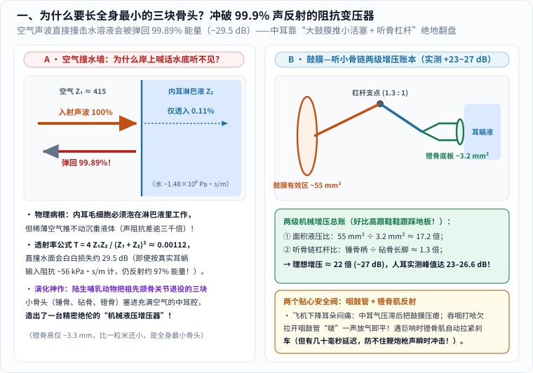
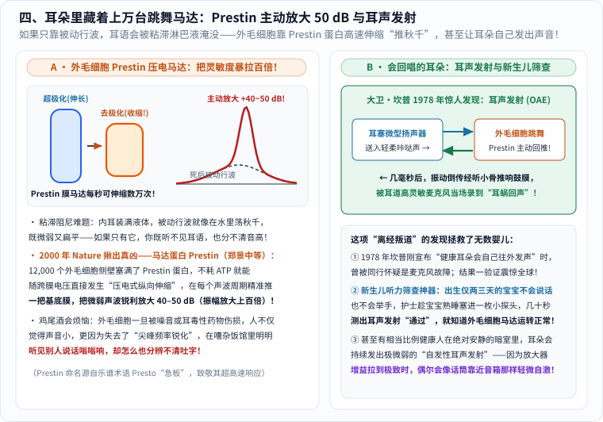

如果你刚读完上一篇[《彻底读懂我们是如何看到的》]()，可能会觉得人眼的单光子生化放大器已经够逆天了；但只要把目光移到脑袋两侧那对不起眼的耳朵上，物理学家会告诉你：**人类听觉系统创下的机械与时间纪录，比视觉还要疯狂得多！**

不信请看四组经过现代生物物理学反复核实的硬数据：

1. **原子级灵敏度**：在安静房间里你刚能听见的 $$0\ \mathrm{dB\ SPL}$$ 微弱声响，对应的空气压强波动只有 **$$20$$ 微帕（$$20\ \mu\mathrm{Pa}$$，约两百亿分之一个标准大气压！）** [[1]](#ref-1)——此时你的鼓膜与内耳毛细胞纤毛束来回晃动的幅度，仅仅只有 **$$0.1\text{–}0.3$$ 纳米（$$1\text{–}3\ \text{\AA}$$，差不多只相当于一颗金原子的直径！）** [[2]](#ref-2) [[3]](#ref-3)；
2. **比视觉快 $$1{,}000$$ 倍的闪电开关**：视网膜靠酶促化学反应把光变成电要花几十毫秒，而耳朵里的毛细胞靠一根纳米级“蛋白质拉绳”直接硬拽开离子通道，响应时间只需短短 **$$10\text{–}40$$ 微秒（百万分之十秒）** [[3]](#ref-3)；
3. **健康的耳朵不仅能听，还会自己往外“发声”**：你耳蜗里住着约 $$12{,}000$$ 个装满压电马达蛋白的外毛细胞，它们每秒钟随着音乐原地伸缩跳舞数万次，把声音放大上百倍——跳得太起劲时，振动还会倒着传出鼓膜，让微型麦克风在耳道口录到清清楚楚的“耳蜗回唱” [[10]](#ref-10)！
4. **比单个神经脉冲还准 $$100$$ 倍的脑干秒表**：闭上眼睛拍打蚊子时，你的大脑能分辨出声音先后抵达左右两耳仅仅 **$$10$$ 微秒（十万分之一秒！）** 的时间差，定位精度直逼 **$$1^\circ$$** [[12]](#ref-12)！

一团微弱的空气分子疏密波，究竟是怎么闯过骨头、液体、纳米拉绳和跳舞马达，变成你脑海里气势恢宏的交响乐与亲人低语的？让我们顺着声波进门的路径，一关一关揭开谜底。

---

## 一、第一关：中耳变压器——为什么要长全身最小的三块骨头？

### 1. 空气撞水墙的绝境：如果没有中耳，$$99.9\%$$ 的声音连门都进不去！

先问一个看似奇怪的问题：为什么我们不能把听觉感受细胞直接摆在耳道尽头的空气里，非要隔着鼓膜、绕过三块米粒大的听小骨，再把振动送进装满液体的内耳耳蜗？

因为包括人类在内的所有陆生脊椎动物，老祖先都是从海里爬上岸的鱼！内耳里娇嫩的毛细胞必须在富含特定离子的淋巴液里才能存活放电。可祖先一爬上陆地，迎面就撞上了一道令声学工程师绝望的物理高墙——**气—水声阻抗严重失配（Impedance Mismatch）** [[4]](#ref-4)！

你一定有过这样的体验：夏天在游泳池里把脑袋埋进水下，岸上的朋友扯破嗓子冲你大喊，你在水底下却几乎什么都听不见，只剩一片闷闷的嗡嗡声。为什么？

因为空气分子稀薄轻巧，声阻抗极低（$$Z_1 \approx 415\ \mathrm{Pa\cdot s/m}$$）；而水分子稠密沉重，声阻抗高达 $$Z_2 \approx 1.48 \times 10^6\ \mathrm{Pa\cdot s/m}$$，两者相差**三千五百多倍**！根据声学界面能量透射公式：

$$
T = \frac{4 Z_1 Z_2}{(Z_1 + Z_2)^2} \approx \frac{4 \times 415 \times 1.48 \times 10^6}{(1.48 \times 10^6)^2} \approx 0.00112 = 0.112\%
$$

也就是说，如果让空气声波直接撞向纯水表面，高达 **$$99.89\%$$（接近 $$99.9\%$$，折合损失约 $$-29.5\ \mathrm{dB}$$）** 的声音能量会被当场弹回空气，只有千分之一能钻进水里 [[4]](#ref-4)！（即便换用解剖实测的真实人类耳蜗卵圆窗输入声阻抗约 $$56\ \mathrm{kPa\cdot s/m}$$ 计算，空气直撞卵圆窗依然会被弹回约 **$$97\%$$** 的声能，凭空丢掉 $$-15.3\ \mathrm{dB}$$ 以上 [[5]](#ref-5)！）这就好比让一只乒乓球去撞一颗实心铅球——乒乓球自己弹飞了，铅球纹丝不动。

### 2. 把下巴旧零件改成“液压千斤顶”：大鼓膜推小镫骨，压强暴涨二十多倍！

怎么让轻飘飘的空气推得动沉甸甸的耳蜗淋巴液？哺乳动物在演化史上完成了一次堪称神来之笔的“旧物改造”：把爬行类祖先原本用来连接上下颌关节的三块退役小骨头，缩微塞进了充满空气的中耳腔里，串成了一条精妙绝伦的**听骨链——锤骨（Malleus）、砧骨（Incus）与镫骨（Stapes）** [[4]](#ref-4) [[5]](#ref-5)！其中最末端的**镫骨**长得酷似一只微型马镫，高度仅约 **$$3.3\ \mathrm{mm}$$**，比一粒大米还要小，稳坐**人体全身最小骨头**的宝座 [[6]](#ref-6)。

这三块小骨头并不是傻傻传声的棍子，而是一台两级串联的**机械液压增压变压器**（见图 1 右栏）：

1. **第一级：大面积收集、小底板集中发力（液压活塞比 $$\approx 17 : 1$$）**。外耳道尽头的鼓膜有效振动面积约为 **$$55\ \mathrm{mm}^2$$**，它收集到的全部推力经过听骨链传递，最后全部压在面积仅约 **$$3.03\text{–}3.2\ \mathrm{mm}^2$$** 的镫骨底板（封住内耳入口“卵圆窗”）上 [[4]](#ref-4) [[6]](#ref-6)！就像穿平底鞋踩泥地不留印、换细高跟鞋一脚戳出深坑一样，光是面积浓缩就把压强放大了 $$55 \div 3.2 \approx 17.2$$ 倍；
2. **第二级：听小骨不等臂省力杠杆（杠杆比 $$\approx 1.3 : 1$$）**。锤骨长柄比砧骨长脚略长一截，绕支点摆动时又把推力额外放大了约 $$1.3$$ 倍 [[4]](#ref-4)。

两级相乘，理想理论增压倍数高达 $$17.2 \times 1.3 \approx 22.4$$ 倍（折合 $$20\log_{10}(22.4) \approx +27\ \mathrm{dB}$$）；人类新鲜颞骨标本激光测振实测显示，在语言核心频段 $$1\ \mathrm{kHz}$$ 附近，中耳提供的真实声压增益峰值稳定达到 **$$23\text{–}26.6\ \mathrm{dB}$$** [[4]](#ref-4)，几乎分毫不差地把刚才气—水界面损失掉的那二十多分贝能量全抢了回来！

更贴心的是，中耳腔还自带两道日常安全阀：

- **飞机下降时的“啵”一声（咽鼓管调压）**：鼓膜只有两侧气压完全相等时才能轻盈振动。飞机急速下降时舱内气压变大，而密闭中耳腔还是高空低气压，鼓膜被向内死死压瘪，耳朵立刻又闷又痛；此时只要做一次吞咽、嚼口香糖或打哈欠，连接鼻咽部与中耳的**咽鼓管**“啵”地拉开一条缝放进空气，鼓膜瞬间回弹舒坦！
- **遇到轰鸣时的自动刹车（镫骨肌声反射）**：一旦遭遇持续高分贝强声，全身最小的骨骼肌——**镫骨肌**会自动收缩把镫骨拉偏，减少传进内耳的震动；但要注意，这个神经反射有几十毫秒的启动延迟，所以**防得住电钻轰鸣，却防不住贴耳鞭炮或枪声的毫秒级瞬时冲击**！

*图 1：气—水声阻抗反射壁与中耳鼓膜—听小骨链两级增压原理（[单独打开大图](/assets/images/how-we-hear/middle-ear-impedance-transformer.svg)）。左栏展示空气声波直撞水溶液时高达 $$99.89\%$$ 能量被反射；右栏展示约 $$55\ \mathrm{mm}^2$$ 鼓膜经 $$1.3:1$$ 听骨杠杆推动仅 $$3.2\ \mathrm{mm}^2$$ 镫骨底板，把声压放大二十余倍送入耳蜗淋巴液。*

---

## 二、第二关：把蜗牛壳拉直 $$35$$ 毫米——为什么“窄硬根部听高音，宽软尖端听低音”？

### 1. 冯·贝凯希的行波奇观：一条不用芯片的纯机械“傅里叶拆频仪”

镫骨底板像小活塞一样在卵圆窗上“一推一拉”（内耳骨壳坚硬不可压缩，下方另开一扇弹性的“圆窗”同步一鼓一瘪释放压力），终于在盘成两圈半蜗牛壳形状的**耳蜗（Cochlea）**液体里激起了水波。

当交响乐团同时奏响低沉的大提琴、清亮的长笛和清脆的三角铁时，所有声音混成一条奇形怪状的压力曲线冲进耳蜗——耳朵里又没有装数字信号处理器（DSP），它是怎么在一瞬间把几十种频率拆得清清楚楚的？（关于复杂波形拆解成正弦波的数学原理，详见[《傅里叶怎样把温度拆成波》]()。）

揭开这个谜底的人，是匈牙利物理学家格奥尔格·冯·贝凯希（Georg von Békésy，独享 1961 年诺贝尔生理学或医学奖）[[7]](#ref-7)。他用微型钻头在人类遗体与动物颞骨耳蜗上开出天窗，撒上反光银粉，在频闪显微镜下亲眼看到了贯穿耳蜗全长的**基底膜（Basilar Membrane，拉直后总长约 $$35\ \mathrm{mm}$$）**是如何随声音起舞的（见图 2 上栏单次动画）：

原来，这条 $$35\ \mathrm{mm}$$ 长的基底膜，长着一副**跟竖琴和钢琴琴弦刚好“反过来”的奇特身材** [[7]](#ref-7)！

很多人看耳蜗外壳底部粗、顶尖细，想当然以为里面的基底膜也是底部宽、顶端窄；**解剖打开一看恰恰相反**：

- **在靠近卵圆窗入口的“蜗底（Base）”**：基底膜其实**最窄（宽仅约 $$0.1\ \mathrm{mm}$$），而且绷得极紧、刚度比顶端硬约 $$100$$ 倍**！
- **顺着管道一路走到尽头的“蜗顶（Apex）”**：基底膜反而**越来越宽（增宽到约 $$0.5\ \mathrm{mm}$$），质地越来越柔软松弛**！

回忆一下中学物理里的弹簧振子固有频率公式 $$f \propto \sqrt{k / m}$$（刚度 $$k$$ 越大、质量 $$m$$ 越小，固有频率越高）：

- 当 **$$8{,}000\text{–}20{,}000\ \mathrm{Hz}$$ 的尖锐高音**冲进卵圆窗时，又窄又硬的**蜗底入口段**当场与它剧烈共振，激起高高的行波包络峰值，随后能量迅速耗尽，根本传不到后面去；
- 当 **$$1{,}000\ \mathrm{Hz}$$ 的人声中音**进来时，行波一路滑过坚硬的蜗底，精准在**耳蜗中段**掀起最高浪峰；
- 当 **$$20\text{–}200\ \mathrm{Hz}$$ 的轰鸣低音**进来时，行波浩浩荡荡跑完近 $$35\ \mathrm{mm}$$ 全程，直到最宽最软的**蜗顶尽头**才轰然拍岸！

不花一颗晶体管、不写一行代码，仅靠一条宽度与刚度连续渐变的弹性薄膜，耳蜗就在物理层面实时完成了**硬件级傅里叶频谱分解**——不同频率自动按对数坐标排成整齐的一列（称为**频率拓扑映射 Tonotopy**），精准敲响各自专属毫米地段上的毛细胞琴键！

### 2. 为什么人上了年纪，总是“先听不见蚊子叫和高频门铃”？

顺着图 2 上栏那三条行波轨迹多看一眼，你立刻就能想通一个伴随每个人一生的生理现象：

健康年轻人的听觉频率范围横跨 **$$20\ \mathrm{Hz}\text{–}20{,}000\ \mathrm{Hz}$$**（整整约 $$10$$ 个八度音阶！），可一过三四十岁，哪怕平时不怎么去吵闹场所，最高听觉上限往往也会悄无声息退缩到 $$15\text{–}17\ \mathrm{kHz}$$，到了老年更是最先听不清鸟鸣、女高音以及英语里的辅音擦音（`s`、`f`、`th`）[[1]](#ref-1)。前些年商场里甚至流行过一种 $$17.4\ \mathrm{kHz}$$ 的“驱散青少年蚊音器”——二十岁以下年轻人听得捂耳朵逃跑，四十岁以上大叔大妈站在喇叭底下却一脸茫然毫无感觉！

为什么衰老和噪音伤害**永远先拿高频开刀，而不是先坏低频**？

看图 2 的入口位置就全明白了：**卵圆窗大门就开在蜗底高频区！** 低音行波要去蜗顶，必须先踩过蜗底；中音行波要去中段，也必须先踩过蜗底；高音更是在蜗底原地炸开——也就是说，**驻扎在耳蜗大门口的“高频毛细胞”，一辈子承受着所有频率声波的机械冲刷、代谢负荷与自由基氧化磨损**，自然成了全耳蜗最先壮烈牺牲的前锋哨兵！

*图 2：展平 $$35\ \mathrm{mm}$$ 耳蜗基底膜的贝凯希行波单次动画与频率位置映射（[单独打开大图](/assets/images/how-we-hear/bekesy-cochlea-traveling-wave-tonotopy.svg)，刷新可重播三频行波包络动画）。上栏展示 $$8{,}000\ \mathrm{Hz}$$（近蜗底窄硬区）、$$1{,}000\ \mathrm{Hz}$$（中段）与 $$200\ \mathrm{Hz}$$（蜗顶宽软区）的非对称行波谐振包络；下栏解释基底膜“根窄硬、尖宽软”的反直觉构造，以及所有声波必经入口导致高频听力最先衰退的原因。*

---

## 三、第三关：$$0.1$$ 纳米原子级门槛与 $$10$$ 微秒机械弹簧门

### 1. 不搞慢吞吞的化学接力：一根纳米拉绳直接硬拽开 `TMC1` 离子门！

现在基底膜在特定频率位置上下振动起来了，坐在这段基底膜上方“柯蒂氏器（Organ of Corti）”里的**毛细胞（Hair Cells）**，是怎么把这微乎其微的机械晃动变成电信号的？

如果用高倍电子显微镜俯瞰一颗毛细胞的头顶，你会看到几十到上百根粗细均匀的微绒毛——**静纤毛（Stereocilia）**，像管风琴的音管一样严格按照**从矮到高**排成几排整齐的阶梯（见图 3 左栏）。

1979 年科里（David P. Corey）与赫德斯佩思（A. J. Hudspeth）通过超快微电极记录发现，毛细胞的机电转换快得匪夷所思——潜伏期只有短短 **$$10\text{–}40$$ 微秒** [[8]](#ref-8)！五年后的 1984 年，皮克尔斯（J. O. Pickles）团队终于在电镜下拍到了连接在每根矮纤毛顶端与紧邻高纤毛侧壁之间的那根神秘细丝——**顶端连接（Tip Link，由钙黏蛋白 `PCDH15` 与 `CDH23` 手拉手拼成的纳米级蛋白质拉绳）** [[8]](#ref-8)；而直到 2018 至 2022 年，科学家们才历尽千辛万苦最终拍板确认了拴在拉绳下端的那扇真正机械门控离子通道——**`TMC1`（跨膜通道样蛋白 1）** [[9]](#ref-9)！

这套“纯物理拉绳开关”的工作过程干净利落到了极致：

1. **为什么绝不能学视网膜搞酶促放大？** 因为人耳要听清高达 $$20{,}000\ \mathrm{Hz}$$ 的高音——这意味着声波每秒钟来回推拉两万次，**每 $$50$$ 微秒就换一次方向**！如果像视网膜那样慢悠悠召集 G 蛋白、切碎二级信使花掉几十毫秒，两万赫兹的声波早就糊成一滩死水了；
2. **原子级拉门**：当基底膜向上拱起，盖膜与毛细胞发生微小错位，推动静纤毛阶梯向最高那一排轻轻歪斜——哪怕在 $$0\ \mathrm{dB}$$ 听阈下，纤毛顶端仅仅横移了 **$$0.1\text{–}0.3\ \mathrm{nm}$$（一颗金原子的宽度！）** [[2]](#ref-2) [[3]](#ref-3)，绷紧的 Tip Link 拉绳已经像拉开手榴弹拉环一样，在 **$$10\text{–}40$$ 微秒**内直接把 `TMC1` 通道的门栓硬拽开了；
3. **罕见的“双电池串联”零延时供电**：门一开，泡在纤毛上方的**内淋巴液**不仅富含高浓度钾离子（$$\mathrm{K^+}$$），还由耳蜗侧壁血管纹维持着全身独一无二的 **$$+80\ \mathrm{mV}$$ 高正电位**！加上毛细胞内部自身的 $$-45\text{ 至 }-60\ \mathrm{mV}$$ 负静息电位，跨膜总电压高达 **$$125\text{–}140\ \mathrm{mV}$$** [[3]](#ref-3)——根本不需要毛细胞自己费劲泵离子，$$\mathrm{K^+}$$ 与 $$\mathrm{Ca^{2+}}$$ 顺着这道百毫伏电压瀑布轰然灌入细胞，令细胞去极化并在底部突触释放谷氨酸，点燃听神经脉冲！反过来，当声波下半周期把纤毛往矮排方向推回时，拉绳松弛，通道啪地关上，电信号完美踩准声波节拍！

### 2. 只有 $$3{,}500$$ 个传信兵，死一颗少一颗！为什么哺乳动物终生不能再生毛细胞？

看完这套精妙绝伦的纳米机械，接下来这个数字一定会让你倒吸一口凉气、立刻把耳机音量调小两格（见图 3 右栏）：

前面我们刚算过，你每只眼睛的视网膜里足足准备了 **$$9{,}660$$ 万个**感光细胞，哪怕损失几万个你也毫无察觉；可猜猜看，你每侧耳蜗里真正负责把声音信号传给大脑的**内毛细胞（Inner Hair Cells, IHC）**一共有多少个？

**整只耳朵从头数到尾，只排了薄薄 $$1$$ 排，总共只有大约 $$3{,}500$$ 个！** [[3]](#ref-3)

没看错，只有三千五百个——还装不满一座中型体育馆的一角看台！偏偏这区区 $$3{,}500$$ 个内毛细胞，承包了单侧耳朵约 $$30{,}000$$ 根 I 型螺旋神经节听神经纤维中高达 **$$95\%$$ 的传入专线** [[3]](#ref-3)！你这辈子听过的每一首莫扎特、每一句鸟语花香、每一声亲人呼唤，全都是靠这三千五百名“特级报务员”传进大脑的。

更残酷的是演化的代价：鱼类、两栖类和鸟类的毛细胞被巨响震死后，周围的支持细胞还能重新分裂长出崭新的毛细胞；**唯独人类等哺乳动物，为了换取极致精密的柯蒂氏器几何结构，彻底关掉了细胞分裂开关——毛细胞从你出生那一刻起就锁死了终身配额，死掉一颗就永远少一颗，绝不再生** [[3]](#ref-3) [[11]](#ref-11)！

根据美国国家耳聋和其他交流障碍研究所（NIDCD）的安全准则 [[11]](#ref-11)：长期反复暴露在 **$$\ge 85\ \mathrm{dBA}$$** 的噪声中（比如在轰隆隆的地铁车厢里为了盖过环境声把普通入耳式耳机音量开到八九成，或者施工电钻旁不戴耳塞），甚至在 $$100\text{–}110\ \mathrm{dBA}$$ 的夜店音箱、摇滚演唱会前排待上短短十几分钟，耳蜗里的狂暴液流就会把纳米拉绳硬生生扯断、把整齐的静纤毛吹得东倒西歪相互粘连，最终触发活性氧风暴逼迫毛细胞永久凋亡！

*图 3：静纤毛阶梯顶端连接（Tip Link）与 `TMC1` 通道 $$10$$ 微秒机械门控及毛细胞不可再生铁律（[单独打开大图](/assets/images/how-we-hear/tip-links-tmc1-and-atomic-threshold.svg)）。左栏展示 $$0.1\text{–}0.3\ \mathrm{nm}$$ 原子级偏转拉紧顶端连接硬拽打开 `TMC1` 通道，由 $$+80\ \mathrm{mV}$$ 内淋巴正电位驱动钾离子瞬间涌入；右栏对比仅 $$3{,}500$$ 个传信内毛细胞与 $$12{,}000$$ 个外毛细胞的悬殊分工及 $$85\ \mathrm{dBA}$$ 护耳红线。*

---

## 四、第四关：会跳舞的 `Prestin` 马达——耳朵不仅能听，还会自己“唱歌”！

### 1. $$12{,}000$$ 个外毛细胞不传信干嘛去了？每秒伸缩上万次给声音“推秋千”！

细心的你刚才一定注意到了一个反常账目：内毛细胞只有 $$1$$ 排约 $$3{,}500$$ 个，却拿走了 $$95\%$$ 的听神经传入电缆；那排在旁边的 **$$3$$ 排、足足约 $$12{,}000$$ 个外毛细胞（Outer Hair Cells, OHC）**，既然几乎不往大脑发语音电报，它们蹲在耳蜗里吃白饭吗？

这个问题曾困扰了听觉生理学界几十年：冯·贝凯希当年在**死后遗体**耳蜗里测出的被动行波包络其实相当宽扁迟钝——就像你在齐腰深的游泳池水里荡秋千，粘稠的水阻力两下就把微弱振动刹停了。如果活人耳蜗只有被动行波，我们既听不见轻声耳语，也根本分不清钢琴相邻两个琴键的细微音高差别！

1985 年布朗内尔（William E. Brownell）在显微镜下给活体分离出的外毛细胞通上交变电压，目睹了生物学史上最滑稽又最震撼的一幕：**这颗圆柱形细胞竟然像装了弹簧马达一样，随着电压节拍以高达数万赫兹的速度疯狂纵向一伸一缩“原地蹦迪”**！2000 年，美国西北大学郑景中（Jing Zheng）与彼得·达洛斯（Peter Dallos）团队终于在《自然》杂志揪出了塞满外毛细胞侧壁的幕后功臣，并用乐谱里的极速术语“急板（*Presto*）”将它命名为——**马达蛋白 `Prestin`** [[10]](#ref-10)！

与肌肉里需要消耗 `ATP` 慢吞吞爬行的肌球蛋白完全不同，`Prestin` 是一种罕见的**直接电压驱动压电式膜蛋白**（见图 4 左栏）：

- 当声波行波推偏外毛细胞纤毛、引起细胞膜电位去极化变正时，成百上千万个 `Prestin` 分子瞬间集体收缩，让整个外毛细胞变矮发胖；
- 当下半周期电位超极化变负时，`Prestin` 瞬间舒展，让外毛细胞猛地伸长！
- 一伸一缩踩在完全正确的相位上，就像大人在孩子荡秋千最高点顺势往前推一把，抵消掉耳蜗淋巴液的粘滞阻力，把微弱声音在谐振点附近的基底膜振幅**暴拉 $$40\text{–}50\ \mathrm{dB}$$（机械振幅锐利放大 $$100\text{–}300$$ 倍！）** [[3]](#ref-3) [[10]](#ref-10)！

这下你也就彻底明白了老年性耳聋或噪音损伤最痛苦的症状——**“听得见声音，却听不清说话”**：很多老人并不是耳朵全聋（你小声说话他听不见，你稍微大点声他又嫌你吼他震得慌！），而是最脆弱的外毛细胞 `Prestin` 放大器先坏掉了——失去了那座又高又尖的 $$+50\ \mathrm{dB}$$ 谐振窄峰（图 4 左上红线退化成灰虚线），微弱辅音全丢了，周围桌子的杯盘碰撞声和说话声在扁平宽阔的被动行波里糊成一团，这就是医学上典型的“重振现象”与鸡尾酒会识别障碍。

### 2. 坎普震惊学界的发现：产科护士怎么在 $$30$$ 秒内测出熟睡新生儿听不听得见？

既然耳蜗里装了上万台主动发力蹦迪的 `Prestin` 纳米马达，1978 年，英国物理学家大卫·坎普（David T. Kemp）脑洞大开地提出了一个大胆推论：如果耳朵真的是一台主动机械放大器，那么它在放大外界声音时，多余的机械振动会不会顺着耳蜗液 $$\to$$ 镫骨 $$\to$$ 砧骨 $$\to$$ 锤骨 $$\to$$ 鼓膜一路**倒着传出来**，把鼓膜当成扬声器纸盆，**让耳朵自己往耳道外面发出声音**？

坎普把高灵敏微型麦克风塞进健康人耳道，播放一声轻柔的“咔哒”声——几毫秒后，麦克风真的清清楚楚录到了一串来自耳蜗深处的微弱回唱！这就是轰动医学界的**耳声发射（Otoacoustic Emissions, OAE）** [[10]](#ref-10)（见图 4 右栏）！更有意思的是，把健康人关进绝对消声室里细测，超过半数人的耳朵甚至在没有任何外界声音时，也会因为放大器增益拉得太满而轻微自激振荡，持续往外哼出只有精密仪器才录得到的“自发性耳声发射”！

这项原本纯属好奇心的基础物理发现，如今每年在全世界医院产科拯救着成千上万名听障婴儿的语言未来：刚出生两三天的新生儿既不会说话，也不会听指令举手，以前先天性听力障碍往往要拖到两三岁孩子迟迟不会开口叫爸妈时才被发现，错过了大脑语言皮层发育的黄金期；而今天，护士只需趁熟睡的宝宝安静躺在摇篮里，往小耳朵塞进一枚软耳塞播放轻柔测试音，**短短几十秒内只要耳塞麦克风收到了外毛细胞蹦迪回唱的“耳声发射”，屏幕当场跳出“通过（Pass）”**！

*图 4：外毛细胞 `Prestin` 马达主动耳蜗放大器与耳声发射（OAE）筛查原理（[单独打开大图](/assets/images/how-we-hear/prestin-motor-amplifier-and-oae.svg)）。左栏展示外毛细胞随膜电位高速伸缩，在被动行波基础上锐利叠加 $$40\text{–}50\ \mathrm{dB}$$ 主动增益峰值；右栏展示坎普发现的耳声发射逆向传声机制及其在新生儿无创听力筛查中的应用。*

---

## 五、第五关：大脑 $$10$$ 微秒声呐尺——闭眼抓蚊子与“微信语音社死之谜”

### 1. 单个神经脉冲宽达 $$1{,}000$$ 微秒，脑干凭什么测准 $$10$$ 微秒双耳时间差？

与眼睛视网膜不同——视网膜天生是一张二维画布，左边来的光打在右边像素上，位置清清楚楚；可耳朵里的基底膜是按**频率高低**排座位的，不管蚊子在左边还是右边嗡嗡叫，敲响的都是同一块频率区！那为什么你闭着眼睛，依然能一巴掌拍准蚊子在左前方偏多少度？

答案是：大脑把你脑袋两侧相隔约 $$20\ \mathrm{cm}$$ 的两只耳朵，改造成了一套精密的**双耳相控阵声呐** [[12]](#ref-12)（见图 5 左栏与右上）：

1. **低频靠“双耳时间差（ITD，主攻 $$< 1.5\text{–}3\ \mathrm{kHz}$$）”**：声音在空气中每秒跑约 $$343\ \mathrm{m}$$。当声源在正左侧 $$90^\circ$$ 时，声波绕过脑袋抵达右耳最多晚约 **$$700$$ 微秒**；如果声源只比正前方往左偏了区区 **$$1^\circ$$**，到达左耳比右耳只早了不可思议的 **$$10$$ 微秒（$$0.00001$$ 秒，声波仅仅多走了 $$3.4\ \mathrm{mm}$$！）**——心理声学实测证明，人类大脑真的能稳稳分辨出这 $$10$$ 微秒的时间差 [[12]](#ref-12)！
   这里藏着一个神经科学奇迹：要知道，单根神经元发出的一个动作电位脉冲本身宽度就有约 $$1\ \mathrm{ms} = 1{,}000$$ 微秒！拿一把刻度粗达 $$1{,}000$$ 微秒的尺子，怎么量得出 $$10$$ 微秒的差距？1948 年杰弗里斯（Lloyd A. Jeffress）提出了精妙的**延迟线符合检测模型**（已在脑干**内侧上橄榄核 MSO** 得到证实）：来自左耳和右耳的神经轴突从相反方向伸入一排符合神经元阵列——左耳先出发的脉冲多跑一段轴突内路程，刚好跟晚出发的右耳脉冲在“第 4 号神经元”门口同时撞个满怀！只有同时收到双侧脉冲的那颗神经元才会猛烈点火，直接把时间差换算成了神经元座位号！
2. **高频靠“头颅声影差（ILD，主攻 $$> 2\ \mathrm{kHz}$$）”**：高频声波的波长比人头直径还短，绕不过去，会被脑袋挡出一片明显的“声影区”，导致背风侧耳朵听到的响度弱好几分贝至十几分贝，由脑干**外侧上橄榄核（LSO）**专门对比双耳响度差完成定位 [[12]](#ref-12)。
3. **上下与前后靠“皱巴巴的外耳廓频谱密码”**：假如蚊子在你的**正前方、正头顶或正后方**（全在左右对称中垂面上），它到左右两耳的距离完全相等，双耳时间差 $$= 0$$、响度差也 $$= 0$$！这时候你怎么知道蚊子在头顶还是脚下？全靠你脑袋外面那对看似凹凸古怪、满是耳轮与耳甲腔褶皱的**外耳廓（Pinna）** [[12]](#ref-12)！不同仰角射来的高频声波在耳廓沟壑里弹射干涉，会在特定千赫兹频段切出独一无二的“频谱凹口（Spectral Notch）”。经典声学实验一旦用柔软硅胶把受试者的外耳廓沟壑填平（只留耳道口畅通），受试者立刻分不清声音是从头顶还是脚底传来的！

### 2. 生活彩蛋：为什么每个人第一次听自己的微信语音，都觉得“这谁呀这么难听”？

最后，顺着声波传导路径解开一个几乎困扰过地球上每一个人的灵魂拷问：**为什么我自己平时说话觉得嗓音浑厚磁性，一点击播放自己录的微信语音或视频原声，瞬间尴尬得脚趾抠地，觉得又尖又扁像个陌生人——难道是手机麦克风失真了吗？**

残酷的真相是：**手机麦克风一点没失真，录音里那个陌生的声音，恰恰就是你身边所有亲戚朋友一辈子听到的你的真实声音！**（见图 5 右下）

之所以只有你自己觉得不对劲，是因为当你平时开口说话时，你的内耳耳蜗其实在同时接收**两条通道混合后的立体声**：

- **第一路（空气传导）**：声音从嘴唇发出，经外部空气绕进外耳道、鼓膜和听小骨——别人和手机麦克风**只能听到这一路**；
- **第二路（颅骨骨传导，你一个人的私享VIP通道）**：你的声带振动时，直接震动咽喉、颌骨与坚硬的头骨，跳过鼓膜和听小骨，直接摇晃嵌在颞骨岩部里的耳蜗淋巴液！而厚实的头骨和软组织就像一台天然的**重低音均衡器**，大幅增强了 $$100\text{–}400\ \mathrm{Hz}$$ 的温暖低频共鸣，让你自听的嗓音自带“播音员低音炮滤镜”。一旦听录音把骨传导这条重低音通道抽掉，只剩空气传声，你自然觉得声音变薄变尖了！（反过来，骨传导耳机能挂在颧骨上不堵耳道听歌，以及贝多芬晚年耳聋后咬住一根木棒抵在钢琴音板上继续作曲，借用的也正是这条神奇的颅骨直通专线！）

*图 5：脑干双耳 $$10$$ 微秒延迟线符合检测、高频声影、外耳廓褶皱定位与自听骨传导滤镜（[单独打开大图](/assets/images/how-we-hear/binaural-ten-microsecond-localization.svg)）。左栏展示内侧上橄榄核（MSO）利用左右反向轴突延迟线分辨 $$10\ \mu\mathrm{s}$$ 双耳时间差实现 $$1^\circ$$ 水平定位；右栏汇总外侧上橄榄核高频声影差、耳廓仰角频谱滤波，以及录音缺失颅骨骨传导重低音导致自听声音陌生的原理。*

---

## 六、总结：请温柔善待耳蜗里那三千五百名不可再生的音乐家

回望一缕微风或一串琴声走过的五道关卡，我们的耳朵实在是一件精密到让人敬畏的纳米艺术品：

1. **三块全身最小的听小骨**组成液压杠杆变压器，把鼓膜推力放大二十余倍，硬生生撞开了原本反射 $$99\%$$ 声能的气—水高墙；
2. **$$35\ \mathrm{mm}$$ 反着长的基底膜**用“根部窄硬、顶端宽软”的力学梯度，无需芯片就将万千声波实时拆成了整齐的傅里叶频率地图；
3. **纳米级顶端拉绳与 `TMC1` 门控通道**在 $$+80\ \mathrm{mV}$$ 内淋巴双电池驱动下，以 $$0.1$$ 纳米的原子级位移门槛和 $$10$$ 微秒的闪电速度捕捉每一个声波周期；
4. **$$12{,}000$$ 个外毛细胞的 `Prestin` 马达**每秒伸缩数万次，提供 $$40\text{–}50\ \mathrm{dB}$$ 主动放大并唱出守护新生儿听力的“耳声发射”；
5. **脑干双耳符合阵列与外耳廓褶皱**在十万分之一秒尺度上拼出三维声景，再一路送上颞叶听觉皮层化作语言与热泪盈眶的旋律。

而支撑这一切听觉盛宴的传信核心，每只耳朵里只有薄薄一排、约 **$$3{,}500$$ 颗终生不可再生的内毛细胞**与一万两千名娇贵的跳舞助演。下次在嘈杂地铁里戴上耳机时，记得打开主动降噪、把音量轻轻往下拨两格——替未来的自己，好好守护住这支一辈子只发一次入场券的微型交响乐团。

---

## 参考资料与核查来源

1. Purves, D., Augustine, G. J., Fitzpatrick, D., et al. (Eds.). *Neuroscience* (2nd ed., Sinauer Associates): The Audible Spectrum ([NBK10924](https://www.ncbi.nlm.nih.gov/sites/books/NBK10924/?report=printable)) 及 National Research Council, Sound Levels and HumanThresholds ([NBK236684](https://www.ncbi.nlm.nih.gov/sites/books/NBK236684/?report=printable))（支持：年轻人类听觉范围 $$20\ \mathrm{Hz}\text{–}20\ \mathrm{kHz}$$、成年后高频上限自然下降及 $$1\ \mathrm{kHz}$$ 处 $$0\ \mathrm{dB\ SPL} = 20\ \mu\mathrm{Pa}$$ 参考声压）
2. Purves, D., et al. *Neuroscience* (2nd ed.): Hair Cells and the Mechanoelectrical Transduction of Sound Waves ([NBK10867](https://www.ncbi.nlm.nih.gov/sites/books/NBK10867/?report=printable))（支持：人类听阈处毛细胞纤毛束偏转幅度约为原子尺度 $$0.1\text{–}0.3\ \mathrm{nm}$$）
3. Effertz, T., Scharr, A. L., & Ricci, A. J. (2015/2020). The how and why of identifying the hair cell mechano-electrical transduction channel. *Pflügers Archiv*, 467(1), 73–84. [PMC7886071 全文](https://pmc.ncbi.nlm.nih.gov/articles/PMC7886071/) 及 Purves Two Kinds of Hair Cells in the Cochlea ([NBK11122](https://www.ncbi.nlm.nih.gov/sites/books/NBK11122/?report=printable))（支持：单侧耳蜗约 $$3{,}500$$ 个内毛细胞驱动 $$95\%$$ 传入听神经纤维、约 $$12{,}000$$ 个外毛细胞主动放大、机电转导微秒级速度与内淋巴 $$+80\ \mathrm{mV}$$ 电位）
4. Purves, D., et al. *Neuroscience* (2nd ed.): The Middle Ear ([NBK11076](https://www.ncbi.nlm.nih.gov/sites/books/NBK11076/?report=printable))；以及 Kurokawa, H., & Goode, R. L. (1995). Sound pressure gain produced by the human middle ear. *Otolaryngology–Head and Neck Surgery*, 113(4), 349–355 (PMID: 7567003)（支持：气—水界面约 $$99.9\%$$ 声能反射、鼓膜与镫骨底板面积比加杠杆比理论增益与人类颞骨实测约 $$23\text{–}26.6\ \mathrm{dB}$$ 声压增益）
5. Mason, M. J. (2016). Structure and function of the mammalian middle ear. II: inferring function from structure. *Journal of Anatomy*, 228(2), 300–312. [PMC4718164 全文](https://pmc.ncbi.nlm.nih.gov/articles/PMC4718164/)（支持：基于实测耳蜗输入声阻抗约 $$56\ \mathrm{kPa\cdot s/m}$$ 的中耳阻抗匹配定量分析）
6. Sim, J. H., Röösli, C., Chatzimichalis, M., Eiber, A., & Huber, A. M. (2013). Characterization of stapes anatomy: investigation of human and guinea pig bones. *Journal of the Association for Research in Otolaryngology*, 14(2), 159–173. [PMC3660917 全文](https://pmc.ncbi.nlm.nih.gov/articles/PMC3660917/)（支持：人体最小骨头镫骨高度约 $$3.3\ \mathrm{mm}$$、底板面积约 $$3.03\text{–}3.2\ \mathrm{mm}^2$$ 解剖实测）
7. von Békésy, G. (1961). Concerning the Pleasures of Observing, and the Mechanics of the Inner Ear (1961 年诺贝尔生理学或医学奖演讲). [NobelPrize.org 官方档案](https://www.nobelprize.org/prizes/medicine/1961/lecture/) 及 Purves The Inner Ear ([NBK10946](https://www.ncbi.nlm.nih.gov/sites/books/NBK10946/?report=printable))（支持：约 $$35\ \mathrm{mm}$$ 耳蜗基底膜蜗底窄硬响应高频、蜗顶宽软响应低频的贝凯希行波理论）
8. Corey, D. P., & Hudspeth, A. J. (1979). Ionic basis of the receptor potential in a vertebrate hair cell. *Nature*, 281, 675–677 ([PMC1328566 相关研究](https://pmc.ncbi.nlm.nih.gov/articles/PMC1328566/))；以及 Pickles, J. O., Comis, S. D., & Osborne, M. P. (1984). Cross-links between stereocilia in the guinea pig organ of Corti, and their possible relation to sensory transduction. *Hearing Research*, 15(2), 103–112. [DOI: 10.1016/0378-5955(84)90041-8](https://doi.org/10.1016/0378-5955(84)90041-8)（支持：$$10\text{–}40\ \mu\mathrm{s}$$ 超快直接机械门控与静纤毛顶端连接结构发现）
9. Pan, B., Akyuz, N., Liu, X.-P., et al. (2018). TMC1 Forms the Pore of Mechanosensory Transduction Channels in Vertebrate Inner Ear Hair Cells. *Neuron*, 99(4), 736–753. [DOI: 10.1016/j.neuron.2018.07.033](https://doi.org/10.1016/j.neuron.2018.07.033)；以及 Jeong, H., Clark, S., Goehring, A., et al. (2022). Structures of the *C. elegans* TMC-1 complex suggest roles in mechanosensory transduction. *Nature*, 610, 796–803. [DOI: 10.1038/s41586-022-05314-8](https://doi.org/10.1038/s41586-022-05314-8)（支持：确证 `TMC1` 构成毛细胞机械敏感离子通道孔道及分子结构）
10. Zheng, J., Shen, W., He, D. Z. Z., et al. (2000). Prestin is the motor protein of cochlear outer hair cells. *Nature*, 405, 149–155. [DOI: 10.1038/35012009](https://doi.org/10.1038/35012009)；以及 Kemp, D. T. (1978). Stimulated acoustic emissions from within the human auditory system. *The Journal of the Acoustical Society of America*, 64(5), 1386–1391. [DOI: 10.1121/1.382104](https://doi.org/10.1121/1.382104)（支持：外毛细胞 `Prestin` 马达蛋白驱动主动耳蜗放大及人类耳声发射现象发现）
11. National Institute on Deafness and Other Communication Disorders (NIDCD). Noise-Induced Hearing Loss. [NIH NIDCD 官方指南](https://www.nidcd.nih.gov/health/noise-induced-hearing-loss)（支持：哺乳动物内耳毛细胞终生不可再生，长期或反复暴露于 $$\ge 85\ \mathrm{dBA}$$ 噪声可致永久性感音神经性听力损失）
12. Purves, D., et al. *Neuroscience* (2nd ed.): Localization of Sound Sources ([NBK10820](https://www.ncbi.nlm.nih.gov/sites/books/NBK10820/?report=printable))（支持：人类双耳最大时间差约 $$700\ \mu\mathrm{s}$$、脑干内侧上橄榄核可分辨 $$10\ \mu\mathrm{s}$$ 时间差实现约 $$1^\circ$$ 方位定位，以及外侧上橄榄核高频声强差与外耳廓频谱垂直定位机制）
