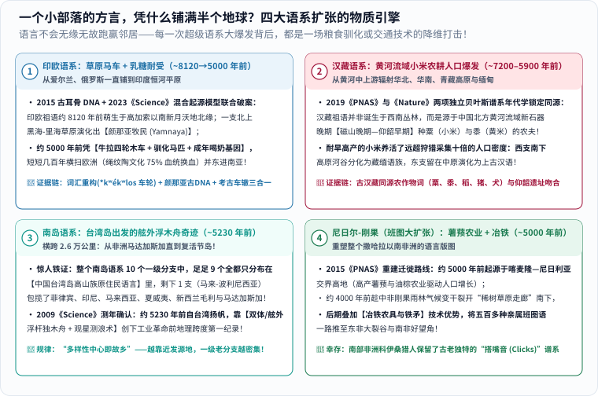
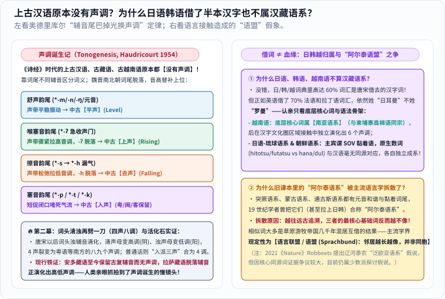
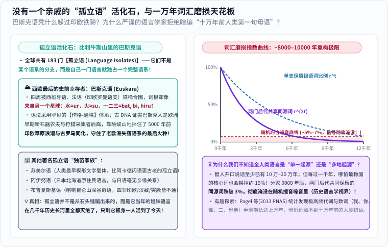

如果你打开手机地图随便点几个角落：在英国伦敦点一杯茶说 *Three*，在意大利罗马说 *Tre*，在俄罗斯莫斯科说 *Tri*（`Три`），再飞越几千公里到印度新德里用印地语或古老梵语说 *Tráyas*——你会突然怔住：**相隔半个地球、肤色与宗教截然不同的民族，怎么连数个“一二三”、喊一声“爸爸妈妈兄弟”，发音骨子里都像从一个模子里刻出来的？**

更让人拍案惊奇的事实还在后面：

- 如果你坐时光机回到两千五百年前的洛阳或曲阜，听孔子和老子当面聊天，你会震惊地发现：**那时候的上古汉语居然根本没有“平上去入”或“妈麻马骂”四个声调**，反倒在词尾挂着一串干脆利落的 `-p`、`-t`、`-k`、`-s` 辅音小尾巴 [[7]](#ref-7)！
- 如果你去非洲东南外海的世界第四大岛——**马达加斯加**旅行，你会发现当地人虽然近在非洲家门口，说的母语却跟非洲大陆语言鸡同鸭讲，反而跟两万多公里外的**中国台湾高山族原住民、菲律宾人、印尼人和夏威夷人**是血脉相连的亲兄弟 [[8]](#ref-8)！
- 而像日语、韩语和越南语，哪怕词典里塞满了超过六成从唐宋中国借过去的汉字词，语言学家却铁面无私地判定：**它们统统不属于汉藏语系**！

今天全人类 $$80$$ 亿人到底说着多少种语言？几千年前连录音机甚至文字都没有的史前部落，究竟靠什么把自己的方言铺满整块大陆，分化成今天蔚为壮观的各大**语系（Language Families）**？让我们像侦探破案一样，把历史比较语言学、考古学与古人类 DNA（详见[《远古遗骸 DNA 保存之谜》]()）三股线索拧在一起，揭开人类语言演化的宏大史诗。

---

## 一、先看地球语言总账：245 个家族、183 棵独苗与惊人的“二八折叠”

### 1. 印欧与汉藏两大家族占走全球六成人口，太平洋一座岛却挤着 840 种语言！

先给全人类的语言摸个家底。根据马克斯·普朗克进化人类学研究所维护的全球语言学权威目录 **Glottolog 5.4** 与《民族语》（**Ethnologue**）最新普查 [[1]](#ref-1)（见图 1）：

- 目前地球上共有 **$$7{,}170\text{–}7{,}685$$ 门活生生的第一语言口语**，分属于 **$$245$$ 个彼此独立的语系**，外加 **$$183$$ 门找不到任何在世亲戚的“孤立语”**——合起来共有 **$$428$$ 条独立的语言血脉** [[1]](#ref-1)！
- 然而，使用者人口的分布却极端不均衡：排名前 $$20$$ 的超级大语言（仅占全球语种总数的 **$$0.3\%$$**）母语使用者加起来超过 **$$37$$ 亿人**！光看前两大巨头——**印欧语系**（英语、西班牙语、印地语、俄语、法语、德语、波斯语等，约 $$32$$ 亿人，占全球约 $$42\%$$，欧洲各国姓氏演变可参看[《破译欧洲姓名的隐藏规律》]()）加上**汉藏语系**（汉语各大方言分支以及藏语、缅甸语、彝语、羌语等，约 $$14$$ 亿人，占全球约 $$18\%$$），**仅仅两个家族就包揽了地球上整整 $$60\%$$ 的人类**！

反过来，如果按“语种数量”和“古老分支密度”排名，地图立刻反转：面积还不如中国四川省加云南省大的太平洋岛国**巴布亚新几内亚**，仅仅一座岛上就挤着超过 **$$840$$ 种互不相通的语言**（超过整个欧洲大陆所有语言总和的十倍！）[[1]](#ref-1)。因为在没有轮船与帝国大一统的几万年里，热带高山深谷把自给自足的芋头农耕部落隔成了一座座孤岛——**只要人群分开不再通婚聊天，原本一模一样的同一种话，过上五百年就会变成带口音的方言，过上一千五百年就会彻底听不懂变成两门独立语言，过上五千年就会裂变成一整个庞大的语系！**

（令人揪心的是，随着现代交通、互联网与义务教育普及，全球目前已有约 **$$44\%$$ 的语言处于濒危状态**，平均每两三周就有一门承载着独特世界观的古老语言随着最后一位白发老人的离世永远沉默 [[1]](#ref-1)。）

*图 1：全球人类语言语系人口规模与语种多样性对比（[单独打开大图](/assets/images/language-families/global-language-families-distribution.svg)）。左栏展示印欧语系与汉藏语系合计占据全球约六成人口的头部集中格局；右栏依据 Glottolog 5.4 与 Ethnologue 数据呈现全球 245 个语系与 183 门孤立语的语种普查及巴布亚新几内亚语言多样性高地。*

---

## 二、没有录音机的远古时代，怎么铁证两门语言是“亲兄弟”？

### 1. 1786 年加尔各答的惊雷，与专门骗外行的“伪同源词陷阱”

文字发明至今不过五千多年（汉字早期符号与造字逻辑详见[《汉字里的造字密码与千年反转》]()），绝大多数史前祖语连半块石碑都没留下。语言学家凭什么敢拍着胸脯画出一棵几千年前的“语言家谱树”？

故事的起点在 **1786 年 2 月 2 日**。当时被派往印度加尔各答担任最高法院法官的英国学者**威廉·琼斯爵士（Sir William Jones）**，为了审理案件研读印度古法典去学了古印度**梵语（Sanskrit）**。结果他越背单词越背脊发凉，随即在亚洲学会发表了载入科学史册的《第三周年演说》[[2]](#ref-2)（见图 2 左栏）：

他发现，古印度梵语不论在动词词根还是语法变格形式上，竟然与几千公里外的**古希腊语、拉丁语**，乃至**哥特语（英语与德语的老祖宗）、凯尔特语和古波斯语**像到了不可思议的地步——**“任何语言学家只要仔细核查这三种语言，都绝不可能相信它们只是巧合，而必然断定它们源自某个或许早已不复存在的共同源头！”** [[2]](#ref-2)

但请注意！如果你以为历史语言学家认亲只是靠“听着发音像”，那就大错特错了——民间业余爱好者最爱掉进的大坑，就叫**伪同源词陷阱（False Cognates）**：

- 比如英语里的 **`much`**（多）和西班牙语里的 **`mucho`**（多），意思完全一样，读音也像双胞胎——可翻开古文献一查：**它们半毛钱血缘关系都没有！** 英语 `much` 来自古英语 *micel*（上溯原始印欧语 `*meǵh₂-`，“巨大”）；西班牙语 `mucho` 则来自拉丁语 *multus*，两词在各自演化几千年后纯属半路撞衫！
- 反过来，英语里的 **`wheel`（车轮）** 和古印度梵语里的 **`cakra`（轮，如瑜伽脉轮）**，乍一看连一个字母都不沾边——可经过严密推演，**它们偏偏是百分之百同胞亲兄弟**，全都源自六千年前原始印欧语里同一个词 **`*kʷékʷlos`**！

### 2. 写《格林童话》的大哥雅各布·格林，破译了震古烁今的“音变密码轮”！

不靠“听着像”，那靠什么？靠两样铁证：**第一，专查最不容易跟外族借用的“核心基础词”**（如语言学家莫里斯·斯瓦迪士列出的百词表：*我、你、水、火、血、眼睛、死、一、二、三*，外加动词变位形态）；**第二，也是最致命的杀手锏——找出“成批整排平移的规则语音对应（Regular Sound Correspondence）”！**

1822 年，全世界小朋友都熟知的《格林童话》两兄弟里的大哥——德国语言学巨匠**雅各布·格林（Jacob Grimm）**，在《德语语法》第二版里公布了一条让语言学瞬间拥有自然科学般预测力的铁律——**格林定律（Grimm's Law）**（见图 2 右栏单次动画）：

格林发现，当初日耳曼部落（英语、德语、荷兰语、北欧诸语的共同祖先）从原始印欧大家庭分家出来时，他们并没有零敲碎打地乱改读音，而是把嘴巴里整整三排塞音辅音，像多米诺骨牌一样**整齐划一地顺时针挪了一格**：

1. 凡是拉丁语、希腊语里保留原始清塞音 **`*p, *t, *k`** 的词，进到英语祖先嘴里，**一个不落全变成了清擦音 `f, th(þ), h`**：
   - 拉丁语 ***p**ater*（父）$$\to$$ 英语 ***f**ather*；拉丁语 ***p**iscis*（鱼）$$\to$$ 英语 ***f**ish*；拉丁语 ***p**ēs / **p**ed-*（脚，如踏板 pedal）$$\to$$ 英语 ***f**oot*！
   - 拉丁语 ***t**rēs*（三）$$\to$$ 英语 ***th**ree*；拉丁语 *noc**t**-*（夜）$$\to$$ 英语 *nigh**t***（古日耳曼 `*naht-`）！
2. 凡是拉丁语里读浊塞音 **`*d, *g`** 的词，进到英语祖先嘴里，**全部填补空缺变成了清塞音 `t, k`**：
   - 拉丁语 ***d**uo*（二）$$\to$$ 英语 ***t**wo*；拉丁语 ***d**ecem*（十，如十进制 decimal）$$\to$$ 英语 ***t**en*；拉丁语 ***d**ent-*（牙，如牙医 dentist）$$\to$$ 英语 ***t**ooth*！
3. 凡是原始印欧语里读送气浊塞音 **`*bʰ, *dʰ, *gʰ`** 的词，则统一脱掉送气变成普通浊音 **`b, d, g`**（如 `*bʰréh₂tēr` $$\to$$ ***b**rother*）！

最传奇的一幕发生在半个世纪后的 1875 年：当时学者们抓住了格林定律里唯一一处恼人的“破绽”——为什么同样是词中的 `*-t-*`，原始印欧语 `*bʰréh₂tēr`（兄弟）在古日耳曼语里乖乖变成了清音 `*brōþēr`，可 `*ph₂tḗr`（父亲）在古日耳曼语里却莫名其妙浊化成了 `*faðēr`？难道音变规律也有看心情失灵的时候吗？

丹麦青年学者卡尔·维尔纳（Karl Verner）一头扎进吠陀梵语古经卷，猛然拍案而起（**维尔纳定律**）：看梵语保留的远古重音位置！在 *bhrā́tar-* 里，**重音落在 `-t-` 前面**，气流冲过去后依然保住清音；而在 *pitár-* 里，**重音偏偏落在 `-t-` 后面**，夹在非重读音节后面的清擦音被前后元音同化成了浊音！连唯一的“例外”背后竟然都藏着更精密的子定律——这促使青年语法学派喊出了现代语言学的立身宣言：**“语音演变铁律没有无缘无故的例外！”**

*图 2：1786 年威廉·琼斯同源词矩阵与 1822 年格林定律链式音变单次动画（[单独打开大图](/assets/images/language-families/comparative-method-and-grimms-law.svg)，刷新可重播三步音变轮动画）。左栏对比梵语、古希腊语、拉丁语、英语与拟构原始印欧语核心词，并剖析伪同源词陷阱；右栏展示格林定律三排塞音擦音链移及维尔纳重音定律。*

---

## 三、一个史前小村落的方言，凭什么铺满半个地球？四大语系扩张之谜

学会了画语言家谱树，第二个更宏大的历史问题立刻摆在眼前：**在五千到八千年前的新石器时代，地球上原本散布着成千上万个互不统属的狩猎采集小部落语言；凭什么唯独印欧、汉藏、南岛和班图这几个小部落的母语脱颖而出，像洪水一样吞没了周边成百上千种古老语言，长成了横跨大陆的超级语系？**

过去十年里，随着**古人类内耳岩骨 DNA 测序革命**与**贝叶斯演化谱系年代学**联手，这四桩悬置百年的史前大案终于水落石出——答案惊人一致：**每一次超级语系大爆发，本质上都是一场“农业热量爆炸”或“交通军事黑科技”的人口降维打击！**（见图 3 四宫格）

### 1. 印欧语系：牛拉木轮车、骑马术与“成年喝鲜奶外挂”（约 8120 → 5000 年前）

关于原始印欧人到底住在哪里，学界曾争吵了整整一百年：“安纳托利亚农夫假说”认为他们是九千年前从土耳其种麦子慢慢走去欧洲的农夫；而“库尔干草原假说”则指出一个致命漏洞——**所有印欧古老分支里都共同继承了 `车轮 (*kʷékʷlos)`、`车轴 (*h₂éḱs-)`、`车辕` 和 `马 (*h₁éḱwos)` 的同源词**，而人类发明轮子和马车不过是距今约五六千年前的事！如果九千年前就分家了，大家怎么会用同一个词叫车轮？

2015 年哈佛医学院大卫·赖希（David Reich）与沃尔夫冈·哈克（Wolfgang Haak）团队在《自然》发表了里程碑式的 69 例古欧洲人基因组研究 [[3]](#ref-3)，紧接着 2023 年保罗·赫加蒂（Paul Heggarty）等八十多位学者在《科学》提出**印欧语混合起源模型** [[4]](#ref-4)，彻底拼齐了真相：

- 大约 **$$8{,}120$$ 年前**，最早的原始印欧母语萌生于高加索山脉以南（新月沃地北缘），一支早早向西留下了安纳托利亚古语（如赫梯语）；
- 另一支越过高加索山北上进入今乌克兰与俄罗斯南部的**黑海—里海大草原**，演化出了彪悍的**颜那亚游牧文化（Yamnaya）** [[3]](#ref-3) [[4]](#ref-4)；
- 距今约 **$$5{,}000$$ 年前**，颜那亚牧民同时凑齐了三件史前超级神器：**牛拉四轮大木车（移动房车）、驯化马匹（机动侦察与放牧），以及让他们成年后喝牛羊奶不拉肚子的乳糖酶持续表达基因突变**！原本无人能活的干旱大草原瞬间变成了移动粮仓。颜那亚人推着木轮车向西狂飙突进——古 DNA 显示，短短几百年内，中北欧绳纹陶文化人群高达 **$$75\%$$ 的基因组血统被草原牧民直接替换** [[3]](#ref-3)，另一路则向东越过中亚草原南下伊朗高原与印度河流域，一举铸就了从大西洋到恒河的印欧语言帝国！

### 2. 汉藏语系：黄河流域一碗小米（粟与黍）养出的十四亿人家谱（约 7200–5900 年前）

那我们自己每天说的汉语，又是怎么跟青藏高原上的藏语、缅甸伊洛瓦底江畔的缅甸语、大凉山的彝语同出一源的呢？

2019 年，法国沙加尔（Laurent Sagart）团队在《美国国家科学院院刊》（*PNAS*）[[5]](#ref-5)，以及复旦大学张梦翰、金力院士团队在《自然》（*Nature*）[[6]](#ref-6)，几乎前后脚独立发表了基于核心同源词贝叶斯系统发育分析的重磅成果，得出了高度一致的结论：

- **原始汉藏母语并非诞生于西南热带森林，而是诞生于中国北方黄河中上游的新石器晚期——磁山文化晚期至仰韶文化早期（距今约 $$7{,}200\text{–}5{,}900$$ 年前）！** [[5]](#ref-5) [[6]](#ref-6)
- 点燃这场语言大扩张的物质引擎，正是中国北方先民率先驯化的耐旱黄金口粮——**粟（小米）与黍（大黄米）**，辅以家猪与家犬（这些词在古汉语与古藏缅语里拥有严丝合缝的同源对应）[[5]](#ref-5)！
- 小米农业让黄河流域人口密度暴涨十倍以上：其中**西支先民**带着小米沿着陇西走廊向西、向南翻山越岭走入青藏高原与横断山脉深谷，一步步分化成了四百多种**藏缅语族**语言；而留守黄河中下游平原的**东支先民**，则吸收融合周边族群，一路演化成了甲骨文、金文、《诗经》里的**上古汉语**，并在秦汉以后随人口南迁分化出官话、吴语、粤语、闽语、客家话、湘语、赣语等绚烂分支！

### 3. 南岛语系与班图大扩张：台湾出发的双体帆船与非洲铁器农夫

地球另外两场壮阔的语言迁徙同样荡气回肠：

- **南岛语系（Austronesian，约 $$1{,}250$$ 种语言，工业革命前地理跨度世界第一！）** [[8]](#ref-8)：如果你把南岛语系的家谱画出来，会看到历史语言学“**多样性中心即发源地**”定律最震撼的教科书案例——整个南岛语系共有 $$10$$ 个平起平坐的一级老分支，其中**足足 $$9$$ 个分支全都只住在中国台湾岛的高山族原住民村落里**（阿美语、排湾语、泰雅语、布农语等），而门下包揽了菲律宾、印尼、马来西亚、夏威夷、新西兰毛利语、复活节岛拉帕努伊语乃至非洲东岸马达加斯加语的千余种外海语言，居然**全都是第 10 个分支（马来—波利尼西亚语族）一家生出来的子孙**！2009 年格雷（Russell D. Gray）团队在《科学》杂志精确测定 [[8]](#ref-8)：正是在距今约 **$$5{,}230$$ 年前**，先民从福建渡海定居台湾后，发明了抗风浪无敌的**舷外浮杆独木舟（Outrigger Canoe）与双体远洋帆船**，顶着太平洋信风一路跳岛远航两万六千公里，写下了全人类最伟大的航海史诗！
- **尼日尔—刚果语系班图大扩张（Bantu Expansion，约 $$5{,}000$$ 年前）** [[9]](#ref-9)：2015 年《PNAS》研究揭示，原本居住在喀麦隆与尼日利亚交界高地的原始班图农夫，靠着高产的**薯蓣（山药类）、油棕农业**以及随后的**冶铁砍刀与铁矛**，趁着约四千年前中非刚果雨林气候变干裂开稀树草原走廊，在几千年里一路南下直到南非，把五百多种亲属班图语铺满了大半个非洲（唯有南部非洲荒漠里的科伊桑猎人顽强保住了古老神奇的“搭嘴音 Clicks”语言）[[9]](#ref-9)。

*图 3：印欧、汉藏、南岛与非洲班图四大语系史前扩张物质引擎对比（[单独打开大图](/assets/images/language-families/farming-steppe-canoe-four-expansions.svg)）。汇总古 DNA、考古学与词汇谱系树证据，展示草原木轮马车与乳牧、黄河流域粟黍农耕、台湾舷外浮杆独木舟远航以及非洲薯蓣农业与铁器如何驱动四大超级语系成型。*

---

## 四、破解两大热门迷思：声调是怎么无中生有长出来的？日语韩语为何不姓“汉”？

### 1. 孔子说话真没四声！奥德里库尔揭秘“辅音小尾巴掉光换声调”

很多母语是普通话或粤语的朋友都有一个天然错觉：觉得“声调”肯定是从盘古开天辟地起就刻在汉藏语基因里的。然而清代古音学家段玉裁、孔广森在研究《诗经》押韵时早就察觉了蹊跷，直到 **1954 年法国语言学大师安德烈-乔治·奥德里库尔（André-Georges Haudricourt）**发表研究越南语与汉语声调起源的传世论文 [[7]](#ref-7)，彻底揭开了**声调发生学（Tonogenesis）**的秘密（见图 4 左栏）：

**原来，《诗经》与先秦时代的上古汉语、古藏语、古越南语，统统都是没有声调的语言！** 那时候古人怎么区分同音词呢？靠的是词尾拖着的不同**辅音小尾巴**！到了东汉至魏晋南北朝时期，人们说话图省事，词尾辅音纷纷磨损脱落——为了不让成百上千个词混成同音词，大脑巧妙地把**原本发词尾辅音时声带的松紧惯性，转化成了元音的高低旋律（声调）** [[7]](#ref-7)：

1. **原本以元音或鼻音（`*-m, *-n, *-ŋ`）收尾的词**：气流舒缓平稳，声带不紧不松 $$\to$$ 变成平稳的中古**平声**；
2. **原本以喉塞音（`*-ʔ`）收尾的词**：发喉塞音时声门要猛地绷紧关闭，把前面元音的尾音骤然拉高；后来 `-ʔ` 脱落不读了，这股往上挑的高音留了下来 $$\to$$ 变成了昂扬的中古**上声**！
3. **原本以清擦音（`*-s`，后弱化为气息音 `*-h`）收尾的词**：漏气时声带自然放松下沉，音高往下滑；后来 `-s/-h` 彻底消失，下滑旋律留了下来 $$\to$$ 变成了往下降的中古**去声**！
4. **原本以闭口塞音（`*-p, *-t, *-k`）收尾的词**：发音短促急收 $$\to$$ 保持为中古**入声**（今天粤语、闽南话、客家话里读 `一 jat1`、`六 luk6`、`十 sap6` 那种短促收住的音，正是活生生的古汉语辅音尾巴遗存！）。

紧接着在唐宋之际，词头的清辅音（如 `p, t, k`）与浊辅音（如 `b, d, g`）合并清化，原本浊声母字声带低沉，于是把“平上去入”四声整齐一劈为二（**清浊分阴阳**），变成了 **四声八调**（粤语至今保留九声六调；北方官话后来把入声字分派进平上去三声，定型为今天的阴平、阳平、上声、去声四声）。

更棒的是，大自然今天还在青藏高原现场直播这一过程：青海牧区的**安多藏语**至今保留着上古藏语复杂的词头复辅音，所以**至今没有声调**；而西藏**拉萨藏语**磨掉了复辅音和部分韵尾，**正在我们眼皮底下演化出清晰的高低声调**！

### 2. 日语、韩语、越南语借了六成汉字词为何不算汉藏语系？“阿尔泰语系”为何解体？

第二个大家最常问的疑惑是：**日语、韩语、越南语里一大半词汇听起来跟粤语或闽南话像极了（比如韩语“图书馆”读 *doseogwan*，越南语“历史”读 *lịch sử*），为什么语言学家坚决不把它们划进汉藏语系？还有以前历史课本上常提的“阿尔泰语系（突厥+蒙古+满通古斯）”，怎么现在国际学界都不认了？**（见图 4 右栏）

一句话就能点透：**借来的衣服穿得再厚，也改不了亲生父母的 DNA！**

想想英语就明白了：1066 年法国诺曼底公爵征服英格兰后，法语和拉丁语词汇像潮水一样涌入英语，导致今天英语词典里超过 **$$60\%\text{–}70\%$$** 的词（*beef, pork, justice, science, university*）全是罗曼语族借词！可只要你剥掉这层华丽礼服，看英语最底层的日常骨架——*I, you, water, fire, hand, one, two, three, sing/sang/sung*——全都是纯粹的日耳曼祖传词根！所以英语永远姓“日耳曼”，绝不姓“法语”。

日、韩、越也是完全一样的道理：

- **越南语**虽然在汉唐千年接触中借入了海量汉越词并仿照汉语机制长出了 $$6$$ 个声调，但剥开表层借词一看，它说“水、火、手、鱼、一二三”的原生底层词，与柬埔寨高棉语、孟语严丝合缝同源——所以越南语铁板钉钉属于**南亚语系（Austroasiatic）**！
- **日语（日琉语系）**与**韩语（朝鲜语系）**把宾语放在动词前面（主—宾—谓 `SOV`，如“我饭吃”），靠一长串黏着助词表达语法，原生数词（日语 *hitotsu, futatsu, mittsu*；韩语 *hana, dul, set*）与汉藏语找不到任何规则音变对应，因此在现代 Glottolog 分类中各自独立成系 [[1]](#ref-1)。
- 至于旧教材里的**“阿尔泰语系”**：19 世纪学者见突厥语、蒙古语、满—通古斯语都有“元音和谐”与“黏着词尾”，还共享不少草原词汇，便把它们绑成一家。谁知 20 世纪下半叶学者用严苛的历史比较法一筛查，尴尬了：**把草原游牧民族几千年混居结盟互相借用的词汇剔除干净后，越往远古重构，突厥、蒙古、通古斯三者的核心基础词反而越不像！** 因此当今绝大多数主流语言学家已将“阿尔泰”重新定性为**语言联盟 / 语盟（Sprachbund）**——也就是长期做邻居越长越像的朋友群，而非同一个娘胎出来的亲兄弟。（注：2021 年马丁娜·罗比茨团队在《自然》提出将日、韩、突厥、蒙古、通古斯归结于九千年前辽河流域种黍农夫的“泛欧亚语系 Transeurasian”假说 [[10]](#ref-10)，但因核心同源词筛选标准争议极大，目前仍属于少数派探讨假说。）

*图 4：声调发生学定律与汉字圈借词及阿尔泰语盟辨析（[单独打开大图](/assets/images/language-families/tonogenesis-and-sprachbund-traps.svg)）。左栏图解 1954 年奥德里库尔揭示的词尾辅音脱落与词头清浊分化生成四声八调机制；右栏剖析日韩越汉语借词层与底层语法骨架的区别，以及阿尔泰语系被主流学界修正为草原语言联盟的原因。*

---

## 五、孤独的活化石与一万年视界：为什么算不出“全人类第一句母语”？

### 1. 西欧深山里的史前独苗：跟全世界谁都不沾亲的巴斯克语

在欧洲西南角西班牙与法国交界的比利牛斯深山里，生活着一群说**巴斯克语（Basque / *Euskara*）**的山民 [[11]](#ref-11)（见图 5 左栏）。

它四周被西班牙语、法语、葡萄牙语等印欧罗曼语围得水泄不通；可只要你听巴斯克人开口数数或叫水和火——水叫 `ur`，火叫 `su`，一二三叫 `bat, bi, hiru`，语法采用极特殊的“作格—通格”结构——全欧洲的语言学家翻烂了全世界几千种语言的词典，竟找不到**任何一门**跟它同源的亲戚！

它不是外星人留下的语言，而是我们前面提到的全球 **$$183$$ 门孤立语（Language Isolates）**中最传奇的代表 [[1]](#ref-1) [[11]](#ref-11)（同属孤立语的还有发明人类最早楔形文字的**苏美尔语**、日本北海道原住民的**阿伊努语**等）。古 DNA 测序揭开了巴斯克语幸存的秘密：在五千年前颜那亚印欧铁骑横扫欧洲之前，“老欧洲”大陆上原本百花齐放地说着许多早期新石器农夫与狩猎采集者的本土语系；后来那些语系在印欧浪潮与罗马帝国扩张中全军覆没，**唯独躲在险峻比利牛斯山谷里的巴斯克语，像一株冰河期幸存的银杏树一样，单枪匹马把前印欧时代的老欧洲母语火种守到了今天！**

### 2. 一万年词汇磨损天花板：为什么语言学家拒绝瞎猜“十万年前的原始人类语”？

最后，一个终极追问呼之欲出：**既然智人早在十万到二十万年前就已经在非洲演化出了成熟的现代大脑与发音器官，那今天地球上这 $$245$$ 个语系和 $$183$$ 门孤立语，在十万年前是不是都来自同一门“原始世界母语（Proto-World）”？我们能不能把人类说出的第一句话复原出来？**

严肃的历史语言学家会非常坦诚地摇摇头告诉你：**大概率存在过极早期的非洲智人语言，但无论它是单一起源还是多地起源，超过 $$8{,}000\text{–}10{,}000$$ 年的远古词汇信号已经永久蒸发在数学噪音里了！**（见图 5 右栏定量衰减曲线）

算一笔简单的概率账就全明白了：

- 哪怕是最抗拒借用的斯瓦迪士百词核心表，每一千年也会因为比喻替换、避讳或音变而自然换掉约 $$14\%\text{–}20\%$$ 的词（取每千年保留率 $$r \approx 0.81$$）；
- 单支语言走过 $$t$$ 千年后保留祖语词的比例为 $$r^t$$；而**两门分道扬镳的后代语言在同一个词义上恰好都保留住当年祖语词根的概率，则是两者的乘积 $$r^{2t}$$**！
- 当分家 $$3{,}000$$ 年时（如拉丁语、希腊语、梵语之间），共同保留的核心同源词还有 $$0.81^6 \approx 28\%$$，铁证如山；
- 可一旦分家跨过 **$$9{,}000\text{–}10{,}000$$ 年**，共同幸存的同源词骤跌至 $$0.81^{20} \approx 1.5\%$$，而且早已被几轮面目全非的音变碾碎！要知道，随便从地球两头抓两门毫无关系的语言硬凑发音相似词，光靠人类嘴巴有限的几十个元音辅音**随机撞衫巧合率都有 $$5\%\text{–}7\%$$**！当真实遗传信号跌破随机巧合底线时，任何强行拼接“原始世界语”的尝试，在统计学上都跟看云彩认动物没有区别。（英国演化生物学家马克·佩格尔团队 2013 年在《PNAS》发现 *我、你、谁、二、母亲* 等二十来个超高频词半衰期可达上万年 [[12]](#ref-12)，能隐约窥探约一万五千年前欧亚超语系的微光，但距离十万年前的人类初语依然隔着深不可测的时间海洋。）

*图 5：孤立语活化石与历史比较语言学一万年重构极限（[单独打开大图](/assets/images/language-families/basque-isolates-and-ten-millennia-horizon.svg)）。左栏介绍西欧前印欧幸存孤立语巴斯克语及苏美尔语、阿伊努语；右栏绘制单支保留率 $$r^t$$ 与双支共享同源词率 $$r^{2t}$$ 指数衰减曲线，说明为何约八千至一万年以上的远古母语因跌破随机巧合噪音线而无法可靠重构。*

---

## 六、总结：每一门语言，都是一部活在舌尖上的无字史书

回望全人类各大语系波澜壮阔的演化历程，四条核心脉络清晰可见：

1. **分化源于隔离**：只要人群迁徙隔绝，微小的日常语音漂变经过千百年累积，必然从方言裂变为独立语言乃至庞大语系；
2. **认亲全凭音律**：甄别语言血缘绝不看表面借词或偶然撞音，而是靠核心基础词与格林定律式的**无例外规则语音对应**；
3. **扩张紧跟粮船**：草原马车与乳牧催生了印欧语系，黄河流域的小米农耕孕育了汉藏语系，台湾出发的舷外浮木舟扬起了南岛语系，山药与铁器铺开了非洲班图语族；
4. **结构生生不息**：从无声调的上古辅音尾巴蜕变为抑扬顿挫的四声八调，到深山孤立语顽强守护万年火种，人类的每一声问候里，都回荡着祖先翻山越海的脚步声。

---

## 参考资料与核查来源

1. Hammarström, H., Forkel, R., Haspelmath, M., & Bank, S. (2024/2025). *Glottolog 5.4* — Language Information ([马普进化人类学研究所 Glottolog 官方统计](https://glottolog.org/glottolog/glottologinformation))；以及 SIL International, *Ethnologue*: How many languages are there in the world? ([Ethnologue 官方普查](https://www.ethnologue.com/insights/how-many-languages/))（支持：全球 $$7{,}685$$ 门第一语言口语归入 $$245$$ 个语系与 $$183$$ 门孤立语、现存 $$7{,}170$$ 门活语言中约 $$44\%$$ 濒危及头部人口分布）
2. Jones, W. (1786). *The Third Anniversary Discourse, delivered 2 February 1786, On the Hindus*. Asiatick Society of Bengal. [莱斯大学语言学经典文献档案](https://www.ruf.rice.edu/~kemmer/Words/jones.html)（支持：1786 年威廉·琼斯爵士首次科学论证梵语、古希腊语、拉丁语与日耳曼、凯尔特、波斯语源自共同史前祖语）
3. Haak, W., Lazaridis, I., Patterson, N., et al. (2015). Massive migration from the steppe was a source for Indo-European languages in Europe. *Nature*, 522, 207–211. [PMC5048219 全文](https://pmc.ncbi.nlm.nih.gov/articles/PMC5048219/)（支持：69 例古基因组证实约 4500–5000 年前黑海—里海颜那亚草原牧民大规模迁入欧洲并贡献绳纹陶文化约 $$75\%$$ 血统）
4. Heggarty, P., Anderson, C., Scarborough, M., et al. (2023). Language trees with sampled ancestors support a hybrid model for the origin of Indo-European languages. *Science*, 381(6656), eabg0818. [DOI: 10.1126/science.abg0818](https://doi.org/10.1126/science.abg0818) 及 [马普学会官方解读](https://www.mpg.de/20666229/new-insights-into-the-origin-of-the-indo-european-languages)（支持：印欧语系约 $$8{,}120$$ 年前高加索以南起源与约 $$5{,}000$$ 年前草原车马二次大扩张混合模型）
5. Sagart, L., Jacques, G., Lai, Y., et al. (2019). Dated language phylogenies shed light on the ancestry of Sino-Tibetan. *PNAS*, 116(21), 10317–10322. [PMC6534992 全文](https://pmc.ncbi.nlm.nih.gov/articles/PMC6534992/)（支持：汉藏语系约 $$7{,}200$$ 年前起源于中国北方黄河流域磁山晚期—仰韶早期粟黍农耕人群）
6. Zhang, M., Yan, S., Pan, W., & Jin, L. (2019). Phylogenetic evidence for Sino-Tibetan origin in northern China in the Late Neolithic. *Nature*, 569, 112–115. [DOI: 10.1038/s41586-019-1153-z](https://doi.org/10.1038/s41586-019-1153-z)（支持：独立贝叶斯谱系分析印证汉藏语系约 $$5{,}900$$ 年前北方黄河流域新石器晚期粟作农业起源）
7. Haudricourt, A.-G. (1954). De l'origine des tons en vietnamien. *Journal Asiatique*, 242, 69–82. [法国国家开放科学档案 HAL 原文](https://hal.science/halshs-01678018)（支持：声调发生学经典定律——古越南语与上古汉语原本无声调，因词尾喉塞音 `*-ʔ` 与擦音 `*-s/-h` 脱落及词头清浊分化生成声调系统）
8. Gray, R. D., Drummond, A. J., & Greenhill, S. J. (2009). Language Phylogenies Reveal Expansion Pulses and Pauses in Pacific Settlement. *Science*, 323(5913), 479–483. [DOI: 10.1126/science.1166858](https://doi.org/10.1126/science.1166858)（支持：南岛语系约 $$5{,}230$$ 年前起源于中国台湾岛及随后向太平洋与印度洋马达加斯加的脉冲式航海扩张）
9. Grollemund, R., Branford, S., Bostoen, K., et al. (2015). Bantu expansion shows that habitat alters the route and pace of human dispersals. *PNAS*, 112(43), 13296–13301. [DOI: 10.1073/pnas.1503793112](https://doi.org/10.1073/pnas.1503793112)（支持：尼日尔—刚果语系班图语族约 $$5{,}000$$ 年前自喀麦隆高地出发、经雨林稀树草原走廊南下的扩张路线）
10. Robbeets, M., Bouckaert, R., Conte, M., et al. (2021). Triangulation supports agricultural spread of the Transeurasian languages. *Nature*, 599, 616–621. [DOI: 10.1038/s41586-021-04108-8](https://doi.org/10.1038/s41586-021-04108-8)（支持：关于日、韩、突厥、蒙古、通古斯语言的“泛欧亚语系”黍农起源探讨假说及与主流“阿尔泰语言联盟”观点的学术讨论）
11. Glottolog 5.4 — Languoid: Basque (`basq1248`). [Glottolog 巴斯克语档案](https://glottolog.org/resource/languoid/id/basq1248)（支持：巴斯克语作为无任何已知谱系亲属的西欧孤立语分类地位）
12. Pagel, M., Atkinson, Q. D., Calude, A. S., & Meade, A. (2013). Ultraconserved words point to deep language ancestry across Eurasia. *PNAS*, 110(21), 8471–8476. [Europe PMC 档案](https://europepmc.org/article/MED/23650390)（支持：核心词替换速率导致常规历史比较法受限于约八千至一万年视界，仅极少数超高频词可保留上万年微弱信号）
