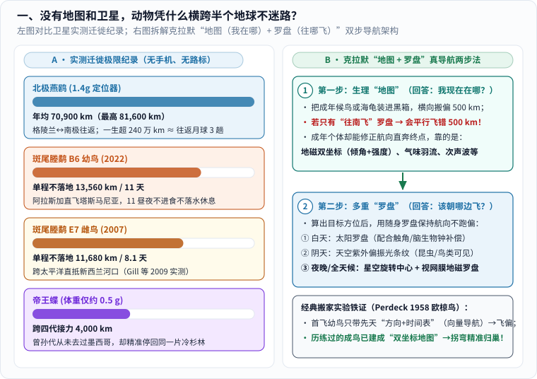
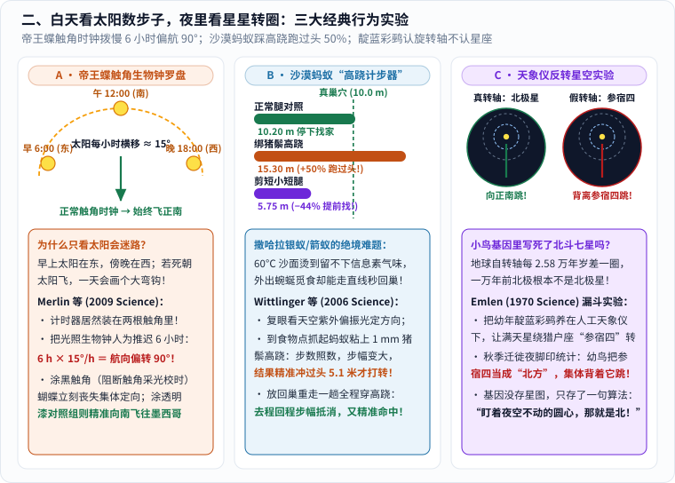
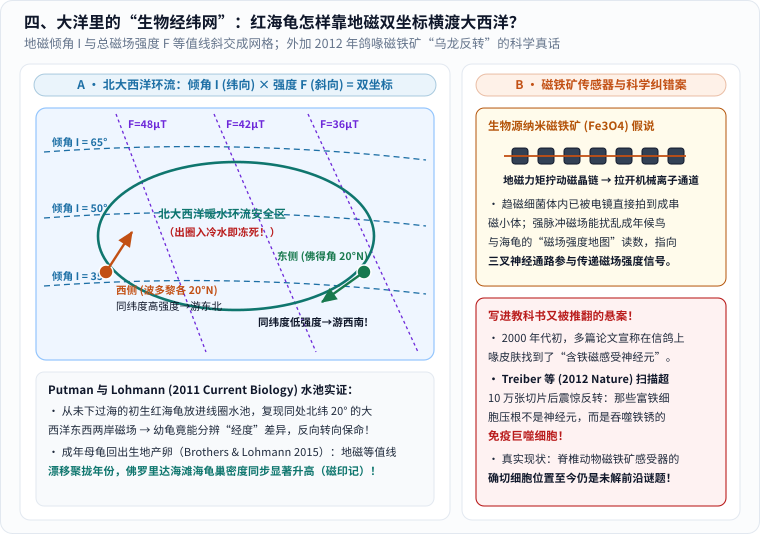
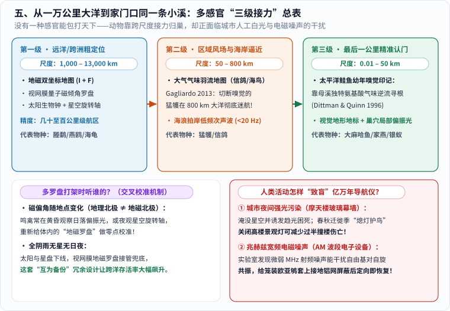

先想象一个把人类飞行员逼到绝望的极限挑战：

把你塞进一架没有任何电子仪表、没有无线电、没有海图、连指南针都被没收的超轻型滑翔机里，在秋风凛冽的阿拉斯加育空河三角洲把你推上天空，要求你横跨茫茫无际、连一座落脚荒岛都难找的太平洋，在海上狂风、暴雨、浓雾和黑夜里连续飞行十几天，一滴淡水不能喝、一口食物不能吃，最后精准降落在南半球一万三千多公里外的一片泥滩上。

在人类世界里，这几乎等于自杀；但在自然界，这只是一只**刚满四个月的未成年小鸟人生第一次独立出远门**。

2022 年 10 月 13 日，一只腿上戴着 `B6` 环志、背上粘着一枚仅重 $$5\ \mathrm{g}$$ 太阳能卫星信标的四月龄**斑尾塍鹬（*Limosa lapponica*）**幼鸟从阿拉斯加起飞，连续扇翅 **$$11$$ 个昼夜**，中间没有落水休息一秒钟，一口气飞完了 **$$8{,}425$$ 英里（约 $$13{,}560\ \mathrm{km}$$）**，于 10 月 24 日稳稳降落在澳大利亚塔斯马尼亚州的安森斯湾——创下了人类有卫星追踪记录以来鸟类单程不落地飞行的最高世界纪录 [[2]](#ref-2)。早在 2007 年，鸟类学家罗伯特·吉尔（Robert E. Gill Jr.）团队追踪的雌鸟 `E7` 也曾以 $$8.1$$ 天不落地直飞 $$11{,}680\ \mathrm{km}$$ 抵达新西兰河口 [[1]](#ref-1)。

如果再看耐力总里程，体重不到 $$125\ \mathrm{g}$$（大约两颗鸡蛋重）的**北极燕鸥（*Sterna paradisaea*）**每年在格陵兰繁殖地与南极浮冰区之间往返迁徙，微型地理定位器实测年均飞行里程高达 **$$70{,}900\ \mathrm{km}$$**（最高个体达 $$81{,}600\ \mathrm{km}$$）——活上三十年的北极燕鸥，一生累计飞行超过 **$$240$$ 万公里**，相当于**在地球与月球之间来回飞了整整三趟** [[3]](#ref-3)！更不可思议的是体重只有 $$0.5\ \mathrm{g}$$ 的北美**帝王蝶（*Danaus plexippus*）**：每年秋天南迁墨西哥冷杉林的那一代蝴蝶，已经是春天北飞祖先的**曾孙辈（隔了整整三四代）**——它的父母、爷爷奶奶全都死在了半路上，这只从未去过墨西哥的小昆虫，凭什么能跨越近 $$4{,}000\ \mathrm{km}$$ 找回太爷爷过冬的那几座山头 [[4]](#ref-4)？

没有卫星星座、没有纸质地图、也没有老鸟手把手发坐标，动物大脑里到底藏着怎样一套逆天的导航黑科技？今天我们就顺着过去七十年最精彩的生物学判决实验，把动物的**天空罗盘、步幅积分仪、视网膜量子自旋罗盘与大洋地磁经纬网**一层层拆开来看。

---

## 一、先拆底层架构：只带“指南针”根本到不了家！克拉默的“地图 + 罗盘”两步铁律

### 1. 一个直击灵魂的思想实验：把你蒙上眼空投到陌生森林，给你指南针有用吗？

很多人一听“动物导航”，第一反应就是：“那还不简单！动物脑子里肯定长着一块天然指南针，知道哪边是南、哪边是北呗！”

慢着——请你闭上眼睛想三秒钟：假如现在有人把你装进密闭黑箱，坐直升机飞了两个小时，把你扔在一片完全陌生的荒野里。这时候交给你一只全世界最准的军用指北针，指针清清楚楚指着正北方。请问：**你知道自己家在哪个方向吗？**

**完全不知道！** 因为指北针只能告诉你“哪边是北”，却回答不了更致命的前半个问题——**“我现在在家的东边、西边、南边还是北边？”** 如果你此刻其实被扔在了家的正东边 $$500\ \mathrm{km}$$ 处，你却死心塌地照着老规矩“一路往南走”，最后只会跟自己的家擦肩而过、平行偏离整整 $$500\ \mathrm{km}$$！

1950 年代，德国鸟类学家古斯塔夫·克拉默（Gustav Kramer）一针见血地指出：任何真正的远距离归巢导航（True Navigation），都必须拆解成两个截然不同、缺一不可的物理模块——**“地图步骤（Map Step）”加“罗盘步骤（Compass Step）”**：

1. **第一步是“生理地图”（回答：我现在在哪？目标相对于我在什么方位？）**——动物必须先读取当地随空间位置变化的物理梯度（比如地磁倾角、磁场总强度、大气气味分布等），推算出自己相对目的地的方位；
2. **第二步才是“随身罗盘”（回答：选定航向后，怎么在茫茫大海和夜空里保持直线不跑偏？）**——动物利用太阳、偏振光、星空或地磁倾角充当方向标尺，锁死航向往前飞。

### 2. 一万只欧椋鸟的“跨国搬家大实验”：抓住了幼鸟与成鸟的惊人分野

怎么证明动物真的分成了“只有罗盘”和“既有地图又有罗盘”两套程序？1958 年，荷兰鸟类学家阿尔伯特·佩尔德克（Albert Perdeck）做了一场载入教科书的万人级搬家实验：

他在荷兰海牙捕捉了超过 **$$11{,}000$$ 只**正准备往西南方向飞往英吉利海峡两岸（英国南部与法国北部）越冬的**欧椋鸟（*Sturnus vulgaris*）**，给它们戴上脚环后装上飞机，一口气往东南方向横向搬偏了数百公里，在瑞士放飞：

- **从来没飞过这条路的当年幼鸟**：被放飞后，依然傻乎乎地严格按照基因里写死的“往西南飞固定天数”程序（生物学家称为**时钟—向量导航 Clock-and-Vector Navigation**），结果整条航线跟正常路线平行南移，最后全飞到了西班牙和法国南部——证明首飞幼鸟手里**只有罗盘和里程表，还没有建成真正的地图**！
- **已经飞过至少一个来回的成年老鸟**：在瑞士被放飞后，立刻察觉“不对劲，我被搬到东南边来了！”，当场把航向修正为**向西北偏西飞**，跨越陌生陆地精准回到了原本在英法海峡边的老越冬地——铁证如山地证明：**成年候鸟脑中真的建成了一张能定位陌生坐标的“双坐标生理地图”**！

*图 1：动物迁徙极限实测纪录与克拉默“地图 + 罗盘”两步导航架构（）。先看左栏四组实测标尺：从年飞 $$7.09$$ 万公里的北极燕鸥、单程 $$11$$ 昼夜不落地横跨太平洋 $$13{,}560\ \mathrm{km}$$ 的斑尾塍鹬幼鸟 `B6`，到跨四代接力的半克帝王蝶；再看右栏两步流程图——只有把定位坐标的“地图”与锁死航向的“罗盘”拼在一起，被横向搬偏的成年个体才能拐弯精准归巢。*

---

## 二、白天看太阳数步子，夜里看星星转圈：破译天空罗盘的三场神级实验

我们先从相对好懂的“罗盘模块”拆起。白天最显眼的天体当然是太阳，夜里最显眼的当然是满天繁星。但要把太阳和星星当罗盘用，动物必须先跨过两个巨大的几何陷阱！

### 1. 帝王蝶的“触角生物钟罗盘”：把时钟拨慢 6 小时，蝴蝶当场飞偏 90 度！

先想第一个陷阱：**太阳在天上根本不是静止不动的！**

由于地球每 $$24$$ 小时自转 $$360^\circ$$，在北半球中纬度观察者眼里，太阳平均每小时会在天空横着走过：

$$
\omega_{\text{日}} = \frac{360^\circ}{24\ \mathrm{h}} = 15^\circ/\mathrm{h}
$$

清早 $$6{:}00$$ 太阳在东边，正午 $$12{:}00$$ 跑到正南边，傍晚 $$18{:}00$$ 又落到西边。如果一只准备从加拿大往正南方墨西哥飞的帝王蝶，脑子里只有一句死命令“朝着太阳飞”，那它早上会往东飞进大西洋，中午往南飞，下午又往西飞进太平洋，一天下来在地图上画出一道大弯钩！

要拿太阳定正南，蝴蝶体内必须自带一块精准走时的**昼夜节律生物钟（Circadian Clock）**：早上 $$9{:}00$$ 知道“正南在太阳右边约 $$45^\circ$$”，正午 $$12{:}00$$ 知道“正南就在太阳正下方”，下午 $$15{:}00$$ 知道“正南换到太阳左边约 $$45^\circ$$ 了”！

这块时钟到底藏在帝王蝶身体的哪个零件里？以前科学家理所当然以为时钟肯定长在大脑里。直到 2009 年，马萨诸塞大学史蒂文·雷珀特（Steven M. Reppert）团队的克里斯蒂娜·梅林（Christine Merlin）等人在《科学》（*Science*）发表了一组令人拍案叫绝的实验 [[4]](#ref-4)：

1. **拨慢生物钟实验**：把帝王蝶关在人造光照室里，把天亮和天黑时间人为往后**推迟 $$6$$ 小时**，再放到真实阳光下放飞。此时蝴蝶的身体以为现在才清早 $$6{:}00$$（其实已经是正午 $$12{:}00$$，太阳已经在正南了！），于是它依然按照“早上 $$6{:}00$$ 该往太阳顺时针方向拐 $$90^\circ$$”去飞——结果整群蝴蝶齐刷刷偏转了 $$6\ \mathrm{h}\times 15^\circ/\mathrm{h} = \mathbf{90^\circ}$$，朝着正西飞去！
2. **剪除与涂黑触角实验**：更石破天惊的是，当研究者剪掉帝王蝶的**两根触角**，虽然蝴蝶大脑里的生物钟基因依然正常振荡，它们在阳光下却瞬间丧失了集体南飞的能力！为了排除“剪触角弄疼了蝴蝶”的干扰，研究者给一组蝴蝶的触角涂上**不透光的黑漆**（阻断触角感光校时，但保留触角神经完好），另一组涂上**透明清漆**做对照——结果涂透明漆的蝴蝶精准朝西南飞往墨西哥，而涂黑触角的蝴蝶由于触角内的独立时钟跟外界日照脱节，航向彻底偏乱 [[4]](#ref-4)！

原来，帝王蝶把校时太阳罗盘的主时钟直接装在了头顶那两根细细的触角里！哪怕多云天太阳被云层遮住了一小半，只要露出一角蓝天，大气瑞利散射产生的**紫外偏振光条纹**（我们在[《空气明明无色透明，为什么抬头却是蔚蓝的天空》]()里讲过的散射几何）照样能被昆虫复眼背侧边缘区的偏振感光器读取，反推出太阳躲在哪朵云后面。

### 2. 撒哈拉沙漠蚂蚁的“高跷计步器”：给蚂蚁绑上猪鬃高跷，它精准跑过头 50%！

光有天空偏振光罗盘只能知道“方向”，要是想知道“离家还有几米远”呢？

在北非突尼斯的盐碱荒漠里，生活着著名的**撒哈拉沙漠箭蚁（*Cataglyphis fortis*）**。正午沙面温度高达 $$50\text{–}60\,^\circ\mathrm{C}$$，普通蚂蚁留下的化学信息素气味几秒钟就会在滚烫沙地上挥发殆尽，四周更是连一棵草、一块石头地标都没有。可沙漠蚂蚁出巢时东拐西绕走了上百米之字形弯路，一旦叼到一只热死的昆虫尸体，它居然能立刻转身，**沿着一条笔直如尺的捷径全速冲刺，不偏不倚停在直径不到 $$1$$ 厘米的巢穴小洞口**！

这在数学上叫**路径积分（Path Integration，航海家叫航位推算 Dead Reckoning）**：每走一小段位移 $$\Delta \mathbf{r}_i$$，蚂蚁脑中都实时把步长与天空罗盘角度做向量累加 $$\mathbf{R} = \sum \Delta \mathbf{r}_i$$。方向靠复眼看天空偏振光，可**距离**它是怎么量出来的？难道蚂蚁脑子里真的在一步、两步、三步地“数步数”吗？

2006 年，德国乌尔姆大学的马蒂亚斯·维特林格（Matthias Wittlinger）、吕迪格·韦纳（Rüdiger Wehner）与哈拉尔德·沃尔夫（Harald Wolf）在《科学》杂志上发表了生物学史上最可爱也最硬核的手术实验——**给蚂蚁绑高跷** [[5]](#ref-5)！

他们训练沙漠蚂蚁从巢穴走到正前方 $$10.0\ \mathrm{m}$$ 远的喂食器取食。等蚂蚁正常腿走过去吃饱准备回家时，研究者悄悄抓起蚂蚁，在显微镜下对三组蚂蚁做了三种处理，然后放进平行的测试槽里看它在几米处停下来打转找家门：

- **正常腿对照组**：平均走到 **$$10.20\ \mathrm{m}$$** 处停下，原地急转弯找洞口，误差不到 $$2\%$$；
- **“踩高跷”组（Stilts）**：在蚂蚁六条腿末端用胶水各粘上一截约 $$1\ \mathrm{mm}$$ 长的坚硬**猪鬃毛**，让它的腿变长、每迈一步的跨度变大。结果这群踩着高跷的蚂蚁一路狂奔，走过 $$10$$ 米根本不停，直到冲出去 **$$15.30\ \mathrm{m}$$**（足足**跑过头 $$50\%$$**！）才停下来纳闷：“咦？我家大门怎么不见了？” [[5]](#ref-5)
- **“小短腿”组（Stumps）**：把小腿末端截短约 $$1\ \mathrm{mm}$$，让每一步跨度变小。结果短腿蚂蚁才跑到 **$$5.75\ \mathrm{m}$$**（**提前了 $$44\%$$**！）就停下来拼命找洞口 [[5]](#ref-5)！

最绝的是验证闭环：当研究者把这些已经粘着高跷或剪成短腿的蚂蚁放回老家，让它们**从头穿着高跷重新走一趟去喂食器的去程，再走回程**——因为去程和回程用的是同一双高跷，往返步数再次严格相等，这群高跷蚂蚁回程居然又分毫不差地在 $$10.0\ \mathrm{m}$$ 处精准找到了家！这组正反对照无懈可击地证明：沙漠蚂蚁体内真的装有一台基于步幅运动的**生物计步积分仪（Step Integrator）**（后续研究进一步发现步频与本体感觉共同参与了这台里程表的编码） [[5]](#ref-5)。

### 3. 埃姆伦天象仪漏斗实验：把满天星星改成绕“参宿四”转圈，小鸟瞬间认错了北方！

白天有太阳，那**专门挑伸手不见五指的深夜起飞**的绝大多数小型鸣禽（如莺、鸫、鹀——为了避开白天的猛禽追杀并防止飞行过热脱水）又看什么呢？

1960 年代末，康奈尔大学的斯蒂芬·埃姆伦（Stephen T. Emlen）设计了精妙绝伦的**“埃姆伦印泥漏斗笼（Emlen Funnel）”**：笼底放一块吸满墨水的印泥垫，四周斜壁铺一圈白色吸墨纸，顶上蒙着铁丝网能仰望星空。每到秋季迁徙夜，笼里的小鸟产生强烈的“迁徙躁动（Zugunruhe）”，不停朝着它想飞的方向起跳，白纸上留下的密集黑脚印方向就是它的导航航向！

当时学界吵得不可开交：夜迁小鸟到底是不是像自带星图软件一样，把大熊座、仙后座和北极星的图案直接写进了基因遗传密码里？

其实只要懂一点天文学就会怀疑这个假说：地球自转轴像斜转的陀螺一样存在周期约 $$25{,}800$$ 年的**岁差（Precession）**——今天北天极附近碰巧有勾陈一（北极星），可在一万两千年前，北极点附近最亮的星却是织女星！如果基因把星座图案写死，每隔几千年全世界的候鸟岂不是要集体迷航灭绝？

1970 年，埃姆伦在《科学》杂志发表了决定性判决实验 [[6]](#ref-6)。他人工孵育了三组从未见过真实夜空的幼年**靛蓝彩鹀（*Passerina cyanea*）**，在人造天象仪穹顶下长大：

1. **第一组（剥夺星空组）**：成长期只看漫射白光穹顶，从没见过星星旋转——到了秋天迁徙季，放进星空下完全摸不着头脑，脚印乱成一团；
2. **第二组（正常北极星旋转组）**：成长期看到天象仪星空绕着真实的**北极星**缓慢旋转——秋天关掉旋转，它们全都能认出北极星周围的星座，齐刷刷朝**正南方**起跳；
3. **第三组（伪造旋转轴组——神来之笔！）**：埃姆伦在幼鸟成长期动了手脚，把天象仪马达歪过来，让整座人造星空绕着猎户座肩膀上那颗明亮的红超巨星——**参宿四（Betelgeuse）**旋转！等秋天把这群鸟放进静止星空下测试时，奇迹出现了：**所有幼鸟全都把猎户座参宿四当成了“正北方”，齐刷刷背对着参宿四往反方向起跳迁徙** [[6]](#ref-6)！

谜底水落石出：鸣禽基因里根本没有存任何一张星座图片，大自然只写进去了一行比任何图片都抗老化的**几何算法**——**“幼年时抬头盯住夜空几个晚上，找出满天繁星画同心圆时唯一不动的那颗圆心，再把圆心周围的星座背下来，那就是北方！”** 哪怕地球自转轴晃到织女星还是参宿四，这套算法永远不会过时！

*图 2：破译动物天空罗盘与里程表的三场经典判决实验（）。左栏展示帝王蝶触角生物钟如何以 $$15^\circ/\mathrm{h}$$ 抵消太阳视运动；中栏按 Wittlinger 等（2006）实测数据绘出沙漠蚂蚁正常腿（$$10.20\ \mathrm{m}$$）、猪鬃高跷腿（$$15.30\ \mathrm{m}$$）与短腿（$$5.75\ \mathrm{m}$$）的寻巢落点；右栏对比埃姆伦天象仪真北极星转轴与参宿四假转轴下的迁徙脚印方向。*

---

## 三、鸟眼里的量子力学罗盘：不认南北极，只看磁感线钻地的“倾角”！

讲到这里，一个新的致命问题马上冒了出来：

如果碰上连绵阴雨、漫天浓雾的漆黑海面，**既看不见太阳和偏振蓝天，也看不见一颗星星**，正在太平洋上空狂飞的候鸟靠什么辨别方向？

答案是地球自带的那层极其微弱的保护罩——**地磁场**。可地球表面磁场强度只有约 $$25\text{–}65\ \mu\mathrm{T}$$（微特斯拉，大约只有你家冰箱贴磁铁强度的**百分之一到千分之一**！）。连精密金属指针都要架在宝石轴承上才勉强转得动，血肉之躯的小鸟到底是怎么感知这股微弱磁场的？

### 1. 1972 年轰动学界的怪现象：把磁场南北极全反过来，知更鸟居然纹丝不动！

1972 年，德国法兰克福大学的沃尔夫冈·维尔奇科与罗斯维塔·维尔奇科夫妇（Wolfgang & Roswitha Wiltschko）把欧洲夜迁鸣禽**欧亚鸲（*Erithacus rubecula*，俗称欧洲知更鸟）**放进没有阳光星空的赫姆霍兹电磁线圈室里，做了一组让物理学家大跌眼镜的实验 [[7]](#ref-7)。

在北半球（比如德国），天然地磁场的磁感线并不是平着贴地走的，而是**一边指向北方（水平分量 $$B_x$$ 向北），一边斜着往地底下钻（垂直分量 $$B_z$$ 向下）**，磁感线与水平面之间的夹角就叫**磁倾角（Magnetic Inclination $$I$$）**。

维尔奇科夫妇用线圈对笼内磁场做了两次魔改（对应下方图 3 左栏）：

1. **第一次魔改（只反转垂直分量 $$B_z$$，或只反转水平分量 $$B_x$$）**：比如保持水平分量 $$B_x$$ 依然向北（此时如果你拿一块人类机械指南针放进笼子，指针依然稳稳指北！），唯独把垂直分量 $$B_z$$ 改成**向上翘起**。结果笼子里的欧亚鸲当场被骗过了，**齐刷刷 $$180^\circ$$ 掉头朝南方飞去**！
2. **第二次魔改（水平 $$B_x$$ 与垂直 $$B_z$$ 同时反转——相当于把磁铁 N 极和 S 极彻底对调！）**：此时放进笼子里的人类机械指南针**当场转了 $$180^\circ$$ 指错方向**；可笼子里的欧亚鸲看都没看一眼，**居然照旧稳稳朝着原来的北方起跳** [[7]](#ref-7)！

为什么人类指南针反了它不反，人类指南针没反它却反了？！

维尔奇科夫妇瞬间参透了玄机：欧亚鸲的生物罗盘压根不是看磁感线箭头指向哪一头的“极性罗盘（Polarity Compass）”，而是一台**“磁倾角罗盘（Inclination Compass）”**！它根本分不清磁感线是“往下钻”还是“往上冒”（对磁场方向 $$\mathbf{B}$$ 与 $$-\mathbf{B}$$ 完全等价），它只看**磁感线这条直线与脚下重力方向 $$\mathbf{g}$$ 之间在哪一侧夹出锐角**：

- **磁感线斜向下钻向地面（与向下重力夹锐角）的那一头** $$=$$ **朝向极地（Poleward，北半球的北、南半球的南）**；
- **磁感线与地面张开钝角的那一头** $$=$$ **朝向赤道（Equatorward）** [[7]](#ref-7)！

*(顺带一提：正因为候鸟用的是磁倾角罗盘，当北半球候鸟飞越地磁赤道——那里磁感线完全水平、磁倾角 $$I = 0^\circ$$——进入南半球时，它必须把程序从“远离极地飞”切换成“朝着极地飞”，否则一过赤道就会往回飞！实验也确实证实了跨赤道候鸟具备这套精妙的赤道翻转开关。)*

### 2. 50 微特斯拉凭什么触发化学反应？视网膜 `ErCRY4` 里的量子自由基对之舞

接下来的三十年里，一个硬核物理学死结拦住了所有科学家：

在室温（$$T \approx 310\ \mathrm{K}$$）下，分子无规则热碰撞的能量大约是 $$k_B T \approx 4.3\times 10^{-21}\ \mathrm{J}$$；而 $$50\ \mu\mathrm{T}$$ 地磁场作用于一个电子磁矩（玻尔磁子 $$\mu_B \approx 9.27\times 10^{-24}\ \mathrm{J/T}$$）的能量差只有：

$$
\Delta E_{\text{磁}} \approx \mu_B B \approx 4.6\times 10^{-28}\ \mathrm{J} \approx 10^{-7}\,k_B T
$$

**地磁相互作用能量比分子的室温热运动噪声小了整整一千万倍！** 这就好比你想在飓风呼啸的甲板上，听清十公里外一片雪花落地的声音——按经典热力学平衡态统计，这么微弱的磁场绝对不可能推动任何普通化学键的断裂或生成！

怎么绕过热噪声？唯有靠**尚未被热运动打乱相干性的非平衡态量子自旋动力学**！

2000 年，索尔·里茨（Thorsten Ritz）、克劳斯·舒尔滕（Klaus Schulten）等人正式提出著名的**视网膜隐花色素自由基对模型（Radical-Pair Mechanism）** [[8]](#ref-8)；2018 年亨里克·莫里森（Henrik Mouritsen）团队的安雅·冈瑟（Anja Günther）等人定位到欧亚鸲视网膜双视锥细胞外段高表达的**第 4 型隐花色素蛋白（`ErCRY4`）**在迁徙季显著上调；到了 2021 年，牛津大学彼得·霍尔（Peter J. Hore）与奥尔登堡大学莫里森联合团队（徐静景等为第一作者）在《自然》（*Nature*）发表重磅论文 [[9]](#ref-9)，首次对纯化出的欧亚鸲 `ErCRY4` 蛋白完成了超快光谱与磁场效应实测！

结合下方图 3 右栏的单次动画，我们一步步看清这台装在鸟眼里的量子机器是怎么运转的：

1. **第一步（蓝光扣动扳机，电子连跳四级台阶）**：候鸟地磁罗盘需要微弱的蓝绿光才能工作（放在纯红光下候鸟会暂时磁盲！）。当一颗波长约 $$450\ \mathrm{nm}$$ 的蓝光光子射入视网膜，击中 `ErCRY4` 蛋白内部的黄素腺嘌呤二核苷酸辅基（$$\mathrm{FAD}$$）时，一条由 4 个色氨酸残基排成的“分子导线”（$$\mathrm{Trp_A \to Trp_B \to Trp_C \to Trp_D}$$）在皮秒级时间内把一个电子接力传给 $$\mathrm{FAD}$$，瞬间生成一对空间相距约 $$1.5\text{–}2.0\ \mathrm{nm}$$、各自带一个未配对孤电子的**自旋关联自由基对** $$\mathrm{[FAD^{\bullet -}\ \cdots\ TrpH^{\bullet +}]}$$ [[9]](#ref-9)。
2. **第二步（单重态 $$\leftrightarrow$$ 三重态的量子华尔兹）**：这两个孤电子虽然隔了近两纳米远，但它们的量子自旋状态仍然纠缠/相干关联在一起——要么两个自旋一正一反抵消，叫**单重态（Singlet, $$\mathrm{S}, \uparrow\downarrow$$）**；要么两个自旋同向平行，叫**三重态（Triplet, $$\mathrm{T}, \uparrow\uparrow$$）**。在自由基对存活的短短几微秒内（赶在热噪声把量子相干性彻底破坏之前！），周围原子核的超精细磁场与外部 $$50\ \mu\mathrm{T}$$ 地磁场共同驱动电子自旋在单重态与三重态之间高速振荡转换 [[8]](#ref-8)。
3. **第三步（为什么天然“不认南北极”？因为自旋演化只看轴线夹角 $$\cos^2\theta$$！）**：蛋白分子固定在球面排列的视网膜感光细胞里，外部地磁场与蛋白内部轴线的夹角 $$\theta$$ 稍有不同，单重态与三重态的最终化学产物比例就会跟着改变——**而且量子自旋哈密顿量对 $$\mathbf{B}$$ 反号成 $$-\mathbf{B}$$ 是严格对称的**！这就从第一性原理完美解释了 1972 年维尔奇科夫妇发现的怪现象：量子自由基对罗盘天生只测磁感线斜率，绝不区分南北极！
4. **第四步（候鸟很可能直接“看见”了地磁场！）**：因为眼球是个半球碗，同一时刻不同视线方向上的 `ErCRY4` 与地磁场夹角各不相同，叠加在候鸟原本看到的视觉画面上，就会浮现出一块随转头实时移动的明暗/色彩调制度图案 [[8]](#ref-8)！

*(科学严谨边界限定：2021 年《自然》论文是在**体外纯化蛋白溶液**中证实迁徙欧亚鸲 `ErCRY4` 的磁场敏感性显著高于非迁徙留鸟鸡和家鸽的同源蛋白 [[9]](#ref-9)；至于活体鸟眼内 `ErCRY4` 怎样把自由基信号传给下游离子通道并送入大脑“N 簇（Cluster N）”视觉区，全球实验室至今仍在做最后的活体基因敲除闭环验证。)*

*图 3：欧亚鸲磁倾角罗盘判决实验与视网膜 `ErCRY4` 量子自由基对机制单次动画（，刷新页面可重播一次 $$6.6$$ 秒电子跃迁与自旋态转换动画；开启系统“减少动态效果”将直接停留在完整终态）。左栏三组线圈对照展示为何极性全反时小鸟照旧飞北；右栏按蓝光激发四级色氨酸链、微秒级自由基对单重态/三重态振荡到球面视网膜调制逐层展开。*

---

## 四、大洋里的“生物经纬网”与一桩轰动《自然》的科学纠错案

现在我们回到最神奇的“**地图模块**”：没有经纬仪，动物怎么在大洋正中央知道自己的**纬度和经度**？

### 1. 红海龟的北大西洋生死圈：地磁倾角 $$I$$ + 磁场强度 $$F$$ ＝ 天然双坐标网格

每年夏天，美国佛罗里达东海岸沙滩上刚破壳钻出来的**红海龟（*Caretta caretta*）**幼龟，体长只有几厘米，一生下来就要独自爬进波涛汹涌的大西洋，顺着温暖的北大西洋副热带环流（湾流—加那利寒流大圆环）漂流游弋整整五到十年，长大后再游回北美近岸。

这是一场容错率为零的生死闯关：如果小海龟在北纬 $$40^\circ$$ 附近不小心游出了环流北界，就会被北大西洋漂流直接冲进英国以北不到 $$10\,^\circ\mathrm{C}$$ 的刺骨冷水里**当场冻死**；如果在南侧游偏，又会被洋流卷进南半球回不来！刚出壳、连妈妈的面都没见过的小海龟，怎么知道自己漂到了大西洋的哪个角落？

北卡罗来纳大学肯尼思·洛曼（Kenneth J. Lohmann）与内森·普特曼（Nathan F. Putman）团队用二十年线圈水池实验揭开了谜底 [[10]](#ref-10)：

原来，地球磁场在海面上天然铺着两组**并不完全平行的等值线**（见图 4 左栏）：

1. **地磁倾角（Inclination $$I$$）等值线**：从赤道附近的 $$0^\circ$$ 一路向地磁极增大到 $$90^\circ$$，大致顺着东西向延伸，相当于一张天然的**“生物纬度尺”**（在偶极磁场近似下满足 $$\tan I = 2\tan\varphi_{\text{磁}}$$）；
2. **总磁场强度（Total Intensity $$F$$）等值线**：从赤道约 $$25\text{–}30\ \mu\mathrm{T}$$ 向两极增至约 $$60\ \mu\mathrm{T}$$，但由于地核外核液态铁对流存在局部异常，**等强度线与等倾角线在大西洋上呈现出明显的斜交夹角**！

两条不平行的等值线一交叉，奇迹就诞生了——它们在整片北大西洋海面上织成了一张独一无二的**双坐标地磁网格（Bicoordinate Magnetic Map）**！

2011 年，普特曼与洛曼在《当代生物学》（*Current Biology*）做了一场堪称绝杀的“同纬度东西两岸盲测” [[10]](#ref-10)：他们把从未下过海的初生红海龟放进实验室线圈水池，分别复现**同处北纬 $$20^\circ$$**、但分别位于大西洋西岸（波多黎各附近）和东岸（非洲佛得角群岛附近）的两组真实地磁场——两地的地理纬度一模一样，但地磁倾角与强度的组合微有差异。结果小海龟一进“波多黎各磁场”就拼命朝**东北方向**游，一进“佛得角磁场”立刻改成朝**西南方向**游——两个方向恰好都能把它们稳稳留在温暖的环流圈内 [[10]](#ref-10)！

更浪漫的是母龟成年后的归巢：洛曼与布拉德斯（J. Roger Brothers）分析了佛罗里达海岸长达 $$19$$ 年的海龟筑巢数据库发现，由于地球磁场每年都在缓慢漂移（Secular Variation），当某些年份相邻海滩的地磁等值线发生聚拢时，这片海滩上的母海龟筑巢密度就同步显著变密；等地磁等值线散开，母龟巢穴也跟着散开——直接证实了母海龟正是靠**儿时爬出沙滩那一刻印在脑海里的“家乡地磁签名（Geomagnetic Imprinting）”**，在几十年后横渡重洋找回出生地产卵的 [[11]](#ref-11)！

### 2. 写进教科书又被推翻的悬案：鸽子嘴里的“磁铁矿神经元”竟是免疫巨噬细胞！

既然视网膜里的 `ErCRY4` 自由基对只对磁场方向敏感、很难精确测量几微特斯拉的**磁场强度微小变化**，那动物又是用什么器官测出磁场强度的呢？

物理学上最合理的另一条路线，是**生物源纳米磁铁矿（Biogenic Magnetite, $$\mathrm{Fe_3O_4}$$）颗粒**。在趋磁细菌（Magnetotactic bacteria）体内，科学家早已用电镜拍到了排成整齐一串的纳米 $$\mathrm{Fe_3O_4}$$ 磁小体链；如果脊椎动物的感觉神经末梢里也嵌着这样的纳米磁晶，外磁场强弱变化产生的机械力矩就能拉开细胞膜上的机械敏感离子通道，顺着**三叉神经眼支**把磁场强度信号报给大脑。

在 2000 年代初，曾有多篇轰动一时的论文宣称“破案了”：研究者在信鸽上喙皮肤的六个特定区域找到了富含铁颗粒的树突状结构，被当成“鸟类磁铁矿感受器”写进了无数科普书甚至大学讲义。

然而，真正的科学最迷人的地方，就在于它从不迷信权威、随时准备自我纠错！

2012 年，奥地利分子病理学研究所戴维·基斯（David A. Keays）领衔的克里斯托夫·特赖伯（Christoph D. Treiber）团队在《自然》发表了一篇石破天惊的纠错论文 [[12]](#ref-12)：他们动用三维组织重构技术，对超过 $$200$$ 只信鸽的上喙切了**数十万张连续显微切片**，并用神经元标记物与免疫细胞标记物双重染色核查。结果发现——

1. 信鸽上喙里的富铁细胞数量在个体间相差悬殊，根本没有固定在所谓的“六个对称位点”；
2. 这些含铁细胞跟神经纤维几乎没有突触连接，反而高表达主要组织相容性复合体（MHC-II）等免疫分子，甚至能伸出伪足吞噬异物——**它们压根不是什么“磁感受神经元”，而是专门负责清理、回收老旧红细胞铁元素的免疫“巨噬细胞（Macrophages）”** [[12]](#ref-12)！

这篇论文发表后，全球磁生物学界经历了一场诚实的推倒重来：**直到今天，脊椎动物体内真正的纳米磁铁矿感受细胞究竟藏在三叉神经末梢、内耳半规管还是筛骨附近，依然是等待年轻一代科学家去摘取的诺奖级未解之谜** [[12]](#ref-12)！

*图 4：红海龟北大西洋地磁双坐标地图与鸽喙磁铁矿感受器科学纠错案（）。左栏展示斜交的地磁倾角 $$I$$ 与总强度 $$F$$ 等值线如何让同处 $$20^\circ\mathrm{N}$$ 东西两岸的幼龟做出相反保命转向；右栏梳理纳米 $$\mathrm{Fe_3O_4}$$ 力矩假说及 2012 年《自然》证实鸽喙富铁细胞实为免疫巨噬细胞的真实科研波折。*

---

## 五、从一万公里大洋到家门口同一条小溪：多感官“三级接力”与人类干扰警示

### 1. 没有一种感官能包打天下：远洋靠地磁，百公里闻海风，最后一公里认溪水与屋檐

看到这里你可能会问：地磁场的空间变化其实相当平缓（平均每走 $$100\ \mathrm{km}$$ 磁场强度才变化零点几微特斯拉），就算红海龟和候鸟把地磁场读到极致，定位精度顶多也就精确到**几十公里宽的一片海域**——那大麻哈鱼（太平洋鲑鱼）凭什么能从几千公里外的北太平洋深海，一头扎进江口，在成百上千条支流岔口里**百分之百拐进自己出生时的那一条小石子溪流**？家燕又凭什么去年在你家老屋房梁左数第三根椽子上筑巢，今年飞越万里回来还精准停回同一根椽子？

答案是：动物进化出了一套堪比现代洲际导弹“惯导 + 卫星 + 末端图像匹配”的**跨尺度多感官三级接力体系**（见图 5 上栏）：

- **第一级（$$1{,}000\text{–}13{,}000\ \mathrm{km}$$ 跨洋跨洲粗定位）**：靠**地磁双坐标地图**确定大致航区，配合**视网膜量子磁倾角罗盘、太阳生物钟罗盘与星空旋转轴罗盘**维持大圆或恒向航线（我们在[《北京飞纽约为什么要绕道北冰洋？彻底读懂测地线原理与应用》]()里算过，阿拉斯加斑尾塍鹬跨极区与太平洋的航迹同样巧妙借用了高空风场与球面几何！）；
- **第二级（$$50\text{–}800\ \mathrm{km}$$ 区域逼近段）**：靠**大气气味羽流地图（Olfactory Navigation）**与海岸浪涌低频次声波！意大利比萨大学安娜·加利亚尔多（Anna Gagliardo）团队 2013 年把远洋海鸟猛鹱（*Calonectris borealis*）搬到离繁殖岛 $$800\ \mathrm{km}$$ 外的茫茫大西洋放飞：给鸟头上绑强磁铁扰乱磁感，它们照样轻松回家；可一旦用硫酸锌暂时封闭嗅神经让它们闻不到海风里的二甲基硫醚等海洋特征气味，这群老练的海鸟竟在大洋上彻底迷失了归巢方向！
- **第三级（$$0.01\text{–}50\ \mathrm{km}$$ 最后一公里精准认门）**：进入家乡冲刺圈！太平洋鲑鱼在幼年顺流下海变态（银化期）时，甲状腺激素飙升打开大脑嗅球记忆窗口，把家乡小溪土壤、水草和腐殖质溶解出的独特**氨基酸化学指纹**刻进终身记忆；成年逆流回游到每一个河汊口，只要闻一闻哪股水流里有童年的味道就能一路溯源到产卵砾石滩。而鸟类与沙漠昆虫则在最后几公里切换到高分辨率**视觉地标记忆**，分毫不差落回旧巢。

更精妙的是**多罗盘交叉校准**：因为地球的“地理北极”与“地磁北极”并不重合（两地之间的夹角叫磁偏角，高纬度地区甚至能差出几十度！），许多夜迁鸣禽会在每天黄昏起飞前观察日落方位与天空偏振光条纹，或者在晴朗夜晚对照星空旋转中心，给体内的地磁罗盘重新“对表校零”；等到后半夜乌云密布遮住星空时，校准好的视网膜地磁罗盘立刻无缝接管航向。

### 2. 亿万年打磨的精密罗盘，正在遭遇哪两重现代人类干扰？

读懂了这套精密到光子、电子自旋和单分子氨基酸的导航工程，我们也就能理解为什么最近几十年全球迁徙物种保护拉响了警报：

1. **第一重杀手：城市不夜天的人工强光污染**。摩天大楼彻夜通明的玻璃幕墙与射向云底的景观探照灯，不仅直接淹没了夜迁鸣禽赖以校准的微弱星光，更会干扰鸟眼感光系统、诱发致命的“趋光捕获效应”——每年全球有数以亿计的夜迁候鸟在浓雾夜里绕着明亮高楼盘旋力竭或直接撞死在反光玻璃幕墙上（正如我们在[《为什么汽车开得飞快，天上的太阳和月亮却一直跟着我们走》]()里分析过的，天然平行天光本是无穷远方向基准，近距离人造点光源却会让动物越飞越绕圈！）。这也是为什么北美与欧洲多座城市推行春秋迁徙高峰夜“熄灯护鸟（Lights Out）”，只需关掉午夜高空装饰灯，就能把候鸟撞楼伤亡率砍掉一半以上。
2. **第二重隐忧：兆赫兹级人为宽频电磁噪声**。莫里森团队 2014 年在《自然》发表双盲实验发现：城市普通电子设备辐射出的极其微弱的宽频电磁背景噪声（约 $$0.1\text{–}10\ \mathrm{MHz}$$ 中波调幅频段，强度甚至远低于世界卫生组织人体安全限值数千倍），因为频率恰好踩中了 `ErCRY4` 自由基对的电子拉莫尔进动共振区，竟然足以让实验室木屋里的欧亚鸲丧失磁倾角定向能力；而一旦给木屋罩上一层接地的法拉第铝网屏蔽掉这层人为射频雾霾，小鸟的量子罗盘瞬间满血复活！

*图 5：跨尺度多感官三级接力体系、多罗盘交叉校准与现代人为干扰机制（）。上栏按万公里大洋、百公里海岸到最后一公里家门口汇总动物调用的感官组合；下栏展示黄昏/星空交叉校准逻辑，以及夜间高楼强光与兆赫兹电磁噪声如何干扰这套演化了亿万年的自然导航仪。*

---

## 六、总结：一封写进光子、自旋与海风里的回家信

下次在春天的屋檐下重逢筑巢的燕子，或者在秋夜仰望掠过月面的南飞雁阵时，不妨想起这幅横跨量子物理与地球物理的壮阔图景：

- **它们之所以不会在陌生天地迷失**，是因为把导航拆成了定位坐标的**“生理地图”**与锁定航向的**“多重罗盘”**；
- **白天**，帝王蝶用触角里的生物钟以每小时 $$15^\circ$$ 抵消太阳横移，沙漠蚂蚁用复眼读紫外偏振光、用六条腿一步步积分出回家的直线距离；
- **黑夜与阴雨天**，幼鸟学会盯住满天繁星旋转的不动圆心，更用视网膜 `ErCRY4` 蛋白里一对寿命仅几微秒的**自旋关联自由基对**，把比室温热噪声小一千万倍的地磁倾角变成了眼底可见的方向光斑；
- **在浩瀚大洋与江河尽头**，红海龟借着斜交的地磁倾角与强度织出天然经纬网，猛鹱顺着海风气味羽流收窄航向，鲑鱼循着童年小溪的一缕氨基酸气味拼尽一生游回起点。

人类用了几千年才造出六分仪、原子钟和卫星导航星座；而在每一只体重不过几克的小鸟、蝴蝶与幼龟体内，这套融汇了天体力学、量子自旋与化学印记的超级导航仪，早已静静运转了亿万年。

---

## 参考资料与核查来源

1. Gill, R. E. Jr., Tibbitts, T. L., Douglas, D. C., et al. (2009). Extreme endurance flights by landbirds crossing the Pacific Ocean: ecological corridor rather than barrier? *Proceedings of the Royal Society B: Biological Sciences*, 276(1656), 447–457. [PMC2664343 全文](https://pmc.ncbi.nlm.nih.gov/articles/PMC2664343/)（支持：卫星追踪斑尾塍鹬跨太平洋不落地直飞，其中雌鸟 `E7` 以 $$8.1$$ 天不进食不落地直飞 $$11{,}680\ \mathrm{km}$$ 抵达新西兰）
2. U.S. Geological Survey (USGS), Alaska Science Center (2022). Juvenile Bar-tailed Godwit "B6" Sets World Record. [USGS 官方通报](https://www.usgs.gov/centers/alaska-science-center/news/juvenile-bar-tailed-godwit-b6-sets-world-record)（支持：2022 年 10 月四月龄斑尾塍鹬幼鸟 `B6` 背负 $$5\ \mathrm{g}$$ 太阳能卫星发射器，连续 $$11$$ 天不落地从阿拉斯加飞抵塔斯马尼亚，创下 $$8{,}425$$ 英里约 $$13{,}560\ \mathrm{km}$$ 不间断飞行纪录）
3. Egevang, C., Stenhouse, I. J., Phillips, R. A., et al. (2010). Tracking of Arctic terns *Sterna paradisaea* reveals longest animal migration. *Proceedings of the National Academy of Sciences (PNAS)*, 107(5), 2078–2081. [PMC2836663 全文](https://pmc.ncbi.nlm.nih.gov/articles/PMC2836663/)（支持：体重不足 $$125\ \mathrm{g}$$ 的北极燕鸥年均往返迁徙 $$70{,}900\ \mathrm{km}$$、最高个体达 $$81{,}600\ \mathrm{km}$$，一生总航程可超 $$240$$ 万公里）
4. Merlin, C., Gegear, R. J., & Reppert, S. M. (2009). Antennal circadian clocks coordinate sun compass orientation in migratory monarch butterflies. *Science*, 325(5948), 1700–1704. [PMC2754321 全文](https://pmc.ncbi.nlm.nih.gov/articles/PMC2754321/)（支持：帝王蝶跨多代迁徙可达 $$4{,}000\ \mathrm{km}$$，切除或用黑漆涂蔽触角即破坏时间补偿太阳罗盘定向，证实主校时生物钟位于触角）
5. Wittlinger, M., Wehner, R., & Wolf, H. (2006). The ant odometer: stepping on stilts and stumps. *Science*, 312(5782), 1965–1967. [DOI: 10.1126/science.1126912](https://doi.org/10.1126/science.1126912)（支持：撒哈拉沙漠箭蚁寻巢路径积分实验，正常腿落点 $$10.20\ \mathrm{m}$$、绑猪鬃高跷冲过头至 $$15.30\ \mathrm{m}$$、截短腿提前停于 $$5.75\ \mathrm{m}$$）
6. Emlen, S. T. (1970). Celestial rotation: its importance in the development of migratory orientation. *Science*, 170(3963), 1198–1201. [DOI: 10.1126/science.170.3963.1198](https://doi.org/10.1126/science.170.3963.1198)（支持：人工天象仪将星空旋转轴改为猎户座参宿四培养靛蓝彩鹀幼鸟，证实鸣禽通过学习夜空旋转中心而非先天星座图建立星空罗盘）
7. Wiltschko, W., & Wiltschko, R. (1972). Magnetic compass of European robins. *Science*, 176(4030), 62–64. [DOI: 10.1126/science.176.4030.62](https://doi.org/10.1126/science.176.4030.62)（支持：欧亚鸲地磁罗盘为不区分南北极性的“磁倾角罗盘”，依据磁感线与重力矢量夹锐角侧判别向极地方向）
8. Ritz, T., Adem, S., & Schulten, K. (2000). A model for photoreceptor-based magnetoreception in birds. *Biophysical Journal*, 78(2), 707–718. [PMC1300674 全文](https://pmc.ncbi.nlm.nih.gov/articles/PMC1300674/)（支持：提出鸟类视网膜隐花色素蛋白光激发自旋关联自由基对量子磁感应理论模型及球面视网膜方向调制机制）
9. Xu, J., Jarocha, L. E., Zollitsch, T., et al. (2021). Magnetic sensitivity of cryptochrome 4 from a migratory songbird. *Nature*, 594, 535–540. [DOI: 10.1038/s41586-021-03618-9](https://doi.org/10.1038/s41586-021-03618-9)（支持：体外纯化迁徙鸣禽欧亚鸲 `ErCRY4` 蛋白经四级色氨酸电子传递形成黄素—色氨酸自由基对，磁敏感性显著高于非迁徙鸡与家鸽）
10. Putman, N. F., Endres, C. S., Lohmann, K. J., et al. (2011). Longitude perception and bicoordinate magnetic maps in sea turtles. *Current Biology*, 21(6), 463–466. [DOI: 10.1016/j.cub.2011.01.057](https://doi.org/10.1016/j.cub.2011.01.057)（支持：初生红海龟能分辨北大西洋同纬度东西两岸地磁倾角与强度组合差异，证实双坐标地磁经纬网导航）
11. Brothers, J. R., & Lohmann, K. J. (2015). Evidence for geomagnetic imprinting and magnetic navigation in the natal homing of sea turtles. *Current Biology*, 25(3), 392–396. [DOI: 10.1016/j.cub.2014.12.035](https://doi.org/10.1016/j.cub.2014.12.035)（支持：佛罗里达 $$19$$ 年筑巢记录显示地磁长期漂移导致等值线聚散时母海龟巢密度同步升降，证实出生地磁印记归巢）
12. Treiber, C. D., Salzer, M. C., Riegler, J., et al. (2012). Clusters of iron-rich cells in the upper beak of pigeons are macrophages not magnetosensitive neurons. *Nature*, 484, 367–370. [DOI: 10.1038/nature11046](https://doi.org/10.1038/nature11046)（支持：三维切片与免疫染色证实此前误认为信鸽上喙磁铁矿感受神经元的富铁细胞实为巨噬细胞，脊椎动物磁铁矿感受器确切位置仍待攻克）
