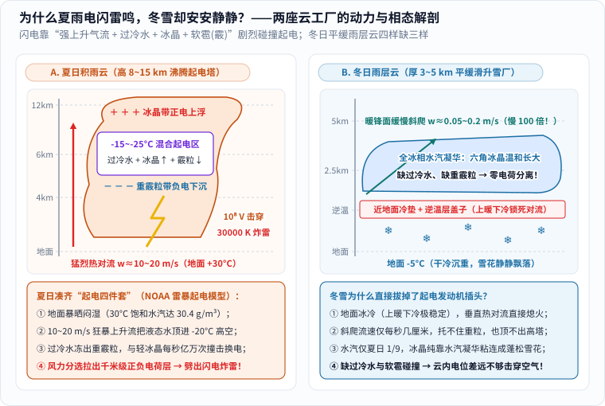
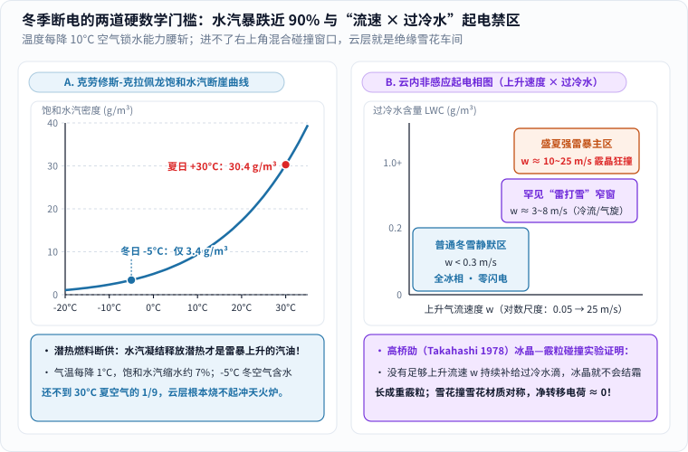
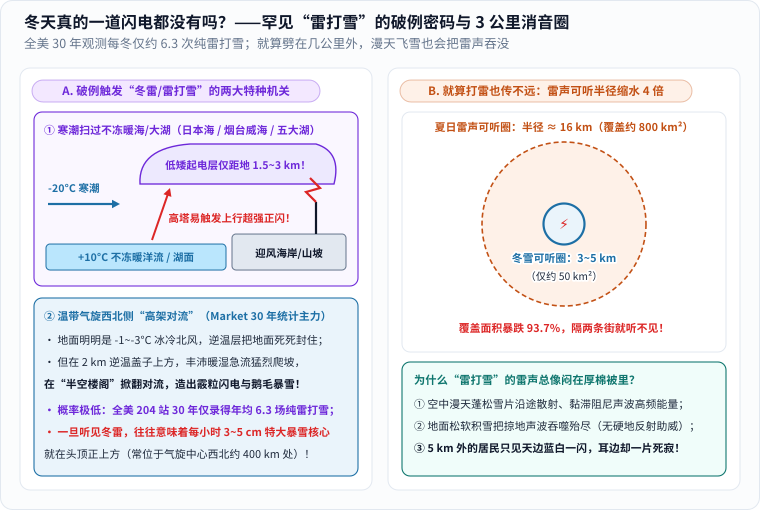
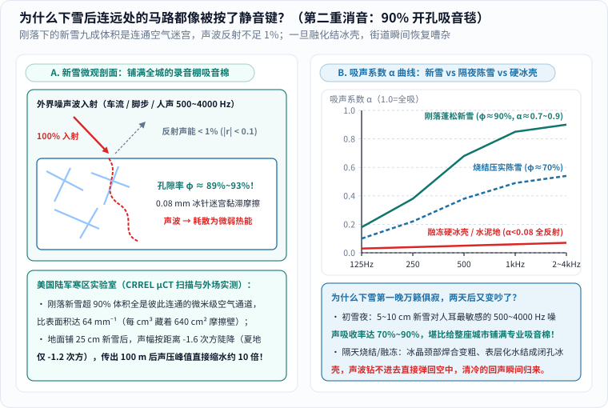

不知道你有没有在一个冬夜拉开窗帘时突然愣住过：

夏天下大雨，天还没黑透就开始狂风大作，紫白色的闪电一刀劈开云层，紧接着就是震得玻璃窗嗡嗡发抖的炸雷，雨点砸在雨棚、树叶和积水坑里“噼里啪啦”吵成一片；可一到冬天，哪怕外面已经下得铺天盖地、早上推门积了厚厚一尺雪，整晚的天空却没有一道闪电、没有一声闷雷——甚至连平时两百米外高架桥上的车流声都像被谁偷偷拧小了音量，漫天鹅毛大雪就这么不声不响、“默默地”往地上落。

这件几乎每个人从小都体验过的日常现象，背后其实藏着**三个环环相扣的硬核物理追问**：

1. **同样是从云里往下掉冰和水**（别忘了，[盛夏暴雨在半空中原本也是冰晶和软雹]()！），**为什么冬天的雪云几乎从不打雷和闪电？**
2. **冬天真的一道闪电都没有吗？** 古诗里写的“冬雷震震”、老话说的“雷打冬，十个牛栏九个空”到底是怎么破例发生的？为什么就算几公里外真的劈下一道“雷打雪”，你也大概率完全听不见？
3. **为什么下雪老是感觉“默默地下”？** 为什么不光是雪花落地没声音，连整座城市在初雪夜都会陷入一种录音棚般的奇妙寂静，可过了两天雪没化完，街道却又重新变吵了？

今天我们就把**云物理学、大气热力学与多孔介质声学**放在同一张桌子上，用五张分步图解把这场“冬日静音魔术”一层层拆到底。

---

## 一、先破第一个谜：同样是云里掉冰水，为什么夏雨狂劈闪电，冬雪却直接“断电”？

很多人第一反应会猜：“是不是因为雨滴导电、雪花不导电，所以冬天没法放电？”

恰恰相反！我们在[《云雨雷电的原理》]()里刚拆解过一个反直觉真相：**哪怕在三伏酷暑，制造十亿伏闪电的主力也根本不是底下的暖雨滴，而是高空 $$-15\,^\circ\text{C}\sim -25\,^\circ\text{C}$$ 冰火交界层里的“冰晶”与“霰粒（软雹）”！**

既然闪电本来就是靠“冰撞冰”搓出来的，冬天满天都是冰晶雪花，按理说应该更容易打雷才对呀？为什么结果正好倒过来？

答案就藏在**夏日积雨云（Cumulonimbus）**与**冬日雨层云（Nimbostratus）**截然不同的动力结构里——要让一朵云变成十亿伏特的高压发电机，必须同时凑齐[美国国家气象局（NOAA）雷电科学指南](https://www.weather.gov/safety/lightning-science-electrification)总结的**“非感应起电四件套”**；而普通冬雪云一上来就缺了三样半。

*图 1：先看左栏 A 的夏日积雨云——地面 $$+30\,^\circ\text{C}$$ 湿热空气以 $$10\sim 20\,\text{m/s}$$ 猛烈冲顶，把大量未结冰的过冷水滴硬塞进 $$-15\sim -25\,^\circ\text{C}$$ 高空，冻出重霰粒并与上升轻冰晶剧烈碰撞换电；再看右栏 B 的冬日雨层云——近地面被沉重冷空气垫与逆温层锁死，暖湿气流只能沿锋面以 $$0.05\sim 0.2\,\text{m/s}$$ 缓慢斜爬（慢了整整 100 倍），冰晶纯靠水汽凝华温和长大，云内根本搓不出闪电所需的正负电荷巨塔。（点击图片可单独放大查看）*

### 1. 第一道死穴：地面“上暖下冷”加上逆温盖子，垂直热对流发动机直接熄火

夏天午后之所以能拔地而起一座高达 $$8\sim 15\,\text{km}$$ 的积雨云巨塔，靠的是太阳把柏油路和地表烤得滚烫（$$+30\,^\circ\text{C}$$ 甚至更高），而万米高空却是 $$-40\,^\circ\text{C}$$ 的严寒。**底下滚烫轻盈、头顶冰冷沉重**，就像烧水壶底架着猛火，热空气像脱缰野马一样以每秒 $$10\sim 20\,\text{m}$$（时速 $$36\sim 72\,\text{km}$$，堪比垂直过山车！）的速度往上猛窜。

到了冬天，整套温度分布被彻底颠倒了：

- 太阳斜射微弱、白昼极短，西伯利亚南下的冷高压贴着地面铺开一层又冷又沉的“铁板冷气垫”（比如地面 $$-5\,^\circ\text{C}$$）；
- 当南方的相对暖湿气流北上遇到这层重冷空气时，它根本钻不到冷空气底下加热地面，只能顺着冷空气倾斜的背部**慢吞吞地斜着往上爬**（气象学叫**锋面滑升**）；
- 这就造出了冬季最经典的**逆温层（Temperature Inversion）**：地面 $$-5\,^\circ\text{C}$$，往上一两千米反而变成 $$-1\,^\circ\text{C}$$ 或 $$+2\,^\circ\text{C}$$！**下冷重、上暖轻**，在流体力学里是绝对稳定的“死水层”——任何一团想往上冒的气泡，刚抬起头发现自己比周围空气更冷更沉，当场就会被重力按回原位。

没有了浮力托举，冬季降雪主力——扁平绵延数百公里的**雨层云**——内部的垂直上升速度 $$w$$ 只有可怜的 **$$0.05\sim 0.2\,\text{m/s}$$（每秒仅 $$5\sim 20$$ 厘米）**，比盛夏积雨云慢了整整 **$$100$$ 倍**！

### 2. 第二道死穴：克劳修斯—克拉佩龙“水汽断崖”，雷暴潜热汽油被砍掉近九成

就算偶尔来一股强冷锋把地面空气往上铲，冬天的空气里还缺一样致命的“高能汽油”——**水汽凝结潜热**。

很多人以为上升气流只靠地面晒热；其实积雨云冲上两千米后还能越蹿越猛，靠的是水汽凝结成水滴和冰晶时释放出的巨额潜热（每凝结 $$1\,\text{kg}$$ 水蒸气会释放约 $$2.26\times 10^6\,\text{J}$$ 热量，相当于给半空中的气球持续点火加热！）。

然而，一团空气最多能锁住多少水蒸气，受热力学著名的**克劳修斯—克拉佩龙方程（Clausius–Clapeyron relation）**铁律统治。写成近似指数形式（Magnus 公式），温度 $$T$$（单位 $$^\circ\text{C}$$）下的饱和水汽压 $$e_s(T)$$ 为：

$$
e_s(T) \approx 6.1094 \exp\!\left(\frac{17.625\,T}{T + 243.04}\right)\ \text{hPa}
$$

再结合理想气体状态方程 $$\rho_{v,\max} = \frac{e_s}{R_v (T + 273.15)}$$（其中水汽气体常数 $$R_v = 461.5\,\text{J/(kg\cdot K)}$$），我们可以直接算出温度每跌 $$1\,^\circ\text{C}$$，空气的锁水上限就会**按复利缩水约 $$7\%$$**！

- **盛夏 $$+30\,^\circ\text{C}$$ 闷热午后**：每立方米空气最多能灌进 **$$30.4\,\text{g}$$** 水蒸气；
- **初冬 $$0\,^\circ\text{C}$$ 冰点附近**：每立方米只剩 **$$4.85\,\text{g}$$**；
- **隆冬 $$-5\,^\circ\text{C}$$ 降雪天**：每立方米饱和水汽只剩 **$$3.4\,\text{g}$$**（相对于冰面更是只有 $$3.25\,\text{g}$$），**还不到盛夏空气的九分之一（缩水近 $$89\%$$）！**

*图 2：先看左栏 A——饱和水汽密度随温度下降呈指数断崖暴跌，冬日 $$-5\,^\circ\text{C}$$ 空气含水燃料不到夏日 $$+30\,^\circ\text{C}$$ 的 $$1/9$$；再看右栏 B 的云内起电二维相图——只有同时具备高上升速度 $$w$$ 与丰沛过冷水含量（LWC），才能跨进右上角的霰晶碰撞起电窗口，普通冬雪死死困在左下角的全冰相静默区。（点击图片可单独放大查看）*

油箱里连十分之一的汽油都不到，大气潜在可对流有效位能（CAPE，夏日强雷暴常高达 $$2000\sim 4000\,\text{J/kg}$$，普通冬雪几乎为 $$0$$）彻底归零，云层自然掀不起半点风浪。

### 3. 第三道死穴：缺“过冷水”也缺“重霰粒”，雪花撞雪花搓不出净电荷

这才是给冬云彻底拔掉电源插头的最后一击。

云物理学家高桥劭（Tsutomu Takahashi，1978 年发表于 *Journal of the Atmospheric Sciences* 的经典风洞结霜实验）与英国曼彻斯特学派（Saunders 等）早就用实验证明：云里要想高效分离正负电荷，**绝不是靠两片一模一样的雪花互相轻碰**，而是必须同时满足三件事：

1. **要有大量尚未结冰的“过冷液态水滴”（Supercooled Liquid Water）**，被每秒数米的强上升气流源源不断顶进 $$-15\sim -25\,^\circ\text{C}$$ 层；
2. 冰核撞上过冷水滴瞬间冻结结霜（凇附，Riming），滚雪球般长成表面粗糙、凝结放热略微偏暖、密度较大的**霰粒（Graupel，俗称软雹）**；
3. 沉重的霰粒往下掉（或悬停），轻巧的[六角小冰晶]()被强上升风往上吹——**一重一轻、一冷一暖、表面生长速率截然不同**的两种冰粒每秒发生亿万次擦碰弹开，每次碰撞转移几十飞库仑（$$10^{-14}\,\text{C}$$）电荷，最后靠大风把带正电的轻冰晶吹上万米云顶、带负电的重霰粒留在云中下部，拉开数千米的巨型电容极板，才能攒出击穿空气所需的 **$$10^8\sim 10^9\,\text{V}$$** 高压！

再看冬天的普通雨层云：整座云从底到顶都在 $$0\,^\circ\text{C}$$ 以下，上升气流每秒只有几厘米，根本来不及把大股液态水滴往上猛灌。云里的水蒸气直接跳过了液态水阶段，慢条斯理地**凝华（Deposition）**在六角冰晶的六个尖角上，长成精致的树枝状雪晶，下飘途中再温柔地钩挂粘连成鹅毛雪片。

- **一没过冷水结霜，长不出沉重的霰粒；**
- **二没强风高速对冲，雪片之间材质对称、温差极小，就算碰在一起也粘成一团而非高速弹开换电；**
- **三没垂直风力分选，拉不开千米级正负电荷层。**

云内电场强度连空气击穿阈值（湿云含冰尖端环境约 $$100\sim 300\,\text{kV/m}$$）的零头都摸不到——这就是为什么你看了几十年下雪，绝大多数时候连一道电火花都见不着！

---

## 二、冬天真的一道闪电都没有吗？罕见“雷打雪”的破例密码与 3 公里消音圈

说到这里你可能会问：**“不对呀！汉代乐府诗《上邪》里明明写过‘冬雷震震，夏雨雪’，新闻里偶尔也播过‘雷打雪’，难道冬天真能破例打雷？”**

能！气象学上管这种一边狂下鹅毛暴雪、一边电闪雷鸣的奇观叫 **Thundersnow（雷打雪 / 冬雷暴）**。但它之所以能被古人写进发毒誓的情诗里当成“天地异象”，恰恰说明它罕见到什么地步——

美国密苏里大学气象学家帕特里克·马基特（Patrick S. Market 等，2002 年发表于美国气象学会期刊 *Weather and Forecasting*）统计了全美 204 个气象站整整 **30 年（1961–1990）** 的逐时观测档案：在成千上万场冬季降雪和十余万场雷暴里，纯粹“下雪同时伴随雷声”的报告 30 年总共只抓到 **229 站次（归并为 191 个天气过程）**——平均整个美国大陆每年冬天只有 **约 $$6.3$$ 场**！在所有冬季降雪报告里占比**连千分之一都不到**。

那么，在冰天雪地的冬天，大自然究竟要动用哪两套“作弊机关”，才能强行在雪云里点着闪电呢？

*图 3：先看左栏 A 的两大破例机关——① 极寒气流掠过不冻暖海/大湖（如日本海北陆、山东半岛烟台威海、北美五大湖），海气温差超 $$25\,^\circ\text{C}$$ 掀起低矮强对流，甚至从通信塔尖触发罕见的“上行超强正闪电”；② 温带气旋西北侧在逆温层盖子上方掀起的“高架对流”。再看右栏 B 按 $$1:4$$ 真实比例绘制的可听圆——漫天飞雪与积雪把雷声可听半径从夏天的 $$16\,\text{km}$$ 吸短到 $$3\sim 5\,\text{km}$$，覆盖面积暴跌 $$93.7\%$$！（点击图片可单独放大查看）*

### 1. 破例机关一：温带气旋西北侧的“空中楼阁——高架对流”

在 Market 等人 30 年统计的雷打雪里，超过一半（约 $$53\%$$）发生在强温带气旋（江淮气旋、东北冷涡或北美“炸弹气旋”）中心的西北到东北侧约 $$400\,\text{km}$$ 处，而且高发在冷暖拉锯最凶的**初春（3 月）和深秋初冬**。

地面温度明明是 $$-1\,^\circ\text{C}\sim -3\,^\circ\text{C}$$ 的刺骨北风，地面以上 $$1.5\,\text{km}$$ 也确实盖着铁桶般的逆温层；但在这层逆温盖子的**正上方（$$2\sim 5\,\text{km}$$ 高空）**，一股来自南方的强盛暖湿低空急流正以每秒二三十米的速度猛烈爬坡，上面又叠着高空干冷急流！于是，**地面死水微澜，两千米高空的“二楼”却像烧开了锅一样掀起了剧烈对流（Elevated Convection，高架对流）**，短时间内搓出大量霰粒与闪电，同时往下倾泻每小时 $$3\sim 5\,\text{cm}$$ 的鹅毛特大暴雪。民间老话“雷打冬，十个牛栏九个空”，本质上就是因为一旦出现高架对流雷打雪，往往意味着一场足以压塌牲口棚的极端暴风雪核心正砸在头顶！

### 2. 破例机关二：寒潮扫过不冻暖海——日本海与胶东“雪窝子”的怪兽级上行正闪电

另一类极具传奇色彩的冬雷，专门挑**隆冬腊月**出现在特定海岸线上——全球最著名的就是**日本本州岛西侧的北陆沿岸（石川、富山、新泻）**，以及我国**山东半岛北岸的烟台、威海（冷流暴雪）**和北美五大湖下风岸。

当 $$-20\,^\circ\text{C}$$ 的西伯利亚极寒空气呼啸着冲上尚未结冰、受暖流滋润仍保持 $$+8\sim +12\,^\circ\text{C}$$ 的海面时，**下暖湿、上极寒**的温差瞬间拉满到 $$30\,^\circ\text{C}$$ 以上！海面像滚水锅一样冒起白茫茫的“海浩”，狂暴的暖湿水汽在短短几十公里内被迎风海岸山脉猛抬，直接点燃冬季强对流云团。

更神奇的是[日本北陆电力与东京大学团队（Saito, Ishii 等，2007，*IEEJ Transactions on Power and Energy*）](https://www.jstage.jst.go.jp/article/ieejpes/127/12/127_12_1325/_article)的长期观测发现：虽然日本海冬雷云顶只有 $$4\sim 6\,\text{km}$$ 高，但因为冬季气温低，**$$-15\,^\circ\text{C}$$ 起电核心区离地面近得吓人——高度只有 $$1.5\sim 3\,\text{km}$$（夏天则在 $$6\sim 8\,\text{km}$$ 高空）！**

带电云层几乎贴着山头和风力发电机鼻尖飞过，在铁塔和避雷针尖端感应出骇人的强电场，结果：

- 闪电不再只是从云里往下劈，而是频繁从地面高塔尖端**倒着往天上蹿（Upward Lightning，上行闪电）**！
- 而且冬季风切变常把云顶的**正电荷区**吹歪裸露出来，导致冬雷中**正地闪（Positive Cloud-to-Ground Flash）**比例高达 $$30\%\sim 50\%$$（夏天通常不到 $$10\%$$），单次峰值电流动辄飙破 **$$100\sim 300\,\text{kA}$$**（普通夏雷的 $$5\sim 10$$ 倍），一口气转移数百库仑电荷，历史上曾多次一击劈断风机叶片，被称为“超级霹雳”。

### 3. 就算真的劈下冬雷，为什么隔两条街你就完全听不见？

这又引出一个极有趣的几何账：哪怕你们城市今晚真的发生了一场罕见的雷打雪，为什么朋友圈里有人发视频说看见蓝白色闪光，住在他五公里外的你却发誓“整晚一点雷声都没听见”？

看一眼[美国国家气象局（NOAA）雷声传播实测数据](https://www.weather.gov/safety/lightning-science-thunder)就全明白了：

- **盛夏雷暴**：闪电把通道空气瞬间加热到约 $$28000\sim 30000\,\text{K}$$（太阳表面温度的 $$5$$ 倍）炸出冲击波，雷声在无雪开阔空气里通常能传出 **约 $$10\,\text{英里（16 km）}$$**，单次闪电的可听圆面积约为：

$$
A_{\text{夏}} = \pi R_{\text{夏}}^2 \approx \pi \times (16\,\text{km})^2 \approx 804\,\text{km}^2
$$

- **冬季暴雪中**：漫天飞舞的密集雪片在半空中不断散射并黏滞耗散声波，地面厚厚的新雪又把掠地传播的声波大口吞掉（没有硬地反射助威），再加上近地面逆温风切变与湿雪阻尼，雷打雪的可听半径被硬生生压缩到 **仅 $$2\sim 3\,\text{英里（约 3\sim 5 km，取中值 4 km）}$$**！此时单次冬雷的可听圆面积只剩：

$$
A_{\text{冬}} = \pi R_{\text{冬}}^2 \approx \pi \times (4\,\text{km})^2 \approx 50\,\text{km}^2
$$

两者一比，$$\frac{A_{\text{冬}}}{A_{\text{夏}}} = \left(\frac{4}{16}\right)^2 = \frac{1}{16} = 6.25\%$$——也就是说，**一场冬雷能被人类耳朵听见的覆盖面积，比夏雷暴跌了整整 $$93.75\%$$！** 除非那道闪电几乎就劈在你头顶两三公里以内（听起来也往往不是清脆的“咔嚓”，而是像隔着厚棉被炸开的沉闷“轰隆”），否则五公里外的你只会觉得今晚的雪依然下得悄无声息。

---

## 三、为什么下雪老是感觉“默默地下”？第一重消音：慢 10 倍的降落伞与消失的气泡钟声

解开了“为什么不打雷”，我们再来解你问题里最细腻的后半句：**“下雪老是感觉默默的下”**。

为什么下雨天哪怕不打雷，你在屋里闭着眼睛也能听见窗外“哗啦啦、淅淅沥沥”响个不停；而下雪天就算雪下得再急，贴到玻璃窗跟前也听不见半点动静？

这其实是一场由**“源头静音”**加**“全场吸音”**联手导演的双重声学魔术。我们先看第一重：**雪花是怎么从源头上把落地噪声砍掉 $$99\%$$ 以上的？**

*图 4：同为 $$14\,\text{mg}$$ 的一份降水——左栏 A 中直径 $$3\,\text{mm}$$ 雨滴以 $$8.0\,\text{m/s}$$ 高速砸入水膜，携 $$448\,\mu\text{J}$$ 动能敲响物体并卷入水下微气泡，激发 $$3\sim 15\,\text{kHz}$$ 清脆鸣叫；右栏 B 中约 $$10\,\text{mm}$$ 宽的蓬松鹅毛雪片撑开空气降落伞，以 $$0.8\,\text{m/s}$$ 轻飘落地，冲击动能仅 $$4.48\,\mu\text{J}$$（缩水 100 倍！）且零气泡产生。（图中包含单次下落对比短动画，[点此单独打开 SVG 刷新可重播](/assets/images/snow-no-thunder/raindrop-splash-bubble-vs-snowflake-feather-landing.svg)；开启“减少动态效果”时自动保持完整静态标注）*

### 1. 终端速度慢 10 倍，落地撞击动能直接缩水 100 倍！

任何雨滴或雪花从两三千米高空往下掉，都不会无休止加速——空气阻力 $$F_d = \frac{1}{2}\rho_{\text{air}} C_d A v^2$$ 会随速度平方迅速增大，直到与重力 $$mg$$ 完全抵消，此后就以恒定的**终端速度（Terminal Velocity）**匀速落地：

$$
v_t = \sqrt{\frac{2mg}{\rho_{\text{air}}\,C_d\,A}}
$$

我们来拿**质量完全相等（同样都是 $$m = 14\,\text{mg} = 1.4\times 10^{-5}\,\text{kg}$$）**的一滴中大雨滴和一片鹅毛雪片做个正面对决：

- **一滴 $$14\,\text{mg}$$ 的雨滴**：液态水紧实抱团，缩成一颗直径仅 **$$3.0\,\text{mm}$$** 的光滑水珠，迎风截面积 $$A$$ 只有约 $$7\,\text{mm}^2$$，阻力系数 $$C_d \approx 0.5\sim 0.6$$。根据大气物理经典实测（Gunn & Kinzer, 1949, *Journal of Meteorology*），它的落地终端速度高达 **$$v_{\text{雨}} \approx 8.0\,\text{m/s}$$（合时速 $$28.8\,\text{km/h}$$）**！
- **一片同样 $$14\,\text{mg}$$ 的鹅毛雪团（树枝状冰晶聚合体）**：[六角树枝状雪晶]()互相钩挂，九成空间全是镂空空气，直径摊开到 **$$10\sim 12\,\text{mm}$$**，迎风截面积暴涨 $$15$$ 倍以上，镂空枝杈拖曳出的阻力系数 $$C_d$$ 也翻倍到 $$1.2\sim 1.6$$。根据华盛顿大学 Locatelli 与 Hobbs（1974，*Journal of Geophysical Research*）对天然降雪的实测，单枚六角枝状雪晶飘落速度仅 **$$0.3\sim 0.6\,\text{m/s}$$**，这片 $$14\,\text{mg}$$ 鹅毛雪团的终端速度也只有 **$$v_{\text{雪}} \approx 0.8\,\text{m/s}$$（时速不到 $$3\,\text{km/h}$$，比人散步还慢一半）**！

别小看这 **$$10$$ 倍** 的速度差距——物体砸向地面瞬间释放的冲击动能 $$E_k = \frac{1}{2}mv^2$$ 是**按速度的平方算账**的：

$$
E_{k,\text{雨}} = \frac{1}{2}\times (1.4\times 10^{-5}\,\text{kg})\times (8.0\,\text{m/s})^2 = 4.48\times 10^{-4}\,\text{J} = 448\,\mu\text{J}
$$

$$
E_{k,\text{雪}} = \frac{1}{2}\times (1.4\times 10^{-5}\,\text{kg})\times (0.8\,\text{m/s})^2 = 4.48\times 10^{-6}\,\text{J} = 4.48\,\mu\text{J}
$$

不仅总动能**暴跌了整整 $$100$$ 倍**，更关键的是冲击功率（单位时间的动量传递）：紧实雨滴撞上铁皮棚在约 $$0.4\,\text{ms}$$ 内急停，瞬间冲击功率超过 $$1\,\text{W}$$，像小鼓槌一样敲响树叶、雨伞和窗台；而蓬松雪片落地的减速过程拉长了十多倍，枝杈还自带微观柔性缓冲，冲击声功率比雨滴弱了 **$$1000\sim 10000$$ 倍（低 $$30\sim 40\,\text{dB}$$）**，直接掉进了人类听觉阈值以下！

### 2. 雨声“淅淅沥沥”的真正幕后歌手——水下微气泡，在雪地里彻底失业了

还有一个更反直觉的声学冷知识：夏天下雨时那阵最清脆、最催眠的“淅淅沥沥”高频水声，主要甚至不是水滴拍打水面的撞击声，而是**水下微气泡的共振歌声**！

早在 1933 年物理学家闵奈尔特（Marcel Minnaert，后来由 Prosperetti 与 Pumphrey 在 1980–1990 年代用高速摄影彻底证实）就发现：当高速雨滴砸破积水表面凹坑回弹闭合的千分之一秒内，会往水下卷进一颗半径仅零点几毫米（比如 $$R_0 = 0.3\,\text{mm}$$）的微型空气泡。这颗小气泡在周围水压 $$P_0$$ 的挤压下像微型铃铛一样剧烈呼吸振荡，其**闵奈尔特基频**为：

$$
f_M = \frac{1}{2\pi R_0}\sqrt{\frac{3\gamma P_0}{\rho_w}} \approx \frac{3.26\,\text{m/s}}{R_0}
$$

把半径 $$R_0 = 0.2\sim 1.0\,\text{mm}$$ 代进去，正好算出 **$$f_M \approx 3.3\sim 16\,\text{kHz}$$**——分毫不差落进人类耳朵最敏感的清脆高频段！千千万万颗微气泡在水膜底下接力“叮咚”作响，才汇成了夏夜哗啦啦的雨声交响曲。

而冬天的雪花呢？它是**固态冰晶**，地面也没有液态积水坑——雪片轻飘飘搭在干冷地面或前一片雪花的枝杈上，**一滴水花都不溅，半颗微气泡都卷不出来**。鼓槌没劲儿，连“气泡铃铛”也被彻底收走，雪花自然只能“默默地”往下落了。

---

## 四、雪夜万籁俱寂的第二重消音：刚落下的新雪，等于给全城铺满 90% 开孔的“录音棚吸音棉”！

可就算雪花自己落地没声音，为什么一下雪，连远处马路上的汽车胎噪、邻居关车门声、楼下说话声也统统像被什么东西“吸干”了一样，让人一推开窗就生出一种“天地间只剩我一个人”的空灵寂静感？

因为那层刚铺满屋顶、草坪、树冠和马路的松软新雪，在声学家眼里根本不是实心冰块，而是一张**铺满整座城市的巨型开孔吸音海绵**！

*图 5：先看左栏 A——美国陆军寒区实验室（CRREL）三维显微 CT 测得刚落新雪拥有 $$89\%\sim 93\%$$ 的彼此连通空气孔隙与 $$0.08\,\text{mm}$$ 冰针迷宫，正入射声能反射率不足 $$1\%$$，声波钻进迷宫与冰壁摩擦化为微热；再看右栏 B 的吸声系数 $$\alpha$$ 频率曲线——蓬松新雪在中高频吸声高达 $$0.7\sim 0.9$$，而一旦隔天烧结压实或融冻结出硬冰壳（红线 $$\alpha < 0.08$$），城市噪声便瞬间反弹归来。（点击图片可单独放大查看）*

### 1. 显微 CT 下的新雪真相：九成体积全是连通空气迷宫，声能反射不到 1%

平时没有积雪的城市，柏油马路、水泥墙面、地砖全是密不透风的刚性硬平面，声吸声系数 $$\alpha$$ 只有 **$$0.02\sim 0.05$$**——也就是说，远处一辆汽车发出的胎噪撞上地面，**$$95\%$$ 以上的声波能量都会原封不动弹回空中**，在街道和楼宇之间来回折射助威，传出几百米依然吵闹。

那刚落下的天然新雪内部长什么样？[美国陆军寒区研究与工程实验室（CRREL）的 Lieblappen、Fegyveresi、Courville 与声学家 Donald G. Albert 团队（2020 年发表于 *Frontiers in Earth Science*）](https://www.frontiersin.org/journals/earth-science/articles/10.3389/feart.2020.00034/full)，把刚接住的天然新雪放进高分辨率三维 X 射线显微断层扫描仪（$$\mu\text{CT}$$），并同步用非接触超声脉冲实测了声反射率，拿到了一组令人惊叹的微观数据：

- **超高开孔率（Open Porosity）**：刚落下的天然新雪样本，孔隙率高达 **$$88.6\%\sim 92.5\%$$**！你捧起一捧新雪，里面**只有不到一成是冰，超过九成体积全是从表面一直贯通到底部的微米级空气迷宫**；
- **惊人的内摩擦比表面积**：支撑这座迷宫的冰晶枝杈平均厚度仅 **$$0.065\sim 0.087\,\text{mm}$$**（比一根头发丝还细），每立方毫米雪体内部藏着高达 **$$57.8\sim 68.2\,\text{mm}^2$$** 的冰壁表面积（即每 $$1\,\text{cm}^3$$ 新雪里折叠着超过 $$600\,\text{cm}^2$$ 的摩擦壁！）；
- **声阻抗完美过渡、零表面反弹**：正因为表层九成是空气，新雪的有效特征声阻抗几乎与空气无缝衔接！实测声压振幅反射系数 $$\lvert r \rvert < 0.10$$——换算成声能量反射率 $$R_E = \lvert r \rvert^2 < 0.01$$，意味着**超过 $$99\%$$ 的入射声波能量根本不会在雪面上反弹，而是一头扎进了新雪内部的孔隙迷宫里！**

一旦声波钻进这片由亿万根 $$0.08\,\text{mm}$$ 冰针交织成的曲折窄缝（声学上可用 Biot 多孔介质理论或 Attenborough 刚性骨架多孔吸声模型精确计算），空气分子被迫在狭窄弯曲的冰通道里来回高频搓动，受到强烈的**黏滞摩擦阻力**与**冰壁热传导交换**，声波的机械振动能在短短几厘米厚度内就被迅速“搓”成了无法察觉的极其微弱的热能！（放心，这点微热连十万分之一摄氏度都不到，绝不会把雪吵化。）

根据 CRREL 声学家 Donald G. Albert 的外场声传播实测（CRREL Report 93-20 及 2001 年 *JASA* 论文）：

- 只要地面铺上 **$$5\sim 10\,\text{cm}$$** 厚的蓬松新雪，对人耳最敏感的 **$$500\sim 4000\,\text{Hz}$$** 中高频噪声（轮胎摩擦声、脚步声、说话声、鸟鸣风声），吸声系数 $$\alpha$$ 就能飙升到 **$$0.68\sim 0.90$$**——**直接追平专业录音棚墙面贴的聚氨酯金字塔吸音棉！**
- 在无雪草地上，水平掠地传播的声压幅值大约按距离的 $$r^{-1.2}$$ 衰减；而铺上 $$25\,\text{cm}$$ 新雪后，掠地声波被雪面一路抽血，衰减斜率陡增至 **$$r^{-1.6}$$**——仅仅传出 **$$100\,\text{m}$$**，峰值声压就比平时**额外缩水了约 $$10$$ 倍（降低约 $$20\,\text{dB}$$）**！

### 2. 为什么初雪当晚静得像童话，过了一两天街道却又重新变吵了？

读懂了多孔迷宫原理，你顺手还破译了另外两个冬日小秘密：

1. **为什么过了一两天雪还在地上，世界却不那么安静了？**
   CRREL 的显微 CT 连续追踪发现，雪花落地后哪怕气温一直低于 $$0\,^\circ\text{C}$$，水分子也会自发从尖锐的枝端往凹陷颈部迁移焊合（**等温烧结变质，Sintering**）：仅仅存放 **$$24$$ 小时**，新雪孔隙率就从 $$92.5\%$$ 跌到 $$79.9\%$$，内表面积缩水 $$17\%$$；如果白天太阳一晒表层微化、夜里再冻成一层硬邦邦的**融冻冰壳（Ice Crust）**，表面开孔瞬间被封死成闭孔冰板，吸声系数 $$\alpha$$ 暴跌回 **$$0.05$$** 左右！声波再也钻不进雪层，直接在硬冰壳上镜面反弹，清脆刺耳的远方车流声和回声便一夜之间全回来了。
2. **那为什么踩在特别冷的积雪上，脚底下反而会发出“咯吱咯吱”的清脆响声？**
   当气温低于 $$-2\,^\circ\text{C}\sim -5\,^\circ\text{C}$$ 时，冰晶表面那层起润滑作用的纳米级准液态水膜变薄消失，已经烧结焊连在一起的亿万根脆性冰晶细颈在你一脚踩实的瞬间发生**连锁脆性断裂与颗粒滑移摩擦**，激发出 $$500\sim 1800\,\text{Hz}$$ 的清脆声脉冲；越冷冰越脆，“咯吱”声就越响亮清脆！

---

## 五、一张表收好：夏雨轰鸣 vs 冬雪静默的六维物理对照单

最后，我们把今天拆解的所有大气热力学与声学账单浓缩成一张速查表。下次下雪夜陪孩子或朋友散步时，你就可以指着漫天雪花一条条讲给他听：

| 对比维度 | 盛夏强雷雨（积雨云） | 普通冬雪（雨层云） | 罕见“雷打雪 / 冬雷” |
| :--- | :--- | :--- | :--- |
| **近地面温度结构** | 下极热（$$+30\,^\circ\text{C}$$）、上极冷，浮力狂暴不稳定 | 下冷重（$$-5\,^\circ\text{C}$$）+ 逆温盖子，热力学锁死 | 逆温层上方高架急流，或 $$-20\,^\circ\text{C}$$ 寒潮掠过 $$+10\,^\circ\text{C}$$ 暖海 |
| **饱和水汽燃料** | 约 **$$30.4\,\text{g/m}^3$$**（凝结潜热充沛） | 仅约 **$$3.4\,\text{g/m}^3$$**（不足夏日 $$1/9$$，断油熄火） | 暖洋流海面或低空暖湿急流强行跨区输水 |
| **云内上升流速 $$w$$** | **$$10\sim 20\,\text{m/s}$$**（冲上 $$8\sim 15\,\text{km}$$ 云顶） | **$$0.05\sim 0.2\,\text{m/s}$$**（慢 $$100$$ 倍，仅 $$3\sim 5\,\text{km}$$ 厚） | 局地达 **$$3\sim 8\,\text{m/s}$$**（起电层距地仅 $$1.5\sim 3\,\text{km}$$） |
| **云内相态与起电** | 过冷水 + 轻冰晶↑ + 重霰粒↓ 高速碰撞，攒出 $$10^8\,\text{V}$$ | 全冰相水汽凝华，缺过冷水与重霰粒，**净起电 $$\approx 0$$** | 短促霰晶碰撞；海岸高塔易触发**上行超强正闪电** |
| **雷声可听范围** | 半径约 **$$16\,\text{km}$$**（覆盖约 $$800\,\text{km}^2$$） | 无雷声 | 飞雪+积雪吸音，半径缩至 **$$3\sim 5\,\text{km}$$**（面积缩水 $$93.7\%$$） |
| **落地声源与环境吸声** | $$8\,\text{m/s}$$ 高速硬砸（$$448\,\mu\text{J}$$）+ 水下微气泡 $$3\sim 15\,\text{kHz}$$ 鸣叫 + 硬地全反射 | $$0.8\,\text{m/s}$$ 降落伞轻放（$$4.48\,\mu\text{J}$$，小 $$100$$ 倍）+ **零气泡** + **$$90\%$$ 开孔新雪吸走 $$70\%\sim 90\%$$ 环境噪声** | 狂风暴雪呼啸掩盖远处闷雷 |

原来，冬天下雪之所以不打雷、不闪电、总是“默默地下”，并不是冬天的大自然变懒了：

- **在天上**，寒冷抽走了九成水汽潜热，逆温层给大地盖上了保温锅盖，让云朵从狂暴的“高压起电炉”变成了每秒只升几厘米的“六角冰晶慢工绣坊”；
- **在半空**，每一片镂空的树枝状雪花都自己撑开了空气降落伞，把落地冲击动能卸掉了 $$99\%$$，顺手还关掉了雨滴砸水特有的千赫兹微气泡铃铛；
- **在地上**，亿万片新雪松松搭起一座 $$90\%$$ 连通开孔的微米冰针迷宫，像给整座喧嚣的城市披上了一床厚厚的录音棚消音绒毯。

下次再遇上一场万籁俱寂的初雪夜，不妨停下脚步安静听十秒钟——你听见的那份奇妙的“静”，其实是热力学定律、流体力学阻力与微米冰晶迷宫正在同时为你演奏的冬日物理乐章。

---

## 参考资料与核查来源

1. **NOAA National Weather Service (美国国家气象局)** — [*Lightning Science: Five Ways Lightning Strikes People / Electrification*](https://www.weather.gov/safety/lightning-science-electrification) 与 [*Understanding Lightning: Thunder*](https://www.weather.gov/safety/lightning-science-thunder)：核查积雨云非感应起电所需的三相态条件（过冷水滴、上升冰晶与软雹霰粒碰撞分离正负电荷）以及正常夏雷约 $$10\,\text{miles（16 km）}$$ 可听距离与闪电通道约 $$50000\,^\circ\text{F（28000 K）}$$ 膨胀冲击波机制。
2. **Takahashi, T. (1978)** — *"Riming Electrification as a Charge Generation Mechanism in Thunderstorms"*, *Journal of the Atmospheric Sciences*, 35(8), 1536–1548：核查冰晶与结霜霰粒（Graupel）碰撞电荷转移极性与温度、液态过冷水含量（LWC）定量实验相图。
3. **Market, P. S., Halcomb, C. E., & Ebert, R. L. (2002)** — *"A Climatology of Thundersnow Events over the Contiguous United States"*, *Weather and Forecasting*, 17(6), 1290–1295：核查全美 204 站 30 年（1961–1990）纯“雷打雪”气候统计（共 229 次报告 / 191 个事件，年均约 6.3 次，温带气旋高架对流占比、3 月峰值及近地面平均气温特征）与冬季飞雪对雷声可听半径（$$2\sim 3\,\text{miles}$$）的衰减效应。
4. **Saito, M., Ishii, M., Matsui, M., & Itamoto, N. (2007)** — [*"Location of Negative Charge Associated with Continuing Current of Upward Lightning Flash in Winter"*](https://www.jstage.jst.go.jp/article/ieejpes/127/12/127_12_1325/_article), *IEEJ Transactions on Power and Energy*, 127(12), 1325–1329：核查日本海北陆沿岸冬季寒潮冷流雷暴低矮起电高度（$$1.5\sim 3\,\text{km}$$）、高塔触发上行闪电及高比例大电流正闪特征。
5. **Gunn, R., & Kinzer, G. D. (1949)** — *"The Terminal Velocity of Fall for Water Droplets in Stagnant Air"*, *Journal of Meteorology*, 6(4), 243–248；以及 **Locatelli, J. D., & Hobbs, P. V. (1974)** — *"Fall Speeds and Masses of Solid Precipitation Particles"*, *Journal of Geophysical Research*, 79(15), 2185–2197：核查 $$3\,\text{mm}$$ 雨滴终端速度（$$\approx 8.0\,\text{m/s}$$）与无凇附树枝状雪晶（$$0.3\sim 0.6\,\text{m/s}$$）、鹅毛雪片聚合体（$$0.5\sim 1.4\,\text{m/s}$$）质量—终端速度实测关系；微气泡声共振公式核查自 **Minnaert, M. (1933)**, *Philosophical Magazine*, 16(104), 235–248 与 **Pumphrey, H. C., & Elmore, P. A. (1990)**, *Journal of Fluid Mechanics*, 220, 539–567。
6. **Lieblappen, R., Fegyveresi, J. M., Courville, Z., & Albert, D. G. (2020)** — [*"Using Ultrasonic Waves to Determine the Microstructure of Snow"*](https://www.frontiersin.org/journals/earth-science/articles/10.3389/feart.2020.00034/full), *Frontiers in Earth Science*, 8:34；以及 **Albert, D. G. (1993 / 2001)**, *US Army CRREL Report 93-20* / *Journal of the Acoustical Society of America*, 109(1), 54–61：核查天然刚落新雪三维显微 CT 连通孔隙率（$$88.6\%\sim 92.5\%$$）、冰针特征厚度（$$0.065\sim 0.087\,\text{mm}$$）、比表面积（$$57.8\sim 68.2\,\text{mm}^{-1}$$）、正入射声振幅反射率（$$\lvert r \rvert < 0.10$$）、24 小时烧结变质对比及 $$25\,\text{cm}$$ 积雪覆盖下户外水平声压按 $$r^{-1.6}$$ 加速衰减的实测结论。
