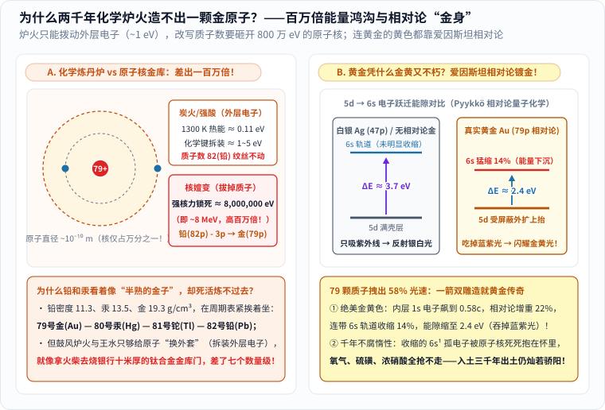
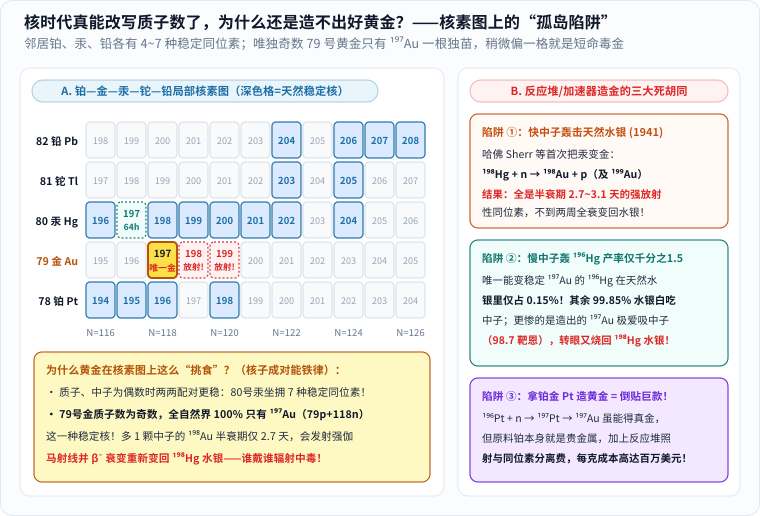
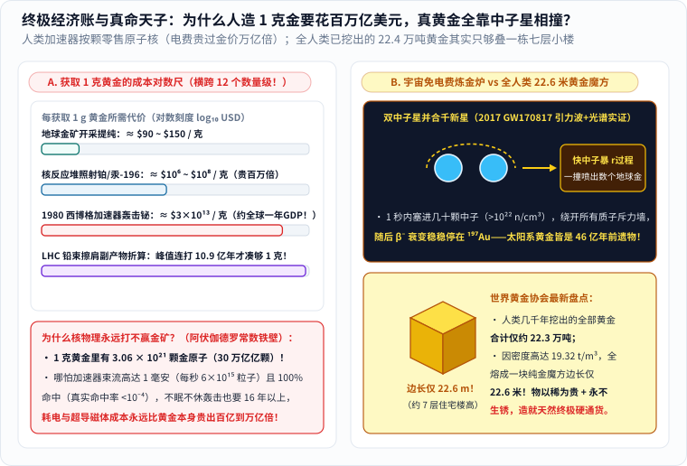

今天的人类，早就把好几样曾经高不可攀的“天价宝石”打成了白菜价：原本要在地幔深处憋上十亿年的天然钻石，如今在河南工厂的高温高压釜和化学气相沉积炉里，几个星期就能长出肉眼难辨真假的克拉大钻；曾经比黄金还娇贵的红宝石、蓝宝石，早已按吨烧制，成了智能手机摄像头和智能手表上最耐刮的镜片。

可唯独面对**黄金**，全世界的化工厂、冶金炉乃至超级实验室却集体败下阵来。

更让人好奇的是：从古埃及亚历山大港的工匠、阿拉伯帝国的学者、中国炼制长生仙丹的道士，一直到写出《自然哲学的数学原理》的科学巨匠**艾萨克·牛顿（Isaac Newton）**，人类最聪明的一批大脑前赴后继折腾了两千多年，有人熬干了五千多升人尿，有人在丹炉边意外炸出了黑火药，为什么连**半颗**金原子都没在炉火里造出来？

而如果把这个问题抛给今天的核物理学家，你会得到一个更加反直觉的答案：**人类其实早就在实验室里把水银、铋和铅真正变成了黄金！就在 2025 年 5 月，欧洲核子研究中心（CERN）的大型强子对撞机刚刚正式宣布，他们在铅核束流中观测到了每秒高达 8.9 万颗真金原子核的诞生！** 既然梦想已经成真，为什么各国央行金库里的金条没有立刻贬值成废铁？为什么人类直到今天依然“造不出”能拿去打戒指的黄金？

沿着这条跨越两千年的悬念主线，我们把原子外壳、爱因斯坦相对论、世界炼金奇史与核素图上的死胡同一层层剥开。

---

## 一、两千年炉火为什么炼不出半颗金原子？——百万倍能量鸿沟与爱因斯坦镀上的“金身”

### 1. 为什么古人看铅和水银，总觉得它们像“没熟透的金子”？

在嘲笑古代炼金术士之前，不妨先钻进他们的工坊看一眼：为什么全世界互不相通的文明，都不约而同盯上了**铅（Pb）**和**水银（汞，Hg）**，坚信只要配齐秘方、烧够火候，就能把它们催熟变成黄金？

答案一点也不玄幻——因为它们在物理手感上实在太像亲兄弟了！普通石头和铁块密度只有 $$2.6 \sim 7.9\text{ g/cm}^3$$，而灰扑扑的铅块一上手就沉得吓人（密度 $$11.34\text{ g/cm}^3$$），而且质地绵软、一锤就能敲成薄片；银亮流动的水银更夸张，常温下是液体，密度高达 $$13.53\text{ g/cm}^3$$，连铁球扔进去都能像软木塞一样浮在水银面上，还能轻易把金粉“吃”进肚子里结成金汞齐，上火一烤水银飞走，底下又留下一层纯金。

如果翻开今天的元素周期表第六周期，你会惊叹古人的直觉有多准——它们在周期表上真的**紧挨着坐在一排**：

$$\text{78 号铂（Pt）} \longrightarrow \mathbf{79\text{ 号金（Au）}} \longrightarrow \text{80 号汞（Hg）} \longrightarrow \text{81 号铊（Tl）} \longrightarrow \text{82 号铅（Pb）}$$

水银只比黄金多 **1 颗质子**，铅也只比黄金多 **3 颗质子**！从数字上看，把铅变成金，无非就是从 82 号铅原子里扣掉 3 颗质子而已；人造钻石能把乌黑廉价的石墨变成璀璨金刚石，凭什么就不能把铅烧成黄金？

### 2. 炭火只够给原子“换外套”，改写质子数要砸开百万倍硬度的核金库

人造钻石能成功，而化学炼金术注定全军覆没，根源在于两者动刀的位置差了一万倍，所需能量更隔着一道**百万到千万倍的物理学天堑**。

石墨和钻石本来就是同一种元素——**6 号碳（C）**，原子核里全都是 6 颗质子。把石墨变成钻石，根本不需要碰原子核，只需要用几万个大气压把碳原子最外层的**电子握手方式（化学键）**从层状平面改成三维正四面体支架（详见[《化学键的底层密码》]()）。拆装这种外层电子化学键，每颗原子只需要 **$$1 \sim 5\text{ eV}$$（电子伏特）** 的能量。

炼金术士手里的终极武器是什么呢？无非是木炭鼓风炉和强酸蒸馏釜。哪怕把古代炉火鼓风烧到通体发白的 $$1300\text{ K}$$（约 $$1027\text{ }^\circ\text{C}$$），根据玻尔兹曼常数 $$k_B \approx 8.617 \times 10^{-5}\text{ eV/K}$$，炉膛里每次热碰撞的平均动能只有：

$$E_{\text{热}} \approx k_B T \approx 8.617 \times 10^{-5} \times 1300 \approx 0.11\text{ eV}$$

算上高能尾部的剧烈分子碰撞和强酸氧化还原反应，化学手段撑死只能调动几个电子伏特（$$\sim 1\text{ eV}$$）的能量，在直径约 $$10^{-10}\text{ m}$$ 的**原子外层电子云**上给原子“换件外套”——比如把银白色的金属铅烧成鲜红的铅丹（$$\text{Pb}_3\text{O}_4$$）或金黄色的密陀僧（$$\text{PbO}$$），看着金光闪闪，里头每一颗原子的核心依然雷打不动坐着 82 颗质子！

而决定一颗原子姓“铅”还是姓“金”的身份证，藏在直径只有约 $$1.4 \times 10^{-14}\text{ m}$$（比原子外壳小一万倍）的**原子核**里。要把 82 号铅核里的 3 颗质子硬生生拔出来变成 79 号金核，或者往原子核里塞进带电粒子，就必须正面硬刚锁死核子的**强核力**以及高达上千万伏特的**质子库仑斥力墙**（详见[《原子核是如何运作的》]()）：

- **撬动 1 颗核子的平均比结合能门槛**：约 **$$8\text{ MeV} = 8{,}000{,}000\text{ eV}$$（800 万电子伏特）**！
- **能量悬殊比**：$$8 \times 10^6\text{ eV} \div 0.11\text{ eV} \approx 7.3 \times 10^7$$——整整差出**七千多万倍**！

打个最直观的比方：化学炉火就像拿一根火柴去熏银行地下十米厚的钛合金金库大门——你把外墙熏得再黄再亮，连金库门的一丝油漆皮都撼动不了。

### 3. 彩蛋追问：黄金凭什么偏偏是金黄色，还入土三千年不生锈？居然全靠爱因斯坦相对论！

讲到这里，一个更奇妙的问题浮出水面：周期表里绝大多数金属——铁、铝、银、铂、水银、铅——清一色全是**银白色或灰白色**（只有铜和金例外）。为什么黄金偏偏闪耀着独一无二的温暖金黄色，而且埋在潮湿墓穴或海底三千年，挖出来一擦依然灿若骄阳、半点铁锈铜绿都不长？

令人拍案叫绝的是，直到 20 世纪后期，量子化学家（如芬兰化学家 Pekka Pyykkö 在[《Chemical Reviews》1988 年经典综述](https://pubs.acs.org/doi/10.1021/cr00085a006)与[相对论金原子轨道定量计算](https://openworldlab.org/fun/atoms/relativity-gold)中所展示的）才彻底算明白：**如果宇宙里没有爱因斯坦的狭义相对论，黄金根本不会是金黄色，而会像白银一样白花花、还更容易被腐蚀！**

原因就出在金原子核里那 **79 颗带正电的质子**拉力太猛了：

1. **内层电子飙到 58% 光速，触发相对论增重与轨道收缩**：在 $$Z=79$$ 的超强静电场拖拽下，金原子最内层 $$1s$$ 轨道电子的运动速度高达 $$v \approx Z\alpha c \approx \frac{79}{137.036}c \approx 0.58c$$（光速的 **58%**）！代入狭义相对论洛伦兹因子：

   $$\gamma = \frac{1}{\sqrt{1 - (v/c)^2}} \approx \frac{1}{\sqrt{1 - 0.576^2}} \approx 1.224$$

   电子的有效相对论质量暴涨了 **$$22.4\%$$**！电子一“变重”，轨道半径就猛烈向原子核收缩；由于所有 $$s$$ 轨道都要钻到核附近并保持正交，连最外层的 **$$6s$$ 轨道半径也跟着剧烈收缩了约 $$14\%$$**（相对论与非相对论期望半径比值 $$\langle r \rangle_{6s}^{\text{rel}} / \langle r \rangle_{6s}^{\text{non-rel}} = 0.859$$）。
2. **一箭双雕之一——吞掉蓝紫光，镀上金黄色**：在楼上的 47 号白银（Ag）里，相对论效应很弱，内层满壳 $$4d$$ 电子跳到外层 $$5s$$ 空位需要约 **$$3.7\text{ eV}$$** 的高能光子，落在人眼看不见的紫外区，所以白银把红橙黄绿蓝紫所有可见光一视同仁全反射回来，呈现刺眼的银白色。而在 79 号黄金里，外层 $$6s$$ 轨道猛缩下沉，次外层 $$5d$$ 轨道因屏蔽增强而外扩上抬，一降一升把 $$5d \to 6s$$ 跃迁能隙硬生生挤窄到了 **$$2.4\text{ eV}$$**！对应波长 $$\lambda = \frac{hc}{\Delta E} \approx \frac{1240\text{ eV}\cdot\text{nm}}{2.4\text{ eV}} \approx 517\text{ nm}$$——黄金一口吃掉了太阳光里的**蓝光和紫光**，剩下的红光与绿光反射进我们眼睛，就合成了无可替代的璀璨金黄色！
3. **一箭双雕之二——锁死孤电子，铸就千年不腐“金刚身”**：黄金最外层原本只有 1 颗孤零零的 $$6s^1$$ 电子（和极易生锈起火的钠、钾、铜同一主族特征），按常理很容易被氧气或酸抢走。全靠相对论收缩把这颗 $$6s^1$$ 电子死死拽回原子核怀抱，电离能飙升到 $$9.23\text{ eV}$$——空气里的氧气、火山口的硫磺（会让银变黑）、甚至连能把铜铁瞬间化作浓烟的浓硝酸、浓硫酸，全都抢不走金原子的电子！

*图 1：先看左栏——化学炉火与强酸只能在约 $$10^{-10}\text{ m}$$ 的外层电子云里调动 $$0.1 \sim 5\text{ eV}$$ 能量，与撬开原子核所需的 $$8{,}000{,}000\text{ eV}$$（$$8\text{ MeV}$$）隔着七千多万倍的能量鸿沟；再看右栏——正是 79 号核拽出的 $$0.58c$$ 相对论效应使 $$6s$$ 轨道收缩 $$14\%$$，让黄金吸收蓝紫光显出金黄色并锁死外层电子永不生锈（能级间距为教学示意）。[单独打开本图（新窗口）](/assets/images/alchemy-and-gold/chemical-fire-ev-vs-nuclear-fortress-mev.svg)*

正是这抹永不褪色的金黄，迷倒了整个人类文明，拉开了长达两千年的世界炼金大戏。

---

## 二、冲着黄金去，却炸开了现代化学大门——横跨四大文明的两千年炼金奇史

今天很多人提起“炼金术（Alchemy）”，脑海里浮现的是一群神棍在黑屋子里念咒骗钱。但科学史家还原手稿与器物后发现：炼金术固然建立在错误的物质理论上，它留下的实验家当却是**现代化学亲生的摇篮**。

### 1. 亚历山大港（公元 1–4 世纪）：工匠染色术撞上亚里士多德，顺手发明水浴锅

西方炼金术的源头，诞生在希腊哲学与古埃及工匠技艺交汇的**亚历山大港**。埃及金匠早就掌握了用硫磺蒸汽、砷化物给铜铅表面镀上一层逼真金色或银色的手艺；当这套手艺遇上亚里士多德的“土、气、水、火四元素互变论”——认为万物只是冷、热、干、湿四种性质在不同比例下的组合——一个无比诱人的推论诞生了：既然铜和铅只是“还没在地下长熟的金子”，只要把贱金属烧回原始黑泥，再依次染白、染黄、染紫，就能人工走完大自然的造金流程！

公元 300 年前后的帕诺波利斯的佐西莫斯（Zosimos of Panopolis）与传说中的犹太女炼金家玛丽亚（Maria the Jewess），为了精准控温蒸煮药液，发明了玻璃曲颈甑蒸馏器（Ambix）、回流提取器，以及今天全世界西餐厅厨房烘焙巧克力、实验室恒温加热仍在天天使用的**玛丽亚水浴锅（Bain-marie）**。

### 2. 阿拉伯黄金时代（8–10 世纪）：贾比尔的“硫—汞双亲论”与唯一能吃掉黄金的“王水”

公元 8 世纪起，希腊炼金典籍传入巴格达与库法，被阿拉伯学者冠上定冠词 `al-` 称为 *al-kīmiyāʾ*——这正是英文 **Alchemy（炼金术）** 与 **Chemistry（化学）** 的共同词根。以贾比尔（Jabir ibn Hayyan）与拉齐（Abu Bakr al-Razi）为代表的学者提出了统治学界近千年的**“硫—汞双亲论”**：认为一切金属都是地底“可燃之硫”与“流动之汞”按不同纯度结合的产物，而最纯净的黄金，只要找到终极催化剂（阿拉伯语 *al-iksīr*，即英文 Elixir“仙丹/哲人石”的词源），就能由铅汞转化而来。

黄金没炼出来，阿拉伯与中世纪炼金实验室却干出了一件震古烁今的大事——**人类历史上第一次突破天然果酸（醋酸、柠檬酸），高温干馏矿物制出了三大无机强酸**！他们干馏绿矾（硫酸亚铁）得到“矾油”（硫酸 $$\text{H}_2\text{SO}_4$$），加硝石蒸馏得到“烈水”（硝酸 $$\text{HNO}_3$$），加食盐得到“盐精”（盐酸 $$\text{HCl}$$）。

更神奇的是，当炼金术士把**浓硝酸与浓盐酸按体积比 $$1:3$$ 混合**时，调出了一种冒着橘黄色烟雾的液体——连单枪匹马的浓硝酸都奈何不了的百炼真金，扔进这碗混合酸里居然像冰糖化水一样彻底溶解消失了！炼金术士惊呼它吃掉了“金属之王”，将其命名为**“王水”（Aqua Regia）**：

$$\text{Au} + \text{HNO}_3 + 4\text{HCl} \longrightarrow \text{HAuCl}_4 + \text{NO}\uparrow + 2\text{H}_2\text{O}$$

今天我们知道，王水并没有毁灭金原子，而是靠硝酸提供氧化力、高浓度氯离子（$$\text{Cl}^-$$）冲上去死死抱住金离子结成极其稳定的四氯合金酸根配离子 $$\text{AuCl}_4^-$$，两相配合把黄金请进了溶液——直到今天，从废旧手机主板里提纯真金依然靠这套七百多年前的炼金配方！而英语里的 **Alcohol（酒精）、Alkali（碱）、Alembic（蒸馏釜）**，全都是那段历史留下的阿拉伯语活化石。

### 3. 中国道教外丹术（东汉至唐宋）：不求发财求长生，葛洪记下可逆反应，丹炉意外炸出黑火药！

几乎与亚历山大港同一时期，地球另一端的中国走上了一条气质截然不同的炼金之路——**道教外丹术**。西方炼金术士大多盯着财富，而从东汉魏伯阳《周易参同契》到东晋葛洪（283–363）《抱朴子·内篇》，中国炼丹家看重的是黄金“入火百炼不消，埋之毕天不朽”的不灭秉性，试图把黄金与朱砂炼成“金丹”吞进肚子，让肉体也像黄金一样长生不老：

> **“丹砂烧之成水银，积变又还成丹砂，其去凡草木亦远矣，故能令人长生。”** ——东晋·葛洪《抱朴子·内篇·金丹》

别小看这短短十九个字！这是人类化学史上最早、最清晰的**可逆氧化还原化学反应记录**之一：鲜红的辰砂（硫化汞 $$\text{HgS}$$）在空气中煅烧生成银亮的水银（$$\text{Hg}$$）与二氧化硫；水银再与硫磺混合加热，又重新变回红色的硫化汞！可惜，水银、铅丹与砒霜（砷化物）在人体内是致命的巯基酶毒药，从晋哀帝到唐太宗、唐宪宗、唐穆宗、唐武宗、唐宣宗，一连串帝王名士因为迷信“外丹长生”重金属中毒暴毙。

然而就在方士们为了驯服猛烈的硫磺与硝石（硝酸钾 $$\text{KNO}_3$$）做“伏火”处理时，历史最大的意外发生了。成书于唐末宋初的炼丹奇书《真元妙道要略》赫然留下一条血泪安全警告：

> **“有以硫黄、雄黄合硝石并蜜烧之，焰起，烧手面及烬屋舍者。”**

蜂蜜在加热炭化后变成了木炭（$$\text{C}$$），与硝石（$$\text{KNO}_3$$）、硫磺（$$\text{S}$$）恰好凑齐了“一硝二磺三木炭”的黄金配方——**中国炼丹家在寻找不死仙丹的丹炉里，意外炸出了改写整个人类热兵器与矿山工程史的黑火药！**

### 4. 欧洲近代绝唱（1669–1789）：熬干 5500 升人尿炼出白磷、牛顿百万字炼金手稿与拉瓦锡的终审天平

到了 17 世纪科学革命前夜，炼金术非但没有立刻消亡，反而迎来了最荒诞也最辉煌的谢幕演出：

- **1669 年，5500 升人尿里熬出第一颗近代新元素**：德国汉堡炼金师**亨尼格·布兰德（Hennig Brand）**（据[科学史研究所 Science History Institute 考证](https://www.sciencehistory.org/education/scientific-biographies/hennig-brand/)）突发奇想——既然人尿也是金黄色的，里头必定藏着生命与黄金共有的“贤者之石”精华！他攒下足足约 **1200 加仑（约 $$4500 \sim 5500$$ 升）人尿**，在地下室里熬成发臭糖浆，混入沙子和木炭隔绝空气猛火干馏。黄金当然一粒没见着，曲颈甑口却滴下一种雪白如蜡、在伸手不见五指的暗夜里幽幽发着冷绿光芒的奇异物质！他将其命名为 **Phosphorus（磷，“携光者”，即白磷 $$\text{P}_4$$）**——这是人类走出古代七大天然金属之后，**历史上第一个有明确发现者与年份记载的化学新元素**！
- **波义耳与牛顿不为人知的另一面**：中学课本里写下《怀疑派化学家》（1661）的罗伯特·波义耳（Robert Boyle，见[劳伦斯·普林西比专著考证](https://www.sciencehistory.org/education/scientific-biographies/robert-boyle/)），甚至促成英国议会在 1689 年废除了禁止繁衍金银的古老法令；而奠定经典力学大厦的**艾萨克·牛顿**，去世后留下的私人箱笼里竟然藏着**超过 100 万字的炼金术手稿**（现由印第安纳大学[《牛顿化学手稿工程 The Chymistry of Isaac Newton》](https://webapp1.dlib.indiana.edu/newton/)完整数字化公开）！牛顿在剑桥三一学院花园旁亲手砌炉，几十年如一日熬煮锑矿“星状锑王”与水银，试图参透物质嬗变的终极密码。
- **1789 年，精密天平敲响化学炼金术的丧钟**：直到法国化学家**拉瓦锡（Antoine Lavoisier）**把精确到毫克的分析天平推上实验台中心，在 1789 年出版《化学基础论》，用铁一般的**质量守恒定律**与“化学分析不可再分之单质”的操作性元素定义证明：铅就是铅，汞就是汞，金就是金，任何化学加热与酸碱调配都无法让一种元素跨界变成另一种元素。

*图 2：从左上到右下按时间脉络浏览世界炼金术四幕演进——亚历山大港蒸馏器与水浴锅、阿拉伯强酸与溶金王水、中国葛洪丹砂水银可逆反应与伏火硝石炸出黑火药、再到 1669 年布兰德熬尿发现白磷与 1789 年拉瓦锡终结化学炼金。两千年里没造出 1 毫克黄金，却攒齐了整座现代化学实验室。[单独打开本图（新窗口）](/assets/images/alchemy-and-gold/two-thousand-years-alchemy-four-traditions-timeline.svg)*

故事讲到这里，上半场以化学的全面胜利告终。可谁也没想到，仅仅过了一百多年，随着放射性与粒子加速器的诞生，物理学家居然推翻了“元素不可嬗变”的铁律——下半场大戏，比古代炼金术还要刺激！

---

## 三、核物理真能改写质子数了，为什么还是造不出好黄金？——核素图上的“孤岛陷阱”

进入 20 世纪，卢瑟福在 1919 年用 $$\alpha$$ 粒子轰开氮核变出氧核，人类正式拿到改写原子核质子数的钥匙。按理说，水银（80 号）就在黄金（79 号）隔壁，拿中子或质子去轰击水银，把多出来的 1 颗质子敲掉或让它捕俘电子，不就能吨产黄金了吗？

科学家兴冲冲一试，立刻撞上了核物理专门给黄金挖好的**三座连环深坑**。

### 1. 奇数 79 号的原罪：邻居汞有 7 门亲戚，唯独黄金全宇宙只有 $$^{197}\text{Au}$$ 一根独苗

在原子核内部，质子与质子、中子与中子就像宿舍床位一样，极度偏爱**两两自旋相反配成偶数对**（即核物理中的“核子成对能”）。

- 看看黄金楼上的 **80 号水银（Hg，质子数为偶数）**：它的核子床位宽敞平稳，天然界里整整坐拥 **7 种稳定同位素**（$$^{196}\text{Hg}$$、$$^{198}\text{Hg}$$、$$^{199}\text{Hg}$$、$$^{200}\text{Hg}$$、$$^{201}\text{Hg}$$、$$^{202}\text{Hg}$$、$$^{204}\text{Hg}$$），质量数从 196 跨到 204 都能稳稳过日子；楼下的 **78 号铂（Pt）** 和旁边的 **82 号铅（Pb）** 也各有 4 到 6 种天然长寿核素（关于同位素家族的脾气，详见[《从同位素神探家族讲到碳十四》]()）。
- 再看夹在中间的 **79 号黄金（Au，质子数为奇数 79）**：奇数颗质子天生多出一个落单核子，稳定窗口被挤压到了极致——**全宇宙所有天然黄金，$$100\%$$ 只有唯一一种稳定同位素：$$^{197}_{79}\text{Au}$$（79 颗质子 + 118 颗中子）！**

少 1 颗中子的 $$^{196}\text{Au}$$ 半衰期只有 **6.17 天**；多 1 颗中子的 $$^{198}\text{Au}$$ 半衰期只有 **2.695 天**；多 2 颗中子的 $$^{199}\text{Au}$$ 半衰期只有 **3.14 天**！在核素棋盘上，黄金就像悬崖尖上仅容一只脚尖站立的孤岛，哪怕偏离一格，造出来的就全是狂喷射线的短命“毒金”！

### 2. 1941 年哈佛回旋加速器首次“点汞成金”：造出来的全是几天就变回水银的放射性金

1941 年，哈佛大学的谢尔（R. Sherr）、班布里奇（K. T. Bainbridge）与安德森（H. H. Anderson）在[《Physical Review》（60 卷 473 页）](https://journals.aps.org/pr/abstract/10.1103/PhysRev.60.473)发表了人类历史上第一篇真正把水银变成黄金的实验论文！他们用锂加氘核产生的高能快中子猛轰三四百克纯水银，成功敲出质子：

$$^{198}_{80}\text{Hg} + n \longrightarrow \,^{198}_{79}\text{Au} + p, \qquad ^{199}_{80}\text{Hg} + n \longrightarrow \,^{199}_{79}\text{Au} + p$$

化学提取千真万确检出了货真价实的黄金元素！可尴尬的是：因为天然水银绝大部分是质量数 $$\ge 198$$ 的重同位素，敲出来的全都是 **$$^{198}\text{Au}$$ 和 $$^{199}\text{Au}$$**。它们一边释放出穿透力极强的 $$412\text{ keV}$$ 伽马射线（谁敢戴在脖子上不出几天就会严重辐射灼伤），一边以 2.7 天和 3.1 天的半衰期发生 $$\beta^-$$ 衰变（核内 1 颗中子变成质子），**不到两个星期，这批千辛万苦造出来的黄金又老老实实全变回了水银**！

### 3. 核反应堆慢中子的双重死胡同：千分之 1.5 原料与“造出来又烧回去”的 98.7 靶恩陷阱

有人立刻想出妙计：既然重水银只能造出短命毒金，那我专门挑最轻的那种水银——**$$^{196}_{80}\text{Hg}$$**，放进核反应堆里喂一颗慢中子变成 $$^{197}_{80}\text{Hg}$$，等它半衰期 $$64.14$$ 小时轨道电子俘获衰变，不就能精准落进唯一稳定的真金 **$$^{197}_{79}\text{Au}$$** 孤岛里吗？

$$^{196}_{80}\text{Hg} + n \longrightarrow \,^{197}_{80}\text{Hg} \xrightarrow[\;t_{1/2}=64.1\text{ h}\;]{\text{电子俘获}} \,^{197}_{79}\text{Au}\text{（真金！）}$$

核反应方程完美无瑕，一算工程账却让人欲哭无泪：

1. **原料万里挑十五**：在天然水银里，$$^{196}\text{Hg}$$ 的丰度只有可怜的 **$$0.15\%$$（千分之 1.5）**！如果你不花天价先把同位素离心分离出来，直接把水银塞进反应堆，另外 $$99.85\%$$ 的水银同位素把中子抢光不说，还会夹杂产生大量放射性杂质。
2. **“自焚式”98.7 靶恩中子胃口**：更致命的是，刚造出来的真金 $$^{197}\text{Au}$$ 偏偏是个超级贪吃慢中子的“大胃王”——它的热中子俘获截面高达 **$$98.7\text{ barns}$$（靶恩）**！你把靶件留在反应堆里多照一会儿想提高产量，刚诞生的稳定 $$^{197}\text{Au}$$ 转头就一口吞下第二颗中子变成 $$^{198}\text{Au}$$，2.7 天后又衰变回 $$^{198}\text{Hg}$$ 水银！
3. **拿铂金造黄金＝倒贴百万美元**：至于另一条能产出稳定 $$^{197}\text{Au}$$ 的路线——拿慢中子照射 **78 号铂（$$^{196}\text{Pt} + n \to \,^{197}\text{Pt} \to \,^{197}\text{Au}$$）**，原料铂本身就是和黄金平起平坐的稀有贵金属，再加上核反应堆中子通量租赁费与强放射化学分离费，造出 1 克黄金的成本高达**数百万到上千万美元**，纯属抱着金碗讨饭吃！

*图 3：先看左栏局部核素网格——偶数 80 号水银拥有一整排 7 种蓝色稳定同位素，而奇数 79 号黄金只有金色方格 $$^{197}\text{Au}$$ 一根独苗，紧挨着的红色虚线格 $$^{198}\text{Au}$$、$$^{199}\text{Au}$$ 全是几天内就会衰变回水银的强放射核；再看右栏三大死胡同——无论快中子轰汞、慢中子照稀有 $$^{196}\text{Hg}$$ 还是拿贵金属铂去转金，全被核物理规律堵死了量产之路。[单独打开本图（新窗口）](/assets/images/alchemy-and-gold/nuclide-chart-single-gold-197-island-and-traps.svg)*

---

## 四、1980 西博格与 2025 CERN 大型强子对撞机：人类真的把铋和铅变成了黄金！

既然温柔的慢中子左右为难，如果我们动用地球上最狂暴的巨型粒子加速器，直接拿重离子当锤子，把更便宜的**铋（83 号 Bi）**和炼金术士心心念念两千年的终极目标——**铅（82 号 Pb）**硬生生削成黄金呢？

### 1. 1980 年诺奖得主西博格轰击铋靶：敲掉 4 颗质子，算完账每盎司一千万亿美元

1980 年，曾因发现钚等超铀元素斩获诺贝尔化学奖的核化学泰斗**格伦·西博格（Glenn T. Seaborg）**与阿莱克莱特（K. Aleklett）、洛夫兰（W. Loveland）等团队，在美国劳伦斯伯克利国家实验室的 **Bevalac 重离子加速器**上做了一场致敬千年炼金梦的经典实验（正式发表于[《Physical Review C》1981 年第 23 卷 1044 页](https://journals.aps.org/prc/abstract/10.1103/PhysRevC.23.1044)）。

他们把碳核（$$^{12}\text{C}$$）和氖核（$$^{20}\text{Ne}$$）加速到接近光速，像高速炮弹一样轰向廉价稳定的 **83 号金属铋（$$^{209}_{83}\text{Bi}$$）** 箔片。剧烈的散裂碰撞从部分铋核上恰好撞飞了 **4 颗质子**和若干中子（$$83 - 4 = 79$$），在靶片里真真切切生成了从 $$^{190}\text{Au}$$ 到 $$^{199}\text{Au}$$ 的一串金同位素（其中就包含稳定的真金 $$^{197}\text{Au}$$ 及其前体）！

梦想实现了，西博格团队顺手算了一笔让人笑出眼泪的财务账：Bevalac 加速器开机运行每小时要烧掉约 5000 美元（1980 年币值），而整场实验造出的黄金原子连十亿分之一克都不到。折算下来，**用这台加速器造出 1 盎司（约 31.1 克）黄金，需要花掉大约一千万亿美元（$$10^{15}$$ 美元，折合每克约 30 万亿美元）——相当于把全人类一整年的全球 GDP 统统交了电费，只够买一枚戒指！**

### 2. 2025 年 5 月 CERN ALICE 轰动世界：不靠硬撞，靠“近光速隔空电磁巴掌”把铅削成黄金！

如果说 1980 年撞的是铋，那么炼金术士两千年最执着的终极梦想——**“把 82 号铅（Pb）变成 79 号黄金（Au）”**，则在 **2025 年 5 月 7 日**迎来了史上最震撼的官方实测成绩单！

欧洲核子研究中心（CERN）大型强子对撞机（LHC）上的 **ALICE 实验合作组**在《Physical Review C》（`Phys. Rev. C 111, 054906`）及[CERN 官方科学公报](https://home.web.cern.ch/news/news/physics/alice-detects-conversion-lead-gold-lhc)中正式宣布：他们在地下 100 米深、周长 27 公里的环形隧道里，精确捕捉并定量测出了**铅原子核向金原子核的大规模嬗变**！

最精彩的地方在于它的物理机制——**绝对不能让两颗铅核迎头撞上，而必须让它们“擦肩而过”！**

1. **为什么迎头硬撞反而造不出金？** 在 LHC 里，两束铅-208 原子核（$$^{208}_{82}\text{Pb}$$）以 **$$99.999993\%$$ 光速**相向飞驰。一旦两颗铅核迎头撞实，局部温度瞬间飙到几万亿摄氏度（太阳核心的十万倍以上），整颗原子核当场融化成宇宙大爆炸后百万分之一秒才有的“夸克—胶子汤”，炸成几千颗细碎粒子，79 号金核根本保不住全尸。
2. **近光速“隔空电磁巴掌”（超外围碰撞 UPC 与光核解离）**：当两颗铅核没有撞到彼此、而是相距十几飞米“擦肩掠过”时，奇迹发生了！每颗铅核怀揣 82 颗质子的强大电场，在洛伦兹因子 $$\gamma > 2500$$ 的极端相对论效应下，被压扁成一张薄如刀片的横向电磁冲击波——等效于迎面射来一束能量极高的**准实光子脉冲（$$\gamma^*$$）**！
3. **巨偶极共振精准削掉 3 颗质子**：这记温柔却猛烈的“隔空电磁巴掌”抽在对面铅核身上，瞬间激发铅核内部的质子群与中子群发生整体反向晃动（核物理称为**巨偶极共振 Giant Dipole Resonance**）。铅核像一串被猛晃了一下的葡萄，恰到好处地甩掉几颗核子冷静下来：
   - 甩掉 1 颗质子 $$\longrightarrow$$ 变成 **81 号铊（Tl）**；
   - 甩掉 2 颗质子 $$\longrightarrow$$ 变成 **80 号汞（Hg）**；
   - **恰好甩掉 3 颗质子（外加 $$2 \sim 3$$ 颗中子） $$\longrightarrow$$ $$82 - 3 = 79$$，当场变成货真价实的 79 号黄金原子核（如 $$^{202}\text{Au}$$、$$^{203}\text{Au}$$）！**

ALICE 探测器安装在束流正前方的“零度商业量热器”（Zero Degree Calorimeters, ZDC）就像高速收费站一样，一颗不落地数清了每次擦肩碰撞飞出来的 1 颗、2 颗、3 颗质子与伴随中子，测出在 LHC 铅—铅对撞期间，**每秒钟峰值可诞生约 $$89{,}000$$ 颗（8.9 万颗）金原子核**！

### 3. 860 亿颗金核听着吓人，放到天平上只有 29 皮克——连打 10.9 亿年才够攒 1 克！

每秒 8.9 万颗！整个 LHC 第二轮运行（Run 2，2015–2018 年）期间，四大实验点一共造出了约 **$$860\text{ 亿颗}$$（$$8.6 \times 10^{10}$$ 颗）金原子核**（最新的第三轮运行因为束流亮度翻倍，还多造了近一倍）！

860 亿颗真金，够不够给实验室每位博士生发一枚纪念金章？咱们掏出中学化学的**阿伏伽德罗常数 $$N_A \approx 6.022 \times 10^{23}\text{ mol}^{-1}$$**，亲手放在天平上算一算：

$$m_{\text{金}} = \frac{8.6 \times 10^{10}\text{ 颗}}{6.022 \times 10^{23}\text{ 颗/mol}} \times 203\text{ g/mol} \approx 2.9 \times 10^{-11}\text{ g} = \mathbf{29\text{ 皮克（pg）}}$$

**29 皮克（万亿分之 29 克）是什么概念？** 空气里随便飘过的一粒普通肉眼微尘（约 $$1\text{ 微克} = 10^{-6}\text{ g}$$），都比全人类最强对撞机攒了四年的黄金总和**重出三万多倍**！

更扎心的是：
- **凑够 1 克要多久？** $$1\text{ 克}$$黄金里装满了 $$3.057 \times 10^{21}$$ 颗金原子。哪怕 LHC 全年无休、分秒不停地按每秒 $$8.9\text{ 万颗}$$ 的巅峰速率猛造，攒够区区 **1 克黄金**所需的时间也是：

  $$t = \frac{3.057 \times 10^{21}\text{ 颗}}{8.9 \times 10^4\text{ 颗/秒}} \approx 3.43 \times 10^{16}\text{ 秒} \approx \mathbf{10.9\text{ 亿年！}}$$

  从寒武纪三叶虫诞生那会儿开机一直打到今天，还攒不够半克金豆子！
- **而且一颗都留不住**：刚甩掉 3 颗质子的金核因为核电荷突然从 $$82+$$ 降成了 $$79+$$，磁刚度与原来的铅束不再匹配，飞行不到几微秒就会偏离轨道，一头撞进对撞机准直器管壁摔得粉碎（何况富含中子的 $$^{203}\text{Au}$$ 自身半衰期也只有约 60 秒）。对 LHC 工程师来说，这批“人造黄金”非但换不了钱，反而是限制束流寿命、需要严密监控防护的束流损耗副产物！

*图 4：先看上方深色束流管道（本图含单次播放的擦肩光核解离短动画，支持减少动态效果设置；若滚动到此处时已停在终态，可[单独打开本图（新窗口）](/assets/images/alchemy-and-gold/lhc-alice-2025-lead-to-gold-ultraperipheral-anim.svg)并刷新重播）——上方铅核以 $$0.99999993c$$ 掠过，压扁的强电场发射高能光子 $$\gamma^*$$ 激发下方铅核巨偶极共振，震飞 3 颗红色质子与中子，变成金色 $$_{79}\text{Au}$$ 核并由左侧 ZDC 量热器点清；再看下方两栏，860 亿颗金核折合质量仅 29 皮克，峰值连打 10.9 亿年才凑够 1 克。*

---

## 五、终极经济账与宇宙真命天子：为什么人造黄金永远亏本，真黄金全靠中子星相撞？

### 1. 阿伏伽德罗常数铁壁：按“颗”零售原子核，永远打不赢每克 30 万亿亿颗的金矿

看到这里，也许还有读者不死心：“对撞机毕竟是做基础科研的，如果未来专门建一座工业级大功率离子加速器工厂，只干造黄金这一件事，能不能把金价打下来？”

答案非常冷酷：**哪怕科技再进步一千年，只要物理定律不变，用粒子加速器造黄金在经济上就永远是一笔倒贴百亿倍以上的赔本买卖。**

拦住人类发财梦的，不是工程师不够努力，而是微观世界与宏观世界之间横亘着一堵名叫**阿伏伽德罗常数**的绝望高墙：

1. **数量铁壁**：$$1\text{ 克}$$黄金看似只有米粒大小，里面却整整挤着 **$$3.06 \times 10^{21}$$ 颗（30.6 万亿亿颗）金原子**。化学工业（比如合成氨、烧蓝宝石）之所以便宜，是因为热力学温度一升上去，反应器里 $$10^{24}$$ 量级的分子是**同时并联自动反应**的；而核嬗变必须靠高能粒子束**一颗接一颗去撞靶核**！哪怕你造出一台束流高达 $$1\text{ mA}$$（毫安，在重离子加速器里已是极高流强，相当于每秒发射 $$6.24 \times 10^{15}$$ 颗粒子）的超级机器，就算违反常识假设 **$$100\%$$ 颗颗命中且全部变成稳定 $$^{197}\text{Au}$$**（真实核反应有效产额通常不到万分之一），不眠不休轰出 **1 克黄金**也要整整 **$$15.5\text{ 年}$$**！按真实核反应截面算，则是几万年才出 1 克。
2. **电费能量铁壁**：为加速每一颗重离子并维持超导磁体与高真空，加速器在靶上每成功变出 1 颗金核，电网端实际消耗的电能至少在数千兆电子伏特（$$\text{GeV}$$）乃至更高量级。哪怕按最理想的工业电价折算，光交电费就要每克数百万到上百亿美元——而今天地球金矿把矿石挖出来、氰化浸出再电解提纯到 $$99.99\%$$ 足金，**每克总成本只需约 $$90 \sim 150\text{ 美元}$$**！

一个是抓一把泥沙就能筛出几万亿亿颗现成金原子，一个是花几千万度电一颗颗手工雕刻原子核——核物理造金在成本上永远差着**六到十二个数量级**。

### 2. 宇宙免电费的终极炼金炉：双中子星并合“千新星”一撞喷出几个地球的黄金

既然地球炉火烧不出黄金，人类加速器又慢如蜗牛，甚至连普通大质量恒星内部的核聚变反应炉，烧到 **26 号铁（Fe）** 就会因为比结合能见顶而彻底熄火（铁之后融合原子核不再放能，反而要倒贴巨额能量，详见[《你血液里的铁和手上的黄金是从哪炼出来的》]()），那么你手指上那枚金戒指里的 $$10^{22}$$ 颗 $$^{197}\text{Au}$$ 原子，究竟是谁替我们免电费造出来的？

2017 年 8 月 17 日，人类引力波天文台 LIGO/Virgo 联合全球 70 多台望远镜共同锁定了距离地球 1.3 亿光年的 **GW170817 双中子星并合事件**，当场拍到了这座宇宙终极炼金炉的营业现场！

中子星是恒星死亡后把整颗太阳的质量压进一座城市大小（直径约 20 公里）的致密怪物，满肚子几乎全是纯中子。当两颗中子星螺旋盘旋、以接近光速猛烈撞在一起撕裂抛射时，爆炸碎片里的自由中子密度瞬间飙升到每立方厘米 **$$10^{22}\text{ 颗}$$以上**！在这场被称为**快中子俘获过程（$$r$$-过程）**的狂暴风暴里：

- 中子不带电，根本无视原子核外那堵高耸的质子库仑斥力墙；
- 铁族种子核来不及衰变，在**不到 1 秒钟**内就像被机关枪扫射一样一口气硬塞进几十到上百颗中子，变成极端富中子的超重核，随后沿着核素图一连串 $$\beta^-$$ 衰变滑向稳定谷，稳稳停在了唯一稳定的 **$$^{197}_{79}\text{Au}$$** 孤岛上！
- 光谱测算表明，**仅仅那一次双中子星相撞炸开的“千新星（Kilonova）”火球，一瞬间抛洒进宇宙的纯黄金质量，就抵得上好几个地球那么重！**

今天地球金矿里的每一粒金砂，全都是在 46 亿年前太阳系还没诞生时，由银河系早期的中子星相撞（及极端磁旋转超新星）提前铸好、洒进原始太阳星云的星际遗物。

### 3. 世界黄金协会盘点：人类几千年挖出的全部黄金，熔在一起只是一块 22.6 米边长的魔方！

宇宙炼金炉虽然一次能喷出几个地球的黄金，但中子星相撞在银河系里几万年才偶发一次，洒到地球这粒尘埃上的份额本就稀少；加上地球诞生初期通体熔融，沉甸甸的黄金绝大部分跟着铁水一起沉进了脚下三千公里深、人类钻头永远够不着的地核（地壳现存可采黄金很大一部分还是约 39 亿年前“晚期重轰炸期”小行星陨石雨补撒在表面的）。

根据[世界黄金协会（World Gold Council）最新全球黄金存量统计](https://www.gold.org/goldhub/data/how-much-gold)，从史前古埃及法老墓葬算起，全人类几千年翻遍高山河谷挖出来的**所有黄金地面总存量，加在一起总共只有约 $$22.26 \sim 22.42\text{ 万吨}$$**！

22.3 万吨听起来很多？别忘了黄金的密度高达 **$$19.32\text{ 吨/立方米}$$**！我们把全世界的黄金首饰、各国央行地下金库的全部金砖、博物馆文物和芯片金线统统收拢熔成一个纯金实心正方体，它的体积与边长只有：

$$V = \frac{222{,}600\text{ t}}{19.32\text{ t/m}^3} \approx 11{,}522\text{ m}^3 \quad \Longrightarrow \quad L = \sqrt[3]{11{,}522} \approx \mathbf{22.6\text{ 米！}}$$

**边长仅仅 22.6 米**——还不到半个标准奥运泳池长，高度也就跟小区里一栋普通的 **7 层住宅小楼**差不多！全人类几千年为之发动战争、远航探险、支撑国际金融体系的所有黄金，整整齐齐就能塞进这一栋七层小楼里！

*图 5：先看左栏对数成本尺——地球挖金每克百美元级，核反应堆照射贵出百万倍，1980 西博格加速器轰击铋高达每克约 30 万亿美元，而 LHC 副产物峰值连打 10.9 亿年才凑够 1 克；再看右栏——只有免电费的双中子星并合快中子暴才能批量造金，而人类历史挖出的全部约 22.3 万吨黄金熔铸在一起，只是一块边长 22.6 米的七层小楼魔方（成本尺为 $$\log_{10}$$ 对数刻度）。[单独打开本图（新窗口）](/assets/images/alchemy-and-gold/human-accelerator-cost-vs-neutron-star-gold-factory.svg)*

---

## 结语：最完美的“失败”，与最硬核的货币哲学

回望这两千年的寻金之旅，你会发现大自然写下了一套环环相扣、滴水不漏的剧本：

- **因为强核力高达 $$8\text{ MeV}$$ 的高墙与 $$^{197}\text{Au}$$ 唯一稳定核素的孤岛**，化学炉火一个金原子都造不出，现代粒子加速器造 1 克黄金要亏掉全球一年的财富——**这锁死了黄金“不可人工超发”的绝对稀缺上限**；
- **因为 79 号核触发的爱因斯坦相对论效应**，黄金既拥有一眼就能辨认的温暖金黄色，又拥有水火不侵、千年不朽的化学稳定性——**这赋予了黄金跨越王朝更迭的天然货币金身**；
- 而那些追逐点石成金却抱憾终生的古代炼金术士呢？他们虽然没能在坩埚里炼出一粒黄金，却在两千年的试错里意外为我们留下了蒸馏器、水浴锅、硫酸、硝酸、王水、黑火药、白磷，以及最终孕育出整个现代化学工业的实验火种。

从某种意义上说，人类之所以今天能造出芯片、化肥、新药与太空材料，恰恰要感谢黄金当年拒绝在木炭炉里被轻易造出来——**正是那场持续两千年最执着的“失败”，替全人类炼出了比黄金贵重一万倍的现代科学。**

---

## 六、参考资料与核查来源

1. **CERN ALICE Collaboration (2025)**：[*Proton emission in ultraperipheral Pb-Pb collisions at $$\sqrt{s_{NN}}=5.02\text{ TeV}$$*](https://journals.aps.org/prc/abstract/10.1103/PhysRevC.111.054906)，*Physical Review C* **111**, 054906（2025 年 5 月 7 日），以及 CERN 官方新闻公报 [*ALICE detects the conversion of lead into gold at the LHC*](https://home.web.cern.ch/news/news/physics/alice-detects-conversion-lead-gold-lhc)——核查 LHC 超外围铅—铅碰撞光核解离甩出 3 颗质子生成金核的物理机制、峰值产率 $$89{,}000\text{ 颗/秒}$$ 及 Run 2 累计约 $$860\text{ 亿颗}$$（$$29\text{ 皮克}$$）定量数据。
2. **Aleklett, K., Morrissey, D. J., Loveland, W., McGaughey, P. L., & Seaborg, G. T. (1981)**：[*Energy dependence of $$^{209}\text{Bi}$$ fragmentation in relativistic nuclear collisions*](https://journals.aps.org/prc/abstract/10.1103/PhysRevC.23.1044)，*Physical Review C* **23**, 1044–1046——核查 1980 年劳伦斯伯克利国家实验室 Bevalac 重离子加速器用相对论性碳/氖束轰击铋-209 生成金同位素的实验与成本量级。
3. **Sherr, R., Bainbridge, K. T., & Anderson, H. H. (1941)**：[*Transmutation of Mercury by Fast Neutrons*](https://journals.aps.org/pr/abstract/10.1103/PhysRev.60.473)，*Physical Review* **60**, 473–479——核查 1941 年哈佛回旋加速器快中子轰击天然汞首次实现核嬗变产金，但产物为短半衰期放射性 $$^{198}\text{Au}$$、$$^{199}\text{Au}$$ 并衰变回汞的史实。
4. **Pyykkö, P. (1988)**：[*Relativistic effects in structural chemistry*](https://pubs.acs.org/doi/10.1021/cr00085a006)，*Chemical Reviews* **88**(3), 563–594；及相对论量子化学轨道半径对照 [*Why Gold Is Golden — Relativistic Atomic Orbitals*](https://openworldlab.org/fun/atoms/relativity-gold)——核查金原子 $$1s$$ 电子 $$0.58c$$ 相对论速度、$$6s$$ 轨道约 $$14\%$$ 收缩（$$0.859$$ 比值）及 $$5d \to 6s$$ 跃迁能隙缩窄至 $$2.4\text{ eV}$$ 导致金黄色与化学惰性的机制。
5. **Indiana University — Newman, W. R. (Ed.)**：[*The Chymistry of Isaac Newton Project*](https://webapp1.dlib.indiana.edu/newton/)——核查牛顿留存逾百万字炼金术（Chymistry）手稿、矿物酸蒸馏与锑汞嬗变实验记录。
6. **Science History Institute（科学史研究所）**：[*Hennig Brand Biography*](https://www.sciencehistory.org/education/scientific-biographies/hennig-brand/) 与 [*Robert Boyle and the Limits of Alchemy*](https://www.sciencehistory.org/education/scientific-biographies/robert-boyle/)（Lawrence M. Principe 化学史考证）——核查 1669 年布兰德蒸馏逾千加仑人尿首次分离白磷，以及波义耳与 1689 年英国废除禁炼金银法令史实。
7. **中国古代炼丹与火药史原始文献**：东晋·葛洪《抱朴子·内篇·金丹》（丹砂与水银可逆反应记载）及唐末宋初《真元妙道要略》（硫磺、雄黄、硝石与蜜伏火起焰烧屋记载）。
8. **World Gold Council（世界黄金协会）**：[*How Much Gold Has Been Mined?*](https://www.gold.org/goldhub/data/how-much-gold)——核查人类历史累计开采黄金总存量（约 $$22.26 \sim 22.42\text{ 万吨}$$）及折合边长约 $$22.6\text{ 米}$$ 纯金立方体数据。
9. **Abbott, B. P. et al. (LIGO Scientific Collaboration & Virgo Collaboration, 2017)**：[*GW170817: Observation of Gravitational Waves from a Binary Neutron Star Inspiral*](https://journals.aps.org/prl/abstract/10.1103/PhysRevLett.119.161101)，*Physical Review Letters* **119**, 161101——核查双中子星并合千新星快中子俘获（$$r$$-过程）合成宇宙黄金等重元素的观测实证。
