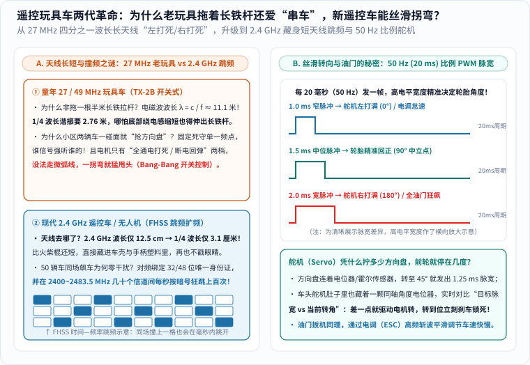

如果今晚你坐在客厅沙发上，不妨顺手做两个十秒钟就能验证的小实验：

1. **实验一（抓拍隐形光）**：拿起家里的电视或机顶盒遥控器，用肉眼直视它顶端那颗深紫色的小圆珠，无论怎么按键都漆黑一片；但只要打开手机相机——尤其是**前置自拍镜头**——对准那颗小灯珠再按下任意键，手机屏幕里立刻会爆出一闪一闪、清晰无比的**紫白色亮光**！
2. **实验二（被窝跳变之谜）**：夏天开着 $$26\ ^\circ\text{C}$$ 的空调，你把空调遥控器缩进厚棉被里，对着被窝连按三次“降温”键，墙上的空调毫无反应，遥控器小屏幕却变成了 $$23\ ^\circ\text{C}$$。接着你把遥控器伸出被窝，对准空调只按**一下**“升温（`+`）”键——滴！墙上原本 $$26\ ^\circ\text{C}$$ 的空调没有升到 $$27\ ^\circ\text{C}$$，反而瞬间**倒退跳变到了 $$24\ ^\circ\text{C}$$**！

再往茶几和抽屉里看一眼，疑惑就更多了：

- 大白天阳光洒满客厅，太阳光里全是强烈的红外线，电视接收头为什么从来不会被太阳晃晕乱换台？把遥控器反过来对着身后的**大白墙**按，电视居然也能乖乖换台？
- 同样发红外光，为什么电视遥控器干干净净**从来不装屏幕**，空调遥控器却非得顶着一块单色液晶屏不可？现在的蓝牙语音遥控器明明不用对准电视就能说话搜片，为什么额头上还顽固保留着一颗老式红外灯？
- 小时候玩遥控汽车，手柄和车顶都得拽出一根半米长的亮银色铁拉杆，小区里两个小朋友一碰面，你的手柄居然能抢走他的车头，而且方向盘只有“左打死、右打死”两档；为什么现在的遥控车和无人机**连根外露天线都找不到**，五十辆同场狂飙互不干扰，手指轻轻勾一点扳机就能慢悠悠走微弧线？
- 路边配钥匙摊花二十块钱就能用“拷贝遥控器”复制小区老道闸的开关，为什么面对你的汽车钥匙却束手无策？可新闻里两个小偷根本不破译密码，拿两台“信号放大器”一个贴着你家大门、一个站在楼下车边，怎么又能隔空把无钥匙进入的汽车偷走？

这串横跨客厅、儿童房与地下车库的日常悬案，背后其实只围着一个核心工程命题打转：**怎样在看不见摸不着、到处充满太阳光与电磁杂波、甚至还有小偷窃听的空气里，既省电又零差错地把人类的意图隔空传过去？**

顺着这条线索剥开五层外壳，你会发现每一件习以为常的遥控器里，都藏着让人拍案叫绝的物理与通信巧思。

---

## 一、从“绊脚电线、手电筒乱换台”到“敲铝棒发超声波”：为什么英文至今把遥控器叫 Clicker？

在拆解今天的红外灯与射频芯片之前，我们先回答一个根本问题：**为什么电视和空调用红外光，玩具车和蓝牙用 $$2.4\text{ GHz}$$ 无线电，车钥匙却偏爱 $$433\text{ MHz}$$ 甚至 $$6\text{–}8\text{ GHz}$$ 的超宽带脉冲？大家干脆统一用同一种波不好吗？**

翻开遥控器一百二十多年的试错史，答案一目了然——因为人类把电线、可见光、超声波和无线电全都试了一遍，每一种物理波都有自己的脾气。

*图 1：左栏按时间轴还原从 1898 年无线电遥控船到无电池超声波铝棒的演化里程碑；右栏对比当今四大主流遥控物理信道在波长、穿墙能力、天线尺寸与防盗测距上的天然分工。*

### 1. 遥控鼻祖其实比电视机还早半个世纪：1898 年的无线电小船

很多人以为先有电视才有遥控器，其实人类第一台无线遥控装置诞生于 **1898 年**。当年 5 月，电气先驱尼古拉·特斯拉（Nikola Tesla）在纽约麦迪逊花园广场中央挖了一座水池，放进一艘一米多长的铁壳玩具船。观众在岸边目瞪口呆地看着：船上既没有水手也没有电线，特斯拉拨动岸边盒子的开关，小船就精准地前进、左右转舵，连桅杆上的小灯都能听口令闪烁——甚至有人怀疑船肚子里藏了一只训练过的猴子！

同年 11 月 8 日，这项名为《控制移动船只或车辆机构的方法与装置》的发明正式获批**美国专利 US 613,809**。小船肚子里装的是一根装满金属碎屑的玻璃管（“金属屑检波器”，无线电波一到，金属屑就粘连导电，驱动棘轮继电器拨动船舵）。这就是今天一切无人机、遥控车与制导装备的共同老祖宗。

### 2. 电视遥控器的三次爆笑翻车与神来之笔：不装电池的“四根小铝棒”

可等到 20 世纪中叶电视机走进千家万户时，把笨重昂贵的无线电发射机塞进掌心还太奢侈。美国泽尼特（Zenith）公司的工程师们为了替老板消灭恼人的电视广告，硬生生蹚出了三代奇葩设计：

1. **1950 年“懒骨头”（Lazy Bones）——全客厅绊脚索**：工程师直接从沙发拉了一根几米长的粗电线连进电视机，按键驱动马达硬拧调谐旋钮。换台是省事了，可全家人半夜起床天天被横穿地毯的长电线绊个狗吃屎。
2. **1955 年“闪光魔术”（Flash-Matic）——被太阳逼疯的手电筒**：工程师尤金·波利（Eugene Polley）剪掉了电线，在电视屏幕四个角各装一颗光电管，手里的遥控器干脆就是一把**高亮度绿光手电筒**——照左上角换台、照右上角静音、照下角关机！这确实是人类第一款无线电视遥控器，但致命漏洞当天就暴露了：**只要晴天下午阳光斜射进客厅窗户，电视机就像中了邪一样在客厅里疯狂自动乱转换台！**
3. **1956 年“太空指挥官”（Space Command）——零电池敲铝棒，造出英文词 Clicker**：既然可见光斗不过太阳，物理学家罗伯特·阿德勒（Robert Adler）干脆换到了人耳听不见的**超声波**赛道。更绝的是，当时的干电池容易漏液腐蚀电路，阿德勒居然设计出了一款**一节电池都不用装的纯机械超声波遥控器**：外壳里面并排悬空挂着 **4 根长约 $$6.35\text{ cm}$$（约 $$2.5$$ 英寸）、长度经过毫厘级精密裁切的高纯度轻质铝棒**！你拇指使劲按下一颗按键，弹簧释放小锤“咔哒（Click）”一声敲击对应的铝棒，铝棒立刻像音叉一样在 **$$38\text{–}41\text{ kHz}$$** 附近发出专属频率的超声波，电视机里的麦克风听音辨位完成换台或静音！

这套“不充电、不换电池、敲铝棒遥控电视”的机械神作一卖就是整整二十五年（总销量超过 900 万只），直到 1980 年代初才退役。因为每次按键弹簧锤敲击铝棒都会发出清脆的“咔哒”声，英语国家的老百姓从此把电视遥控器亲切地叫做 **“Clicker（咔哒器）”**，一直沿用到无声硅胶按键的今天。

> **为什么超声波最终还是让位给了红外线？** 因为日常生活里藏着意想不到的超声波源——你在客厅里**哗啦一下晃动钥匙串、拍巴掌、撕胶带，甚至小狗抖动金属狗牌**，都会迸发出 $$40\text{ kHz}$$ 附近的高频声波，把电视吓得突然静音；反过来，按下遥控器时人类虽然听不见，家里听力上限高达 $$45\text{–}60\text{ kHz}$$ 的猫咪和狗狗却会竖起耳朵一脸惊恐！直到 1980 年代廉价的**砷化镓（GaAs）近红外发光二极管**成熟，家电遥控才终于找到了最完美的归宿。

### 3. 一张表看懂四大物理信道：为什么绝不能“全用同一种波”？

到了今天，不同遥控器各守各的频段，本质上是电磁波**波长 $$\lambda$$** 决定的天然边界（声波除外，其余皆满足光速 $$c = \lambda f$$）：

- **电视、空调、风扇 —— $$940\text{ nm}$$ 近红外光**：波长不到千分之一毫米，像手电筒光一样**连一张薄纸、一堵卧室墙都穿不过**。这恰恰是家电梦寐以求的优点！要是空调和电视用穿墙无线电，你在主卧按一下关机，隔壁次卧爸妈正在看的电视、甚至楼下邻居家的空调全跟着关了，整栋楼都得乱套。加之红外发射管成本只要几毛钱、待机零耗电，两节七号电池能用两三年。
- **老玩具车、车库门、传统汽车钥匙 —— $$27\text{ MHz} / 315\text{ MHz} / 433\text{ MHz}$$（Sub-GHz 无线电）**：波长从 $$0.7\text{ m}$$ 到 $$11\text{ m}$$，遇到车身铁皮、院墙和裤兜布料能轻松绕射穿过。你在兜里盲按或者隔着几十米拐角锁车，非它莫属。
- **现代比例遥控车、无人机、智能语音遥控器 —— $$2.4\text{ GHz}$$ 射频（蓝牙 BLE / 跳频专网）**：波长缩到 $$12.5\text{ cm}$$，不仅能把天线藏进塑料壳里，还拥有几十兆赫兹的充裕带宽，既能让五十辆遥控车高速跳频同场竞技，又能把你说的话实时双向传给智能电视识别。
- **新一代防盗数字车钥匙 —— $$6\text{–}8\text{ GHz}$$ 超宽带（UWB）**：每次发射宽度仅约 $$2\text{ ns}$$（十亿分之二秒）的极窄无线电脉冲，专治小偷隔门放大信号的“中继盗车术”。

---

## 二、电视红外遥控的双重密码：为什么肉眼看不见、手机能拍出紫光，太阳也晃不晕它？

回到开篇第一个小实验：同是一颗几毛钱的透明或深紫塑料灯珠，为什么我们的眼睛盯破了也看不见亮光，手机前置摄像头却能拍出闪亮的紫白点？大晴天满客厅都是太阳红外线，电视机凭什么不犯迷糊？

答案藏在**光子能量门槛**与 **$$38\text{ kHz}$$ 载波暗号**这两道精密关卡里。

*图 2：上半部分展示 $$940\text{ nm}$$ 近红外光如何绕过人眼视蛋白极限、被手机硅传感器捕获，同时靠每秒 $$38\,000$$ 次的频闪暗号穿过太阳直流光与灯光干扰；下半部分拆解全球家电最通用的 NEC 脉冲距离编码与恒定 $$68.06\text{ ms}$$ 帧结构（支持动效的浏览器可见红外脉冲串发射过程；[单独打开动图可重播](/assets/images/remote-control/tv-ir-38khz-carrier-nec-waveform-anim.svg)，开启减少动态效果或阅读静态图同样保留完整波形与数值）。*

### 1. 第一重关卡（$$940\text{ nm}$$ 波长）：刚好卡在“人眼瞎、硅片亮”的夹缝里

我们在中讲过，人眼视网膜之所以能看见光，靠的是视锥细胞里的**视蛋白与视黄醛分子开关**：光子必须具备足够的单光子能量，才能一脚踹弯视黄醛分子。当波长拉长到约 **$$700\text{ nm}$$** 的深红光边缘时，单个光子的能量跌到了约 $$1.77\text{ eV}$$ 以下，再也扳不动人眼的分子开关了。

而家用遥控器顶端的砷化镓（GaAs）红外 LED，发射峰值波长特意选在 **$$\lambda = 940\text{ nm}$$**。我们可以顺手算出它单颗光子的能量：

$$
E = \frac{hc}{\lambda} \approx \frac{1240\text{ eV}\cdot\text{nm}}{940\text{ nm}} \approx 1.32\text{ eV}
$$

$$1.32\text{ eV}$$ 远低于人眼的 $$1.77\text{ eV}$$ 门槛，所以在我们的肉眼看来，这束光跟彻底黑暗毫无区别，看电视时绝不会有一道刺眼的红光在客厅里乱晃。

**那手机镜头为什么又能看见它？** 因为手机摄像头底部的感光芯片是用**单晶硅（CMOS）**造的！单晶硅的半导体禁带宽度只有 **$$E_g \approx 1.12\text{ eV}$$**（对应截止波长约 $$1100\text{ nm}$$）。$$1.32\text{ eV}$$ 的红外光子撞上硅芯片，绰绰有余能把电子激发出来产生电流！

事实上，为了防止大晴天树叶反射的红外线让照片严重偏色，手机厂商会在昂贵的**后置主摄**前贴一片厚厚的“红外截止滤光片（IR-Cut）”，所以有的高端手机用后置镜头拍遥控器会显得很暗；但**前置自拍镜头**为了机身轻薄和暗光进光量，滤光片往往薄得多。漏进来的 $$940\text{ nm}$$ 光子能同时穿透传感器表面的红色与蓝色拜耳滤色片，手机图像算法一合成，就在屏幕上显示成了醒目的**紫白色闪光**！下次家里遥控器失灵，不用到处找万用表，拿手机前置镜头照一下按键：灯亮说明电池和按键完好，灯不亮多半是没电或导电橡胶脏了。

### 2. 第二重关卡（$$38\text{ kHz}$$ 载波调制）：在满屋太阳光里对上“每秒狂闪 38,000 次”的暗号

解决了不刺眼的问题，1955 年手电筒遥控器的老噩梦又来了：**太阳也是个超级红外大灯泡！** 晴天洒进客厅的阳光，还有白炽灯、取暖器、甚至滚烫的火锅，无时无刻不在向四周倾泻海量的 $$940\text{ nm}$$ 红外线，强度比遥控器那颗小灯珠高出成百上千倍。电视接收头为什么不会被吵聋？

工程师使出了一招无线电通信里的看家绝活——**副载波调制（Subcarrier Modulation）**。

遥控器在发送“高电平脉冲”的那几百微秒里，并不是让红外灯一直傻亮着，而是让它以 **$$f_c = 38\text{ kHz}$$** 的惊人速度疯狂明灭闪烁——也就是**每秒钟开关 $$38\,000$$ 次**，每闪一次周期只有：

$$
T_c = \frac{1}{38\,000\text{ Hz}} \approx 26.32\ \mu\text{s}
$$

> **冷知识：为什么全世界不约而同选了 `38 kHz` 这个有零有整的数字？** 因为在微电子还没白菜价的 1980 年代，收音机产业链上产量最大、最便宜到几分钱一颗的频率基准元件，是中波收音机用的 **$$455\text{ kHz}$$ 陶瓷谐振器**！遥控器芯片只要用一个最简单的 **$$12$$ 分频电路**，算出来的频率就是 $$455\text{ kHz} \div 12 \approx 37.92\text{ kHz} \approx 38\text{ kHz}$$！就这么一个省钱的硬件整数比，沿用成了统治全球四十年的家电铁律。

现在我们再看电视机下边框里那颗花生米大小、只有三条腿的**红外一体接收头**（比如经典的 Vishay `TSOP38238`），它是怎样在强光风暴里淡定挑出暗号的：

1. **第一层（黑环氧树脂滤光壳）**：你看到遥控接收窗总是黑得发紫，那层黑色特种树脂本身就是一道光学墨镜，把 $$400\text{–}750\text{ nm}$$ 的可见光先砍掉九成九。
2. **第二层（自动增益控制 AGC + $$38\text{ kHz}$$ 窄带带通滤波器）**：太阳的红外光再毒辣，它的亮度是稳定不变的（频率 **$$0\text{ Hz}$$**）；客厅里的交流电吸顶灯哪怕有频闪，也只有 **$$100\text{ Hz}$$**（$$50\text{ Hz}$$ 市电每半周亮一次）或几百赫兹。接收头内部的窄带滤波器是个铁面无私的门卫：**凡是不按每秒 $$38\,000$$ 次节奏跳动的红外光，哪怕强如正午烈日，一律当成背景废话清零拒之门外！**
3. **顺带解开“对着白墙反按也能换台”之谜**：正因为滤掉了全部太阳和灯光背景噪声，接收头里的自动增益放大器（AGC）敢在安静时把灵敏度调到极高！你把遥控器调转枪口射向身后的大白墙，$$940\text{ nm}$$ 红外光在粗糙墙面上发生漫反射，哪怕只有万分之一的微弱光子弹回电视机，只要它还带着 **$$38\text{ kHz}$$** 的心跳节拍，接收头就能稳稳抓住并还原成干净利落的 `0` 和 `1` 方波！

### 3. 第三重关卡（NEC 脉冲距离编码）：用“沉默时间长短”拼出永不错乱的 32 位电报

有了干净的开关方波，遥控器又是怎样表达“音量加”还是“换到中央五套”的呢？全球八成以上的电视、盒子和风扇都在用日本电气公司制定的 **NEC 红外协议**，它的每一帧电报都优雅得像一道数学题（对照图 2 下半部分从左往右看）：

1. **先大喊一声唤醒耳朵（引导码 Header）**：先连闪 $$9\text{ ms}$$ 的 $$38\text{ kHz}$$ 强脉冲串（足足闪 $$342$$ 下！专门给接收头的 AGC 电路校准音量大小），再安静停顿 $$4.5\text{ ms}$$，合计 $$13.5\text{ ms}$$。电视主板一看到“亮 $$9$$ 停 $$4.5$$”，立刻竖起耳朵准备抄写。
2. **靠“停顿长短”区分 `0` 和 `1`（脉冲距离编码）**：接下来每一位比特都以一段固定 $$562.5\ \mu\text{s}$$（约闪 $$21$$ 下）的亮光打头；紧接着，如果**短停顿 $$562.5\ \mu\text{s}$$**（总长 $$1.125\text{ ms}$$），就代表二进制 **`0`**；如果**长停顿 $$1.6875\text{ ms}$$**（总长 $$2.25\text{ ms}$$，刚好是 `0` 的两倍！），就代表二进制 **`1`**。
3. **奇妙的“正反成双”与恒定 $$68.06\text{ ms}$$ 定律**：标准 NEC 一口气发 **$$32$$ 位比特**，依次是：`[8 位设备地址]` + `[8 位地址按位取反]` + `[8 位按键命令]` + `[8 位命令按位取反]`，最后补一颗 $$562.5\ \mu\text{s}$$ 的收尾脉冲封口。
   - **为什么非要多发两串“反码”？** 既是为了区分不同品牌家电（电视地址可能是 `0x04`，机顶盒是 `0x80`，所以电视遥控器按不响风扇），更是为了**零差错防误触**！比如“音量+”命令是 `00010110`（`0x16`），紧跟着的反码必须是 `11101001`（`0xE9`）。万一半路有人走过挡掉半截光，正码加反码凑不出全 `1`（`0xFF`），电视主板当场扔进垃圾桶，绝不会把“音量+”错听成“恢复出厂设置”！
   - **更妙的数学巧合**：既然每一个 `0` 在反码里必然对应一个 `1`，那么不管你按哪个键、发什么地址，整帧 $$32$$ 位电报里**永远不多不少刚好有 $$16$$ 个 `0` 和 $$16$$ 个 `1`**！所以尽管 `0` 短 `1` 长，整包电报的总耗时却是一个雷打不动的常数：

$$
T_{\text{NEC}} = 13.5\text{ ms} + 16 \times 1.125\text{ ms} + 16 \times 2.25\text{ ms} + 0.5625\text{ ms} = 68.0625\text{ ms}
$$

4. **按住“音量+”不松手为什么不费电？** 如果你死死按住音量键两秒钟，遥控器并不会傻乎乎连发二十遍 $$32$$ 位长电报，而是在发完第一帧完整电报后，每隔 $$110\text{ ms}$$ 只补发一个极短的**“重复码（Repeat Code）”**（亮 $$9\text{ ms}$$ + 停 $$2.25\text{ ms}$$ + 亮 $$0.5625\text{ ms}$$），告诉电视：“刚才那个键还没松手，继续加！”发光时长砍掉大半，难怪两节干电池能撑好几年。

---

## 三、同是红外遥控，为什么电视遥控器没屏幕，空调遥控器却非带一块小屏不可？

读懂了电视的 $$32$$ 位短电报，我们马上撞上了开篇第二个生活悬案：**明明用的都是几毛钱一颗的 $$940\text{ nm}$$ 红外灯、走的都是 $$38\text{ kHz}$$ 调制，凭什么电视遥控器光溜溜一块板，空调遥控器却家家户户顶着一块液晶屏？而且躲在被窝里按到 $$23\ ^\circ\text{C}$$ 再伸出来按一下 `+`，墙上 $$26\ ^\circ\text{C}$$ 的空调为什么会直接跳到 $$24\ ^\circ\text{C}$$？**

这不是厂商为了显得高档故意加块表（单色液晶屏的原理详见），而是**“单向盲发信道”**逼出来的两种截然不同的状态同步哲学！

*图 3：左栏展示电视遥控器借助“人眼盯大屏”构成实时闭环，因而只需发送 $$32\text{ bit}$$ 无状态增量短指令；右栏拆解空调遥控器因单向红外无法回话且多参数强耦合，必须在本地维护完整账本并每次打包发送 $$96\text{–}224\text{ bit}$$ 全量状态快照，从而完美解释“被窝盲按跳变”现象。*

### 1. 电视遥控器是“健忘的传令兵”：无状态增量指令（Stateless）

先想一想你看电视的场景：电视机本身就是一面硕大无比的发光屏幕，你的眼睛正死死盯着它。

当你按一下“音量 `+`”时，电视遥控器需要知道电视现在是音量 `20` 还是音量 `35` 吗？**完全不需要！** 它脑子里空空如也，只管向空气里喊一嗓子刚刚讲过的 $$32$$ 位短暗号：“请把音量往上加 $$1$$ 格（`0x16`）！”

- 如果喊成功了，你亲眼看到电视屏幕右下角弹出音量条 `20 → 21`；
- 如果茶几上的果盘刚好挡住了红外光没按上，你看到屏幕没动静，手腕抬高一点**顺手再补按一下**就完事了！

在控制工程里，这叫**“人在回路（Human-in-the-Loop）闭环反馈”**。因为你的眼睛替遥控器承担了核对结果的任务，电视遥控器根本不需要记忆任何状态——哪怕你把客厅里两只一模一样的同型号电视遥控器抓在左右手里轮流乱按，左边加一下音量、右边换一个台，它们也绝不会打架出错。

### 2. 空调遥控器是“随身带账本的总管”：有状态全量快照包（Stateful）

可一旦换成挂在两米多高墙角上的空调（我们在里拆解过它的四通换向阀与压缩机调速系统），情况就彻底反过来了：

首先，传统红外遥控是**严格单向（One-way）**的——只有遥控器上有发射灯、空调上有接收头，墙上的空调根本没有红外发射管，**永远没法开口回话告诉遥控器“我现在到底是几度、什么风速”**！早期绝大多数壁挂空调机身甚至连数码管都没有，全靠两三颗小指示灯和“滴”的一声蜂鸣回应你。

其次，空调跟电视不同，它身上捆着**六七个互相牵制的耦合参数**：`开关机 + 制冷/制热/除湿/送风模式 + 目标温度（16~30°C）+ 风速档位 + 上下/左右摆风 + 定时/睡眠`。比如在很多品牌的空调协议（如经典的美的 `R05D / RG57` 六字节协议、格力 `YBOFB` 八字节协议）里，只要切到“自动模式”或“除湿模式”，风速字节就会被强制改写成特殊锁定值（如 `0xF8`）。

设想一下，如果空调遥控器也学电视那样只发相对指令“温度减 $$1$$ 度”，会发生什么灾难？

- 假如遥控器小屏幕显示 $$26\ ^\circ\text{C}$$，你随手按了一下“降温”，遥控器屏幕自己减成了 $$25\ ^\circ\text{C}$$，可偏偏这时候老伴从前面走过挡住了红外光，墙上的空调没收到，还停在 $$26\ ^\circ\text{C}$$！
- 完了——从此以后，**遥控器屏幕永远比真实空调低 $$1$$ 度**；再漏收两次，屏幕显示 $$22\ ^\circ\text{C}$$ 制冷，墙上其实还在吹 $$25\ ^\circ\text{C}$$ 暖风，两边账本彻底崩盘，除非拔电源重启否则永远对不上账！

为了根治这个死穴，家电工程师想出了一个绝妙的架构：**干脆让手里带液晶屏的遥控器当唯一的“最高总账本”，每次不管你按了哪一颗小键，遥控器都把整块液晶屏上显示的所有参数打成一个“全家桶完整快照包”，一次性全覆盖发给空调！**

拿逆向工程中非常典型的美的 `RG57` 红外帧来说，你哪怕只是轻轻按了一下“上下摆风”键，遥控器吐出的也不是短短 $$32$$ 位，而是足足 **$$6$$ 个字节（连发两遍共 $$96$$ 位，复杂机型甚至长达 $$112\text{–}224$$ 位）** 的全量状态长包：

- **字节 0–1（厂商身份头）**：如固定的 `0xB2` 与反码 `0x4D`；
- **字节 2–3（开关机 + 风速档位 + 正反校验）**：把自动风、低中高风速与开关状态编成一串字节；
- **字节 4（运行模式 + 查表目标温度）**：高四位写明制冷/制热/除湿，低四位把 $$17\text{–}30\ ^\circ\text{C}$$ 编成格雷码式的温度表；
- **字节 5（摆风/辅热/定时扩展 + Checksum 校验和）**：把前面所有字节算一个校验和封尾，空调收到后先验总账，一字不差才“滴”一声全盘照收！

**现在再回看开篇的“被窝盲按跳变”实验，是不是瞬间通透了？**

1. 空调原本开在 $$26\ ^\circ\text{C}$$；你钻进被窝盲按三下“-”，红外光全被棉被吸收了，墙上的空调对此一无所知，依然吹着 $$26\ ^\circ\text{C}$$；但你手里遥控器的本地账本已经实打实记到了 **$$23\ ^\circ\text{C}$$**。
2. 当你把遥控器探出被窝，对准空调按下那一下“`+`”时，遥控器账本从 $$23\ ^\circ\text{C}$$ 变成 **$$24\ ^\circ\text{C}$$**，然后向空调发射了一整包命令：**“听好！现在立刻设为：开机、制冷、$$24\ ^\circ\text{C}$$、自动风、摆风开！”**
3. 墙上的空调一接到这份“全家桶圣旨”，根本不管自己刚才是不是 $$26\ ^\circ\text{C}$$，当场无条件把全身状态刷新成 **$$24\ ^\circ\text{C}$$**——账本在单向盲发信道里一秒追平，分毫不差！

> **一个反常识推论**：正因为空调只认最后收到的那份“全家桶快照”，如果你家里有**两只**同型号空调遥控器，一只屏幕停在 `28°C 制热`，另一只停在 `20°C 制冷`，两个人轮流按一下摆风键，墙上的空调就会在冰火两重天之间来回精神分裂！这和两只电视遥控器和谐共处恰好相反。

---

## 四、遥控玩具车的两代革命：为什么老玩具拖着长铁杆还爱“串车”，新遥控车连天线都没了却能丝滑拐弯？

看完了客厅里的红外光，我们走进小区空地和儿童房。80 后、90 后爸妈大都记得童年玩具车那三件刻进 DNA 的烦恼：

1. 车屁股和手柄顶上各插着一根半米长、一不小心就折弯戳人的亮银色伸缩铁杆（或者软铁丝套根透明塑料管）；
2. 两个小孩各提一辆车下楼比赛，刚一开机，**你的手柄一推前进，他的车居然跟着蹿进了花坛**（俗称“撞频串车”）；
3. 转向键按下去只听车头“咔”一声**直接左打死**，松手弹簧“啪”一下弹回正中，永远拐不出真车那样优雅顺滑的大弯道。

而今天哪怕百元级的遥控越野车、航模和无人机，外表光溜溜连根天线都摸不着，几十台车挤在同一个赛道里各跑各的，轻轻拧一点手轮就能让前轮精准偏转 $$10^\circ$$、$$25^\circ$$ 或 $$45^\circ$$。这中间究竟发生了哪两场技术跃迁？

*图 4：左栏对比童年 $$27\text{ MHz}$$ 四分之一波长长天线开关式玩具车与现代 $$2.4\text{ GHz}$$ 藏身短天线 + FHSS 跳频扩频系统；右栏图解现代航模与比例遥控车通用的 $$50\text{ Hz}$$（$$20\text{ ms}$$ 周期）PWM 脉宽调制与舵机内部闭环电位器反馈机制。*

### 1. 天线为什么突然“消失”了？从 $$11\text{ m}$$ 长波缩短到 $$12.5\text{ cm}$$ 微波

很多小朋友以为现在的遥控车不用天线了——其实天线一根没少，只是因为电磁波频率翻了近百倍，天线缩得比一根火柴棍还短，直接藏进塑料壳肚子里了！

我们在里推导过天线高效收发电磁波的黄金法则：**单极子天线的理想谐振长度大约等于电磁波波长的四分之一（$$L \approx \lambda / 4$$）**。

早年廉价玩具车普遍搭载一颗传奇国产/台系芯片组合 `TX-2B / RX-2B`，工作在国家开放的 **$$27.145\text{ MHz}$$**（或 $$49\text{ MHz}$$）低频段。我们来算算 $$27.145\text{ MHz}$$ 无线电波在空气里的波长：

$$
\lambda_{27\text{M}} = \frac{c}{f} = \frac{2.998 \times 10^8\text{ m/s}}{2.7145 \times 10^7\text{ Hz}} \approx 11.04\text{ m}
$$

四分之一波长足足有 **$$2.76\text{ m}$$**！玩具厂当然没法在巴掌大的塑料车顶立一根近三米高的钓鱼竿，只能在电路板根部先绕一圈铜线电感（“底部加感线圈”等效延长电长度），即便如此，外面也必须硬拽出一截 **$$40\text{–}60\text{ cm}$$ 的金属拉杆天线**，否则走出去五米就彻底失联。

再看今天的 **$$2.4\text{ GHz}$$（$$2400\text{–}2483.5\text{ MHz}$$ ISM 频段）** 遥控系统，频率暴涨了将近 $$90$$ 倍，波长瞬间浓缩到了：

$$
\lambda_{2.4\text{G}} = \frac{2.998 \times 10^8\text{ m/s}}{2.44 \times 10^9\text{ Hz}} \approx 0.123\text{ m} = 12.3\text{ cm}
$$

算一算它的四分之一波长：**$$L = \lambda / 4 \approx 3.1\text{ cm}$$**！仅仅三厘米出头——也就是大拇指一节指肚的长度！工程师只要在电路板边缘蚀刻一小段蛇形铜箔，或者留一小截三厘米长的同轴剥皮细线贴在车壳内壁，辐射效率甚至比当年那根半米长的铁拉杆还要高得多。

### 2. 50 辆车同场为什么再也不“撞频串车”？对频身份证 + FHSS 每秒百次跳频

当年 $$27\text{ MHz}$$ 老玩具之所以一碰面就抢方向盘，是因为它的收发晶振死死焊死在同一个频点上，而且 `TX-2B` 芯片根本没有“车主身份证”的概念——前进就是连发 $$16$$ 个脉冲，左转就是连发 $$58$$ 个脉冲，谁离车近、谁电池新嗓门大，车就听谁的！当年讲究一点的玩具包装盒侧面还会贴一张小圆贴纸写着“`27 MHz`”或“`49 MHz`”，叮嘱家长给双胞胎买两辆车时千万挑不同贴纸，可全小区总共也就两三个频点，下楼照样撞车。

现代 $$2.4\text{ GHz}$$ 遥控器用两招彻底终结了撞频历史：

- **第一招：全球唯一身份绑定（Bind ID）**。第一次买回家开机“对频”时，手柄会把一串出厂烧录的 **$$32\text{ bit}$$ 或 $$48\text{ bit}$$ 唯一识别码**（几十亿至上百万亿种组合）写进小车的接收机记忆里。从此小车每收到一帧数据包先核对身份证号，不是自家手柄发来的指令看都不看。
- **第二招：跳频扩频（FHSS，Frequency-Hopping Spread Spectrum）**。$$2.4\text{ GHz}$$ 频段宽达 $$83.5\text{ MHz}$$，被切分成了几十到上百条独立小车道。手柄和小车对好暗号后，绝不傻待在一条道上，而是按照只有它俩知道的伪随机序列，**每秒钟在几十个频道之间疯狂跳跃上百次**（如图 4 左下角蓝色跳频格所示）！哪怕广场上五十辆遥控车加上周围十几台家用 Wi-Fi 路由器同时开机，某两辆车在某一毫秒凑巧踩进同一个频道，下一毫秒它们就已经各自跳去别的干净车道了，你手底下连半点卡顿都察觉不到。

### 3. 方向盘拧多少度、轮子就转多少度：$$50\text{ Hz}$$ 比例舵机（Servo）的脉宽闭环

解决了通信，更迷人的是操控手感的质变：老玩具车前轮装的只是一颗几毛钱的普通小马达（甚至两块电磁铁）配一根回位扭簧，电路只有“全电压通电打死”和“断电弹回中间”两档，学名叫**开关控制（Bang-Bang Control）**，所以跑直线都得一路扭秧歌修正。

而真正的**全比例遥控（Proportional RC）**，车头转向靠的是一颗麻雀虽小五脏俱全的**伺服舵机（Servo）**，车轮快慢靠的是**电子调速器（ESC，简称电调）**。接收机跟舵机、电调之间说的是全球航模界统一了半个世纪的普通话——**$$50\text{ Hz}$$（周期 $$20\text{ ms}$$）脉宽调制信号（PWM）**！

对照图 4 右上角的三条波形，规则简单到不可思议：接收机每隔 $$20\text{ ms}$$ 准时给舵机发一次高电平脉冲，**脉冲持续的毫秒宽度 $$t_{\text{high}}$$，直接一对一线性映射成前轮的目标角度 $$\theta$$**：

$$
\theta(t_{\text{high}}) = \frac{t_{\text{high}} - 1.0\text{ ms}}{1.0\text{ ms}} \times 180^\circ \qquad (1.0\text{ ms} \le t_{\text{high}} \le 2.0\text{ ms})
$$

- 当 $$t_{\text{high}} = 1.0\text{ ms}$$（窄脉冲）：命令舵机转到最左端极限（$$0^\circ$$），对电调则代表油门归零怠速；
- 当 $$t_{\text{high}} = 1.5\text{ ms}$$（正中脉冲）：命令舵机精准停在正前方中立位（$$90^\circ$$）；
- 当 $$t_{\text{high}} = 2.0\text{ ms}$$（宽脉冲）：命令舵机转到最右端极限（$$180^\circ$$），对电调则代表全油门狂飙；
- 如果你的手指只把方向手轮轻轻往左拨了一半，手柄里的电位器（或霍尔磁传感器）测出分压，经过 $$2.4\text{ GHz}$$ 无线链路让接收机吐出 **$$1.25\text{ ms}$$** 的脉宽——套进上面的公式，目标角度不多不少正好是 **$$45^\circ$$**！

**舵机又是怎么知道自己已经转到 $$45^\circ$$ 该立刻刹车的？** 拆开舵机外壳你会看到，它的输出齿轮轴底下，同轴硬连着另一颗**角度反馈电位器**！舵机里的小控制芯片每时每刻都在拿“接收机要的 $$1.25\text{ ms}$$ 目标脉宽”跟“自己当前轴位对应的脉宽”做减法：

- 差得远，就全速驱动微型电机猛转；
- 快贴近 $$45^\circ$$ 了，自动减小电流减速；
- 一旦两边相等（误差归零），当场切断电机稳稳锁死在 $$45^\circ$$；哪怕石头硌了一下车轮把角度撞歪了 $$2^\circ$$，误差瞬间不为零，舵机不用等你动手就会自己顶回去！这就是自动控制理论里最经典、最迷人的**负反馈位置闭环**。

---

## 五、终极延伸与安全攻防：为什么蓝牙遥控器头顶还留红外灯？汽车钥匙又是怎样跟小偷斗智斗勇的？

把前面四块拼图合拢，日常生活里最后两个高阶谜题也就水到渠成了。

### 1. 现代智能电视语音遥控器的“双模心机”：为什么连了蓝牙还舍不得拔掉红外灯？

现在买回家的智能电视遥控器，躲进厨房不指着电视也能换台，按住麦克风键说一句“我想看纪录片”就能实时语音识别——这是因为里面装了一颗 **$$2.4\text{ GHz}$$ 低功耗蓝牙（BLE，采用 HID over GATT 协议）** 双向收发芯片：不仅能把按键和压缩后的语音流发给电视，电视还能反过来提醒你“遥控器电池只剩 $$10\%$$ 了”。

可如果你拿手机镜头照一下这把蓝牙遥控器的最顶端，按下红色的**“电源开关键”**时，往往还是能拍到那束熟悉的 $$940\text{ nm}$$ 紫白红外闪光！为什么非要“红外 + 蓝牙”双模并存？

算一笔**待机功耗账**就明白了：现代各国能效法规（如欧盟与我国一级能效标准）严格要求电视机深度关机待机功耗必须压在 **$$0.5\text{ W}$$ 以下**！当电视彻底关机休眠时，安卓主芯片和耗电较大的蓝牙协议栈往往跟着断电睡大觉去了，只有主板角落里一颗微瓦级超低功耗单片机连着红外接收头醒着值班。于是工程师设计了这套天衣无缝的交接班：

- **关机唤醒那一下**：按键同时射出 **$$38\text{ kHz}$$ 红外电源码**（或者极低占空比的蓝牙唤醒广播），由值班红外接收头一脚踹醒电视主电源；
- **开机以后的所有操作与语音**：瞬间切回穿墙免对准、高带宽的 **$$2.4\text{ GHz}$$ 蓝牙通道**！如果你用这把遥控器顺便学习了客厅老机顶盒或功放的红外开关码，那颗几毛钱的红外灯还能兼职一键同开同关。

### 2. 路边“万能拷贝器”为什么抄得走道闸，却偷不走汽车？66 位滚动码（Rolling Code）

前面不论是电视 NEC 红外码还是空调六字节快照，每次发出去的电报都是**明文固定码**——因为没人会趴在你家窗外偷录一段信号半夜替你开空调。可一旦遥控的对象换成**车库大门和几十万的汽车**，明文固定码立刻变成灾难！

*图 5：左栏对比老式 $$433\text{ MHz}$$ 固定码道闸的重放漏洞与汽车钥匙 KeeLoq $$66$$ 位滚动码的“单次作废 + 前向滑动窗口”同步机制；右栏拆解无钥匙进入系统遭遇的“双人中继放大盗车”软肋，以及新一代 IEEE `802.15.4z` UWB 超宽带如何凭 $$30\text{ cm/ns}$$ 光速飞行时间与加密脉冲一举识破骗局。*

很多老小区电动门或廉价卷帘门遥控器里，装的是几毛钱的 $$315 / 433\text{ MHz}$$ 固定码芯片（如 `PT2262` 或 `EV1527`），每次按键都在空气里反复裸奔喊同一串 $$24$$ 位口令。网上卖二十块钱一个的所谓“万能对拷遥控器”，本质上就是一个同频段录音复读机：只要贴近你的旧钥匙按一下把波形录下来，从此就能无限次**原样重放（Replay Attack）**打开大门！

为了粉碎录音重放，汽车工业在 1990 年代全面换装了以 Microchip `HCS301（KeeLoq 算法）` 为代表的**加密滚动码（Rolling Code / Hopping Code）**芯片（对照图 5 左栏）：

1. **用一次废一次的动态暗号**：你的车钥匙和汽车电脑出厂配对时，肚子里各自锁着一把绝不外泄的 **$$64$$ 位对称密钥**，外加一个起步完全相同的 **$$16$$ 位递增同步计数器**。每次你按下锁车或开锁键，计数器自动 `+1`，经非线性分组密码搅乱后，发出一串 $$66$$ 位报文（$$34$$ 位固定序列号与按键号 + **$$32$$ 位每次截然不同的加密跳变码**）。
2. **录音当场变废票**：假如你第 $$101$$ 次按键发出 `0x9F2A...`，汽车解密核对计数器等于 $$101$$（大于上次记录的 $$100$$），痛快开锁，同时**把 $$\le 101$$ 的所有历史号码永久拉黑作废**！就算小偷躲在绿化带里拿顶级无线电设备把第 $$101$$ 次信号录得一字不差，等你走后重播，汽车一看是作废旧票，连双闪都不会眨一下。
3. **揣兜里误按了十几次没对着车怎么办？** 既然每次按键钥匙计数器都会自己 `+1`，万一你在办公室里不小心压到钥匙误按了 $$5$$ 次，下班走到车边按第 $$107$$ 次，汽车还停在 $$101$$，岂不是打不开车门了？别担心，工程师在汽车电脑里留了一个宽容的**“前向滑动窗口（Forward Window）”**（比如允许超前 `+1` 到 `+256` 次以内）：看到 $$107$$ 落在合法窗口里，汽车照常开门并一步把自己的计数器追平到 $$107$$！不过这也带来一个真实例外：**如果家里熊孩子把车钥匙当玩具在楼上连按了五百下**，彻底跑出了 `+256` 的单次信任窗口（甚至进了需要连按两次验证的双检区或彻底失步区），你下楼真会发现遥控突然失灵了，必须按车主手册做一次钥匙重新同步！

### 3. 魔高一尺道高一丈：“双人中继隔门偷车”与 UWB 光速尺的降维绝杀

本以为有了加密滚动码就万无一失，没想到汽车普及**无钥匙进入（PKE，揣着钥匙走近车门一拉把手就自动开锁）**之后，高智商盗车团伙居然发明了一种**根本不用破译任何密码**的降维打击——**双人中继放大攻击（Relay Attack）**！

看一眼图 5 右上角就知道这招有多阴险：当你走近车门时，汽车会先通过门把手发出 **$$125\text{ kHz}$$ 低频磁场**呼叫：“车主钥匙在附近吗？”只有相距一两米内的钥匙感应到足够强的唤醒信号，才会用 $$433\text{ MHz}$$ 加密滚动码回话开锁。

半夜你回家睡觉，顺手把车钥匙扔在一楼玄关鞋柜上。两个小偷摸黑配合：

- **小偷 A** 拎着一台伪装成背包的接收转发器，悄悄贴近你家大门外——隔着一扇木门，鞋柜上的车钥匙瞬间被唤醒！
- 小偷 A 把钥匙吐出的正版加密回话实时无线接力传给百米外停车场里的**小偷 B**，小偷 B 手里的放大器在车门边大声播出来。
- 密码百分百是真钥匙刚刚亲口算出来的最新滚动码，而老款汽车**只懂得看信号强度（RSSI）有多大**，误以为你就站在车门边一米处，“咔哒”一声解锁点火，几十万的车三十秒就被开走了！（所以如果你开的是老款无 UWB 的无钥匙进入车型，回家把钥匙放进一个几块钱的**马口铁饼干盒/法拉第屏蔽袋**里挡住 $$125\text{ kHz}$$ 唤醒波，小偷在门外就彻底瞎了。）

怎样在不牺牲无钥匙便利性的前提下，从物理定律底层彻底判处“中继放大器”死刑？答案正是近年来高端手机与新款智能汽车纷纷标配的 **UWB 超宽带数字车钥匙（IEEE `802.15.4z` / CCC Digital Key 3.0）**！

UWB 彻底抛弃了“听嗓门大小猜远近”的糊涂办法，改用最硬核的物理学铁律——**直接拿高精度时钟（参考）卡秒表，测量电磁波在空气里来回飞行的真实时间（ToF，Time of Flight）**！

电磁波在空气中的传播速度就是光速 $$c \approx 2.998 \times 10^8\text{ m/s}$$，换算成纳秒（$$1\text{ ns} = 10^{-9}\text{ s}$$）尺度非常直观：**光在 $$1$$ 纳秒里正好飞过约 $$30\text{ cm}$$**。汽车与车钥匙互发宽度仅 $$2\text{ ns}$$、且混入**加密随机时间戳序列（STS，Scrambled Timestamp Sequence）**的极窄脉冲，扣除钥匙固定处理耗时 $$t_{\text{reply}}$$ 后，真实物理距离 $$d$$ 就是：

$$
d = c \cdot \frac{t_{\text{round}} - t_{\text{reply}}}{2}
$$

现在再让那两个中继小偷来试试：**爱因斯坦狭义相对论替你把守着车门——宇宙间没有任何信号能跑得过光速！**

- 小偷的中继放大器就算不破解密码，把信号接收、滤波放大再转发出去，电路硬件随随便便就要多耽误几十纳秒；哪怕往返总共只多耽误区区 **$$20\text{ ns}$$**，汽车算出来的距离就会凭空暴增：

$$
\Delta d = \frac{1}{2} \times 30\text{ cm/ns} \times 20\text{ ns} = 300\text{ cm} = 3.0\text{ m}
$$

- 明明信号强得像贴在车玻璃上，光速秒表一算却远在五六米甚至几十米开外！再加上 `IEEE 802.15.4z` 标准里的加密随机脉冲序列（STS）每次都在变，黑客想提前瞎蒙伪造一个“抢跑脉冲”把时间补回来也毫无可能。汽车电脑当场识破中继骗局，任凭小偷怎么拉车门也纹丝不动。

---

## 小结：一张速查表收好家里所有遥控器的底牌

下次再拿起家里大大小小的遥控器，你眼里看到的就不再是一块黑塑料板，而是一套各司其职的物理与信息密码：

| 日常遥控器类型 | 物理载体与工作频段 | 编码与状态策略 | 一句话看透核心绝活 |
| :--- | :--- | :--- | :--- |
| **传统电视 / 风扇遥控** | $$940\text{ nm}$$ 近红外光（$$38\text{ kHz}$$ 载波） | `32 bit` NEC 无状态增量短码 | 躲开人眼与阳光干扰，靠人眼看大屏构成闭环，所以不装小屏幕 |
| **壁挂 / 柜式空调遥控** | $$940\text{ nm}$$ 近红外光（$$38\text{ kHz}$$ 载波） | `96~224 bit` 有状态全量快照长包 | 单向盲发没法回话，每次按键把整块液晶屏所有参数打包全覆盖 |
| **智能电视语音遥控** | 红外唤醒 + $$2.4\text{ GHz}$$ 低功耗蓝牙 | 红外开机码 + `BLE HID` 双向数据流 | 兼顾电视 `<0.5 W` 休眠省电唤醒，与开机后免对准传语音 |
| **现代比例遥控车 / 航模** | $$2.4\text{ GHz}$$ 射频（$$3.1\text{ cm}$$ 内置短天线） | 唯一对频 ID + FHSS 跳频 + `50 Hz` PWM | 每秒百次跳频零串车，`1.0~2.0 ms` 脉宽闭环控制舵机精准转角 |
| **现代汽车 / 数字车钥匙** | $$433\text{ MHz}$$ + $$125\text{ kHz}$$ / $$6\text{–}8\text{ GHz}$$ UWB | 加密滚动码 / `IEEE 802.15.4z` 光速测距 | 滚动码防录音复读；UWB 按 `30 cm/ns` 卡光速秒表粉碎双人中继盗车 |

从 1898 年纽约水池里那艘被怀疑藏了猴子的无线电小船，到 1956 年咔哒敲响的四根超声波小铝棒，再到今天把光速精确切分到十亿分之一秒的数字车钥匙——人类之所以能躺在沙发上挥一挥手指号令万物，靠的从来不是什么魔法，而是把麦克斯韦的电磁波谱、香农的编码校验与爱因斯坦的光速上限，悄悄塞进了两节七号电池就能驱动的方寸之间。

---

## 六、参考资料与核查来源

1. **无线电遥控鼻祖一手专利**：Nikola Tesla, *"Method of and Apparatus for Controlling Mechanism of Moving Vessels or Vehicles"*, **US Patent 613,809**（1898 年 7 月 1 日申请，1898 年 11 月 8 日授权），[Google Patents 原文页](https://patents.google.com/patent/US613809A/en)——核查 1898 年麦迪逊花园广场无线电遥控船（Teleautomaton）的金属屑检波器与旋转擒纵舵机控制原理。
2. **电视遥控器早期三代演进史实**：Zenith Electronics 官方历史档案，*"Remote Background — Six Decades of Zenith Remote Control Innovation"*，[Zenith Heritage 官方档案页](https://zenith.com/heritage/remote-background/)——核查 1950 年有线版 *Lazy Bones*、1955 年尤金·波利发明的四角光电管手电筒版 *Flash-Matic*（及阳光直射误触发换台缺陷），以及 1956 年罗伯特·阿德勒发明的无电池敲击四根精切铝棒（约 $$40\text{ kHz}$$ 超声波）*Space Command* 遥控器与英文俗称 *"Clicker"* 的历史渊源。
3. **$$940\text{ nm}$$ 近红外传感、$$38\text{ kHz}$$ 带通解调与手机 CMOS 显影机制**：Limor Fried (Ladyada), *"IR Sensor Overview — How Infrared Receivers & LEDs Work"*，[Adafruit Learning System 技术文档](https://learn.adafruit.com/ir-sensor/overview)（配合 Vishay `TSOP38238` 一体化红外接收头数据手册）——核查 $$940\text{ nm}$$ 砷化镓 LED 波长、硅传感器近红外响应、黑环氧可见光滤除、自动增益控制（AGC）及 $$38\text{ kHz}$$ 带通滤波器抑制太阳直流光与室内灯频闪的机制。
4. **NEC 红外通信协议帧格式与精确时序参数**：San Bergmans, *"SB-Projects: IR Remote Control Theory — NEC Protocol"*，[SB-Projects NEC 协议规范页](https://www.sbprojects.net/knowledge/ir/nec.php)——核查 $$9\text{ ms}$$ 引导脉冲 + $$4.5\text{ ms}$$ 空闲头、$$562.5\ \mu\text{s}$$ 脉冲距离编码（逻辑 `0` 总长 $$1.125\text{ ms}$$、逻辑 `1` 总长 $$2.25\text{ ms}$$）、正反双校验 $$32$$ 位结构（恒为 $$16$$ 个 `0` 与 $$16$$ 个 `1`，总长 $$68.06\text{ ms}$$）及 $$110\text{ ms}$$ 周期省电重复码。
5. **壁挂空调有状态“全量快照包”红外协议实例**：Ruchira (`smruchira`), *"Midea AC IR Protocol Decode (RG57 / R05D 6-Byte Stateful Frame)"*，[协议实测解析文档](https://raw.githubusercontent.com/smruchira/Midea-AC-IR-Protocol-Decode/main/README.md)——核查空调红外遥控单次按键打包发送开关机、运行模式、查表目标温度、风速、摆风及校验和的 $$6$$ 字节双发（$$96\text{ bit}$$）全量覆盖协议结构与模式耦合规则。
6. **比例遥控舵机（RC Servo）$$50\text{ Hz}$$ PWM 脉宽与内部电位器闭环控制**：*"Servo Motor Pulse Width, Sizing, Wiring & Closed-Loop Potentiometer Feedback"*，[ElectricalFlux 技术解析页](https://electricalflux.com/mcu-peripherals/servo-pulse-width-sizing-wiring-selection/)——核查标准 $$20\text{ ms}$$（$$50\text{ Hz}$$）周期下 $$1.0\text{ ms}$$（$$0^\circ$$）、$$1.5\text{ ms}$$（$$90^\circ$$ 中立位）至 $$2.0\text{ ms}$$（$$180^\circ$$）的比例脉宽映射与内部反馈电位器误差比较闭环。
7. **汽车无钥匙进入中继攻击原理与 IEEE `802.15.4z` UWB 飞行时间（ToF）防御**：Microchip `HCS301 KeeLoq Code Hopping Encoder` 数据手册，以及 Automotive Security Innovation, *"UWB Distance Bounding Against Relay Attacks in Vehicle Access (IEEE 802.15.4z & CCC Digital Key)"*，[技术专题文章](https://autosecinnovation.com/articles/uwb-distance-bounding-relay-attacks-vehicle-access)——核查 $$66$$ 位滚动码单次作废与前向同步窗口机制、$$125\text{ kHz} / 433\text{ MHz}$$ 双人中继放大攻击对 RSSI 测距的欺骗原理，以及 UWB 纳秒脉冲利用光速飞行时间与加密时间戳序列（STS）实现厘米级防中继距离界定的物理机制。
