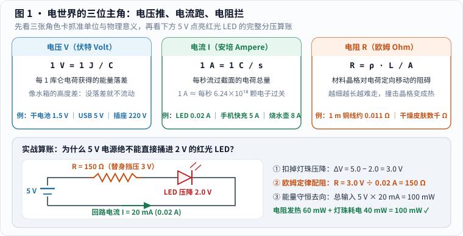
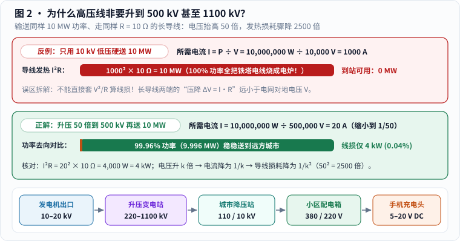
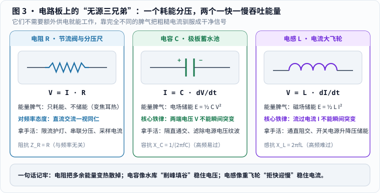
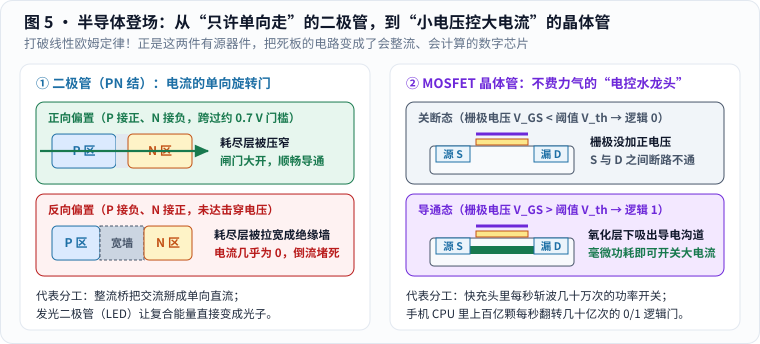
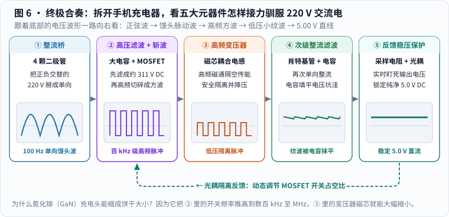

把手机插上床头充电器的那一刻，很少有人意识到，这股正在往电池里灌注的能量，刚刚走过了一段横跨七个数量级的“变形记”：

在几千公里外的发电站和特高压铁塔上，它曾以高达 **$$500\ \mathrm{kV}$$ 乃至 $$\pm 1100\ \mathrm{kV}$$（一百一十万伏！）** 的惊人高压呼啸而过；钻进小区配电房后，它被驯服成墙上插座里的 **$$220\ \mathrm{V}$$** 交流电；穿过你手心里那块饼干大小的充电头后，它又变成 **$$5\ \mathrm{V}$$ 到 $$20\ \mathrm{V}$$** 的平稳直流电；最后钻进手机主板，供养那颗塞满上百亿个晶体管的处理器芯片时，工作电压已经被压低到了 **$$0.7\text{–}1.0\ \mathrm{V}$$**！

如果你顺着这条电线追问下去，马上会撞见一连串既日常、又常常让人绕晕的问题：

1. **电压、电流、电阻到底谁是谁？** 为什么有人触电时“几万伏静电只让人嘶地甩一下手”，而家里 $$220\ \mathrm{V}$$ 插座却极度危险？
2. **远距离输电为什么要拼命升压？** 中学课本里明明写着功率 $$P = \frac{V^2}{R}$$，既然电压 $$V$$ 越高，难道电线上的发热损耗不该越大吗？为什么电网工程师偏偏说“电压抬高 $$50$$ 倍，路上白烧掉的电反而骤降 $$2500$$ 倍”？
3. **拆开任何一块电路板，密密麻麻焊着的五花八门的小零件到底在忙活什么？** 既然已经有了电线送电，为什么还要塞进**电阻、电容、电感、二极管、晶体管**？它们各自靠什么物理脾气对付电压和电流？

（如果你还没看过前几天我们聊过的“电线里的电子每秒只爬 $$0.05$$ 毫米，电能其实是沿着导线外面的空间电磁场跑过去的”，可以先读或回头联动阅读[《电线里的电子比蜗牛爬得还慢，按下开关电灯凭什么瞬间亮起？》]()；今天这一篇，我们专门把镜头对准**电路法则、远距输电与电子元器件的精密分工**。）

---

## 一、电世界的三位主角：谁在推、谁在跑、谁在拦？

刚学电路时最容易犯迷糊的地方，就是把“电压”和“电流”混成一团，说成“一股很高的电压流过了身体”。其实只要把国际单位制（SI）里的严格定义摊开，三者的分工立刻清清楚楚。

### 1. 电压 $$V$$、电流 $$I$$、电阻 $$R$$：不是比喻，是三笔硬账

我们用大家最熟悉的水路做个引子，但立刻落实到真实的物理量上：

- **电压（Voltage，符号 $$V$$ 或 $$U$$，单位：伏特 $$\mathrm{V}$$）——“每包电荷背着多少能量落差”**
  物理定义非常干脆：**$$1\ \mathrm{V} = 1\ \mathrm{J/C}$$（焦耳每库仑）**。也就是说，电路里两点之间有 $$1$$ 伏特的电压，意味着每当 $$1$$ 库仑的电荷从高电位走到低电位，电场就能释放出 $$1$$ 焦耳的能量去干活（发光、发热、转马达）。一节五号干电池是 $$1.5\ \mathrm{V}$$，标准 USB 口基础档是 $$5\ \mathrm{V}$$，家里单相插座有效值是 $$220\ \mathrm{V}$$。**注意：电压永远指两点之间的“电势差”，它自己不会“流”，就像两层楼之间的高度差不会流动一样。**
- **电流（Current，符号 $$I$$，单位：安培 $$\mathrm{A}$$）——“每秒钟有多少电荷涌过关卡”**
  物理定义是：**$$1\ \mathrm{A} = 1\ \mathrm{C/s}$$（库仑每秒）**。自 2019 年国际单位制（SI）重新定义基本单位起，元电荷被精确固定为 $$e = 1.602176634 \times 10^{-19}\ \mathrm{C}$$（见[美国国家标准与技术研究院 NIST 对安培的官方定义](https://www.nist.gov/si-redefinition/definitions-si-base-units)）。拿 $$1$$ 除以它就能算出：**$$1$$ 安培电流，恰好等于每秒钟约有 $$6.24 \times 10^{18}$$ 颗（624 亿亿颗！）电子定向穿过导线截面。**
  这也顺手解开了开头那个“冬天脱毛衣静电上万伏却没电死人”的谜题：毛衣摩擦攒下的电荷总量极少（往往只有微库仑量级），放电在微秒级瞬间就结束了，总能量不到几十毫焦；而 $$220\ \mathrm{V}$$ 插座背后连着整张电网，一旦形成回路就能持续不断地泵出几十毫安乃至数安培电流，真正让人体心脏纤颤和组织灼伤的，正是**持续流过身体的电流与总能量**。
- **电阻（Resistance，符号 $$R$$，单位：欧姆 $$\Omega$$）——“通道本身有多难走”**
  电子在金属晶格里定向挪动时，会不断撞上振动的原子实，把电场刚给它的动能撞成晶格热振动（焦耳热）。均匀导体的电阻由材料电阻率 $$\rho$$、长度 $$L$$ 和横截面积 $$A$$ 共同决定：

$$
R = \rho \frac{L}{A}
$$

路越长（$$L$$ 大）越难走，路越宽（$$A$$ 大）越好走。比如室温下铜的电阻率极低（$$\rho \approx 1.68 \times 10^{-8}\ \Omega\cdot\mathrm{m}$$），一段 $$1$$ 米长、$$1.5\ \mathrm{mm}^2$$ 粗的家装铜线，电阻只有约 **$$0.011\ \Omega$$**；而电暖器里的镍铬发热丝电阻率高出约六十倍，专门用来把电能变成热。

_图 1：先看上方三张角色卡，把电压（$$1\ \mathrm{V} = 1\ \mathrm{J/C}$$ 能量落差）、电流（$$1\ \mathrm{A} = 1\ \mathrm{C/s}$$ 电荷流量）和电阻（$$R = \rho L/A$$ 通道阻碍）拆开；再看下方实战回路——用 $$5\ \mathrm{V}$$ 电源点亮一颗额定压降 $$2.0\ \mathrm{V}$$、工作电流 $$20\ \mathrm{mA}$$ 的红光 LED 时，必须串联一颗 $$150\ \Omega$$ 电阻替它扛下多余的 $$3.0\ \mathrm{V}$$ 电压。[单独打开高清图](/assets/images/voltage-current-resistance/vir-triad-led-loop.svg)_

### 2. 欧姆定律与功率账本：为什么 $$5\ \mathrm{V}$$ 电源直接接 LED 会“啪”地烧毁？

1827 年，德国物理学家格奥尔格·西蒙·欧姆（Georg Simon Ohm）在《电路的数学研究》（*Die galvanische Kette, mathematisch bearbeitet*）中发表了他用热电偶与不同长度金属丝反复测出来的线性规律（史料见 [IEEE 工程技术史百科 ETHW：Georg Simon Ohm](https://ethw.org/Georg_Simon_Ohm)）：对于金属导体和常规电阻器，流过的电流 $$I$$ 与两端所加电压 $$V$$ 成正比、与电阻 $$R$$ 成反比：

$$
I = \frac{V}{R} \qquad \Longleftrightarrow \qquad V = I \cdot R
$$

同时，把电压的单位（$$\mathrm{J/C}$$）和电流的单位（$$\mathrm{C/s}$$）直接乘起来，库仑 $$\mathrm{C}$$ 恰好约掉，立刻得到每秒钟转换的能量——**电功率 $$P$$（单位：瓦特 $$\mathrm{W} = \mathrm{J/s}$$）**：

$$
P = V \cdot I = \frac{\mathrm{J}}{\mathrm{C}} \times \frac{\mathrm{C}}{\mathrm{s}} = \frac{\mathrm{J}}{\mathrm{s}} = \mathrm{W}
$$

千万别小看这两行式子。正如大学物理教材明确强调的那样（见 [OpenStax《大学物理》第 2 卷 9.4 节 Ohm's Law](https://openstax.org/books/university-physics-volume-2/pages/9-4-ohms-law)），**欧姆定律并不是放之四海皆准的宇宙根本定律，而是一条“线性材料经验律”**——普通电阻和金属线在恒温下遵守它（叫欧姆器件），但半导体二极管、LED、晶体管全都是脾气倔强的**非欧姆器件**！

拿图 1 下方最经典的电子入门实验来算一笔账，你立刻就能体会“电阻为什么要来当替身”：
假设你手里有一颗常见的红光 LED 灯珠，它在正常发光时两端压降大约固定在 $$V_F \approx 2.0\ \mathrm{V}$$，额定电流是 $$I = 20\ \mathrm{mA} = 0.02\ \mathrm{A}$$。如果你直接拿 $$5.0\ \mathrm{V}$$ 的 USB 电源捅上去，一旦超过 $$2\ \mathrm{V}$$ 门槛，LED 的等效内阻极小，电流会瞬间飙升几十倍把细如发丝的键合线和芯片烧穿。

怎么办？串一颗**限流电阻 $$R$$**：
1. **先按基尔霍夫电压定律（KVL，一圈总压降等于电源电压）分摊落差**：电源给 $$5.0\ \mathrm{V}$$，LED 自己占走 $$2.0\ \mathrm{V}$$，剩下的 $$\Delta V = 5.0 - 2.0 = 3.0\ \mathrm{V}$$ 必须由电阻全部扛下来；
2. **再按基尔霍夫电流定律（KCL，单条串联支路处处电流相等）配阻值**：既然我们要把整条支路的电流卡在 $$0.02\ \mathrm{A}$$，根据欧姆定律：

$$
R = \frac{\Delta V}{I} = \frac{5.0\ \mathrm{V} - 2.0\ \mathrm{V}}{0.02\ \mathrm{A}} = 150\ \Omega
$$

3. **最后核对能量守恒**：电源每秒钟掏出 $$P_{\text{总}} = 5.0\ \mathrm{V} \times 0.02\ \mathrm{A} = 100\ \mathrm{mW}$$；其中电阻变成热散掉 $$P_R = I^2 R = (0.02)^2 \times 150 = 60\ \mathrm{mW}$$，LED 拿走 $$P_{\text{LED}} = 2.0\ \mathrm{V} \times 0.02\ \mathrm{A} = 40\ \mathrm{mW}$$ 用来发光（和少量发热），**$$60 + 40 = 100\ \mathrm{mW}$$，分毫不差！**

---

## 二、电是如何跨越千里的：特高压输电与变压器的“升压省电术”

搞懂了欧姆定律和功率公式，我们马上把视野放大一亿倍，去解决几乎每个中学生都曾犯过迷糊的经典悖论。

### 1. 拆解经典误区：既然 $$P = V^2 / R$$，为什么电压越高反而越省电？

发电厂要把 $$P = 10\ \mathrm{MW}$$（一千万瓦，大约够几千户家庭同时开空调做饭）的电功率，顺着总电阻 $$R_{\text{线}} = 10\ \Omega$$ 的长途架空导线送到远方城市。路上究竟会白白烧掉多少电？

很多人第一反应是往导线电阻里套 $$P = \frac{V^2}{R_{\text{线}}}$$，结果越算越糊涂：“要是把输电电压 $$V$$ 从 $$10\ \mathrm{kV}$$ 升到 $$500\ \mathrm{kV}$$，$$V^2 / R_{\text{线}}$$ 岂不是暴涨 $$2500$$ 倍？”

**错就错在把两个完全不同的“电压”张冠李戴了！**
输电线标称的 $$500\ \mathrm{kV}$$，是**火线与大地（或回线）之间用来给远方城市做功的送电电压 $$V_{\text{送}}$$**，而不是“加在半路这一段电线电阻两端的电压差 $$\Delta V_{\text{线}}$$”！长途导线真正的发热功率，只取决于有多少电流 $$I$$ 硬挤过这 $$10\ \Omega$$ 的电线：

$$
P_{\text{损}} = I^2 R_{\text{线}}
$$

而为了送出同样的总功率 $$P_{\text{送}} = V_{\text{送}} \cdot I$$（这里先取功率因数 $$\cos\varphi = 1$$ 讲清主干关系，见 [OpenStax《大学物理》第 2 卷 15.6 节 Transformers](https://openstax.org/books/university-physics-volume-2/pages/15-6-transformers)），所需电流是 $$I = \frac{P_{\text{送}}}{V_{\text{送}}}$$。把它代进上一行，真相水落石出：

$$
P_{\text{损}} = \left(\frac{P_{\text{送}}}{V_{\text{送}}}\right)^2 R_{\text{线}} = \frac{P_{\text{送}}^2 \, R_{\text{线}}}{V_{\text{送}}^2}
$$

**看分母上的 $$V_{\text{送}}^2$$！输送同样的功率，把送电电压抬高 $$k$$ 倍，路上跑的电流就缩小到 $$\frac{1}{k}$$，电线白白发掉的焦耳热直接暴跌到原来的 $$\frac{1}{k^2}$$！**

_图 2：先对比上下两张账单——同样送 $$10\ \mathrm{MW}$$ 功率走 $$10\ \Omega$$ 导线，若只用 $$10\ \mathrm{kV}$$ 硬送，需要 $$1000\ \mathrm{A}$$ 大电流，$$I^2 R = 10\ \mathrm{MW}$$ 会把功率全烧在半路；把电压抬高 $$50$$ 倍到 $$500\ \mathrm{kV}$$，电流降到 $$20\ \mathrm{A}$$，线损骤降 $$2500$$ 倍至区区 $$4\ \mathrm{kW}$$（仅占 $$0.04\%$$）。底部再顺着箭头看电从发电厂一路降压进手机的五级台阶。[单独打开高清图](/assets/images/voltage-current-resistance/high-voltage-transmission.svg)_

### 2. 从尼亚加拉瀑布到中国 $$\pm 1100\ \mathrm{kV}$$ 特高压：交流与直流怎样各显神通？

正因为“高压小电流”有着压倒性的平方级优势，十九世纪末爱迪生主推的低压直流电网（当时没有高效直流升降压手段，一两公里外灯就变暗）输给了尼古拉·特斯拉（Nikola Tesla）与乔治·威斯汀豪斯（George Westinghouse）主推的多相交流电系统。1895 年 8 月，尼亚加拉瀑布亚当斯水电站（Adams Hydroelectric Generating Plant）投运，次年通过升压变压器把电力远距离送往约 40 公里外的布法罗市，奠定了现代交流电网的基石（见 [IEEE 历史里程碑：Adams Hydroelectric Generating Plant, 1895](https://ethw.org/Milestones:Adams_Hydroelectric_Generating_Plant,_1895)）。

交流电之所以这么容易升降压，全靠**变压器（Transformer）**：把初级线圈（$$N_1$$ 匝）和次级线圈（$$N_2$$ 匝）绕在同一块高导磁硅钢片铁芯上。每秒来回变化 $$50$$ 次的交流电在铁芯里激发出交变磁通量 $$\Phi(t)$$，根据法拉第电磁感应定律，两边感应出的电压严格正比于匝数比，而电流反比于匝数比（理想无损近似下 $$V_1 I_1 = V_2 I_2$$）：

$$
\frac{V_2}{V_1} = \frac{N_2}{N_1}, \qquad \frac{I_2}{I_1} = \frac{N_1}{N_2}
$$

**一句话：变压器不凭空创造半点能量，它只是电磁世界里的“杠杆”——用高电压换小电流去跑长途，到站后再用低电压换回安全的大电流进千家万户。**

那今天为什么又冒出了“特高压直流（UHVDC）”？因为当距离拉长到两三千公里以上时，交流高压线与大地之间庞大的分布电容会产生巨大的无功充电电流，两端大电网还得严格保持同步；而在现代大功率半导体换流阀成熟后，工程师可以先用交流变压器升到极高电压，整流成**特高压直流**跨省狂奔，到站后再逆变回交流并网！例如我国 2018 年底启动全压送电的**昌吉—古泉 $$\pm 1100\ \mathrm{kV}$$ 特高压直流输电工程**，从新疆准东一路跨过六省区直达安徽宣城，全长 **$$3{,}293$$ 千米**，额定输送功率高达 **$$1{,}200$$ 万千瓦（$$12\ \mathrm{GW}$$）**，每年可向华东送电约 $$660$$ 亿千瓦时（见[国务院国资委转发国家电网官方通报](http://www.sasac.gov.cn/n2588025/n2588124/c10157491/content.html)）。

---

## 三、把电驯服成精细工具（上）：电路板上的“无源三兄弟” R、C、L

电到了家门口插座是 $$220\ \mathrm{V}$$、$$50\ \mathrm{Hz}$$ 交流电，可你的手机屏幕、音响功放、电脑主板需要的是稳如镜面的直流电，还要滤掉杂音、切分信号、定时计数。在麻省理工学院经典的电路入门课《6.002 电路与电子学》里，第一课就是教学生把复杂的真实电磁场抽象成几个各司其职的**集总参数元器件（Lumped circuit elements）**（见 [MIT OpenCourseWare 6.002 课程大纲](https://ocw.mit.edu/courses/6-002-circuits-and-electronics-spring-2007/pages/syllabus/)）。

其中不需要额外接电源就能自己干活的三位元老，就是被称为**“无源三兄弟（Passive components）”**的**电阻（R）、电容（C）和电感（L）**。

_图 3：从左到右对照无源三兄弟的脾气——电阻 $$R$$ 只耗能不储能，对直流交流一视同仁；电容 $$C$$ 把能量存在极板电场里，死守“两端电压不能瞬间突变”，专门削峰填谷；电感 $$L$$ 把能量存在线圈磁场里，死守“流过电流不能瞬间突变”，像大飞轮一样拒快迎慢。[单独打开高清图](/assets/images/voltage-current-resistance/passive-rcl-trio.svg)_

### 1. 电阻器（Resistor, $$R$$）：限流保镖、串联分压尺与电流采样哨兵

千万别以为电阻只会“白白发热浪费电”。在一块电路板上，数量最多的往往就是几厘钱一颗的贴片电阻，它至少干着三件不可替代的细活：
- **限流保护**：就像图 1 里的 $$150\ \Omega$$ 电阻，卡住支路最大电流，保护脆弱的半导体芯片；
- **串联分压（给芯片递“参考标尺”）**：两颗电阻 $$R_1$$、$$R_2$$ 串联接在电压 $$V_{\text{in}}$$ 上，中间节点分到的电压严格按阻值比例切分：

$$
V_{\text{out}} = V_{\text{in}} \cdot \frac{R_2}{R_1 + R_2}
$$

电源芯片就是靠两颗精密分压电阻，随时“尝一口”输出电压高了还是低了；
- **电流采样（把看不见的电流翻译成电压）**：芯片自己没法直接“看见”导线里流过几安培电流，工程师就在主路上串一颗极小的毫欧级合金电阻（比如 $$R_s = 0.01\ \Omega$$）。当 $$5\ \mathrm{A}$$ 快充电流流过时，两端立刻产生 $$V = 5 \times 0.01 = 50\ \mathrm{mV}$$ 的精确压差，保护芯片一测这个压差，就知道有没有过流短路！

### 2. 电容器（Capacitor, $$C$$）：面对面绝不相通的两块极板，为什么能“隔直通交”？

把两片金属箔面对面放好，中间夹一层薄薄的绝缘介质（陶瓷、塑料薄膜或氧化膜），就做成了一颗**电容器**。它的电容值 $$C$$（单位：法拉 $$\mathrm{F}$$，电路板上常用微法 $$\mu\mathrm{F}$$、纳法 $$\mathrm{nF}$$、皮法 $$\mathrm{pF}$$）衡量的是“每加上 $$1\ \mathrm{V}$$ 电压能攒下多少库仑电荷”：$$Q = C \cdot V$$。

对时间求导，就得到了电容最核心的脾气方程：

$$
I(t) = C \frac{\mathrm{d}V_C}{\mathrm{d}t}, \qquad E_C = \frac{1}{2} C V_C^2
$$

这两道式子藏着电容在电路板上横着走的两大绝活：
1. **两端电压绝不能一瞬间跳变！** 因为如果 $$V_C$$ 在零秒内突变，$$\mathrm{d}V_C/\mathrm{d}t$$ 就会变成无穷大，需要无穷大的电流——现实中根本做不到。所以每当电源电压突然掉个坑，并联在旁边的电容立刻把极板上存着的电荷放出来“填坑”；电压突然冒个尖，电容立刻把多余电荷吸进去“削峰”。CPU 背面密密麻麻焊着几十颗小陶瓷电容（去耦电容），干的就是这件**纳秒级就近救急供水**的大事！
2. **隔直通交（容抗 $$X_C = \frac{1}{2\pi f C}$$）**：虽然两块极板中间隔着绝缘层，一颗电子也穿不过去，但当交流电压来回拉扯时，极板两侧不断交替充放电，外电路里看起来就像交流电顺畅穿过了电容一样，而且频率 $$f$$ 越高越容易过；一旦换成稳定不变的直流电（$$f = 0$$），充满之后电流就彻底归零。

_图 4：单次播放动画（若开启系统“减少动态效果”则直接展示完整曲线）——用 $$5\ \mathrm{V}$$ 电源串一颗 $$R = 1\ \mathrm{k\Omega}$$ 电阻给 $$C = 1000\ \mu\mathrm{F}$$ 电容充电，特征时间常数 $$\tau = R C = 1.0\ \mathrm{s}$$。先看橙色虚线：刚合闸瞬间极板是空的（$$V_C = 0$$），充电电流冲上最大值 $$5\ \mathrm{mA}$$；再看绿色实线：随着极板电压按 $$V_C(t) = 5(1 - e^{-t/\tau})$$ 爬升反顶电源，$$1\tau$$ 时充到 $$63.2\%$$，$$3\tau$$ 达 $$95.0\%$$，$$5\tau$$ 达 $$99.3\%$$，直流电流随之衰减归零。[单独打开高清图（刷新可重播）](/assets/images/voltage-current-resistance/rc-charging-anim.svg)_

### 3. 电感器（Inductor, $$L$$）：脾气刚好和电容拧着来的“电流大飞轮”

把漆包铜线一圈圈绕起来（常配上铁氧体磁芯），就成了**电感器**（单位：亨利 $$\mathrm{H}$$，常用毫亨 $$\mathrm{mH}$$、微亨 $$\mu\mathrm{H}$$）。如果说电容偏爱“稳电压”，电感就是它的镜像双胞胎——它靠线圈周围的磁场储存能量，死死守护**“流过的电流绝不能瞬间突变”**：

$$
V_L(t) = L \frac{\mathrm{d}I}{\mathrm{d}t}, \qquad E_L = \frac{1}{2} L I^2
$$

你想让电流突然增大，线圈立刻感应出一股反向电压顶住你；你想突然拉闸断掉正在流淌的电流（$$\mathrm{d}I/\mathrm{d}t$$ 极大且为负），电感为了保住电流连续，甚至会在断口处瞬间憋出几百上千伏的**反电动势高压尖峰**！（老式电风扇拔插头或继电器断开时噼啪冒出的小蓝火花，往往就是电感磁场能量无处释放打穿空气的杰作。）

因此，电感对直流电几乎畅通无阻，对高频交流杂波却像一堵高墙（感抗 $$X_L = 2\pi f L$$，**通直阻交**）。在手机主板和显卡供电模块上，那一排排灰色小方砖正是功率电感——它们和高速开关配合，每秒钟几十万次地“吸能—吐能”，把 $$12\ \mathrm{V}$$ 或 $$5\ \mathrm{V}$$ 几乎无损地降成 CPU 需要的 $$0.8\ \mathrm{V}$$ 大电流，而不用像纯电阻那样把多余的电压全烧成滚烫的废热！

---

## 四、把电变成智能开关（下）：半导体两件套——二极管与晶体管

光靠无源三兄弟 R、C、L，人类只能造出电灯、电炉、老式调幅收音机分频器，却造不出一台智能手机。因为 R、C、L 全都是“老实人”，没法做到**“用一丁点微弱信号，去指挥另一路大电流瞬间通断”**。

真正推开现代电子文明大门的，是在纯硅晶体里掺入微量硼（缺电子，形成带正电空穴的 **P 型半导体**）和磷（多电子，形成 **N 型半导体**）造出来的**有源半导体器件**。

_图 5：左栏看二极管（PN 结）——正向偏置超过约 $$0.7\ \mathrm{V}$$ 硅门槛时耗尽层压窄导通，反向偏置时耗尽层拉宽成绝缘墙堵死倒流；右栏看现代芯片基石 MOSFET——栅极隔着二氧化硅绝缘层，不加正电压时源漏断开（逻辑 $$0$$），加上正电压超过阈值 $$V_{\text{th}}$$ 时在绝缘层下吸出导电沟道（逻辑 $$1$$），用极微小代价控制大电流与数字运算。[单独打开高清图](/assets/images/voltage-current-resistance/semiconductor-diode-mosfet.svg)_

### 1. 二极管（Diode）：只许往前走、绝不许倒流的“电流止回阀”

把一块 P 型硅和一块 N 型硅制作在同一块晶片上，交界面处电子与空穴互相扩散复合，会留下一层没有自由载流子的薄区——叫做**耗尽层（PN 结）**。这层薄区天生就是一扇奇妙的单向旋转门：

- **正向导通**：把电源正极接 P、负极接 N，当外加电压跨过硅材料约 **$$0.6\text{–}0.7\ \mathrm{V}$$** 的内建势垒门槛（肖特基二极管更低，约 $$0.2\text{–}0.4\ \mathrm{V}$$）时，耗尽层被外电场压扁，大批载流子涌过交界，电流畅通无阻；
- **反向截止**：一旦把正负极接反，外电场会把电子和空穴往两边拉开，耗尽层瞬间变宽成一堵厚实的绝缘墙，只要不超过反向击穿电压，反向漏电流几乎为零！

二极管在电路里干着三件大事：① 四颗二极管搭成**惠斯通式的全桥整流器**，能把正负来回翻滚的交流电统统掰成单向直流；② 并联在电感或继电器线圈两端当**续流二极管**，专门给断电瞬间的电感电流修一条安全泄放环路，防止高压火花击穿芯片；③ 换用氮化镓（GaN）、砷化镓等直接带隙半导体材料，让电子掉进空穴复合时释放的能量直接变成光子射出来——这就是照亮千家万户的**发光二极管（LED）**。

### 2. 晶体管（Transistor / MOSFET）：人类工业史上制造数量最多的人造物

1947 年 12 月，约翰·巴丁（John Bardeen）、沃尔特·布拉顿（Walter Brattain）在威廉·肖克利（William Shockley）领导的贝尔实验室小组里造出了第一只点接触晶体管，三人因此共同荣获 **1956 年诺贝尔物理学奖**（见[诺贝尔奖官网 1956 年物理学奖档案](https://www.nobelprize.org/prizes/physics/1956/summary/)）；紧接着在 1959 年，贝尔实验室的穆罕默德·阿塔拉（Mohamed Atalla）与姜大元（Dawon Kahng）利用热生长二氧化硅层驯服硅表面态，成功造出了**金属-氧化物-半导体场效应晶体管（MOSFET）**（史料见[计算机历史博物馆 CHM：1960 MOS Transistor Demonstrated](https://www.computerhistory.org/siliconengine/metal-oxide-semiconductor-mos-transistor-demonstrated/)）。

看一眼图 5 右栏的截面，你就能明白为什么 MOSFET 能统治今天所有的快充头、电动车逆变器与电脑 CPU：
- **源极（Source）和漏极（Drain）** 就像水管的进水口和出水口，平时被中间的半导体衬底隔断，水一滴也流不过去（对应二进制的 **$$0$$**）；
- 头顶上的 **栅极（Gate）** 隔着一层极薄的氧化物绝缘膜悬在上方——注意，因为有绝缘膜挡着，栅极稳态下几乎**不消耗直流电流**！
- 可是只要你在栅极上轻轻加一点正电压（$$V_{\text{GS}} > V_{\text{th}}$$），静电场就会穿透绝缘膜，把底下的电子吸到表面排成一条连通源极和漏极的**反型导电沟道**，“水龙头”啪地打开，主路大电流哗哗流过（对应二进制的 **$$1$$**）！

把它做大、耐高压，它就是开关电源和新能源汽车电控里每秒钟开关几十万次的**功率管**；把它缩小到几纳米线宽，在一枚指甲盖大的硅片上塞进上百亿颗，让前一级的输出电压去拧动后一级的栅极，就拼出了与门、或门、加法器与大模型加速器！而且正因为芯片里每翻转一次栅极电容，消耗的动态功耗正比于 $$C f V_{\text{DD}}^2$$，把芯片内核电压压低到 **$$0.7\text{–}1.0\ \mathrm{V}$$**，正是为了让百亿颗晶体管每秒狂闪几十亿次却不至于把你手里的手机烫化！

---

## 五、终极合奏：拆开手边的手机充电器，看五大元器件怎样接力干活

讲完了单个零件的独门武功，最过瘾的验证莫过于拆开一件你天天摸得到的东西——**手机 USB-C 快充充电头**，看看刚才认识的这帮伙计是怎样在一块几平方厘米的小电路板上紧密配合，把墙上暴烈危险的 **$$220\ \mathrm{V}$$、$$50\ \mathrm{Hz}$$ 交流电**，一步步驯服成温顺纯净的 **$$5\ \mathrm{V}$$（或快充协商后的 $$9\ \mathrm{V} / 15\ \mathrm{V} / 20\ \mathrm{V}$$）直流电**的。

_图 6：顺着底部的五个小波形窗从左往右跟读——① 四颗二极管组成的整流桥把正负交替的 $$220\ \mathrm{V}$$ 正弦波掰成 $$100\ \mathrm{Hz}$$ 单向馒头波；② 高压电解电容先把它抹成约 $$311\ \mathrm{V}$$ 直流，功率 MOSFET 再以每秒数十万次高速斩波切成高频脉冲；③ 高频变压器靠磁通隔空传能，在彻底隔绝高压触电风险的同时把电压降下来；④ 次级肖特基二极管与固态电容再次整流、抹平纹波；⑤ 精密分压采样电阻与光耦随时盯紧输出，把误差隔空反馈回初级调节 MOSFET 开关占空比，锁死一条笔直的 $$5.0\ \mathrm{V}$$ 直流线。[单独打开高清图](/assets/images/voltage-current-resistance/charger-five-stage-symphony.svg)_

### 1. 五棒接力：从 $$311\ \mathrm{V}$$ 峰值高压到纹丝不动的 $$5.00\ \mathrm{V}$$

跟着图 6 的编号，我们把这五棒接力一口气串起来：

1. **第一棒（保险丝 + 整流桥二极管）**：墙上插座标称的 $$220\ \mathrm{V}$$ 是均方根有效值，它的正弦波峰顶其实高达 $$220 \times \sqrt{2} \approx 311\ \mathrm{V}$$！交流电先经过保险丝和抑制电磁干扰的安规电容、共模电感，随即撞进由 **$$4$$ 颗二极管**搭成的整流桥——正半周放行、负半周翻正，出来就成了每秒 $$100$$ 个鼓包的单向“馒头波”。
2. **第二棒（高压滤波电容 + 功率开关管 MOSFET / GaN）**：一颗耐压 $$400\ \mathrm{V}$$ 的高压电解电容先把馒头波蓄满抹平，变成约 $$311\ \mathrm{V}$$ 的高压直流；紧接着，**功率 MOSFET（或氮化镓 GaN 晶体管）** 登场，以每秒钟 **$$100\ \mathrm{kHz}$$ 到上千 $$\mathrm{kHz}$$** 的极高速度一开一关，把死板的高压直流切碎成一串高频方波脉冲。
   *顺带破案：为什么以前的充电器像块笨重的大黑砖，现在的氮化镓快充头却像块小饼干？* 因为根据法拉第电磁感应定律，变压器每周期传递的能量取决于频率和磁芯截面积——老式工频变压器只能慢吞吞地每秒吞吐 $$50$$ 次，必须用一大坨沉甸甸的硅钢片；而氮化镓开关管把吞吐频率拉高了两千倍到十万次乃至百万次以上，每次只需搬运一小勺能量，**高频变压器（第三棒）的磁芯体积就能一下子缩小十倍以上！**
3. **第三棒（高频变压器——隔空传能的救命防线）**：高频变压器初级与次级线圈之间裹着严格的绝缘胶带和挡墙，两边的铜线**没有任何物理连通**，完全靠磁芯里的高频交变磁场“隔空接力”把能量传过去，并按匝数比把几百伏高压降到十几伏乃至几伏。正是这道电气隔离墙，保证了哪怕你一边充电一边用手摸着金属手机壳，也绝不会碰到墙里的 $$220\ \mathrm{V}$$ 市电！（这也就是为什么劣质山寨充电器省掉隔离间距或安规电容会极其危险。）
4. **第四棒（次级肖特基二极管 / 同步整流管 + 滤波电容）**：刚从变压器次级出来的还是高频脉冲，次级的低损耗肖特基二极管（大功率快充里常升级成内阻更低的同步整流 MOSFET）把它整成单向，再交给几颗大容量固态电容把起伏的小锯齿纹波彻底填平。
5. **第五棒（采样分压电阻 + 光电耦合器闭环稳压）**：如果你突然点亮屏幕打大型游戏，手机抽走的电流猛增，输出电压刚往下掉零点零几伏，输出端的两颗**精密分压电阻**立刻察觉。为了不破坏第三棒好不容易建起的高低压隔离墙，电路用一颗**光电耦合器（一头是微缩 LED，对面是光敏管，靠光信号隔空报信！）**把误差传回初级控制芯片，稍微调宽一点第二棒 MOSFET 每次打开的时间比例（**PWM 占空比**），多泵一点能量过来——于是无论你待机还是满载，送进手机的数据线电压都稳稳钉在目标值上！

### 2. 快充又是怎么玩出 $$100\ \mathrm{W}$$ 甚至 $$240\ \mathrm{W}$$ 的？还是那条老公式！

看到这里，连手机快充为什么越做越猛也顺理成章了：一根轻巧柔软的 USB Type-C 数据线，里面的铜芯截面积很有限，安全载流上限通常卡在 **$$3\ \mathrm{A}$$ 或 $$5\ \mathrm{A}$$**（否则按 $$I^2 R$$ 数据线自己就会发烫软化）。如果死守老式 USB 的 $$5\ \mathrm{V}$$ 电压，顶天只能送出 $$5\ \mathrm{V} \times 3\ \mathrm{A} = 15\ \mathrm{W}$$。

怎样不把数据线加粗成电饭煲电源线，却把充电功率翻上十几倍？**跟特高压输电一模一样的招数——升压！** 按照国际通用的 USB Power Delivery（USB PD）规范（技术细节可参阅 [德州仪器 TI 关于 USB PD 3.1 SPR 100W 与 EPR 240W 的工程白皮书 SSZTD49](https://www.ti.com/document-viewer/lit/html/SSZTD49)），手机插上充电器后会先通过 CC 引脚跟充电头“对暗号”：电流照样不超过 $$5\ \mathrm{A}$$，但把线上输送电压一路抬升到 **$$20\ \mathrm{V}$$**，功率立刻冲上 $$20\ \mathrm{V} \times 5\ \mathrm{A} = 100\ \mathrm{W}$$（标准功率范围 SPR）；最新的 PD 3.1 扩展功率范围（EPR）更是把电压抬到了人体安全特低电压上限附近的 **$$48\ \mathrm{V}$$**，用同一根 $$5\ \mathrm{A}$$ 线送出了惊人的 **$$48\ \mathrm{V} \times 5\ \mathrm{A} = 240\ \mathrm{W}$$**，连高性能游戏本都能一线喂饱！进了机身内部之后，再由主板上的电荷泵或同步降压电感电路把高电压换回电池所需的约 $$4.2\text{–}4.5\ \mathrm{V}$$ 大电流充进电芯——**从三千公里的国家电网，到一米长的手机充电线，物理规律从头到尾只有同一套剧本。**

---

## 六、动手试试：不用买电烙铁，在浏览器里亲手搭一条真实电路

读完公式和图纸，最能打通任督二脉的办法就是亲手“接错几次线”看看会发生什么（在网页里烧灯泡不用花一分钱，也不会跳闸）：

- **科罗拉多大学博尔德分校 PhET 互动仿真实验室——《电路搭建套件：直流电》（Circuit Construction Kit: DC）**：[打开官方互动仿真页](https://phet.colorado.edu/en/simulations/circuit-construction-kit-dc)（需联网并启用浏览器 JavaScript，支持中文界面切换）。你可以直接从左侧工具箱拖出电池、导线、电阻、灯泡、保险丝甚至硬币和橡皮擦，随时打开右上角的电压表和电流表探针：
  1. 试着把电池电压拉高一倍，观察电阻不变时电子流动快慢与电流表读数的正比变化；
  2. 试着把两颗灯泡改成串联和并联，用电压表亲自量一量每一段的压降之和是不是永远等于电池总电压；
  3. 故意拿一根纯导线直接跨接电池正负极（模拟短路），看看没有限流电阻拦着时，电流怎样暴涨把电池烧起火苗——这比背十遍 $$I = V/R$$ 都印象深刻（不打开外站也完全不影响读懂本文上方的全部算例与图示）。

---

## 奶爸说

以前带孩子拆淘汰下来的旧玩具遥控器，孩子指着绿油油的电路板上花花绿绿的小圆柱、小黑块、小色环问：“爸爸，电直接流进小马达不就转了吗，干嘛要绕这么多弯弯？”

现在我们可以指着它们，像介绍一支篮球队那样挨个叫出名字了：**电压**是背后的推力落差，**电流**是真正跑起来干活的车队，而板上这五个小家伙就是分工明确的后卫和中锋——**电阻**负责踩刹车和量尺寸，**电容**是随叫随到的蓄水池，**电感**是稳住节奏的大飞轮，**二极管**是绝不许逆行的单向门，而**晶体管**则是那只听令行事、一秒钟能开合上亿次的聪明电门。从横跨山河的百万伏银色铁塔，到指尖不到一伏的纳米芯片，整个人类电气时代的奇迹，不过是把这三个物理量和五种小零件的脾气摸透了、排顺了而已。

---

## 参考资料与核查说明

1. **国际单位制（SI）安培与元电荷精确定义**：National Institute of Standards and Technology (NIST), [*Definitions of SI Base Units*](https://www.nist.gov/si-redefinition/definitions-si-base-units)——核查 2019 年修订后安培基于固定元电荷精确值 $$e = 1.602176634 \times 10^{-19}\ \mathrm{C}$$ 的定义，对应 $$1\ \mathrm{A} \approx 6.2415 \times 10^{18}$$ 个基本电荷每秒。
2. **欧姆定律史实与适用边界**：IEEE History Center / Engineering and Technology History Wiki (ETHW), [*Georg Simon Ohm*](https://ethw.org/Georg_Simon_Ohm)；以及 OpenStax, [*University Physics Volume 2*, Section 9.4 "Ohm's Law"](https://openstax.org/books/university-physics-volume-2/pages/9-4-ohms-law)——核查欧姆 1827 年专著《电路的数学研究》（*Die galvanische Kette, mathematisch bearbeitet*）史实，以及欧姆定律属于线性材料经验律而非普适自然定律的物理界定。
3. **高压输电减损原理与理想变压器方程**：OpenStax, [*University Physics Volume 2*, Section 15.6 "Transformers"](https://openstax.org/books/university-physics-volume-2/pages/15-6-transformers)；以及 IEEE Milestone, [*Adams Hydroelectric Generating Plant, 1895*](https://ethw.org/Milestones:Adams_Hydroelectric_Generating_Plant,_1895)——核查 $$I_{\text{rms}}^2 R$$ 输电线损随电压平方反比下降关系、变压器匝数比方程及 1895 年尼亚加拉瀑布亚当斯多相交流水电站投运史实。
4. **中国 $$\pm 1100\ \mathrm{kV}$$ 特高压直流输电工程参数**：国务院国有资产监督管理委员会（引自国家电网有限公司官方通报），[《昌吉—古泉±1100千伏特高压直流输电工程启动送电》](http://www.sasac.gov.cn/n2588025/n2588124/c10157491/content.html)（2019-01-02）——核查线路全长 $$3{,}293$$ 千米、额定电压 $$\pm 1100\ \mathrm{kV}$$、额定输电容量 $$1{,}200$$ 万千瓦及年送电量约 $$660$$ 亿千瓦时等工程实测规格。
5. **集总电路抽象与 R/C/L、MOSFET 教学体系**：MIT OpenCourseWare, [*6.002 Circuits and Electronics (Spring 2007)*](https://ocw.mit.edu/courses/6-002-circuits-and-electronics-spring-2007/pages/syllabus/)——核查集总电路模型、一阶 RC/RL 暂态响应与 MOSFET 开关模型课程框架。
6. **晶体管与 MOSFET 发明史实**：NobelPrize.org, [*The Nobel Prize in Physics 1956*](https://www.nobelprize.org/prizes/physics/1956/summary/)（肖克利、巴丁、布拉顿因半导体研究与发现晶体管效应获奖）；Computer History Museum (CHM), [*1960: Metal Oxide Semiconductor (MOS) Transistor Demonstrated*](https://www.computerhistory.org/siliconengine/metal-oxide-semiconductor-mos-transistor-demonstrated/)（核查阿塔拉与姜大元 1959 年在贝尔实验室制成首只实用 MOSFET 并于 1960 年公开报告的史实区分）。
7. **USB Type-C PD 快充功率与电压等级规范**：Texas Instruments, [*USB Type-C® and USB Power Delivery: Designing for both Extended Power Range and battery-powered systems* (SSZTD49A)](https://www.ti.com/document-viewer/lit/html/SSZTD49)——核查 USB PD 3.0 标准功率范围 SPR（最高 $$20\ \mathrm{V}, 5\ \mathrm{A} = 100\ \mathrm{W}$$）与 USB PD 3.1 扩展功率范围 EPR（$$28\ \mathrm{V} / 36\ \mathrm{V} / 48\ \mathrm{V}, 5\ \mathrm{A}$$，最高 $$240\ \mathrm{W}$$）参数。
