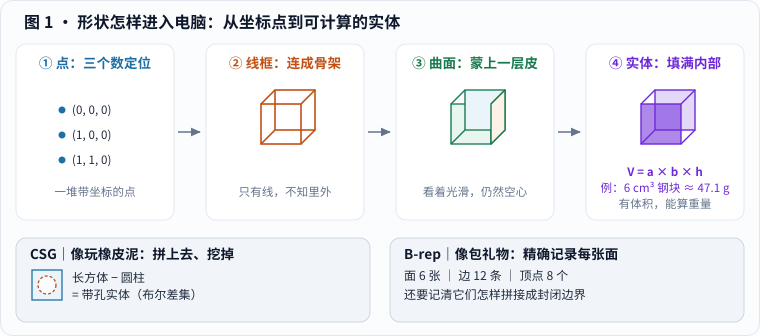
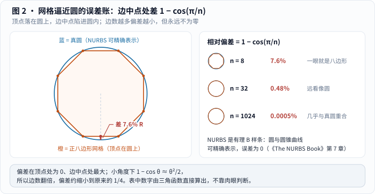
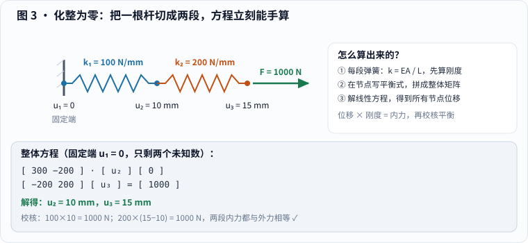
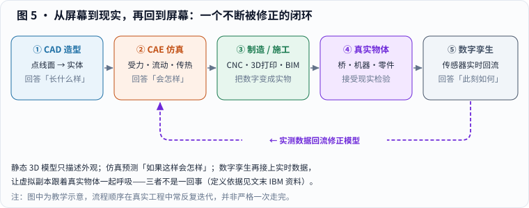

孩子用积木搭桥，是先想好“我要一座能承重的桥”，再一块一块拼出来。工程师盖真正的大桥、造汽车、发火箭，用的其实也是同一招——只不过他们搭的“积木”，是电脑里的虚拟世界。

我们先把一个真正让人好奇的问题摆在桌上：

> **能不能在什么都还没造出来的时候，就先在电脑里知道“这座桥会不会塌”？**

这个问题听起来像魔法，但它的答案是一整套可以一步步跟读的数学和物理。顺着它走下去，你会依次遇到三道关卡：

1. **形状怎么进电脑？**——把脑子里的桥变成电脑能存储、能计算的三维模型；
2. **受力怎么算出来？**——让模型回答“挂上卡车、刮起大风会怎样”；
3. **算完怎么变成真的？**——把数字模型变成机床刀路、施工图纸，乃至一座真桥。

这就串起了工程界常说的 **CAD / CAE / CAM 三兄弟**：CAD（计算机辅助设计）负责“画形状”，CAE（计算机辅助工程）负责“做实验”，CAM（计算机辅助制造）负责“造出来”。下面一关一关拆开看。

---

## 一、形状怎样进电脑：从三个数到能算重量的实体

### 1. 一切从三个数开始：点 → 线 → 面 → 体

电脑可不懂“圆圆的杯子”“弯弯的拱桥”，它只认识数字。所以第一步，是把形状翻译成数学。

最底层是**点**：每个点用三个坐标 $$(x, y, z)$$ 定位。点连成线，线围成面，面合起来成为体。移动、旋转、缩放一个物体，本质上都是对坐标做矩阵运算——这正是线性代数在背后干活。

_图 1：先看四张卡片的顺序——① 三个坐标点定位；② 点连成线框，但电脑还分不清哪面是“里面”；③ 线框蒙上曲面，看着光滑却仍是空心；④ 只有变成“填满内部”的实体，电脑才能算出体积和质量。底部再对照两种造实体的思路：CSG 像玩橡皮泥做布尔加减，B-rep 则像包礼物，精确记录每张面、每条边、每个顶点及拼接关系。图中立方体为教学示意，比例不代表真实工程尺度。_

**为什么非得是“实体”？** 举个能亲手验算的小例子：一块 $$1\text{ cm}\times 2\text{ cm}\times 3\text{ cm}$$ 的砖形零件，体积 $$V = 1\times2\times3 = 6\text{ cm}^3$$。如果它是钢（密度约 $$7.85\text{ g/cm}^3$$），质量就是 $$m = \rho V \approx 47.1\text{ g}$$。线框模型没有“内部”，算不出体积；曲面模型是一层空壳，也得不到同样的质量。**只有实体模型，才能让“算重量、算受力”这句话成立。**

### 2. 两种造实体的思路：拼出来 vs 包出来

图 1 底部给出了两条经典路线：

- **CSG（构造实体几何）**：像玩橡皮泥——把一个长方体和一个圆柱“加”在一起，或者从长方体中“挖掉”一个圆柱，得到带孔的块。这类操作叫**布尔运算**（并、交、差）。
- **B-rep（边界表示）**：像包礼物——精确描述每一张面、每一条边、每一个顶点，以及它们如何拼成封闭边界。今天主流 CAD 多用这一套，因为它能精确回答“这个点是属于哪张面的”。

这不是纸上分类：[FreeCAD 功能页](https://www.freecad.org/features.php?lang=en)明确写道，它的几何内核基于 Open CASCADE Technology，同时支持实体、B-rep 对象与 NURBS 曲线曲面，并提供布尔运算、圆角等工具——CSG 与 B-rep 在真实软件里就是这样共存互补的。

### 3. 会“记住配方”的模型：参数化建模

现代 CAD 最聪明的地方，是它不只是一张死图，而是一段**可以重新播放的配方**。

比如你建一个长方体，设长 $$a$$、宽 $$b$$、高 $$h$$ 三个参数，再在角上倒个半径 $$r$$ 的圆角、打个直径 $$d$$ 的孔。软件会把“拉伸成方体”“倒圆角”“打孔”记录成一串**特征**。改一个数字，比如把 $$a$$ 从 $$100$$ 改成 $$120$$，后面所有相关特征自动跟着更新，不必从头重画。

开源软件 [FreeCAD 官网](https://www.freecad.org/) 对这件事说得很直白：参数化建模让你“回到模型历史里改参数”，从而轻松修改设计；它还把 FEA（有限元分析）、实验性 CFD、BIM、CAM/CNC 等工作台装在同一套工具里——这正好说明“造型—仿真—制造”在软件里本来就是连着的。

### 4. 曲面为什么光滑：NURBS 与网格的误差账

描述光滑曲面有两条路：

- **NURBS（非均匀有理 B 样条）**：用数学曲线精确描述曲面，放大多少倍都不会看到棱角；“有理”二字还让它能**精确表示圆和圆锥曲线**，不只是逼近（Piegl 与 Tiller 的经典教材[《The NURBS Book》](https://link.springer.com/book/10.1007/978-3-642-59223-2)第 7 章“Conics and Circles”专讲这件事）；
- **网格（Mesh）**：把曲面切成许多小三角形或四边形，像用乐高拼出的球面。

两者的差别可以用一个能算清楚的例子感受。用正 $$n$$ 边形去逼近半径为 $$1$$ 的圆：顶点都落在圆上，但每条边的中点会“陷进”圆内，那里的相对偏差（相对半径）最大，等于 $$1-\cos(\pi/n)$$：

| 边数 $$n$$ | 相对偏差 $$1-\cos(\pi/n)$$ | 直观感受 |
| :---: | :---: | :--- |
| 8 | 约 7.6% | 一眼就是八边形 |
| 32 | 约 0.48% | 远看像圆 |
| 1024 | 约 0.0005% | 几乎和真圆重合 |

_图 2：先看左图——蓝色是真圆，橙色正八边形的 8 个顶点都落在圆上，但底边中点陷进圆内，红色短线标出的缺口正好是半径的 $$1-\cos(\pi/8)\approx 7.6\%$$；再看右表，边数从 8 加到 1024，偏差从 7.6% 一路缩到约 0.0005%，却永远不为零。小角度下 $$1-\cos\theta\approx\theta^2/2$$，所以边数翻倍、偏差约缩到 1/4。表中数字由三角函数直接算出。_

对照图 2 就能明白：**NURBS 相当于“直接写圆的方程”，网格相当于“切出 1024 条边去逼近”**——后者永远带着可测量的误差。这也是为什么精密 CAD 用 NURBS，而游戏、动画常用网格：前者要精度，后者要对显卡友好的速度。

---

## 二、让模型“受力”：有限元把连续世界切成小块

### 1. 核心思路：化整为零

真实物体是连续的，直接解它的受力方程非常难。工程师的妙招是：**把它切成很多小块（单元），每块只用简单公式近似，再拼起来一起解**。这就是**有限元法（FEM）**。

我们先用一个小到能手算完整的例子看清楚它的全部机制，再去想几百万个单元的大模型。

### 2. 手算一次完整的有限元：两段弹簧串联

想象一根杆被切成两段，等效成两根弹簧串联：左端固定，第一段刚度 $$k_1 = 100\ \text{N/mm}$$，第二段刚度 $$k_2 = 200\ \text{N/mm}$$，右端受拉力 $$F = 1000\ \text{N}$$（图 3）。设三个节点向右的位移分别为 $$u_1, u_2, u_3$$。

_图 3：先看左端的固定墙和三个圆点（节点），再看两段锯齿弹簧上标注的刚度；绿箭头是外力 1000 N。底部给出整体方程与解：先看位移 $$u_2=10\text{ mm},\,u_3=15\text{ mm}$$，再用手算校核每段的“伸长 × 刚度”是否都等于外力。这是一个**教学玩具模型**，数字由弹簧公式与节点平衡精确构造，不是某座真实桥梁的测量结果。_

每段弹簧的“恢复力”等于刚度乘伸长量，写成 $$f = k\,\Delta u$$。初学者最容易卡在正负号上，我们把力的方向掰开看：

- **节点 2**：左段被拉长了 $$u_2 - u_1$$，所以左段往**左**拽节点 2，拉力大小为 $$k_1(u_2-u_1)$$；右段被拉长了 $$u_3 - u_2$$，所以右段往**右**拽节点 2，拉力大小为 $$k_2(u_3-u_2)$$。向左的力等于向右的力，移到等号同一边（把 $$u_3-u_2$$ 改写成 $$-(u_2-u_3)$$）就是：
  $$k_1(u_2-u_1) + k_2(u_2-u_3) = 0$$

- **节点 3**：左边的第二段弹簧往左拽它，外力 $$F$$ 往右拉它，两者平衡：
  $$k_2(u_3-u_2) = F$$

固定端 $$u_1 = 0$$，代入数值 $$k_1=100,\ k_2=200,\ F=1000$$：

$$
\begin{cases}
300\,u_2 - 200\,u_3 = 0\\
-200\,u_2 + 200\,u_3 = 1000
\end{cases}
$$

第一式给出 $$u_3 = 1.5\,u_2$$；代进第二式得 $$200(0.5u_2)=1000$$，所以

$$u_2 = 10\ \text{mm},\qquad u_3 = 15\ \text{mm}.$$

**校核才是关键**：第一段伸长 $$u_2-u_1=10\text{ mm}$$，内力 $$100\times10=1000\text{ N}$$；第二段伸长 $$u_3-u_2=5\text{ mm}$$，内力 $$200\times5=1000\text{ N}$$。两段内力都等于外力，节点平衡成立——解是对的。

把这两行方程写成矩阵，就是有限元最有名的那句话：

$$K u = F$$

其中 $$K$$ 叫**刚度矩阵**，$$u$$ 是所有未知节点位移组成的向量，$$F$$ 是外力向量。电脑面对百万个单元时并不是手写平衡式，而是像“盖印章”一样**组装矩阵**：每根刚度为 $$k$$ 的小弹簧天生自带一块 $$2\times2$$ 单元刚度块 $$\begin{bmatrix}k&-k\\-k&k\end{bmatrix}$$，两段弹簧在共享的节点 2 处叠在一起，左上角恰好就是 $$k_1 + k_2 = 100 + 200 = 300$$，消去固定的 $$u_1$$ 后直接得到 $$K=\begin{bmatrix}300&-200\\-200&200\end{bmatrix}$$。真实结构无非是把 $$K$$ 放大到几十万、几百万阶——因为每个节点只和身边的邻居相连，矩阵很大但**很稀疏**（绝大多数位置都是 0），计算机正是靠这个结构高效求解。这套“单元刚度 → 按节点组装整体矩阵 → 解方程”的流程有个正式名字：**直接刚度法**，MIT 开放课程 2.092《Finite Element Analysis of Solids and Fluids I》（K.-J. Bathe 主讲）的讲义里有系统推导（[MIT OCW 2.092](https://ocw.mit.edu/courses/2-092-finite-element-analysis-of-solids-and-fluids-i-fall-2009/)）。

算完数字，再看一遍“加载全过程”会更直观——为什么软的那段伸得多、硬的那段伸得少？

_图 4：先对比虚线（加载前）与实线（加载后）——首次打开会播放约 3.7 秒的伸长过程并**停在完整终态**；若开启系统“减少动态效果”则直接静态呈现终态（，刷新页面可重播）。关键看底部两行账：串联的两段传的是**同一个 1000 N 内力**，软段（$$k_1=100$$）伸长 10 mm，硬段（$$k_2=200$$）只伸长 5 mm——谁软谁伸得多。节点位移 $$u_2=10\text{ mm}$$、$$u_3=15\text{ mm}$$ 与图 3 手算完全一致。位移按 1 mm = 6 px 教学放大绘制，不是真实比例。_

### 3. 除了形状，还得告诉电脑三件事

要让仿真有意义，光有几何不够：

1. **材料属性**：每段的刚度来自 $$k = EA/L$$，其中 $$E$$ 是弹性模量、$$A$$ 是截面积、$$L$$ 是长度。比如一根长 $$L=1000\text{ mm}$$、截面积 $$A=0.5\text{ mm}^2$$ 的细钢丝（钢的 $$E\approx 200\text{ GPa}=2\times 10^5\text{ N/mm}^2$$），算出来正好是 $$k = 100\text{ N/mm}$$；把截面积加倍或长度减半，刚度就变成 $$200\text{ N/mm}$$。不同材料的 $$E$$ 差别可以达到数量级——具体数值要查材料手册，不能凭感觉填。此外还有泊松比、密度、屈服强度等。
2. **边界条件**：哪些地方被固定（比如桥的两端架在桥墩上）、哪些面可以自由变形。这就是上面例子里 $$u_1=0$$ 的“大工程版”。
3. **载荷**：施加多大的力、压力、温度。IBM 在介绍数字孪生时举了一个很贴切的例子：基于物理的数字孪生可以帮助判断一座桥能否承受强风、暴雨和车流，从而在施工前就改设计（[IBM：What is a digital twin?](https://www.ibm.com/think/topics/digital-twin)）。

### 4. 不止是“力”：同一个世界，好几套物理规律

现实里力、热、流体常常同时发生，仿真也分成不同门派：

- **结构力学**：会不会断、会变形多少；
- **流体力学（CFD）**：气流、水流怎么走，机翼有没有足够升力；
- **热分析**：热量怎么传，芯片会不会过热；
- **电磁场**：电机、天线怎么工作。

前面提到的 [FreeCAD 官网](https://www.freecad.org/) 就把 FEA、实验性 CFD、BIM、CAM/CNC 等工作台放在一起，正好让我们看到：这些“门派”在工程软件里是真实共存的工具，不是本文杜撰的分类。

如果过程随时间变化（碰撞、爆炸），计算机还要像放电影一样一帧一帧算，每一帧叫一个**时间步** $$\Delta t$$。步长太小算得慢，太大可能数值失稳；这里有一条数学上的稳定性约束，不是想调多大就多大——显式时间积分里著名的 **CFL 条件**，早在 1928 年就由 Courant、Friedrichs 与 Lewy 在论文[《Über die partiellen Differenzengleichungen der mathematischen Physik》](https://link.springer.com/article/10.1007/BF01448839)（Mathematische Annalen 100, 32–74）中给出。用一维波速 $$c$$ 和网格尺寸 $$\Delta x$$ 写出来，最核心的直觉就是：

$$\frac{c\,\Delta t}{\Delta x} \le 1$$

也就是说，**在一帧时间 $$\Delta t$$ 里，声波或冲击波跑过的距离 $$c\,\Delta t$$ 不能跨过一整格网格 $$\Delta x$$**——否则物理信息还没来得及传给相邻节点，数值解就会发散“炸掉”。这也顺带解释了为什么高精仿真这么吃算力：在三维空间里把网格 $$\Delta x$$ 切细一半，单元数先乘 $$2^3=8$$，时间步 $$\Delta t$$ 还得跟着缩一半，总计算量往往要暴涨约 $$16$$ 倍。

### 5. 网格越细越准吗：收敛性检查

把物体切得越细，通常越接近真实解，但切到一定程度后，结果变化会越来越小。负责任的工程师会**用两套不同密度的网格算同一个问题**，看位移、应力是否基本不再变化——这叫**网格收敛性检查**。只报一个网格的结果，却不说它是否已经收敛，是不完整的仿真。

---

## 三、从屏幕走进现实：机械和建筑怎样“落地”

仿真通过后，虚拟世界就要“施工”了。图 5 把完整闭环画在了一起。

_图 5：先看上排五个方框的箭头方向——① 造型 → ② 仿真 → ③ 制造/施工 → ④ 真实物体 → ⑤ 数字孪生；再看下方紫色虚线箭头（←），它把真实物体的实测数据逆向送回模型，让模型被不断修正。注意 IBM 特别区分了三件事：**静态 3D 模型**只回答“长什么样”，**仿真**回答“如果这样会怎样”，**数字孪生**再接上实时数据，回答“此刻真实状态如何”。图中顺序为教学示意，真实工程常反复迭代，并非一次走完。_

### 1. 机械世界：数字样机 → 真零件

- **装配与干涉检查**：先在上千个零件的数字样机里“装”一遍，看运动起来会不会互相撞上；
- **公差分析**：现实中的零件不可能分毫不差，要评估误差累积后还能不能装上；
- **CAM 与数控加工（CNC）**：由模型直接生成刀具路径，驱动机床把金属切削成零件；
- **3D 打印**：把模型一层层堆成实物，几小时就能拿到原型。

这些不是概念演示——前面引用的 [FreeCAD 官网](https://www.freecad.org/) 明确列出了 CAM/CNC 工作台和适合 3D 打印、原型制作的工具链。

### 2. 建筑世界：先把一栋楼“盖”在电脑里

建筑领域有个更系统的名字——**BIM（建筑信息模型）**。它不是一张 3D 图，而是给墙、梁、门窗等构件附上材料、造价、施工顺序、保温性能等信息。IBM 对 BIM 的说明正是“用建筑的数字化表达来管理它的施工与维护”（[IBM：数字孪生与 BIM](https://www.ibm.com/think/topics/digital-twin)）。

在动第一锹土之前，电脑里可以先做：结构抗震分析、采光与能耗模拟、风环境模拟——把“事后发现漏雨”变成“事前改设计”。

### 3. 闭环的最后一环：数字孪生

最妙的是模型造出来后还能**一直活着**。在真实桥梁上装传感器，把振动、应变等数据实时传回电脑里的模型，这个“会呼吸的数字副本”就叫**数字孪生**。

IBM 给出的定义是：数字孪生是物理对象或系统的虚拟表示，用**实时数据**反映真实对象的行为、性能与状态；它的关键特征是物理对象与虚拟副本之间**实时的双向数据交换**（[IBM：What is a digital twin?](https://www.ibm.com/think/topics/digital-twin)）。同一资料还梳理了来龙去脉：迈克尔·格里夫斯（Michael Grieves）在 2002 年提出产品生命周期管理框架，NASA 的 John Vickers 在 2010 年正式使用“数字孪生”一词。

于是闭环形成了：**仿真 → 制造/施工 → 实测 → 修正模型**。模型不再是交完图纸就扔掉的草稿，而是跟着真实物体一起成长。

有意思的是，今天的大模型也在走同一条闭环：它在仿真里练手，再到真机上试错、修正。想知道它究竟靠什么指挥机械臂，可以接着读姊妹篇《[大模型凭什么能指挥机械臂]()》。

---

## 四、模型不是现实本身：为什么最后还要做实验

### 1. 任何模型都是有前提的简化

讲到这里，必须补上一盆“冷水”，否则就变成迷信电脑了。

**任何模型都是现实的简化。** 我们忽略了微小缺陷，用了理想化公式，网格切得再细也有离散误差；材料参数、边界条件如果填错，再漂亮的彩色应力云图也是错的。上面那个两段弹簧的例子之所以能给出精确解，恰恰因为它是一个**刻意简化的玩具模型**——别把它当作真实桥梁结构的计算结果。

### 2. 分清玩具模型、仿真预测与真实测量

工程上严格区分三件事，非常重要：

- **玩具模型**：用来把核心机制讲清楚（比如图 3、图 4 的两段串联弹簧）；
- **仿真预测**：基于明确假设与实测材料手册数据，回答“如果……会怎样”；
- **真实测量**：样机拉压测试、风洞吹风、现场传感器读数——这才是最终裁判。

所以负责任的做法永远是：**先仿真缩小搜索范围，再做实验验证仿真**。如果两者差得远，回头检查的是模型假设与边界条件，而不是修改实验数据去迁就模型。

> 🧠 **一句话记住**：模型不是现实，但好的模型能让我们少造十座塌掉的桥。

---

## 五、带孩子一起玩：从“看热闹”到“自己造”

### 1. 五个循序渐进的官方动手工具

想让孩子亲手试试？下面这些都是**官方原页**（外部网站需要联网，部分需要 JavaScript；不打开也完全不影响读懂本文）：

- 🧱 **[Tinkercad](https://www.tinkercad.com/)**：Autodesk 出品的免费浏览器 3D 设计工具，拖拖拽拽就能做布尔拼搭，适合第一次接触“三维坐标”和 CSG 实体；
- 🛠️ **[FreeCAD](https://www.freecad.org/)**：开源参数化 3D 建模器，官网明说可以回到历史改参数，还带 FEA、CFD、BIM、CAM/CNC 工作台，适合想深入探索的孩子；
- ☁️ **[Onshape](https://www.onshape.com/en/)**：浏览器里的云端参数化 CAD，把 CAD、版本管理与协作放在一起，提供面向学生与教育者的免费方案；
- 🏠 **[SketchUp（草图大师）](https://www.sketchup.com/)**：Trimble 旗下的三维方案设计工具（国内访问会自动跳转至天宝中国官网 `sketchupchina.com`），主打“简单、易学、轻量化”，靠直觉式的“推拉”就能把平面变成体块，在建筑与室内设计里很常用；
- ⚗️ **[PhET 互动物理实验](https://phet.colorado.edu/)**：科罗拉多大学博尔德分校出品的免费物理、化学、数学互动模拟，胡克定律（弹簧串联／并联）、力、热、电都能直接动手试。

### 2. 周末亲子小挑战：同体积三座桥

用 Tinkercad（甚至直接用同一包意面和热熔胶）分别设计一座**平桥**、一座**拱桥**和一座**桁架桥**，规定用同样多的“材料”（同样的总体积或总重），再用硬币或书本做承重实验，比一比谁更能扛。这就是一次缩微版的 **造型 → 仿真预测 → 实验验证** 完整工程实践。顺带可以告诉孩子：屏幕里的计算机魔法，底层也只是 0 和 1 的逻辑门与加法，本站另一篇《[计算机是如何工作的]()》讲过它的原理。

---

## 奶爸说

孩子天生就是小工程师——他们搭积木、造纸箱城堡、把玩具拆得七零八落，本质上都在做“物理建模”。

我们想传给他们的，不是一堆软件按钮的位置，而是三件更长远的东西：

- 复杂的世界，可以拆成**简单的数学和物理规则**；
- 虚拟的模型，可以指导真实的**创造与制造**；
- 再厉害的模型，也必须接受**现实的检验**。

当孩子明白“屏幕里的世界不是魔法，而是可以被理解、被预测、被创造的”，他就有了数字时代真正的底气。也许下一个在电脑里造出真实世界的人，就是你家那个爱搭积木的小家伙。🚀

---

### 参考资料

1. [IBM：What is a digital twin?](https://www.ibm.com/think/topics/digital-twin)——本文关于数字孪生定义、实时双向数据交换、3D 模型／仿真／数字孪生三者区别、BIM 用途、桥梁抗风抗雨抗车流例子，以及 Grieves（2002）与 NASA John Vickers（2010）历史节点的依据。
2. [FreeCAD 官网](https://www.freecad.org/)与[功能页](https://www.freecad.org/features.php?lang=en)——参数化建模“回到历史改参数”、FEA/实验性 CFD/BIM/CAM/CNC 工作台、3D 打印与开放文件格式的依据；功能页另说明其 Open CASCADE 内核同时支持实体、B-rep 与 NURBS，并提供布尔运算（支撑第一节 CSG/B-rep 的论述）。
3. [MIT OCW 2.092：Finite Element Analysis of Solids and Fluids I](https://ocw.mit.edu/courses/2-092-finite-element-analysis-of-solids-and-fluids-i-fall-2009/)（K.-J. Bathe，2009 秋）——有限元直接刚度法、刚度矩阵组装与 $$k=EA/L$$ 型杆件刚度公式的大学课程依据；本文两段弹簧算例为按同一原理自行构造的教学玩具模型。
4. [Piegl & Tiller：The NURBS Book（第 2 版，Springer，1997）](https://link.springer.com/book/10.1007/978-3-642-59223-2)——NURBS 作为 CAD 曲线曲面描述标准的地位，以及第 7 章“Conics and Circles”关于圆与圆锥曲线精确表示的依据。
5. [Courant, Friedrichs & Lewy（1928）：Über die partiellen Differenzengleichungen der mathematischen Physik](https://link.springer.com/article/10.1007/BF01448839)，Mathematische Annalen 100, 32–74——显式时间步稳定性约束（CFL 条件）的原始论文。
6. [Tinkercad 官网](https://www.tinkercad.com/)——Autodesk 免费浏览器 3D 设计工具入口（外部站点，需联网与 JavaScript）。
7. [Onshape 官网](https://www.onshape.com/en/)——云端参数化 CAD 与内置 PDM、学生教育方案入口（外部站点，需联网）。
8. [SketchUp 官网](https://www.sketchup.com/)（国内自动跳转至天宝中国官网 `sketchupchina.com`）——“简单、易学、轻量化”方案创作与建筑／室内设计应用入口（外部站点，需联网）。
9. [PhET 互动模拟官网](https://phet.colorado.edu/)——科罗拉多大学博尔德分校免费物理／化学／数学模拟入口（外部站点，需联网与 JavaScript）。
10. 本站《[计算机是如何工作的]()》——“计算机底层是 0 与 1”的延伸阅读。
11. 图 1–图 5 均为本站原创 SVG，由 `tools/visuals/` 工具包的 `cad-physics-modeling` 主题生成并通过数值与版式断言：图 1 的点线面体与 CSG/B-rep、图 5 的工程闭环为教学示意，比例不代表真实工程尺度；图 2 的偏差 $$1-\cos(\pi/n)$$ 与图 3、图 4 的位移、内力由弹簧模型和节点平衡精确计算并互相校核；图 4 为播放一次即停的短动画，支持“减少动态效果”，位移按 1 mm = 6 px 教学放大。
