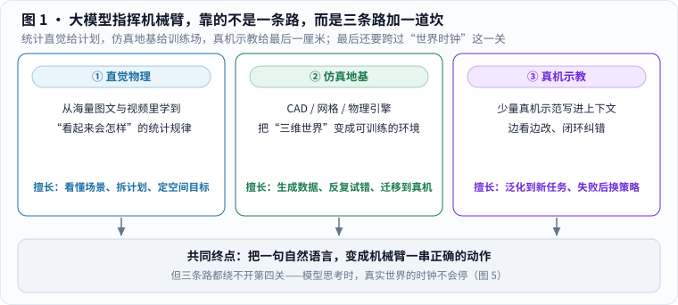
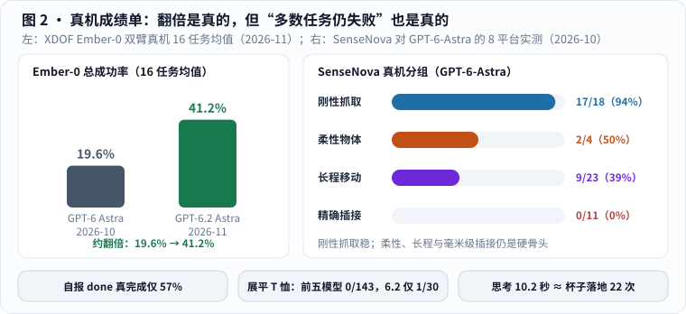
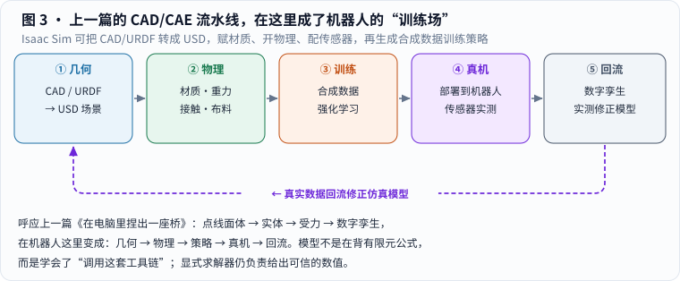
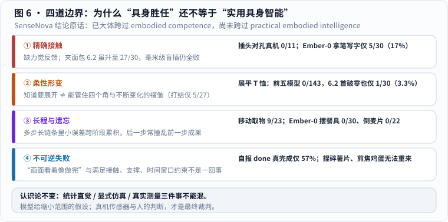

想象桌上有两道给双臂机器人出的真机考题（来自 XDOF 的 [Ember-0 基准原文](https://www.xdof.ai/blog/evaluating-llms) 与[公开榜单](https://benchmarks.xdof.ai/)）：

- **第一题（`Retrieve out-of-reach plush`，拉毛巾取玩具）**：一只毛绒玩具摆在机械臂够不着的远处，但它身下垫着的毛巾边缘刚好够得着。摄像头看一眼，模型思考十来秒，伸出一只手**先把毛巾拽到手边，再顺势抓起跟过来的玩具**——Sol 6.1 做对了约 83%（24/29），而最新的 GPT-6.2 Astra 更冲到了 **96.7%（29/30）**。
- **第二题（`Follow the red sticky note`，看红便利贴办事）**：桌上贴着三张不同颜色的便利贴，模型得先找到红色的那张，读懂上面的手写英文“把盘子放进垃圾桶”（`Put the plate in the bin`），再指挥双臂把盘子端进去——前代 GPT-6 Astra 只有 18.5%（5/27），GPT-6.2 Astra 一口气涨到了 **79.3%（23/29）**。

这两幕最有意思的地方在于：真正难的不是“抓”这个动作本身，而是**先把一句人话能说清的物理与空间洞见——“拉毛巾，玩具就会跟着过来”——变成机械臂在三维空间里的真实轨迹**。

于是问题来了：

> 一个原本只会聊天的语言模型，既没有长手也没有触觉神经，凭什么突然能指挥真机械臂？它是不是偷偷在脑子里背下了我们上一篇讲的那套 CAD 图纸和有限元网格？

上一篇《[在电脑里捏出一座桥]()》我们讲清了工程师怎样把虚拟模型变成真桥。今天顺着这条线往下走一步，把前沿大模型学到了什么、没学到什么拆个明白。

先把答案的地图摊开：它靠**三条路径**走到机械臂面前，但还要直面**第四道时间大坎**。

_图 1：先看上排三张卡片的分工——① 统计性的“直觉物理”负责看场景拆计划，② CAD 与物理引擎构成的“仿真地基”提供反复试错的训练场，③ “真机示教”靠上下文学习补齐最后一厘米；再顺着三个向下箭头看底部灰栏——三条路汇聚成动作序列，却都绕不开“世界时钟”：模型思考时，真实世界不会按暂停键等它。_

---

## 一、先看成绩单：翻倍是真的，但“多数任务仍失败”也是真的

### 1. XDOF Ember-0：一个月内总分翻倍，但刚过四成

先把时间线和评测口径对齐，免得把两代模型的数据混成一锅粥：

- **2026 年 10 月**：机器人数据团队 XDOF 发布 [Ember-0 真机基准报告](https://www.xdof.ai/blog/evaluating-llms)，让未针对该硬件微调的前沿大模型通过工具调用（输出末端三维坐标、旋转与夹爪开合，并可维护一份 2000 字以内的记忆备忘录）直接控制双臂机器人。16 项日常操作任务、每项重复约 30 次、在 6 个双臂工位上并行实测，当时排第一的 **GPT-6 Astra 平均成功率只有 19.6%**（Sol 6.1 紧随其后为 19.3%）。
- **2026 年 11 月**：GPT-6.2 发布后，[XDOF Robotics Leaderboard](https://benchmarks.xdof.ai/) 更新了同一套 16 项真机任务的实测成绩——**GPT-6.2 Astra 的平均成功率跃升到 41.2%**，足足翻了一倍还多，在样本量上绝不是“撞大运”。

_图 2：先看左图——同一套 XDOF Ember-0 双臂真机 16 任务基准上，GPT-6.2 Astra（2026-11）把总成功率从前代 GPT-6 Astra（2026-10）的 19.6% 拉升至 41.2%；再看右图——SenseNova 团队对前代 GPT-6-Astra 在 8 种真机平台上的分组实测，蓝条（刚性抓取 94%）与红条（精确插接 0%）反差极鲜明；底栏汇总了三条最值得警醒的实测细节。注意左右两组来自不同团队与评测协议，不能直接混算。_

### 2. SenseNova 八平台解剖与两条反直觉真相

光看一个总平均分还不够。SenseNova 联合团队在 2026 年 10 月发表了针对前代基座 **GPT-6-Astra** 的大规模系统解剖，横跨 12 个仿真基准与 8 种真机硬件平台，把“到底哪类活能干、哪类活干不了”扒得清清楚楚（[SenseNova 官方项目页](https://www.sensenova.ai/has-gpt-6-astra-achieved-embodied-intelligence)、[arXiv:2610.22471](https://arxiv.org/abs/2610.22471)）：

- **刚性抓取 17/18（约 94%）**——叠方块、套杯子、抓玩具，可靠性已经接近实用；
- **柔性物体 2/4（50%）**——在 Franka 3 机械臂上叠毛巾，布料一软就明显吃力；
- **长程移动 9/23（约 39%）**——用移动底盘导航加跨房间取物，中途波折很多；
- **精确插接 0/11（0%）**——把插头对准毫米级插孔，换了三种机械臂平台全军覆没，PiPER 平台上 3 次尝试里甚至有 2 次直接撞出关节碰撞保护故障。

再翻开 XDOF 的原始真机记录，还有两条特别反直觉的观察：

1. **模型很自信，裁判很冷静**：在早期五模型评测里，每当模型自己宣布“我做完了（`done`）”的时候，人工核验发现任务**真正完成的比例只有 57%**（[Ember-0 原文](https://www.xdof.ai/blog/evaluating-llms)）；
2. **叠衣服和长链条家务依然是“天堑”**：展开一件皱巴巴的 T 恤（`Unfold the t-shirt`），早期五个前沿模型合计 **143 次有效尝试，0 次成功**——衣服经常被越折越小；哪怕到了最新的 GPT-6.2 Astra，这项也只实现了 **1/30（3.3%）** 的破零，系绳结（`Tie a knot`）仅 **5/27（18.5%）**，而多步整理的**摆餐具（0/30）**和**端盘倒麦片（0/22）**至今仍是零分（[XDOF 榜单](https://benchmarks.xdof.ai/)）。

所以，“具身智能真的突破了”和“多数任务依然失败（$$100\% - 41.2\% = 58.8\%$$）”这两句话完全同时成立。它跨过的是一道关键门槛，还远不是终点。

---

## 二、三条路径之一：统计性的“直觉物理”

### 1. 老师傅的经验手感，不是脑子里的牛顿方程

第一条路径最容易被误读成“它读懂了大学物理课本”。其实不是。

大语言模型在海量图文、视频和代码上预训练，见过成千上万次“杯子推到桌边会掉下去”“毛巾一拽上面的东西跟着动”“食品夹要捏中后段才会合拢”。它学到的是一套**统计关联规律**——更像人类婴儿或老师傅积累的直觉手感，而不是在神经元里实时推导 $$\mathbf{F}=m\mathbf{a}$$。

这里必须守住事实边界：OpenAI 在 [GPT-6.2 系统卡](https://deploymentsafety.openai.com/gpt-6-2-astra-sol)（2026-11-17）里只说明模型在“多样化数据集（含公开网络数据、合作方数据及内部构建数据）”上预训练，并通过强化学习训练推理能力，**并未公开任何具体的 3D 或 CAD 训练配比**。因此网上流传的“专门喂了海量有限元网格才开窍”属于没有公开证据支撑的猜测。

### 2. 知道“该干嘛”，却卡在“指尖最后一厘米”

统计直觉的强项与短板，正好和 Ember-0 的单项演化严丝合缝地对上：

- **强在高层因果与空间意图**：把一句模糊指令拆成步骤、从多视角相机图像里圈出目标位置、想通“拉毛巾 → 玩具到手边”这类间接工具使用——这恰恰是 XDOF 总结大模型最惊艳的地方；
- **弱在缺乏力觉反馈的精细接触**：以“用食品夹夹起面包”（`Pick up a bread with a tong`）为例，早期评测中模型近一半回合**把夹子拿反了头**；就算握对了方向，由于机器人是无力传感器的二指平行夹爪，“夹爪闭合”不等于“食品夹尖端咬紧面包”，模型得等把夹子抬到半空看照片，才发现面包根本没夹起来——当时 Sol 6.1 成功率只有 **13.3%（4/30）**，GPT-6 Astra 只有 **10.0%（3/30）**。到了 **GPT-6.2 Astra**，靠更准的视觉对位把夹面包追到了 **90.0%（27/30）**；可一旦换成对持续接触力要求更高的**拿笔在纸上写“HI”**，成功率又跌回 **16.7%（5/30）**。

一句话总结第一条路：**视觉统计直觉让它越来越清楚“应该怎么做”，但单靠看图说话，很难拿准接触瞬间的力道与毫厘偏差。**

---

## 三、三条路径之二：仿真地基——上一篇的流水线成了训练场

### 1. 不靠“心算”物理，而是亲手写求解器、调工具链

第二条路径，恰恰是我们上一篇《[在电脑里捏出一座桥]()》的直接延续。

如果让大模型凭空“心算”轮胎压过山路坑洼时悬架弹簧受多大冲击力，它照样会胡编；但 OpenAI 在 [GPT-6.2 官方发布页](https://openai.com/index/introducing-gpt-6-2-astra-sol/)里展示了另一套完全不同的做法：

- **底盘动力学仿真**：让 GPT-6.2 Astra 可视化一辆汽车在山路上行驶的底盘动态，它不是靠嘴猜，而是**自己建出 3D 模型、自己写 Python 物理求解器**去算轮胎与悬架的耦合动力学方程，最后调用 Blender 渲染成动画；
- **逐零件机械装配**：它能按零件逐一搭建机械系统，检查装配配合关系，并测试修改某个零件尺寸后整体运动行为怎么变；
- **从建筑照片到实物纸灯**：团队给它看芝加哥 Marina City 大楼标志性的扇贝形阳台照片，它一路完成 CAD 建模修订、展开图纸生成，最后由人手工拼装成一盏真实的纸灯；在盲测三维交互生成的 **AA-3D** 排行榜上，GPT-6.2 Astra 也以 **1,318 Elo** 位列第一。

### 2. 与数字孪生同构的 Sim-to-Real 机器人训练闭环

把这套能力放进机器人工程里，就是今天具身智能最核心的 **Sim-to-Real（从仿真到真机）闭环**：

_图 3：先顺着上排 ①→⑤ 看正向链路——把 CAD 零件或机器人描述文件（URDF）转成通用场景描述（USD），加上重力、摩擦、接触和布料物理，在虚拟世界里生成海量合成数据训练策略，再部署到真机；再看下方紫色虚线箭头（←）——真机传感器的实测误差反过来修正仿真参数，与上一篇图 5 的数字孪生闭环完全同构。_

NVIDIA 的 [Isaac Sim 官方文档页](https://developer.nvidia.com/isaac/sim)把这条工业流水线写得非常清楚：将 CAD、URDF、MJCF 导入为 OpenUSD 场景，赋予真实物理材质、碰撞属性与传感器模型，再接入 Isaac Lab 做大规模合成数据生成与强化学习训练；SenseNova 的下一代家庭基准原型，同样搭在一间带有液体、布料与加热物理的 Isaac Sim 虚拟公寓里。

看明白了吗？这里发生的绝不是“大模型把有限元刚度矩阵背进了脑子里”，而是**它学会了像人类工程师一样操作 CAD 与物理仿真工具链**——模型负责理解意图、写脚本、改参数，而真正给出可信受力与运动数值的，仍然是背后严守牛顿定律的**显式数学求解器**。当然，也要分清**能力展示**与**训练成因**：官方展示证明它“越来越会用 3D 与仿真工具”，并不等于公开了它内部靠多少仿真轨迹训练而成。

---

## 四、三条路径之三：真机示教与上下文学习——“没微调”不等于“没看示范”

### 1. 把示范写进只读“知识包”：不改权重的考前复习

围绕这类实验最容易产生误解的一句宣传语是：“大模型零微调就能直接上真机干活！”这话只说对了一半。

SenseNova 在评测 GPT-6-Astra 时把真实机制毫无保留地摊开给学界看：整个过程中**模型权重确实一个数字都没改（没有微调）**，但评测协议允许它做**上下文学习（In-Context Learning, ICL）**——正式考试之前，先让模型自己研读该基准的训练示教轨迹，由模型亲手总结并写下一份结构化的**知识包 $$K$$**（[SenseNova 项目页](https://www.sensenova.ai/has-gpt-6-astra-achieved-embodied-intelligence)）：

1. **任务指南（`.md`）**：任务目标、分阶段拆解与高层策略；
2. **运动参考（`.npz`）**：示范轨迹数组、夹爪开合时机与关键相位锚点；
3. **视觉参考（`.png`）**：关键示范帧与指尖接触局部的放大特写；
4. **可执行助手（`.py`）**：模型自己写的正／逆运动学换算、轨迹检索与动作生成小脚本；
5. **检查与恢复（`.md` / `.py`）**：怎样判定这一步真做成了、滑脱失败后怎么补救；
6. **元数据（`.md` / `.py`）**：机器人自由度规格、坐标系约定与文件校验信息。

这份知识包 $$K$$ 在测试开始前被**冻结成只读副本**；真正上场遇到新摆放位置时，模型再去翻自己写的“复习笔记”，调里面的 `.py` 助手算出适配当前画面的动作。

_图 4：先看左上卡片——SenseNova 协议中知识包 $$K$$ 的六类文件把文字经验、轨迹数据、特写图片与运动学 Python 脚本打包在一起；再看右上卡片——把步数上限从 1× 放宽到 10× 后，模型得以在失败后换策略重试，LIBERO 等仿真族成功率冲过 95%，但每回合要烧掉约 100 万 token 和近 1 小时；最后看底栏消融数字，对比“单跑小模型”与“快慢结合 + 知识包”的巨大跃升。_

所以，“没微调权重”千真万确，但“看了真机示范”也千真万确——只不过学习发生的位置，从**训练期改参数**变成了**推理期查自己整理的错题本与工具箱**。

### 2. 步数经济学与接口设计：为什么“给关节角”反而帮倒忙？

SenseNova 在论文里做的两组定量拆解，把背后的工程账算得极其透彻（[arXiv:2610.22471](https://arxiv.org/abs/2610.22471)）：

- **10 倍步数的代价账**：在 LIBERO、SIMPLE 等仿真基准里，如果只给官方默认的 $$1\times$$ 步数预算，一旦第一次抓取滑脱基本就宣告失败；把步数上限放宽到 **10 倍（$$10\times$$）** 后，模型发现没抓起来会自己退回来换个角度重抓，成功率一路冲上 **95% 以上**。但天下没有免费午餐：在长程基准 `LIBERO-Long++` 上，跑完这样一局平均要消耗约 **100 万 token、耗时近 1 小时**（由于约 98% 是重复复用的缓存输入，按当时 GPT-6-Astra 计价折合约 **1 美元/回合**；后来 GPT-6.2 Astra 又将缓存输入单价下调了 60% 至 `$0.40 / 1M`）。虚拟世界里耗一小时只花一块钱，可放到真机上，每一次笨拙重试都在磨损电机与夹爪。
- **快慢结合与接口消融**：在 RoboDojo 的 42 项任务上，如果只让专门训练的端到端视觉-语言-动作小模型 **π0.5**（VLA，见 [arXiv:2504.16054](https://arxiv.org/abs/2504.16054)）自己埋头干，平均成功率只有 **6.91%**；如果让大模型每隔 $$L=4$$ 个动作片段看一眼画面做**闭环审核与纠偏**，成功率立刻涨到 **25.83%**（相反，只下命令不回头看的开环模式只有 5.83%）；再叠加上面的 **ICL 知识包**，成功率直接跃升到 **54.17%**！
- **动作语言必须顺着模型的空间直觉**：同一组消融还发现，让模型用“往左／往前挪多少厘米”这类三维**方向命令**沟通，成功率能再加 **+2.50 个百分点**；反过来，如果非要把机器人 6 个或 7 个电机的**原始关节角（弧度）**塞进提示词让它直接算，成功率反而暴跌 **−5.84 个百分点**！原因很朴素：人在脑子里想“手往杯子伸过去”也是按三维上下左右想的，谁也不会去心算肩关节转几度、肘关节弯几度——把关节角换算留给底层的逆运动学代码，才是各司其职。

真机实验里还抓到了一个让人眼前一亮的瞬间：单臂插花时，手腕相机被花瓶口挡住视线导致任务失败；换成双臂 Piper 机器人后，模型**主动把空闲的另一只机械臂挪到旁边充当“第三只眼”**，用它的腕部相机看清瓶口位置，再指挥持花的手稳稳插进去。这种“主动挪相机找视角”的动作在人类示教数据里几乎不会特意教，是模型把空间推理活学活用出来的。

---

## 五、第四关：世界时钟——模型想 10.2 秒，杯子早落地 22 次

### 1. 一笔高中物理自由落体账：为什么真实世界不等模型想完？

现在来算最关键、却最容易在宣传倍速视频里被忽略的一笔账：**时间**（很多演示视频为了好看会打上 `4×`、`8×` 快进角标，XDOF 榜单甚至记录到部分展示片段加速上百倍）。

根据 XDOF 排行榜的原始计时统计，所有参测前沿大模型每两次动作决策之间平均都要停顿 **10～24 秒**：前代 GPT-6 Astra 平均每次思考约 **15.0 秒**，最新的 GPT-6.2 Astra 优化了约三分之一，降到了平均 **10.2 秒**（精确值 `10.16 s`；注意这一延迟数据来自 [XDOF 真机实测榜单](https://benchmarks.xdof.ai/)，而非 OpenAI 系统卡——部分二手解读把它写成出自系统卡属于张冠李戴）。在这整整十秒的“发呆期”里，机械臂收不到任何新指令。

10.2 秒在聊天窗口里只是一眨眼，但在受重力支配的物理世界里有多漫长？我们用高一物理的自由落体公式算一下：一只水杯从 $$h = 1.0\text{ m}$$ 高的桌面滑落，重力加速度取 $$g = 9.8\text{ m/s}^2$$，落地时间是：

$$t = \sqrt{\frac{2h}{g}} = \sqrt{\frac{2 \times 1.0}{9.8}} \approx 0.45\ \text{s}$$

拿模型的平均思考时间一除：

$$\frac{10.16\ \text{s}}{0.452\ \text{s}} \approx 22.5\ \text{次}$$

也就是说，**模型才刚想出一个主意，失手碰掉的杯子已经足够从桌面上摔碎 22 次了！**

_图 5：先看左图的三层分工——慢思考的大模型（System 2，约 10 秒级）只管全局规划与纠错，把快执行交给 VLA 小模型（System 1），再由底层控制器（System 0）维持毫秒级力矩与姿态稳定；再看右图——首次打开会按真实时间比播放一次约 4 秒的对比动画：虚线框是 $$t=0\text{ s}$$ 脱手位置，紫色思考进度条才刚走出不到二十分之一，蓝色水杯就已经加速砸到地面（$$t\approx 0.45\text{ s}$$），而进度条还要慢悠悠走完剩下的 9.7 秒（开启系统“减少动态效果”时直接呈现完整静态终态，刷新可重播）。_

### 2. 煎焦的鸡蛋与快慢“双系统”架构

SenseNova 团队为了揭开传统仿真基准“模型思考时自动暂停物理时钟”的假象，专门在 Isaac Sim 里搭了一套**“世界时钟”交互式家庭公寓原型基准**（Section 04，含空气炸锅、烤面包机、炉灶煎蛋与洗衣机，模型思考时炉火与时钟照走不误），结果测出了一个令人哭笑不得的名场面：模型看着锅里的蛋液，非常聪明地做出了正确判断——“鸡蛋已经凝固，现在该关火了”；可等它慢条斯理地想完动作参数再伸手去关旋钮时，**炉火足足晚了约 90 秒才关掉，锅里的鸡蛋早就煎焦了**！

放到真机硬件上也是一样：SenseNova 把大模型直接接到宇树 Unitree G1 人形机器人的底层运动控制器（System 0）上做验证时，简单桌面操作 2/3 成功、短距行走 3/3 成功，证明链路走得通；但整场实验里机器人**约 90% 的真实墙钟时间都站在原地等云端模型思考**，团队因此明确指出：这种直连只是一次慢速反馈下的可行性验证，**绝不等于可靠的实时视觉运动控制**。

这正是为什么今天几乎所有严肃的机器人工程团队都走向了图 5 左侧的**快慢分层双系统（System 2 + System 1 + System 0）**——就像人打乒乓球时，大脑皮层（System 2）只负责想“下一板打他反手底角”，而真正盯住来球挥拍救险的，必须是几十毫秒内就能反应的小脑与脊髓反射（System 1 / System 0）。

---

## 六、四道边界：它真的“懂”物理吗

### 1. 横在“具身胜任力”与“实用智能”之间的四堵墙

把上面三条能力路径和“世界时钟”拼回同一张桌面，开头那个大问题就水落石出了。

_图 6：从上到下对照四道真实工程边界——左侧标出卡住模型的物理机制，右侧列出 SenseNova（GPT-6-Astra）与 XDOF（早期五模型及最新 GPT-6.2 Astra）的一手实测成功率；底部回到与上一篇一致的工程认识论。_

借用 SenseNova 报告原话给出的定性结论：前沿大模型**已经大体跨过了“具身胜任力”（embodied competence），但还没有跨过“实用具身智能”（practical embodied intelligence）**。横在中间的正是图 6 的四道硬边界：

1. **毫米级精确接触与力控**：没有高频触觉与力反馈，插头对插孔真机 **0/11** 全败；即便 GPT-6.2 Astra 把夹面包追到 27/30，拿笔写字也只有 **5/30（16.7%）**；
2. **高自由度柔性形变**：一块软布有无穷多个自由度，知道“该把 T 恤铺平”不等于能同时管住四个衣角和随时塌陷的褶皱——前五模型 **0/143**，GPT-6.2 Astra 首破零也仅 **1/30（3.3%）**；
3. **长程多步误差累积**：跨房间移动取物仅 **9/23**，Ember-0 上摆整齐整套餐具 **0/30**、倒麦片端盘 **0/22**——前一步歪两厘米，后一步伸手就可能把刚摆好的碗碰翻；
4. **不可逆失败与自检盲区**：捏碎的薯片粘不回去、晚关火 90 秒煎焦的鸡蛋变不回嫩蛋，而模型在画面里看一眼，仍有近四成概率在没达标时自信地报告“已完成”（真完成率 **57%**）。

### 2. 回到认识论：统计直觉、显式仿真与真实测量各司其职

所以，回答“大模型到底懂不懂物理”，最诚实、最准确的说法是：

它同时拥有**从海量多模态数据里习得的统计性直觉物理**、**编写代码与调用显式 CAD／仿真工具链的能力**，以及**从真机示教中提炼并检索上下文经验的能力**；但它脑子里并没有内置一台毫秒级运转的精确物理求解器——真遇到要算准受力、轨迹和碰撞的硬仗，它得老老实实去写程序、调求解器，再交给底层控制器和传感器去闭环。

这恰好和上一篇《在电脑里捏出一座桥》严丝合缝地合上了同一套科学认识论：**统计直觉、显式仿真、真实测量，三件事永远不能混为一谈**。大模型擅长给出“先试试这个方向”的聪明假设，数学求解器负责算出可核查的预测，而真实世界里的力传感器、世界时钟与人的检验，永远握着最终裁判哨。

---

## 奶爸说

看孩子学系鞋带、叠衣服或者搭积木的时候，你会惊讶地发现，人类小朋友其实天生就把这三套本事揉在了一起：瞄一眼就知道“积木歪成这样肯定要倒”（直觉物理），在脑子里比划先抽哪根木条（心理仿真），手指一碰觉得太滑立刻加点劲、倒了再重来（高频触觉闭环与试错验证）。

今天最顶尖的大模型，走的却是一条恰好倒过来的奇特路线——它先读遍了人类写的万卷书、能写代码算山路悬架，最后才笨拙地伸出机械臂，学着怎么在十秒钟里把一件揉成团的 T 恤抖开。

带孩子看懂这场正在发生的机器人革命，最值得留给他的大概也是这三层清醒的眼光：

- **别神化“看图说话”**：说得头头是道，不代表手底下真能对准那 1 毫米的插孔；
- **善用数学与工具**：再聪明的大脑也不靠瞎猜算受力，把直觉和严密的仿真工具配在一起才真正强大；
- **永远敬畏真实世界**：真实世界有摩擦、有形变、有不停歇的时钟——敢动手试、尊重实测反馈的人，永远不会被屏幕里的幻觉骗倒。

GPT-6.2 已经学会拽毛巾取玩具、看红便利贴收盘子了；但要像你家孩子一样三两下把自己的小 T 恤叠得方方正正——它还在交学费呢。🚀

---

### 参考资料

1. [OpenAI：Introducing GPT-6.2 Astra and Sol](https://openai.com/index/introducing-gpt-6-2-astra-sol/)——山路底盘动力学 Python 求解器与 Blender 可视化、逐零件机械系统建模装配、芝加哥 Marina City 阳台照片到 CAD 纸灯、AA-3D（1,318 Elo 排名第一）及 API 缓存输入定价（`$0.40 / 1M`）的一手来源。
2. [GPT-6.2 System Card（Deployment Safety Hub，2026-11-17）](https://deploymentsafety.openai.com/gpt-6-2-astra-sol)——“多样化数据集预训练 + 强化学习推理”的官方说明来源；该系统卡未公开任何 3D/CAD 训练数据配比，也未包含机器人动作延迟测试。
3. [SenseNova：Has GPT-6-Astra Achieved Embodied Intelligence? 官方项目页](https://www.sensenova.ai/has-gpt-6-astra-achieved-embodied-intelligence)——针对前代 `GPT-6-Astra` 的 ICL 只读知识包六类结构、1×/10× 步数预算与成本（约 1M tokens、98% 缓存输入折合 1 美元）、8 平台真机分组成功率、双臂主动视觉插花、世界时钟公寓原型中晚关火约 90 秒煎焦鸡蛋、Unitree G1 双系统验证（约 90% 时间花在思考）及四道工程边界结论的来源。
4. [arXiv:2610.22471（2026-10）](https://arxiv.org/abs/2610.22471)——同上研究的完整学术论文，提供 12 个仿真基准、8 种真机平台明细与 RoboDojo 42 任务架构及动作接口消融（6.91% → 25.83% → 54.17%，方向命令 +2.50、关节角 −5.84）数据。
5. [XDOF：Ember-0: A benchmark for LLMs in the real world（2026-10-23）](https://www.xdof.ai/blog/evaluating-llms)——16 项双臂真机任务定义（含拉毛巾取玩具与读红便利贴放盘子）、每项 30 次重复、6 工位并行、早期决策间隔、自报 `done` 真完成率 57%、前五模型展平 T 恤 0/143 与早期夹面包失误原因的来源。
6. [XDOF Robotics Leaderboard（2026-11-20 快照）](https://benchmarks.xdof.ai/)——Ember-0 总成功率从 GPT-6 Astra 的 19.6%（平均延迟 15.0 秒）提升至 GPT-6.2 Astra 的 41.2%（平均延迟约 10.2 秒），以及单项成功率（拉毛巾 29/30、红便利贴 23/29、夹面包 27/30、写字 5/30、打结 5/27、展平 T 恤 1/30、摆餐具 0/30、倒麦片 0/22）的一手榜单数据来源。
7. [π0.5: a Vision-Language-Action Model with Open-World Generalization（arXiv:2504.16054）](https://arxiv.org/abs/2504.16054)——VLA 作为快执行 System 1 的代表模型、异构数据协同训练与开放家庭泛化的论文依据。
8. [NVIDIA Isaac Sim 官方页](https://developer.nvidia.com/isaac/sim)——CAD/URDF 转 OpenUSD、赋材质与物理属性、合成数据生成与 Isaac Lab 策略训练的官方依据，支撑图 3 的仿真地基闭环。
9. 本站《[在电脑里捏出一座桥——从点线面、有限元到数字孪生，读懂三维物理建模]()》——姊妹篇上篇，本文 CAD/CAE/CAM 与数字孪生概念的基础。
10. 图 1–图 6 均为本站原创 SVG，由 `tools/visuals/` 工具包的 `embodied-ai-three-paths` 主题生成并通过数值与版式断言：图 2、图 4、图 6 的数字均来自上述一手报告与榜单；图 5 的自由落体时间按 $$t=\sqrt{2h/g}$$ 计算，动画按真实时间比压缩并停留在地面终态，支持“减少动态效果”，比例失真处均已在图内标注。
