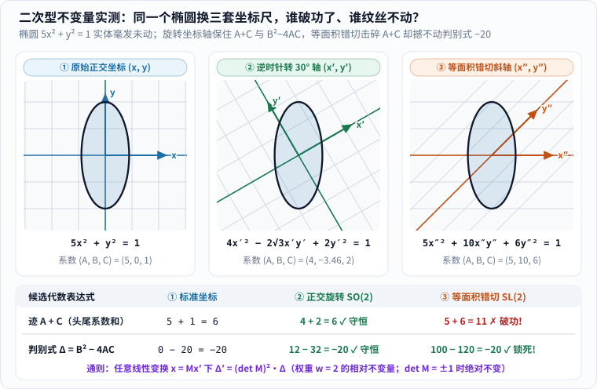
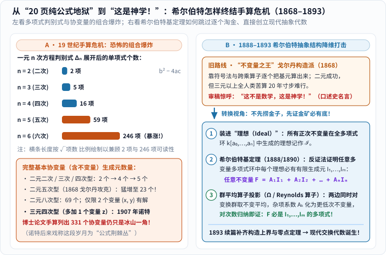
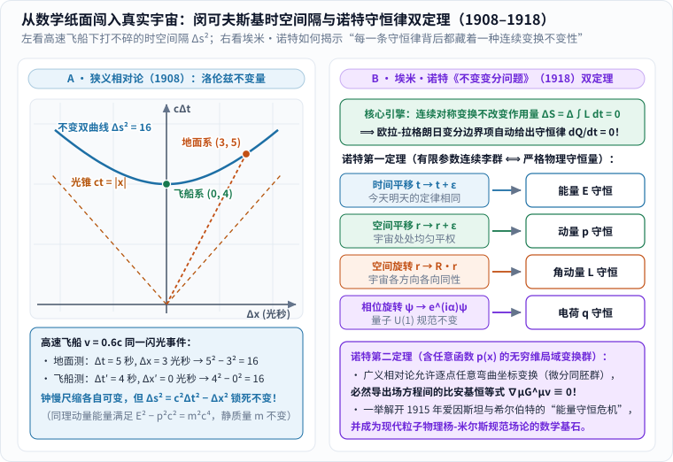
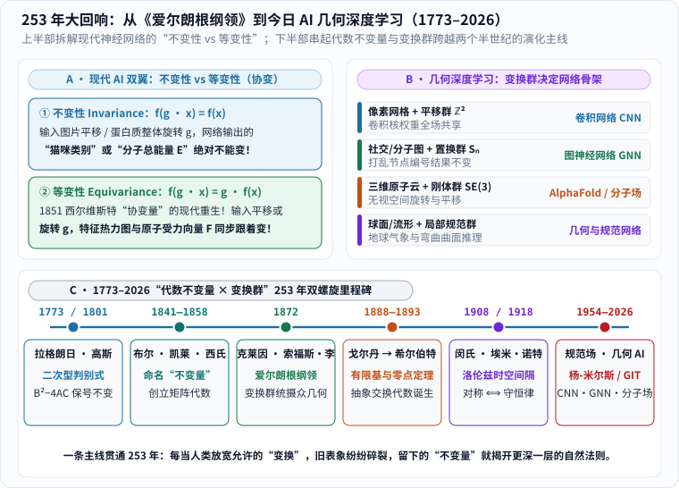

先在书桌上做两个哪怕不用草稿纸也能马上想明白的小实验。

**第一个实验（歪头看椭圆）**：拿一张白纸，画一个瘦高个儿的标准椭圆：

$$
5x^2 + y^2 = 1
$$

它的长相干净利落，三个系数依次是 $$A = 5,\ B = 0,\ C = 1$$，连讨厌的交叉项 $$xy$$ 都没有。

现在，**白纸上的椭圆一根汗毛都不许动**，你只是把铺在底下的透明坐标方格纸**逆时针歪转了 $$30^\circ$$**。在新坐标轴 $$(x', y')$$ 眼里，同一个椭圆的方程当场“毁容”，变成了一串夹杂着根号的怪式子：

$$
4x'^2 - 2\sqrt{3}\,x'y' + 2y'^2 = 1
$$

你看，原来的系数 $$(5, 0, 1)$$ 全军覆没，换成了 $$(4, -2\sqrt{3}, 2)$$！可如果你鬼使神差地拿新系数算两笔简单账，鸡皮疙瘩马上就起来了：
- 把头尾两个系数加起来（$$A + C$$）：原来是 $$5 + 1 = 6$$；转完之后是 $$4 + 2 = 6$$，**分毫不差**！
- 再算一下初中解方程最眼熟的判别式（$$B^2 - 4AC$$）：原来是 $$0^2 - 4 \times 5 \times 1 = -20$$；转完之后是 $$(-2\sqrt{3})^2 - 4 \times 4 \times 2 = 12 - 32 = -20$$，**连正负号带个位数都像焊死了一样纹丝不动**！

**第二个实验（折腾一块方橡皮）**：如果还不解气，我们干脆连图形本身一起折腾——先把一块带圆孔的正方形饼干**平移旋转**，再用复印机**缩小一半**，接着像推扑克牌一样把它**斜着推歪成平行四边形**，再拿手电筒斜着照墙投出**近大远小的梯形影子**，最后干脆把它当成橡皮泥**随便揉捏扭曲**（只要不撕破、不粘连）。每往上升一级“酷刑”，边长、直角、平行线、中点就会排着队轮流阵亡；可哪怕到了最后一步面目全非，饼干中间“有且只有 $$1$$ 个洞”这件事依然打不碎！

为什么方程和图形被折腾得改头换面，底下却总有几样东西死活不变？

这两个问题撞在一起，串起了过去 **253 年（1773–2026）** 数学与物理学最波澜壮阔的一条暗线——**从“代数不变量（Algebraic Invariants）”到“变换群（Transformation Groups）”的双向奔赴**。顺着这条主线走一趟，你会惊讶地发现：线性代数里的**矩阵**、统摄一切几何的**《爱尔朗根纲领》**、催生现代抽象代数的**希尔伯特基定理**、解释宇宙为什么能量守恒的**诺特定理**，乃至今天认猫的卷积神经网络与斩获诺奖的 **AlphaFold**，竟然全是从同一颗种子里长出来的参天大树！

---

## 一、算出来的定海神针（1773–1858）：为什么 $$B^2 - 4AC$$ 在坐标乱变时打不碎？

### 1. 旋转守得住、错切就破功？亲手揪出“真假不变量”

很多人在初中背过一元二次方程求根公式里的 $$\Delta = b^2 - 4ac$$，知道它大于零有两个实根、等于零有重根、小于零没有实根；到了高中解析几何，老师又告诉你二次曲线 $$Ax^2 + Bxy + Cy^2 = 1$$ 也能拿 $$B^2 - 4AC$$ 判断它是椭圆（$$<0$$）、抛物型退化线（$$=0$$）还是双曲线（$$>0$$）。

可很少有人追问一句：**凭什么换一套斜着的坐标系，$$A, B, C$$ 三个数字全变了，$$B^2 - 4AC$$ 却不会从负数变成正数？**（毕竟同一个椭圆不可能因为你歪着脖子看它，就突然裂成两条开口朝外的双曲线！）

为了看穿底牌，我们在刚才“旋转 $$30^\circ$$”的基础上，再给同一个椭圆 $$5x^2 + y^2 = 1$$ 增加第三场测试——**等面积水平错切（Shear）**。

什么叫等面积水平错切？想象一摞整整齐齐的扑克牌，底牌不动，越往上的牌越往右平移一点，写成坐标换算就是：

$$
x = x'' + y'', \qquad y = y''
$$

注意看这套新坐标尺：横轴 $$x''$$ 还是水平向右，但纵轴 $$y''$$ 变成了 $$45^\circ$$ 斜向右上方的斜线；底为 $$1$$、高为 $$1$$ 的小平行四边形面积依然等于 $$1 \times 1 = 1$$（面积一分钱没涨，也没有翻转）。把 $$x = x'' + y'',\ y = y''$$ 代回原椭圆方程 $$5x^2 + y^2 = 1$$，展开合并同类项：

$$
5(x'' + y'')^2 + y''^2 = 5x''^2 + 10x''y'' + 6y''^2 = 1
$$

新系数变成了 $$A'' = 5,\ B'' = 10,\ C'' = 6$$。现在再来核对刚才那两个“疑似不变量”：
1. **头尾系数和（迹 $$A + C$$）**：原来是 $$6$$，转 $$30^\circ$$ 也是 $$6$$，可一遇上水平错切，瞬间变成了 $$5 + 6 = \mathbf{11} \neq 6$$——**当场破功了！** 原因很直观：$$A+C$$ 衡量的是两条互相垂直坐标轴方向上的曲率之和；一旦坐标轴本身被拉斜、不再垂直保长，它就守不住了。
2. **判别式 $$B^2 - 4AC$$**：代入 $$A'' = 5,\ B'' = 10,\ C'' = 6$$，算出 $$10^2 - 4 \times 5 \times 6 = 100 - 120 = \mathbf{-20}$$——**依然稳如泰山，一分不差！**

_图 1：先看上排三幅网格——黑色的物理椭圆 $$5x^2+y^2=1$$ 自始至终没有发生任何形变，变的只是铺在底下的三把“坐标尺”（① 标准正交尺、② 逆时针旋转 $$30^\circ$$ 正交尺、③ 等面积错切斜尺）；再看底部核对表，迹 $$A+C$$ 只在正交旋转群 $$\mathrm{SO}(2)$$ 下守恒，遇到错切立刻变成 $$11$$，而判别式 $$B^2-4AC=-20$$ 在一切保面积线性变换下锁死不变（[单独打开高清图](/assets/images/invariants-transformations/quadratic-form-rotation-shear-invariants.svg)）。_

这组小实验一下子把整门学科最核心的灵魂亮了出来：**世上从来没有孤立的“不变量”，任何不变量都必须指明“在什么样的变换下不变”！**

早在 **1773 年**，法国-意大利数学家**约瑟夫·拉格朗日（Joseph-Louis Lagrange）**在《算术研究》（*Recherches d'arithmétique*）中研究整数二次型 $$Ax^2 + Bxy + Cy^2$$ 时，就已经算出了一般线性代换下的神奇恒等式；**1801 年**，24 岁的**卡尔·弗里德里希·高斯（Carl Friedrich Gauss）**在传世巨著《算术研究》（*Disquisitiones Arithmeticae*，详见姊妹篇《[高斯到底发明了什么？从 1 加到 100 开始]()》）第 153–157 节里更进一步，对任意可逆线性变换：

$$
x = \alpha x' + \beta y', \qquad y = \gamma x' + \delta y'
$$

记变换系数排成的方表行列式为 $$D = \alpha\delta - \beta\gamma$$（它的几何意义就是**新坐标单位网格相对于旧网格的面积放大倍率**），直接把新式子展开硬算，几十项繁杂的交叉乘积会像排练好一样成对抵消，最后只留下一行极其干净的等式：

$$
B'^2 - 4A'C' = (\alpha\delta - \beta\gamma)^2 \,(B^2 - 4AC) = D^2 \,(B^2 - 4AC)
$$

盯着这行等式看三秒钟，两个贯穿后世两百年的核心概念就全懂了：
- **绝对不变量（Absolute Invariant）**：只要变换不改变单位网格的面积（$$D = \pm 1$$，比如一切旋转、镜像反射和刚才的等面积错切），就有 $$D^2 = 1$$，新判别式和旧判别式**连数值都完全相等**；
- **相对不变量（Relative Invariant，权重 $$w$$）**：哪怕你把坐标尺整体放大 $$3$$ 倍（$$\alpha = 3, \delta = 3 \implies D = 9$$），新判别式也只是整整齐齐乘上 $$D^2 = 81$$！一般地，如果某个由系数拼成的代数式 $$I$$ 在线性变换后满足 $$I' = (\det M)^w \, I$$，数学家就称它是**权重（Weight）为 $$w$$ 的相对不变量**（这里 $$B^2 - 4AC$$ 的权重 $$w = 2$$）。只要变换可逆（$$\det M \neq 0$$），平方因子 $$(\det M)^2$$ 永远严格大于零，所以判别式的**正负号与是否为零永远打不碎**！

### 2. 伦敦林肯律师学院里的“不变量双子星”与矩阵的意外诞生（1841–1858）

高斯关心的主要还是整数数论。真正捅破窗户纸、把这套思想推广到任意高次多项式与任意维空间的，是一群极具传奇色彩的英国数学家。

**1841 年**，出身贫寒鞋匠家庭、全靠自学在林肯郡办乡村中学糊口的青年**乔治·布尔（George Boole**，没错，就是后来发明布尔代数、奠基现代计算机逻辑门的那位布尔！），在刚创刊不久的《剑桥数学杂志》上发表了《线性变换一般理论阐述》（*Exposition of a General Theory of Linear Transformations*）。布尔敏锐地追问：二次多项式有 $$B^2 - 4AC$$，那三次、四次、五次多项式在一般线性变换下，是不是也藏着一大批类似的“打不碎的系数组合”？

这篇论文像一颗火星，瞬间点燃了剑桥天才**阿瑟·凯莱（Arthur Cayley，1821–1895）**。

凯莱在剑桥拿遍了数学头名（Senior Wrangler），可按照当时英国的老规矩，要想留在剑桥长期当研究员，必须宣誓就任英国圣公会神职。凯莱不愿违心宣誓，干脆转行去伦敦著名的**林肯律师学院（Lincoln's Inn）**考了律师执照，从 **1849 年到 1863 年**整整当了 **14 年**专办房产地契转让的执业律师！他白天兢兢业业拟合同（后来他幽默地吐槽：“法律的目标是用最多的词把一件事说清楚，而数学的目标是用最少的词把一件事说清楚”），晚上则在煤气灯下狂写数学论文，14 年律师生涯竟发表了近 **250 篇**一流数学论文。

更巧的是，他在林肯律师学院的庭院里，遇上了另一位同病相怜的“跨界律师”——**詹姆斯·约瑟夫·西尔维斯特（James Joseph Sylvester，1814–1897）**。西尔维斯特同样在剑桥大考高居榜眼，只因身为犹太人拒绝签署基督教信仰宣誓，连正式毕业学位都被剑桥剥夺，只好先去保险公司当精算师，后来也跑来考大律师。

这两个性格截然相反的人——凯莱沉静内敛像一口深井，西尔维斯特热情奔放、酷爱写诗造新词像一团烈火——每天并肩在伦敦法院的回廊里散步讨论“超行列式（Hyperdeterminants）”，被数学史家亲切地称为**“不变量双子星（Invariant Twins）”**。

据数学词汇史学者杰夫·米勒（Jeff Miller）与圣安德鲁斯大学 MacTutor 档案考证，今天翻开任何一本大学数学书都会撞见的术语，几乎一半是西尔维斯特在那几年一口气造出来的：
- **1850 年**，西尔维斯特造出 **“Matrix（矩阵）”** 一词——拉丁语本意是“母体、子宫”，意思是能从里面源源不断孕育出各种子行列式的矩形数表；
- **1851 年**，西尔维斯特在《哲学杂志》（*Philosophical Magazine*）发表名篇《论标准型与超行列式理论中的一项非凡发现》，研究二元四次齐次多项式

$$
f(x, y) = ax^4 + 4bx^3y + 6cx^2y^2 + 4dxy^3 + ey^4
$$

凯莱刚刚找出它在线性变换下有两个打不碎的组合：一个是二次的 $$I = ae - 4bd + 3c^2$$（权重 $$4$$），另一个是三次的 $$J = ace + 2bcd - ad^2 - eb^2 - c^3$$（权重 $$6$$）。西尔维斯特在论文里庄严提议：“我建议今后把它们统称为该多项式的**不变量（Invariants）**！”同一年，他又造出了 **“判别式（Discriminant）”**（四次方程判别式正好就是 $$I^3 - 27J^2$$！）和 **“协变量（Covariant）”**——不仅依赖系数、还带着变量 $$(x,y)$$ 一起同步变形的伴随多项式（比如黑塞行列式 Hessian 与雅可比行列式 Jacobian）。
- **1858 年**，凯莱为了把连续两次线性变换 $$x = My,\ y = Nz$$ 干净利落地合写成一步，正式发表《矩阵论备忘录》（*A Memoir on the Theory of Matrices*），定义了矩阵的加法、乘法与逆矩阵，并证出了著名的凯莱-哈密顿定理！

回望这段历史实在令人感慨：很多同学刚上大学学《线性代数》时觉得矩阵乘法“横行乘竖列”规定得莫名其妙，殊不知**矩阵根本不是数学家拍脑袋编出来的算术游戏，它正是为了追踪“连续变换”与“不变量”才在伦敦律师楼里降生的工具**！一个 $$2\times 2$$ 矩阵 $$M$$ 换任何基底变成 $$P^{-1}MP$$（相似变换），它的特征多项式 $$\lambda^2 - \operatorname{tr}(M)\lambda + \det(M)$$ 之所以纹丝不动，正是因为**迹 $$\operatorname{tr}(M)$$** 与**行列式 $$\det(M)$$** 是矩阵在相似变换群下的两大基本代数不变量！

---

## 二、从“20 页纯公式地狱”到“这不是数学，这是神学！”（1868–1893）

### 1. 恐怖的组合爆炸与“不变量之王”戈尔丹的二十年死胡同

布尔、凯莱和西尔维斯特打开新大陆后，整个欧洲数学界掀起了一场持续四十年的“淘金热”：大家纷纷撸起袖子，比赛把更高次、更多变量的多项式不变量全部算出来。

可算着算着，所有人背后都冒出了冷汗——**代数不变量的膨胀速度，简直像一场失控的雪崩！**

光看最基础的一元 $$n$$ 次多项式判别式 $$\Delta_n$$（用来判断 $$n$$ 次方程有没有重根的那个唯一基本不变量），把它按系数完全展开成单项式相加（数据引自圣安德鲁斯大学 MacTutor 判别式专题）：
- 二次方程（$$n=2$$）：$$b^2 - 4ac$$，只有清爽的 **$$2$$ 项**；
- 三次方程（$$n=3$$）：$$b^2c^2 - 4ac^3 - 4b^3d - 27a^2d^2 + 18abcd$$，涨到 **$$5$$ 项**；
- 四次方程（$$n=4$$）：涨到 **$$16$$ 项**；
- 五次方程（$$n=5$$）：猛增到 **$$59$$ 项**；
- 六次方程（$$n=6$$）：一口气炸成 **$$246$$ 项**！（要是算到十次方程，展开项数将超过百万量级！）

更要命的是，一个多项式其实有无穷多个不变量——比如 $$I$$ 和 $$J$$ 是四次型的不变量，那 $$I^2,\ IJ,\ 5I^3 - 11J^2$$ 全都是不变量。于是全世界的代数学家都被逼到了同一个生死攸关的核心问题面前（**有限基问题，Finite Basis Problem**）：

> **对于任意给定变量个数和次数的多项式，它那无穷无尽的不变量和协变量，能不能全部由“有限几个”最基本的原子积木通过加、减、乘拼出来？**

最先在正面战场立下不世奇功的，是德国爱尔朗根大学教授**保罗·戈尔丹（Paul Gordan，1837–1912）**。

戈尔丹是个计算力恐怖到极点的传奇人物。他把阿隆霍尔德（Aronhold）和克莱布什（Clebsch）发明的“符号法”推向极致，在 **1868 年**硬生生给出了一套构造性算法，证明：**只要多项式只含 $$2$$ 个变量 $$(x, y)$$（即二元 $$n$$ 次型），无论次数 $$n$$ 有多高，它的完整基本不变量与协变量个数一定是有限的！**

凭借这一壮举，戈尔丹被全欧洲尊称为**“不变量之王（König der Invarianten）”**。他的论文风格彪悍到什么地步？据数学史家康斯坦丝·瑞德（Constance Reid）记载，戈尔丹有些论文**连续二十页密密麻麻全是代数公式，中间连一个德文单词都没有**！算二元二次型只有 $$2$$ 个基本生成元，三次 $$4$$ 个，四次 $$5$$ 个，到了五次猛增到 **$$23$$ 个**，八次多达 **$$69$$ 个**。

然而，当戈尔丹和全欧洲的顶尖算手试图跨出下一步——把变量从 **$$2$$ 个增加到 $$3$$ 个**（三元齐次式 $$f(x, y, z)$$，对应平面代数曲线）时，这台无坚不摧的手算推土机一头撞上了钢筋混凝土高墙。从 **1868 年到 1888 年**，整整 **20 年**过去了，没有任何人能证明三元或更多变量的不变量是不是有限生成的！（后来在 **1907 年**，戈尔丹一生带出的唯一一位博士生——年轻的**埃米·诺特**——在博士论文里硬着头皮手算三元四次型，光列出一部分协变量就写了足足 **$$331$$ 个**庞大公式，连冰山一角都没掏完！诺特晚年提起自己这篇处女作时，忍不住自嘲那是**“一丛公式荆棘（Formelgestrüpp）”**。）

_图 2：左栏用精确项数展示手算路线为何走入绝境（六次方程判别式暴涨至 $$246$$ 项，三元四次型手算协变量超 $$331$$ 个）；右栏拆解 26 岁的希尔伯特在 1888–1893 年如何转换视角，用“理想 + 希尔伯特基定理 + 群平均投影”三步完成存在性降维打击，直接推开 20 世纪抽象交换代数的大门（[单独打开高清图](/assets/images/invariants-transformations/invariant-explosion-and-hilbert-basis-shift.svg)）。_

### 2. 26 岁希尔伯特的三步奇袭与“神学风暴”（1888–1893）

就在所有人困在公式泥潭里绝望打转时，**1888 年 9 月**，哥尼斯堡大学一位年仅 **26 岁**的年轻讲师去爱尔朗根拜访了戈尔丹，迷上了这个悬置二十年的难题。仅仅三个月后的 **1888 年 12 月**，他向《哥廷根科学院通报》寄出一篇只有寥寥几页的短文（完整长文发表于 **1890 年**《数学年刊》*Mathematische Annalen* 第 36 卷）。

这位年轻人名叫**大卫·希尔伯特（David Hilbert，1862–1943）**。他干了一件让所有老派数学家瞠目结舌的事：**他一个具体的不变量都没去算，就一举证明了任意多个变量、任意高次数的不变量系，统统都有有限生成基！**

希尔伯特是怎么做到的？打个日常比方你就秒懂了：戈尔丹的办法是跳进浑浊的大河里，非要把河底每一块金子亲手摸上来摆在岸上，数清楚以后才肯承认“金子是有限块”；而希尔伯特站在岸上，直接根据河床的岩石结构用**反证法**算出“这条河根本装不下无穷多块互不隶属的原矿”！

放到数学上，希尔伯特只走了干净利落的三步（对应图 2 右栏）：
1. **第一步（装进“理想”口袋）**：把所有次数大于零的不变量放进系数构成的多项式环 $$k[a_0, a_1, \dots, a_N]$$ 里，允许它们乘上任何普通多项式再相加，这个大口袋叫作一个**理想（Ideal）**，记作 $$\mathcal{I}$$；
2. **第二步（希尔伯特基定理，Hilbert's Basis Theorem）**：希尔伯特对变量个数做数学归纳并用反证法证明——**多元多项式环里的任何一个理想 $$\mathcal{I}$$，都必定能由有限个元素生成！**既然 $$\mathcal{I}$$ 本身就是由全体不变量张开的，那就一定可以从不变量里挑出**有限几个代表** $$I_1, I_2, \dots, I_m$$，使得任何一个别的不变量 $$F$$ 都能写成：

$$
F = A_1 I_1 + A_2 I_2 + \dots + A_m I_m
$$

   慢着！这里的系数 $$A_1, \dots, A_m$$ 还只是普通多项式，万一它们自己不是不变量怎么办？
3. **第三步（群平均“洗沙机”）**：希尔伯特请出了凯莱发明的 $$\Omega$$ 微分算子（现代称为线性群上的 **Reynolds 群平均投影算子** $$\mathcal{R}$$）：对等式两边同时在变换群上取“不变平均”！左边 $$F$$ 本来就是不变量，洗完还是 $$F$$；右边 $$I_1, \dots, I_m$$ 也是不变量，可以直接提到平均号外面，于是外面的杂项 $$A_k$$ 被洗成了**次数严格更低的不变量** $$\mathcal{R}(A_k)$$！因为多项式的次数不可能无限往下掉，对次数做一次归纳，当场证毕：**一切不变量 $$F$$ 必定都是 $$I_1, \dots, I_m$$ 的多项式！**

整套证明行云流水，连一行复杂的符号展开都没用！

论文送到当时德国最权威的《数学年刊》，主编菲利克斯·克莱因自然请好友、“不变量之王”戈尔丹审稿。戈尔丹看完差点气晕过去——你告诉我有限组积木一定存在，可哪怕三元四次型到底有哪几个积木，你的定理连一个字都算不出来，这算哪门子数学？！

戈尔丹在写给克莱因的审稿信里严词抗议：“希尔伯特完全蔑视了把思想按正式规则呈现出来的义务，他以为只要他的推理严密正确、没人能驳倒就够了……这充其量只是给未来真正的数学证明搭了个脚手架！”数学史上更广为流传着戈尔丹读完证明后脱口而出的那句千古名言：

> **“这不是数学，这是神学！（Das ist nicht Mathematik. Das ist Theologie!）”**

*（史实注记：据圣安德鲁斯大学 MacTutor 戈尔丹与环论史档案考证，戈尔丹拒稿信的原话有据可查；而“这是神学”这句妙语源自哥廷根学派后来的口述史与传记传统，未必逐字写在审稿信上，但它无比传神地定格了**19 世纪具体构造计算派**与**20 世纪公理抽象结构派**正面相撞的历史瞬间——因为在中世纪神学里，神学家最爱做的正是“不把上帝指给你看，纯靠逻辑反证上帝必然存在”！）*

面对德高望重的学术泰斗，27 岁的希尔伯特回信克莱因，态度坚定如铁：“我绝不修改或删去论文里的任何一句话……本文的目的就在于从零建立起一般不变量理论的全部基石。”年长他 13 岁的主编克莱因展现出宗师级的胸怀，力排好友戈尔丹的反对，一字不改全文刊登！

更让人敬佩的是后续：希尔伯特没有止步于纯存在性，他在 **1893 年**发表续篇《论全系不变量》（*Über die vollen Invariantensysteme*，*Math. Ann.* 第 42 卷），引入了代数几何的根基——**希尔伯特零点定理（Nullstellensatz）**，真正给出了寻找有限基的构造性度数上界！这一次，连倔强的老对手戈尔丹都心悦诚服地转换阵营，在后来的论文里亲自简化推广希尔伯特的证明，感叹道：“如今我也确信，哪怕是神学也有它的长处！”

经此一役，延续半个世纪的“手算不变量淘金热”宣告终结，而希尔伯特随手锻造的**多项式环、理想、模与自由分解**，直接长成了统治整个 20 世纪的**现代交换代数与代数几何**。

---

## 三、23 岁青年的几何大一统（1872）：克莱因怎样用“五级变换筛子”收编所有几何学？

就在代数学家埋头猛算多项式不变量的同一时期，隔壁的几何学正经历一场前所未有的“诸侯割据”。

在两千多年的时间里，人类以为世界上只有一种几何——欧几里得《几何原本》里用圆规直尺量边长、量角度的几何。可进入 19 世纪，怪事接二连三冒了出来：
- 拿破仑手下的工程军官**彭赛列**在俄国战俘营里发现，手电筒斜投影把边长、角度甚至平行线全弄乱了，却有一套全新的**射影几何**屹立不倒（详见姊妹篇《[影子把长度全弄乱了，几何还剩什么？彭赛列与射影几何的故事]()》）；
- **高斯、波尔约与罗巴切夫斯基**发现，推翻第五平行公设居然一点矛盾都没有，长出了三角形内角和小于 $$180^\circ$$ 的**双曲非欧几何**（详见姊妹篇《[过线外一点难道不只有一条平行线？]()》）；
- 再往后，连直线都被允许随便揉弯的**位置分析（拓扑学前身）**也杀进了赛场。

各派几何学家吵得不可开交：射影派觉得度量派太狭隘，传统派觉得非欧几何是怪物。到底什么才配叫“一种几何学”？它们之间究竟是什么亲戚关系？

### 1. 《爱尔朗根纲领》：把“变换群”请上王座

**1872 年 10 月**，年仅 **23 岁**的德国青年数学家**菲利克斯·克莱因（Felix Klein，1849–1925）**被聘为爱尔朗根大学正教授。

此前两年（1870 年），克莱因与同龄的挪威挚友**索福斯·李（Sophus Lie，1842–1899**，后来把伽罗瓦的离散置换群推广成光滑连续变化的**李群 Lie Group**）一起去巴黎游学，从法国群论大师若尔当（Camille Jordan）那里学到了当时最前沿的“变换群”思想（关于伽罗瓦与群论的诞生，详见姊妹篇《[群论和集合，以及那些改变数学的年轻人]()》）。克莱因把英国凯莱的射影度量不变量与巴黎的群论猛地撞在一起，按德国大学新任正教授向哲学系提交书面学术纲领的惯例，印发出了一本薄薄的小册子——《关于近代几何研究的比较考察》（*Vergleichende Betrachtungen über neuere geometrische Forschungen*，英文标准译本见 M. W. Haskell 译，`arXiv:0807.3161`），这就是流芳百世的**《爱尔朗根纲领》（Erlanger Programm）**。

*（顺手澄清一个常见科普误传：许多书上说《爱尔朗根纲领》是克莱因就职典礼上的口头演讲稿；其实据圣安德鲁斯大学 MacTutor 克莱因传记核实，他当年 12 月 7 日口头宣读的就职演讲谈的是数学教育，而《爱尔朗根纲领》是 10 月作为新教授入职资格印刷分发的正式学术宣言。）*

在这本小册子里，23 岁的克莱因给出了一个石破天惊的定义：

> **给定一个流形（空间）和作用在它上面的一个变换群 $$G$$；所谓一种几何学，不多不少，正是研究图形在变换群 $$G$$ 作用下保持不变的那些性质（即 $$G$$ 的不变量理论）！**

这句话为什么被称为几何学史上的“门捷列夫元素周期表”？因为它告诉我们：**想知道两门几何有什么区别，根本不用争论谁更真实，只需要看它们背后允许的“变换群 $$G$$”谁包住了谁！**

### 2. 一张图走完五级变换大筛子：中点破灭后，为什么“交比 $$= 2$$”还能幸存？

让我们拿同一个测试标靶——**一块中间挖了 $$1$$ 个圆孔的正方形薄片，并在底边上标出四个共线刻度点 $$A, B, C, D$$**（设坐标依次为 $$x_A = 0,\ x_B = \frac{1}{3},\ x_C = \frac{1}{2},\ x_D = 1$$，注意红色点 **$$C$$ 正好是底边 $$AD$$ 的正中点**！），亲自把它扔进克莱因的**五级变换群漏斗**里（$$G_1 \subset G_2 \subset G_3 \subset G_4 \subset G_5$$），一级一级放宽折腾尺度，看看到底谁阵亡、谁幸存：

_图 3：克莱因五级几何变换筛子（首次打开会按 ①→⑤ 顺序轻扫高亮一轮并停留在完整终态；若开启系统“减少动态效果”则直接静态呈现，[单独打开高清图](/assets/images/invariants-transformations/erlangen-five-tier-transformation-ladder-anim.svg)）。上排对同一块带圆孔及底边四点（红点 $$C$$ 为原始中点）的正方形依次施加刚体旋转、相似缩放、仿射错切、射影透视与拓扑扭曲；下排矩阵清晰呈现阶梯状淘汰律——变换群越大，幸存的绿色“✓”越少，留下的性质越本质。_

请顺着图 3 从左往右一级级验算：

1. **第一级：欧氏刚体变换群 $$\mathrm{E}(2)$$（平移 + 旋转 + 镜像反射）$$\longrightarrow$$ 欧氏几何**  
   就像把一块硬铁板在桌面上挪位置、转角度或翻个面：$$\mathbf{x}' = R\mathbf{x} + \mathbf{t}$$（其中 $$R^{\mathsf{T}}R = I$$）。在这里，**两点间距离 $$d$$、两条线夹角 $$\theta$$、图形面积 $$S$$、圆的形状**统统毫发无损。“边长边”“角边角”全等三角形定理，研究的全都是 $$\mathrm{E}(2)$$ 群的不变量。
2. **第二级：相似变换群 $$\mathrm{Sim}(2)$$（加入均匀缩放 $$s > 0$$）$$\longrightarrow$$ 相似几何**  
   允许把图纸放进复印机整体缩小到 $$68\%$$。这一缩，**绝对长度和面积立刻阵亡**！但**夹角 $$\theta$$、圆依然是正圆、任意两条线段的长度比 $$\frac{AB}{CD}$$** 全部幸存——这就是初中“相似三角形对应角相等、对应边成比例”的群论本质。
3. **第三级：仿射变换群 $$\mathrm{Aff}(2)$$（任意可逆线性矩阵 $$\mathbf{x}' = A\mathbf{x} + \mathbf{t},\ \det A \neq 0$$）$$\longrightarrow$$ 仿射几何**  
   现在允许沿不同方向做不均匀拉伸，还允许像推扑克牌一样做平行错切（图 3 第 ③ 格）。直角被掰成了锐角和钝角，里面的**正圆也被压扁成了椭圆**！似乎全乱套了？别急，看底边那个红点 $$C$$：在仿射变换下，**直线还是直线，平行线永远平行，而且同一直线上线段的分割比例绝对不变**——所以**原来的中点 $$C$$ 依然精确停在新底边的正中央**！三角形三条中线依然交于同一个重心，任意两块图形的面积之比也依然不变（同时乘以 $$\lvert \det A \rvert$$ 后上下约掉）。
4. **第四级：射影变换群 $$\mathrm{PGL}(3, \mathbb{R})$$（中心透视投影 / 分式线性变换）$$\longrightarrow$$ 射影几何**  
   站在笔直的铁轨中间往前看，两条原本平行的铁轨竟在远方地平线的“灭点”撞到了一起！连“平行性”都阵亡了，那么“中点”还保得住吗？  
   我们来真刀真枪算一笔数！对刚才底边上的四个点 $$x_A = 0,\ x_B = \frac{1}{3},\ x_C = \frac{1}{2},\ x_D = 1$$，施加一个最简单的透视分式线性变换：

$$
x' = \frac{2x}{x + 1}
$$

   把四个坐标逐一代进去：
   - $$x'_A = \frac{0}{1} = 0$$，$$x'_D = \frac{2}{2} = 1$$（首尾两端点还在 $$0$$ 和 $$1$$！）；
   - $$x'_B = \frac{2/3}{4/3} = \frac{1}{2} = 0.500$$；
   - 原来的正中点 $$x_C = 0.5$$ 变成了 $$x'_C = \frac{1}{1.5} = \frac{2}{3} \approx \mathbf{0.667}$$！  
   你看图 3 第 ④ 格底边的红点——**它明显往右偏了，再也不是中点了**！（所以你在画透视画时，千万不能靠量取画布中点来画电线杆的中间那一根！）  
   长度、角度、平行、连单条线段的比例都全军覆没了，还有什么东西活了下来？算一下彭赛列和沙勒最心爱的**四点交比（Cross-Ratio，比例的比例）**：

$$
\mathrm{CR}(A, B; C, D) = \frac{(x_C - x_A)(x_D - x_B)}{(x_C - x_B)(x_D - x_A)}
$$

   - **变形前**：$$\dfrac{(\frac{1}{2} - 0)(1 - \frac{1}{3})}{(\frac{1}{2} - \frac{1}{3})(1 - 0)} = \dfrac{\frac{1}{2} \times \frac{2}{3}}{\frac{1}{6} \times 1} = \dfrac{1/3}{1/6} = \mathbf{2}$$；
   - **透视变形后**：$$\dfrac{(\frac{2}{3} - 0)(1 - \frac{1}{2})}{(\frac{2}{3} - \frac{1}{2})(1 - 0)} = \dfrac{\frac{2}{3} \times \frac{1}{2}}{\frac{1}{6} \times 1} = \dfrac{1/3}{1/6} = \mathbf{2}$$！  

   **还是整整齐齐的 $$2$$！** 不仅这个例子等于 $$2$$，对任意可逆分式线性变换 $$x' = \frac{\alpha x + \beta}{\gamma x + \delta}$$（$$\alpha\delta - \beta\gamma \neq 0$$），分子分母里的变形因子会精准对消，交比永远锁死不变！更绝的是，克莱因还在 1871 年证明：只要在射影平面里钦定一条圆锥曲线作为“绝对无穷远边界”，那些**保持这条圆锥曲线不动的射影变换子群**，就会自动变出罗巴切夫斯基的双曲非欧几何！困扰 19 世纪几十年的欧氏与非欧之争，在变换群面前瞬间握手言和。
5. **第五级：拓扑同胚群 $$\mathrm{Homeo}$$（任意连续可逆橡皮泥变形，不撕裂、不粘连）$$\longrightarrow$$ 拓扑学**  
   最后一步，连直线都被允许揉成波浪线（图 3 第 ⑤ 格），共线性和四点交比彻底瓦解。此时还能顽强幸存下来的终极不变量，就是图形的**连通分支数**、**洞的个数（亏格 $$g = 1$$）**以及多面体网格的**欧拉示性数 $$\chi = V - E + F$$**！正因如此，在拓扑学家的变换筛子里，一只带把手的咖啡杯和一只甜甜圈都只有 $$1$$ 个洞（$$g=1$$），属于完全等价的同一个几何体（详见姊妹篇《[把一张纸条拧半圈粘起来，为什么正反面突然消失了？]()》与《[内部绝缘、表面却修起电子高速公路]()》）。

回顾这五级台阶，你会对数学产生一种通体透亮的快感：**变换群与不变量是一架精准的天平——你允许的变换越宽泛（群越大），表层的琐碎特征就掉得越干净，筛盘底下留下的不变量就越接近空间最坚硬的骨骼！**

---

## 四、从数学纸面闯入真实宇宙（1905–1918）：为什么“对称变换”就是“物理守恒律”？

如果故事只停在数学系黑板上，它顶多是一门优美的纯粹艺术。真正让所有物理学家倒吸一口凉气的转折发生在 20 世纪初：**大自然最底层的物理定律，竟然也是严格按照克莱因“变换群 × 不变量”的剧本写出来的！**

### 1. 钟慢了、尺缩了，闵可夫斯基替相对论找到了真正的“不变量”（1908）

**1905 年**，26 岁的爱因斯坦提出**狭义相对论**。很多人第一次听说“高速运动的钟会变慢、尺子会缩短”时，总觉得相对论把世界搞得一团糟：公说公有理、婆说婆有理，难道宇宙里什么都是“相对”的、再也没有客观标准了吗？

恰恰相反！爱因斯坦自己最初其实更想把这套理论叫作**“不变论（Invariantentheorie）”**！

**1908 年**，希尔伯特的终生挚友、曾在苏黎世教过爱因斯坦数学的**赫尔曼·闵可夫斯基（Hermann Minkowski）**在科隆发表了那场著名的演讲（“从今往后，孤立的空间和孤立的时间注定要消逝为纯粹的影子，唯有两者的结合才能保持独立的实在性”）。闵可夫斯基一针见血地指出：狭义相对论一点都不神秘，它无非就是把牛顿时代的伽利略变换换成了保持光速 $$c$$ 不变的**洛伦兹变换群**！

在平面欧氏几何里，你歪着头旋转坐标轴，横坐标 $$\Delta x$$ 和纵坐标 $$\Delta y$$ 各自都会变，但斜边平方 $$\Delta x^2 + \Delta y^2$$ 绝对不变；而在四维闵可夫斯基时空里，换不同速度的惯性系观察同一对事件，时间差 $$\Delta t$$ 和空间距离 $$\Delta x$$ 各自都会变，但带一个减号的**闵可夫斯基时空间隔（Spacetime Interval）**却像钢铁一样打不碎：

$$
\Delta s^2 = c^2\Delta t^2 - \Delta x^2 - \Delta y^2 - \Delta z^2
$$

我们拿真实数字算一遍（对应图 4 左栏）：假设一艘高速飞船以 $$v = 0.6c$$（六成光速）从地球原点呼啸掠过，飞行途中船舱闪了一次灯。
- **地面观察者测量**：时间过去了 $$\Delta t = 5\text{ 秒}$$，飞船飞出了 $$\Delta x = 5 \times 0.6 = 3\text{ 光秒}$$。地面算出的时空间隔是：

$$
(c\Delta t)^2 - \Delta x^2 = 5^2 - 3^2 = 25 - 9 = \mathbf{16}
$$

- **飞船里的宇航员测量**：灯就在自己手边闪的，空间位移 $$\Delta x' = 0$$；由于洛伦兹钟慢效应（因子 $$\sqrt{1 - 0.6^2} = 0.8$$），宇航员低头看腕表只走了 $$\Delta t' = 5 \times 0.8 = 4\text{ 秒}$$。宇航员算出的时空间隔是：

$$
(c\Delta t')^2 - \Delta x'^2 = 4^2 - 0^2 = \mathbf{16}
$$

一个是 $$25 - 9 = 16$$，一个是 $$16 - 0 = 16$$，全都稳稳落在图 4 左栏那条蓝色的双曲线 $$c^2\Delta t^2 - \Delta x^2 = 16$$ 上！同样地，一个粒子的能量 $$E$$ 和动量 $$p$$ 在不同参考系下各不相同，但把它们拼成四维动量的洛伦兹不变量：

$$
E^2 - p^2c^2 = m^2c^4
$$

右边剩下的静止质量 $$m$$ 就是这颗粒子走遍全宇宙都不改姓名的身份证！

_图 4：左栏绘出四维时空截面中的光锥与不变双曲线 $$c^2\Delta t^2 - \Delta x^2 = 16$$，直观展示 $$v=0.6c$$ 飞船系 $$(0,4)$$ 与地面系 $$(3,5)$$ 为何拥有完全相同的洛伦兹不变量；右栏拆解埃米·诺特 1918 年《不变变分问题》的两大定理——有限维连续对称群铸就四大物理守恒律，无穷维局域变换群解开广义相对论能量之谜并奠基现代规范场论（[单独打开高清图](/assets/images/invariants-transformations/noether-symmetry-to-conservation-bridge.svg)）。_

### 2. 1915 年广义相对论的“能量危机”与埃米·诺特的惊天答案（1918）

故事的高潮发生在 **1915 年至 1918 年**的德国哥廷根。

1915 年深秋，爱因斯坦与希尔伯特几乎同时冲过终点，写出了**广义相对论**引力场方程（详见姊妹篇《[连光都会被太阳掰弯吗？]()》）。广义相对论把允许的变换群推到了极致——**广义协变性（General Covariance）**：不管你用什么扭曲、加速、随时间蠕动的任意光滑坐标系（微分同胚群）去写物理方程，物理定律的形式都必须不变！

可欢呼声还没落定，希尔伯特和克莱因就发现了一个吓出冷汗的大麻烦：**在广义相对论里，物理学最神圣的“局域能量守恒定律”怎么好像算不出来了？！** 爱因斯坦凑出来的引力场能量-动量“赝张量”，只要换一套弯曲坐标，数值就能在某些点凭空归零！难道能量守恒在弯曲时空里是个假象？

危急关头，希尔伯特和克莱因在 **1915 年**把一个人请到了哥廷根——正是当年“不变量之王”戈尔丹唯一的女博士、曾亲手算过 $$331$$ 个协变量、后来又彻底吸纳了希尔伯特抽象代数思想的**埃米·诺特（Emmy Noether，1882–1935）**！

当时的普鲁士学界充满性别偏见。尽管希尔伯特在大学评议会上拍案怒斥：“先生们，大学评议会又不是公共澡堂，怎么能因为她是女性就拒之门外？！”诺特直到 1919 年战后才拿到正式无薪讲师资格，此前整整四年只能挂在“希尔伯特教授助教”的名下替自己开的课讲学。

然而，正是这位连正式职称都没有的女数学家，把**索福斯·李的连续变换群**、自己看家的**代数不变量理论**（她在论文第 21 条脚注里专门点明：变分不变量正是代数不变量“相对不变性”的延伸！）与**拉格朗日分析力学变分法**（详见姊妹篇《[为什么有了牛顿还需要分析力学？]()》）熔铸一炉，在 **1918 年 7 月**发表了物理学与数学史上最伟大的论文之一——**《不变变分问题》（*Invariante Variationsprobleme*，英文全译本见 `arXiv:physics/0503066`）**。

诺特在论文里一口气证出了两条震古烁今的定理。我们可以用三行最简单的微积分，先亲眼摸一下**诺特第一定理**跳动的心脏：

在分析力学里，一切物理系统的运动轨迹都让作用量 $$S = \int_{t_1}^{t_2} L(q, \dot{q}, t)\,dt$$ 取驻值（$$\delta S = 0$$，其中 $$L = \text{动能} - \text{势能}$$ 叫拉格朗日量，$$\dot{q} = \frac{dq}{dt}$$ 是速度），由此推导出著名的欧拉-拉格朗日运动方程：

$$
\frac{d}{dt}\left(\frac{\partial L}{\partial \dot{q}}\right) = \frac{\partial L}{\partial q}
$$

现在，假设整个系统具有**空间平移不变性**——也就是说，把整套实验仪器往东平移任意一小段距离 $$q \to q + \varepsilon$$，周围物理环境一模一样，拉格朗日量 $$L$$ 丝毫不变。这意味着 $$L$$ 根本不显含位置坐标 $$q$$，即偏导数 $$\frac{\partial L}{\partial q} = 0$$！把它代回上面那行方程：

$$
\frac{d}{dt}\left(\frac{\partial L}{\partial \dot{q}}\right) = 0 \quad \Longrightarrow \quad p = \frac{\partial L}{\partial \dot{q}} = \text{常数（随时间永远不变！）}
$$

算一下自由粒子 $$L = \frac{1}{2}m\dot{q}^2$$ 的 $$\frac{\partial L}{\partial \dot{q}}$$ 是什么？正好就是**动量 $$p = m\dot{q}$$**！

诺特把这个朴素观察推广到了包含任意 $$\rho$$ 个连续参数的李群与任意场论，得出了令全人类震撼的**诺特第一定理**：

> **物理系统的作用量每拥有一种单参数连续对称变换不变性，自然界就必定严格对应着一条随时间打不碎的守恒定律！**

从此以后，中学物理课本里那些看似互不相干、只能死记硬背的“三大守恒定律 + 电荷守恒”，在一夜之间露出了整齐划一的群论底牌（图 4 右栏）：
- **为什么能量守恒？** 因为物理定律具有**时间平移不变性**（$$t \to t + \varepsilon$$，牛顿引力或麦克斯韦方程今天做和明天做结果完全一样）；
- **为什么动量守恒？** 因为物理定律具有**空间平移不变性**（$$\mathbf{r} \to \mathbf{r} + \boldsymbol{\varepsilon}$$，实验在地球做和搬去仙女座星系深空做没有区别）；
- **为什么角动量守恒？** 因为物理定律具有**空间旋转不变性**（$$\mathbf{r} \to R\mathbf{r}$$，宇宙没有哪个方向高人一等，各向同性）；
- **为什么电荷守恒？**（外尔 Hermann Weyl 于 1918–1929 年接力发现）因为电子波函数具有 **$$\mathrm{U}(1)$$ 相位旋转不变性**（$$\psi \to e^{i\alpha}\psi$$）！

那困扰爱因斯坦和希尔伯特的广义相对论“能量危机”呢？诺特紧接着端出了**诺特第二定理**：
> 如果作用量不仅对有限几个参数不变，而是对**含任意光滑函数 $$p(x)$$ 的无穷维局域变换群**（比如广义相对论逐点任意弯曲的坐标变换，或者电磁场与核力的局域规范变换）都保持不变，那么它导出的不再是朴素的普通局域守恒流，而是**运动场方程之间必须自动满足的一组微分恒等式**（在广义相对论里，正好就是爱因斯坦张量的缩并比安基恒等式 $$\nabla_\mu G^{\mu\nu} \equiv 0$$）！

爱因斯坦读完诺特的论文后赞叹不已，专门写信给希尔伯特说：“昨天收到诺特小姐关于不变量的新论文，她穿透问题本质的深邃功力令我折服！”

顺着诺特第二定理与外尔规范思想往下走，**1954 年**，**杨振宁与米尔斯（Robert Mills）**把电磁学的阿贝尔 $$\mathrm{U}(1)$$ 相位变换群推广到非交换的 **$$\mathrm{SU}(2)$$ 局域规范变换群**，创立了**杨-米尔斯规范场论**。今天统治微观粒子物理的**标准模型**，骨子里就是一句话：要求宇宙的作用量在局域规范变换群 $$\mathrm{U}(1) \times \mathrm{SU}(2) \times \mathrm{SU}(3)$$ 下保持**不变**，为了抵消逐点不同步变形冒出来的多余导数项，大自然就**被迫**自动变出光子、$$W/Z$$ 玻色子和传递强核力的胶子！**原来宇宙间的一切基本相互作用力，全都是“局域变换不变性”逼出来的产物！**

---

## 五、两百五十年大回响（1950s–2026）：从弯曲流形到今天 AI 的“几何深度学习”

故事讲到这里，按严谨的科学态度，我们还得追问一个关键边界问题（反例检验）：

**克莱因《爱尔朗根纲领》说“一种几何就是研究一个全局变换群的不变量”，可如果我捡起桌上一颗坑坑洼洼、奇形怪状的土豆呢？**

这颗土豆表面既不能像平面那样到处平移，也不能像正球面那样随便旋转——能把土豆严丝合缝变回它自己的刚体变换，除了“原地不动（恒等变换 $$e$$）”之外一个都没有！变换群退化成了寒酸的单元素群 $$\{e\}$$，难道土豆表面就没有几何学了吗？

### 1. 超越全局对称：从黎曼曲率、陈省身示性类到几何不变量理论

当然有！这就是 19 世纪中叶**黎曼（Bernhard Riemann）**开辟、20 世纪由**埃利·嘉当（Élie Cartan）**与华人数学大师**陈省身（Shiing-Shen Chern）**推向巅峰的**现代微分几何**。

黎曼和嘉当发现：哪怕整颗土豆宏观上没有任何全局对称变换，但只要你拿无穷倍放大镜贴在土豆表面的**每一个微小局部切平面**上，局部切空间依然挂着旋转群 $$\mathrm{SO}(n)$$ 或一般线性群 $$\mathrm{GL}(n)$$（纤维丛与联络）！
- 在**局部**，你可以算出不随任何地面坐标网格改变的**微分不变量**——比如高斯发现把披萨饼卷成圆柱筒也不会改变的**高斯曲率 $$K$$**（高斯“绝妙定理”*Theorema Egregium*），以及广义相对论用来度量时空弯曲的**黎曼曲率张量**；
- 在**全局**，陈省身在 1944 年石破天惊地证明了高维高斯-博内-陈公式：把这些局部的曲率微分形式在整颗坑坑洼洼的闭曲面上做积分，凹凸起伏竟然全部精确抵消，最后算出来的积分值 $$\frac{1}{2\pi}\iint K\,dA = 2 - 2g = \chi$$ 永远锁定在整数倍的拓扑洞数上！局部的弯曲微分不变量，最终长成了全局打不碎的**陈示性类（Chern Classes）**拓扑不变量！

而在纯代数战场上，希尔伯特留下的不变量火种也在 **1965 年**迎来了华丽复兴：美国数学家**大卫·芒福德（David Mumford**，1974 年菲尔兹奖得主）出版专著《几何不变量理论》（*Geometric Invariant Theory*，简称 **GIT**），用希尔伯特的零点定理与稳定点判据去给千变万化的几何对象做“分类目录（模空间）”，让古老的不变量理论重新站回当代代数几何与弦论舞台的正中央。

### 2. 为什么卷积网络认猫、AlphaFold 折蛋白质，底层全在抄《爱尔朗根纲领》的作业？

最令人拍案叫绝的跨界回响，就发生在我们眼皮底下的 **2020 年代人工智能浪潮**里。

2021 年，牛津大学教授迈克尔·布朗斯坦（Michael Bronstein）与 DeepMind 等机构学者联名发表了一部轰动 AI 界的综述纲领——《几何深度学习：网格、群、图、测地线与规范》（*Geometric Deep Learning: Grids, Groups, Graphs, Geodesics, and Gauges*，`arXiv:2104.13478`）。作者们在摘要里开宗明义地写道：**现代深度学习五花八门的成功架构，本质上就是克莱因 1872 年《爱尔朗根纲领》在神经网络时代的翻版！**

为什么这么说？想让 AI 在高维数据里不靠“死记硬背上亿张图”就学会真正举一反三，就必须把真实物理世界的**变换群结构**直接焊进神经网络的骨架里。这里刚好用到一对跨越 170 年的概念（对应图 5 上半部分）：

1. **不变性（Invariance）：$$f(g \cdot x) = f(x)$$**  
   不管输入数据 $$x$$ 经历了群里的什么变换 $$g$$，输出答案绝对不变。比如照片里的小猫从左上角走到右下角（平面平移变换 $$g$$），AI 输出的类别标签“这是一只猫”绝不能变；一团蛋白质分子在宇宙空间里随便歪转一个三维角度 $$g \in \mathrm{SE}(3)$$，它折叠出来的化学自由能 $$E$$ 绝不能变！
2. **等变性（Equivariance）：$$f(g \cdot x) = g \cdot f(x)$$**  
   这正是 1851 年西尔维斯特命名的**“协变量（Covariant）”**在现代 AI 里的满血复活！它的意思是：**输入怎么变，中间提取的特征也必须分毫不差地同步跟着怎么变！**  
   - 比如做图像分割找“猫眼睛在哪”，猫往右平移 $$50$$ 个像素，网络提取出的“猫眼激活热力图”也必须原封不动往右平移 $$50$$ 个像素——怎么在数学上强制做到平移等变？答案唯一：**让同一个小卷积核滑过整张图片的每一个角落（权重共享）！** 这就是统治计算机视觉几十年的**卷积神经网络（CNN）**最底层的群论推导！前面若干层用“卷积层”保持**平移等变**，最后一层接“全局池化（Global Pooling）”汇总成**平移不变**的分类结果。
   - 如果输入不是方格像素，而是一张分子化学键网络或社交网络呢？节点根本没有上下左右之分，把 $$n$$ 个原子的编号顺序随便打乱重排（对称置换群 $$S_n$$），分子还是同一个分子！把对置换群 $$S_n$$ **等变**的消息传递层叠起来，长出来的就是**图神经网络（GNN）**！
   - 如果输入是三维空间里几千颗原子的真实坐标，我们要预测蛋白质怎么折叠（如斩获 2024 年诺贝尔化学奖的 **AlphaFold 2 / 3**），或者模拟新材料的原子受力向量 $$\mathbf{F}$$ 呢？当你把整团分子在三维空间旋转矩阵 $$R \in \mathrm{SO}(3)$$ 时，标量能量必须**不变**，而每颗原子受到的力向量 $$\mathbf{F}$$ 必须严格跟着旋转成 $$R\mathbf{F}$$（**$$\mathrm{SE}(3)$$ 刚体等变性**）！如果不把这个群等变约束写进网络（比如 AlphaFold 著名的“不变点注意力 IPA 模块”或等变图网络），AI 就得傻乎乎地把同一个蛋白质转成一万个角度重新背一万遍；一旦焊入群不变与群等变结构，样本学习效率就会发生数量级的飞跃！

_图 5：上半部分拆解现代 AI 的核心双翼——不变性 $$f(g\cdot x)=f(x)$$ 与等变性 $$f(g\cdot x)=g\cdot f(x)$$，以及四大主流神经网络架构各自对应的底层变换群；下半部分将 1773 年拉格朗日二次型直到 2026 年几何深度学习的 253 年历史浓缩为六个关键里程碑（[单独打开高清图](/assets/images/invariants-transformations/modern-ai-equivariance-and-250yr-timeline.svg)）。_

---

## 六、尾声：一张贯穿 253 年的“变与不变”全景地图

合上这两百五十多年的漫长画卷，我们不妨把六个最闪亮的坐标点串成一句话（图 5 下栏）：

| 年代 | 关键人物 | 允许的“变换” | 找到的“不变量 / 结构” | 改写了什么学科 |
| :--- | :--- | :--- | :--- | :--- |
| **1773 / 1801** | 拉格朗日、高斯 | 二元线性代换 $$\mathrm{SL}(2)$$ / $$\mathrm{GL}(2)$$ | 二次型判别式 $$B^2 - 4AC$$ | 现代数论与二次型理论 |
| **1841–1858** | 布尔、凯莱、西尔维斯特 | 任意维一般线性变换 $$\mathrm{GL}(n)$$ | 相对/绝对不变量、协变量、矩阵迹与行列式 | 创立**矩阵代数**与经典不变量论 |
| **1872** | 克莱因、索福斯·李 | 刚体 $$\subset$$ 相似 $$\subset$$ 仿射 $$\subset$$ 射影 $$\subset$$ 同胚及连续李群 | 距离 $$\to$$ 角度 $$\to$$ 中点 $$\to$$ 四点交比 $$\to$$ 洞数 | **《爱尔朗根纲领》**大一统几何学 |
| **1888–1893** | 戈尔丹 $$\to$$ 希尔伯特 | 多项式环上的代数群作用 | **希尔伯特基定理**（有限生成理想）与零点定理 | 终结暴力手算，诞生**现代抽象交换代数** |
| **1908 / 1918** | 闵可夫斯基、埃米·诺特 | 洛伦兹群、连续李群与无穷维微分同胚/规范群 | 时空间隔 $$\Delta s^2$$、**诺特守恒量**（能量/动量/角动量/电荷） | 相对论、量子力学与**粒子物理标准模型** |
| **1954–2026** | 杨振宁-米尔斯、陈省身、芒福德、几何 AI 学者 | 纤维丛局部规范群、网格平移群 $$\mathbb{Z}^2$$、置换群 $$S_n$$、刚体群 $$\mathrm{SE}(3)$$ | 陈示性类、模空间 GIT、CNN / GNN / AlphaFold **等变与不变表征** | 现代微分几何、规范场论与**科学智能（AI for Science）** |

两百多年前，高中学子看着卷子上的 $$b^2 - 4ac$$，只当它是一把解方程的小改锥；两百多年后回头再看，那小小的一行加减乘，其实是人类第一次在大自然纷繁乱变的表象迷雾里，摸到了那根打不碎的定海神针。

无论是歪着头看桌上的椭圆、坐在接近光速的飞船里看一块腕表，还是让超级计算机在三维空间里折叠救命的蛋白质——**人类认识世界最深邃的方法从来只有一招：大胆地去摇晃它、旋转它、变换它；等所有偶然的假象纷纷抖落，最后留在筛子底下一动不动的那颗金粒，就是客观真理本身。**

---

## 参考资料与核查出处

本文涉及的关键数学定理、历史年份、手算项数纪录及原始文献均经以下一手论文英译本与权威数学史档案交叉核查：

1. **菲利克斯·克莱因 1872 年《爱尔朗根纲领》原始文献英译本**：Felix Klein, *A comparative review of recent researches in geometry* (*Vergleichende Betrachtungen über neuere geometrische Forschungen*, Erlangen, Oct. 1872), trans. M. W. Haskell (1892), transcribed on arXiv: [https://arxiv.org/abs/0807.3161](https://arxiv.org/abs/0807.3161) —— 核查“给定流形与变换群，几何学即该变换群的不变量理论”核心纲领、仿射/射影/拓扑包含阶梯，以及将非欧几何嵌入射影绝对圆锥曲线子群的构造。
2. **埃米·诺特 1918 年《不变变分问题》原始论文英译本**：Emmy Noether, *Invariant Variation Problems* (*Invariante Variationsprobleme*, *Nachr. d. König. Gesellsch. d. Wiss. zu Göttingen, Math-phys. Klasse*, 1918, pp. 235–257), trans. M. A. Tavel, [https://arxiv.org/abs/physics/0503066](https://arxiv.org/abs/physics/0503066) —— 核查诺特第一定理（有限参数连续群 $$\mathfrak{G}_\rho$$ 对应守恒散度关系）、诺特第二定理（含任意函数无穷维群 $$\mathfrak{G}_{\infty\rho}$$ 对应微分恒等式与广义相对论非真能量守恒解析）及第 21 条关于代数相对不变量渊源的脚注。
3. **“不变量（Invariant）”与“矩阵（Matrix）”词源及 1851 年原始引文**：Jeff Miller, *Earliest Known Uses of Some of the Words of Mathematics — Letter I*（圣安德鲁斯大学 MacTutor 词源档案）：[https://mathshistory.st-andrews.ac.uk/Miller/mathword/i/](https://mathshistory.st-andrews.ac.uk/Miller/mathword/i/) —— 核查西尔维斯特 1851 年在 *Philosophical Magazine* (4th Ser., 2, 391–410) 为四次型超行列式正式命名“Invariant”的原话及凯莱 1858 年《矩阵论备忘录》出处。
4. **高次方程判别式单项式爆炸项数（$$2, 5, 16, 59, 246$$）与历史**：J. J. O'Connor & E. F. Robertson, *Discriminant*, MacTutor History of Mathematics Archive, University of St Andrews: [https://mathshistory.st-andrews.ac.uk/Extras/Discriminant/](https://mathshistory.st-andrews.ac.uk/Extras/Discriminant/) —— 核查高斯 1801《算术研究》二次/三次型判别式、西尔维斯特 1851 年命名“Discriminant”，以及二至六次多项式判别式展开项数 $$2 \to 5 \to 16 \to 59 \to 246$$ 的精确数据。
5. **戈尔丹、希尔伯特 1888–1893 有限基论战与交换环论诞生史**：MacTutor 专题档案 *Paul Albert Gordan*（[https://mathshistory.st-andrews.ac.uk/Biographies/Gordan/](https://mathshistory.st-andrews.ac.uk/Biographies/Gordan/)）、*The development of Ring Theory*（[https://mathshistory.st-andrews.ac.uk/HistTopics/Ring_theory/](https://mathshistory.st-andrews.ac.uk/HistTopics/Ring_theory/)）及 *Emmy Amalie Noether*（[https://mathshistory.st-andrews.ac.uk/Biographies/Noether_Emmy/](https://mathshistory.st-andrews.ac.uk/Biographies/Noether_Emmy/)）—— 核查戈尔丹 1868 年二元型构造定理、20 页纯公式论文记载、对希尔伯特 1890 年 *Math. Ann.* 论文的审稿信原文与“这是神学”口述史背景，以及诺特 1907 年博士论文手算 $$331$$ 个三元四次协变量的史实。
6. **凯莱、西尔维斯特与布尔生平史料**：MacTutor 人物传记 *Arthur Cayley*（[https://mathshistory.st-andrews.ac.uk/Biographies/Cayley/](https://mathshistory.st-andrews.ac.uk/Biographies/Cayley/)）、*James Joseph Sylvester*（[https://mathshistory.st-andrews.ac.uk/Biographies/Sylvester/](https://mathshistory.st-andrews.ac.uk/Biographies/Sylvester/)）与 *George Boole*（[https://mathshistory.st-andrews.ac.uk/Biographies/Boole/](https://mathshistory.st-andrews.ac.uk/Biographies/Boole/)）—— 核查布尔 1841 年开创性论文、凯莱 1849–1863 年林肯律师学院执业及名言、西尔维斯特拒签宗教誓言与两人合作细节。
7. **现代 AI 几何深度学习与《爱尔朗根纲领》的统一框架**：Michael M. Bronstein, Joan Bruna, Taco Cohen, Petar Veličković, *Geometric Deep Learning: Grids, Groups, Graphs, Geodesics, and Gauges* (2021), [https://arxiv.org/abs/2104.13478](https://arxiv.org/abs/2104.13478) —— 核查不变性 $$f(g\cdot x)=f(x)$$ 与等变性 $$f(g\cdot x)=g\cdot f(x)$$ 数学定义，以及平移群 $$\to$$ CNN、置换群 $$S_n \to$$ GNN、三维欧氏刚体群 $$\mathrm{SE}(3) \to$$ 分子与蛋白质三维网络（如 AlphaFold）的群论对应。
