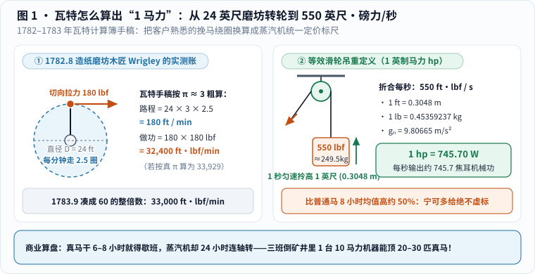
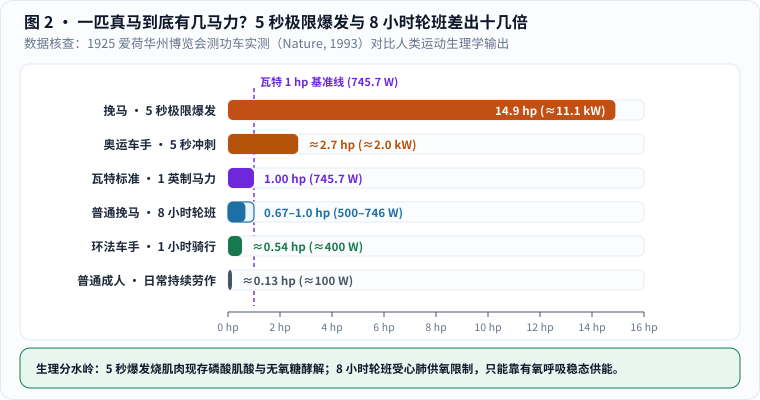
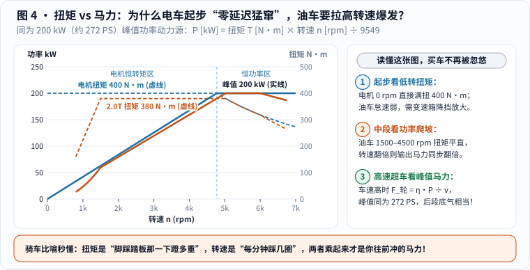
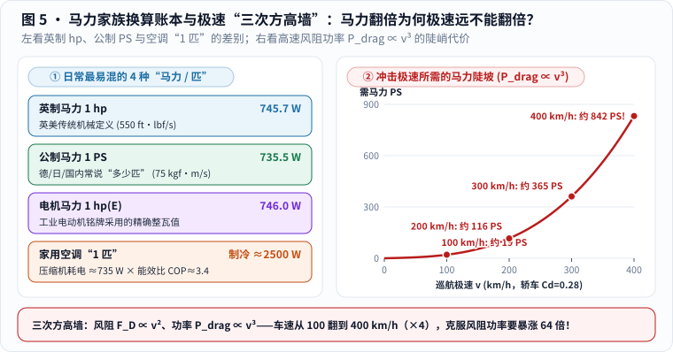

路过商场一楼的汽车展厅，销售顾问拍着引擎盖介绍：“咱们这台车足足有 **300 匹马力**，一脚油门下去推背感拉满！”

很多孩子——甚至不少开了十年车的大人——心里都会冒出一个特别朴素的画面：

> **1 马力，是不是就等于 1 匹真马使出来的力气？300 马力的汽车，难道相当于在车头前面拴上 300 匹骏马一块儿往前拽？**

如果你真找来一匹健硕的挽马跟一台“1 马力”的小机器拔河，结果一定会让你大跌眼镜：**在短短几秒钟的全力猛拽里，这一匹真马爆发出的本事不是 1 马力，而是接近 15 马力！** 可要是让它跟这台小机器比拼连轴转干满一整天，真马累得口吐白沫也只能维持 **0.7 马力左右**，反倒败下阵来。

更让人容易绕晕的是：**“马力”虽然名字里带个“力”字，但在物理学里它压根不是“力气”的单位！**

为什么当年詹姆斯·瓦特（James Watt）非要拿马当尺子？为什么他算出来的“1 马力”比普通马干一整天的均值还要高出一截？买车时参数表上的“扭矩（$$\mathrm{N\cdot m}$$）”和“马力（$$\mathrm{hp}$$ / $$\mathrm{PS}$$）”到底谁管起步、谁管极速？家里墙上挂的“1.5 匹空调”怎么又跟马扯上了关系？今天我们就把这笔跨越两百四十多年的物理账与商业账一页页翻开算清。

---

## 一、瓦特卖蒸汽机的难题：怎样向磨坊老板推销一台“看不懂的铁疙瘩”？

### 1. 1782 年的商业痛点：客户根本不关心气缸压强，只关心“能替掉几匹马”

把时钟拨回 18 世纪下半叶的英国。在瓦特之前，纽科门（Thomas Newcomen）式的早期蒸汽机只会傻傻地上下往复抽动拉杆，几乎全用在煤矿里抽地下水。那时候评价一台抽水蒸汽机好不好，行话叫看“职责值（Duty）”——也就是烧掉一蒲式耳（约 84 到 120 磅）煤炭，能把多少百万磅的水往上提 1 英尺。

到了 1781 至 1782 年，瓦特与合伙人马修·博尔顿（Matthew Boulton）完成了一项改变工业革命走向的升级：**用行星齿轮等机构把活塞的往复运动变成了连续旋转的转轴输出**。这意味着蒸汽机终于能走出矿井，去驱动造纸厂、面粉磨坊、纺织厂和伦敦各大啤酒厂的磨轮了。

可新的销售难题紧跟着来了。当时的磨坊主和酿酒厂老板根本听不懂什么“蒸汽绝对压强”“每分钟焦耳数”，他们院子里原本就拴着十几匹绕圈拉磨的重型挽马（mill-horse）。老板们只会问瓦特一句话：

> **“我这间厂子现在靠 12 匹马轮流拉磨，买你这一台铁机器，到底能替掉我几匹马？”**

想要把蒸汽机卖出去，瓦特就必须把冰冷的活塞尺寸与蒸汽压力，翻译成老板们闭着眼都能算明白的“马匹数量”。

### 2. 翻开 1782–1783 年手稿：从 24 英尺转轮到 33,000 英尺·磅力/分钟

民间故事常说瓦特牵了一匹马去矿井边现场做实验；但工业史学者迪金森与詹金斯（H. W. Dickinson & Rhys Jenkins）在 1927 年出版的权威史料《詹姆斯·瓦特与蒸汽机》（*James Watt and the Steam Engine*）中，核查了现存于伯明翰档案馆的瓦特亲笔《吸墨与计算簿（1782 & 1783）》（*Blotting and Calculation Book 1782 & 1783*），还原了更真实的工程现场。

1782 年 8 月，瓦特在给一家原本用 12 匹马驱动的造纸磨坊核算蒸汽机尺寸时，在笔记本里记下了磨坊木匠里格利先生（Mr. Wrigley——专门负责设计畜力传动机构的资深工匠）提供的日常经验数据：

1. **绕圈直径**：一匹磨坊挽马围着直径 $$D = 24\ \mathrm{ft}$$（半径 $$12\ \mathrm{ft}$$，约 $$3.66\ \mathrm{m}$$）的圆形轨道拉动横杆；
2. **行走圈速**：挽马每分钟能走 $$n = 2.5$$ 圈（即每小时 $$150$$ 圈左右）；
3. **套索拉力**：马肩持续顶住挽具的切向拉力约为 $$F = 180\ \mathrm{lbf}$$（磅力，约合 $$800.7\ \mathrm{N}$$）。

在车间草算时，瓦特顺手把圆周率 $$\pi$$ 粗略取成了整数 $$3$$，列出了下面这串乘法：

$$
\text{每分钟路程} \approx 24\ \mathrm{ft} \times 3 \times 2.5\ \mathrm{min^{-1}} = 180\ \mathrm{ft/min}
$$

$$
\text{每分钟做功} = 180\ \mathrm{ft/min} \times 180\ \mathrm{lbf} = 32{,}400\ \mathrm{ft\cdot lbf/min}
$$

（顺便一提：如果把 $$\pi \approx 3.1416$$ 代进去精确重算，结果其实是 $$33{,}929\ \mathrm{ft\cdot lbf/min}$$！）到了 **1783 年 9 月**，为了方便按“每秒钟（$$1\ \mathrm{min} = 60\ \mathrm{s}$$）”整除换算，瓦特在计算簿里正式把这个定额规整成了 $$60$$ 的漂亮整倍数——**每分钟 $$33{,}000$$ 英尺·磅力**，也就是**每秒钟 $$550$$ 英尺·磅力**。

晚年的瓦特在 1814 年为罗比森《机械哲学体系》（*System of Mechanical Philosophy*）撰写的注文里还补充过另一段印证：他们曾参考伦敦巴克莱与帕金斯（Barclay & Perkins）大型啤酒厂强壮挽马用滑轮从深井提水的数据——马以每小时 $$2.5$$ 英里（即 $$220\ \mathrm{ft/min}$$）的步速拉起 $$150\ \mathrm{lb}$$ 重物，乘起来同样恰好是 $$220 \times 150 = 33{,}000\ \mathrm{ft\cdot lbf/min}$$。

_图 1：先看左栏俯视图——挽马沿直径 24 英尺圆周每分钟走 2.5 圈、切向拉力 180 磅力，瓦特在 1782 年草算得 32,400 并在次年规整为 33,000 英尺·磅力/分钟；再看右栏等效定滑轮——相当于 1 秒内把 550 磅（约 249.5 千克）重物匀速拎高 1 英尺（0.3048 米），按国际计量标准精确折合 745.70 瓦特。_

### 3. 精明的“多给五成”与三班倒账本：为什么客户买了都说赚翻了？

按照美国国家标准与技术研究院（[NIST Special Publication 811](https://www.nist.gov/pml/special-publication-811/nist-guide-si-appendix-b-conversion-factors/nist-guide-si-appendix-b9)）给出的精确国际单位定义——$$1\ \mathrm{ft} = 0.3048\ \mathrm{m}$$，$$1\ \mathrm{lb} = 0.45359237\ \mathrm{kg}$$，标准重力加速度 $$g_n = 9.80665\ \mathrm{m/s^2}$$——我们可以把瓦特定义的 **1 英制机械马力（$$\mathrm{hp}$$）** 算到小数点后两位：

$$
1\ \mathrm{hp} = 550 \times 0.3048\ \mathrm{m} \times 0.45359237\ \mathrm{kg} \times 9.80665\ \mathrm{m/s^2} \div 1\ \mathrm{s} \approx 745.70\ \mathrm{W}
$$

为了纪念瓦特对人类动力革命的贡献，1882 年英国科学促进会采纳威廉·西门子（C. William Siemens）的提议，把“每秒做功 1 焦耳（$$1\ \mathrm{J/s}$$）”的功率单位命名为 **瓦特（$$\mathrm{W}$$）**，并在 1960 年第 11 届国际计量大会上正式确立为国际单位制（SI）导出单位。于是今天就有了这句饶舌却好记的换算：**瓦特发明了“马力”，而科学界用“瓦特”来丈量马力——$$1$$ 英制马力约等于 $$745.7$$ 瓦特。**

有趣的是，瓦特心里门儿清：普通矿山马连续干满 8 小时，平均做功速率其实只有大约 $$22{,}000\ \mathrm{ft\cdot lbf/min}$$（约 $$0.67\ \mathrm{hp}$$）。他故意把“1 马力”的门槛定得比普通马全天均值**高出约 $$50\%$$**，藏着两重极高明的工程与商业智慧：

- **第一重是“宁可多给、绝不扯皮”**：新生的蒸汽机面对的是满腹狐疑的保守买主。只要瓦特卖出一台标称“10 马力”的蒸汽机，它在任何时刻干的活都稳稳压过客户院子里最壮的 10 匹大挽马，挑剔的老板绝对抓不到“动力缩水”的把柄。
- **第二重是“24 小时连轴转降维打击”**：血肉之躯的真马每天拉磨 6 到 8 小时就必须卸套歇班、吃草饮水；要想让矿井水泵昼夜不停，老板得养 **24 到 30 匹真马** 分三班轮换。而一台“10 马力”蒸汽机只要添煤加水就能 24 小时不眠不休，一算草料费和马厩账，工厂主自然排着队签订单。

---

## 二、真马到底有几马力？短时爆发 14.9 马力与全天耐力的鸿沟

### 1. 1925 年爱荷华州博览会实测：一匹重型挽马瞬间能飙出 14.9 马力！

既然瓦特把标准定得比普通马全天均值还高，为什么网上又流传着“一匹马其实有 15 马力”的说法？这两句话非但不矛盾，反而恰好戳中了生物肌肉与钢铁机器最大的本质差别——**爆发功率（Peak Power）与持续功率（Sustained Power）天差地别**。

1993 年 7 月，生物力学学者史蒂文森与瓦瑟苏格（R. D. Stevenson & R. J. Wassersug）在《自然》（*Nature*，第 364 卷第 195 页）发表了一篇专门回答这个问题的短文 *Horsepower from a horse*。他们调阅了美国爱荷华州立农学院工程师柯林斯与凯恩（E. V. Collins & A. B. Caine，1926 年第 240 号实验公报 *Testing Draft Horses*）在 1925 年爱荷华州博览会“挽马极限拉重赛”上用液压测功车记录的硬核数据：

在标准 $$27.5\ \mathrm{ft}$$（约 $$8.38\ \mathrm{m}$$）的短程冲刺拉拽中，一对并排挽马在短短四五秒内全力蹬地，测功车实测双马合计输出功率高达 **$$29.76\ \mathrm{hp}$$**——平均分摊到**每一匹真马身上，短时极限爆发功率高达约 $$14.9\ \mathrm{hp}$$（约合 $$11.1\ \mathrm{kW}$$）**！

_图 2：先找到紫色虚线标出的“瓦特 1 hp 基准线（745.7 W）”；再对比第 1 行与第 4 行——同一类挽马，5 秒极限爆发可冲上 14.9 马力（11.1 千瓦），但拉长到 8 小时轮班就回落到 0.67–1.0 马力；人类同样如此，奥运车手 5 秒冲刺可达约 2.7 马力，而普通人日常持续劳作仅约 0.13 马力（100 瓦）。_

### 2. 为什么血肉之躯撑不住高马力？两套供能账本的切换

顺着图 2 把马和人放在同一把尺子上比一比，你会发现人类自己就是最好的参照物（[OpenStax *University Physics Vol. 1*, Section 7.4](https://openstax.org/books/university-physics-volume-1/pages/7-4-power)）：

- **几秒钟的极限冲刺**：奥运场地自行车手全力猛踩踏板或举重运动员挺举的瞬间，双腿在几秒内能爆发出 **$$1{,}500\text{–}2{,}000\ \mathrm{W}$$（约 $$2.0\text{–}2.7\ \mathrm{hp}$$）** 的峰值功率——那一刻，一个顶尖运动员就是“两匹半马力”！
- **一小时的耐力极限**：即便是心肺天赋顶级的环法自行车赛职业车手，连续骑行 1 小时所能维持的功率也立刻掉到 **约 $$400\ \mathrm{W}$$（约 $$0.54\ \mathrm{hp}$$）**。
- **一整天的日常搬砖**：普通成年人匀速爬楼梯、骑通勤车或做体力活，能连续坚持几小时不垮掉的稳定输出只有 **$$75\text{–}100\ \mathrm{W}$$（约 $$0.10\text{–}0.13\ \mathrm{hp}$$）**，差不多刚够点亮一盏老式百瓦白炽灯。

为什么无论是马还是人，5 秒爆发和 8 小时耐力都会差出十几倍？根源就在我们在[《可视化理解呼吸作用》]()里拆解过的**细胞双轨供能机制**：

1. **头 5 到 10 秒烧“现货库存”**：肌肉细胞里原本就攒着少量现成的 **ATP 与磷酸肌酸（PCr）**，紧接着还能启动不需要氧气参与的**无氧糖酵解**，几秒钟就能倾泻出巨量化学能，所以真马能飙出 $$14.9\ \mathrm{hp}$$；但库存转瞬即空，代谢副产物和散热压力会立刻逼停肌肉。
2. **连续干 8 小时靠“现挣现花”**：长时间拉磨或耕地时，肌肉消耗 ATP 的速度绝对不能超过鼻孔吸氧、心脏泵血、线粒体慢条斯理进行**有氧呼吸**的补给速度，同时还得把七成以上变成废热的能量靠流汗散发出去。

柯林斯与凯恩在长达三年的田间实测中证实：让挽马每天稳稳走完 20 英里（约 32 公里）且第二天不掉膘、不过劳，最佳牵引力只能控制在马自身体重的 $$\frac{1}{10}$$ 到 $$\frac{1}{8}$$，全天平均功率正好落在 **$$0.67\text{–}1.42\ \mathrm{hp}$$** 之间（普通马约 $$0.7\ \mathrm{hp}$$，超重型良种挽马约 $$1\ \mathrm{hp}$$ 出头）。可见瓦特当年定下的 $$1\ \mathrm{hp}$$，还真是一把极其老辣的“重型好马持续干活标尺”。

---

## 三、最关键的物理纠偏：马力不是“力气有多大”，而是“干活有多快”

### 1. 力（$$F$$）、功（$$W$$）与功率（$$P$$）：同吊 75 千克重物的三通道竞速

搞清了历史和真马，我们再来拆解日常语言里最大的坑——很多人一听“300 马力”，就以为是“拉扯物体的力气大”。

在物理学里，**力（Force，单位：牛顿 $$\mathrm{N}$$）**、**功（Work，单位：焦耳 $$\mathrm{J}$$）** 和 **功率（Power，单位：瓦特 $$\mathrm{W}$$ 或马力）** 是三个截然不同的角色：

- **力 $$F$$** 只管“推或拉那一下使了多大劲”。哪怕你用千斤顶顶住一吨重的石头纹丝不动，石头受的支持力很大，但只要没有移动距离，物理上做的机械功就是 **零**。
- **功 $$W = F \cdot \Delta h$$** 管的是“总共搬运了多少能量账单”。把同一箱 $$75\ \mathrm{kg}$$ 的重物匀速拎上 $$4\ \mathrm{m}$$ 高的二楼，无论你是花 1 秒钟拽上去，还是慢吞吞摇半小时绞盘摇上去，克服重力做的总功一分钱不少，统统是：

$$
W = m g_n \Delta h = 75\ \mathrm{kg} \times 9.80665\ \mathrm{m/s^2} \times 4.0\ \mathrm{m} \approx 2{,}942\ \mathrm{J}
$$

- **功率 $$P = \dfrac{W}{t} = F \cdot v$$** 管的才是 **“做功的快慢”**——也就是**马力**！

请直接看图 3 的三通道匀速吊装竞速（动画把真实时间统一按 4 倍速等比例压缩播放一次，最终停在终点；你也可以）：

_图 3：先看右侧账本核对——A、B、C 三根钢索匀速吊起同为 75 千克的重物时，绳子上的拉力分毫不差全是 735.5 牛顿，升到 4.0 米高处完成的总功也全是 2,942 焦耳；差别全在速度 $$v$$ 与耗时 $$t$$——1 公制马力（1 PS = 735.5 W）恰好每秒升 1 米、4 秒到顶，3 匹卷扬机 1.33 秒就到顶，而 0.25 匹人力手摇绞盘要摇足足 16 秒。_

看懂了图 3，你就彻底免疫了一个常见忽悠：**“力气小”的电机能不能拉动千斤重物？完全能！** 只要给一台只有 $$0.25$$ 马力的小马达配上一套大减速比的齿轮箱或滑轮组，它照样能拉起 $$735.5\ \mathrm{N}$$ 甚至几吨重的货物；它真正做不到的，是**既拉得重、又拉得飞快**——因为齿轮箱只能把“力 $$F$$ 放大 $$k$$ 倍、同时把速度 $$v$$ 缩小为 $$1/k$$”，两者相乘的**功率 $$P = F \cdot v$$ 守恒不增**！

### 2. 买车必懂的“扭矩 vs 马力”：为什么电车起步猛如虎，油车要靠拉高转速？

放到汽车发动机和电机上，直线运动里的 $$P = F \cdot v$$ 就变成了旋转运动里最核心的黄金公式（[OpenStax *University Physics Vol. 1*, Section 10.8](https://openstax.org/books/university-physics-volume-1/pages/10-8-work-and-power-for-rotational-motion)）：

$$
P = \tau \cdot \omega
$$

这里的 $$\tau$$（工程上常记作 $$T$$）是曲轴或电机转子输出的**扭矩**（单位：牛·米 $$\mathrm{N\cdot m}$$），代表转轴“拧那一下有多大劲”；$$\omega$$ 是旋转角速度（单位：弧度/秒 $$\mathrm{rad/s}$$）。平时仪表盘看的是“每分钟转多少圈”即转速 $$n$$（$$\mathrm{rpm}$$），因为转一圈是 $$2\pi$$ 弧度、一分钟有 $$60$$ 秒，代入 $$\omega = \dfrac{2\pi n}{60}$$ 并除以 $$1{,}000$$ 换算成千瓦（$$\mathrm{kW}$$），就得到了每一位汽车工程师倒背如流的常数 **$$9549$$**：

$$
P\ [\mathrm{kW}] = \frac{T\ [\mathrm{N\cdot m}] \times n\ [\mathrm{rpm}]}{9549}
$$

如果你觉得公式抽象，想想自己骑变速自行车上坡就一秒通透了：

- **扭矩 $$T$$** 就像你**每一脚踩在踏板上往下蹬的力量**；
- **转速 $$n$$** 就像你双腿**每分钟倒腾多少圈（踏频）**；
- **功率（马力）$$P$$** 则是**蹬踏力度 × 踏频**。哪怕你腿劲儿不算顶级（扭矩中等），只要双腿倒腾得飞快（转速极高），照样能输出惊人的马力！例如一级方程式（F1）赛车引擎排量只有 $$1.6\ \mathrm{L}$$，扭矩不过几百牛·米，但转速能拉到 $$12{,}000\text{–}15{,}000\ \mathrm{rpm}$$，轻松爆发出近千匹马力；反过来，重型半挂卡车的柴油机扭矩高达 $$2{,}500\ \mathrm{N\cdot m}$$，但红线转速只有 $$1{,}900\ \mathrm{rpm}$$，算出来的最大马力大约是 $$500\ \mathrm{PS}$$。

_图 4：先看横轴最左侧 0–1500 rpm 起步区——蓝色虚线（永磁电机扭矩）在 0 转通电瞬间直接端出 400 N·m 满扭矩，而橙色虚线（2.0T 燃油机）低转还没建起涡轮增压，必须靠多挡变速箱降挡放大扭矩；再看右侧 5000 rpm 以上——两台动力源峰值功率同为 200 kW（272 PS），高速超车底气趋于一致。_

这也顺手解开了当下最火的一个买车疑问：**同样标称 272 匹马力（$$200\ \mathrm{kW}$$）的家用电动车和 2.0T 燃油车，为什么红绿灯起步时电车感觉猛得多，可上了高速 $$110\ \mathrm{km/h}$$ 再超车时差距就没那么夸张了？**

跟着图 4 看两条曲线就全明白了：

1. **红绿灯刚起步（$$0\text{–}50\ \mathrm{km/h}$$）**：燃油机怠速只有 $$800\ \mathrm{rpm}$$，涡轮还没起压，必须等变速箱结合、转速拉高才能发力；而永磁同步电机靠洛伦兹力驱动转子，**$$0\ \mathrm{rpm}$$ 通电几毫秒内直接拉满 $$400\ \mathrm{N\cdot m}$$ 峰值扭矩**，一脚电门毫无延迟地把你按在椅背上。
2. **中高速再加速（$$100\ \mathrm{km/h}$$ 以上）**：当电机跨过约 $$4{,}775\ \mathrm{rpm}$$ 基速进入**恒功率区**后，受逆电动势和逆变器电压限制，扭矩会按 $$T = 9549 P_{\max} / n$$ 自然回落；而此时燃油车只要连降两挡把转速拉进 $$5{,}000\text{–}6{,}000\ \mathrm{rpm}$$ 甜点区，同样能把 $$200\ \mathrm{kW}$$ 满功率送到车轮上。在任意车速 $$v$$ 下，刨去传动效率 $$\eta$$，车轮能拿到的最大推进力上限都由功率决定：

$$
F_{\text{车轮最大推力}} = \frac{\eta P_{\max}}{v}
$$

所以行家买车从来不单看一个数字：**日常市区轻快感看低转扭矩响应，满载爬长坡与高速超车底气看峰值功率（马力）！**

---

## 四、一词多义与极速高墙：从“英制 hp、公制 PS、空调 1 匹”到 400 km/h 的残酷账单

### 1. 同叫“300 马力”差出 4 匹？顺手算清家里“1 匹空调”是怎么来的

既然国际单位制早在 1960 年就统一用千瓦（$$\mathrm{kW}$$，我国汽车行驶证和工信部铭牌上法定必填的也是 $$\mathrm{kW}$$），为什么全世界车迷还是偏爱聊“多少匹马力”？道理很人性化：“220 千瓦”听着像一台大型电热水器，“300 匹马力”却自带奔腾的画面感。

不过看海外评测与国内配置表时要注意，“马力”在历史上分出了好几个近亲（[NIST SP 811 Appendix B.9](https://www.nist.gov/pml/special-publication-811/nist-guide-si-appendix-b-conversion-factors/nist-guide-si-appendix-b9)）：

- **英制机械马力（$$\mathrm{hp}$$）**：英美车企常用，定义即瓦特的 $$550\ \mathrm{ft\cdot lbf/s}$$，折合 **$$745.70\ \mathrm{W}$$**。
- **公制马力（$$\mathrm{PS}$$ / $$\mathrm{CV}$$，国内俗称“匹”）**：19 世纪欧洲大陆推行公制时，德国（*Pferdestärke*，标准 DIN 66036）与法国（*cheval-vapeur*）用十进制整数重新做了一个极其接近的定义——**在 1 秒内把 $$75\ \mathrm{kg}$$ 重物在标准重力下匀速提升 $$1\ \mathrm{m}$$**：

$$
1\ \mathrm{PS} = 75\ \mathrm{kg} \times 9.80665\ \mathrm{m/s^2} \times 1\ \mathrm{m/s} = 735.49875\ \mathrm{W} \approx 735.5\ \mathrm{W}
$$

两者相差约 **$$1.39\%$$**（$$1\ \mathrm{hp} \approx 1.0139\ \mathrm{PS}$$）。因此一台美规标称 **$$300\ \mathrm{hp}$$**（$$223.7\ \mathrm{kW}$$）的发动机，换算成中规/欧规的公制马力其实是 **$$304.2\ \mathrm{PS}$$**；反过来，标称 **$$300\ \mathrm{PS}$$**（$$220.6\ \mathrm{kW}$$）的车型折合成英制只有 **$$295.9\ \mathrm{hp}$$**。

- **电机马力（$$\mathrm{hp(E)}$$）**：北美工业电动机铭牌直接取精确整瓦值 **$$746\ \mathrm{W}$$**。
- **彩蛋——家用空调的“1 匹”怎么变成了 2500 瓦？** 很多朋友买家电时一头雾水：既然 1 匹马力是 $$735.5\ \mathrm{W}$$，为什么“1 匹空调（如型号 KFR-25GW）”参数表上写着 **制冷量 $$2{,}500\ \mathrm{W}$$**？其实这正是历史沿用下来的行业黑话：早年日本空调工程师按压缩机电机的输入功率约为 **1 公制马力（$$\approx 735\ \mathrm{W}$$）** 来划分档位；而我们在[《彻底读懂空调工作原理》]()里讲过，空调不是电热丝，而是热力学“搬热工”，能效比 $$\mathrm{COP}$$ 通常在 $$3.0\text{–}3.6$$ 左右——花掉约 $$735\ \mathrm{W}$$ 的电功率，正好能从卧室往室外搬走约 **$$2{,}200\text{–}2{,}500\ \mathrm{W}$$** 的热量！后来压缩机越来越省电（如今新一级能效 1 匹空调满载耗电往往不到 $$650\ \mathrm{W}$$），行业干脆把 **“制冷量 $$2{,}500\ \mathrm{W}$$ 左右叫 1 匹、$$3{,}500\ \mathrm{W}$$ 左右叫 1.5 匹”** 固定成了选购俗称。

### 2. 马力翻倍，极速就能翻倍吗？撞上空气阻力的“三次方高墙”

最后，我们来回答展厅里最容易让人产生错觉的问题：**一辆 150 马力的家用轿车极速能跑 $$200\ \mathrm{km/h}$$，那把发动机升级到 300 马力（翻 2 倍），极速能不能跑到 $$400\ \mathrm{km/h}$$？**

答案是：**门儿都没有——300 马力连 $$260\ \mathrm{km/h}$$ 都很勉强！**

为什么高速往上每多推 $$10\ \mathrm{km/h}$$ 都像撞墙一样费劲？我们在流体力学里算过（[OpenStax *University Physics Vol. 1*, Section 6.4](https://openstax.org/books/university-physics-volume-1/pages/6-4-drag-force-and-terminal-speed)），当汽车在高速上飞驰时，车头每秒钟不仅要撞开更多的空气分子（质量流量 $$\propto v$$），还要把这些空气分子加速推开到更高的速度（动量变化 $$\propto v$$），因此**空气阻力 $$F_{\text{D}}$$ 与车速的平方成正比**：

$$
F_{\text{D}} = \frac{1}{2} \rho C_{\text{D}} A v^2
$$

其中 $$\rho \approx 1.225\ \mathrm{kg/m^3}$$ 是空气密度，$$C_{\text{D}}$$ 是风阻系数（流线型轿车约 $$0.28$$），$$A$$ 是迎风面积（约 $$2.2\ \mathrm{m^2}$$）。别忘了，发动机维持匀速极速所需的功率等于**阻力再乘上车速 $$v$$**！这么一乘，真正的“马力吞金兽”露出了獠牙——**克服风阻所需的功率与车速的三次方（$$v^3$$）成正比**：

$$
P_{\text{风阻}} = F_{\text{D}} \cdot v = \frac{1}{2} \rho C_{\text{D}} A v^3 \propto v^3
$$

_图 5：先看左栏四种“马力/匹”的精确底账，区分汽车的 hp/PS 与空调按搬热制冷量算的“匹”；再看右栏红色陡坡——同一台风阻系数 0.28 的轿车（计入轮胎滚阻与 88% 传动效率），以 100 km/h 巡航仅需约 19 PS，可一旦想把极速推上 400 km/h，所需马力会沿着三次方曲线狂飙到 842 PS 以上！_

把数字代进图 5 右栏的真实轿车账本（车重 $$1{,}600\ \mathrm{kg}$$，滚阻系数 $$0.012$$，传动总效率 $$88\%$$），你会真切感受到 $$v^3$$ 铁律有多残酷：

- **时速 $$100\ \mathrm{km/h}$$ 巡航**：车轮克服风阻只需 $$8.1\ \mathrm{kW}$$，加上轮胎滚阻，发动机总共只需掏出约 **$$19\ \mathrm{PS}$$**——所以哪怕是百匹出头的买菜车，跑法定高速也气定神闲。
- **时速 $$200\ \mathrm{km/h}$$（车速 $$\times 2$$）**：风阻功率瞬间放大 $$2^3 = 8$$ 倍（$$64.7\ \mathrm{kW}$$），算上滚阻与传动损耗共需约 **$$116\ \mathrm{PS}$$**。
- **时速 $$300\ \mathrm{km/h}$$（车速 $$\times 3$$）**：风阻功率放大 $$3^3 = 27$$ 倍，共需约 **$$365\ \mathrm{PS}$$**。
- **时速 $$400\ \mathrm{km/h}$$（车速 $$\times 4$$）**：风阻功率暴涨 **$$4^3 = 64$$ 倍**（光推开狂风就要烧掉 $$518\ \mathrm{kW}$$！），哪怕保持 $$0.28$$ 的低风阻，发动机也得拿出 **$$842\ \mathrm{PS}$$**；考虑到超跑为了不在 $$400\ \mathrm{km/h}$$ 起飞还必须加装尾翼产生下压力（风阻系数往往升至 $$0.35$$ 左右），实际门槛直奔 **$$1{,}000\ \mathrm{PS}$$** 而去——这就是当年布加迪威龙（Bugatti Veyron）为了把量产车极速推过 $$407\ \mathrm{km/h}$$，不得不塞进一台 $$8.0\ \mathrm{L}$$ 四涡轮 W16、足足 **$$1{,}001\ \mathrm{PS}$$** 怪兽引擎的根本原因！

至于日常最在乎的“零百加速（$$0\text{–}100\ \mathrm{km/h}$$ 快不快）”，除了马力之外，还要看**推重比（马力 ÷ 车重 $$m$$）**、轮胎抓地力极限和变速箱换挡损耗。一台 $$200$$ 马力但只有 $$900\ \mathrm{kg}$$ 重的轻量化小跑车，加速起来往往能轻松甩开一台 $$300$$ 马力却重达 $$2.6$$ 吨的大型豪华 SUV。

---

## 五、动手试一试：在浏览器里亲手验证能量转化与做功功率

想带孩子亲眼看看“能量是怎样一焦耳一焦耳从肌肉、蒸汽、水流变成机械功与热能”的，可以直接打开科罗拉多大学博尔德分校（UC Boulder）开发的免费中文物理互动实验 **PhET《能量形式与转化》（Energy Forms and Changes）**（需联网并在支持 HTML5 / JavaScript 的现代浏览器中运行；即便不打开网页，本文图 1–图 5 也已完整包含全部定量结论）：

- **官方互动实验直达**：[PhET — 能量形式与转化（Energy Forms and Changes）](https://phet.colorado.edu/zh_CN/simulations/energy-forms-and-changes)（切换到“系统 Systems”标签页）

推荐试两个 2 分钟小实验：

1. **体验“生物肌肉为什么会累”**：在左下角选“骑自行车的人”，勾选右上角“能量符号”。先把踩踏滑块拉到最大，观察机械能怎样驱动发电机烧水或点亮灯泡，同时留意骑车人身上不断飘出的红色“热能”方块，直到提示“需要喂食补充能量！”——这就是图 2 里生物有氧供能与散热极限的缩小版。
2. **复刻瓦特的蒸汽机闭环**：把动力源切成“水壶蒸汽”，把炉火拉高推动叶轮旋转。试着比较小火慢烧与大火猛烧时，单位时间内飞向右侧用电器或提水装置的能量块数量——“每秒流过去的能量块个数”，就是今天我们聊透的**功率（瓦特 / 马力）**。

---

## 奶爸说

每次跟孩子聊起“马力”这个词，我都觉得它像一枚活化石——哪怕人类早就造出了上千马力的航空涡扇发动机、几十万千瓦的核电站汽轮机，甚至飞向火星的液氧甲烷火箭，我们嘴里念叨的依然是两百四十多年前英国磨坊里那匹低头绕圈拉磨的老挽马。

这背后其实藏着科学与工程最温柔的一面：**任何伟大的新技术想要走进千家万户，第一步都不是甩出一堆高高在上的新术语，而是蹲下来，用人们最熟悉的老尺子把账算清楚。** 瓦特当年在笔记本上写下 $$33{,}000$$ 这个数字时，既用了木匠丈量转轮的朴素算术，又留足了不让客户吃亏的厚道余量；而两百年后的今天，当我们分清了“力气大小（力与扭矩）”和“干活快慢（功率与马力）”，再看汽车配置表、空调铭牌甚至自己跑步骑车的运动手表时，眼前的数字就不再是商家的宣传口号，而是一幅清清楚楚的能量流动图景。

下次在路上看到标着“300 匹”的车标，不妨考考身边的孩子：“如果真拉来一匹壮马拔河 5 秒钟，它一个人能顶几马力？”看着他一脸惊讶地听完 $$14.9$$ 马力的故事，物理课最迷人的种子就已经种下了。

---

## 参考资料与核查来源

本文问题意识受科普中国（力学科普）文章《1 马力=1 匹马的力气吗？》启发，文中全部史实年份、计量换算系数、生物力学实测数据、动力曲线与高速风阻账本均已独立回溯一手档案与权威文献重新核算并原创绘图：

1. **国际单位制与各类马力精确换算系数**：National Institute of Standards and Technology (NIST), [*NIST Guide to the SI (Special Publication 811), Appendix B.9: Factors for units listed by kind of quantity or field of science — Power*](https://www.nist.gov/pml/special-publication-811/nist-guide-si-appendix-b-conversion-factors/nist-guide-si-appendix-b9)——核查英制机械马力（$$550\ \mathrm{ft\cdot lbf/s} \approx 745.6999\ \mathrm{W}$$）、公制马力（$$735.4988\ \mathrm{W}$$）、电机马力（精确 $$746\ \mathrm{W}$$）及英尺、常衡磅与标准重力加速度精确定义。
2. **瓦特 1782–1783 年计算簿档案记录**：Library of Birmingham Archives, [*Boulton and Watt Collection, MS 3147/4/1: Calculation Blotter & Blotting and Calculation Book (1782–1783)*](https://discovery.nationalarchives.gov.uk/details/r/0277718d-24b6-4461-89a1-1c66f9f75de0)；引文与考证见 H. W. Dickinson & Rhys Jenkins, *James Watt and the Steam Engine* (Oxford University Press, 1927) 及 John Robison (ed. David Brewster, notes by James Watt), [*A System of Mechanical Philosophy*, Vol. 2 (1822)](https://archive.org/details/asystemmechanic03wattgoog)——核查 1782 年 8 月磨坊木匠 Wrigley 提供的 $$24\ \mathrm{ft}$$ 转轮参数、$$32{,}400$$ 至 $$33{,}000\ \mathrm{ft\cdot lbf/min}$$ 规整过程及伦敦啤酒厂挽马提水记载。
3. **真马短时爆发 14.9 马力与全天耐力实测**：R. D. Stevenson & R. J. Wassersug, [*"Horsepower from a horse"*, *Nature* **364**, 195 (1993), doi:10.1038/364195a0](https://www.nature.com/articles/364195a0)；原始测功车实验数据出自 E. V. Collins & A. B. Caine, [*Testing Draft Horses*, Iowa Agricultural Experiment Station Bulletin No. 240, 193–223 (1926)](https://catalog.hathitrust.org/Record/011457662)——核查 1925 年爱荷华州博览会双马极限拉重峰值（折合单马约 $$14.9\ \mathrm{hp}$$）以及每日 20 英里持续劳作（$$0.67\text{–}1.42\ \mathrm{hp}$$）实测区间。
4. **机械功、瞬时功率与人体运动功率算例**：OpenStax, [*University Physics Volume 1*, Section 7.4 "Power"](https://openstax.org/books/university-physics-volume-1/pages/7-4-power)——核查 $$P = \mathrm{d}W/\mathrm{d}t = \vec{F}\cdot\vec{v}$$、瓦特单位定义及人体运动与汽车爬坡功率计算模型。
5. **旋转运动做功与扭矩—转速功率方程**：OpenStax, [*University Physics Volume 1*, Section 10.8 "Work and Power for Rotational Motion"](https://openstax.org/books/university-physics-volume-1/pages/10-8-work-and-power-for-rotational-motion)——核查旋转刚体功率关系 $$P = \tau \omega$$ 及其工程转速换算系数 $$9549$$。
6. **高速空气阻力与三次方功率定律**：OpenStax, [*University Physics Volume 1*, Section 6.4 "Drag Force and Terminal Speed"](https://openstax.org/books/university-physics-volume-1/pages/6-4-drag-force-and-terminal-speed)——核查二次方压差阻力公式 $$F_{\text{D}} = \frac{1}{2} C_{\text{D}} \rho A v^2$$、典型轿车风阻系数（如 $$C_{\text{D}} = 0.28$$）及巡航风阻功率随速度三次方增长规律。
