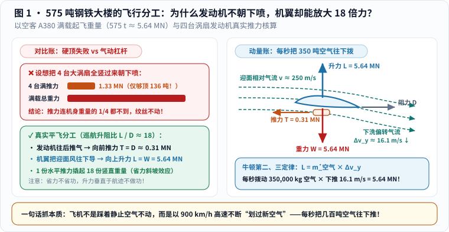
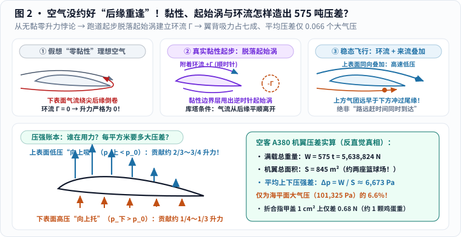
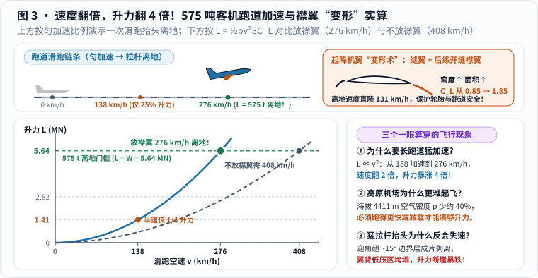
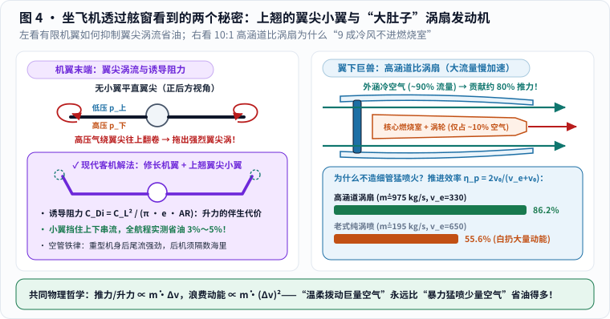

站在机场候机厅的落地玻璃窗前，带孩子看一架双层巨无霸客机滑过停机坪时，几乎每个大人心里都会冒出一丝不真实感：

拿人类造过的最大民航客机**空客 A380** 来说，它机身长约 **$$73\ \mathrm{m}$$**，翼展近 **$$79.8\ \mathrm{m}$$**，两层宽敞客舱坐满五百多名乘客、塞满几千件行李、再灌进两百多吨航空煤油后，最大起飞重量高达 **$$575\ \mathrm{t}$$（吨）**——相当于 **95 头成年非洲公象**，或者整整一栋七层居民楼的重量！

如果再往下深算一步，你会发现一件比“钢铁大楼上天”更反直觉的事：挂在 A380 机翼底下的四台劳斯莱斯 Trent 900（或 GP7000）巨型涡扇发动机，哪怕油门推到底，单台海平面最大静推力也只有约 **$$332\ \mathrm{kN}$$**，四台加起来总共 **$$1.33\ \mathrm{MN}$$（约合 $$135\ \mathrm{t}$$ 推力）**——**连飞机满载重量的四分之一（$$24\%$$）都不到！**

换句话说，就算工程师把这四台发动机全部竖过来对着地面猛喷，这架 $$575\ \mathrm{t}$$ 的大铁鸟也会死死钉在停机坪上，连一毫米都抬不起来！

在早前的[《如何能实现飞行》]()里，我们曾全景俯瞰过纸飞机、飞鸟、直升机与人造卫星的不同升空路线。今天，我们专门钻进这栋“会飞的钢铁大楼”，算清三个最容易被一笔带过、甚至在无数短视频和旧教辅里被讲错了上百年的核心问题：

1. **四两怎样拨千斤？** 推力还不到体重的四分之一，飞机靠什么分工把力放大了近 **18 倍**？
2. **升力到底从哪儿来？** 既然“上下两股空气约好同时在机翼后缘重逢”是彻头彻尾的错题，真实机翼凭什么造出托起 $$575\ \mathrm{t}$$ 的压强差？
3. **为什么要跑那么快、机翼要“裂开”、发动机要造得那么“胖”？** 读懂两个简洁公式，你下次坐飞机透过舷窗看到的每一个动作都会变得清清楚楚。

---

## 一、第一重反直觉：推力连体重四分之一都不到，凭什么托起 575 吨？

很多人第一次琢磨飞机为什么能飞，脑子里会下意识把它想成“斜着往上冲的火箭”——似乎全靠发动机玩命喷气硬扛地心引力。咱们先把空客 A380 的真实物理账摆到台面上比一比（机型数据见[空客 A380 官方技术页面](https://www.airbus.com/en/products-services/commercial-aircraft/passenger-aircraft/a380)）：

_先看左栏上方的红框“死胡同”：四台发动机总推力 $$1.33\ \mathrm{MN}$$ 远小于机身重力 $$5.64\ \mathrm{MN}$$；再看左栏下方的水平分工：发动机只管往前克服 $$0.31\ \mathrm{MN}$$ 阻力，机翼按 $$18:1$$ 升阻比换出 $$5.64\ \mathrm{MN}$$ 升力；最后看右栏的牛顿第三定律动量账。[单独打开大图](/assets/images/heavy-aircraft-flight/airliner-force-leverage.svg)。_

### 1. 要是拿客机发动机直接“往下喷”，结果有多尴尬？

把质量换算成地球往下拽它的重力（取标准重力加速度 $$g \approx 9.807\ \mathrm{m/s^2}$$）：

$$
W = m g = 575{,}000\ \mathrm{kg} \times 9.807\ \mathrm{m/s^2} \approx 5.64 \times 10^6\ \mathrm{N} = 5.64\ \mathrm{MN}
$$

而四台顶级大涵道比涡扇发动机的总静推力只有：

$$
T_{\max} \approx 4 \times 332\ \mathrm{kN} \approx 1.33\ \mathrm{MN} \approx 0.236\,W
$$

直接硬举？还差着整整 **$$4.31\ \mathrm{MN}$$（约 $$440\ \mathrm{t}$$）** 的巨大缺口！只有运载火箭、垂直起降战斗机（如 F-35B 升力风扇模式）或多旋翼无人机，才走“向下推力大于自身重力（推重比 $$>1$$）”的硬扛路线——代价是油耗惊人，烧不了几分钟油箱就见底了。

### 2. 天才的“水平分工”：用 1 份前推力，撬出 18 份向上升力

固定翼飞机的绝妙之处，是把**“往前推”**和**“往上托”**拆给了两个完全不同的器官，各司其职：

- **水平方向（推力 $$T$$ 对抗阻力 $$D$$）**：涡扇发动机根本不负责直接往上托飞机，它只负责把飞机往水平前方推，让机翼以每小时八九百千米的高速劈开迎面而来的空气；
- **竖直方向（升力 $$L$$ 对抗重力 $$W$$）**：固定在机身两侧的巨大机翼，像一把精巧的气动楔子，把高速迎面流过的空气转变成托举机身的**升力 $$L$$**。

在万米高空平稳巡航时，升力恰好抵消重力（$$L = W$$），推力恰好抵消空气阻力（$$T = D$$）。衡量一架飞机气动外形有多优秀的头号指标，叫做**升阻比（Lift-to-Drag Ratio，$$L/D$$）**。现代远程宽体客机在巡航状态下的升阻比高达 **$$17\text{–}20$$**（我们取典型值 $$L/D \approx 18$$ 核算）：

$$
T_{\text{巡航}} = D = \frac{L}{L/D} = \frac{5.64\ \mathrm{MN}}{18} \approx 0.313\ \mathrm{MN}
$$

算完这个数，你一定会对航空工程肃然起敬：在万米高空巡航时，四台发动机加起来只需要输出约 **$$313\ \mathrm{kN}$$** 的推力（平均每台不到 **$$78\ \mathrm{kN}$$**，约合 $$8\ \mathrm{t}$$ 推力），就能稳稳托住 **$$575\ \mathrm{t}$$** 的庞然大物飞越太平洋！

你可以借“缓坡推重车”来建立第一层直觉：徒手垂直抱起一辆 $$575\ \mathrm{t}$$ 的重物绝无可能，但如果沿着坡度约 $$1:18$$ 的长缓坡往上推，所需的水平推力就只剩重量的十八分之一。不过这里一定要补上一句**关键物理边界**：水泥斜坡是刚体，把车停在半坡拉手刹不耗能量；**空气却是会退让的流体**——飞机一旦停下不动（没有相对气流），脚下的“空气斜坡”瞬间消失（NASA 格伦研究中心把这条铁律浓缩成两句大白话：**No Fluid, No Lift；No Motion, No Lift**，见 [NASA Glenn: What is Lift?](https://www1.grc.nasa.gov/beginners-guide-to-aeronautics/lift-3/)）。

### 3. 牛顿第三定律的“空气欠条”：每秒把 350 吨空气往下按

那 $$575\ \mathrm{t}$$ 的重量终究没凭空蒸发，是谁替飞机扛下了这笔重力账？答案是**被机翼源源不断往下拨动的巨量空气**。

根据牛顿第二与第三定律，机翼要想获得向上的升力 $$L$$，就必须在每一秒钟里把质量流量为 $$\dot{m}_{\text{air}}$$ 的迎面空气赋予一个向下的竖直速度增量 $$\Delta v_y$$（航空上称为**下洗气流 Downwash**）：

$$
L = \dot{m}_{\text{air}} \cdot \Delta v_y
$$

在海拔约 $$10.7\ \mathrm{km}$$ 的巡航高度（空气密度 $$\rho \approx 0.38\ \mathrm{kg/m^3}$$），A380 以约 $$250\ \mathrm{m/s}$$（$$900\ \mathrm{km/h}$$）飞过天空，近 $$80\ \mathrm{m}$$ 宽的翼展每秒钟扫过并深度影响的气流柱高达**每秒约 $$350\ \mathrm{t}$$**！机翼只需要把这 $$350\ \mathrm{t/s}$$ 的空气平均往下偏转约 **$$16.1\ \mathrm{m/s}$$**（偏转角仅约 $$3.7^\circ$$），算出来的反作用力就是：

$$
L = 350{,}000\ \mathrm{kg/s} \times 16.11\ \mathrm{m/s} \approx 5.64 \times 10^6\ \mathrm{N} = 5.64\ \mathrm{MN}
$$

飞机并不是“漂浮”在空气上，而是像滑水运动员踩着水面疾驰一样——只要不停向前冲，赶在脚下这团空气下沉之前踩上下一团新空气，稀薄的空气就能托起钢铁巨兽。

---

## 二、撕掉流传百年的错题本：上下两股空气根本没约好“后缘重逢”！

既然机翼能把空气往下拨、把自己往上托，紧接着就是全网争论最激烈的问题：**流过机翼表面的空气，到底是怎样造出这股巨力的？**

翻开不少旧版科普书甚至百科词条，你十有八九读到过下面这段“标准答案”：

> “机翼上表面拱起、路程长，下表面平坦、路程短；在机翼前缘分开的上下两股空气，**为了在同一时刻到达机翼后缘汇合**，上表面的空气只好跑得更快；根据伯努利原理，流速快压强小，于是产生了升力……”

听起来顺理成章？很遗憾，[NASA 格伦研究中心在《错误升力理论》专题](https://www1.grc.nasa.gov/beginners-guide-to-aeronautics/lift-3/)与剑桥大学流体力学家霍尔格·巴宾斯基（Holger Babinsky）发表于《Physics Education》的经典风洞论文中早就明确指出：**前半句“等时间同时到达”是彻头彻尾的物理谬误！**

_先按上排 ①→②→③ 的顺序跟读：无黏流体原本会从后缘倒卷抵消升力（①），真实空气靠黏性在起步瞬间甩掉逆时针“起始涡”并建立顺时针环流 $$\Gamma$$（②），导致上表面气流远远甩开下表面提前冲过尾缘（③）；再看下排左右两栏：翼背低压“吸力”占了总升力的约七成，而 A380 平均翼面压差其实只有大气压的 $$6.6\%$$。[单独打开大图](/assets/images/heavy-aircraft-flight/kutta-circulation-pressure.svg)。_

### 1. 三句话证伪“等时间谬误”：倒飞特技机与风洞烟线不会撒谎

为什么说“上下两团空气约好在尾缘重逢”根本站不住脚？不用高深方程，三个铁证一戳就破：

1. **上下完全对称的机翼照样能飞，普通飞机还能肚皮朝天“倒飞”**：特技表演机和许多战斗机的机翼截面上下完全对称，上路程等于下路程；甚至普通拱形机翼倒过来飞（上短下长），只要机头稍微昂起一个**迎角（Angle of Attack，机翼弦线与迎面气流的夹角）**，照样稳稳产生向上升力！
2. **莱特兄弟 1903 年的机翼几乎是一张薄弯板**：上下表面紧贴同一条弧线，路径长度差还不到百分之一，按“路程差决定流速差”算出来的升力连莱特飞行者一号的零头都托不动。
3. **风洞脉冲烟雾实拍直接拍到了“超车现场”**：巴宾斯基在剑桥大学风洞里释放等间隔烟雾脉冲流过机翼——**上表面的空气团非但没有跟下表面“同时到达”，反而像开了倍速一样猛冲过去，在机翼后缘把原本同排的下方邻居远远甩在身后！**

那问题来了：既然不是因为“路程长逼着它赶时间”，上表面的空气凭什么跑得那么快？

### 2. 真正的幕后功臣：没有空气的“黏性”，飞机一克升力都造不出来！

这正是困住十八、十九世纪顶尖数学家一百多年的**达朗贝尔悖论（d'Alembert's Paradox，1752）**：如果把空气当成完全没有摩擦力的“绝对理想无黏流体”去解方程，不管机翼做成什么形状、昂起多大迎角，算出来的升力永远等于**零**！

为什么？看图 2 上排第 ① 步：在毫无黏性的理想流体里，下表面的水流流到尖锐的机翼后缘时，会以无穷大的理论速度**直接绕过尖角、倒卷到上表面去**，把上下流速差彻底抹平（环流 $$\Gamma = 0$$）。

直到二十世纪初，德国力学大师**路德维希·普朗特（Ludwig Prandtl，1904 年提出边界层理论）**与**库塔（Martin Kutta）、茹科夫斯基（Nikolai Zhukovsky）**才联手揭开了谜底——**救了飞机的，恰恰是平时让人头疼的“空气黏性”**：

- **第 ① 步（尖后缘急转弯失败）**：真实空气虽然黏性很小，但在紧贴机翼表面几毫米的**边界层（Boundary Layer）**内黏性力极其关键。当飞机在跑道上刚起步加速时，下表面气流试图绕过尖锐的机翼后缘急转弯，瞬间因阻力太大而撕裂分离；
- **第 ② 步（甩掉“起始涡”，建立环流 $$\Gamma$$）**：分离的气流在后缘卷成一个**逆时针旋转的“起始涡（Starting Vortex）”**脱落留在跑道空气里。根据开尔文环量守恒定理，原本不旋转的空气凭空掉出一个逆时针旋涡（$$-\Gamma$$），机翼周围就必然同时激发出一个等大反向的**顺时针束缚环流（$$+\Gamma$$）**，直到上下两股气流平顺地从尖后缘向后滑出（这就是著名的**库塔条件 Kutta Condition**）；
- **第 ③ 步（叠加产生巨大流速差）**：把这个顺时针环流叠加在迎面吹来的平直气流上——**机翼上表面“顺风叠加”流速暴涨，下表面“逆风相抵”流速减慢！**

这就是为什么机翼前缘必须做成**圆钝形**（方便气流顺畅贴附绕行），而后缘必须磨成**刀锋般的尖角**（强迫气流无法倒卷、乖乖甩出起始涡建立环流）。

### 3. 伯努利压差与牛顿偏转吵了一百年？其实是一本账的两种算法

科普评论区里经常吵成两派：一派非说升力全靠**伯努利原理（流速快压强小）**，另一派非说伯努利错了、升力全靠**牛顿第三定律（空气打在机翼底面往下弹，像水漂石片）**。

[NASA 格伦研究中心在《Bernoulli and Newton》专章](https://www1.grc.nasa.gov/beginners-guide-to-aeronautics/bernoulli-and-newton/)里给出了最权威的定论：**真正严谨的伯努利/欧拉压强积分与牛顿动量变化，在数学上完全等价，都是流体力学欧拉—纳维-斯托克斯方程的推论！**

- **贴着机翼皮肤算账（压强视角）**：空气跟固体机翼接触，除了微小的摩擦切应力，唯一能施力的方式就是表面压强 $$p$$。机翼上表面流线弯曲加速，静压大幅低于周围大气压（$$p_{\text{上}} < p_0$$）；下表面气流受阻减速，静压略高于大气压（$$p_{\text{下}} > p_0$$）。注意一个专门打脸“打水漂撞底面说”的硬数据：**在正常巡航迎角下，机翼上表面的低压“吸力”贡献了总升力的约 $$\frac{2}{3}\text{–}\frac{3}{4}$$，下表面的高压“托力”只占约 $$\frac{1}{4}\text{–}\frac{1}{3}$$！**（准确地说不是真空去“吸”，而是下方和四周更高的环境大气压借着这片低压区把机翼往上顶。）
- **退后十米围着空气算账（牛顿动量视角）**：正是机翼上表面这片强大的低压区，把原本水平飞过翼背的一大团空气硬生生“拽”得贴着拱背往下走，再加上下表面把空气往下推，汇合成强大的下洗气流——空气动量向下改变量 $$\dot{m}\Delta v_y$$，一分不差就等于机翼表面上下压强差的总积分！

### 4. 指甲盖上只差“一颗鸡蛋重”？算穿 A380 机翼的真实压强差

听到“托起 $$575\ \mathrm{t}$$”，很多人以为机翼底下一定承受着像液压千斤顶那样恐怖的高压。咱们拿空客 A380 的真实机翼参考面积 **$$S = 845\ \mathrm{m^2}$$**（差不多相当于**两座标准篮球场**拼在一起！）除一下试试：

$$
\Delta p_{\text{平均}} = \frac{W}{S} = \frac{5{,}638{,}824\ \mathrm{N}}{845\ \mathrm{m^2}} \approx 6{,}673\ \mathrm{Pa}
$$

海平面标准大气压是 $$p_0 = 101{,}325\ \mathrm{Pa}$$。也就是说，托起这栋七层钢铁大楼所需的机翼上下平均压强差，**仅仅是大气压的 $$6.6\%$$**！

如果换算到你大拇指指甲盖大小（$$1\ \mathrm{cm^2} = 10^{-4}\ \mathrm{m^2}$$）的面积上：

$$
\Delta F_{1\,\mathrm{cm^2}} = 6{,}673\ \mathrm{Pa} \times 10^{-4}\ \mathrm{m^2} \approx 0.667\ \mathrm{N} \approx 68\ \mathrm{gf}
$$

**每平方厘米只差一颗大鸡蛋的重量！** 但两座篮球场大的机翼足足有 **$$845\ \text{万平方厘米}$$**——八百多万颗“隐形鸡蛋”齐心协力往上托，$$575\ \mathrm{t}$$ 的巨无霸就这样轻盈地浮上了蓝天。

---

## 三、跑道上的生死算术：为什么要狂奔 3 公里、放襟翼“变形”，却绝不敢猛拉杆？

既然机翼这么神，为什么客机不能慢悠悠滑两步就上天，非要在三四千米长的跑道上轰鸣狂奔四十秒？起飞降落时，舷窗外机翼后缘为什么会“咔嚓咔嚓”往外伸出一大片铁板？

这一切全都写进了航空工程最重要的一条公式——**升力方程**里（推导与符号定义见 [NASA Glenn: The Lift Equation](https://www1.grc.nasa.gov/beginners-guide-to-aeronautics/lift-equation/)）：

$$
L = \frac{1}{2} \rho v^2 S C_L
$$

咱们把右边的四个主角挨个认清楚：

- **$$\rho$$（空气密度，单位 $$\mathrm{kg/m^3}$$）**：海平面标准大气密度约为 $$1.225\ \mathrm{kg/m^3}$$（一立方米空气重约 $$1.2\ \mathrm{kg}$$，比你想象的沉得多！），随海拔升高和气温升高而变稀薄；
- **$$v$$（真空速，单位 $$\mathrm{m/s}$$）**：飞机相对于周围空气的运动速度——**注意它头上顶着一个至关重要的平方 $$v^2$$**；
- **$$S$$（机翼面积，单位 $$\mathrm{m^2}$$）**：机翼投影参考面积（A380 为 $$845\ \mathrm{m^2}$$）；
- **$$C_L$$（升力系数，无量纲）**：把机翼弯度、厚度和**迎角 $$\alpha$$** 的气动本领打包成的综合系数。

先看下面这张按 A380 真实参数计算的跑道滑跑单次动画与 $$v^2$$ 升力曲线，直观感受“速度平方”与“襟翼变形”的威力：

_先看上栏跑道：浅灰虚影标出起点，蓝色客机按匀加速比例滑跑至 $$276\ \mathrm{km/h}$$ 拉杆离地并停留在终态；再看左下坐标图：蓝色实线为放下襟翼+缝翼（$$C_L = 1.85$$）的二次方升力曲线，灰色虚线为不放襟翼（$$C_L = 0.85$$，需加速到 $$408\ \mathrm{km/h}$$ 才能凑够 $$5.64\ \mathrm{MN}$$ 升力）；右下总结三大实战推论。[单独打开动画，刷新可重播](/assets/images/heavy-aircraft-flight/takeoff-roll-lift-anim.svg)。_

### 1. 为什么速度头上有个“平方”？半速滑跑居然只有四分之一升力！

很多同学背熟了 $$\frac{1}{2}\rho v^2 S C_L$$，却没想过为什么偏偏是 $$v^2$$ 而不是 $$v$$。回到刚才的牛顿动量账 $$L = \dot{m}_{\text{air}}\Delta v_y$$，答案一秒通透：

- 当飞机速度 $$v$$ **翻 2 倍**时，机翼每秒迎面撞上的空气质量 $$\dot{m}_{\text{air}}$$ **翻了 2 倍**；
- 与此同时，每一团空气被机翼向下甩出的速度 $$\Delta v_y$$ 也跟着**翻了 2 倍**；
- 两个“2 倍”相乘，升力 $$L$$ 直接**暴涨 $$2 \times 2 = 4$$ 倍**！

这就是跑道前段看似“毫无动静”、后段突然轻盈离地的秘密：当满载的 A380 在海平面跑道上加速到离地速度的一半（**$$138\ \mathrm{km/h}$$**，比高速公路限速还快！）时，机翼产生的升力并不是体重的一半，而是只有可怜的 **$$\left(\frac{1}{2}\right)^2 = 25\%$$（约 $$1.41\ \mathrm{MN}$$）**，剩下四百多吨全压在起落架轮胎上；只有再咬牙把速度从 $$138\ \mathrm{km/h}$$ 翻倍推到 **$$276\ \mathrm{km/h}$$（约 $$76.8\ \mathrm{m/s}$$）**，升力才猛窜 4 倍突破 $$5.64\ \mathrm{MN}$$ 离地门槛！

### 2. 起降时机翼为什么要“裂开变大”？襟翼与缝翼的变形术

升力方程里藏着一对尖锐的工程矛盾：

- **万米高空巡航时（$$v \approx 900\ \mathrm{km/h}$$）**：速度 $$v^2$$ 极大，如果机翼面积 $$S$$ 和弯度 $$C_L$$ 还很大，阻力就会大得惊人、白白烧油。所以巡航想要一副**又薄、又平、干干净净的小阻力机翼**；
- **起飞和降落时（希望 $$v$$ 尽量慢）**：如果在跑道上开到 $$400\ \mathrm{km/h}$$ 以上才起飞或接地，不仅需要五六千米长的超级跑道，起落架轮胎也会因转速过高爆胎、刹车盘烧红！

怎么让同一副机翼“天上嫌大、地上嫌小”两头兼顾？航空工程师发明了**高升力增升装置（High-Lift Devices）**——起飞前和降落前，飞行员推动手柄，机翼前缘向前探出**前缘缝翼（Slats）**，后缘向后下方滑出多片带缝隙的**后缘开缝襟翼（Slotted Flaps）**。

这一伸一折，同时干成了三件大事：① 直接把机翼面积 $$S$$ 撑大一圈；② 大幅增加机翼拱起弯度；③ 开缝把下方高压高能气流导到翼背给边界层“吹风续命”，防止大迎角分离。结果，机翼可用升力系数 $$C_L$$ 从光洁状态的约 **$$0.85$$** 一举跃升到 **$$1.85$$** 以上（着陆全襟翼甚至超过 $$2.4$$）！

代入 $$v_{\text{离地}} = \sqrt{\frac{2W}{\rho S C_L}}$$ 一算：如果不放襟翼，满载 A380 得在跑道上狂飙到惊人的 **$$408\ \mathrm{km/h}$$** 才飞得起来；放下襟翼与缝翼后，**$$276\ \mathrm{km/h}$$** 就能从容拉杆升空，滑跑动能（$$\propto v^2$$）直接砍掉了一半以上！

### 3. 高原机场为什么限载？猛拉杆抬头为什么反而会坠机（失速）？

握住这条升力方程，民航新闻里两个高频词也迎刃而解：

- **高原与酷暑机场的“高温高原限载”**：四川稻城亚丁机场海拔高达 **$$4{,}411\ \mathrm{m}$$**，那里的空气密度 $$\rho$$ 只有海平面的约 **$$60\%$$**；夏天正午跑道暴晒升温，空气热胀冷缩密度更低。$$\rho$$ 掉了四成，要想凑够 $$L = W$$，要么跑道修得极长（稻城亚丁跑道长达 $$4{,}200\ \mathrm{m}$$）、飞机跑得更快，要么就必须少拉乘客或少装货减轻 $$W$$，所以飞拉萨、稻城的航班经常在清早凉爽时起降，并使用专门改装过的高原机型。
- **生死攸关的“临界迎角与失速（Stall）”**：既然增大迎角 $$\alpha$$ 能提高升力系数 $$C_L$$，那遇到危险时飞行员把操纵杆死命往怀里拉、让机头高高昂起，升力岂不是无穷大？**恰恰相反，这是航空史上最致命的直觉陷阱！** 当迎角增大到约 **$$15^\circ\text{–}18^\circ$$（临界迎角）** 时，气流再也爬不动陡峭的机翼上坡，贴附在翼背的边界层会瞬间成片撕裂剥离，变成杂乱翻滚的湍流尾迹（见 [NASA Glenn: Boundary Layer](https://www1.grc.nasa.gov/beginners-guide-to-aeronautics/boundary-layer/)）。翼背占七成的低压吸力区瞬间崩塌，升力断崖式暴跌、阻力翻倍飙升——这就是**失速（Stall）**！注意：**“失速”不是没有速度，而是迎角过大导致气流分离丧失升力**；一旦触发驾驶舱“抖杆器”失速警报，飞行员的第一铁律反而是**果断推杆低头减小迎角**，让气流重新贴回翼背！

---

## 四、舷窗外的两个工程秘密：翼尖为什么要往上翘？发动机为什么越造越“胖”？

下次坐靠窗座位时，往窗外看两眼：机翼最末端总立着一对优雅上翘的“小耳朵”；而机翼底下吊着的发动机短舱，直径粗得几乎能塞进一整辆家用轿车机身。这两处设计可不是为了好看，背后藏着现代大飞机省油千里的核心物理。

_左栏从飞机正后方视角对比：平直翼尖下高压气向上翻卷拖出强烈翼尖涡与诱导阻力，加装上翘翼尖小翼后可削弱串流省油 $$3\%\text{–}5\%$$；右栏剖开 $$10:1$$ 高涵道比涡扇发动机：约九成空气走外圈冷风道直接贡献八成推力，推进效率高达 $$86.2\%$$。[单独打开大图](/assets/images/heavy-aircraft-flight/wingtip-vortex-and-turbofan.svg)。_

### 1. 升力的伴生税单：翼尖涡流、空管尾流间隔与“翼尖小翼”

真实的机翼不是无限长的，它有左右两个尽头（翼尖）。只要机翼正在产生升力，**下表面压强高（$$p_{\text{下}}$$），上表面压强低（$$p_{\text{上}}$$）**——到了翼尖边缘没有挡板，下方高压空气就会忍不住绕过翼尖往上方低压区“偷溜”，在左右翼尖身后拖出一对剧烈旋转的龙卷风式旋涡，叫做**翼尖涡（Wingtip Vortices）**（见 [NASA Glenn: Downwash Effects on Lift](https://www1.grc.nasa.gov/beginners-guide-to-aeronautics/downwash-effects-on-lift/)）。

这对旋涡会带来两件大事：

- **① 白白抽走发动机推力的“诱导阻力（Induced Drag）”**：翼尖涡把机翼周围的迎面气流往下拽，相当于让整副机翼产生的总升力略微向后倾斜了一个小角度——向后分出来的那部分力就是**只要产生升力就躲不掉的诱导阻力**，其阻力系数满足：

$$
C_{D,i} = \frac{C_L^2}{\pi e \cdot \mathrm{AR}}
$$

其中 $$\mathrm{AR} = \frac{b^2}{S}$$ 叫**展弦比（翼展平方除以机翼面积）**，$$e$$ 为奥斯瓦尔德效率因子。公式一眼告诉你怎么减阻：**把翅膀做得越修长（$$\mathrm{AR}$$ 越大），翼尖漏气占比就越小！** 这就是为什么滑翔机和远程客机都长着一对细长的翅膀；二十世纪七十年代石油危机期间，NASA 空气动力学家理查德·惠特科姆（Richard Whitcomb）更进一步发明了向上折起的**翼尖小翼（Winglets）**，像一道空气挡墙拦住上下串流，不用加宽停机位就能把有效展弦比做大，**实测帮远程航班节省 $$3\%\text{–}5\%$$ 的燃油**！

- **② 为什么塔台严令小飞机离 A380 远一点？** 越重的飞机，翼尖涡越狂暴——满载 A380 起降时拖在身后的双涡旋转气流切向风速可超百千米每小时，能在空中持续两三分钟不散！如果一架小型客机紧跟在它屁股后面闯进尾流，瞬间就会被掀翻滚转。为此国际民航组织（ICAO）专门在“重型机（Heavy）”之上为 A380 单独设立了**“超重型（Super）”尾流等级**，强制后方跟进的中小型飞机拉开 **$$6\text{–}8$$ 海里（约 $$11\text{–}15\ \mathrm{km}$$）** 的安全间隔。

### 2. 为什么民航发动机越造越“胖”，9 成空气根本不进燃烧室？

再看机翼底下那台像大酒桶一样的**高涵道比涡扇发动机（High-Bypass Turbofan）**。很多人以为喷气发动机全靠烈火从屁股后面猛喷高温燃气往前冲——那是二十世纪五十年代老式战斗机用的**纯涡喷发动机（Turbojet）**，放到民航客机上简直是“油老虎”。

根据[NASA 格伦研究中心的推力方程](https://www1.grc.nasa.gov/beginners-guide-to-aeronautics/thrust-force/)，当飞机以速度 $$v_0$$ 飞行，发动机每秒吸入质量流量为 $$\dot{m}$$ 的空气并以速度 $$v_e$$ 向后喷出（忽略远小于空气流量的燃油质量流量），获得的净推力为：

$$
F = \dot{m}(v_e - v_0)
$$

想要凑够同样的推力 $$F$$（比如巡航单发所需的 $$78\ \mathrm{kN}$$），你有两种截然不同的选择：

- **方案 A（老式细管纯涡喷：少抓空气、玩命猛喷）**：每秒只吸进 $$\dot{m} = 195\ \mathrm{kg/s}$$ 空气，全灌进燃烧室烧成高温高压燃气，以 $$v_e = 650\ \mathrm{m/s}$$ 狂喷出去。推力确实是 $$195 \times (650 - 250) = 78{,}000\ \mathrm{N}$$；
- **方案 B（现代 10:1 大肚子涡扇：狂抓巨量冷风、温柔加速）**：在发动机最前面装一圈直径近 **$$3\ \mathrm{m}$$** 的巨型钛合金/复合材料风扇！每秒吞进 $$\dot{m} = 975\ \mathrm{kg/s}$$ 空气，其中**只有约 $$10\%$$ 钻进核心机压缩烧油驱动涡轮**，而高达 **$$90\%$$ 的冷空气直接走外圈宽敞的外涵道**，只被大风扇轻轻加速到平均 $$v_e = 330\ \mathrm{m/s}$$ 吹出去——算算推力：$$975 \times (330 - 250) = 78{,}000\ \mathrm{N}$$，**一分不少，而且外涵冷风贡献了约 $$80\%$$ 的总推力！**

既然推力一模一样，为什么方案 B 省油得多？因为被你高高速喷到飞机身后的尾气动能，全是白白扔进大气层的燃油钱！衡量有用推进功率占总机械功率比例的**理想推进效率 $$\eta_p$$** 满足一个极其优美的公式：

$$
\eta_p = \frac{F \cdot v_0}{\frac{1}{2}\dot{m}(v_e^2 - v_0^2)} = \frac{2 v_0}{v_e + v_0}
$$

把 $$v_0 = 250\ \mathrm{m/s}$$ 代进去一比立见高下：

- 老式纯涡喷（$$v_e = 650\ \mathrm{m/s}$$）：$$\eta_p = \frac{500}{650 + 250} \approx 55.6\%$$（近一半机械功全浪费在震耳欲聋的高速热尾流里了！）；
- 高涵道比涡扇（$$v_e = 330\ \mathrm{m/s}$$）：$$\eta_p = \frac{500}{330 + 250} \approx 86.2\%$$（既安静又极其省油！）。

发现了吗？**现代大机翼与大涵道比涡扇发动机，底层居然遵循着完全同一条物理学哲学**：因为力正比于 $$\dot{m}\Delta v$$，而白白浪费的动能正比于 $$\dot{m}(\Delta v)^2$$——**“温柔地拨动巨量空气”，永远比“暴力猛喷少量空气”高效得多！**

---

## 五、一张总表看通天空：大客机、直升机、飞鸟与火箭，谁跟谁是一路？

把上面的原理串起来，我们就能把天空里四类长相迥异的飞行器彻底理顺了：

_按四列从左往右横向对比固定翼大客机、直升机/四旋翼无人机、扑翼飞鸟与运载火箭，重点对照第 1 行“推力从哪来”、第 2 行“抗重力机制”与最后一行“抽成真空会怎样”。[单独打开大图](/assets/images/heavy-aircraft-flight/sky-machines-comparison.svg)。_

- **直升机与四旋翼无人机，本质上是“把细长机翼装在头顶原地转圈”**：固定翼客机必须整架飞机跑起来机翼才有相对风速；直升机干脆机身不动，让头顶那几片细长的旋翼叶片以每秒上百米的线速度高速旋转切割空气，自己给自己造相对风速！需要前进时，只要把旋转盘稍微往前倾斜一点，就分出了水平推力。代价是旋翼机械复杂、前行侧与后行侧叶片速度不对称，极速通常很难突破 $$400\ \mathrm{km/h}$$，长途运载经济性远不如固定翼客机。
- **飞鸟是把“机翼”和“螺旋桨”合二为一的大师**：当老鹰借着上升热气流展翅滑翔时，它就是一架高升阻比的固定翼滑翔机；当鸽子或蜂鸟奋力扇动翅膀时，前缘扭转倾斜的翅尖同时向下拨风（升力）又向后拨风（推力）。
- **为什么再厉害的飞机也飞不到太空里去？** 很多小朋友会问：“既然飞机能飞一万米高，多踩两脚油门直接冲上月球行不行？”绝对不行！越往上飞空气密度 $$\rho$$ 越接近零——**既没有空气给机翼产生升力（$$\rho \to 0 \Rightarrow L \to 0$$），也没有氧气和空气给涡扇发动机吸入喷出（$$\dot{m} \to 0 \Rightarrow F \to 0$$）**。普通民航客机的实用升限约 $$12\text{–}13\ \mathrm{km}$$；要想闯进百千米外的太空真空，就必须换成自带燃料与氧化剂、靠向后高速抛射自身工质反冲前进的**多级火箭**（具体原理可以回看我们的[《真空里没空气可蹬，火箭靠什么狂飙？》]()）。

---

## 六、在家就能做的餐桌实验 + NASA 官方风洞模拟器

讲完了公式与工程账，周末在餐桌上就能带孩子动手验证，顺便帮孩子避开一个常见的实验误区。

### 1. 两分钟“吹纸条”小实验：它到底证明了什么、又不能乱套什么？

撕下一条宽约 $$3\ \mathrm{cm}$$、长约 $$20\ \mathrm{cm}$$ 的餐巾纸或打印纸条，捏住一端凑近下嘴唇，让纸条自然垂落弯成一道拱弧，然后**沿着纸条上表面水平往前吹气**——纸条非但没有被吹得往下塌，反而“呼”地一下飘起来端平了！

带孩子做这个经典小实验时，可以多讲深半步，比90%的科普视频更严谨：

- **它真正展示的物理机制**：你吹出的高速气贴着弯曲的纸背往下拐弯（**康达效应 Coandă Effect**）。流体沿曲率半径 $$R$$ 拐弯时，法向必然存在指向圆心内侧的低压梯度（$$\frac{\partial p}{\partial n} = \frac{\rho v^2}{R}$$），纸背上方压强低于纸条下方的静止大气压，大气压就把轻薄的纸条托了起来——这刚好让你亲眼看见**“流线弯曲 + 上表面低压可以把物体往上拽”**！
- **千万别误导孩子的地方**：真实客机机翼前面可没有一排大嘴专门往翼背上吹高速风（发动机吊在机翼底下往后喷）；真实机翼靠的是整架飞机高速前冲 + 尖后缘黏性环流，让迎面空气自己在翼背加速拐弯。

### 2. 亲手开一次风洞：NASA 官方 FoilSim 翼型交互实验室

如果想亲眼看看改迎角、改弯度、改速度时升力怎么跳动，强烈推荐打开美国宇航局格伦研究中心免费公开的教学风洞程序——[**NASA FoilSim Student 交互式翼型模拟器（官方原页）**](https://www1.grc.nasa.gov/wp-content/plugins/cheerpj-integration/lib/applets/FoilSimStudent/FoilSimStudent.html)（注：该页面需联网并在支持 JavaScript 的现代浏览器中运行；即便不打开网页，对照上文图 2 与图 3 也已包含全部核心结论）。

打开页面后，你可以先把单位切成公制（`Metric`），试着拨动三个滑块做三组 30 秒小实验：

1. **亲手粉碎“等时间谬误”**：在形状面板（`Shape`）里把弯度（`Camber`）拉到 **`0%`**，机翼立刻变成上下完全对称的水滴形；再把迎角（`Angle`）从 `0°` 拨到 **`5°`**——看右上角的升力（`Lift`）瞬间从零跳出几万牛顿，而且翼背的黄色粒子明显把翼底粒子远远甩在后面！
2. **验证“速度平方律”**：保持迎角和机翼面积不变，在飞行面板（`Flight`）里把风速从 `150 km/h` 翻倍拉到 **`300 km/h`**，心算一下升力是不是精准翻了 **4 倍**。
3. **亲手触发一次“大迎角失速”**：慢慢把迎角（`Angle`）往 `10°`、`14°`、**`18°`** 推——你会看到原本一路上涨的升力在越过约 `15°` 后突然掉头暴跌，直观理解为什么飞行员绝不能无脑猛拉杆。

---

## 奶爸说

每次在机场看到几百吨的大飞机昂起机头、轻巧地离开地面，我都觉得这是人类科学史上最浪漫的画面之一。

孩子问“这么重的铁疙瘩为什么不会掉下来”时，最可惜的回答就是甩出一句干巴巴的术语：“因为伯努利原理呀，快去登机吧！”一个名词非但没有解开好奇心，反而把原本鲜活的物理世界锁进了死记硬背的黑盒子里——更何况连不少教材配的“等时间到达图”本身就是错的。

把这笔账拆开算给孩子听，其实藏着两堂特别棒的思维课：

第一堂课叫**“巧借规律，胜过蛮力硬扛”**。四台发动机拼尽全力连体重的四分之一都举不起，可换个方向往前推，借着 $$18:1$$ 的升阻比和两座篮球场大的机翼，每平方厘米只靠“一颗鸡蛋重”的微弱压差，就把 $$575\ \mathrm{t}$$ 的钢铁大楼送上了万米蓝天。

第二堂课叫**“敢对印在纸上的标准答案多问一句为什么”**。如果上下路程一样长的对称机翼照样能倒着飞，那“路程长所以跑得快”肯定漏掉了真凶。顺着反例追下去，你才会撞见普朗特的黏性边界层、跑道上悄悄脱落的那枚起始涡，以及大机翼和大肚子涡扇背后共通的那句物理箴言——**温柔地拨动巨量空气，才能走得最远。**

---

## 参考资料与延伸阅读

1. **Airbus Official — [A380 Passenger Aircraft Specifications & Facts](https://www.airbus.com/en/products-services/commercial-aircraft/passenger-aircraft/a380)**：核查空客 A380 机身长度（$$73\ \mathrm{m}$$）、翼展（$$79.75\text{–}79.8\ \mathrm{m}$$）、参考机翼面积（$$S = 845\ \mathrm{m^2}$$）、最大起飞重量（$$\mathrm{MTOW} = 575\ \mathrm{t}$$）及四台 Trent 900 / GP7000 发动机海平面起飞推力级（约 $$311\text{–}348\ \mathrm{kN}$$）。
2. **NASA Glenn Research Center — [What is Lift? & Incorrect Lift Theories](https://www1.grc.nasa.gov/beginners-guide-to-aeronautics/lift-3/)**：核查“无流体无升力、无相对运动无升力”基本准则，以及对“上下气流等时间同时到达后缘谬误（Equal Transit-Time Fallacy）”与“仅靠下表面打水漂撞击谬误”的官方证伪（含莱特兄弟 1903 薄弧翼型与对称翼型反例）。
3. **NASA Glenn Research Center — [Bernoulli and Newton](https://www1.grc.nasa.gov/beginners-guide-to-aeronautics/bernoulli-and-newton/) & [The Lift Equation](https://www1.grc.nasa.gov/beginners-guide-to-aeronautics/lift-equation/)**：核查机翼表面压强积分（伯努利/欧拉描述）与气流向下偏转动量变化（牛顿定律描述）的数学等价性、上表面低压吸力对总升力的主导贡献，以及升力方程 $$L = \frac{1}{2}\rho v^2 S C_L$$ 的严格定义。
4. **NASA Glenn Research Center — [Boundary Layer](https://www1.grc.nasa.gov/beginners-guide-to-aeronautics/boundary-layer/) & [Downwash Effects on Lift](https://www1.grc.nasa.gov/beginners-guide-to-aeronautics/downwash-effects-on-lift/)**：核查普朗特黏性边界层理论、大迎角气流分离导致的失速（Stall）机理、有限翼展翼尖涡流（Wingtip Vortices）、下洗气流与展弦比诱导阻力关系。
5. **NASA Glenn Research Center — [General Thrust Equation](https://www1.grc.nasa.gov/beginners-guide-to-aeronautics/thrust-force/)**：核查航空燃气涡轮发动机推力方程 $$F = \dot{m}_e v_e - \dot{m}_0 v_0$$，以及高涵道比涡扇发动机依靠大空气质量流量、低排气速度差提升推进效率的原理。
6. **Babinsky, H. (2003), *“How do wings work?”*, Physics Education, 38(6), 497–503（剑桥大学工程系）**：核查脉冲烟雾风洞实验（上表面气团显著早于下表面气团跨越机翼后缘）、流线曲率法向压强梯度 $$\frac{\partial p}{\partial n} = \frac{\rho v^2}{R}$$ 及吹纸条演示实验的适用边界。
7. **NASA Glenn Research Center — [FoilSim Student JS Interactive Simulator](https://www1.grc.nasa.gov/wp-content/plugins/cheerpj-integration/lib/applets/FoilSimStudent/FoilSimStudent.html)**：官方在线翼型风洞交互模拟程序，支持公制单位切换、零弯度对称翼型、迎角与速度平方律及失速实验。
8. **科普选题启发说明**：本文问题切入与大众疑问脉络参考了中科院物理所《物含妙理》专栏文章《几百吨的飞机为什么能飞？》及中国力学学会 / 科普中国《几百吨重的飞机，在空气中平稳翱翔的升力从哪儿来？》的科普视角；文中全部气动与推进数值模型、空客 A380 工程核算及 5 幅分步/动画 SVG 均依据上述空客官方规格与 NASA 格伦研究中心教材重新独立推算绘制。
