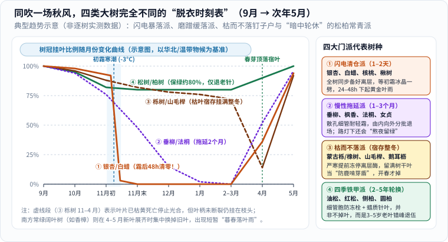
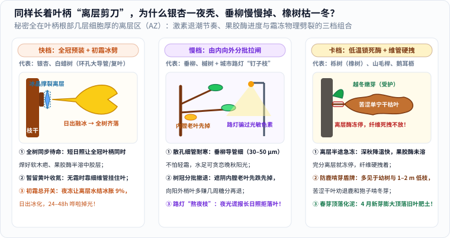
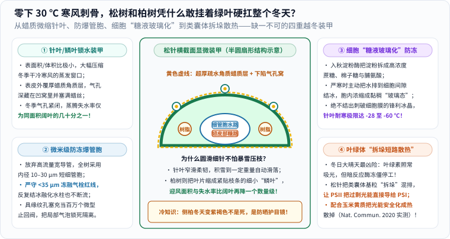
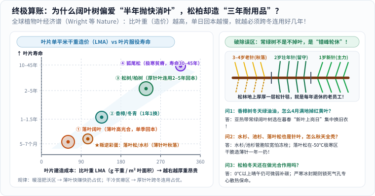

入冬以后，带孩子在同一条街上走一圈，就会撞见一个特别值得追问的现象：

- 路边那棵**银杏**，前两天还满树金黄，一场霜过后一夜之间就秃了；
- 河边的**垂柳**和法桐，叶子却磨磨蹭蹭，从十月一直掉到十二月；
- 公园角落的**橡树（蒙古栎）**和山毛榉更奇怪——叶子早就枯成褐色，却整整一个冬天挂在枝头，风雪再大也不掉；
- 而山坡上的**松树、柏树**，压根没有"落叶季"这回事，顶着雪依然是绿的。

孩子一定会问：**同样是要过冬，为什么有的树急匆匆把叶子扔光，有的慢慢拖，有的干脆赖着不掉，还有的看上去根本不用掉？**

这背后不是四种心情，而是四套完全不同的生存策略。顺着"这片叶子到底走不走、什么时候走、能不能不走"三个问题往下拆，你会依次遇到叶柄上的**离层剪刀**、木质部里的**气泡生死线**、松柏的**四重防冻装甲**，以及一本最终的**经济账**。

_图 1：先看左侧四条曲线的"下车时刻"——橙色的银杏霜后 24–48 小时断崖式清零，紫色的垂柳拖两个月，棕色的橡树枯叶挂着过冬直到开春才落，绿色的松柏全年只退掉约两成老针。右栏是四大门派的代表树种。**注意：曲线是按温带物候典型规律构造的教学示意，不是某一棵树的逐日实测记录**，具体时间随地区、品种和当年天气浮动。_

---

## 一、第一道开关：叶柄根部那把"离层剪刀"

不管是哪种落叶树，秋天叶子要离开树枝，都得经过同一道程序：在**叶柄基部**有一层特殊的细胞，叫**离层区（abscission zone）**。秋天日照变短、气温下降，树木在这里分泌果胶酶和纤维素酶，把细胞之间的"中胶层"慢慢溶解，剪刀一点点剪下去；与此同时，靠近枝条一侧会先形成一层**软木保护疤**，把伤口封好，防止病菌从断口钻进去。上一篇讲红叶黄叶时，我们已经在[《为什么银杏只会变黄，枫树却拼命染红》]()里见过这层软木塞——它是每棵树落叶前的"标配收尾工程"。

剪刀大家都装了，可**剪的节奏完全不同**，这就是快、慢、赖三派的来历。

_图 2：三栏分别看——**快档**（银杏）全树同步待命，初霜冰晶一撑，日出就集体脱落；**慢档**（垂柳）由内向外分批撤退，路灯下的枝条还会"熬夜留绿"；**卡档**（橡树）离层酶被早霜冻停，木质纤维死拽着枯叶不放。图中离层细胞、冰晶与纤维均为机制示意。_

### 1. 快档：全树"预装待命"，一场霜就是总开关

银杏、白蜡这类树，秋天短日照一到，**全树每一个叶柄几乎同时把离层剪到"只差最后一刀"**：保护疤焊好，中胶层被果胶酶溶得半通不通，金黄的叶子靠细细的维管束勉强挂着。

那最后一刀谁来动手？很多时候是**霜**。水在离层细胞间隙结冰，体积膨胀约 9%，冰晶像楔子一样把本就脆弱的离层彻底撑断；等太阳出来一化，失去连接的叶子成片落下——这就是银杏常常"一夜秃"的原因。它不是"某一天突然想通了"，而是几周就装好的离层，被一场霜同时触发。

### 2. 慢档：由内向外分批撤退，路灯还能骗它"再绿两周"

垂柳、法桐、枫香这类树，导管相对细（散孔材，导管多在几十微米量级），不怕轻微霜冻，叶子没有"全员待命"的压力，于是**分批退场**：树冠内部背阴处的老叶先黄先落，向阳的外梢叶多晒几周太阳、多赚一点糖再走，前前后后能拖上一两个月。

更有意思的是城市里的观察：同样一棵树，**路灯附近的枝条往往最后掉叶**。这是因为植物用光敏色素感知昼夜长短来控制衰老，夜里的灯光"谎报"了长日照，让那几根枝条以为秋天还没到（这与高速公路照明下的树木物候推迟是同类现象）。当然，这是大家熟悉的解释，具体效应强弱会随树种、灯距和光色而变，不宜当成铁律。

### 3. 卡档：离层酶被冻停，枯叶挂一整个冬天

橡树（栎属）、山毛榉、鹅耳枥会出现一个专业上叫 **marcescence（宿存叶）** 的现象：叶片枯死变褐，叶柄的离层却**始终没有完成断裂**，枯叶就这么挂到第二年春天，被新芽顶落。

为什么会这样？一种流传很广的解释是**深秋降温太快，果胶酶还没把离层溶解完就被低温冻停了**，纤维还连着，叶子就掉不下来。那树为什么不干脆补一刀？美国克莱姆森大学推广站（Clemson Extension）梳理的假说很有意思：[这些枯叶可能是一种"防鹿盾牌"](https://hgic.clemson.edu/when-leaves-dont-let-go-marcescence/)——宿存叶多出现在幼树和 1–2 米高的低枝上，正好是鹿抬头就能啃到的高度，干涩苦口的枯叶挡在嫩芽前面，能让鹿和狍子知难而退；枯叶落地晚，还能给贫瘠土壤盖一层覆盖物、保住水分。这些是学界提出的适应性假说，并非已盖棺定论的唯一答案。

---

## 二、最硬的问题：阔叶树为什么不扔叶子会死？

到这里你可能会想：既然离层这么麻烦，橡树干脆像松柏那样常绿不就行了？——**不行，因为阔叶输水管道的物理结构不允许。**

这才是"为什么必须落叶"的真正底线，也能解释一个反常识的事实：落叶不是因为怕冷，而是因为**怕"冻融气栓"把输水管道彻底气锁**。

_图 3：首次打开会播放约 5.6 秒的冻融过程并停在终态（开启系统"减少动态效果"则直接静态呈现，刷新可重播）。左栏：120 微米宽导管结冰时把溶解的空气挤成气泡，融冰后木质部负压把气泡拉成"致命气栓"，水柱断流；右栏：18 微米细管胞的微小气泡被表面张力压回水中，万一漏了还有纹孔塞像止回阀一样"啪"地封住。**管径数字是典型值示意，不是每棵树的实测值**；博学者可对照 [Pittermann & Sperry 2006](https://pmc.ncbi.nlm.nih.gov/articles/PMC1326058/)。_

### 1. 水结冰会"吐"出空气，融冰时气泡会在负压下炸开

树靠木质部里的细管道把水从根部往上拉。冬天这些管道里的水会结冰，而**冰的晶格装不下溶解的空气**，结冰过程会把空气挤出来，在管道中央形成一个气泡。

麻烦在融冰的时候：树木为了把水拉到几十米高的树冠，木质部长期处于**负压**（吸水拉力）。融冰后，这个负压会拼命把气泡往外拉——一旦气泡超过某个临界尺寸，它就会迅速膨胀，撑满整根管道，形成**气栓（embolism）**，水柱当场断流。这就像给吸管里灌进一个大泡泡，再怎么吸也吸不上水了。

那多大的气泡会失控？有个漂亮的物理公式——**拉普拉斯公式**。气泡想膨胀，木质部的负压必须压过气泡内部的表面张力压力：

$$\lvert P_x^{*}\rvert = \frac{4\sigma}{D_b}$$

其中 $$\sigma$$ 是水的表面张力（约 $$0.0728\ \mathrm{N/m}$$），$$D_b$$ 是气泡直径。代入冬天常见的 $$\lvert P_x\rvert\approx 0.5\ \mathrm{MPa}=5\times10^{5}\ \mathrm{Pa}$$：

$$D_b \approx \frac{4\times0.0728}{5\times10^{5}} \approx 5.8\times10^{-7}\ \mathrm{m} \approx 0.58\ \mu\mathrm{m}$$

**直径只要超过约 0.6 微米，气泡就会在负压下失控膨胀。** 这就是图 3 里那道生死线的来历，是从公式算出来的，不是拍脑袋。

### 2. 35–44 微米：阔叶树宽导管的"冻融生死线"

气泡多大，取决于管道多粗：管子越宽，结冰时挤出的空气越多，形成的气泡越大。研究者用离心机精确控制木质部负压，反复做冻融实验，找到一个关键阈值——

犹他大学的 Jarmila Pittermann 与 John Sperry 在 2006 年发表于《植物生理学》（*Plant Physiology*）的论文里测得：在 −0.5 MPa 下，**导水管道内径超过约 35–44 微米就会在冻融中栓塞**；压力越负，这条线越往下移（到 −8 MPa 时降到约 6 微米）([Pittermann & Sperry 2006](https://pmc.ncbi.nlm.nih.gov/articles/PMC1326058/))。而且这个阈值对阔叶树的导管和裸子植物的管胞** surprisingly 一致**——说明真正起作用的是"管径"，不是管道长短或体积。

问题就在这里：阔叶树为了夏天高效输水，演化出**又宽又长的导管**（环孔材的早材导管可达 100–250 微米），远超 44 微米的生死线。夏天这是"高速公路"，冬天就成了"定时炸弹"——一场霜冻融化，大面积导管气锁，树就"渴死"了。

**所以落叶的本质，是阔叶树在冬天来临前，主动把蒸腾的叶子全部扔掉，从源头掐断水分拉力，让木质部不再处于危险的负压，从而保住那条宽导管高速路。** 落叶不是认输，是"弃车保帅"。

### 3. 为什么非要宽导管？——哈根–泊肃叶的四次方暴利

既然宽管怕冻，阔叶树为什么不干脆长细管？因为流体力学里有一条"赢家通吃"的定律——**哈根–泊肃叶定律**：单根管道的输水流量正比于管径的**四次方**（$$Q\propto D^4$$）。管径扩大 5 倍（20→100 微米），单管流量暴涨 $$5^4=625$$ 倍！

这是一笔夏天赚翻、冬天亏光的买卖：暖湿季节，宽导管让阔叶树的光合作用和生长速度甩开细管树的几条街；代价是入冬必须把叶子扔干净才能保命。而松柏走的是另一条路——放弃爆发力，换取全年不慌。

一个漂亮的"反证"来自落羽杉：它虽然是针叶树，但管胞宽达约 40 微米，正好卡在生死线附近，于是它秋天照样落叶——这恰恰印证了"管径决定冻融风险"的机制。

---

## 三、松柏凭什么敢挂着绿叶硬扛整个冬天？

既然细管胞这么抗冻，松柏就把它做到了极致，再配上另外三重装甲，凑齐"四季常青"的四件法宝。

_图 4：以松针横截面为中心，看四重装甲——① 蜡质微缩针叶锁水、② 细管胞加纹孔塞防爆管、③ 细胞糖液玻璃化防冰晶、④ 冬季叶绿体"拆垛短路"散热。图中细胞、气孔、纹孔结构均为机制示意，尺寸不代表真实比例。_

**① 微缩叶片 + 蜡质盔甲，先把水锁住。** 松针细长、柏叶缩成贴合枝条的鳞片，表面积与体积之比极小，表皮又覆着厚厚的疏水角质蜡质层，气孔深藏在凹窝里。冬天的干冷风再吹，水分也难逃出去——蒸腾失水率只有同面积阔叶的几十分之一。针叶圆滑柔韧，积雪攒到一定重量会自己滑落，不像阔叶的大叶片那样兜雪压断枝条。

**② 细管胞 + 纹孔塞，把输水管道做成"防爆管"。** 前面算过，管径越细，结冰挤出的气泡越小，小气泡会被表面张力自己压回水里、自动消解。松柏的管胞内径普遍在 10–30 微米，远在 35 微米的生死线以下。更妙的是管胞之间连接处的**具缘纹孔**——那里有个叫**纹孔塞（torus）**的实心圆盘结构，平时居中让水通过，一旦隔壁管道进气、两侧压差骤变，纹孔塞就会像止回阀一样"啪"地贴在孔口上，把气泡永久关禁闭，绝不连累整棵树。这就是图 3 右栏那个会自己封门的小圆盘。

**③ 细胞"糖液玻璃化"，把冰晶挡在细胞外。** 入秋后，松柏把淀粉分解成蔗糖、棉子糖等可溶性糖，并把细胞里的水主动排到细胞间隙去结冰，胞内则浓缩成黏稠的"玻璃态"。这样一来，冰晶不会在细胞内部长出锋利的棱角刺破细胞膜——正是这一招，让针叶的耐寒极限能压到零下几十摄氏度。

**④ 叶绿体"拆垛短路"，把冬天的强光安全卸掉。** 这条最反直觉：冬天大晴天反而危险——叶绿素照常吸光，可低温把暗反应的酶冻僵了，光能用不掉，就会变成破坏力极强的活性氧。2020 年发表于《自然·通讯》（*Nature Communications*）的一项对欧洲赤松的研究揭开了机制：松针会**把叶绿体里堆叠的类囊体基粒"拆垛"**，让原本分开的光系统 II 和光系统 I 直接挨在一起，把多余的激发能顺着"捷径"导过去、安全转化成热量散掉（[Update on photosynthesis research, Nature Communications 2020](https://www.nature.com/articles/s41467-020-20137-9)）。这项机制的防护系数相当惊人——早春时只有约 1.5% 的吸收光能会流经光系统 II 的反应中心可能造成伤害。配合玉米黄质等色素把能量化成热，松针就这样在"阳光很好、温度很低"的杀手组合里活了下来。

至于"侧柏冬天变紫褐色"，那不是死了，是色素变化起到的"防晒护目镜"作用。

---

## 四、终极算账：常绿树不是不落叶，是"错峰轮休"

现在可以回答那个最容易被误解的问题了：**松柏真的"一辈子不落叶"吗？** 不是。

到松林里低头看看，地上厚厚一层松针——那都是每年"退休"的老叶。松柏的每束针叶有 2–5 年的寿命，老叶在秋天集中变黄脱落，只是**同时还有更新、更壮的针叶留在树上**，所以树冠整体看着永远是绿的。它不是不落叶，而是**把落叶分摊到不同年龄的枝条上，错峰进行**——你看到的是"常青"， happening的是一场永不停歇的新老交替。

那为什么有的树选择"薄叶一年一扔"，有的选择"厚针叶用几年"？这背后是一条生态学里著名的规律——**叶经济谱（Leaf Economics Spectrum）**。

_图 5：先看左图的对角线规律——叶片"建造成本"（比叶重 LMA）越高，寿命就越长，是"耐用消费品"；越便宜的薄叶，回本越快、寿命越短。右栏戳破"常绿树不掉叶"的误区：松枝上 3–4 岁老针秋天退场，2 岁壮年和 1 岁新针留守。图中位置为依据典型 LMA 区间的示意排布，非逐种实测散点。_

这是一条全球性的权衡。2016 年《美国国家科学院院刊》（PNAS）上的大尺度研究发现，叶片的氮含量与比叶重（LMA，单位面积干重，代表"建造成本"）之间存在稳定的反向关系：高氮、低 LMA 的叶子光合快、回报高，但"保质期"短；低氮、高 LMA 的厚叶子造价贵、回本慢，却能用很久([Asner et al. 2016, PNAS](https://pmc.ncbi.nlm.nih.gov/articles/PMC4948348/))。**暖湿肥沃的地方，造便宜薄叶、快赚快扔最划算；干冷贫瘠的地方，造昂贵厚叶、跨年连用才回得了本。**

于是整件事就串成了一本账：

- **银杏、杨树**：在温带肥沃土壤里造便宜薄叶，一个夏天赚够，霜一来就全部扔掉——反正明年重建成本低；
- **垂柳、法桐**：薄叶但输水管道稍耐霜，能多榨几周阳光，就多留几周；
- **橡树、山毛榉**：枯叶挂枝是额外的"防鹿投资"，能护住冬芽就赚了；
- **松柏**：在贫瘠寒冷的山地造昂贵厚针叶，用细管胞和四重装甲保它活 2–5 年，摊薄到每一天其实很划算。

还有两个常见的"叛逆选手"值得认一下：**水杉、池杉、落叶松**也是针叶树，但它们的输水管胞偏宽（如落羽杉约 40 微米）或干脆 adopted 极寒区"薄针一年一扔"的策略，所以秋天照样落叶；而**香樟、桂花、冬青**这类亚热带常绿阔叶树，则常常在四五月新叶展齐时集中换掉旧叶，下一场"暮春落叶雨"。

---

## 奶爸说

带孩子看树，最珍贵的不是记住"银杏黄、枫叶红"，而是让他慢慢体会：**每一棵看似静止的树，都在暗中算一笔关于冬天的账。**

这片叶子走不走，是激素和酶在叶柄上剪了多久；这片叶子能不能留，是木质管道里的气泡会不会在融冰时炸开；这棵树该不该常绿，是它把成本摊到几年才回本的抉择。物理、化学、经济学的道理，全写在满地落叶里。

下次孩子问"为什么它还不掉叶子"，别急着给答案，反过来问他一句：**"如果你是这棵树，你会怎么算这笔账？"** 一个会替一棵树算账的孩子，看世界的眼光就已经不一样了。🍂

---

### 参考资料

1. [Pittermann J, Sperry JS (2006). Analysis of Freeze-Thaw Embolism in Conifers. *Plant Physiology* 140(1):374–382](https://pmc.ncbi.nlm.nih.gov/articles/PMC1326058/)——冻融栓塞的临界管径 35–44 μm（−0.5 MPa）、拉普拉斯公式 $$4\sigma/D_b$$、细管胞抗栓塞机制、"小气泡溶解更快"及落羽杉约 40 μm 管胞的依据。
2. [Clemson University Extension：When Leaves Don't Let Go — Marcescence](https://hgic.clemson.edu/when-leaves-dont-let-go-marcescence/)——宿存叶现象、代表树种（美洲山毛榉、栎、鹅耳枥等）、幼树/低枝多见、防鹿啃与保土假说的一手科普依据。
3. [Ottander 等 (2020). Direct energy transfer from photosystem II to photosystem I confers winter sustainability in Scots Pine. *Nature Communications*](https://www.nature.com/articles/s41467-020-20137-9)——松针冬季类囊体基粒"拆垛"、PSII 向 PSI 直接能量转移、早春仅约 1.5% 光能流经 PSII 反应中心、约 40 倍防护系数的依据。
4. [Asner GP et al. (2016). Large-scale climatic and geophysical controls on the leaf economics spectrum. *PNAS* 113(28)](https://pmc.ncbi.nlm.nih.gov/articles/PMC4948348/)——叶经济谱中氮与比叶重（LMA）反向关系、LMA 作为建造成本指标的大尺度观测依据。
5. 本站《[为什么银杏到秋天只会变黄，枫树和黄栌却临死前拼命染红]()》——叶柄离层软木塞保护疤、叶片衰老与氮回收的前情提要。
6. 图 1–图 5 均为本站原创 SVG，由 `tools/visuals/` 工具包的 `winter-leaf-strategies` 主题生成并通过数值与版式断言：图 3 的临界气泡直径 $$D_b\approx0.58\ \mu m$$ 由拉普拉斯公式按 $$\lvert P_x\rvert=0.5\ \mathrm{MPa}$$ 直接算出，哈根–泊肃叶 $$5^4=625$$ 倍流量比、管径阈值 35–44 μm 均有数值断言；图 1、图 2、图 4、图 5 的曲线、物候时间与解剖结构为依据上述机制构造的**教学示意，非逐树实测**，比例不代表真实尺度；图 3 动画播放一次停在终态，支持"减少动态效果"。
