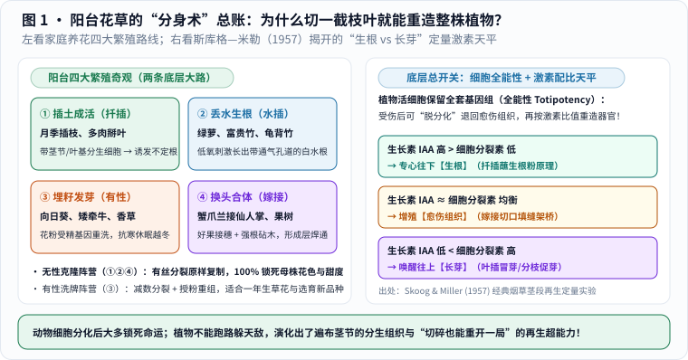
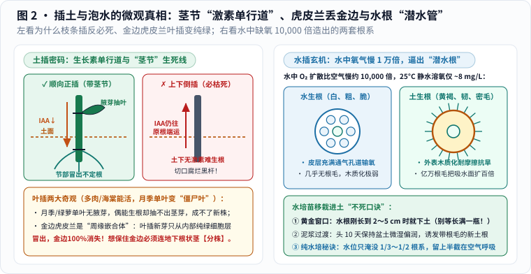
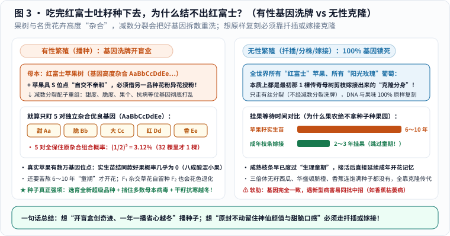
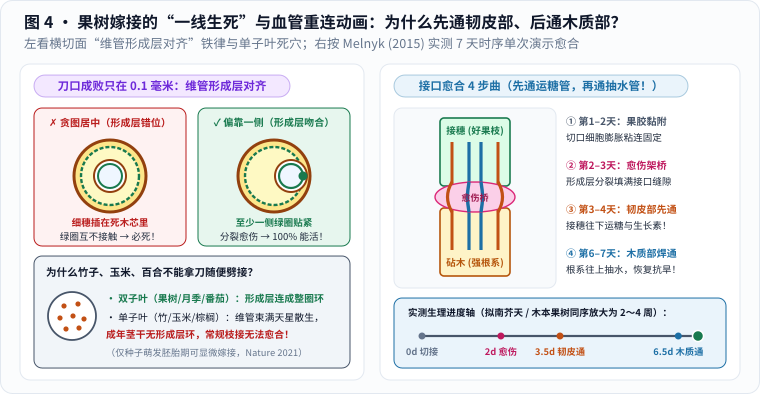
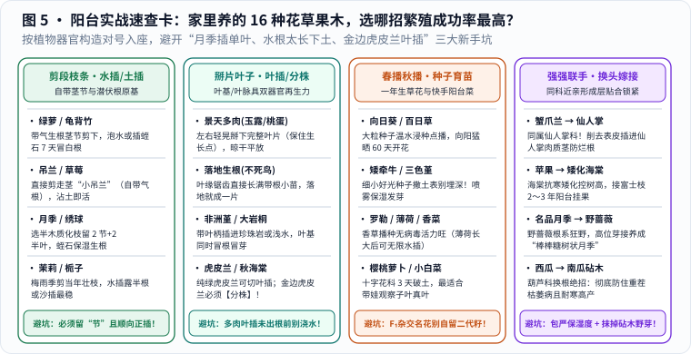

只要在家里阳台上养过几盆花，你一定撞见过一连串特别“分裂”的生命奇观：

剪菜叶剩下的薄荷梗，或者碰掉的一片多肉肥叶，随手往湿土里一插、往土面上一丢，半个月后居然自己长出根须和小苗，白捡一盆新花；剪一截绿萝或富贵竹直接扔进矿泉水瓶，连泥土都不用沾，几天工夫水里就蹿出一簇雪白的水根；可到了种向日葵、矮牵牛、樱桃小番茄时，大家又老老实实拆开种子包一粒粒点播——要是掐一片向日葵叶子插进土里，不是烂掉，就是耗上几个月也冒不出半片新芽。

最让人挠头的还是果树：孩子吃完又脆又甜的红富士苹果，兴冲冲把黑亮饱满的苹果籽埋进花盆。好不容易盼到它发芽蹿高，真要等上七八年开花结果，咬一口却大概率又酸又涩、个头还像山楂！而走进真正的果园一看，无论是红富士苹果、阳光玫瑰葡萄、砂糖橘，还是公园里一棵树开出五种颜色的树状月季，树干底下全都留着一道奇特的愈合疤痕——它们全是被园艺师“咔嚓”砍掉脑袋，硬生生把另一棵树的枝条绑上去**嫁接**出来的！

同样是植物，为什么有的插土就活，有的泡水生根，有的非要播种子，果树和仙人掌还要挨一刀“换头手术”？今天，我们就钻进植物的茎节、叶肉和 $$0.1\ \mathrm{mm}$$ 厚的树皮夹层里，把植物繁殖这四大神通背后的底层逻辑一次拆透。

---

## 一、总开关：为什么壁虎最多长尾巴，植物剪下一截却能变出整棵新生命？

如果剪下小狗的一撮毛、或者壁虎断掉的一截尾巴放进营养液里，壁虎顶多在原身上补一条软骨尾巴，断掉的那截尾巴绝不可能反向长出一只新壁虎。可剪下一段薄荷茎、一片落地生根叶，它却能凭空补齐自己缺少的根、茎、叶，重新长成一株完整的植物。

在看具体手法之前，我们先用一张全景图把家庭养花最常见的四种繁殖方式归好类，再揪出藏在植物细胞里的那只“幕后总开关”（无性与有性繁殖的植物学分类可对照 [OpenStax《生物学》第 32.3 节无性繁殖](https://openstax.org/books/biology-2e/pages/32-3-asexual-reproduction)）：

_先看上半部分四大方式的分阵营：左三格（① 枝插与叶插、② 水插生根、④ 嫁接合体）本质上都不经过受精结籽，属于基因 $$100\%$$ 原样继承的“无性克隆”；唯独第 ③ 格播种繁殖经过花粉与胚珠结合，属于基因重新洗牌的“有性重组”。再看下半部分的激素天平：伤口细胞之所以知道该长根还是冒芽，全靠生长素与细胞分裂素的浓度比值发号施令。[单独打开大图](/assets/images/home-plant-propagation/propagation-panorama-switch.svg)。_

### 1. 两大阵营：复制粘贴的“无性克隆” vs. 重新洗牌的“有性播种”

把阳台上的各种花招剥掉外壳，其实只有两条生命主线：

- **无性繁殖（营养繁殖 / 克隆）**：不管是把枝条插进土里（**扦插**）、扔进水杯里（**水插**）、把丛生根系掰开（**分株**），还是把好品种接在野树桩上（**嫁接**），本质上都是在调用植物的营养器官（根、茎、叶），只做**有丝分裂**，不做精子与卵细胞的结合。长出来的新苗，细胞核里的 DNA 和母株**$$100\%$$ 一模一样**——相当于给原来的花做了一次原汁原味的“Ctrl+C / Ctrl+V 复制粘贴”。
- **有性繁殖（授粉结籽播种）**：开花、传粉、受精、结出种子。父母双方的染色体要先经历**减数分裂**减半并随机互换片段，再重新拼成一颗受精卵。每一粒种子都是一张全新的“基因身份证”，长出来的孩子既像爸妈，又绝不完全等同于爸妈。

### 2. 植物细胞的“后悔药”：细胞全能性与脱分化

为什么植物能随手玩“克隆”？因为植物没办法像动物那样遇到危险拔腿就跑——风折、虫咬、野兽啃食是家常便饭。几亿年演化下来，植物练就了一套绝地求生的本领：**高度保留的细胞全能性（Totipotency）**。

动物绝大多数成年体细胞一旦分工定型（比如变成心肌细胞或神经细胞），基因开关就被死死锁住，没法再退回胚胎状态；而植物茎节、形成层甚至部分叶肉里的**活体薄壁细胞**，只要还保有一套完整的细胞核，收到“受伤切割”的警报后，就能吃下一颗“后悔药”——**脱分化（Dedifferentiation）**：卸下原来的工作服，恢复分裂能力，先在切口处长出一团浅白色、软乎乎的未分化细胞团，叫做**愈伤组织（Callus）**，接着再按需**再分化**出全新的根尖或芽点！

### 3. 一把定量激素天平：谁在指挥伤口“往下长根”还是“往上冒芽”？

更神奇的问题来了：同样一团愈伤组织，它怎么知道自己该变成吸水抓土的**根**，还是变成迎光展叶的**芽**？

1957 年，植物生理学家**斯库格（Folke Skoog）与米勒（Carlos O. Miller）**用烟草髓组织做了一组改写教科书的定量实验（经典机制与最新分子复盘见剑桥大学 [Melnyk 2023 年综述，*Quantitative Plant Biology*](https://pmc.ncbi.nlm.nih.gov/articles/PMC10495819/)）。他们发现，植物并不是靠某一种孤立的“生根素”下命令，而是靠细胞内两大家族激素的**浓度比值**来拨动开关——一边是主要由嫩梢合成、往下运输的**生长素（Auxin，天然代表为吲哚乙酸 IAA）**，另一边是主要由根系合成、往上运输的**细胞分裂素（Cytokinin）**。

我们可以把这个定量开关写成一个直观的激素比值 $$R_{\text{激素}}$$：

$$R_{\text{激素}} = \frac{[\text{生长素 Auxin}]}{[\text{细胞分裂素 Cytokinin}]}$$

这把分子天平只要往不同方向倾斜，细胞的命运就会瞬间改写：

1. **$$R_{\text{激素}} \gg 1$$（生长素高、细胞分裂素低）$$\longrightarrow$$ 启动生根程序**：切口细胞分化成**不定根（Adventitious roots，即不是从种子胚根长出来、而是从茎或叶上额外冒出来的根）**。我们在家扦插难生根的木本花（如月季、栀子、三角梅）时，往枝条基部蘸一点**生根粉**（核心有效成分正是人工合成的生长素类似物吲哚丁酸 IBA 或萘乙酸 NAA），本质上就是人为把切口处的 $$R_{\text{激素}}$$ 猛推上去！
2. **$$R_{\text{激素}} \approx 1$$（两者浓度相当且都偏高）$$\longrightarrow$$ 原地扩增愈伤组织**：细胞只管闷头分裂长肉瘤，既不生根也不抽芽。实验室做兰花、草莓脱毒组培苗时，就是先把一小块茎尖放在 $$R_{\text{激素}} \approx 1$$ 的培养基上扩增成一大团愈伤组织，再分批切换配方批量造苗。
3. **$$R_{\text{激素}} \ll 1$$（生长素低、细胞分裂素高）$$\longrightarrow$$ 启动抽芽程序**：细胞团分化出绿色的**不定芽（Adventitious shoots）**。

搞懂了“全能性 + 激素天平”这把总钥匙，接下来阳台上那几个让人百思不得其解的怪现象，就会像多米诺骨牌一样迎刃而解。

---

## 二、插土与泡水之谜：为什么柳枝和多肉一插就活，月季单叶变“僵尸叶”，水培根下土却秒蔫？

同样是剪一截插下去，为什么有人随手插活一片小森林，有人却频频养出“光长根不发芽的僵尸叶”或者“一下土就烂根的水培苗”？答案全藏在下面这三张解剖对比图里：

_从左往右拆解三个家庭高频现场：① 枝条扦插必须保留带腋芽的“节”，且生长素永远从形态学上端单向泵往形态学下端，插反必死；② 叶片没有现成腋芽，月季单叶只能生根无法造芽，而金边虎皮兰叶插则会丢失嵌合体金边；③ 水中氧气扩散比空气慢约 $$10{,}000$$ 倍，水根靠海绵状“通气组织”呼吸，超过 $$5\ \mathrm{cm}$$ 再转土极易休克。[单独打开大图](/assets/images/home-plant-propagation/stem-leaf-water-anatomy.svg)。_

### 1. 枝条扦插的铁律：必须带“节”，而且千万别插倒了！

仔细观察薄荷、月季、绿萝或绣球的茎干，你会看到每隔一段光滑的“节间”，就会鼓起一圈长叶子的关节——这就是茎的**节（Node）**。在叶片基部与茎干夹角的腋窝里，早就埋伏着一颗现成的微缩芽点，叫做**腋芽（Axillary bud）**（茎节与腋芽解剖结构见 [OpenStax《生物学》第 30.2 节茎的构造](https://openstax.org/books/biology-2e/pages/30-2-stems)）。

所以**枝条扦插（Stem cutting）其实只用完成半道题**：新枝新叶根本不用从零造起，唤醒现成的腋芽就行；枝条唯一需要攻克的难关，是在底下切口长出**不定根**。像薄荷、迷迭香、天竺葵这类草本植物茎节处本就潜伏着大量根原基，插进透气湿润的蛭石或泥炭土里一两周就能爆根；而柳树枝条更是天然的“生根狂魔”（古人常说“无心插柳柳成荫”，因为柳树皮里富含水杨酸和天然生长素前体物质）。

但枝插有一条**绝对不能违背的死规矩——严禁倒插**！很多新手剪下光秃秃的木本枝条（比如冬季修剪下来的无花果、葡萄硬枝），分不清哪头朝天、哪头朝地，随手倒着捅进土里，结果哪怕天天浇水保湿，枝条也必定枯死。

为什么植物不能像水管一样“哪头埋进土里哪头就长根”？罪魁祸首叫**生长素的极性运输（Polar Auxin Transport）**：植物细胞膜上的生长素输出载体蛋白（PIN 蛋白）像单向旋转门一样，只长在细胞的“形态学下端”（即原本靠近老根的那一头）。不管你把枝条正着放、平着放还是倒立过来，地心引力都改不了这道单向门——生长素依然固执地往**原本朝下的那一头**汇集！一旦插反了，原本朝上的顶梢被埋进黑土里，没有生长素积累长不出根；原本朝下的基部却孤零零戳在干空气里，哪怕攒够了生长素也没法扎进土里吸水，整根枝条只能在错位中活活渴死。

### 2. 叶插的隐藏门槛：“僵尸叶”冤案与金边虎皮兰的“失金”悬案

既然枝插是因为自带腋芽才省事，那如果只掰**一片光秃秃的叶子**插进土里呢？

这时难度瞬间翻倍：叶片身上**没有现成的腋芽**！要想变成一棵完整的花，叶柄切口处必须同时打赢两场硬仗——既要造出**不定根**，又要从叶肉或叶脉薄壁细胞里凭空捏造出全新的**不定芽分生组织**（佛罗里达大学园艺系教材对此有清晰的分类说明，见 [UF IFAS *Leaf Cuttings*](https://propg.ifas.ufl.edu/05-cuttings/02-types/05-cuttingtypes-leaf.html)）。

自然界里只有少数“天赋异禀”的家族掌握了全套叶插技能：

- **景天科多肉与落地生根（*Kalanchoe*）**：多肉肥厚的叶片本身就是一座自带干粮和水库的“太空舱”，基部生长点细胞极易同时分化根和芽；更绝的是大叶落地生根（*Kalanchoe daigremontiana*），甚至不等叶子掉下来，直接在锯齿状叶缘凹槽里长出一排排自带白根的小苗，风一吹掉进花盆就能泛滥成灾！
- **苦苣苔科（非洲堇、大岩桐）、秋海棠属与椒草属（豆瓣绿）**：把秋海棠大叶片背面的主叶脉轻轻划几道小口平铺在湿蛭石上，每一道伤口都能冒出一丛小苗。

相反，如果你摘下一片**月季叶、琴叶榕叶、茶花叶，或者不带茎节的心叶球兰叶片**插进水里或土里，就会撞上花友圈著名的**“僵尸叶”现象**：叶柄底下明明长出了密密麻麻的大白根，叶片也绿油油地活着，甚至还能靠[光合作用]()自己养活自己，可无论你等一年还是三年，它永远抽不出半根新枝条——因为它的叶片细胞彻底关闭了“从零造芽”的遗传通道！想要繁殖它们，剪刀往下挪半厘米，**连着一小段带腋芽的茎节一起剪下来**，难题立刻烟消云散。

叶插里还有一桩特别适合考孩子的悬疑案：**为什么把“金边虎皮兰”剪成一段段插进土里，长出来的新苗全都变成了没有金边的“纯绿虎皮兰”？**

原来，金边虎皮兰（*Sansevieria trifasciata* 'Laurentii'）是一株**周缘嵌合体（Periclinal chimera）**（机制详见佛罗里达大学 [UF IFAS *Chimeras* 嵌合体讲义](https://propg.ifas.ufl.edu/03-genetic-selection/04-genetic-chimera.html)）：它的茎尖生长点像三明治一样分成三层细胞（`LI`、`LII`、`LIII`），金黄色的叶绿体突变只存在于最外层的表皮系细胞，而包裹在里面的内部叶肉细胞依然是纯绿色的。当你剪断叶片做叶插时，新冒出来的不定芽是由内部**单一绿色细胞层**独立分裂长出来的，外层的金色细胞根本没参与组队——于是金边 $$100\%$$ 消失！要想保住漂亮的金边，必须等它从地下横走茎自然钻出侧芽（完整继承三层嵌合结构），再用刀切开做**分株繁殖**。

### 3. 扔进水里为什么狂飙白根，一挪进土里却烂根？

再看第三个奇怪现象：绿萝、吊兰、常春藤、薄荷、番茄侧枝（打杈掰下来的芽），扔进装自来水的玻璃杯里，明明水里什么肥料都没有，为什么五六天就能冒出雪白粗壮的根？可一旦等水根长到十几厘米长、兴冲冲移栽进花盆泥土里，怎么没两天叶子全蔫了，拔出来一看白根全烂光了？

这背后是一笔硬核的气体扩散物理账（这跟我们在[太空种菜为什么浇水反而会憋死根系]()里聊过的根系缺氧危机同源）。在常温下，氧气在空气中的分子扩散系数约为 $$D_{\text{空气}} \approx 2.0 \times 10^{-5}\ \mathrm{m^2/s}$$，而在静水中的扩散系数只有约 $$D_{\text{水}} \approx 2.1 \times 10^{-9}\ \mathrm{m^2/s}$$——**氧气在水里的扩散速度，比在空气里慢了整整约 $$10{,}000$$ 倍**（植物水淹缺氧与不定根通气组织机制见 [Sou 等 2021 年《Scientific Reports》研究](https://pmc.ncbi.nlm.nih.gov/articles/PMC7907123/)）！

枝条被扔进水里后，一方面切口完全没有干旱失水焦虑，伤口积累的乙烯信号还会协同生长素加速催生不定根原基；但另一方面，为了不在缺氧的静水里憋死，新长出来的“水培根”把内部结构彻底改造成了“潜水呼吸管”：

- **内部挖空成“通气组织（Aerenchyma）”**：水根皮层里大量细胞主动溶解让位，拼成海绵状的纵向气道，把水面上方茎叶吸进来的氧气一路往下输送到根尖；
- **省掉根毛与厚木质化铠甲**：既然整条根都泡在水里，根本不需要费力长成千上万根微米级的吸水**根毛**，表皮也脆嫩洁白、缺少抗挤压的木质素。

问题就出在这里！如果你等水根长成一大团十几厘米长的“白胡子”再埋进土壤里，泥土颗粒一挤压，脆嫩无根毛的水根瞬间折损，干湿交替的土壤又抽干了海绵状皮层的水分，旧水根大批溃烂，植物只能瘫在盆里等死。

**水插转土培的黄金法则只有一条**：趁白色水根刚冒出 **$$2\text{–}5\ \mathrm{cm}$$** 时立刻上盆！这时根尖分生区活力最旺，移进疏松湿润的泥炭珍珠岩混合土后，第一周保持土壤微湿（像拧干的海绵），它就能无缝切换模式，长出带浓密根毛的真正“土生根”。

---

## 三、种子的秘密：既然插枝这么快，为什么太阳花要播种子，吃完甜苹果吐籽种出来却是酸野果？

看到这儿，好奇的孩子肯定会追问两个相反的问题：**既然剪根枝条克隆这么快，植物干嘛还要大费周章开花结籽？反过来，既然种子这么好存，为什么果农不直接拿红富士苹果的种子种满山坡，非要费劲砍树嫁接？**

把下面这张“基因刮刮乐 vs. 原版复印机”对比图摊开，两边的账立刻一清二楚：

_左栏展示为什么甜苹果籽种不出原版甜苹果：果树高度杂合且存在自交不亲和，异花授粉后仅 $$5$$ 对独立杂合基因保持原组合的概率就跌到 $$(1/2)^5 = 3.125\%$$，成千上万个风味位点重排后几乎必出酸涩实生苗，还要苦等 6–10 年童期；右栏对比无性克隆如何 $$100\%$$ 锁死母株优良风味并把挂果时间缩短到 2–3 年，底部补充种子不可替代的三大绝活。[单独打开大图](/assets/images/home-plant-propagation/seed-lottery-vs-clone.svg)。_

### 1. 苹果籽的“基因刮刮乐”：为什么你吃到的每一个红富士，都来自 1939 年同一棵树？

先揭晓一个冷知识：**全世界超市里卖的每一颗正宗红富士苹果，在基因层面其实是“同一个人”！** 1939 年，日本农林省园艺试验场（青森县藤崎町）的育种家把“国光（Ralls Janet）”和“元帅（Red Delicious）”杂交，在几百株实生小树苗里千挑万选，才在 1962 年正式选定并命名了那唯一一株又脆又甜又耐储的**“富士”原株**。此后六十多年里遍布中国山东、陕西和全球各地的亿万棵富士苹果树，全都是从当年那棵原株身上剪枝、一代代**嫁接克隆**出来的！

为什么不能直接种红富士肚子里掏出来的黑种子？因为苹果、梨、樱桃、芒果、柑橘（部分单胚品种）全都是**高度杂合（Heterozygous）**的植物，而且绝大多数苹果品种身上还带着一套严防“近亲结婚”的分子门禁——**$$S$$ 位点核糖核酸酶自交不亲和机制（Self-incompatibility）**（开花植物异花授粉与自交不亲和机制见 [OpenStax《生物学》第 32.2 节传粉与受精](https://openstax.org/books/biology-2e/pages/32-2-pollination-and-fertilization)，果树实生变异与嫁接必要性详见伊利诺伊大学农学推广中心 [University of Illinois Extension 果树嫁接专题](https://extension.illinois.edu/blogs/flowers-fruits-and-frass/2026-04-14-grafting-important-age-old-skill-aspiring-orchardists)）。

说白了，红富士自己的花粉落到自己的柱头上，花粉管走到半路就会被雌蕊精准识别并拦截销毁！果园里必须每隔几排种上一棵专门提供花粉的**授粉树**（很多时候甚至是开花极早、满树花粉的**海棠果树**），蜜蜂采完海棠花粉授给红富士，红富士才能结出大苹果：

- **你吃掉的香甜果肉**，是由红富士母亲自己的花托与子房壁发育来的，所以 $$100\%$$ 还是红富士的味道；
- **果核里包着的黑种子**，却是“红富士妈妈（减数分裂洗过一遍牌的卵细胞）+ 隔壁海棠爸爸（再洗一遍牌的精子）”生出来的混血儿！

就算我们做一个极简的玩具概率计算：假设决定苹果甜度、酸度、脆度、果个大小和香气的核心基因里，只有 $$n$$ 对相互独立的杂合位点（记为 $$Aa$$），那么单靠有性生殖，后代每一对位点恰好继续保持 $$Aa$$ 杂合状态的概率都只有 $$\frac{1}{2}$$，$$n$$ 对同时不走样的概率就是：

$$P(n) = \left(\frac{1}{2}\right)^n$$

- 当 $$n = 5$$ 时，$$P(5) = \frac{1}{32} = 3.125\%$$；
- 当 $$n = 20$$ 时，$$P(20) = \frac{1}{1{,}048{,}576} \approx 0.000095\%$$（不到百万分之一！）；
- 而在真实的苹果基因组（$$17$$ 对染色体、数万个基因）里，杂合位点何止成千上万！种下一颗苹果籽，保留原版红富士风味的概率**在工程上严格等于零**。

雪上加霜的是，种子长出来的实生果树必须从“婴儿期”重新熬起，经历长达 **6–10 年不开花的“童期（Juvenile phase）”**，还会疯长成 $$8\text{–}12\ \mathrm{m}$$ 高、浑身长刺的大乔木。辛辛苦苦浇水八年，最后摘下一筐酸倒牙的小野果——这就是果农绝不用种子种商品苹果树的原因（反倒是育种科学家最爱播种：成千上万株酸野果里万一蹦出一株比红富士还惊艳的天才新苗，再用嫁接把它永久锁死，一个新水果传奇就诞生了！）。

顺带一提，我们夏天吃的**无籽西瓜**和超市里的**香芽蕉**，干脆是染色体配不成对的**三倍体（$$3n$$）**——减数分裂时三套染色体没法平分，连可育种子都结不出来：香蕉全靠地下吸芽分株和组培苗克隆（代价是全球克隆蕉基因完全一致，一旦遇上专门攻破它的“香蕉枯萎病热带 4 号小种”，整片蕉园就会齐刷刷中招）；无籽西瓜则是每年拿四倍体西瓜（$$4n$$）和二倍体西瓜（$$2n$$）重新杂交制种得来的三倍体种子。

### 2. 既然克隆这么稳，为什么向日葵、矮牵牛和青菜又非要播种子？

反过来，一年生草本花卉和蔬菜（向日葵、百日草、鸡冠花、凤仙花、小油菜、萝卜）几乎清一色靠播种子当家，因为种子手握三张无性克隆永远比不了的王牌：

1. **一年生草本的成本账与 $$\mathrm{F_1}$$ 杂交优势**：向日葵一辈子只活一个夏天，把营养全砸进了花盘和瓜子里，茎秆到秋天就木栓化枯死，根本不划算留母株越冬扦插；而种子公司通过两个纯合亲本杂交制出的**一代杂交种（$$\mathrm{F_1}$$）**，播下去出苗整齐、长势极旺（注意：如果你把买来的 $$\mathrm{F_1}$$ 杂交樱桃番茄或重瓣矮牵牛自己留籽种第二代 $$\mathrm{F_2}$$，同样会发生孟德尔性状分离，大小甜酸又会变得五花八门！）。
2. **天然的“病毒防火墙”**：植物一旦感染花叶病毒，病毒会顺着筛管和胞间连丝传遍全身，剪枝扦插、掰蒜瓣、切土豆块都会把病毒原封不动传给下一代（种几年的草莓和土豆越长越退化就是因为体内攒满了病毒）；但绝大多数植物病毒**跨不过胚珠与种胚之间的生理屏障**——播种子相当于给下一代做了一次干净彻底的“出厂格式化杀毒”！
3. **跨越寒冬与干旱的“时空胶囊”**：枝条离开母株几天不吸水就会干死，而正常型干燥种子把含水量降到 $$5\%\text{–}10\%$$，呼吸代谢几乎休眠归零，塞在牛皮纸袋里熬过零下寒冬甚至睡上好几年，春天一浇水照样破土而出。

---

## 四、果树与仙人掌的“换头外科手术”：嫁接凭什么让两棵树长成一家人？

如果说扦插是“让断枝自己长脚”，那么**嫁接（Grafting）**就是园艺界最硬核的外科移植手术：**把甲植物负责开花结果的枝或芽（叫“接穗 Scion”），精准安到乙植物强壮的根系和下半截树干（叫“砧木 Rootstock”）上**，让两株原本各自独立的植物愈合成一棵“楼上负责貌美甘甜、楼下负责吃苦耐劳”的超级合体树！

### 1. 强强联手的黄金搭档：楼上管好吃好看，楼下管抗冻、抗病与控身高

你在生活里见过的许多神奇植物，其实全是“上下两家人合租”的杰作：

- **矮化甜果树（红富士接穗 + M9 矮化海棠砧木）**：把已经度过童期的成年红富士枝条接在矮化砧木上，不仅 **2–3 年就能提前挂满原汁原味的甜苹果**（春天开花抽梢时，砧木根系还会把头年攒下的陈年淀粉化成高压糖液往上泵送，详见[光秃秃的枝条凭什么在春寒里一夜爆满繁花]()），而且整棵树身高被精准压制在 $$2.5\ \mathrm{m}$$ 左右，伸手就能摘果，连梯子都省了！
- **重茬不死的西瓜（甜西瓜苗 + 白籽南瓜/葫芦砧木）**：西瓜自己根系娇气，同一块地连种两年就会染上毁灭性的土壤枯萎病；换成根系如钢丝般发达、天生免疫西瓜枯萎病的南瓜做砧木，产量稳稳翻番。
- **花店里的彩色仙人球（红黄“绯牡丹” + 绿色“量天尺”三角柱）**：花市里顶着大红球、明黄球的“鸿运当头仙人掌”，上面那颗彩球其实是**彻底丧失叶绿素的白化突变体**——要是不接在底下绿色的火龙果亲戚（量天尺）头顶靠人家光合作用喂糖，彩球自己在土里不出一个月就会活活饿死！
- **一树五色月季与“百果树”**：在野蔷薇老桩（根系狂野耐寒耐涝）的五个分枝上，分别接上红、黄、粉、白、紫五个品种的月季芽，开花时一棵树就是一座五彩花园。

这里必须顺手戳破一个流传极广的误区：**嫁接绝对不是转基因，也不会把接穗和砧木的细胞核揉成“混血新物种”！** 嫁接愈合后，接穗长出来的枝叶果肉依然是接穗自己的基因，底下树根依然是砧木自己的基因（除极少数愈合伤口处偶然冒出的“嫁接嵌合体”外）。正因如此，果农和养月季的老手都有一条铁律：**一旦看见嫁接鼓包“底下”的砧木自己冒出新芽（叫砧木萌蘖），必须第一时间掰掉！** 否则野蔷薇或野海棠的亲生枝条长势凶猛，用不了一年就会把全部水肥截胡，把楼上的名贵月季或甜苹果活活饿死。

### 2. 成败只在 $$0.1\ \mathrm{mm}$$ 之间：为什么“居中必死、靠边才活”，竹子却怎么也接不活？

很多人在家模仿视频削一刀枝条绑上去，十次有九次接穗干瘪发黑。问题到底出在哪？请看下面这张**解剖对齐规则 + 7 天血管重连慢动作图**（点击图片链接并刷新页面可重播右侧愈合动画）：

_先看左半部分横截面规则：树干最外圈老树皮和正中央木质部都是死细胞或输水硬管，真正能分裂长肉的“维管形成层”只有夹在树皮内侧与木头之间约 $$0.1\ \mathrm{mm}$$ 厚的一圈绿线——砧木粗、接穗细时，强行居中会让两侧形成层全部错开，唯有紧贴一侧平齐才能对准绿环；左下角同时解释单子叶植物（如竹子、玉米）因维管束散生无形成层环而无法常规茎嫁接。再看右半部分单次播放动画（按 $$1\text{ 天} = 0.75\ \mathrm{s}$$ 映射拟南芥 $$0\text{–}7$$ 天实测时序，木本果树顺序完全一致但拉长至 $$2\text{–}4$$ 周）：先长淡粉色愈伤桥（第 2–3 天），运糖的两侧橙色韧皮部抢先在第 3–4 天接通，输水的中央蓝色木质部直到第 6–7 天才最后贯通。[单独打开，刷新可重播](/assets/images/home-plant-propagation/graft-cambium-healing-anim.svg)。_

把一根木本树枝横向切开，从外往里看共有四层结构：最外面粗糙开裂的是死掉的木栓外树皮，往里一层软韧的是向下运糖的**韧皮部**，正中间占大头、硬邦邦的是向上输水的**木质部**，而在韧皮部和木质部交界处，夹着一圈薄如蝉翼、滑溜溜的分生细胞环——**维管形成层（Vascular cambium，厚度通常只有约 $$0.05\text{–}0.2\ \mathrm{mm}$$）**（形成层生长素信号驱动嫁接愈合机制见 [Robil 2024 年《Plant Physiology》综述](https://pmc.ncbi.nlm.nih.gov/articles/PMC11444286/)）。

整根老树枝上，**唯有这 $$0.1\ \mathrm{mm}$$ 厚的形成层细胞还能旺盛分裂**！这就引出了嫁接第一铁律——**形成层对齐**：

- 当你拿一根筷子粗的细接穗，往大拇指粗的砧木切口上插时，如果按人类的强迫症审美把它**摆在正中间**，细接穗那圈小小的形成层就会整圈踩在砧木正中央死气沉沉的木质部硬木头上，两边形成层连 $$1\ \mathrm{\mu m}$$ 都没挨着——**存活率直接归零**！
- 正确的做法反而是“偏心眼”：**让细接穗死死贴住粗砧木的其中一侧边缘**（注意对准树皮内侧那条绿白交界线，而不是对准老树皮外皮，因为老砧木树皮更厚！），只要至少有一侧的形成层严丝合缝贴在一起，活细胞就能顺利牵手！

顺着这个解剖逻辑，你还能立刻想明白两个经典追问：

1. **为什么竹子、玉米、百合、绿萝等单子叶植物没法像果树那样劈开茎干嫁接？** 看一眼左下角的小圆截面就懂了：双子叶木本植物的维管束排成一个整齐的同心圆，中间连成一圈完整的形成层环；而单子叶植物成熟茎干里的维管束像满天星一样乱撒在髓腔里（**散生维管束**），而且**根本没有维管形成层**（直到 2021 年底剑桥团队才在《Nature》在线发表突破性研究，证明单子叶植物只有在种子刚萌发、细胞尚未分化的胚胎中胚轴阶段才能在实验室里显微嫁接成功，成年茎干依然无解）。
2. **能不能把红富士苹果嫁接到松树、柳树或者大白菜上？** 不能！嫁接讲究分类学上的**亲和力（Compatibility）**：同种品种间最容易活（红富士接海棠/山定子），**同属不同种**次之（桃、李、杏、梅同属李属 *Prunus* 可互接；柑橘属可接出“一树结橙子、柚子、柠檬”；茄属的**番茄苗接在马铃薯上**甚至能造出楼上结小番茄、楼下挖土豆的“番茄薯”！），**同科不同属**已是常见上限（葫芦科的西瓜接南瓜、蔷薇科的西洋梨接榅桲）。一旦跨科跨目，双方细胞壁识别暗号对不上、次生代谢物互相毒杀或导管口径错位，就算勉强长出一点愈伤组织，后期也会在接口处断裂夭折。

### 3. 伤口里的 7 天接管倒计时：为什么“粮道”比“水管”早通整整三天？

把形成层对准、用嫁接膜绑紧之后，黑漆漆的树皮底下到底发生了什么？2015 年，剑桥大学植物科学系**梅尔尼克（Charles W. Melnyk）团队**在《Current Biology》上发表了活体荧光追踪实验（[Melnyk 等 2015 年论文，PMC4798781](https://pmc.ncbi.nlm.nih.gov/articles/PMC4798781/)），首次在显微镜下掐表测出了嫁接伤口内部血管重连的精确先后顺序（模式植物拟南芥全程约 $$7$$ 天，木本果树耗时拉长到 $$2\text{–}4$$ 周，但四步先后次序丝毫不差）：

1. **第 1–2 天（黏合止血期）**：切口碎裂细胞释放果胶质，先把上下两块组织初步粘住，并在暴露面形成隔离层阻挡真菌入侵。
2. **第 2–3 天（搭桥填缝期）**：接穗往下运来的生长素在切口上方受阻堆积，强烈刺激紧贴在一起的形成层细胞脱分化分裂，鼓出一团淡粉色的**愈伤组织桥（Callus bridge）**，把肉眼看不见的微米级空气缝隙填满，并打通细胞间的胞间连丝。
3. **第 3–4 天（两侧橙色韧皮部率先抢通！）**：最反直觉的一幕出现了——植物并没有先修通救命的自来水管，而是**率先接通了向下输送蔗糖与生长素信号的韧皮部筛管**！原因非常精妙：接穗顶端的嫩芽正在拼命往下发送生长素“施工图纸”和糖分“军粮”，只有先把这条**“通信线 + 粮道”**接通到砧木身上，底下的根系才会在第 5 天收到信号恢复生长，并准确标定下一步铺设水管的路线。
4. **第 6–7 天（中央蓝色木质部压轴贯通！）**：负责承受负压抽水的**木质部导管**，细胞壁必须先一圈圈加厚坚硬的木质素螺旋环，随后完成细胞程序性死亡、清空细胞质变成中空硬管——这道重型基建工序最慢，直到最后一步才彻底贯通上下水路！

读懂了这个**“第 3–4 天先通粮道、第 6–7 天（果树第 3–4 周）才通水管”**的时间差，你就彻底明白为什么嫁接完的头半个月**必须死死缠紧保湿嫁接膜（或套透明保湿袋）并遮阴避晒**了：在木质部水管最后合龙之前，楼上的接穗几乎喝不到楼下砧木抽上来的一滴水！这时候如果把新嫁接的月季或果树直接端到大太阳底下暴晒，叶片气孔一蒸腾，接穗就会在距离手术成功只差最后三天的时刻活活抽干！

---

## 五、阳台实战速查表：家里 16 种常见花草蔬果，到底该选哪一招？

理论全通了，回到自家阳台上，看到一盆喜欢的新花到底该动剪刀、泡水杯、买种子还是试嫁接？下面这张速查表按四大繁殖方式整理了家庭最常见的 **16 种花草蔬果**，连同各自的“成活绝招”与“头号翻车坑”一并标清：

_按四列纵向查阅自家植物所属阵营：第 1 列看插土扦插与叶插（注意月季带节、多肉晾干伤口、金边虎皮兰改用分株）；第 2 列看水插诱根（死守 $$2\text{–}5\ \mathrm{cm}$$ 白根转土窗口，富贵竹只留浅水防烂茎）；第 3 列看播种育苗（区分覆土厚度与 $$\mathrm{F_1}$$ 杂交种留种分离）；第 4 列看家庭趣味嫁接（月季接蔷薇、彩球接量天尺、番茄接土豆，切记掰除砧木底芽）。[单独打开大图](/assets/images/home-plant-propagation/home-plant-cheatsheet.svg)。_

### 周末带娃就能动手的 3 个阳台微实验

不需要昂贵的实验器材，这周末就可以和孩子拿家里的边角料做三组超有成就感的对照观察：

1. **实验一：绿萝“水根 vs. 土根”变身记（5–14 天）**
   剪两段各带 $$1\text{–}2$$ 个气生根疙瘩的绿萝枝条，放进透明玻璃杯浅水里（水面只淹没气生根节位，叶片绝不泡水）。第 5 天用放大镜带孩子看雪白光滑、没有根毛的水根；等长到 **$$3\ \mathrm{cm}$$** 时把其中一根移进湿润营养土，另一根继续留在水里——两周后轻轻扒开土面对比，孩子就能亲眼看见“潜水呼吸管”与毛茸茸“抓土吸水根”的天壤之别！
2. **实验二：多肉叶片的“激素天平”实况直播（10–20 天）**
   从健康的冬美人、胧月或姬胧月多肉上，左右轻轻摇晃掰下 $$3$$ 片完整饱满的老叶（一定要连基部生长点完整掰下，不能半截扯断！），放在散光通风的干土表面**一滴水都别浇**。大约第 10–15 天，叶柄断口处会先钻出粉红色的细根（$$R_{\text{激素}}$$ 偏高先生根），紧接着冒出米粒大的莲座小芽，而老叶片就像尽职的奶瓶一样慢慢干瘪皱缩，把最后一点水分和养分全喂给怀里的新宝宝。
3. **实验三：吃完水果吐籽种一盆“森林微景观”（7–20 天）**
   吃完柠檬、柚子、火龙果或牛油果，把种子洗净外层果胶（柠檬籽轻轻剥掉最外层滑溜的薄种皮发芽快一倍），密密麻麻铺在小瓷杯湿泥炭土上盖一层薄沙。两周后就能收获一碗油绿发亮的桌面小森林——顺便告诉孩子：**咱们种它主要是赏叶看发芽过程；真想三年吃上大甜果，就得请出第四招“嫁接”啦！**

如果想在电脑或平板上带孩子进一步翻看高清的植物繁殖解剖实拍图，推荐两个免费权威的大学公开课页面（需联网访问，英文页面配合浏览器翻译即可轻松共读，不看也不影响本文全部结论）：

- **佛罗里达大学园艺系《植物繁殖交互讲义》（UF IFAS Plant Propagation）**：配有详尽的叶插部位图解与嵌合体三层细胞切片示意图，见 [Leaf Cuttings 专题页](https://propg.ifas.ufl.edu/05-cuttings/02-types/05-cuttingtypes-leaf.html) 与 [Chimeras 嵌合体专题页](https://propg.ifas.ufl.edu/03-genetic-selection/04-genetic-chimera.html)。
- **莱斯大学 OpenStax《Biology 2e》开源教材植物卷**：可随时查阅茎节维管束横截面与无性繁殖自然变态茎（球茎、鳞茎、块茎、匍匐茎）彩图，见 [第 32.3 节 Asexual Reproduction](https://openstax.org/books/biology-2e/pages/32-3-asexual-reproduction)。

---

## 奶爸说

以前陪孩子在阳台上折腾花草，总觉得“插活了是运气好、手气旺，插死了是自己天生植物杀手”。等真正把植物生理学翻开一看才恍然大悟：哪有什么玄学手气，每一片叶子和每一刀切口底下，全都是严丝合缝的物理与化学定律在运转！

枝条插反了活不了，是因为细胞膜上的生长素转运蛋白只认单向门；水培大白根一下土就蔫，是因为水里氧气扩散慢一万倍，逼着植物长出了没法扛泥土挤压的海绵通气根；甜苹果吐籽种不出甜苹果，是因为有性生殖本就不是为了“守旧保真”，而是大自然为了对抗未知环境变迁准备的“基因洗牌机”；而人类发明的扦插与嫁接，则是巧妙借用了植物细胞未泯的全能性和那 $$0.1\ \mathrm{mm}$$ 形成层的愈合本能，把万里挑一的甘甜与芬芳跨越几十年定格了下来。

下次在家里吃苹果、修剪绿萝或者买回一颗顶着红球的小仙人掌时，不妨把这篇文章里的五张图翻出来，和孩子一起指着茎节、水根或者树干底下的那道嫁接小鼓包聊一聊——原来咱们家小小的阳台上，每天都在上演这么精彩的生命魔术。

---

## 参考资料与延伸阅读

1. **OpenStax, Rice University** — *Biology 2e*, [Chapter 30.2: Stems](https://openstax.org/books/biology-2e/pages/30-2-stems), [Chapter 32.2: Pollination and Fertilization](https://openstax.org/books/biology-2e/pages/32-2-pollination-and-fertilization), & [Chapter 32.3: Asexual Reproduction](https://openstax.org/books/biology-2e/pages/32-3-asexual-reproduction)：支持植物茎节与腋芽构造、双子叶环状维管束与单子叶散生维管束对比、异花授粉与 $$S$$ 位点自交不亲和机制，以及自然/人工无性繁殖分类。
2. **Melnyk, C. W. (2023)** — *Quantitative regeneration: Skoog and Miller revisited*, *Quantitative Plant Biology* (Cambridge University Press), [PMC10495819](https://pmc.ncbi.nlm.nih.gov/articles/PMC10495819/)：核查 1957 年 Skoog & Miller 生长素（Auxin）与细胞分裂素（Cytokinin）浓度比值定量调控生根、愈伤组织增殖与抽芽的经典实验及现代分子机制。
3. **University of Florida IFAS Extension** — *Plant Propagation Course*: [Leaf Cuttings](https://propg.ifas.ufl.edu/05-cuttings/02-types/05-cuttingtypes-leaf.html) & [Genetic Chimera](https://propg.ifas.ufl.edu/03-genetic-selection/04-genetic-chimera.html)：支持叶插需从头再生不定芽分生组织的生理门槛（解释“僵尸叶”成因），以及金边虎皮兰周缘嵌合体叶插丢失金边、需靠分株保真的细胞层机制。
4. **Sou, H.-D. et al. (2021)** — *Aerenchyma formation in adventitious roots of Salix*, *Scientific Reports*, [PMC7907123](https://pmc.ncbi.nlm.nih.gov/articles/PMC7907123/)：支持水中氧气扩散速率较空气慢约 $$10^4$$ 倍的物理约束，以及水淹/水插环境下不定根形成海绵状通气组织（Aerenchyma）的适应机制。
5. **University of Illinois Extension (Frillman, 2026)** — [*Grafting: An important, age-old skill for aspiring orchardists*](https://extension.illinois.edu/blogs/flowers-fruits-and-frass/2026-04-14-grafting-important-age-old-skill-aspiring-orchardists)：支持苹果等果树高度杂合实生苗性状分离、童期与树体矮化控制、嫁接保湿膜作用及抹除接口下方砧木萌蘖的园艺规范。
6. **Melnyk, C. W., Schuster, C., Leyser, O., & Meyerowitz, E. M. (2015)** — *A Developmental Framework for Graft Formation and Vascular Reconnection in Arabidopsis thaliana*, *Current Biology*, [PMC4798781](https://pmc.ncbi.nlm.nih.gov/articles/PMC4798781/)：支持嫁接伤口愈合精确时间轴（第 1–2 天组织黏附、第 2–3 天愈伤组织增殖、第 3–4 天韧皮部率先接通、第 5 天根系恢复生长、第 6–7 天木质部最后贯通）。
7. **Robil, J. M. (2024)** — *Cambium-specific auxin signaling promotes plant grafting*, *Plant Physiology*, [PMC11444286](https://pmc.ncbi.nlm.nih.gov/articles/PMC11444286/)：支持维管形成层特异性生长素信号在嫁接愈伤组织连接与维管重连中的核心作用，以及成熟单子叶植物因缺乏维管形成层而难以常规茎嫁接的解剖边界。
