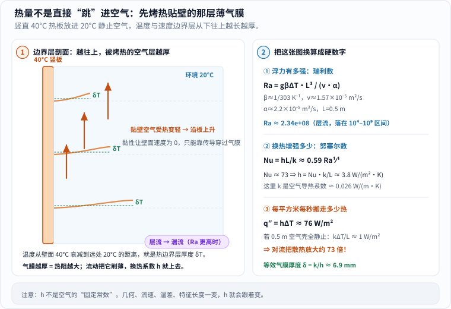
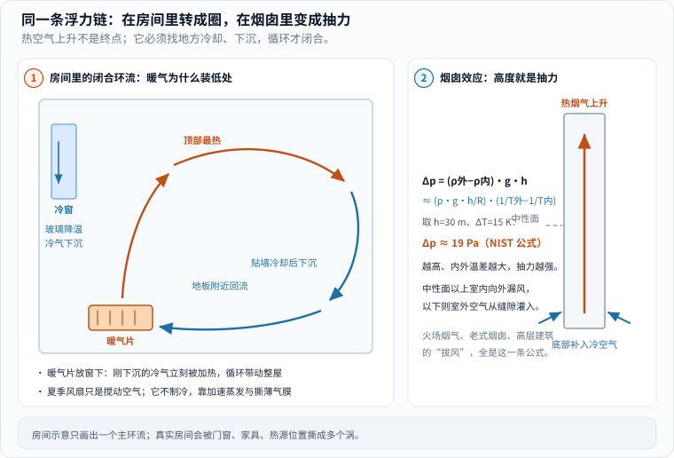
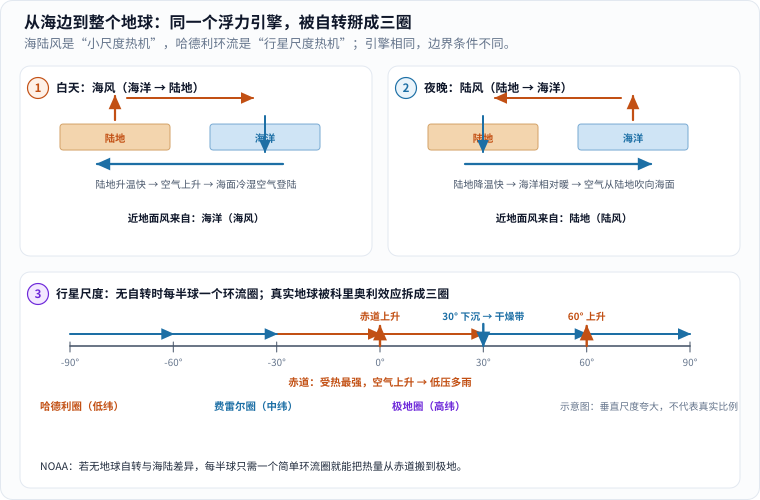

冬天屋里，暖气片安安静静蹲在窗台下面；夏天卧室，空调出风口高高地对着天花板吹。

所有人从小都被灌输过一句解释：**“热空气轻，往上走；冷空气重，往下沉。”**

这句话不算错，但它只是一张没有盖章的“收据”——真正的问题全被跳过去了：

- 热空气凭什么“轻”？凭什么它一轻，就有人把它往上推？把重力拿走，它还往哪儿“上”？
- 暖气烧了半天，为什么摸天花板比摸地板还暖？风扇吹了半小时，**室温一点没降**，人却凉快了，这算哪门子降温？
- 同样是加热，为什么薄薄一层空气能老老实实隔热，把间隙加宽一点反而突然“漏热”？
- 海边的风，为什么白天从海上吹向陆地，夜里又偷偷掉头？到了全球尺度，为什么一台“赤道热机”会被地球自转拆成三个圈？

这些问题看起来风马牛不相及，其实共用同一台发动机：**空气对流**。它本质上只做一件事——用**流动的空气**当搬运工，把热量从一个地方送到另一个地方。

今天我们就顺着“热团受力 → 贴壁气膜 → 对流启动门槛 → 建筑抽力 → 行星环流”这条线，把这台发动机从螺丝钉拆到整机。

---

## 一、“热空气往上跑”：推它的不是热，是重力

### 1. 先算一笔浮力账：3.3% 的密度差，够不够把一立方米空气举起来？

先把这句常识翻译成物理语言。常温常压下的干燥空气近似满足理想气体状态方程，在压强基本相同的情况下：

$$
\rho = \frac{p}{RT} \quad\Longrightarrow\quad \rho \propto \frac{1}{T}
$$

注意这里的 $$T$$ 必须是**绝对温度（开尔文）**。取 $$20^\circ\mathrm{C} = 293.15\ \mathrm{K}$$ 时空气密度约 $$\rho_{20} = 1.205\ \mathrm{kg/m^3}$$ [[9]](#ref-9)，那么 $$30^\circ\mathrm{C} = 303.15\ \mathrm{K}$$ 的热空气密度就是：

$$
\rho_{30} = 1.205 \times \frac{293.15}{303.15} \approx \mathbf{1.165\ \mathrm{kg/m^3}}
$$

仅仅 **$$10^\circ\mathrm{C}$$** 的温差，密度只差了：

$$
\frac{\Delta\rho}{\rho} = \frac{1.205 - 1.165}{1.205} \approx \mathbf{3.3\%}
$$

接下来才是关键一步。热空气不是自己“想”上升：它浸在一片更重的冷空气里，而**冷空气在重力作用下建立起“下高上低”的气压梯度**。一团体积为 $$V$$ 的热空气所受的净浮力，就是阿基米德浮力减去自身重力：

$$
F_{\text{净}} = (\rho_{\text{冷}} - \rho_{\text{热}})\, g V
$$

代入 $$V = 1\ \mathrm{m^3}$$：

$$
F_{\text{净}} \approx 0.040\ \mathrm{kg/m^3} \times 9.81\ \mathrm{m/s^2} \times 1\ \mathrm{m^3} \approx \mathbf{0.39\ \mathrm{N}}
$$

再用 $$a = F/m$$ 看看它一开始能冲多快：

$$
a = \frac{0.39\ \mathrm{N}}{1.165\ \mathrm{kg}} \approx \mathbf{0.33\ \mathrm{m/s^2}} \approx 3.4\%\,g
$$

**只有 $$3.4\%$$ 个重力加速度。** 这就是为什么房间里的气流慢悠悠的，而不是像电梯一样“嗖”地窜上去：驱动力本来就小，还要被黏性、湍流混合不断消耗。

_图 1：怎么看这张图？左栏先盯住环境里的两条蓝色箭头——下方压强大、上方压强小，这是冷空气的重力通过压力场“铺”出来的背景；再看中间的橙色热团：它只比环境轻 3.3%，于是被净浮力 $$(\rho_{\text{冷}}-\rho_{\text{热}})gV$$ 往上托，初始加速度约 $$0.33\ \mathrm{m/s^2}$$。右栏是反证：烛焰在地球上是尖的，是因为热气上升、冷空气从下方补位；国际空间站的微重力里这套环流消失，火焰变成球形 [[1]](#ref-1)。支持动画的浏览器会在加载时播放一次热团上升与冷气补位，然后定格终态；开启系统“减少动态效果”时直接显示完整静态图。_

### 2. 一个太空实验，判定“热”本身不是推力

NASA 的解释干脆利落：地球上的烛焰之所以是尖的、还会跳，是因为“较轻的热气上升，被较重的环境空气从下方补位”；**在微重力里，that circulation effect does not happen**，火焰于是变成球形 [[1]](#ref-1)。

这个反例把概念一下子劈开了：

- **热传导、热辐射**不依赖重力：在空间站里，热照样能从热端跑到冷端；
- **风扇驱动的强迫对流**也不依赖重力：靠的是风扇给的压差；
- 只有靠密度差自己动起来的**自然对流（自由对流）**，才是重力的孩子。

所以准确的说法不是“热往上走”，而是：

> **在有重力的流体里，局部受热造成的密度差，会被重力转化为净浮力；浮力推动流体运动，运动再把热量搬走。**

顺带解决一个常见追问：“热团是不是会一路飞到宇宙里去？”当然不会。它撞上天花板后横着摊开、逐渐冷却、变重，再从别处下沉——**必须闭合，才叫环流**。这就是下一节房间里的故事。

---

## 二、热量先被一层“贴壁气膜”卡住：边界层与换热系数

### 1. 静止空气其实是挺好的保温材料

暖气管里的水有 $$60^\circ\mathrm{C}$$，可你把手伸到离管子半米远的地方，几乎感觉不到热。原因很简单：**静止空气的导热系数只有 $$k \approx 0.026\ \mathrm{W/(m\cdot K)}$$**，比液态水（约 $$0.60$$）低二十多倍 [[2]](#ref-2)[[9]](#ref-9)。羽绒服、双层玻璃、泡沫塑料，锁住的都是这层“不肯动的空气”。

可只要空气**动起来**，情况立刻反转。热量先从壁面传给紧贴壁面的那一薄层空气——这一层只能靠传导；随后这层被烤热的空气被浮力带走，新的冷空气补上来。温度剧烈变化的这一薄层，就叫**热边界层**。

工程上把这一整套复杂过程打包成一个数：

$$
q'' = h\,(T_s - T_\infty)
$$

这就是牛顿冷却定律：热流密度等于换热系数 $$h$$ 乘以温差。而 $$h$$ 的物理意义，正好可以理解为“把这层气膜换成多厚的静止空气”：

$$
h \approx \frac{k}{\delta_{\text{eff}}}
$$

气膜越厚，热阻越大；流动把气膜削薄，$$h$$ 就飙升。

### 2. 硬算一遍：一块 0.5 米高的热板，对流到底放大多少倍？

设一块竖直平板表面 $$40^\circ\mathrm{C}$$，房间空气 $$20^\circ\mathrm{C}$$，板高 $$L = 0.5\ \mathrm{m}$$。取膜温约 $$30^\circ\mathrm{C}$$ 的空气物性：$$\beta \approx 1/303\ \mathrm{K^{-1}}$$、$$\nu \approx 1.57\times10^{-5}\ \mathrm{m^2/s}$$、$$\alpha \approx 2.2\times10^{-5}\ \mathrm{m^2/s}$$、$$k \approx 0.026\ \mathrm{W/(m\cdot K)}$$ [[2]](#ref-2)。

第一步，看浮力相对于黏性和热扩散有多强，也就是**瑞利数**：

$$
Ra_L = \frac{g\beta\,\Delta T\, L^3}{\nu\alpha}
= \frac{9.81 \times (1/303) \times 20 \times 0.5^3}{1.57\times10^{-5}\times2.2\times10^{-5}}
\approx \mathbf{2.3\times 10^8}
$$

第二步，用竖直等温平板在 $$10^4 < Ra < 10^9$$ 区间的经典关联式，把瑞利数翻译成换热能力 [[2]](#ref-2)：

$$
\overline{Nu}_L = 0.59\,Ra_L^{1/4} \approx \mathbf{73}, \qquad
\overline{Nu}_L = \frac{hL}{k}
$$

于是：

$$
h = \frac{Nu\cdot k}{L} \approx \frac{73\times0.026}{0.5} \approx \mathbf{3.8\ \mathrm{W/(m^2\cdot K)}}
$$

每平方米热板每秒钟搬走的热量：

$$
q'' = h\Delta T \approx 3.8\times20 \approx \mathbf{76\ \mathrm{W/m^2}}
$$

做个残酷对比：假如这半米空气**一动不动**，纯导热只有

$$
q''_{\text{静}} = \frac{k\Delta T}{L} = \frac{0.026\times20}{0.5} \approx \mathbf{1\ \mathrm{W/m^2}}
$$

**同样一块板，对流把散热放大了约 73 倍**——这个倍数正好就是努塞尔数 $$Nu$$ 的定义。

_图 2：怎么看这张图？左栏从下往上读：板面附近的橙线是温度剖面，绿色短线标出热边界层厚度 $$\delta_T$$，它越往上越厚；橙色箭头说明贴壁空气被加热后沿板上升。右栏依次算三笔账：瑞利数约 $$2.3\times10^8$$、努塞尔数约 73、换热系数约 $$3.8\ \mathrm{W/(m^2\cdot K)}$$、热流约 $$76\ \mathrm{W/m^2}$$。最后一行的“等效气膜厚度” $$k/h \approx 6.9\ \mathrm{mm}$$ 是把对流折算成静止空气层的直观尺子。_

### 3. 电风扇从来没有让房间降温

既然 $$h$$ 取决于气膜厚度，那么风扇的作用就很清楚了：**它用高速气流把 $$4\ \mathrm{mm}$$ 左右的贴皮暖空气层撕薄，让皮肤热量更快跑掉**。室温一点没变，人体散热功率却翻了几倍——这正是我们在[《哈气暖手、吹气冰凉》]()里算过的“$$4\ \mathrm{mm}$$ 空气羽绒服”和湍流卷吸。

区分两种对流，关键看是谁在推：

| 类型 | 推力来源 | 典型场景 | 判据（数量级） |
| :--- | :--- | :--- | :--- |
| **自然对流** | 密度差 × 重力 | 暖气上方的热浪、烛焰、烟囱 | $$Gr/Re^2 \gg 1$$ |
| **强迫对流** | 风扇、泵、风压 | 吹风扇、CPU 散热器、空调室内机 | $$Gr/Re^2 \ll 1$$ |
| **混合对流** | 两者相当 | 开着风扇的暖气房 | $$Gr/Re^2 \sim 1$$ |

（$$Gr = g\beta\Delta T L^3/\nu^2$$ 是格拉晓夫数，$$Re$$ 是雷诺数；判据形式见 [[2]](#ref-2)。）真要给房间降温，得靠[空调那样把热搬到室外]()，风扇只是帮你把身上的热更快交给房间。

---

## 三、不是一加热就对流：瑞利数 1708 那道看不见的门槛

### 1. 一层薄油里长出的蜂巢：从贝纳德到瑞利

故事要从实验室说起。**1870 年**，爱尔兰物理学家詹姆斯·汤姆森（James Thomson）看到盆里冷却的水面上浮着一层“铺砖”一样的肥皂膜；**1882 年**他指出那是**对流胞**在作怪。到了 **1900 年**，法国物理学家**亨利·贝纳德（Henri Bénard）**用薄层液体做加热实验，看见液面自发排成整整齐齐的六角蜂房 [[5]](#ref-5)。

**1916 年**，瑞利勋爵在《哲学杂志》发表那篇著名论文《论下层温度较高时水平流体层中的对流》，开头就写：这是想看看贝纳德那些精巧实验的结果能在多大程度上被理论解释 [[4]](#ref-4)。瑞利证明：**只有当浮力足够强，强到压过黏性的阻尼和热扩散的“抹平”，静止的传导状态才会失稳，对流胞才突然出现。**

这个“比分”就是我们刚才见过的瑞利数：

$$
Ra = \frac{g\beta\,\Delta T\, d^3}{\nu\,\alpha}
$$

- **分子**是浮力驱动力：重力 $$g$$、热膨胀系数 $$\beta$$、温差 $$\Delta T$$；
- **分母**是两个稳定器：运动黏度 $$\nu$$（黏性阻尼）和热扩散率 $$\alpha$$（把温差抹平）；
- 最要命的是 **$$d^3$$**：层厚翻倍，浮力效应涨 **8 倍**。

### 2. 1708：为什么偏偏是这个数字？

对上下恒温、下热上冷的水平流体层做线性稳定性分析，可以得到一个临界条件 [[3]](#ref-3)：

- 上下**刚壁无滑移**：$$Ra_c \approx \mathbf{1707.76 \approx 1708}$$；
- 上下**自由滑移**：$$Ra_c = \dfrac{27\pi^4}{4} \approx \mathbf{657.5}$$。

刚壁有摩擦，更不容易流动，所以门槛更高。$$Ra < Ra_c$$ 时，热量只能乖乖靠传导穿过静止流体；$$Ra > Ra_c$$ 时，微小的温度扰动会被浮力放大，流体自发卷成条带或六角形对流胞——这便是**自组织**的经典范本 [[3]](#ref-3)[[5]](#ref-5)。

_图 3：怎么看这张图？左栏上下对照：上半部 $$Ra<1708$$，等温线笔直，空气静止，热量靠传导；下半部 $$Ra>1708$$，橙色上升支与蓝色下沉支卷成规则对流胞。右栏给出 $$Ra_c=1708$$（刚壁）与 $$27\pi^4/4\approx657.5$$（自由壁），再用中空玻璃实战：取 $$\Delta T=10\ \mathrm{K}$$、平均 $$10^\circ\mathrm{C}$$，间隙 8 mm 时 $$Ra\approx620<1708$$（近似纯传导），12 mm 时约 2092（对流启动），20 mm 时约 9700（漏热更厉害）。底部对数尺把三个数放在同一条线上。橙色对流胞虚线只播放一次并停在完整终态；开启“减少动态效果”时直接显示静态图。_

### 3. 中空玻璃的“反直觉”：空气层不是越厚越保温

拿家里的双层玻璃验算一下。两层玻璃之间夹着空气，冬天室内外温差取 $$10\ \mathrm{K}$$，空气平均温度约 $$10^\circ\mathrm{C}$$（$$\beta \approx 1/283\ \mathrm{K^{-1}}$$，$$\nu \approx 1.43\times10^{-5}$$、$$\alpha \approx 2.0\times10^{-5}\ \mathrm{m^2/s}$$）[[2]](#ref-2)：

$$
\begin{aligned}
d = 8\ \mathrm{mm} &: \quad Ra \approx \mathbf{620} < 1708 \quad \text{（静止，靠传导）}\\
d = 12\ \mathrm{mm} &: \quad Ra \approx \mathbf{2092} > 1708 \quad \text{（对流启动）}\\
d = 20\ \mathrm{mm} &: \quad Ra \approx \mathbf{9700} \quad \text{（对流旺盛，隔热变差）}
\end{aligned}
$$

这就是 $$d^3$$ 的威力，也是中空玻璃不能一味把空气层做厚的原因：（注：这里用水平层的 1708 做**数量级估算**，真实竖直窗腔的临界值还随高宽比变化，但“越过临界值后隔热变差”的结论不变。）类似逻辑还管着地暖、暖气片、CPU 散热片间隙的设计——**要么让流体彻底别动，要么让它动得够狠，最怕卡在刚要动又没动好的中间地带。**

---

## 四、房间、烟囱与 19 帕的抽力：把浮力接进管道

### 1. 暖气片为什么要贴着冷窗户装？

回到开头的房间。暖气片加热身边空气 → 热空气沿墙上升 → 贴着天花板横向铺开 → 碰到冷窗户和外墙后冷却下沉 → 沿地板回暖气片。一个闭合环流就此形成。

把暖气片装在**冷窗下方**，是有讲究的：窗户附近下沉的冷空气还没来得及在脚边堆成“冷湖”，就被暖气片原地加热重新送上去。相反，如果把暖气片装在房间内侧的高处，热空气会直接沿着天花板跑掉，人在地板附近仍旧凉飕飕。

同理，很多空调和风扇都有“**冬季模式**”：把风**向下**吹，搅动积压在天花板的暖空气重新参与循环（夏天则向上吹，让冷风自然下沉，避免直吹人体）[[2]](#ref-2)。[火苗为什么往上蹿]()，也是同一条链条在燃烧场景里的表演。

### 2. 烟囱效应：高度就是抽力

如果把上面那个房间竖起来，拉高到几十米，浮力压差会累积成看得见的“抽力”。

设室内外空气密度分别为 $$\rho_i$$、$$\rho_o$$，在**中性面**（室内外压力恰好相等的高度）上下取一段高度 $$h$$，则由静水压 $$dp/dz=-\rho g$$ 直接得到 [[8]](#ref-8)：

$$
\Delta p = p_i - p_o = (\rho_o - \rho_i)\,g\,h
$$

对理想气体代入 $$\rho = p_{\text{atm}}/(RT)$$，可写成实用形式：

$$
\Delta p = \frac{p_{\text{atm}}\,g}{R}\left(\frac{1}{T_o} - \frac{1}{T_i}\right)h
\approx 3460\,h\left(\frac{1}{T_o} - \frac{1}{T_i}\right)\ \mathrm{Pa}
$$

（$$T_o,T_i$$ 用开尔文，$$h$$ 用米。）

取一栋 30 m 高的建筑，室内 $$20^\circ\mathrm{C}$$、室外 $$5^\circ\mathrm{C}$$：

$$
\Delta p \approx 3460\times30\times\left(\frac{1}{278.15} - \frac{1}{293.15}\right) \approx \mathbf{19\ \mathrm{Pa}}
$$

**约 19 帕听着不大，但持续作用在整栋楼的缝隙和竖井上，就是冬天大门难推开、楼梯间“嗖嗖”进风、高层烟道倒灌的根源。** 中性面以上室内向外漏热，以下室外冷空气灌入；烟囱、火场竖井、高层建筑通风全吃这碗饭 [[8]](#ref-8)。

_图 4：怎么看这张图？左栏跟着箭头走一圈：窗边冷气下沉 → 暖气片加热 → 沿天花板铺开 → 远墙冷却下沉 → 沿地板回流。右栏看烟囱：橙色箭头是热烟气上升，蓝色箭头是底部补气；公式 $$\Delta p=(\rho_{\text{外}}-\rho_{\text{内}})gh$$ 在 30 m、内外温差 $$15^\circ\mathrm{C}$$ 时给出约 19 Pa，虚线标出中性面。_

---

## 五、从一阵海风到三圈环流：行星尺度的同一台热机

### 1. 海陆风：每天准时掉头的热机

白天，陆地吸收太阳能后升温快，海面因为水的**透明性让阳光穿透到深处**、加上风浪不断把热量搅进厚厚的水层，温度上升得慢得多 [[6]](#ref-6)。于是陆地上方空气更热、更轻，上升；海面上较冷较湿的空气贴着地面补进来——这就是**海风**。

夜里反过来：陆地散热快，海面相对温暖，上升区挪到海上，近地面风从陆地吹向海洋——**陆风** [[6]](#ref-6)。这不是什么神秘节律，就是一台以 24 小时为周期翻转方向的浮力热机。

### 2. 地球自转把“一个圈”掰成“三个圈”

把尺度放大到全球：太阳对赤道加热最强。NOAA 说，假如地球**不自转、不倾斜、没有海陆差异**，每个半球只需要一个简单的大环流圈：赤道上升、高空奔向极地、极地冷却下沉、近地面返回赤道，热量就搬完了 [[7]](#ref-7)。

真实地球多了两件事：**自转带来的科里奥利效应**和**海陆分布不均**。结果每个半球被拆成三圈 [[7]](#ref-7)：

- **哈德利圈**（低纬）：赤道附近上升，约 $$30^\circ$$ 下沉——下沉区晴朗干燥，地球上大量沙漠正卡在南北纬 30° 附近；
- **费雷尔圈**（中纬）与**极地圈**（高纬）：在 $$50^\circ\text{–}60^\circ$$ 附近形成上升带，那里风暴和降水频繁；
- 乔治·哈德利 1735 年提出单圈模型，威廉·费雷尔 1856 年补上中纬圈，名字就这么留了下来 [[7]](#ref-7)。

_图 5：怎么看这张图？先看上排两幅小图：陆地永远画在左、海洋永远画在右，白天暖侧是陆地，热空气上升后高空流向海洋、近地面海风登陆；夜晚暖侧换成海洋，箭头整体掉头。再看下排：赤道上升、$$30^\circ$$ 下沉、$$60^\circ$$ 上升、极地下沉，三个环流圈首尾相接。**注意：垂直尺度被刻意夸大，示意图不代表真实大气厚度比例。**_

从 $$0.33\ \mathrm{m/s^2}$$ 的一立方米热团，到裹住整颗行星的环流圈，物理规律没有换：**温差造密度差，重力把密度差变成压强差，压强差推动流体搬运热量。**

---

## 六、一页总表与四个常见误区

| 场景 | 谁在推 | 关键判据 / 公式 | 本文算出的数 | 结论 |
| :--- | :--- | :--- | :--- | :--- |
| 房间里的热团 | 自然对流（浮力） | $$F=(\rho_{\text{冷}}-\rho_{\text{热}})gV$$ | 密度差 3.3%，$$a\approx0.33\ \mathrm{m/s^2}$$ | 推力来自重力，不是“热”本身 |
| 竖直热板 | 自然对流边界层 | $$Ra=g\beta\Delta T L^3/(\nu\alpha)$$，$$Nu=0.59Ra^{1/4}$$ | $$Ra\approx2.3\times10^8$$，$$Nu\approx73$$ | 对流比纯导热强约 73 倍 |
| 吹风扇的人 | 强迫对流 | 削薄热边界层 $$\delta\approx k/h$$ | 静止时约 4 mm 气膜被撕薄 | 人凉快，房间没降温 |
| 中空玻璃间隙 | 瑞利数门槛 | $$Ra_c\approx1708$$（刚壁水平层） | 8 mm→620；20 mm→约 9700 | 空气层太厚反而漏热 |
| 高层建筑烟囱 | 浮力压差累积 | $$\Delta p=(\rho_o-\rho_i)gh$$ | 30 m、$$\Delta T=15\ \mathrm{K}$$ → 约 19 Pa | 高度就是抽力 |
| 海风 / 三圈环流 | 行星尺度自然对流 | 表面受热不均 + 科里奥利效应 | 每半球 3 个环流圈 | 同一台热机换了个尺度 |

四个最容易踩的坑，顺便一次拆掉：

1. **“热自己想往上走。”** 没有重力，就没有自然对流；有的只是传导、辐射和风扇。
2. **“风扇给房间降温。”** 它只改写你皮肤表面的边界层；关掉风扇，房间热量一点没少。
3. **“空气层越厚越保温。”** $$Ra\propto d^3$$，越厚越容易越过 1708 那条线，从隔热变成搬运。
4. **“有温差就一定有对流。”** 还要看黏性、热扩散和几何尺度；薄层里静止传导完全可以稳定存在。

下次站在暖气片旁边感受那股慢慢上升的暖流，或者站在海边等傍晚风转向时，你看到的就不只是天气——而是一整条从阿基米德浮力一路延伸到大气环流的物理链，正在你身边安静地运转。

---

## 参考资料与核查来源

1. **NASA Science (2024)**, *Why NASA is studying flames in space*. [NASA 官方科普页](https://science.nasa.gov/biological-physical/resources/explainers-infographics/why-nasa-is-studying-flames-in-space/) —— 支持正文中“地球烛焰因热气上升、冷空气下方补位而呈尖形，微重力下环流消失、火焰呈球形”的反证。
2. **F. P. Incropera / A. F. Mills 等《Fundamentals of Heat and Mass Transfer》第 9 章 Natural Convection 教学 PDF**（[在线核查页](https://dl.icdst.org/pdfs/files3/292afddae1ad300b062986a712a49b59.pdf)）—— 支持竖直等温平板关联式 $$\overline{Nu}_L=0.59Ra_L^{1/4}\ (10^4<Ra<10^9)$$ 与 Churchill–Chu 全区间式、$$Gr/Re^2$$ 混合对流判据及常温空气物性取值。
3. **威斯康星大学麦迪逊分校应用数学课程讲义**, *Derive the onset of instability for Rayleigh–Bénard convection*（[PDF](https://people.math.wisc.edu/~chr/am205/g_act/fluid_note.pdf)）—— 支持瑞利数定义、自由边界临界值 $$27\pi^4/4\approx657.5$$、刚壁临界值约 1707.76 及稳定性分析推导。
4. **Lord Rayleigh (1916)**, *On convection currents in a horizontal layer of fluid, when the higher temperature is on the under side*, *Philosophical Magazine*, Series 6, **32**(192), 529–546（[zbMATH 目录记录](http://www.zbmath.org/46.1249.04)，[原文 PDF](http://fig.if.usp.br/~marchett/fluidos/convection_rayleigh-1916.pdf)）—— 支持正文历史时间线及瑞利对贝纳德实验的理论解释。
5. **法国科学院《Comptes Rendus Mécanique》综述 (2017)**, *Henri Bénard: Thermal convection and vortex shedding*（[原文 PDF](https://comptes-rendus.academie-sciences.fr/mecanique/item/10.1016/j.crme.2017.06.006.pdf)）—— 支持贝纳德实验与瑞利 1916 年论文的先后关系及六角对流胞的历史叙述。
6. **NOAA / National Data Buoy Center**, *What are sea breezes and why do they occur?*（[官方页面](https://www.ndbc.noaa.gov/education/seabreeze_ans.shtml)）与 **NOAA JetStream**, *The Sea Breeze*（[官方页面](https://www.noaa.gov/jetstream/ocean/sea-breeze)）—— 支持海风/陆风昼夜反转成因，以及水体透明性与混合导致海面升温慢的解释。
7. **NOAA JetStream (2023)**, *Global Atmospheric Circulations*（[官方页面](https://www.noaa.gov/jetstream/global/global-atmospheric-circulations)）—— 支持“无自转行星每半球一个环流圈”、科里奥利效应将其拆成哈德利/费雷尔/极地三圈、30° 下沉干燥带与 50°–60° 上升风暴带，以及哈德利 1735 年、费雷尔 1856 年的历史年份。
8. **NIST (1989)**, *Considerations of stack effect in building fires*, NISTIR 89-4035（[NIST 原文 PDF](https://nvlpubs.nist.gov/nistpubs/Legacy/IR/nistir89-4035.pdf)）—— 支持烟囱效应压差公式 $$\Delta p=(\rho_o-\rho_i)gh$$、理想气体形式 $$3460h(1/T_o-1/T_i)$$ 及中性面定义。
9. **The Engineering ToolBox**, *Air Properties – Density, Viscosity, Heat Capacity, Thermal Conductivity, and more*（[数据页](https://www.engineeringtoolbox.com/air-properties-d_156.html)）—— 支持正文采用的 $$20^\circ\mathrm{C}$$ 空气密度 $$1.205\ \mathrm{kg/m^3}$$ 及常温空气导热系数量级。
10. **原创图解说明**：图 1 至图 5 均由本站 `tools/visuals.py build air-convection` 根据文中公式与实测物性原创生成，含 XML、宽高比、字号与数值断言检查；动画只播放一次并响应系统“减少动态效果”设置。
