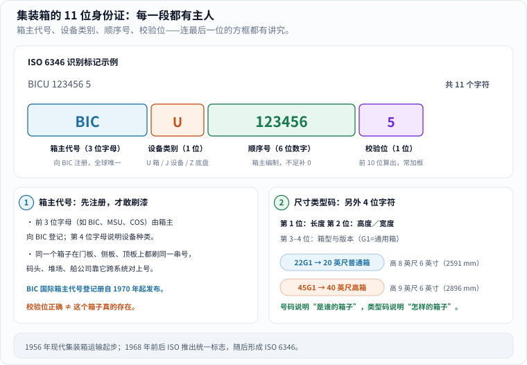
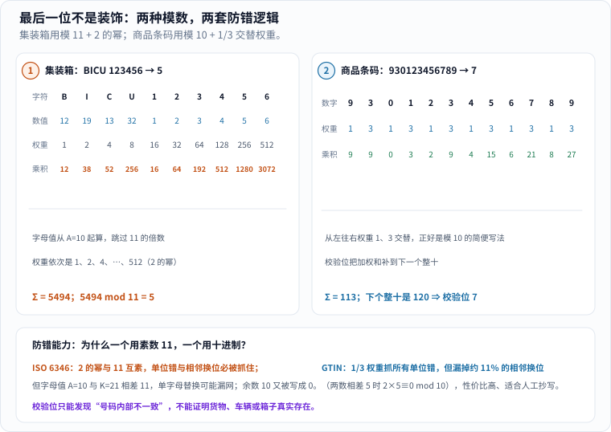
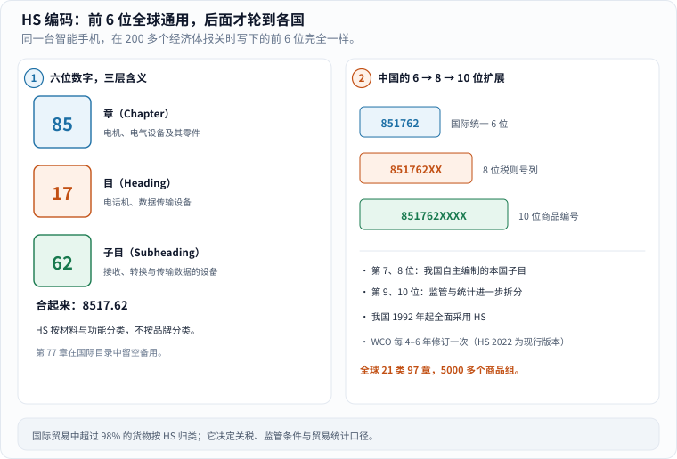
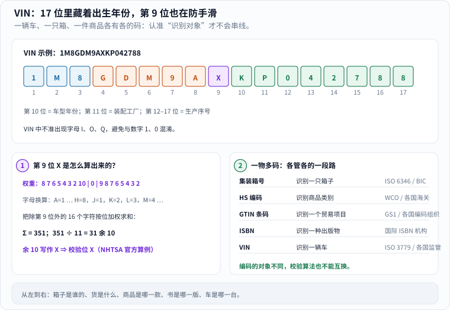

在码头堆场，一只集装箱的门板上刷着 `BICU 123456 5`。

在超市货架，一盒饼干的包装印着 `6901234567892`。

在行驶证上，一辆车的身份写成 `1M8GDM9AXKP042788`。

三串字符，三个行业，看起来毫无关系。但它们都遵守同一条朴素的设计原则：**把身份写成一串有结构的字符，再在末尾加一位“自查错字”的校验码**。

问题来了：最后那一位 `5`、`2`、`X` 到底是怎么算出来的？为什么有的编码用 11 做模数，有的用 10？为什么有人说“条码 690 开头表示含激素”，而这句话又错得离谱？

这篇文章就顺着“集装箱号 → 校验算法 → HS 商品分类 → 零售条码 → 车辆 VIN”这条线，把商品世界里最常用的几套编码一次讲清楚。

---

## 一、集装箱号：11 个字符，每一段都有主人

### 1. 拆开 `BICU 123456 5`

按 **ISO 6346** 标准，一个完整的集装箱识别标记由 **11 位字符**组成 [[1]](#ref-1)[[2]](#ref-2)：

| 位置 | 内容 | 含义 |
| :--- | :--- | :--- |
| 第 1–3 位 | `BIC` | **箱主代号**，由箱主向国际集装箱局 BIC 注册，全球唯一 |
| 第 4 位 | `U` | **设备类别**：`U` = 货运集装箱，`J` = 可拆式集装箱设备，`Z` = 底盘车／挂车 |
| 第 5–10 位 | `123456` | **顺序号**，箱主自己编制，不足 6 位前面补 0 |
| 第 11 位 | `5` | **校验位**，由前 10 位算出，通常印在一个小方框里 |



_图 1：怎么看这张图？先看顶部那串被四色框切开的 `BICU 123456 5`——四种颜色正好对应箱主、类别、顺序号、校验位四段。再看右栏另外 4 位“尺寸类型码”：`22G1` 表示 20 英尺普通箱（高 2591 mm），`45G1` 表示 40 英尺高箱（高 2896 mm）。**箱号回答“这是谁的箱子”，类型码回答“这是个什么样的箱子”。** 同一串号会刷在门板、侧板和顶板上，让码头、堆场、船公司在各自系统里对上同一只箱子。[单独打开图片](/assets/images/commodity-codes/container-number-anatomy.svg)_

有意思的是，这套规矩的年代很早：现代集装箱运输在 1956 年前后起步，1968 年前后 ISO 开始统一集装箱标志，随后形成 ISO 6346；国际箱主代号登记册从 1970 年起陆续发布 [[2]](#ref-2)[[4]](#ref-4)。也就是说，在条形码普及之前，集装箱就已经有了全球通用的“身份证格式”。

### 2. 一个必须纠正的直觉：校验位正确，不等于箱子真实存在

这一点值得单独拎出来说。校验位只能证明：

> **这 11 位字符内部是自洽的——末尾那一位确实等于前 10 位按规则算出来的值。**

它不证明这只箱子在册、不证明箱主真实、也不证明箱子里装的东西和报关单一致。它是一个**抄写错误检测器**，不是防伪印章 [[3]](#ref-3)。

---

## 二、最后一位是怎么算出来的：模 11 与 2 的幂

### 1. 先把字母变成数字

ISO 6346 的校验算法，第一步是给字母赋值。规则很怪但很有讲究：

```
A=10, B=12, C=13, D=14, …, J=20, K=21, L=23, …, U=32, V=34, …, Z=38
```

也就是从 10 开始递增，但**跳过 11 的倍数**（11、22、33），这样每个字母值都不会是 11、22、33 [[1]](#ref-1)[[3]](#ref-3)。

### 2. 加权求和，再除以 11

取前 10 位字符，从第 1 位到第 10 位分别乘以权重

$$
1,\ 2,\ 4,\ 8,\ 16,\ 32,\ 64,\ 128,\ 256,\ 512 \quad (2^0 \sim 2^9)
$$

把乘积加起来，除以 11 取余数；**余数就是校验位，余数为 10 时写 0** [[1]](#ref-1)[[3]](#ref-3)。

拿 `BICU 123456` 实算一遍。字母换算：`B=12`、`I=19`、`C=13`、`U=32`。

$$
\begin{aligned}
\Sigma =\;&12\times1 + 19\times2 + 13\times4 + 32\times8\\
&+ 1\times16 + 2\times32 + 3\times64 + 4\times128\\
&+ 5\times256 + 6\times512\\
=\;&12+38+52+256+16+64+192+512+1280+3072\\
=\;&\mathbf{5494}
\end{aligned}
$$

$$
5494 \div 11 = 499 \text{ 余 } \mathbf{5}
$$

于是校验位就是 **5**，完整箱号 `BICU1234565`。这个算法还能反推出别的公开算例：`CSQU3054383`、`MSKU3881107`、`SUDU3070079` 都满足同一条规则 [[1]](#ref-1)[[3]](#ref-3)。



_图 2：怎么看这张图？左栏是集装箱的算例：四行依次列出字符、数值、权重、乘积，最下面 `5494 mod 11 = 5`。右栏是商品条码的算例：`930123456789` 交替乘 1 和 3 得 113，补到整十 120，校验位为 7。把两栏对着看就能发现：一个在“除以素数取余”，一个在“补到整十”。[单独打开图片](/assets/images/commodity-codes/check-digit-mod11-vs-mod10.svg)_

### 3. 为什么偏偏是 11，偏偏是 2 的幂？

这背后是数论里很干净的一条性质。

**11 是素数**，而 $$2^0,2^1,\ldots,2^9$$ 中没有一个能被 11 整除。假设某一位写错了，差错量是 $$\Delta$$（$$1\le|\Delta|\le9$$），它落在权重 $$w$$ 上，加权和的改变量就是 $$\Delta w$$。因为 $$w$$ 与 11 互素、$$|\Delta|<11$$，所以 $$\Delta w \not\equiv 0 \pmod{11}$$——**任何一位数字写错都逃不掉**。

再看相邻两位互换：原来贡献是 $$aw + b(2w)$$，换后是 $$bw + a(2w)$$，相差 $$(a-b)w$$。同样因为 $$w$$ 与 11 互素且 $$|a-b|<11$$，这个差不可能被 11 整除——**相邻换位也能全部抓到**。

但这套算法有两个漂亮的“漏洞”：

1. 字母值刻意跳过了 11 的倍数，于是 `A=10` 与 `K=21` 相差正好 11。抄写时把 `A` 误写成 `K`，加权和的变化是 $$11w \equiv 0 \pmod{11}$$——**校验位照样对** [[3]](#ref-3)。
2. 余数 10 被约定写成 0，意味着两个不同的原编号可能共享同一个校验位 [[1]](#ref-1)。

结论依旧是那句：**校验位防的是手滑，不是造假。**

---

## 三、HS 编码：商品的“海关普通话”

### 1. 六位数字，全球通用

集装箱号识别的是**一只箱子**；箱子里的货，靠另一套编码识别——**HS 编码**（《商品名称及编码协调制度》）。

世界海关组织（WCO）给出的官方数字是：HS 把商品分成 **5000 多个商品组**，每个用 **6 位数字**标识；全球 **200 多个国家和地区**采用；国际贸易中 **超过 98% 的货物**按 HS 归类；每 **5–6 年**修订一次（我国财政部的表述是 4–6 年）[[5]](#ref-5)[[6]](#ref-6)。

六位数字的结构像一棵树：

- **前 2 位**：章（Chapter），如 `85` = 电机、电气设备及其零件；
- **前 4 位**：目（Heading），如 `8517` = 电话机、数据传输设备；
- **6 位**：子目（Subheading），如 `8517.62` = 数据接收、转换与传输设备。



_图 3：怎么看这张图？左栏把 `85 | 17 | 62` 三层逐级展开，越往下分类越细。右栏讲中国的做法：在 6 位国际编码后面加 2 位本国子目，形成 **8 位税则号列**；实际报关时再细分到 **10 位商品编号**。我国从 **1992 年 1 月 1 日**起全面采用 HS [[6]](#ref-6)。[单独打开图片](/assets/images/commodity-codes/hs-code-hierarchy.svg)_

### 2. HS 不认识品牌，只认识材料和功能

这是 HS 与商品条码最大的差别。HS 关心的是“这是一类什么东西”，用来定关税、做统计、执行管制；它不关心这是哪个牌子、哪个型号、哪一批次。

所以同一台智能手机，在 200 多个经济体报关时写下的**前 6 位完全一样**；但不同国家可以在后面续上自己的子目，就像同一棵树长出不同侧的枝条 [[5]](#ref-5)[[6]](#ref-6)。

---

## 四、EAN-13 条码：前缀不是“成分密码”

### 1. 13 位的结构与校验

超市里最常见的零售商品条码是 **EAN-13**，在 GS1 体系里也叫 **GTIN-13**。13 位依次是：

$$
\underbrace{690}_{\text{国家／地区前缀}}\ \underbrace{1234}_{\text{厂商识别代码}}\ \underbrace{56789}_{\text{商品项目代码}}\ \underbrace{2}_{\text{校验位}}
$$

校验算法比集装箱简单：从左往右，前 12 位依次乘 **1、3、1、3……**，把乘积加总，再补到下一个整十。

以 `690123456789` 为例：

$$
\Sigma = 6+27+0+3+2+9+4+15+6+21+8+27 = \mathbf{128}
$$

下一个整十是 130，所以校验位 $$=130-128=2$$，完整条码 `6901234567892`。GS1 官方手册的另一个算例 `930123456789` 加权和为 113，校验位为 7 [[7]](#ref-7)。



_图 4：怎么看这张图？左栏的条码不是随手画的装饰：它按 EAN-13 的 L/G/R 编码表，把 13 位数字逐模块翻译成 95 个黑白模块，两端的长线是起始／中间／终止符；橙色扫描线只播放一次并停在终态。右栏是 `6901234567892` 的校验位计算。底部那句大字请记住：**ISBN-13 以 978/979 开头，用的也是同一套 GTIN 校验算法** [[7]](#ref-7)[[9]](#ref-9)。[单独打开图片（刷新可重播）](/assets/images/commodity-codes/ean13-barcode-anatomy.svg)_

### 2. “690 表示含激素”？这是谣言

中文互联网上流传过一种说法：“条码 690 表示含激素，691 含铅汞，692 是中药……”中国物品编码中心已明确辟谣：**前三位只是 GS1 分配给国家或地区编码组织的前缀码，分配给我国的是 690–699（目前已启用 690–697），与商品质量、成分没有任何关系** [[8]](#ref-8)。

而且前缀也不等于原产地：依法在中国境内有资质的企业（包括外国企业）可以申请以 690 开头的厂商识别代码；反过来，国内生产的商品也可以使用境外注册的条码 [[8]](#ref-8)。

### 3. 为什么模 10 只用 1 和 3？

因为十进制手算要够简单。1/3 交替权重能抓住**所有单数字错误**：某位写错 $$\Delta$$，加权和变化 $$\Delta$$ 或 $$3\Delta$$，模 10 都不可能为 0（$$1\le\Delta\le9$$）。

但相邻换位会漏网。若把相邻的 $$a,b$$ 互换，加权和的改变量是

$$
(3a+b)-(a+3b)=2(a-b)
$$

当 $$a-b\equiv5\pmod{10}$$ 时，$$2\times5=10\equiv0\pmod{10}$$——**校验位竟然不变**。在 $$a\ne b$$ 的 90 种有序组合里，差为 5 的正好 10 种，也就是约 **11%** 的相邻换位抓不到（约 89% 能抓到）。这就是工程上的取舍：比集装箱的模 11 弱一点，但人工核算快得多 [[7]](#ref-7)。

---

## 五、VIN：17 位里藏着出生年份

### 1. 一辆车的身份证

车辆识别代号 **VIN** 共 17 位，分成三段：

- **第 1–3 位**：WMI，世界制造厂识别代码；
- **第 4–8 位**：VDS，车辆特征描述；
- **第 9 位**：校验位；
- **第 10–17 位**：VIS，其中第 10 位是**车型年份**、第 11 位是装配工厂、第 12–17 位是生产序号。

为避免混淆，VIN 中不使用字母 `I`、`O`、`Q`。

### 2. NHTSA 的官方算例

美国国家公路交通安全管理局（NHTSA）给出的例子是 `1M8GDM9AXKP042788` [[10]](#ref-10)：

- 权重依次是 $$8,7,6,5,4,3,2,10,0,9,8,7,6,5,4,3,2$$（第 9 位权重为 0，不参与计算）；
- 字母按专门表换算：`A=1, B=2, …, H=8, J=1, K=2, L=3, M=4, …`；
- 16 个有效位加权求和得 **351**；
- $$351\div11=31\text{ 余 }10$$；
- **余 10 写作 `X`**，于是第 9 位就是 `X`。



_图 5：怎么看这张图？上排 17 个格子按颜色分成 WMI、VDS、校验位、VIS 四段，`X` 被单独框出；左下复算 NHTSA 的 351 与余 10；右下把五套编码放在一起对照——它们识别的对象完全不同，校验算法也不能互换。[单独打开图片](/assets/images/commodity-codes/vin-and-code-ecosystem.svg)_

---

## 六、一张总表，四个别再踩的坑

| 编码 | 识别对象 | 长度 | 校验方式 | 管理机构／标准 |
| :--- | :--- | :--- | :--- | :--- |
| 集装箱号 | 一只箱子 | 11 位 | 前 10 位 × $$2^0\!\sim\!2^9$$，模 11 | ISO 6346 / BIC |
| HS 编码 | 一类商品 | 6 位（各国续位） | 无校验位，靠归类规则 | WCO / 各国海关 |
| GTIN / EAN-13 | 一个贸易项目 | 13 位 | 1/3 交替加权，补到整十 | GS1 |
| ISBN-13 | 一种出版物 | 13 位 | 同 GTIN（978/979 开头） | 国际 ISBN 机构 |
| VIN | 一辆车 | 17 位 | 固定权重，模 11，余 10 写 X | ISO 3779 / 各国监管 |

四个常见误区：

1. **“校验位对，东西就是真的。”** 不对。它只查内部一致性，不查存在性。
2. **“690 开头说明含激素，进口货都是 000 开头。”** 不对。前缀是申请地，不是成分表，也不等于原产地。
3. **“HS 码和商品条码是一回事。”** 不对。HS 管“哪一类货”，GTIN 管“哪一款商品”。
4. **“校验算法越复杂越好。”** 不对。模 11 更强但手算麻烦；模 10 稍弱却适合超级市场的人工录入——工程永远是权衡。

从堆场那只刷着 `BICU 123456 5` 的箱子，到货架上 `6901234567892` 的饼干，再到行驶证上的 VIN，这些编码其实在做同一件事：**给纷繁的物理世界划出可核对的边界，再给每条边界装一个低成本的“自查开关”。** 这就是编码里最有趣的学问。

---

## 参考资料与核查来源

1. <span id="ref-1"></span>**ISO 6346 集装箱识别与校验规则综述**（[Kuyper 技术资料库](https://kuyper-graveertechniek.com/en/knowledge-base/container-number-and-check-digit)）—— 支持箱号 11 位结构、字母赋值、$$1\sim512$$ 权重、模 11 与余数 10 写 0，以及 `22G1`、`45G1` 尺寸类型码。
2. <span id="ref-2"></span>**ISO 6346**（[维基百科条目](https://en.wikipedia.org/wiki/ISO_6346)）—— 支持设备类别字母 `U/J/Z`、箱主代号由 BIC 登记、国际标准化历史与标记位置。
3. <span id="ref-3"></span>**Wolfram Blog (2011)**, *Computing Freight Container Check Digits*（[原文](https://blog.wolfram.com/2011/06/16/mathematica-qa-computing-freight-container-check-digits/)）—— 支持 `MSKU3881107` 等算例，以及“字母值相差 11 的替换会漏检”的局限说明。
4. <span id="ref-4"></span>**开放百科全书**, *集装箱运输与标准化*（[中文页面](https://oenc.org/zh-cn/science/%E7%BB%84%E7%BB%87/transportation/shipping/container/)）—— 支持 1956 年现代集装箱运输起步、1968 年前后 ISO 统一标志的历史叙述。
5. <span id="ref-5"></span>**世界海关组织 WCO**, *What is the Harmonized System (HS)?*（[官方页面](https://www.wcoomd.org/en/topics/nomenclature/overview/what-is-the-harmonized-system.aspx)）—— 支持“5000 多个商品组、6 位编码、200 多个经济体、国际贸易 98% 以上、每 5–6 年修订”。
6. <span id="ref-6"></span>**中华人民共和国财政部关税司**, *关税税目基础概念*（[官方页面](https://gss.mof.gov.cn/gszhs/guanshuizhishi/202009/t20200927_3595856.htm)）—— 支持 HS 的 21 类 97 章结构、我国 1992 年 1 月 1 日采用 HS、8 位税则号列（前 6 位国际＋第 7、8 位本国）、每 4–6 年修订。
7. <span id="ref-7"></span>**GS1 Australia**, *Manual Check Digit Calculation*（[官方 PDF](https://assets.ctfassets.net/9uypwcnuzbqi/7oxH9aoSSK3z1v4TorzfCY/bc949d91aa4b1e1a03e7743b9704ee41/GS1au-fact-sheet-manual-check-digit-calculation.pdf)）—— 支持 GTIN-13 的 1/3 交替权重算法与 `930123456789 → 7` 算例；相邻换位漏检率由本文按 90 种有序组合穷举得出。
8. <span id="ref-8"></span>**科技日报 / 中国物品编码中心 (2023)**, *“商品条码前三位代表产品成分”系谣言*（[报道](https://m.stdaily.com/web/gdxw/2023-11/09/content_1941934.html)）与**中国物品编码中心**, *商品条码探索之旅*（[官方页面](http://www.gs1cn.org/2014/ancc/index.html)）—— 支持前缀 690–699 的含义、辟谣结论及“前缀不等于原产地”。
9. <span id="ref-9"></span>**ISBN International**, *What is an ISBN?*（[官方页面](https://www.isbn-international.org/content/what-isbn)）—— 支持 ISBN-13 采用 978/979 前缀并与 GTIN-13 兼容的说明。
10. <span id="ref-10"></span>**NHTSA**, *VIN check digit information*（[官方 PDF](https://static.nhtsa.gov/nhtsa/downloads/MfrMail/ORG10560.pdf)）—— 支持 17 位 VIN 的权重表、`1M8GDM9AXKP042788` 算例、加权和 351、余 10 写作 `X`。
11. **原创图解说明**：图 1 至图 5 由本站 `tools/visuals.py build commodity-codes` 根据文中规则生成，包含字母换算、校验位、L/G/R 条码模块数与 VIN 加权和的断言，以及 XML、宽高比、字号审计；扫描线动画只播放一次并响应“减少动态效果”设置。
