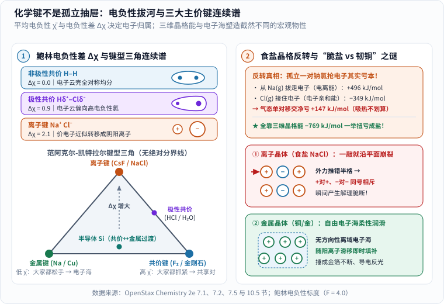
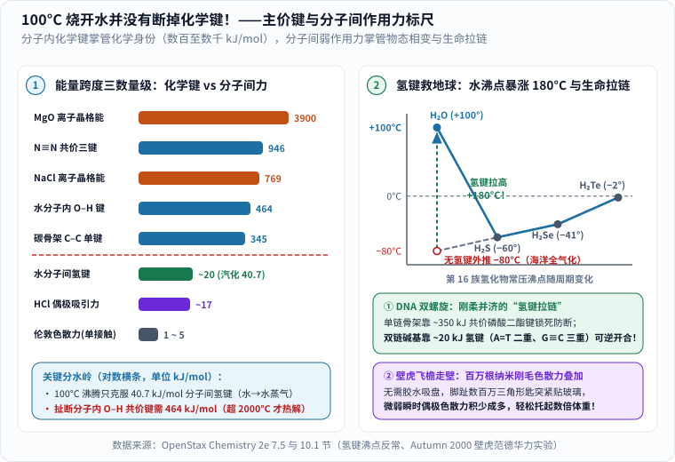
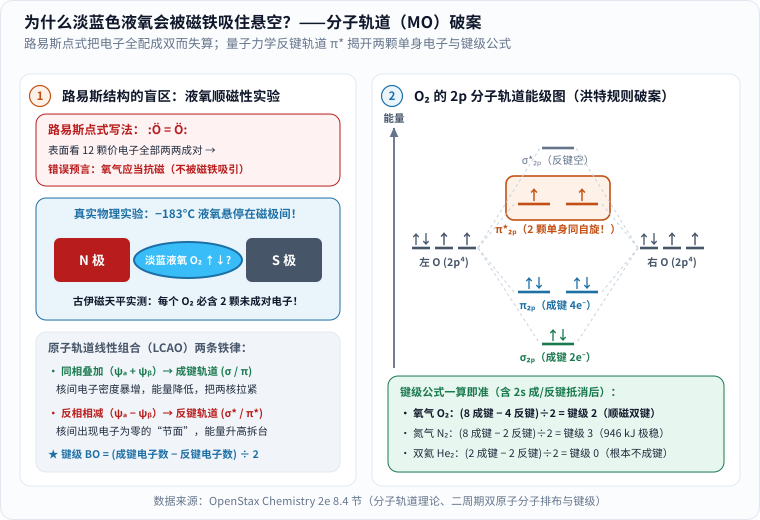

你手里那杯水、桌上那粒盐、笔芯里那截石墨，看起来毫无关系，其实都在回答同一个问题：**原子凭什么黏在一起，又凭什么有时黏得死死的、有时一碰就散？**

先把你给的定义摆正：

> **化学键（chemical bond）**是纯净物分子内或晶体内，相邻两个或多个原子（或离子）之间**强烈的相互作用力**。

IUPAC《金皮书》更克制：当两个原子或原子团之间的作用力，强到足以形成**足够稳定、可被化学家当作独立"分子物种"来看待的聚集体**时，就说它们之间存在化学键 [[1]](#ref-1)。两句话指向同一幅物理图像：

> **原子核带正电，电子带负电。所有化学键的共同底座，都是两个或多个原子核对电子的吸引。**

但真把账本摊开，会撞上一串算不通的账：

1. **钠"交给"氯一个电子，单看这一笔竟净亏 $$147\,\mathrm{kJ/mol}$$。** 交电子本身要吸 $$496$$，氯接住只放 $$349$$——净亏一百多，为什么食盐还能稳定存在？是谁把这笔亏空补上的 [[3]](#ref-3)？
2. **烧开水烧到 $$100^\circ\mathrm{C}$$、水蒸气满天飞，水分子内部一根 O–H 键都没断。** 那"断"的到底是什么？为什么断它只要几十 $$\mathrm{kJ/mol}$$、断 O–H 却要四百多 [[7]](#ref-7)？
3. **"ATP 水解断键释放能量"和"断键永远吸热"两句话，到底谁对？** 为什么全世界高中生在这里集体犯晕 [[2]](#ref-2)？
4. **同样全是碳原子，金刚石硬到能划玻璃、石墨软到能在纸上写字，一个绝缘一个导电**——原子一模一样，凭什么差出两个极端 [[9]](#ref-9)？
5. **液氧在 $$-183^\circ\mathrm{C}$$ 会被磁铁吸住。** 按"电子全都成对"的路易斯点式，$$\mathrm{O_2}$$ 该是抗磁的——这个"不该出现"的现象，逼出了哪一套更深的理论 [[2]](#ref-2)？

这五笔账，正好把离子键、共价键、金属键和氢键的边界全部串起来。今天我们就一层层算清。

---

## 一、先算第一笔账：断键为什么一定吸热，放热的"能量"到底从哪来？

先把最容易被讲反的一条钉死：**断键永远吸热，成键永远放热。** 没有例外。

### 1. 一笔"势能井"账：H₂ 的坑底在 −436

把两个氢原子放在真空里，它们之间同时存在四种作用：核—核排斥、电子—电子排斥、核 A—电子 B 吸引、核 B—电子 A 吸引。距离很远时都接近零；慢慢靠近，如果**跨原子吸引**带来的能量下降超过同号排斥的上升，总势能就出现一个"坑"。

以氢分子为例，坑底在核间距 $$74\,\mathrm{pm}$$、深度 $$436\,\mathrm{kJ/mol}$$ [[2]](#ref-2)。要把它拆开，你必须把体系从坑底抬回零——这就叫**键解离能**：

$$
\mathrm{H_2(g)}\to 2\,\mathrm{H(g)}\qquad \Delta H=+436\,\mathrm{kJ/mol}
$$

反过来，两个 H 结合成 H₂，就放出同样的 $$436\,\mathrm{kJ/mol}$$。**同一条曲线，往左走掉进坑（放热），往右走爬出坑（吸热）**——这是理解一切反应热的第一块基石。

### 2. 那"ATP 断键放能"为什么错了？——它把两笔账混成一笔

生物课本常说"ATP 断裂高能磷酸键释放能量"，这话在化学上是有害的简化。真实过程是：

$$
\text{ATP}+\mathrm{H_2O}\to\text{ADP}+\mathrm{P_i}
$$

这里**先断开** ATP 的 P–O 键（吸热），**再形成** ADP 和游离磷酸里的新键（放热）。形成新键放出的能量**大于**断旧键吸收的能量，净结果才是放能 [[2]](#ref-2)。

$$
\Delta H_{\text{反应}}\approx\underbrace{\sum D_{\text{断键}}}_{\text{吸收(+)}}\;-\;\underbrace{\sum D_{\text{成键}}}_{\text{放出(−)}}
$$

**能量从来不是"储存在键里、断开就流出来"，而是"拆浅坑、掉深坑"的净差。** 键能越大（坑越深），断裂越吸热，物质反而越稳定——这也是为什么"高能键"这个词容易误导。

讲到这里，正好把那张势能曲线摊开看一眼——它是后面所有论证的底图。

_图 1 怎么看：沿曲线从右往左走一遍。先看右端：两个氢原子相距无穷远，势能为 0，彼此不认识。再往左滑到谷底：距离缩到 $$74\,\mathrm{pm}$$ 时，跨原子吸引压过同号排斥，势能跌到 $$-436\,\mathrm{kJ/mol}$$——这就是 H–H 键的"坑"，坑深即键能。最后继续往左硬挤：核—核排斥陡然爆表，势能直线上升，原子根本压不到一起。右栏把这条曲线翻成一条铁律：断键吸热、成键放热，反应热是两笔账的净差。动画只播放一次并停在成键终态；开启"减少动态效果"时直接显示完整静态图。_

---

## 二、第二笔账：钠交出电子净亏 147，食盐凭什么还稳如磐石？

### 1. 先把那笔"亏空"算出来

孤立气态钠原子交出一个电子，要付电离能：

$$
\mathrm{Na(g)}\to\mathrm{Na^+(g)}+e^-\qquad \Delta H=+496\,\mathrm{kJ/mol}
$$

氯原子接住这个电子，只收回电子亲和能：

$$
\mathrm{Cl(g)}+e^-\to\mathrm{Cl^-(g)}\qquad \Delta H=-349\,\mathrm{kJ/mol}
$$

两笔相加，净亏 **$$+147\,\mathrm{kJ/mol}$$** [[3]](#ref-3)。如果化学只到"一个钠交给一个氯"为止，食盐根本不该存在——这比室温下的热运动能高出太多了。

### 2. 翻盘的是"晶格能"：不是一对离子，是无穷无尽的阵列

真实情况里，你永远不会得到"一对" $$\mathrm{Na^+Cl^-}$$。正负离子在三维晶格里无限延伸排列，每个 $$\mathrm{Na^+}$$ 同时被 **6 个** $$\mathrm{Cl^-}$$ 包围，每个 $$\mathrm{Cl^-}$$ 也被 6 个 $$\mathrm{Na^+}$$ 包围。把 1 mol 气态离子组装成晶体，一次性放出约 **$$770\sim787\,\mathrm{kJ/mol}$$** 的晶格能 [[3]](#ref-3)。

$$
\underbrace{+147}_{\text{电子转移净亏}}\;\underbrace{-\,770}_{\text{晶格能收入}}\;=\;-623\,\mathrm{kJ/mol}
$$

一笔巨亏被一笔巨赚彻底盖过。**这才是离子键的完整图像**：电子转移只是"造砖"，把砖砌成无限延伸的三维晶格才是"盖楼"，稳定化能主要来自后者。

这也解释了两件事：

- **离子键没有方向性**：库仑引力朝四面八方都一样，所以配位数由离子半径比决定，而不是由"某个特定角度"决定。
- **没有"一个 NaCl 分子"**：一整粒食盐晶体就是一个巨大的离子阵列，化学式 NaCl 只是最简比例（1:1），不是分子式。

### 3. 为什么食盐一敲就碎、铜却能捶成箔？

离子晶体的"脆"是这套结构的直接后果。你用锤子一敲，离子层发生错位，原本"正对负"的排列瞬间变成"正对正、负对负"：

$$
(+)(-)(+)(-)\quad\xrightarrow{\text{错动一格}}\quad (+)(+)(-)(-)
$$

同号相斥，晶体沿解理面直接崩开 [[4]](#ref-4)。金属就完全不同：价电子是一片离域的"电子海"，原子层滑移位后，电子海立刻重新填缝，正负对撞的问题根本不存在——所以铜能捶成比纸还薄的箔。

---

## 三、第三笔账：电负性——一把量"谁抢电子更狠"的尺子

离子键、共价键、金属键看着是三个抽屉，其实是一条连续谱。判断尺度叫**电负性** $$\chi$$，即原子在分子中把成键电子往自己身边拽的本领 [[4]](#ref-4)。

### 1. 鲍林 1932 年怎么"凭空"造出这把尺子？

电负性不是能量，测不出来，是个**相对标度**。鲍林（Linus Pauling）1932 年的做法很巧：他假定 A–B 键的键能，等于 A–A 与 B–B 键能的几何平均，再加上一个"额外离子稳定化能" $$\Delta$$：

$$
D(A\!-\!B)=\sqrt{D(A\!-\!A)\cdot D(B\!-\!B)}+\Delta
$$

这个 $$\Delta$$ 越大，说明 A、B 抢电子的本事差得越远。他把它累积成一张标度，指定最强的氟 $$\chi=4.0$$，氢约 2.1，钠约 0.9，氯约 3.0 [[4]](#ref-4)。后来马利肯（Robert Mulliken）1934 年提出另一套更"物理"的定义——取电离能 $$I$$ 与电子亲和能 $$A$$ 的平均：

$$
\chi_{\text{Mulliken}}\propto \frac{I+A}{2}
$$

两套标度数值必须换算到同一区间才能比较，但结论一致：**同周期从左到右电负性升高，同主族从上到下降低**。

### 2. 判据不是非黑即白：一条 50% 的分界线

常用经验判据是：$$\Delta\chi>2.0$$ 偏离子，$$0.5\sim2.0$$ 为极性共价，$$<0.5$$ 近非极性 [[4]](#ref-4)。更精细一点，可以用离子性百分比公式：

$$
\%\,\text{离子性}=\left(1-e^{-0.25(\chi_A-\chi_B)^2}\right)\times100\%
$$

把 $$\Delta\chi=1.7$$ 代进去，得到约 **50%**——这就是"离子键与共价键各占一半"的分界点。NaCl 的 $$\Delta\chi\approx2.1$$ 给出约 70% 离子性，仍不是 100%。

**所以三类键从来没有绝对的墙。** 把这张连续谱摊开看，比死记三个抽屉有用得多——金属键那"一角"在周期表左下方茁壮成长，钠、镁、铝的价电子整片离域，形成能带而非定域键；价带与导带之间若有禁带阻隔就是绝缘体，若部分重叠就是导体 [[5]](#ref-5)[[6]](#ref-6)。

_图 2 怎么看：从上到下、从左到右。先看左栏的拔河：H–H 两边力气一样，电子云正中间；H–Cl 向氯偏；Na⁺Cl⁻ 几乎整包交给氯——同一件事的三种程度，不是三种东西。再看下方三角：离子键、共价键、金属键被放在一张连续谱上，顶点是理想化的极端，真实化学键大多落在三条边的中段。最后看右栏的撞击实验：离子晶体错位后同号对撞而碎裂，金属错位后电子海重新填缝而弯折——宏观的脆与韧，根源在微观的电子安排。_

---

## 四、第四笔账：水分子里两套完全不同的作用，别混为一谈

### 1. 分子内：O–H 是极性共价键

你举的水分子，2 个 H 和 1 个 O 通过化学键结合成 $$\mathrm{H_2O}$$。氧的电负性约 3.5、氢约 2.1，谁也没把电子完全抢走，而是**共用一对电子、但电子云偏向氧**——这就是**极性共价键**。

水分子不是直线，而是 $$104.5^\circ$$ 的 V 形。氧周围有四组价层电子对（两根 O–H 键 + 两对孤对电子），近似四面体排布；孤对电子更"胖"，把两根键压得更近 [[8]](#ref-8)。正是这个弯折，让两根 O–H 键的偶极不能互相抵消，水才成为强极性溶剂。

把同族氢化物排成一列，孤对电子的挤压效果一目了然：

$$
\mathrm{CH_4}\ 109.5^\circ\;\to\;\mathrm{NH_3}\ 107.0^\circ\;\to\;\mathrm{H_2O}\ 104.5^\circ
$$

孤对电子从 0 对 → 1 对 → 2 对，键角被一寸寸挤小 [[8]](#ref-8)。

### 2. 分子间：氢键只是"拉住"，不是"决定身份"

一个水分子的 O–H 上带部分正电的氢，被另一个水分子氧上的孤对电子吸引——这就是**氢键**。它和 O–H 共价键完全不是一回事：

| 比较项 | 化学键（分子内主价键） | 氢键（分子间作用力） |
| :--- | :--- | :--- |
| 典型强度 | 几百到几千 $$\mathrm{kJ/mol}$$ | 约 $$5\sim30\,\mathrm{kJ/mol}$$ [[7]](#ref-7) |
| 作用对象 | 分子内相邻原子／整个离子晶体 | 分子与分子之间，或同一大分子的不同部分 |
| 是否决定"它是谁" | 决定，O–H 断了水就不是水 | 不决定，只是把水分子彼此拉住 |
| 是否决定物态 | 不直接决定 | 决定沸点、熔点、黏度、DNA 双链稳定性 |

**烧开水烧到 $$100^\circ\mathrm{C}$$ 时，破坏的主要是分子间氢键，水分子内部的 O–H 共价键一根都没断。** 真把 O–H 震断，冒出来的就不是水蒸气，而是氢氧混合气了。

### 3. 一笔"沸点账"：氢键把水从 −80°C 硬拉到 +100°C

第 16 族氢化物 $$\mathrm{H_2S}\to\mathrm{H_2Se}\to\mathrm{H_2Te}$$ 的沸点随分子量增大而升高（色散力增强）：$$\mathrm{H_2S}$$ 约 $$-60^\circ\mathrm{C}$$、$$\mathrm{H_2Te}$$ 约 $$-2^\circ\mathrm{C}$$。按这条趋势外推，分子量最小的水本该在 **约 $$-80^\circ\mathrm{C}$$** 沸腾。可它实际在 **$$+100^\circ\mathrm{C}$$**——凭空高出约 **180 度** [[7]](#ref-7)。

原因就是水分子间那张密集的氢键网络：每个水最多可形成 4 条氢键（2 个供体 + 2 个受体），汽化时必须同时拆掉大量氢键，能耗远高于同族其他氢化物。**没有氢键，地球上的水在大部分地区都是气体，生命根本无从谈起。**

_图 4 怎么看：左看能量标尺，右看沸点反常。先看左栏的对数标尺：MgO 晶格能约 3900、氮氮三键约 946、水中 O–H 键约 464，而氢键只有约 20、色散力 1–5 $$\mathrm{kJ/mol}$$——横跨整整三个数量级，这就是"化学键 vs 分子间作用力"的分界。再看右栏的折线：同族氢化物本该随分子量平滑上升，水却凭氢键把沸点从外推的 $$-80^\circ\mathrm{C}$$ 硬拉到 $$+100^\circ\mathrm{C}$$。最后对照两栏：正因为差了百倍，断开氢键只需加热到 100 度，断开 O–H 却要几千度或强电解。_

### 4. 严谨补丁：IUPAC 2011 其实放宽了氢键的定义

按教科书口径，把氢键归入分子间作用力完全正当。但要补一句：IUPAC 在 2011 年给出的新定义是——

> 氢键是分子或分子片段 X–H（X 比 H 电负性大）中的氢原子，与同一或不同分子中的某个原子或原子团之间的**有"键形成证据"的吸引相互作用** [[10]](#ref-10)。

注意它不再要求 X 必须是 N/O/F，也不再用某个固定能量门槛（因为"能量上限很主观"），而是看有没有**光谱位移、电子密度拓扑上的键临界点**等证据。所以广义文献里确实会出现"强氢键也是键"的说法——那是另一个语境，不冲突。

---

## 五、第五笔账：液氧的磁性——路易斯点式为什么不够用

### 1. 一个"不该发生"的实验现象

路易斯电子点式把 $$\mathrm{O_2}$$ 画成 $$:\mathrm{O}{=}\mathrm{O}:$$，所有电子成对——按这个模型，氧气应该是**抗磁**的（被磁场轻微排斥）。可实验里，$$-183^\circ\mathrm{C}$$ 的液氧会**悬停在磁极之间被吸住**，是明确的**顺磁**性 [[2]](#ref-2)。

点式解释不了。分子轨道理论才能。

### 2. 分子轨道：把"属于某个原子的轨道"换成"属于整个分子的轨道"

原子轨道线性组合，生成属于整个分子的**成键轨道**（能量低）与**反键轨道**（能量高）。填电子时遵守能量最低与洪特规则，键级定义为：

$$
\text{键级}=\frac{N_{\text{成键}}-N_{\text{反键}}}{2}
$$

$$\mathrm{O_2}$$ 有 16 个电子，填完以后最后两颗按洪特规则**分占两个能量相同的反键 $$\pi^*$$ 轨道、自旋平行**：

$$
\text{键级}=\frac{8-4}{2}=2
$$

键级仍是 2（双键），但那两个未成对电子带来了顺磁性——**实验现象和理论一次对上** [[2]](#ref-2)。

_图 5 怎么看：左看实验反差，右看能级排布。先看左栏：点式预言"抗磁、该被推开"，真实液氧却"顺磁、悬停在磁极间"——这一记反差，就是旧模型不够用的铁证。再看右栏的 2p 分子轨道排布：最后两颗电子没有挤进同一个 $$\pi^*$$ 轨道，而是按洪特规则各占一个、自旋平行——正是这两颗"孤单"的电子造成了顺磁性。最后核对键级：成键 8 颗、反键 4 颗，$$(8-4)/2=2$$，所以氧气仍是双键，没有被"算弱"。_

### 3. 同样全是碳，为什么一个最硬一个最软？

把"成键方式决定宏观性质"这条线索再推一步，就是金刚石与石墨的经典对照 [[9]](#ref-9)：

| | 金刚石 | 石墨 |
| :--- | :--- | :--- |
| 杂化 | $$sp^3$$，每个碳连 4 个碳 | $$sp^2$$，每个碳连 3 个碳 |
| 结构 | 三维网状，键角 $$109.5^\circ$$ | 层状六角，层内强共价、层间范德华力 |
| 硬度 | 莫氏 10，天然最硬 | 莫氏 1–2，能在纸上留痕 |
| 导电 | 绝缘（电子全锁在 σ 键里） | 导电（每层有离域 π 电子） |

**元素完全相同，只因电子的安排方式不同，物理性质就一个天上一个地下。** 这正是"化学键不是小钩子、而是电子在能量最低原理下排出的结构"最直观的证据。

---

## 六、一张总表收拢四类作用 + 五个常见误区

| 键型 / 作用 | 电子怎么安排 | 典型例子 | 主要特征 |
| :--- | :--- | :--- | :--- |
| **离子键** | 电子转移，形成正负离子 | NaCl、MgO | 无方向性，晶格能大，固态不导电、熔融导电 |
| **共价键** | 电子成对共享（可偏移） | H₂O、CH₄、金刚石 | 有方向性，决定分子几何；可极性／非极性 |
| **金属键** | 价电子全域离域 | Cu、Na、Fe | 导电导热、延展、金属光泽 |
| **氢键** | 分子间静电吸引 | 水、DNA、蛋白质 | 约 5–30 kJ/mol，决定物态与生物大分子结构，非主价化学键 |

五个常见误区，逐条拆：

1. **"离子键就是钠把电子送给氯，送完就稳了。"** 孤立一对原子净亏 $$147\,\mathrm{kJ/mol}$$；靠三维晶格能约 $$770\,\mathrm{kJ/mol}$$ 才翻盘 [[3]](#ref-3)。
2. **"ATP 断键释放能量。"** 断键永远吸热；放能来自"断旧键 + 成新键"的净差 [[2]](#ref-2)。
3. **"共价键就是电子平均分。"** 只有同种原子才近似均分；O–H、H–Cl 都是共用但偏向一方 [[4]](#ref-4)。
4. **"烧开水把水分子拆了。"** 没有，断的是分子间氢键；O–H 共价键完好无损 [[7]](#ref-7)。
5. **"氢键是化学键。"** 在三类主价键的分类里，它属于分子间作用力，强度低一个数量级以上；但 IUPAC 2011 的广义定义里，强氢键也可称"键"——看语境 [[10]](#ref-10)。

想继续深入势能曲线、键型三角、VSEPR、分子轨道和氢键沸点异常的数学细节，可以接着读本站那篇更完整的长文：[《剧毒氯气遇上遇水爆炸的钠，凭什么变成救命食盐？钻石和铅笔芯为何同宗不同命？》]()。

---

## 参考资料与核查来源

1. **IUPAC Gold Book**, *bond*（[官方条目](https://goldbook.iupac.org/terms/view/B00697)）—— 支持"作用力足够稳定、可视为独立分子物种"的化学键定义，及其与 hydrogen bond、multi-centre bond 等条目的交叉引用。
2. **OpenStax Chemistry 2e**, [7.2 Covalent Bonding](https://openstax.org/books/chemistry-2e/pages/7-2-covalent-bonding) 与 [8.4 Molecular Orbital Theory](https://openstax.org/books/chemistry-2e/pages/8-4-molecular-orbital-theory) —— 支持莫尔斯势能曲线、H₂ 在 74 pm／−436 kJ/mol 的成键谷底、断键吸热成键放热，以及分子轨道、键级与氧气顺磁性（液氧被磁铁吸住）。
3. **OpenStax Chemistry 2e**, [7.5 Strengths of Ionic and Covalent Bonds](https://openstax.org/books/chemistry-2e/pages/7-5-strengths-of-ionic-and-covalent-bonds) —— 支持钠电离能 +496、氯电子亲和能 −349、气态转移净亏 +147 kJ/mol，以及三维晶格能（约 770–787 kJ/mol）对 NaCl 形成的贡献。
4. **Chemistry LibreTexts**, *Bond Polarity and Bond Strength*（[page](https://chem.libretexts.org/Courses/CSU_San_Bernardino/CHEM_4300%3A_Inorganic_Chemistry_(Mink)/03%3A_Review_of_Chemical_Bonding/3.04%3A_Bond_Polarity_and_Bond_Strength)）—— Pauling electronegativity $$\chi$$ (1932), its definition via the geometric mean of bond energies, Mulliken's $$(I+A)/2$$ scale (1934), and the $$\Delta\chi>2.0$$ empirical criterion. **IUPAC Gold Book**, *electronegativity*（[entry](https://goldbook.iupac.org/terms/view/E02091)）—— official definition.
5. **Chemistry LibreTexts**, *Metallic Bonding*（[页面](https://chem.libretexts.org/@go/page/349732)）—— 支持电子海模型、金属的导电/导热/延展/光泽解释、离子晶体错位后同号相斥而脆裂，以及价带、导带与禁带的能带理论框架。
6. **Wired Chemist**, *Common Bond Energies (D) and Bond Lengths (r)*（[data table](https://www.wiredchemist.com/chemistry/data/bond_energies_lengths.html)）—— C–C 单键 154 pm / 346 kJ/mol、双键 134 pm / 602 kJ/mol、三键 120 pm / 835 kJ/mol 的英文数据表；与正文引用的 347/614/839 量级一致。
7. **Chemistry LibreTexts**, *Hydrogen Bonding: Trends in Boiling Points…*（[页面](https://chem.libretexts.org/Bookshelves/Inorganic_Chemistry/Map%3A_Inorganic_Chemistry_(Housecroft)/10%3A_Hydrogen/10.6%3A_Hydrogen_Bonding/10.6B%3A_Trends_in_Boiling_Points_Melting_Points_and_Enthalpies_of_Vaporization_for_p-block_Binary_Hydrides)）—— 支持氢键典型强度 5–30 kJ/mol、每个水最多形成 4 条氢键，以及氢键使水沸点（+100°C）远高于同族氢化物外推值（约 −80°C）的解释。
8. **OpenStax Chemistry 2e**, [7.6 Molecular Structure and Polarity](https://openstax.org/books/chemistry-2e/pages/7-6-molecular-structure-and-polarity) 与 [8.2 Hybrid Atomic Orbitals](https://openstax.org/books/chemistry-2e/pages/8-2-hybrid-atomic-orbitals) —— 支持 VSEPR、孤对电子挤压键角、$$sp^3$$ 杂化，以及 CH₄ 109.5°／NH₃ 107.0°／H₂O 104.5° 的键角序列。
9. **Encyclopaedia Britannica**, *diamond (carbon)* and *graphite*（[diamond](https://www.britannica.com/science/diamond-gemstone)、[graphite](https://www.britannica.com/science/graphite-mineral)）—— diamond 的 sp³ 三维共价网络、莫氏硬度 10、绝缘，以及 graphite 的 sp² 层状结构、层间弱范德华力、导电与质软等英文权威表述。
10. **IUPAC**, *Definition of the hydrogen bond (IUPAC Recommendations 2011)*（[官方 PDF](https://publications.iupac.org/pac/pdf/2011/pdf/8308x1637.pdf)）—— 支持 2011 年氢键新定义（"有键形成证据的吸引相互作用"）、不再限定 N/O/F、不设固定能量门槛、以光谱位移与电子密度拓扑为证据。
11. **配图说明**：本文五张 SVG 均来自本站 `tools/visuals/chemical_bonds.py`（主题 `chemical-bonds`），此前已通过数值断言与 XML／宽高比／字号审计；本文未重复生成新图。
