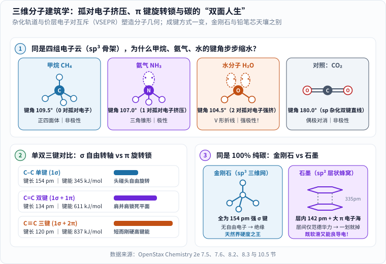

先把你给的定义摆正：

> **化学键（chemical bond）**是纯净物分子内或晶体内，相邻两个或多个原子（或离子）之间**强烈的相互作用力**。使离子相结合或原子相结合的作用力，通称为化学键。

IUPAC《金皮书》给出的定义更克制：当两个原子或原子团之间的作用力，强到足以形成**足够稳定、可被化学家当作独立“分子物种”来看待的聚集体**时，就说它们之间存在化学键 [[1]](#ref-1)。

两句话合起来，其实指向同一个物理图像：

> **原子核带正电，电子带负电。所有化学键的共同底座，都是两个或多个原子核对电子的吸引。**

差别只在于：电子被**搬到哪边**、被**谁共享**、还是被**整块晶体公有**。

---

## 一、先解决一个总问题：原子凭什么“黏”在一起？

把两个原子放在真空里，它们之间同时存在四种作用：核—核排斥、电子—电子排斥、核 A—电子 B 吸引、核 B—电子 A 吸引。距离很远时，这些作用都接近零；慢慢靠近时，如果**跨原子吸引**带来的能量下降超过同号排斥的上升，总势能就会出现一个“坑”。

坑底对应的核间距就是**键长**，坑的深度大致就是**键能**。以氢分子为例，坑底在 $$74\ \mathrm{pm}$$、深度 $$436\ \mathrm{kJ/mol}$$ [[2]](#ref-2)。

_图 1：怎么看这张图？左栏沿曲线从右往左看：两个氢原子在远处势能为 0，靠近时电子云同相叠加、能量下滑，在 $$74\ \mathrm{pm}$$ 落到 $$-436\ \mathrm{kJ/mol}$$ 的谷底；再硬挤，核—核排斥让势能陡升。右栏提醒一条铁律：**断键永远吸热，放热来自“拆浅坑、掉深坑”的总账**。动画只播放一次并停在成键终态；系统开启“减少动态效果”时直接显示完整静态图。[单独打开图片（刷新可重播）](/assets/images/chemical-bonds/h2-morse-potential-anim.svg)_

所以，“化学键”不是原子身上长出来的小钩子，而是**体系总能量显著低于孤立原子时的稳定束缚态**。这也是为什么 IUPAC 的定义强调“足够稳定”。

---

## 二、三种主价键：同一底座上的三种电子安排

你给的分类——**离子键、共价键、金属键**——是中学化学最经典的三分法。它们的分界并不像抽屉那样整齐，而是一条连续谱；判断尺度是**电负性** $$\chi$$，即原子在键中把电子往自己身边拽的本领 [[4]](#ref-4)。

_图 2：怎么看这张图？左栏看电子云从 H–H 的对称均分，到 H–Cl 的偏移，再到 Na⁺Cl⁻ 的近乎完全移交；下方三角把离子键、共价键、金属键放在一张连续谱上。右栏给出食盐为什么脆、铜为什么能捶成箔的微观解释。[单独打开图片](/assets/images/chemical-bonds/electronegativity-and-bond-triangle.svg)_

### 1. 离子键：电子“移交”，正负离子在三维网格里互相抓住

典型例子是 NaCl。钠的电负性约 0.9，氯约 3.0，差值 $$\Delta\chi \approx 2.1$$。按常用判据，$$\Delta\chi>2.0$$ 的键主要呈离子性 [[4]](#ref-4)。

中学常说“钠把一个电子交给氯”——这句话只说对了一半。孤立气态钠原子交出电子要吸热约 $$+496\ \mathrm{kJ/mol}$$，氯接过电子只放热约 $$-349\ \mathrm{kJ/mol}$$，净亏 $$+147\ \mathrm{kJ/mol}$$ [[3]](#ref-3)。真正让反应翻盘的是：正负离子在三维晶格里无限延伸排列，每个 $$\mathrm{Na^+}$$ 同时被六个 $$\mathrm{Cl^-}$$ 包围，晶格能一次性放出约 $$770\ \mathrm{kJ/mol}$$。

所以离子键的完整图像是：

- **电子转移**形成离子；
- **库仑引力**把正负离子拉在一起；
- **晶格整体稳定化**才是能量上的关键。

它没有方向性，也没有“一个 NaCl 分子”——食盐晶体本身就是一整块巨大的离子阵列。

### 2. 共价键：电子“共享”，方向性造就分子形状

你举的水分子就是典型共价键。氧原子和氢原子谁也没把电子完全抢走，而是**共用一对电子**；但氧的电负性更大（约 3.5 对 2.1），电子云偏向氧，于是 O–H 是**极性共价键**。

水分子不是直线，而是 $$104.5^\circ$$ 的 V 形：氧周围有四组价层电子对（两根 O–H 键 + 两对孤对电子），近似四面体排布；孤对电子更“胖”，把两根键压得更近 [[8]](#ref-8)。正是这个弯折，让两根 O–H 键的偶极不能互相抵消，水才成为强极性溶剂。

_图 3：怎么看这张图？上排看 CH₄ 的 $$109.5^\circ$$ → NH₃ 的 $$107.0^\circ$$ → H₂O 的 $$104.5^\circ$$：孤对电子越多，键角被挤得越小。左下对比碳碳单、双、三键：**键数越多，键长越短、键能越大**；右下解释同样纯碳为何有金刚石与石墨两种极端。[单独打开图片](/assets/images/chemical-bonds/vsepr-hybridization-and-carbon.svg)_

碳碳键的数据把规律写得很直白：单键约 $$154\ \mathrm{pm}$$、$$347\ \mathrm{kJ/mol}$$；双键约 $$134\ \mathrm{pm}$$、$$614\ \mathrm{kJ/mol}$$；三键约 $$120\ \mathrm{pm}$$、$$839\ \mathrm{kJ/mol}$$ [[6]](#ref-6)。键级越高，两核被拉得越近，拆开它要付的能量越多。

### 3. 金属键：电子“公有”，整块晶体共享一片电子海

金属原子电负性低、价电子束缚松。大量金属原子凑在一起时，价电子不再属于某个原子，而是在整块晶体里**离域**，形成“电子海”；带正电的原子实浸在这片负电海里，靠静电吸引结合 [[5]](#ref-5)。

这套模型解释金属性质时很顺手：

- **导电**：外加电场一推，离域电子就能定向流动；
- **导热**：自由电子快速传递能量；
- **延展**：原子层滑移位后，电子海立刻重新“填缝”，不会像离子晶体那样正负对撞而脆裂；
- **光泽**：表面自由电子吸收入射光后重新辐射，金属显得闪亮。

从量子角度看，原子轨道重叠成极密的能级，形成**价带**与**导带**；金属的价带与导带重叠，电子随时可以进入导带运动；绝缘体禁带宽，半导体禁带适中 [[5]](#ref-5)。

---

## 三、水分子里的两件事：分子内是键，分子间不是

现在回到你的例子：一个水分子中，2 个氢原子和 1 个氧原子通过化学键结合成 $$\mathrm{H_2O}$$。这句话只讲了水分子**内部**。

水分子**之间**还有另一种吸引：一个水分子的 O–H 上带部分正电的氢，被另一个水分子氧上的孤对电子吸引——这就是**氢键**。

氢键为什么不算化学键？按你给的定义，关键在于它不满足“分子内或晶体内强相互作用”的通常门槛：

| 比较项 | 化学键（分子内主价键） | 氢键（分子间作用力） |
| :--- | :--- | :--- |
| 典型强度 | 几百到几千 $$\mathrm{kJ/mol}$$ | 约 $$5\sim30\ \mathrm{kJ/mol}$$ [[7]](#ref-7) |
| 作用对象 | 分子内相邻原子／整个离子晶体 | 分子与分子之间，或同一大分子的不同部分 |
| 是否决定“它是谁” | 决定，O–H 断了水就不是水 | 不决定，只是把水分子彼此拉住 |
| 是否决定物态 | 不直接决定 | 决定沸点、熔点、黏度、DNA 双链稳定性 |

把水烧到 $$100^\circ\mathrm{C}$$ 时，破坏的主要是分子间氢键，**水分子内部的 O–H 共价键一根都没断**。如果真把 O–H 键震断，冒出来的就不是水蒸气，而是氢氧混合气了。

_图 4：怎么看这张图？左栏是对数能量标尺：MgO 晶格能约 3900、氮氮三键约 946、水中 O–H 键约 464，而氢键约 20、色散力只有 1–5 $$\mathrm{kJ/mol}$$——横跨三个数量级。右栏画出第 16 族氢化物沸点：若按趋势外推，水本该在约 $$-80^\circ\mathrm{C}$$ 沸腾，是氢键把它拉到了 $$+100^\circ\mathrm{C}$$。[单独打开图片](/assets/images/chemical-bonds/chemical-bonds-vs-imf-scale.svg)_

需要补一句严谨话：IUPAC 在 2011 年给出的氢键定义强调“有键形成证据的吸引相互作用” [[7]](#ref-7)，广义文献里确实会把某些强氢键称为“键”；但在**主价键分类**这个语境下，按你提供的教科书式口径，把氢键归入分子间作用力是完全正当的。

---

## 四、一个容易忽略的量子补丁：电子不总是乖乖配对

路易斯电子点式很好用，但它不是终极理论。液氧在 $$-183^\circ\mathrm{C}$$ 会被磁铁吸住，说明 $$\mathrm{O_2}$$ 分子里有两个未成对电子——按“所有电子都配对”的点式画法根本解释不了。分子轨道理论把原子轨道组合成属于整个分子的**成键轨道**与**反键轨道**，用键级

$$
\text{键级} = \frac{N_{\text{成键}} - N_{\text{反键}}}{2}
$$

算出氧气仍是双键，却带着两个平行自旋的单电子 [[2]](#ref-2)。

_图 5：怎么看这张图？左栏是实验反差：点式预言抗磁，真实液氧却悬停在磁极间；右栏是 $$\mathrm{O_2}$$ 的 2p 分子轨道排布，最后两颗电子按洪特规则分占两个反键 $$\pi^*$$ 轨道，键级为 2 且有顺磁性。[单独打开图片](/assets/images/chemical-bonds/molecular-orbital-liquid-oxygen.svg)_

这个补丁提醒我们：**离子键／共价键／金属键是现象分类，不是量子力学的终极划分**。越往深处走，三种键都用同一套“原子核 + 电子 + 能量最低”的语言重写。

---

## 五、总表与四个常见误区

| 键型 | 电子怎么安排 | 典型例子 | 主要特征 |
| :--- | :--- | :--- | :--- |
| 离子键 | 电子转移，形成正负离子 | NaCl、MgO | 无方向性，晶格能大，固态不导电、熔融导电 |
| 共价键 | 电子成对共享 | H₂O、CH₄、金刚石 | 有方向性，决定分子几何；可极性／非极性 |
| 金属键 | 价电子全域离域 | Cu、Na、Fe | 导电导热、延展、金属光泽 |
| 氢键 | 分子间静电吸引 | 水、DNA、蛋白质 | 约 5–30 kJ/mol，决定物态与生物大分子结构，非主价化学键 |

四个常见误区：

1. **“离子键就是钠把电子送给氯，送完就稳了。”** 孤立一对原子其实净亏能量，靠晶格能才翻盘。
2. **“共价键就是电子平均分。”** 只有同种原子才近似均分；O–H、H–Cl 都是共用但偏向一方。
3. **“烧开水把水分子拆了。”** 没有，断的是分子间氢键；O–H 共价键完好无损。
4. **“氢键是化学键。”** 在三类主价键的分类里，它属于分子间作用力，强度低一个数量级以上。

想继续深入势能曲线、键型三角、VSEPR、分子轨道和氢键沸点异常的数学细节，可以接着读本站那篇更完整的长文：[《剧毒氯气遇上遇水爆炸的钠，凭什么变成救命食盐？钻石和铅笔芯为何同宗不同命？》]()。

---

## 参考资料与核查来源

1. **IUPAC Gold Book**, *bond*（[官方条目](https://goldbook.iupac.org/terms/view/B00697)）—— 支持“作用力足够稳定、可视为独立分子物种”的化学键定义，及其与 hydrogen bond、multi-centre bond 等条目的交叉引用。
2. **OpenStax Chemistry 2e**, [7.2 Covalent Bonding](https://openstax.org/books/chemistry-2e/pages/7-2-covalent-bonding) 与 [8.4 Molecular Orbital Theory](https://openstax.org/books/chemistry-2e/pages/8-4-molecular-orbital-theory) —— 支持莫尔斯势能曲线、H₂ 在 74 pm／−436 kJ/mol 的成键谷底，以及分子轨道、键级与氧气顺磁性。
3. **OpenStax Chemistry 2e**, [7.5 Strengths of Ionic and Covalent Bonds](https://openstax.org/books/chemistry-2e/pages/7-5-strengths-of-ionic-and-covalent-bonds) —— 支持钠电离能 +496、氯电子亲和能 −349、气态转移净亏 +147 kJ/mol，以及三维晶格能对 NaCl 形成的贡献。
4. **Chemistry LibreTexts**, *Bond Polarity and Bond Strength*（[页面](https://chem.libretexts.org/Courses/CSU_San_Bernardino/CHEM_4300%3A_Inorganic_Chemistry_(Mink)/03%3A_Review_of_Chemical_Bonding/3.04%3A_Bond_Polarity_and_Bond_Strength)）—— 支持鲍林电负性 $$\chi$$ 的定义、1932 年提出，以及 $$\Delta\chi>2.0$$ 偏离子、$$0.5\sim2.0$$ 极性、$$<0.5$$ 非极性的经验判据。
5. **Chemistry LibreTexts**, *Metallic Bonding*（[页面](https://chem.libretexts.org/@go/page/349732)）—— 支持电子海模型、金属的导电/导热/延展/光泽解释，以及价带、导带与禁带的能带理论框架。
6. **维基百科中文版**, *碳-碳键*（[条目](https://zh.wikipedia.com/zh-tw/%E7%A2%B3-%E7%A2%B3%E9%94%AE)）—— 支持 C–C 单键 153.5 pm／347 kJ/mol、双键 133.9 pm／614 kJ/mol、三键 120.3 pm／839 kJ/mol 与 $$\sigma/\pi$$ 成键方式。
7. **Chemistry LibreTexts**, *Hydrogen Bonding: Trends in Boiling Points…*（[页面](https://chem.libretexts.org/Bookshelves/Inorganic_Chemistry/Map%3A_Inorganic_Chemistry_(Housecroft)/10%3A_Hydrogen/10.6%3A_Hydrogen_Bonding/10.6B%3A_Trends_in_Boiling_Points_Melting_Points_and_Enthalpies_of_Vaporization_for_p-block_Binary_Hydrides)）—— 支持 IUPAC 2011 年氢键定义、典型强度 5–30 kJ/mol，以及氢键使水沸点显著高于同族氢化物的解释。
8. **OpenStax Chemistry 2e**, [7.6 Molecular Structure and Polarity](https://openstax.org/books/chemistry-2e/pages/7-6-molecular-structure-and-polarity) 与 [8.2 Hybrid Atomic Orbitals](https://openstax.org/books/chemistry-2e/pages/8-2-hybrid-atomic-orbitals) —— 支持 VSEPR、孤对电子挤压键角、$$sp^3$$ 杂化与 H₂O 的 104.5° 键角。
9. **配图说明**：本文五张 SVG 均来自本站 `tools/visuals/chemical_bonds.py`（主题 `chemical-bonds`），此前已通过数值断言与 XML／宽高比／字号审计；本文未重复生成新图。
