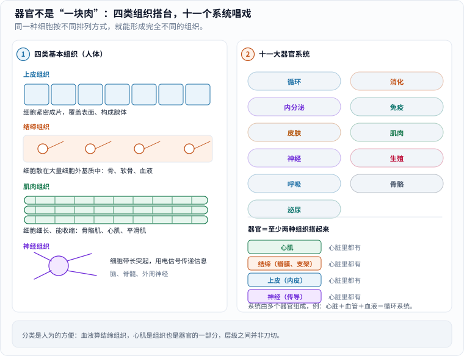
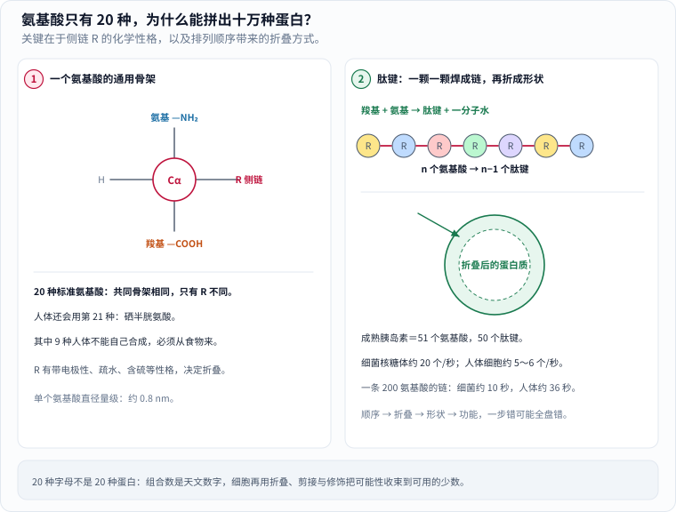
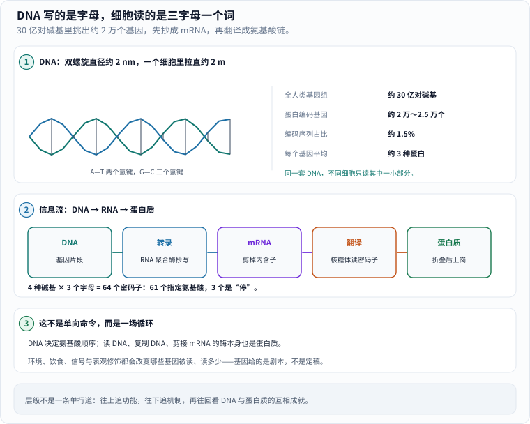

你现在可以摸一摸自己的胸口。那里拳头大小的一块肉，此刻正以每分钟几十次的节奏把血泵向全身——一天跳约 **$$10$$ 万次**、推出约 **$$7$$ 吨**血液，重量却只有你体重的 $$0.5\%$$ 不到 [[1]](#ref-1)[[2]](#ref-2)。

但把这块肉切到最小，你会撞上一连串怎么算都算不通的账：

1. **一颗心肌细胞根本不会“泵血”。** 它只会自己缩短一点点。可成千上万颗凑在一起，突然就会“把血挤出去”。**“泵血”这个本事，是从哪一层冒出来的？** 为什么你把心脏剁碎了，碎肉再也不泵血 [[3]](#ref-3)？
2. **细胞为什么被死死摁在几十微米？** 卵细胞能长到 $$100\,\mu\mathrm{m}$$ 肉眼可见，神经元的轴突能从脊髓一路铺到脚趾超过 $$1\,\mathrm{m}$$——可它的胞体还是只有几十微米 [[4]](#ref-4)。为什么细胞不能随便长大？是谁在给它设上限？
3. **你的血液居然是“组织”，还是结缔组织。** 骨头、软骨、脂肪、血液——这四样东西看起来毫无共同点，凭什么归成一类？而覆盖你全身的**上皮组织却一根血管都没有**，它靠什么活着 [[5]](#ref-5)？
4. **一个肌球蛋白分子每“划一次水”只走 $$10\,\mathrm{nm}$$，输出的力只有几个皮牛。** 可就是这种纳米小马达，数以万亿台一起动作，才让你心脏每一次收缩都把血挤出去 [[6]](#ref-6)。这么小的步子怎么攒出可见的收缩？
5. **你的每个细胞里都塞着约 $$2\,\mathrm{m}$$ 长的 DNA，却装在一个直径只有几微米的核里**——相当于把 $$40\,\mathrm{km}$$ 的细线塞进一个足球，还不能打结 [[7]](#ref-7)。细胞凭什么做到？
6. **更反直觉的是：这套机关不是单向的。** DNA 教你造蛋白质，可**读 DNA、抄 DNA、剪 mRNA 的那些酶，本身就是蛋白质**。先有鸡还是先有蛋？这也是层级图最容易被讲错的地方。

今天我们就带着这六笔账，从系统一路下钻到 DNA，每下一层都问同一句话：**上一层做不到的事，这一层靠什么新机制才做得到？**

先把整条路线摊开看一眼，后面每一层都只是把这张图里的一格放大。

---

## 一、系统与器官：为什么“泵血”这件事，只能由心脏做，不能由心肌细胞做？

先把最容易被含糊过去的两个词钉死：什么叫**器官**，什么叫**系统**。

教科书的定义很干脆：**器官**是一个解剖上独立的结构，由**至少两种组织**搭成，承担一项或几项特定生理功能；**器官系统**则是多个器官合伙完成一件更大的事 [[8]](#ref-8)[[9]](#ref-9)。

### 1. 一笔“零件账”：心脏里到底有几种组织？

拿心脏开刀。一块心肌壁里，至少同时住着四类组织：

- **肌肉组织（心肌）**：占绝对主角的收缩机器；
- **结缔组织**：瓣膜、腱索、心脏支架，还有灌满心肌间隙的毛细血管网；
- **上皮组织**：心脏内外表面那层光滑的内皮与心外膜；
- **神经组织**：窦房结、房室结、浦肯野纤维铺成的“电路”，负责发号施令。

所以心脏不是“一块肌肉”，而是**四种组织合起来的一台泵**。这也解释了开头第一笔账：**单颗心肌细胞只会缩短，不会泵血。** 泵血需要三个条件同时到位——**有能收缩的材料**（心肌）、**有防止倒流的阀门**（瓣膜/结缔组织）、**有让几十亿细胞同步放电的电路**（传导系统）。这三样东西，没有任何一颗细胞能独自备齐。

> 这正是“涌现”的硬核版本：**泵血不是细胞的性质，是“细胞＋组织＋电路”这个组织的性质。** 你把心脏剁成肉泥，收缩蛋白还在、细胞还活着，可阀门和电路全断了——于是血再也推不出去。

### 2. 一笔“产能账”：300 克的器官，凭什么推动全身？

心脏重量不到体重 $$0.5\%$$，约 $$300\,\mathrm{g}$$，却要供养相当于自身 **200 倍**重量的全身组织 [[2]](#ref-2)。算一笔流水：

$$
70\,\mathrm{mL/次}\times 70\,\mathrm{次/分}\approx 5000\,\mathrm{mL/分}
$$

一分钟约 $$5\,\mathrm{L}$$、一天约 $$700$$ 万毫升 ≈ **$$7$$ 吨** [[1]](#ref-1)[[2]](#ref-2)。这台泵每二十多年就要推出相当于一个自身体重一万倍的总量，而它靠的不是“更用力”，而是**永不休息 + 单向阀门 + 同步收缩**三件事的叠加。

### 3. 十一套系统：按“任务”分，不是按“地点”分

人体通常数出 **11 个器官系统**：循环、消化、内分泌、免疫、皮肤（被皮）、肌肉、神经、生殖、呼吸、骨骼、泌尿 [[9]](#ref-9)。

这里有个高频误解：以为系统是一堆挨在一起的器官。恰恰相反，很多系统是一张**散布全身的功能网**：

- **免疫系统**的细胞分散在骨髓、胸腺、脾、淋巴结和血液里，根本不待在一个地方；
- **内分泌系统**的腺体从脑垂体、甲状腺一直排到胰腺、肾上腺，彼此隔着半个身子，靠血液里的激素通信；
- **皮肤系统**也不只是一层皮，还包括汗腺、毛发、指甲这些“附属结构”。

所以判断是不是一个系统，看的不是“它们挨不挨着”，而是**“它们合起来是不是完成了一件任何单个器官都完不成的大事”**。

讲到这里，正好把整条下钻路线摊开看一眼——下面五节，无非是把这张图里的一格格放大。

_图 1 怎么看：先竖着读七层，再横着读两列。先竖着看左列的台阶：系统 → 器官 → 组织 → 细胞 → 蛋白质 → 氨基酸 → DNA，每一级都比上一级小一到三个数量级，从约 $$1\,\mathrm{m}$$ 一直落到 $$2\,\mathrm{nm}$$。再横着看第三列“典型尺度”：注意“蛋白质”到“DNA”这两级已经进入纳米世界，光学显微镜彻底失效。最后盯住最右列“这一层才有的能力”：这才是层级的意义——心肌细胞没有“泵血”，蛋白质没有“遗传”，每一层都凭新机制冒出上一层压根没有的新性质（涌现）。_

_图 2 怎么看：先看左边四种排列，再看右边十一张功能网。先看左栏四格“细胞怎么排”：上皮紧密成片、结缔细胞散在基质、肌肉细长带横纹、神经拖着长突起——分类依据是“排列方式”，不是“长相”。再看右栏上方的 11 个胶囊：这是按任务分的 11 套系统，注意它们和左栏四类组织是两种完全不同的切法。最后看右栏下方的“心脏拼装图”：四种颜色的小条代表四类组织，心脏把它们全用上了——这就是“器官至少两种组织”的活证据。_

---

## 二、组织：血液凭什么是“结缔组织”，上皮凭什么没有血管？

组织这一层，最反直觉的不是名字，而是**分类逻辑**。

### 1. 四类组织，其实只按一件事分：细胞怎么摆、中间垫什么

人体只有四类基本组织 [[8]](#ref-8)：

| 组织 | 细胞排列 | 细胞外基质 | 代表 | 主要本事 |
| :--- | :--- | :--- | :--- | :--- |
| **上皮组织** | 紧密成片，几乎无间隙 | 极少，靠基膜挂在下面 | 皮肤表皮、消化道内壁、腺体 | 屏障、吸收、分泌 |
| **结缔组织** | 稀疏、散在 | **极多**，是主角 | 骨、软骨、肌腱、脂肪、**血液** | 支撑、连接、运输 |
| **肌肉组织** | 细长成束，能收缩 | 少量 | 骨骼肌、心肌、平滑肌 | 输出力 |
| **神经组织** | 胞体＋超长突起 | 少量 | 脑、脊髓、外周神经 | 传电信号 |

看出分类的钥匙了吗？**关键不是细胞长什么样，而是“细胞与细胞外基质的比例”。** 上皮是“细胞多、胶水少”，所以能铺成密不透风的墙；结缔组织是“胶水多、细胞少”，所以能当支架、当填充、当运输通道 [[8]](#ref-8)。

### 2. 血液凭什么是结缔组织？——因为它正好符合“细胞散在基质里”

结缔组织的定义是“细胞散在大量细胞外基质中” [[8]](#ref-8)。把血液代进去：

- **细胞**：红细胞、白细胞、血小板；
- **细胞外基质**：血浆——占血液体积一半以上的液体基质。

严丝合缝。所以下次验血时不妨想一下：针管里抽出来的，其实是一块**液态的结缔组织**。同理，骨头是“基质被钙盐硬化了的结缔组织”，脂肪是“基质里塞满脂滴的结缔组织”——它们看着毫无关系，结构配方却是同一套。

### 3. 上皮组织为什么一根血管都没有？——一道扩散的死限制

这是组织层最精妙的一笔账。上皮组织是**无血管的（avascular）**，它底下有一层基膜，基膜下面才是富含血管的结缔组织 [[10]](#ref-10)。营养只能靠**扩散**从下面的血管穿过基膜，一层层往上送。

而扩散是有硬上限的。小分子在水里的扩散系数大约 $$D\sim 10^{-9}\,\mathrm{m^2/s}$$。扩散走一段距离 $$x$$ 需要的时间量级是：

$$
t\sim \frac{x^2}{2D}
$$

代入 $$x=100\,\mu\mathrm{m}=10^{-4}\,\mathrm{m}$$：

$$
t\sim\frac{(10^{-4})^2}{2\times10^{-9}}\approx 5\,\mathrm{s}
$$

$$100$$ 微米还算快；可如果组织厚到 $$1\,\mathrm{mm}$$（$$x=10^{-3}\,\mathrm{m}$$），时间就暴涨到约 **$$500\,\mathrm{s}$$**，接近十分钟；再厚就彻底供不上 [[10]](#ref-10)。

这就是为什么**上皮必须薄、必须贴着血管长**，也是为什么你的皮肤表皮只有几十到一百多微米厚——它不是随便长的，是被扩散物理**逼**成这么薄的。毛细血管和每一个细胞之间，几乎都不超过这个距离。

> 一句话收拢：**细胞的“社会分工”不是谁拍脑袋定的，是被物理和化学的硬约束筛出来的。** 这一层看到的“组织形态”，其实是上一层的细胞在“扩散、力学、供能”三张账单下能拿出的最优解。

---

## 三、细胞：为什么被摁在几十微米，却又允许神经铺一米长？

现在把镜头推到单个细胞。这里藏着一个看似矛盾的现象：**绝大多数细胞死死卡在几十微米，可神经元的轴突却能铺一米多。**

### 1. 一笔“表面积/体积账”：细胞为什么不能随便长大？

细胞靠表面交换物质，靠体积产生需求。把细胞粗略看成一个半径 $$r$$ 的球：

$$
\text{表面积}=4\pi r^2,\qquad \text{体积}=\frac{4}{3}\pi r^3
$$

两者之比：

$$
\frac{S}{V}=\frac{4\pi r^2}{\frac43\pi r^3}=\frac{3}{r}
$$

注意这个 $$\dfrac{3}{r}$$：**半径越大，单位体积能分到的表面积越小。** 半径从 $$10\,\mu\mathrm{m}$$ 涨到 $$100\,\mu\mathrm{m}$$（10 倍），$$S/V$$ 就掉到原来的 **$$1/10$$**。可细胞的耗氧、产废是按体积（$$r^3$$）涨的，吸收能力却按面积（$$r^2$$）涨——供不应求，细胞就会“憋死”在自己内部。

再叠加上一节那笔扩散账：细胞内部没有循环系统，氧气、ATP 靠扩散从外向内送。半径一旦超过一两百微米，中心就供不上 [[4]](#ref-4)。**两笔账一起，把细胞死死摁在几十微米。**

### 2. 既然有上限，为什么卵细胞能长到 100 微米、神经元能长一米？

因为它们都找到了“绕开上限”的办法：

- **卵细胞（约 $$100\text{–}120\,\mu\mathrm{m}$$）**：它是人体最大的细胞，肉眼勉强可见 [[4]](#ref-4)。但它不是个忙碌的“代谢工厂”，而是一颗**装满储备、暂时不用高强度交换的休眠仓库**——里面塞满卵黄和母源 mRNA，代谢率低，靠周围的卵泡细胞（冠放射）贴着表面供营养。它用“降低需求”绕开了表面积限制。
- **神经元轴突（可超 $$1\,\mathrm{m}$$）**：注意长的是**突起，不是胞体**。胞体直径仍只有几十微米；轴突虽然长，却极细（微米级），$$S/V$$ 依然很高，而且轴突里有专门的**轴浆运输**轨道（微管＋驱动蛋白）主动搬运物资，不等扩散 [[4]](#ref-4)。它用“变细＋主动运输”绕开了限制。

所以规则从来不是“细胞必须小”，而是**“凡是靠扩散过日子的部分，就必须小或薄”**。细胞形态的千差万别，全是围绕这条规则做的工程妥协。

### 3. 心肌细胞的独门绝技：闰盘把几十亿台马达“焊成一台”

回到心脏。心肌细胞还有一个和骨骼肌完全不同的结构——**闰盘（intercalated disc）** [[3]](#ref-3)。

相邻心肌细胞的细胞膜在闰盘处像瓦片一样互相嵌合，里面装着两类关键连接：

- **桥粒（desmosome）与黏着小带**：机械铆钉，把细胞死死焊在一起，收缩时不会被扯散；
- **缝隙连接（gap junction）**：细胞间的小通道，让离子电流直接从一个细胞流到下一个。

正因为有缝隙连接，电信号才能像波浪一样扫过整个心肌，让几十亿颗细胞**几乎同时收缩**——这叫**功能合胞体（functional syncytium）** [[3]](#ref-3)。骨骼肌的每根肌纤维是各自独立受神经支配的，所以你能精细控制手指；心肌却必须“全体一起动”，否则血就会被挤得到处乱流。

> 第一笔账到这里结清：**“泵血”这个新性质，正是靠闰盘这层“细胞→组织”之间的新结构才冒出来的。** 少一类连接，心脏就从泵变成一袋乱抖的肉。

_图 3 怎么看：左看细胞的分工，右看蛋白质的功能。先看左栏的细胞轮廓：紫色双层是细胞膜（边界），中央蓝色是细胞核（档案库），金色小圈是线粒体（发电厂）和核糖体（装配线）——一个细胞内部就有分工，这不是一袋均质的汤。再看右栏那条折叠的链：一条氨基酸链折成有形状的蛋白，下面四行给出它的四种典型工作：运输、催化、运动、防御。最后看底部那行尺度：细胞 $$10\,\mu\mathrm{m}$$ → 蛋白 $$5\,\mathrm{nm}$$，差了 2000 倍——这正是为什么看细胞用显微镜、看蛋白要靠 X 射线晶体学或冷冻电镜。_

---

## 四、蛋白质：一台每步只走 10 纳米的马达，怎么攒出可见的收缩？

现在跨过那 2000 倍的尺度鸿沟，进入分子世界。

### 1. 一笔“步子账”：10 纳米的一步，怎么变成一厘米的收缩？

肌肉收缩的分子机制叫**滑行丝模型**：粗肌丝（肌球蛋白）上的“头”像船桨一样，抓住细肌丝（肌动蛋白），划一下、松开、再抓下一格。每个肌球蛋白头每水解一个 ATP，推动细肌丝滑动约 **$$5\text{–}10\,\mathrm{nm}$$**，输出力约几个皮牛（$$\mathrm{pN}$$） [[6]](#ref-6)。

一步 $$10\,\mathrm{nm}$$ 有多小？一根头发直径约 $$70\,\mu\mathrm{m}=70000\,\mathrm{nm}$$——**得排七千步才等于一根头发的宽度。** 那怎么攒出可见收缩？

答案是**串联放大**：

$$
\underbrace{10\,\mathrm{nm}}_{\text{一次划动}}\times \underbrace{\sim 50}_{\text{一个肌节里连续排列}}\times \underbrace{\text{成千上万个肌节串联}}_{\text{一整根肌纤维}}
$$

一个肌节静息时长约 $$2.2\,\mu\mathrm{m}$$ [[6]](#ref-6)；几十个肌节头尾相接串成一根肌纤维，收缩时所有肌节一起缩短，宏观上就是整块肌肉在动。**纳米级的步子 × 分子级的并联 × 细胞级的串联 = 肉眼可见的运动。** 这就是层级放大的威力：每层只做自己擅长的那一点。

### 2. 一笔“速度账”：蛋白质为什么必须快到“每秒几十万次”？

蛋白质不只是马达，还是催化剂。看一组真实的转换数（$$k_{\mathrm{cat}}$$，每个酶分子每秒转化的底物数）[[11]](#ref-11)：

| 酶 | 底物 | 每秒转化数 |
| :--- | :--- | :--- |
| 过氧化氢酶（catalase） | $$H_2O_2$$ | $$4\times10^7$$ |
| 碳酸酐酶（carbonic anhydrase） | $$HCO_3^-$$ | $$4\times10^5$$ |
| 乙酰胆碱酯酶 | 乙酰胆碱 | $$1.4\times10^5$$ |
| β-内酰胺酶 | 青霉素 | $$2\times10^3$$ |

最快的酶已经快到**“扩散极限”**——$$k_{\mathrm{cat}}/K_m$$ 接近 $$10^8\text{–}10^9\,\mathrm{M^{-1}s^{-1}}$$，也就是说只要底物分子撞到活性中心就被立刻转化，快到限制因素不再是化学反应本身，而是**底物扩散过来的速度** [[11]](#ref-11)。这叫“动力学完美（kinetic perfection）”。

为什么需要这么快？因为细胞里没有“等一等”的余地。你血液里的碳酸酐酶，必须在红细胞穿过肺毛细血管的不到一秒里，把成千上万个 $$CO_2$$ 转成碳酸氢根装车运走——慢一点，二氧化碳就排不出去。

### 3. 一笔“种类账”：2 万个基因，怎么变出 10 万种蛋白？

这里提前预告下一层要遇到的问题。人类基因组只有约 **$$2$$ 万个蛋白编码基因**，可体内的蛋白质种类估计超过 **$$10$$ 万种** [[12]](#ref-12)。中间这道乘法靠的是**可变剪接**：一个基因的转录本可以剪掉不同的外显子组合，拼出多种 mRNA，再翻译出多种蛋白。人类超过 $$70\%$$ 的基因都存在可变剪接 [[12]](#ref-12)。

$$
2\times10^4\ \text{基因}\ \xrightarrow{\text{平均每种}\ge 3\ \text{种异构体}}\ >10^5\ \text{种蛋白}
$$

这就是为什么“一个基因一个蛋白”的老说法早就过时了——**要数清的不是基因的个数，而是基因能拼出多少种蛋白。**

---

## 五、氨基酸：20 种字母，为什么能拼出会思考的蛋白？

蛋白质再往下拆，就是氨基酸。

### 1. 一个氨基酸的通用骨架：20 种字母，差别只在“R”

所有标准氨基酸都有同一副骨架：一个中心碳（$$\alpha$$ 碳）上挂着**氨基（$$-\mathrm{NH_2}$$）**、**羧基（$$-\mathrm{COOH}$$）**、一个氢原子，以及一条各不相同**侧链（R）** [[13]](#ref-13)。

_图 4 怎么看：左看单个零件，右看零件怎么串起来。先看左框的十字架：中心 $$\mathrm{C}\alpha$$ 伸出四根键——上接氨基、下接羧基、左接 H、右接侧链 R。20 种氨基酸的区别，全在那根 R 上。再看右框上方那串珠子：羧基和氨基手拉手，甩掉一分子水，形成肽键；$$n$$ 个氨基酸只形成 $$n-1$$ 个肽键。最后看折叠后的圆球：一维的珠串靠侧链之间的疏水、带电、氢键作用，折成特定的三维形状——形状决定它干什么活，这就是“结构决定功能”。_

### 2. 一笔“组合账”：为什么偏偏是 20 种，不是 10 种或 100 种？

先算下界。氨基酸要能被 4 种碱基（A/T/G/C）编码。如果两个碱基一个词，只有：

$$
4^2=16<20
$$

不够用。三个碱基一个词：

$$
4^3=64\ge 20
$$

绰绰有余，于是自然界锁定三联体密码，$$64$$ 个密码子里 $$61$$ 个指定氨基酸、$$3$$ 个当“停” [[14]](#ref-14)。

至于为什么是 20 种而不是 64 种全用上：这不是随机的。20 种标准氨基酸的侧链化学性格覆盖了从**疏水**（亮氨酸）、**亲水**（丝氨酸）、**带正电**（赖氨酸）、**带负电**（谷氨酸）到**特殊**（半胱氨酸能成二硫键、甘氨酸极小、脯氨酸是“折角”）的完整工具箱 [[13]](#ref-13)。少一种就少一种工具，多一种则要付出翻译系统的额外复杂度——20 是够用与成本之间的演化平衡点。

> 顺带纠个常见说法：“20 种”不是全部。人体还会用特殊机制插入第 **21** 种**硒半胱氨酸**，某些古菌和细菌再用第 **22** 种吡咯赖氨酸 [[13]](#ref-13)。教科书说 20，是因为它讲的是标准遗传密码。

### 3. 一笔“能量账”：焊接肽键为什么要“先充电”？

把两个氨基酸直接接起来，在热力学上并不自发。细胞的做法是**先给氨基酸充能**：氨酰-tRNA 合成酶消耗 ATP，把氨基酸挂到对应的 tRNA 上，形成高能酯键，再由核糖体把这个能量用于形成肽键 [[14]](#ref-14)。

$$
\text{氨基酸}+\mathrm{ATP}\to\text{氨酰-AMP}\to\text{氨酰-tRNA}\to\text{肽键}
$$

**先充电、后焊接**——这套两步走保证了翻译的准确性：合成酶在充电环节就会校对，把接错的氨基酸水解掉，错误率压到 $$10^{-4}$$ 以下 [[14]](#ref-14)。核糖体自己反而“不检查”氨基酸对错，它只认 tRNA 上的反密码子——**质检前移到了充电这一步**。

---

## 六、DNA：2 米长的档案，怎么折进 5 微米的核，还不打结？

终于到底层。这里有两笔最惊人的账。

### 1. 一笔“长度账”：2 米塞进 5 微米，压缩了一万倍

一个人类体细胞是二倍体，两套基因组加起来约：

$$
2\times 3.0\times10^9\ \text{bp}\times 0.34\,\mathrm{nm/bp}\approx 2.0\,\mathrm{m}
$$

每个碱基对沿双螺旋轴向上升 $$0.34\,\mathrm{nm}$$ [[15]](#ref-15)。所以每个细胞核里都躺着约 **$$2\,\mathrm{m}$$** DNA，而核直径只有几微米 [[7]](#ref-7)。压缩倍率：

$$
\frac{2\,\mathrm{m}}{5\,\mu\mathrm{m}}=\frac{2\times10^6\,\mu\mathrm{m}}{5\,\mu\mathrm{m}}=4\times10^5
$$

**约 40 万倍**——把 $$40\,\mathrm{km}$$ 的细线塞进一个足球，也不过这个量级。注意不同资料里还常见另一个数：中期染色体的压缩比约 **$$10000:1$$** [[7]](#ref-7)。两者不矛盾：前者拿“核直径”当分母（间期也要装下），后者拿“中期染色体凝缩后的粗细”当分母，口径不同差一个数量级。怎么做到的？靠一套多级折叠：

1. **第一级：缠组蛋白**。DNA 绕在组蛋白八聚体上约两圈，形成**核小体**，长度先压缩约 7 倍，形成“串珠”结构 [[16]](#ref-16)。
2. **第二级：螺旋成 30 nm 纤维**。核小体串在连接组蛋白帮助下卷成更粗的染色质纤维。
3. **第三级：成环锚定**。纤维折成一个个环，锚在染色体支架上，宽度扩到约 $$300\,\mathrm{nm}$$ [[16]](#ref-16)。
4. **第四级：分裂期极度凝缩**，形成你显微镜下看到的 X 形染色体。

**关键不是“折得紧”，而是“折得有序”**——该读的基因要能随时展开，不该读的要牢牢收起。这靠的是表观遗传标记（甲基化、组蛋白修饰）在控制哪一段松开、哪一段拧紧。

### 2. 一笔“信息账”：30 亿个字母，为什么只有 1.5% 在编码蛋白？

NHGRI 的数据：人类基因组约 $$30$$ 亿碱基对，蛋白编码基因约 $$2$$ 万到 $$2.5$$ 万个，而**编码蛋白质的外显子只占全基因组约 $$1\%\text{–}1.5\%$$** [[15]](#ref-15)。

$$
\frac{3\times10^7\ \text{编码碱基}}{3\times10^9\ \text{总碱基}}\approx 1\%
$$

那剩下 99% 在干什么？早期叫它“垃圾 DNA”，现在知道里面藏着大量**调控开关**（增强子、沉默子）、**非编码 RNA 基因**、重复序列和结构序列。它们不编码蛋白，却决定**“哪个基因在什么时候、哪个细胞里被读出来”**。

这正是“同样的 DNA、不同的细胞”的答案：肝细胞和神经元的基因组几乎一模一样，差别只在**读了哪一小部分**。

_图 5 怎么看：上读档案、中读信息流、下读循环。先看上半框的双螺旋：两条链由 A—T（2 个氢键）、G—C（3 个氢键）配对；右侧四行数字是这份档案的“目录”——30 亿碱基、2 万多个基因、1.5% 编码区、每个基因平均约 3 种蛋白。再看中间五站流水线：DNA →（转录）→ mRNA →（剪掉内含子）→ 成熟 mRNA →（翻译）→ 氨基酸链 →（折叠）→ 蛋白质；每站之间的箭头就是一层新的机制。最后看下半框的循环箭头：DNA 教你造蛋白，而读 DNA、复制 DNA 的酶本身就是蛋白——这条回路打破了“DNA 单向决定一切”的简化叙事。_

### 3. 先有鸡还是先有蛋：中心法则真正的边界

很多人把“中心法则”记成“DNA → RNA → 蛋白质”的单行道，一听逆转录病毒能做 RNA → DNA，就以为法则崩了。其实没崩。

克里克 1958 年提出、1970 年在《自然》重申的中心法则，真正锁死的边界是：**信息可以在核酸之间双向流动，但一旦翻译成蛋白质，就无法从蛋白质倒推回核酸序列** [[14]](#ref-14)。原因很物理：核酸靠碱基互补一对一拓印，是可逆的；而蛋白质折叠成三维球后没有互补配对几何，再加上多个密码子对应同一种氨基酸（信息被压缩），根本无法唯一倒推。

> **你在健身房练出一身肌肉，肌肉蛋白绝不会反过来改写你生殖细胞里的 DNA。** 这就是中心法则真正的铁门。

这也回答了开头第六个疑问：先有鸡还是先有蛋？在现代细胞里，DNA 与蛋白质确实是**互相依存**的——但它不是逻辑上的“循环论证”，而是演化上的“先有 RNA 世界、后来才分化出 DNA 存档和蛋白质执行”的历史结果 [[14]](#ref-14)。层级图讲的是**当下的结构依赖**，不是**起源的时间顺序**——这两件事千万别混。

---

## 七、一张总表收拢七层 + 把变焦镜头还给你

最后，把七层台阶、每层的新机制与关键数字一次收拢：

| 层级 | 这一层的新机制 | 上一层做不到、这一层才有的新性质 | 关键硬核数字 |
| :--- | :--- | :--- | :--- |
| **系统** | 多器官按“任务”组成功能网 | 一件任何单个器官完不成的大事 | 人体 11 套器官系统 [[9]](#ref-9) |
| **器官** | ≥2 种组织搭成独立结构 | 泵血、消化等完整生理功能 | 心脏 ~300 g、每天 ~7 吨血 [[1]](#ref-1)[[2]](#ref-2) |
| **组织** | 细胞按规定方式排列＋基质 | 屏障、支撑、同步收缩、传信 | 4 类基本组织；上皮无血管 [[8]](#ref-8)[[10]](#ref-10) |
| **细胞** | 膜＋细胞器＋功能分工 | 生命的最小独立单位 | 多数 10–30 µm；$$S/V=3/r$$ [[4]](#ref-4) |
| **蛋白质** | 氨基酸链折叠成三维形状 | 催化、运动、运输、防御 |马达一步 5–10 nm；酶最快 $$4\times10^7/\mathrm{s}$$ [[6]](#ref-6)[[11]](#ref-11) |
| **氨基酸** | 侧链 R 的化学差异＋肽键 | 20 种字母拼出无限序列 | 标准 20 种；$$4^2=16<20\le4^3=64$$ [[13]](#ref-13)[[14]](#ref-14) |
| **DNA** | 碱基互补配对＋多级折叠 | 可复制、可遗传的稳定档案 | ~2 m 折进 ~5 µm 核；编码区 ~1% [[7]](#ref-7)[[15]](#ref-15) |

现在把开头那台变焦镜头还给你。**往上看功能，往下看机制**——这七个字能帮你把任何医学问题拆开：

- 心衰了？往**系统层**看血压与供氧，往**器官层**看心腔与瓣膜，往**组织层**看纤维化，往**细胞层**看线粒体和钙调控，往**蛋白层**看肌球蛋白的滑动效率，往 **DNA 层**看相关基因变异。
- 七个层级不是七句废话，而是**七个可以下手的地方**。医生在不同楼层开不同的药，研究者在不同楼层问不同的问题。

想沿着其中几条线走得更深，可以接着读：[从受精卵到胎儿的 280 天]()看层级如何在时间里搭起来；[心脏一天泵 7 吨血]()看器官与系统如何配合；[四个字母造出十万种蛋白]()把本文最底三层彻底展开；[双螺旋的破译史]()则补上 DNA 这一层最动人的发现故事。

---

## 参考资料

1. University of Western Australia, "World Heart Day: heart-smart facts". [https://www.uwa.edu.au/news/article/2020/september/world-heart-day](https://www.uwa.edu.au/news/article/2020/september/world-heart-day) （核查心脏每天跳动约 10 万次、拳头大小等基础事实。）
2. **Britannica**, *heart (anatomy)*（[page](https://www.britannica.com/science/heart)）—— the heart as a hollow muscular organ that pumps blood, its ~300 g mass and roughly 100,000 beats per day; **OpenStax Anatomy & Physiology 2e**, §20.2 *Cardiac Muscle*（[chapter](https://openstax.org/books/anatomy-and-physiology-2e/pages/20-2-cardiac-muscle)）—— intercalated discs, gap junctions and the functional syncytium.
3. Pearson Canada, *Human Anatomy & Physiology*, Ch.18 "The Cardiovascular System: The Heart". [https://www.pearsoncanadaschool.com/content/dam/websites/pearson-canada-school/assets/documents/pdfs/pdfs2/human-anatomy-physio-ch18.pdf](https://www.pearsoncanadaschool.com/content/dam/websites/pearson-canada-school/assets/documents/pdfs/pdfs2/human-anatomy-physio-ch18.pdf) （核查闰盘的桥粒与缝隙连接结构、相邻心肌细胞嵌合方式及“功能合胞体”概念；另参 PMC4317535 的闰盘三维重构研究。）
4. 台湾清华大学生命科学系，《细胞概论》. [https://life.nthu.edu.tw/%7Ed868210/project/cell_intro1.html](https://life.nthu.edu.tw/%7Ed868210/project/cell_intro1.html) （核查细胞尺寸从精子头部约 5 µm、红细胞约 7 µm 到卵细胞约 100 µm、神经元轴突可达 1 m 的范围，以及真核细胞大于原核细胞十倍等尺度事实。）
5. Biology LibreTexts, "4.2: Epithelial Tissue" & connective tissue overview. [https://bio.libretexts.org/Courses/De_Anza_College/DeAnza_-_BIO_A_Book/04%3A_The_Tissue_Level_of_Organization/4.02%3A_Epithelial_Tissue](https://bio.libretexts.org/Courses/De_Anza_College/DeAnza_-_BIO_A_Book/04%3A_The_Tissue_Level_of_Organization/4.02%3A_Epithelial_Tissue) （核查上皮组织覆盖表面与腺体的功能、细胞排列特征。）
6. PMC "Myosin structure and function"（cf. pmc.ncbi.nlm.nih.gov/articles/instance/1693463）与 ScienceDirect "Myosin IIA". [https://sciencedirect.com/topics/medicine-and-dentistry/myosin-iia](https://sciencedirect.com/topics/medicine-and-dentistry/myosin-iia) （核查每次 ATP 水解驱动肌动蛋白滑动约 5–10 nm、肌球蛋白横桥循环与皮牛级输出力；肌节静息长度约 2.2 µm 参 SciSim 滑行丝模型。）
7. Nature Scitable, "What are the levels of DNA packing within the eukaryote nucleus?" 与 JoVE "Chromatin Packaging". [https://www.nature.com/scitable/popular-students-page/127](https://www.nature.com/scitable/popular-students-page/127) （核查每个人类二倍体细胞约 2 m DNA 压缩在几微米核内、中期染色体压缩比约 10000:1。）
8. Biology LibreTexts, *Biology of Human Concerns (Daniels)*, "4.2: Organization of the Body". [https://bio.libretexts.org/Courses/Minnesota_State_Community_and_Technical_College/Biology_of_Human_Concerns_(Daniels)/04%3A_Introduction_to_the_Human_Body/4.02%3A_Organization_of_the_Body](https://bio.libretexts.org/Courses/Minnesota_State_Community_and_Technical_College/Biology_of_Human_Concerns_(Daniels)/04%3A_Introduction_to_the_Human_Body/4.02%3A_Organization_of_the_Body) （核查细胞/组织/器官/器官系统定义、四类基本组织的名称与特征。）
9. Medicine LibreTexts, *Nutrition Essentials*, "7.2: Human Anatomy and Systems". [https://med.libretexts.org/Bookshelves/Nutrition/Nutrition_Essentials_(Greena_and_Shallal)/07%3A_The_Process_of_Digestion_and_Absorption/7.02%3A_Human_Anatomy_and_Systems](https://med.libretexts.org/Bookshelves/Nutrition/Nutrition_Essentials_(Greena_and_Shallal)/07%3A_The_Process_of_Digestion_and_Absorption/7.02%3A_Human_Anatomy_and_Systems) （核查人体 11 套器官系统名单与层级表述。）
10. Biology Insights, "Is Epithelial Tissue Vascular or Avascular?" 与 ScienceInsights 表皮营养供给说明. [https://biologyinsights.com/is-epithelial-tissue-vascular-or-avascular](https://biologyinsights.com/is-epithelial-tissue-vascular-or-avascular) （核查上皮组织无血管、经基膜靠扩散获取营养、必须保持薄层的事实；扩散时间估算为本文按 $$t\sim x^2/2D$$ 的示范计算。）
11. 波士顿大学《Biochemistry Lecture 15: Enzymes》. [https://www.bu.edu/aldolase/biochemistry/html_docs/2020_Lecture_Slides/15_Enzymes_4.pdf](https://www.bu.edu/aldolase/biochemistry/html_docs/2020_Lecture_Slides/15_Enzymes_4.pdf) （核查过氧化氢酶 $$4\times10^7\,\mathrm{s^{-1}}$$、碳酸酐酶 $$4\times10^5\,\mathrm{s^{-1}}$$ 等转换数及 $$k_{cat}/K_m\approx10^8\text{–}10^9\,\mathrm{M^{-1}s^{-1}}$$ 扩散极限。）
12. The Human Protein Atlas, "The human isoform proteome" 与 Encyclopedia MDPI "Alternative Splicing in Cancer and Immune Cells". [https://www.proteinatlas.org/humanproteome/isoform](https://www.proteinatlas.org/humanproteome/isoform) （核查人类约 2 万蛋白编码基因、蛋白质组超过 10 万种蛋白、超过 70% 基因存在可变剪接。）
13. StatPearls / NCBI Bookshelf, "Biochemistry, Essential Amino Acids". [https://www.ncbi.nlm.nih.gov/books/NBK557845/](https://www.ncbi.nlm.nih.gov/books/NBK557845/) （核查 20 种标准氨基酸、通用骨架、第 21 种硒半胱氨酸与第 22 种吡咯赖氨酸、侧链化学性质差异。）
14. Clark, Douglas & Choi (2018), *Biology 2e* §15.1 "The Genetic Code" & §15.5 "Ribosomes and Protein Synthesis", OpenStax. [https://openstax.org/books/biology-2e/pages/15-1-the-genetic-code](https://openstax.org/books/biology-2e/pages/15-1-the-genetic-code) （核查 $$4^3=64$$ 密码子、61 有义 3 终止、中心法则真正边界、氨酰-tRNA 合成酶耗 ATP 充能与校对、错误率量级。）
15. National Human Genome Research Institute (NHGRI), "A Brief Guide to Genomics". [https://www.genome.gov/about-genomics/fact-sheets/A-Brief-Guide-to-Genomics](https://www.genome.gov/about-genomics/fact-sheets/A-Brief-Guide-to-Genomics) （核查人类基因组约 30 亿碱基对、约 2 万～2.5 万个基因、外显子仅占 1%–1.5%；$$0.34\,\mathrm{nm/bp}$$ 为 B-DNA 标准轴向参数。）
16. Biology LibreTexts, "1.1.2: The Structure of DNA" 与 ScienceInsights "If You Stretched Out All the DNA From a Single Cell". [https://bio.libretexts.org/Courses/University_of_Illinois_Chicago/BIOS_220%3A_Introduction_to_Genetics/01%3A_Module_1/1.01%3A_What_is_DNA/1.1.02%3A_The_Structure_of_DNA](https://bio.libretexts.org/Courses/University_of_Illinois_Chicago/BIOS_220%3A_Introduction_to_Genetics/01%3A_Module_1/1.01%3A_What_is_DNA/1.1.02%3A_The_Structure_of_DNA) （核查核小体缠绕约 7 倍压缩、30 nm 纤维、300 nm 成环锚定到染色体支架的多级折叠模型。）
