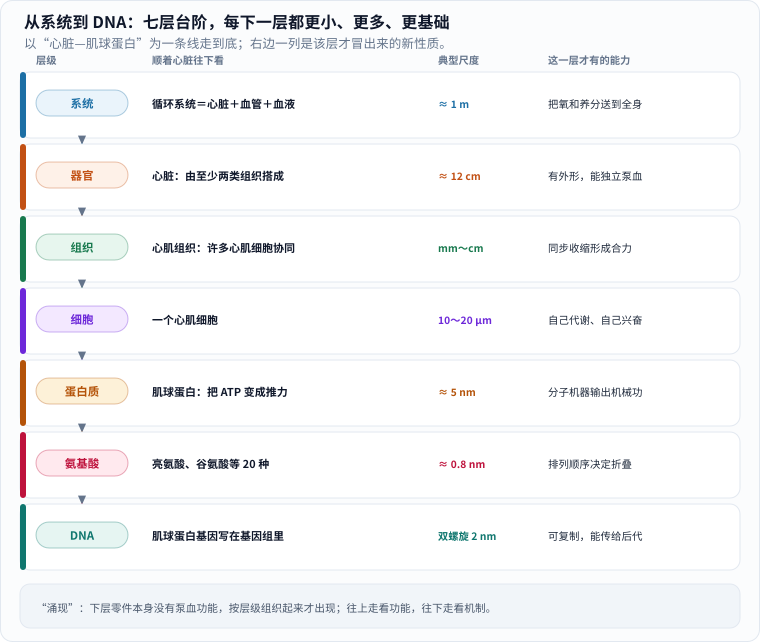
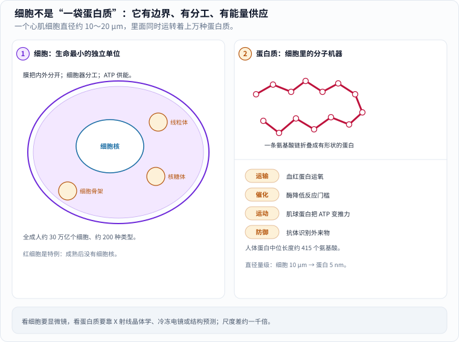

你给出的这条链——

> **系统 → 器官 → 组织 → 细胞 → 蛋白质 → 氨基酸 → DNA**

——其实是生物学里最有用的一台**变焦镜头**。往前推，你看到一个人怎么跑、怎么想、怎么生病；往后拉，你看到原子、分子和一段会被读出来的字母。

这台镜头有两条使用规则，先记住，后面所有内容都顺着它们走：

1. **往上看功能**：这东西在体内干什么活？
2. **往下看机制**：这活是靠什么零件、怎么干成的？

还有一个容易被忽略的关键：**每往上一层，都会冒出下一层根本没有的新性质**。一堆心肌细胞不会“泵血”，心脏会；一堆蛋白质不会“想”，神经元网络会。这叫**涌现（emergence）**。所以七层不是七个盒子，而是七次“零件攒够以后换了个游戏规则”。

_图 1：怎么看这张图？顺着左边一列从“系统”往下读到“DNA”，每一行给出该层的具体例子、典型尺度和“这一层才有的能力”。注意最后两列的尺度：从约 1 m 到 2 nm，跨了九个数量级。右边那一列才是层级的意义——它不是分类游戏，而是新功能的清单。[单独打开图片](/assets/images/bio-hierarchy/bio-hierarchy-ladder.svg)_

---

## 一、先把四个“看得见”的层级说准：系统、器官、组织、细胞

教科书对这四个层级的定义其实很干脆 [[1]](#ref-1)[[2]](#ref-2)：

- **细胞**：生命体结构和功能的最小独立单位。
- **组织**：一群相似（或少数几类相关）细胞加上它们的“胶水”，共同完成一项特定工作。
- **器官**：一个解剖上独立的结构，由**至少两种组织**搭成，自己承担一项或几项生理功能。
- **器官系统**：多个器官合伙完成一件更大的事。

拿心脏串一遍：心肌细胞 → 心肌组织 → 心脏（心肌＋结缔组织＋内皮＋神经）→ 循环系统（心脏＋血管＋血液）。这条线的每一级都不是“换了个名字”，而是换了个能回答的问题：心肌细胞问“我怎么收缩”，心脏问“我怎么把血泵出去”，循环系统问“氧怎么送到脚趾”。

### 1. 四种基本组织，靠“排列方式”分家

人体只有四类基本组织 [[1]](#ref-1)：

| 组织 | 细胞怎么排 | 典型去处 | 主要本事 |
| --- | --- | --- | --- |
| 上皮组织 | 紧密成片，几乎不留缝 | 皮肤表皮、消化道内壁、腺体 | 覆盖、分泌、吸收 |
| 结缔组织 | 细胞稀稀拉拉埋在大量基质里 | 骨、软骨、肌腱、**血液** | 支撑、连接、运输 |
| 肌肉组织 | 细长、能缩，骨骼肌还有横纹 | 骨骼肌、心肌、内脏平滑肌 | 把化学能变成力 |
| 神经组织 | 胞体带很长的突起 | 脑、脊髓、外周神经 | 传电信号 |

表里最反直觉的一格是**血液算结缔组织**：红细胞、白细胞漂在血浆这个“液态基质”里，完全符合“细胞散在基质中”的定义。下次验血时可以想想，你抽出来的其实是一块流动的组织。

### 2. 十一套系统，按“大任务”分工

人体通常数出 **11 个器官系统** [[2]](#ref-2)：循环、消化、内分泌、免疫、皮肤（被皮）、肌肉、神经、生殖、呼吸、骨骼、泌尿。

注意“按任务分”不等于“按地域分”。比如免疫系统的细胞分散在骨髓、胸腺、脾、淋巴结和血液里；皮肤系统也不只是一层皮，还包括汗腺、毛发和指甲。系统是一张**功能网**，不是一堆挨着的器官。

_图 2：怎么看这张图？左栏四格看“细胞怎么排”：紧密成片是上皮，散在基质是结缔，长条带横纹是肌肉，带长突起是神经。右栏先看 11 个系统的名单，再看下方心脏的小示意——同一种器官里，四类组织全都在。[单独打开图片](/assets/images/bio-hierarchy/tissues-and-organ-systems.svg)_

---

## 二、细胞：从“组织的一分子”掉进显微世界

一个成年人的细胞数，常见说法有 **30 万亿到 37 万亿**这一区间：不同体型、年龄和估算方法给出不同答案，教科书里也常引用 37 万亿这个数 [[1]](#ref-1)。细胞类型大约 **200 种** [[1]](#ref-1)。

咱们拿一个心肌细胞当样本。它直径约 **10～20 微米**，外面有一层细胞膜把内外分开，里面有一个细胞核、成堆的线粒体（供 ATP）、核糖体（造蛋白）和细胞骨架（撑形状）。它自己代谢、自己产生电信号、自己收缩——是“活着”的最小单位。

这里要插一句常见的过度简化：**“每个细胞都有一整套 DNA”并不总对**。成熟的哺乳动物红细胞为了多装血红蛋白，把细胞核和线粒体都甩掉了，因此没有完整染色体。NHGRI 的措辞也很谨慎，说的是 **virtually every cell**（几乎每个细胞）都带着完整基因组 [[3]](#ref-3)。讲层级时留这个例外，比背一句“所有细胞都有 DNA”更接近真实。

往下看时，尺度开始变得不讲道理：细胞 10 µm，蛋白质几纳米（血红蛋白约 5 nm，氨基酸约 0.8 nm，DNA 双螺旋约 2 nm）[[8]](#ref-8)，中间差**一千倍到几千倍**。这已经不是“小一点”，而是换了一套观察手段——细胞用光学显微镜，蛋白质要靠 X 射线晶体学、冷冻电镜或结构预测。

_图 3：怎么看这张图？左半边是一个放大了的细胞轮廓：膜、核、线粒体、核糖体、骨架各有分工；右半边是一条氨基酸链折成有形状的蛋白，并列出蛋白质四类典型工作——运输、催化、运动、防御。[单独打开图片](/assets/images/bio-hierarchy/cell-to-protein-zoom.svg)_

---

## 三、蛋白质：细胞里真正动手的家伙

如果只把蛋白质理解成“营养品”，这一层就白看了。**蛋白质是执行者**：

- **血红蛋白**运氧；
- **酶**把反应门槛降到体温就能跨过去；
- **肌球蛋白**把 ATP 里的化学能变成推力；
- **抗体**认出外来物并贴上去。

我们这条线选**肌球蛋白**：心肌细胞里，肌球蛋白和肌动蛋白相互滑动，宏观上就是心脏一收一放。细胞里的蛋白不是“一锅汤”，而是几万种分子各守岗位、被精确分拣到膜上、核里、线粒体里。

一个典型的人类蛋白由**几百个氨基酸**组成；按基于 UniProt 已审校人类蛋白的统计，中位长度约 **415 个氨基酸** [[7]](#ref-7)。这个“几百”很重要：它意味着一个蛋白既有足够多的零件做出复杂形状，又不至于长到折叠时出错概率爆炸。

更完整的“DNA 怎样一步步变成这些蛋白”，我们前面专门拆过一次：[从细胞核复印便签、剪掉九成废稿，到核糖体每秒焊接氨基酸]()。这里只接住最后一小段：那台“焊接机”到底焊的是什么。

---

## 四、氨基酸：20 个字母，靠侧链性格决定一切

把一个氨基酸拆开，你会看到四样东西挂在一个中心碳（α 碳）上 [[5]](#ref-5)：

- **氨基（—NH₂）**
- **羧基（—COOH）**
- **一个氢原子（H）**
- **一条侧链（R）**

前三种在所有氨基酸里都一样，**只有 R 不同**。R 短到只有一个氢（甘氨酸），也可以是一个带硫的环、一条长长的疏水链，或者一个带电的基团。20 种标准氨基酸的区别，基本就是 20 种 R 的区别。

_图 4：怎么看这张图？左框是氨基酸的通用骨架：中心 Cα 伸出四根键，分别接氨基、羧基、H 和侧链 R。右框把一颗颗氨基酸用肽键连成链，再折成蛋白；下方给出胰岛素这个具体例子。[单独打开图片](/assets/images/bio-hierarchy/amino-acid-to-protein.svg)_

### 1. 数字里的三个“不整齐”

- **是 20 种，也不是 20 种。** 标准遗传密码编码 20 种；人体还会用特殊机制插入第 21 种**硒半胱氨酸**，某些古菌和细菌再用第 22 种吡咯赖氨酸 [[5]](#ref-5)。所以“20”是教科书答案，“21/22”是把它说全的答案。
- **9 种必需。** 人体不能自己合成、必须从食物拿的氨基酸有 9 种 [[5]](#ref-5)。这不是“吃素不够”的问题——植物性食物搭配得当照样凑齐，只是需要知道哪几种容易缺。
- **肽键数 = 氨基酸数 − 1。** 两个氨基酸接一次，甩掉一分子水。成熟胰岛素由 21＋30＝51 个氨基酸组成，正好 **50 个肽键**。

### 2. 为什么 20 种字母够用？

因为拼法不是“20 选几”，而是**序列 × 折叠 × 修饰**。一条 415 氨基酸的链，理论组合数是天文数字；细胞真正做的是用疏水塌缩、分子伴侣和翻译后修饰，把可能性收束到少数能稳定工作的形状。

顺便回答一个常见疑问：为什么遗传密码是**三个字母一个词**？因为两个字母只有 $$4^2=16$$ 种组合，装不下 20 种氨基酸；三个字母有 $$4^3=64$$ 种，其中 61 个指定氨基酸、3 个当“停” [[6]](#ref-6)。这是最低够用的长度，不是巧合。

### 3. 焊接速度：细菌和人体不是一个档

在大肠杆菌里，核糖体大约每 **0.05 秒**接上一颗氨基酸，即每秒约 **20 颗**；真核细胞校对更细，每秒约 **5～6 颗** [[6]](#ref-6)。所以一条 200 氨基酸的链，细菌约 10 秒出货，人体细胞要约 36 秒。这不是谁“更高级”，而是速度与准确率的取舍。

---

## 五、DNA：最底层不是图纸，而是一份会被读、会被抄、会被改的档案

终于走到这条线的尽头：DNA。

先给三个量级，感受一下它有多“小得离谱”：

- 双螺旋直径约 **2 nm**；
- 人类基因组约 **30 亿对碱基**，存在于几乎每一个有核细胞的细胞核中 [[3]](#ref-3)；
- 把这些 DNA 拉直，一个细胞里约 **2 m**，却塞进直径只有几微米的核里 [[4]](#ref-4)。

再看“里面写了什么”。NHGRI 给出的数字是：约 **2 万到 2.5 万个基因**，而且**每个基因平均对应约 3 种蛋白** [[3]](#ref-3)——可变剪接让“一基因一蛋白”的旧等式失效了。更颠覆的是，编码蛋白质的外显子只占基因组约 **1%～1.5%** [[3]](#ref-3)。剩下的大部分不是“垃圾”，而是调控、重复序列、RNA 基因和我们仍在辨认的功能。

_图 5：怎么看这张图？上半部看 DNA 的尺度与数字；中段是五站信息流：DNA → 转录 → mRNA → 翻译 → 蛋白质；下半部提醒这不是单向命令——读 DNA、复制 DNA 的酶本身就是蛋白质。双螺旋的精细结构史，见[这篇用一张 X 光斑破译双螺旋的文章]()。[单独打开图片](/assets/images/bio-hierarchy/dna-to-protein-flow.svg)_

### 1. 从字母到氨基酸：三步就够

1. **转录**：RNA 聚合酶在细胞核里把基因的一段抄成 mRNA；
2. **剪接**：把内含子剪掉、外显子接起来，一个基因可以拼出多种 mRNA；
3. **翻译**：核糖体每读三个碱基（一个密码子），叫来一个对应的氨基酸，用肽键接上去。

于是「A、T、C、G 的排列」变成了「20 种氨基酸的排列」，再折叠成那个会运氧、会收缩、会催化的蛋白。这条路线有个响亮的名字——**中心法则**。

### 2. 但 DNA 不是独裁者

讲到这里，很容易滑向“基因决定一切”。层级图帮我们挡住这个坑：

- 剪 mRNA、复制 DNA、修复损伤的**酶，本身是蛋白质**；蛋白质又回头管 DNA 的读与写。
- 同一个人的肝细胞和神经元，DNA 几乎一样，读的基因却很不一样。
- 饮食、信号、压力和表观遗传修饰都会改变“读多少、什么时候读”。

所以更准确的说法是：**DNA 给的是剧本，细胞决定演哪一幕、演多大声**。想看剧本抄错了会怎样，可以接着读[新生儿为什么自带新突变]()。

---

## 六、把这台变焦镜头还给你

回到开头那四个字：**往上看功能，往下看机制**。

假设有人问：“为什么心脏会衰竭？”你可以：

- 在**系统层**看血压、血流量和全身供氧；
- 在**器官层**看心腔扩大、瓣膜返流；
- 在**组织层**看心肌纤维化；
- 在**细胞层**看线粒体能量供应和钙离子调控；
- 在**蛋白质层**看肌球蛋白与肌动蛋白的滑动效率；
- 在**氨基酸层**看某个位点换了氨基酸会怎样折不动；
- 在 **DNA 层**看对应的基因变异。

七个层级不是七句废话，而是**七个可以下手的地方**。医生在不同楼层开不同的药，研究者在不同楼层问不同的问题。你只要记住：每下一层，都在回答上一层“为什么”。

这条线也和本博客已有的几篇文章接得上：从[细胞到婴儿的 280 天]()看层级怎么在时间中搭起来，从[心脏一天泵 7 吨血]()看器官与系统的配合，从[细菌与病毒的区别]()看“细胞”这条边界为什么如此重要。

---

## 参考资料

1. Biology LibreTexts, *Biology of Human Concerns (Daniels)*, "4.2: Organization of the Body". [https://bio.libretexts.org/Courses/Minnesota_State_Community_and_Technical_College/Biology_of_Human_Concerns_(Daniels)/04%3A_Introduction_to_the_Human_Body/4.02%3A_Organization_of_the_Body](https://bio.libretexts.org/Courses/Minnesota_State_Community_and_Technical_College/Biology_of_Human_Concerns_(Daniels)/04%3A_Introduction_to_the_Human_Body/4.02%3A_Organization_of_the_Body) （核查细胞约 37 万亿、约 200 种细胞类型、细胞/组织/器官/器官系统的定义，以及上皮、结缔、肌肉、神经四类基本组织。）
2. Medicine LibreTexts, *Nutrition Essentials (Greena and Shallal)*, "7.2: Human Anatomy and Systems". [https://med.libretexts.org/Bookshelves/Nutrition/Nutrition_Essentials_(Greena_and_Shallal)/07%3A_The_Process_of_Digestion_and_Absorption/7.02%3A_Human_Anatomy_and_Systems](https://med.libretexts.org/Bookshelves/Nutrition/Nutrition_Essentials_(Greena_and_Shallal)/07%3A_The_Process_of_Digestion_and_Absorption/7.02%3A_Human_Anatomy_and_Systems) （核查人体 11 个器官系统的名单，以及细胞→组织→器官→系统的层级表述。）
3. National Human Genome Research Institute (NHGRI), "A Brief Guide to Genomics"（2022-08-16 更新）. [https://www.genome.gov/about-genomics/fact-sheets/A-Brief-Guide-to-Genomics](https://www.genome.gov/about-genomics/fact-sheets/A-Brief-Guide-to-Genomics) （核查人类基因组约 30 亿碱基对、约 2 万～2.5 万个基因、每个基因平均约 3 种蛋白；外显子占比参考同机构术语表。）
4. NIH RePORTER, "Genetic Specification and Evolution of 3D Genome Organization". [https://reporter.nih.gov/project-details/10693449](https://reporter.nih.gov/project-details/10693449) （核查“每个细胞约 2 m DNA，而细胞核直径只有几微米”的尺度对比。）
5. StatPearls / NCBI Bookshelf, "Biochemistry, Essential Amino Acids". [https://www.ncbi.nlm.nih.gov/books/NBK557845/](https://www.ncbi.nlm.nih.gov/books/NBK557845/) （核查 20 种标准氨基酸、硒半胱氨酸为第 21 种、吡咯赖氨酸为第 22 种，以及必需氨基酸的计数；通用骨架据该条目与生物化学教材。）
6. OpenStax, *Biology 2e*, §15.5 "Ribosomes and Protein Synthesis". [https://openstax.org/books/biology-2e/pages/15-5-ribosomes-and-protein-synthesis](https://openstax.org/books/biology-2e/pages/15-5-ribosomes-and-protein-synthesis) （核查核糖体每 0.05 秒形成一个肽键、64 个密码子中 61 个有义 3 个终止，以及翻译过程。）
7. ProteinIQ, "How big is a protein? Average protein size in amino acids, kDa and nm". [https://proteiniq.io/guides/average-protein-size](https://proteiniq.io/guides/average-protein-size) （基于 UniProt 已审校数据的第三方统计：人类蛋白中位长度约 415 个氨基酸；数值为量级参考，具体蛋白差异很大。）
8. 台湾清华大学生命科学系，《细胞概论》. [https://life.nthu.edu.tw/%7Ed868210/project/cell_intro1.html](https://life.nthu.edu.tw/%7Ed868210/project/cell_intro1.html) （核查分子尺度表：氨基酸约 0.8 nm、DNA 双螺旋约 2 nm、一般蛋白数纳米、核糖体约 11～25 nm。）
