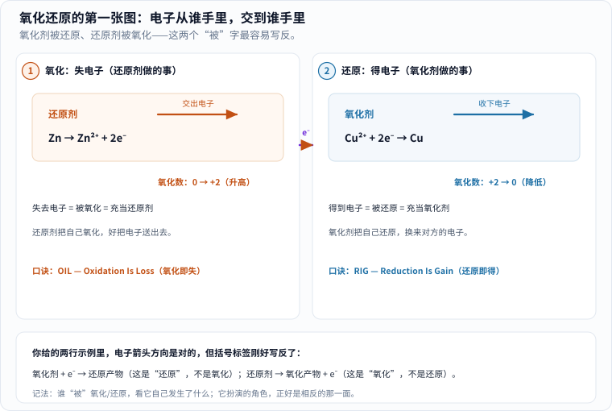
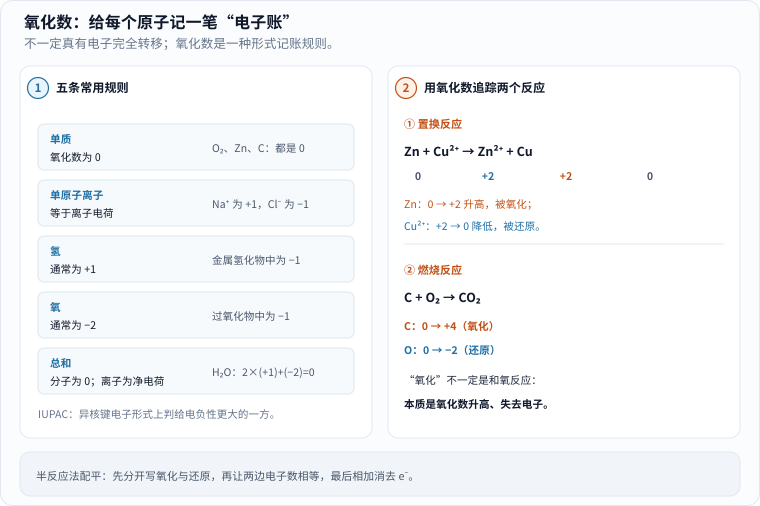
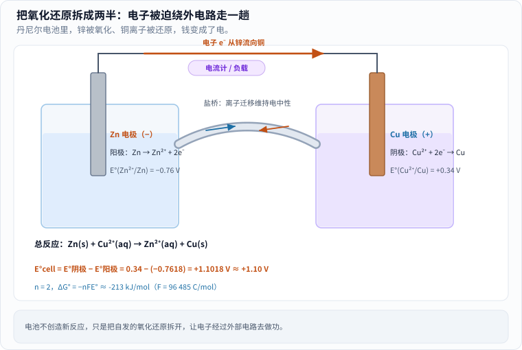

你给出的定义抓住了核心：

> 氧化还原反应是一种涉及**电子转移**的化学反应。氧化剂**接受电子**（自身被还原），还原剂**失去电子**（自身被氧化）。

不过你写的两行示例，电子箭头方向对了，括号里的标签却刚好写反了：

- `氧化剂 + e⁻ → 还原产物`，这是**还原**，不是氧化；
- `还原剂 → 氧化产物 + e⁻`，这是**氧化**，不是还原。

记住一句绕口令式的口诀就不会错：**氧化剂被还原，还原剂被氧化**。谁"被"什么，看的是**它自己发生了什么**；它扮演的角色，恰好是相反的那一面。

把这本账摊开，会撞上一串算不通的账：

1. **一块锌片插进硫酸铜，肉眼什么都没"接"，电子凭什么就知道该往铜那边跑？** 如果把它拆成两个半电池、中间架一座盐桥，电子又凭什么乖乖绕外电路走一圈 [[4]](#ref-4)？
2. **锂的标准电势 $$−3.04\,\mathrm{V}$$ 是所有金属里最负的，理论上是最猛的还原剂。** 那为什么你的手机锂电池里一滴水都不能有 [[5]](#ref-5)？
3. **铁在潮湿空气里一路锈到烂穿，铝却"锈"出一层膜就自动停手。** 同样是金属被氧化，为什么一个停不下来、一个自我悬崖勒马 [[6]](#ref-6)？
4. **标准状态算出的 $$+1.10\,\mathrm{V}$$ 是理想值。** 真实电池用久了电压会掉——把铜离子稀释 100 倍，电压到底掉多少 [[5]](#ref-5)？
5. **你吃下去的每一口饭，最终都在把电子交给氧气。** 这条电子传递链两端电势差有多大、能榨出多少 ATP [[7]](#ref-7)？

今天就用同一本电子账，把这五笔逐一算清。

---

## 一、先把角色钉死：谁失、谁得，谁被氧化、谁被还原

氧化（Oxidation）= 失去电子；还原（Reduction）= 得到电子。英文口诀 **OIL RIG** 很好用：

$$
\text{OIL: Oxidation Is Loss}\qquad \text{RIG: Reduction Is Gain}
$$

以锌和铜离子的反应为例，两个半反应分开写：

$$
\begin{aligned}
\text{氧化半反应：}&\quad \mathrm{Zn \rightarrow Zn^{2+} + 2e^-}\\
\text{还原半反应：}&\quad \mathrm{Cu^{2+} + 2e^- \rightarrow Cu}
\end{aligned}
$$

锌把电子交出去，自己被氧化，所以锌是**还原剂**；铜离子接过电子，自己被还原，所以铜离子是**氧化剂**。两式相加，电子正好抵消：

$$
\mathrm{Zn(s) + Cu^{2+}(aq) \rightarrow Zn^{2+}(aq) + Cu(s)}
$$

这里要点破一个最常混淆的点：**"氧化剂/还原剂"说的是它在反应里扮演的角色，"被氧化/被还原"说的是它自己身上发生的事，两者恰好相反。** 氧化剂让别人氧化，自己却被还原；还原剂让别人还原，自己却被氧化。就像拔河里"赢的人"是施加拉力的一方，但用力的方向是朝自己——角色和遭遇，本来就是两件事。

一个常见追问：**一定要有"真的电子自由飞过去"才算氧化还原吗？** 不一定。很多共价化合物里并没有裸电子在跑，但原子周围的电子密度发生偏移，氧化数变了，就按氧化还原处理。IUPAC 对**氧化态**的定义是"把异核键形式上按离子键处理之后，原子所带的电荷" [[1]](#ref-1)——它是一套**记账规则**，不是对电子真实位置的直接测量。

把这套记账法摊成一张图，后面所有论证都从它出发。

_图 1 怎么看：先左后右，再盯中间那支箭头。先看左栏：还原剂 → 氧化产物 + $$e^-$$，氧化数 0 → +2，升高即氧化。再看右栏：氧化剂 + $$e^-$$ → 还原产物，氧化数 +2 → 0，降低即还原。最后看中间：那支小箭头就是电子的实际去向——它永远从"氧化数升高"的一方，流向"氧化数降低"的一方。底部把你原稿里两处标签更正了一遍：氧化剂那边写"还原"，还原剂那边写"氧化"。_

---

## 二、氧化数：给电子账贴上可算的标签

氧化数（oxidation state）的核心规则只有五条 [[1]](#ref-1)[[2]](#ref-2)：

1. 单质中原子氧化数为 **0**；
2. 单原子离子的氧化数等于离子电荷；
3. 氢通常为 **+1**（金属氢化物中为 −1）；
4. 氧通常为 **−2**（过氧化物中为 −1）；
5. 中性分子各原子氧化数代数和为 0，离子中等于净电荷。

拿三个常见的分子演算：

$$
\begin{aligned}
\mathrm{H_2O}:&\quad 2\times(+1)+(-2)=0\\
\mathrm{CO_2}:&\quad \mathrm{C}=+4,\quad (+4)+2\times(-2)=0\\
\mathrm{MnO_4^-}:&\quad \mathrm{Mn}+4\times(-2)=-1\ \Rightarrow\ \mathrm{Mn}=+7
\end{aligned}
$$

第三行特别值得停一下：高锰酸根里锰是 **+7**，已经顶到锰的氧化数上限，所以它只能降、不能升——这就是高锰酸钾是强氧化剂的记账式解释 [[2]](#ref-2)。

### "氧化"不等于"和氧反应"

只要氧化数升高就是氧化。锌置换铜离子，反应容器里根本没有氧气出场；甲烷燃烧之前，碳在 $$\mathrm{CH_4}$$ 里是 **−4**（氢 +1，四个氢合计 +4，碳必须 −4），烧完变成 $$\mathrm{CO_2}$$ 里的 **+4**——碳一口气升高 8 个氧化数单位，是这场反应里最大的"失电子户"。

配平更复杂的方程式，用**半反应法**：先分别写氧化与还原，让两边电子数相等，再相加消去 $$e^-$$ [[3]](#ref-3)。以酸性条件下高锰酸根氧化亚铁为例：

$$
\begin{aligned}
\mathrm{MnO_4^-+8H^++5e^-}&\rightarrow\mathrm{Mn^{2+}+4H_2O}\\
\mathrm{Fe^{2+}}&\rightarrow\mathrm{Fe^{3+}+e^-}\quad(\times 5)\\
\hline
\mathrm{MnO_4^-+8H^++5Fe^{2+}}&\rightarrow\mathrm{Mn^{2+}+5Fe^{3+}+4H_2O}
\end{aligned}
$$

那个 "$$\times5$$" 就是电子守恒的硬约束——**失几个电子，就得有几个电子被接走，谁也不能凭空多一个少一个**。

_图 2 怎么看：左背规则，右看演算。左栏五条规则是账本封面：单质为 0、离子等于电荷、H 常 +1、O 常 −2、总和守恒。右栏拿置换反应和燃烧反应各演算一遍：重点看每个原子的氧化数怎么变，变了几个单位。最后记住半反应法的那一步"配电子"：它就是把上面那本账做平的关键动作。_

---

## 三、E°：一张"谁更想抢电子"的势能地图

### 1. 为什么电子知道往哪儿跑？——因为两边"电势"不一样

把锌片和铜片各自插进自己的盐溶液，再用导线和盐桥连起来，就是**丹尼尔电池**。它没创造新反应，只是把锌与铜离子的直接氧化还原拆成两半，逼电子走外电路去做功。

标准状态下（1 M、1 bar、298 K），铜电对的标准还原电势 $$E^\circ(\mathrm{Cu^{2+}/Cu})=+0.34\,\mathrm{V}$$；锌电对 $$E^\circ(\mathrm{Zn^{2+}/Zn})=-0.7618\,\mathrm{V}$$ [[4]](#ref-4)。电势更正的一方更容易得电子，所以铜是阴极、锌是阳极：

$$
\begin{aligned}
E^\circ_{\text{cell}}
&= E^\circ_{\text{阴极}} - E^\circ_{\text{阳极}} \\
&= 0.34 - (-0.7618) \approx \mathbf{+1.10\ V}
\end{aligned}
$$

**电子并不是"知道"往哪儿跑，而是被两边的电势差推着走**——就像水往低处流不需要"知道"地形，重力势差本身就是驱动力。$$E^\circ>0$$ 意味着标准状态下反应自发。

### 2. 一笔"自由能账"：1.10 伏到底值多少焦耳？

电压乘上电荷就是能量。用法拉第常数 $$F=96\,485\,\mathrm{C/mol}$$（一摩尔电子的电荷量）换算 [[5]](#ref-5)：

$$
\Delta G^\circ = -nFE^\circ_{\text{cell}}
= -2\times 96\,485\times1.1018
\approx \mathbf{-213\ kJ/mol}
$$

负号表示这份自由能被释放出来、能被拿去做功。每转移 2 摩尔电子（每个锌原子给 2 个），理论上能榨出约 213 千焦——这就是电池能驱动手机、启动汽车的能量来源。

### 3. 电势阶梯的两端：氟与锂

把各种半反应按 $$E^\circ$$ 从高到低排成梯子，就得到一张**氧化剂强弱地图** [[8]](#ref-8)：

- 梯子**上方**：$$\mathrm{F_2/F^-}=+2.87\,\mathrm{V}$$、$$\mathrm{O_2/H_2O}=+1.23\,\mathrm{V}$$——正得越多越容易得电子，是越强的氧化剂；
- 梯子**下方**：$$\mathrm{Zn^{2+}/Zn}=-0.76\,\mathrm{V}$$、$$\mathrm{Li^+/Li}=-3.04\,\mathrm{V}$$——负得越多越容易失电子，是越强的还原剂。

你原稿里说"正的 $$E^\circ$$ 表示氧化剂更容易被还原，负的 $$E^\circ$$ 表示还原剂更容易被氧化"，方向完全正确。补两句：

1. **真正决定电池电压的是两个电对的差值，不是某一个电势的绝对值**；
2. **标准电极电势是"相对"的**——人为把氢电极 $$2\mathrm{H^+}+2e^-\to\mathrm{H_2}$$ 定为 $$0.00\,\mathrm{V}$$ 当原点，其他所有电势都是相对它量的 [[8]](#ref-8)。没有这个原点，整张梯子就无从排起。

_图 3 怎么看：先找箭头，再看盐桥，最后读数字。先看电子箭头：外电路上电子从锌极（阳极，被氧化）流向铜极（阴极，被还原）。再看盐桥：阳离子向阴极、阴离子向阳极迁移，维持两侧电中性——没有盐桥，电荷瞬间堆积，反应几毫秒就停。最后读底部两行：$$E^\circ=+1.10\,\mathrm{V}$$ 与 $$\Delta G^\circ\approx-213\,\mathrm{kJ/mol}$$ 的实算全过程。_

---

## 四、一笔"浓度账"：为什么电池用久了电压会掉？

### 1. 能斯特方程：把浓度写进电压

标准状态是理想条件。真实电池里离子浓度随时在变，电压也跟着变。把热力学关系 $$\Delta G=\Delta G^\circ+RT\ln Q$$ 与 $$\Delta G=-nFE$$ 合并，就得到**能斯特方程** [[5]](#ref-5)：

$$
E = E^\circ - \frac{RT}{nF}\ln Q
$$

在 25 °C 换成常用对数：

$$
E = E^\circ - \frac{0.0592\ \mathrm{V}}{n}\log Q
$$

其中 $$n$$ 是转移电子数，$$Q$$ 是反应商（纯固体、纯液体不写进去）。这公式的物理含义很直白：**产物堆积、反应物稀少时，往前推的劲头就小，电压就低。**

### 2. 实算：把铜离子稀释 100 倍

拿丹尼尔电池做个小实验：保持 $$[\mathrm{Zn^{2+}}]=1\,\mathrm{M}$$，把 $$[\mathrm{Cu^{2+}}]$$ 稀释到 $$0.01\,\mathrm{M}$$。总反应 $$\mathrm{Zn+Cu^{2+}\rightarrow Zn^{2+}+Cu}$$：

$$
Q=\frac{[\mathrm{Zn^{2+}}]}{[\mathrm{Cu^{2+}}]}=\frac{1}{0.01}=100,\qquad n=2
$$

$$
E = 1.10 - \frac{0.0592}{2}\times\log(100)
= 1.10 - 0.0296\times 2
= 1.10 - 0.0592 \approx \mathbf{1.04\ V}
$$

电压从 $$1.10$$ 掉到 $$1.04\,\mathrm{V}$$。别小看这 $$0.06\,\mathrm{V}$$——**电池电量指示（电量计）正是靠监测这种电压缓慢下滑来判断还剩多少电的**。

### 3. 锂为什么"最猛"却不能用水？

锂的 $$E^\circ=-3.04\,\mathrm{V}$$ 意味着它极度想把电子甩出去。可把它扔进水里，它会立刻和水剧烈反应，放出氢气、把自己烧掉——**不是电池，是事故**。

所以商用锂离子电池必须用**有机溶剂**当电解液，而且正极材料要选电势足够高的过渡金属氧化物（如 $$\mathrm{LiCoO_2}$$），让两端电势差做到约 $$3.7\,\mathrm{V}$$——是铜锌电池的 3 倍多 [[5]](#ref-5)。锂的强还原性被"关"在无水体系里，才从实验室危险品变成你口袋里的电源。

_图 4 怎么看：左看阶梯，右看浓度题。左栏从 +2.87 V 到 −3.04 V依次排开常见电对：越往上氧化性越强，越往下还原性越强——这张梯子就是"电子往哪儿流"的地形图。右栏把上面那道稀释题按步骤算完：先算 $$Q=100$$、再代 $$n=2$$、最后得到 $$1.04\,\mathrm{V}$$。底部那句提醒别漏：热力学自发 $$\ne$$ 反应快。$$E^\circ>0$$ 只说"能发生"，不说"多快发生"——速率是动力学的事。_

---

## 五、同一套账本：铁锈为什么停不下，铝为什么自动停？

### 1. 铁锈：一场不需要电池外壳的微型电化学

钢铁生锈，本质是表面形成了无数微型原电池：

$$
\text{阳极：}\mathrm{Fe \rightarrow Fe^{2+}+2e^-},\qquad
\text{阴极：}\mathrm{O_2+2H_2O+4e^- \rightarrow 4OH^-}
$$

生成的 $$\mathrm{Fe(OH)_2}$$ 再被空气氧化成 $$\mathrm{FeOOH}$$ 和 $$\mathrm{Fe_2O_3\cdot xH_2O}$$（铁锈）[[6]](#ref-6)。问题是**铁锈疏松、多孔、会剥落**——它盖不住底下的铁，反而像海绵一样吸水吸氧，让腐蚀继续往里钻。更糟的是，铁变成铁锈后体积膨胀好几倍，把混凝土撑裂、把涂层顶开，暴露出更多新鲜表面 [[6]](#ref-6)。**腐蚀因此自我加速，一路烂穿。**

### 2. 铝与不锈钢：把"氧化"变成自我保护

铝其实比铁更活泼（标准电势更负），按理该锈得更快。可它表面一旦氧化，就生成一层**致密、附着力极强的 $$\mathrm{Al_2O_3}$$ 膜**，厚度只有几纳米，却把内部金属和外界彻底隔开——这叫**钝化（passivation）** [[6]](#ref-6)。不锈钢同理：加进去的铬优先氧化，生成致密铬氧化物薄膜，刀划过后暴露的新表面会**立刻重新钝化**。

**同样是"金属失电子被氧化"，铁的产物疏松所以灾难，铝和铬的产物致密所以自救。** 差别不在反不反应，而在**产物能不能封住反应界面**。

防腐的所有招数，本质都是**不让铁当阳极**：涂漆（隔绝电解质）、镀锌（锌比铁活泼，情愿自己当阳极牺牲掉，叫牺牲阳极）、外加电流阴极保护（把铁强制变成阴极）。

### 3. 燃烧与代谢：同一条"电子下坡"

甲烷燃烧 $$\mathrm{CH_4 + 2O_2 \rightarrow CO_2 + 2H_2O}$$ 中，碳从 −4 升到 +4 被氧化，氧从 0 降到 −2 被还原。我们以前聊过[火为什么往上蹿]()，那篇讲热与流动；这里补上底层的电子迁移——**燃烧就是把燃料的电子一口气交给氧气，能量以热的形式倾泻出来**。

生物体做的事本质上一样，只是**分很多小步、把能量存起来而不是一次性烧掉**。最繁忙的电子搬运工是 $$\mathrm{NAD^+}$$：

$$
\mathrm{NAD^+ + H^- \rightarrow NADH}
$$

它接受一个氢负离子（相当于 **2 个电子 + 1 个质子**）变成 NADH，再把电子交给电子传递链、重新变回 $$\mathrm{NAD^+}$$ [[7]](#ref-7)。把两端电势代进 $$\Delta G=-nF\Delta E$$：

$$
\begin{aligned}
\Delta E^\circ{}' &= E^\circ{}'(\mathrm{O_2/H_2O})-E^\circ{}'(\mathrm{NAD^+/NADH})\\
&\approx 0.82-(-0.32)=1.14\ \mathrm{V}\\
\Delta G^\circ{}' &= -2\times96\,485\times1.14\approx-220\ \mathrm{kJ/mol}
\end{aligned}
$$

这约 $$220\,\mathrm{kJ/mol}$$ 的自由能，被线粒体分装进约 **2.5 个 ATP** 里 [[7]](#ref-7)。**你吃的每一口食物，最终都在做同一件事：把电子从高能位置（NADH，−0.32 V），一步步交给氧气（+0.82 V），沿途把落差兑成 ATP。**

_图 5 怎么看：四个小格逐个圈"谁失谁得"。燃烧格：碳失电子、氧得电子，能量一次性以热放出。腐蚀格：铁失电子、氧得电子，产物疏松所以停不下来。电池格：把氧化与还原拆到两个电极，电子被迫绕外电路走，能量变成电。代谢格：NAD⁺ 与 NADH 只是同一对 redox couple 的氧化态和还原态，电子来回转手，落差兑成 ATP。_

---

## 六、一张总表收拢全篇 + 五个常见误区

| 概念 | 电子视角 | 氧化数视角 | 典型例子 |
| :--- | :--- | :--- | :--- |
| 氧化 | 失电子 | 升高 | $$\mathrm{Zn\rightarrow Zn^{2+}}$$、$$\mathrm{C^{-4}\rightarrow C^{+4}}$$ |
| 还原 | 得电子 | 降低 | $$\mathrm{Cu^{2+}\rightarrow Cu}$$、$$\mathrm{Mn^{+7}\rightarrow Mn^{+2}}$$ |
| 氧化剂 | 得电子，自身被还原 | 氧化数降低 | $$\mathrm{O_2}$$、$$\mathrm{Cu^{2+}}$$、$$\mathrm{F_2}$$ |
| 还原剂 | 失电子，自身被氧化 | 氧化数升高 | $$\mathrm{Zn}$$、$$\mathrm{CH_4}$$、$$\mathrm{Li}$$ |
| 电动势 $$E^\circ$$ | 电子转移倾向的量度 | — | 铜锌电池 +1.10 V |
| 能斯特方程 | 浓度修正实际电压 | — | 稀释铜离子后约 1.04 V |
| $$\Delta G=-nFE$$ | 电压换算自由能 | — | 铜锌电池约 −213 kJ/mol |

五个常见误区，逐条拆：

1. **"氧化剂被氧化。"** 错。氧化剂**让别人氧化**，自己**被还原**——角色和遭遇恰好相反。
2. **"氧化一定要有氧气。"** 错。判据是氧化数升高，锌与硫酸铜反应没有氧气也照样氧化还原。
3. **"$$E^\circ$$ 越正反应越快。"** 错。$$E^\circ$$ 说热力学方向与做功能力，速率要看动力学。**热力学自发的金刚石变石墨，实际上慢到宇宙尺度都看不出来** [[9]](#ref-9)。
4. **"氧化和还原可以单独发生。"** 错。电子不会凭空消失，失电子总数必须等于得电子总数——这是配平方程式的铁律。
5. **"电池电压是常数。"** 错。能斯特方程告诉我们浓度一变电压就变，这是电量计工作的基础。

化学键决定"原子怎么拼起来"，氧化还原回答"电子怎么换手"。把这两本账都学会，燃烧、生锈、电池、呼吸这几件看似无关的事，就都成了同一套规则的不同章节。想深入电子如何被共用、转移和离域，可以接着读[《化学键到底是什么？》]()。

---

## 参考资料与核查来源

1. **IUPAC Gold Book**, *oxidation state*（[官方条目](https://goldbook.iupac.org/terms/view/O04365)）—— 支持"异核键按离子近似处理后原子的电荷"这一氧化态定义及实用判定规则。
2. **IUPAC Gold Book**, *oxidation state*（[entry](https://goldbook.iupac.org/terms/view/O04365)）—— official definition of oxidation state and the rules (elemental form = 0, H = +1, O = −2, sum = net charge); **OpenStax Chemistry 2e**, *17.1 Review of Redox Chemistry*（[chapter](https://openstax.org/books/chemistry-2e/pages/17-1-review-of-redox-chemistry)）—— oxidation as increase in oxidation number, reduction as decrease.
3. **OpenStax Chemistry 2e**, *17.1 Review of Redox Chemistry*（[章节](https://openstax.org/books/chemistry-2e/pages/17-1-review-of-redox-chemistry)）—— 支持氧化还原按氧化数变化定义、半反应配平方法。
4. **OpenStax Chemistry 2e**, *17.3 Electrode and Cell Potentials*（[章节](https://openstax.org/books/chemistry-2e/pages/17-3-electrode-and-cell-potentials)）—— 支持 $$E^\circ(\mathrm{Cu^{2+}/Cu})=+0.34\ \mathrm{V}$$、$$E^\circ(\mathrm{Zn^{2+}/Zn})=-0.7618\ \mathrm{V}$$、$$E^\circ_{\text{cell}}=1.10\ \mathrm{V}$$ 及 $$E^\circ>0$$ 的自发性判据。
5. **OpenStax Chemistry 2e**, *17.4 Potential, Free Energy, and Equilibrium*（[章节](https://openstax.org/books/chemistry-2e/pages/17-4-potential-free-energy-and-equilibrium)）—— 支持 $$\Delta G=-nFE$$、能斯特方程两种形式、法拉第常数 96 485 C/mol、25 °C 下 0.0592/n 系数。锂电池无水体系与约 3.7 V 工作电压参 ChemWhiz《Electrochemistry》教学页。
6. **OpenStax Chemistry**, *17.6 Corrosion*（[章节](https://openstax.org/books/chemistry/pages/17-6-corrosion)）与 Biology Insights《Why Does Rust Spread?》《Does Rust Eat Metal?》及 Master10《Iron Rusting vs Stainless Steel》—— 支持铁腐蚀的阳/阴极半反应、铁锈疏松膨胀自我加速、铝与铬的致密氧化膜钝化、牺牲阳极与阴极保护等防护原理。
7. **NCBI Bookshelf**, *Figure 2.27 Role of NAD⁺ in oxidation-reduction reactions*（[官方图注](https://www.ncbi.nlm.nih.gov/books/NBK9921/figure/A288/?report=objectonly)）与中原大学 Uedu《化學滲透與氧化磷酸化的分子機制》—— 支持 NAD⁺ 接受氢负离子（2 电子＋1 质子）形成 NADH、电子传递链电势梯度与 $$\Delta G=-nF\Delta E$$ 计算、每 NADH 约 2.5 ATP 的现代估值。
8. **Chemistry LibreTexts**, *Table of Standard State Electrochemical Potentials*（[页面](https://chem.libretexts.org/Bookshelves/Analytical_Chemistry/Supplemental_Modules_(Analytical_Chemistry)/Analytical_Sciences_Digital_Library/In_Class_Activities/Electrochemical_Methods_of_Analysis/02_Text/4._Table_of_Standard_State_Electrochemical_Potentials)）—— 支持标准氢电极定为 0.00 V 作为原点、$$\mathrm{F_2/F^-}=+2.87\ \mathrm{V}$$、$$\mathrm{Li^+/Li}=-3.04\ \mathrm{V}$$ 等电势阶梯端点数值。
9. **Chemistry Student**, *Thermodynamic and Kinetic Control*（[页面](https://www.chemistrystudent.com/ap-chemistry/9-thermodynamics-and-electrochemistry/thermodynamic-and-kinetic-control.html)）与 Chemistery《Kinetics vs Thermodynamics》—— 支持"热力学自发指能否发生、动力学指多快"的区分，以及金刚石变石墨在热力学上自发但速率慢到可忽略的经典例证。
10. **原创图解说明**：图 1 至图 5 由本站 `tools/visuals.py build redox-reactions` 生成，含氧化数求和、$$E^\circ$$ 与 $$\Delta G^\circ$$、能斯特方程电势、电势阶梯单调性等断言，以及 XML、宽高比、字号审计。
