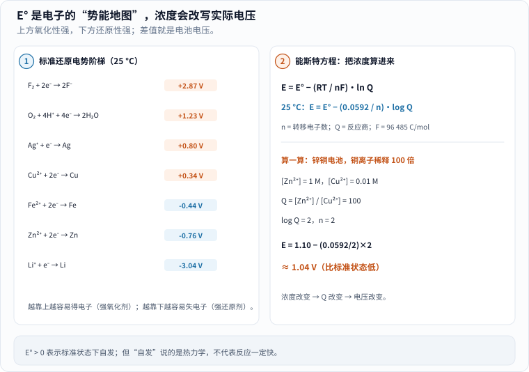

你给出的定义抓住了核心：

> 氧化还原反应是一种涉及**电子转移**的化学反应。氧化剂**接受电子**（自身被还原），还原剂**失去电子**（自身被氧化）。氧化数与电负性决定电子往哪儿走。

不过你写的两行示例，电子箭头方向对了，括号里的标签却刚好写反了：

- `氧化剂 + e⁻ → 还原产物`，这是**还原**，不是氧化；
- `还原剂 → 氧化产物 + e⁻`，这是**氧化**，不是还原。

记住一句绕口令式的口诀就不会错：**氧化剂被还原，还原剂被氧化**。谁“被”什么，看的是**它自己发生了什么**；而它扮演的角色，恰好是相反的那一面。

---

## 一、第一张图：电子从谁手里交到谁手里

氧化（Oxidation）= 失去电子；还原（Reduction）= 得到电子。英文口诀 **OIL RIG** 很好用：

$$
\text{OIL: Oxidation Is Loss}\qquad \text{RIG: Reduction Is Gain}
$$

以锌和铜离子的反应为例：

$$
\begin{aligned}
\text{氧化半反应：}&\quad \mathrm{Zn \rightarrow Zn^{2+} + 2e^-}\\
\text{还原半反应：}&\quad \mathrm{Cu^{2+} + 2e^- \rightarrow Cu}
\end{aligned}
$$

锌把电子交出去，自己被氧化，所以锌是**还原剂**；铜离子接过电子，自己被还原，所以铜离子是**氧化剂**。两个半反应相加，电子正好抵消：

$$
\mathrm{Zn(s) + Cu^{2+}(aq) \rightarrow Zn^{2+}(aq) + Cu(s)}
$$

_图 1：怎么看这张图？左栏盯住“还原剂 → 氧化产物 + e⁻”：氧化数 0 → +2，升高即氧化。右栏盯住“氧化剂 + e⁻ → 还原产物”：氧化数 +2 → 0，降低即还原。中间那支小箭头就是电子的实际去向。底部把你原稿里两处标签更正了一遍。[单独打开图片](/assets/images/redox-reactions/redox-electron-bookkeeping.svg)_

一个常见追问：**一定要有“真的电子自由飞过去”才算氧化还原吗？** 不一定。很多共价化合物里并没有裸电子在跑，但原子周围的电子密度发生偏移，氧化数变了，我们就按氧化还原处理。IUPAC 对**氧化态**的定义是“把异核键形式上按离子键处理之后，原子所带的电荷” [[1]](#ref-1)——它是一套记账规则，不是对电子真实位置的直接测量。

---

## 二、氧化数：给原子电子账贴上标签

氧化数（oxidation state）的核心规则只有五条 [[1]](#ref-1)[[2]](#ref-2)：

1. 单质中原子氧化数为 **0**；
2. 单原子离子的氧化数等于离子电荷；
3. 氢通常为 **+1**（金属氢化物中为 −1）；
4. 氧通常为 **−2**（过氧化物中为 −1）；
5. 中性分子各原子氧化数代数和为 0，离子中等于净电荷。

于是：

- $$\mathrm{H_2O}$$：$$2\times(+1)+(-2)=0$$；
- $$\mathrm{CO_2}$$：$$\mathrm{C}$$ 为 $$+4$$、每个 $$\mathrm{O}$$ 为 $$-2$$，$$(+4)+2\times(-2)=0$$；
- $$\mathrm{C + O_2 \rightarrow CO_2}$$：碳从 0 升到 +4（被氧化），氧从 0 降到 −2（被还原）。

**“氧化”不等于“和氧反应”。** 只要氧化数升高就是氧化，比如锌置换铜离子，根本没氧气出场。

_图 2：怎么看这张图？左栏五条规则像账本封面；右栏拿置换反应和燃烧反应各演算一遍。配平更复杂的方程式时，用**半反应法**：先分别写氧化与还原，让两边电子数相等，再相加消去 $$e^-$$。[单独打开图片](/assets/images/redox-reactions/oxidation-number-rules.svg)_

---

## 三、E°：电子的“势能地图”

把锌片和铜片各自插进自己的盐溶液，再用导线和盐桥连起来，就是**丹尼尔电池**。它没创造新反应，只是把上面那个自发氧化还原拆成两半，逼电子走外电路去做功。

标准状态下（1 M、1 bar、298 K），铜电对的标准还原电势 $$E^\circ(\mathrm{Cu^{2+}/Cu})=+0.34\ \mathrm{V}$$；锌电对 $$E^\circ(\mathrm{Zn^{2+}/Zn})=-0.7618\ \mathrm{V}$$ [[4]](#ref-4)。电势更正的一方更容易得电子，所以铜是阴极、锌是阳极：

$$
\begin{aligned}
E^\circ_{\text{cell}}
&= E^\circ_{\text{阴极}} - E^\circ_{\text{阳极}} \\
&= 0.34 - (-0.7618) \approx \mathbf{+1.10\ V}
\end{aligned}
$$

正电压意味着标准状态下反应自发。再用法拉第常数 $$F=96\,485\ \mathrm{C/mol}$$ 换算成自由能 [[5]](#ref-5)：

$$
\Delta G^\circ = -nFE^\circ_{\text{cell}}
= -2\times 96\,485\times1.1018
\approx \mathbf{-213\ kJ/mol}
$$

_图 3：怎么看这张图？先找电子箭头：外电路上电子从锌极流向铜极；再看盐桥，阳离子与阴离子反向迁移维持两侧电中性。底部两行就是 $$E^\circ$$ 与 $$\Delta G^\circ$$ 的实算。[单独打开图片](/assets/images/redox-reactions/daniell-cell-electron-flow.svg)_

把各种半反应按 $$E^\circ$$ 从高到低排成梯子，就得到一张**氧化剂强弱地图**：

- 梯子**上方**（如 $$\mathrm{F_2/F^-}$$ 为 +2.87 V、$$\mathrm{O_2/H_2O}$$ 为 +1.23 V）容易得电子，是强氧化剂；
- 梯子**下方**（如 $$\mathrm{Zn^{2+}/Zn}$$ 为 −0.76 V、$$\mathrm{Li^+/Li}$$ 为 −3.04 V）容易失电子，是强还原剂。

你原稿里说“正的 E° 表示氧化剂更容易被还原，负的 E° 表示还原剂更容易被氧化”，方向完全正确；补上一句：**真正决定电池电压的是两个电对的差值，而不是某一个电势的绝对值。**

---

## 四、能斯特方程：浓度会改写实际电压

标准状态是理想条件。真实电池里离子浓度随时在变，电压也会跟着变。把热力学关系 $$\Delta G=\Delta G^\circ+RT\ln Q$$ 与 $$\Delta G=-nFE$$ 合并，就得到**能斯特方程** [[5]](#ref-5)：

$$
E = E^\circ - \frac{RT}{nF}\ln Q
$$

在 25 °C 换成常用对数：

$$
E = E^\circ - \frac{0.0592\ \mathrm{V}}{n}\log Q
$$

其中 $$n$$ 是转移电子数，$$Q$$ 是反应商（纯固体、纯液体不写进去）。

拿丹尼尔电池做个小实验：保持 $$[\mathrm{Zn^{2+}}]=1\ \mathrm{M}$$，把 $$[\mathrm{Cu^{2+}}]$$ 稀释到 $$0.01\ \mathrm{M}$$。总反应为 $$\mathrm{Zn+Cu^{2+}\rightarrow Zn^{2+}+Cu}$$，所以

$$
Q=\frac{[\mathrm{Zn^{2+}}]}{[\mathrm{Cu^{2+}}]}=100,\qquad n=2
$$

$$
E = 1.10 - \frac{0.0592}{2}\times\log(100)
= 1.10 - 0.0592 \approx \mathbf{1.04\ V}
$$

产物侧锌离子相对“堆积”，反应往前推的劲头变小，电压就掉了一点。

_图 4：怎么看这张图？左栏从 +2.87 V 到 −3.04 V 依次排开七个常见电对；右栏把上面这道浓度题按步骤算完。底部提醒：热力学自发 ≠ 反应快——动力学是另一回事。[单独打开图片](/assets/images/redox-reactions/nernst-potential-ladder.svg)_

---

## 五、同一套账本：燃烧、腐蚀、电池与代谢

### 1. 燃烧

甲烷燃烧 $$\mathrm{CH_4 + 2O_2 \rightarrow CO_2 + 2H_2O}$$ 中，碳从 −4 升到 +4，被氧化；氧从 0 降到 −2，被还原。燃料是还原剂，氧气是氧化剂。我们以前聊过[火为什么往上蹿]()，那篇文章讲热与流动；这里补上它底层的电子迁移。

### 2. 腐蚀

钢铁生锈是一场不需要电池外壳的微型电化学：

$$
\text{阳极：}\mathrm{Fe \rightarrow Fe^{2+}+2e^-},\qquad
\text{阴极：}\mathrm{O_2+2H_2O+4e^- \rightarrow 4OH^-}
$$

铁被氧化、氧气被还原，生成的铁锈是水合氧化铁 $$\mathrm{Fe_2O_3\cdot xH_2O}$$。和铝表面致密氧化膜不同，铁锈疏松剥落，露出新铁继续被吃 [[6]](#ref-6)。镀锌、涂漆、牺牲阳极，本质都是**不让铁当阳极**。

### 3. 电池

[电池]()是把氧化还原的空间分离做成了器件。充电电池则更进一步：外加电压把反应强行倒着推，$$\Delta G>0$$ 也能发生。

### 4. 代谢

生物体内最繁忙的电子搬运工之一是 $$\mathrm{NAD^+}$$。它接受氢负离子（相当于两个电子）变成 NADH，再把电子交给后续受体、重新变回 $$\mathrm{NAD^+}$$ [[7]](#ref-7)。线粒体的电子传递链就是靠这一连串氧化还原，把电子的能量逐步存进 ATP。我们吃的每一口食物，最终都在做同一件事：**把电子从高能位置，一步步交给氧气**。

_图 5：怎么看这张图？四个小格各自圈出“谁失电子、谁得电子”。注意最后两行：NAD⁺ 与 NADH 只是同一对 redox couple 的氧化态和还原态，电子来回转手。[单独打开图片](/assets/images/redox-reactions/redox-in-life-and-industry.svg)_

---

## 六、总表与四个常见误区

| 概念 | 电子视角 | 氧化数视角 | 典型例子 |
| :--- | :--- | :--- | :--- |
| 氧化 | 失电子 | 升高 | $$\mathrm{Zn\rightarrow Zn^{2+}}$$ |
| 还原 | 得电子 | 降低 | $$\mathrm{Cu^{2+}\rightarrow Cu}$$ |
| 氧化剂 | 得电子，自身被还原 | 氧化数降低 | $$\mathrm{O_2}$$、$$\mathrm{Cu^{2+}}$$ |
| 还原剂 | 失电子，自身被氧化 | 氧化数升高 | $$\mathrm{Zn}$$、$$\mathrm{CH_4}$$ |
| 电动势 $$E^\circ$$ | 电子转移倾向的量度 | — | 铜锌电池 +1.10 V |
| 能斯特方程 | 浓度修正实际电压 | — | 稀释铜离子后约 1.04 V |

四个常见误区：

1. **“氧化剂被氧化。”** 错。氧化剂**让别人氧化**，自己**被还原**。
2. **“氧化一定要有氧气。”** 错。判据是氧化数升高，锌与硫酸铜反应没有氧气也照样氧化还原。
3. **“E° 越正反应越快。”** 错。$$E^\circ$$ 说热力学方向与做功能力，速率要看动力学。
4. **“氧化和还原可以单独发生。”** 错。电子不会凭空消失，失电子总数必须等于得电子总数。

化学键决定“原子怎么拼起来”，氧化还原回答“电子怎么换手”。把这两本账都学会，燃烧、生锈、电池、呼吸这几件看似无关的事，就都成了同一套规则的不同章节。想深入电子如何被共用、转移和离域，可以接着读[《化学键到底是什么？》]()。

---

## 参考资料与核查来源

1. **IUPAC Gold Book**, *oxidation state*（[官方条目](https://goldbook.iupac.org/terms/view/O04365)）—— 支持“异核键按离子近似处理后原子的电荷”这一氧化态定义及实用判定规则。
2. **维基百科中文版**, *氧化态*（[条目](https://www.wikiwand.com/zh-mo/%E6%B0%A7%E5%8C%96%E6%85%8B)）—— 支持单质为零、氢 +1、氧 −2、分子总和为零等常见规则，以及“氧化数升高为氧化、降低为还原”的表述。
3. **OpenStax Chemistry 2e**, *17.1 Review of Redox Chemistry*（[章节](https://openstax.org/books/chemistry-2e/pages/17-1-review-of-redox-chemistry)）—— 支持氧化还原按氧化数变化定义、半反应配平方法。
4. **OpenStax Chemistry 2e**, *17.3 Electrode and Cell Potentials*（[章节](https://openstax.org/books/chemistry-2e/pages/17-3-electrode-and-cell-potentials)）—— 支持 $$E^\circ(\mathrm{Cu^{2+}/Cu})=+0.34\ \mathrm{V}$$、$$E^\circ(\mathrm{Zn^{2+}/Zn})=-0.7618\ \mathrm{V}$$、$$E^\circ_{\text{cell}}=1.10\ \mathrm{V}$$ 及 $$E^\circ>0$$ 的自发性判据。
5. **OpenStax Chemistry 2e**, *17.4 Potential, Free Energy, and Equilibrium*（[章节](https://openstax.org/books/chemistry-2e/pages/17-4-potential-free-energy-and-equilibrium)）—— 支持 $$\Delta G=-nFE$$、能斯特方程的两种形式、法拉第常数 96 485 C/mol 与 25 °C 下的 0.0592/n 系数。
6. **OpenStax Chemistry**, *17.6 Corrosion*（[章节](https://openstax.org/books/chemistry/pages/17-6-corrosion)）—— 支持铁腐蚀的阳极、阴极半反应、铁锈组成及牺牲阳极等防护原理。
7. **NCBI Bookshelf**, *Figure 2.27 Role of NAD⁺ in oxidation-reduction reactions*（[官方图注](https://www.ncbi.nlm.nih.gov/books/NBK9921/figure/A288/?report=objectonly)）—— 支持 NAD⁺ 接受电子形成 NADH、再把电子转给第二底物的载体机制。
8. **原创图解说明**：图 1 至图 5 由本站 `tools/visuals.py build redox-reactions` 生成，含氧化数求和、$$E^\circ$$ 与 $$\Delta G^\circ$$、能斯特方程电势、电势阶梯单调性等断言，以及 XML、宽高比、字号审计。
