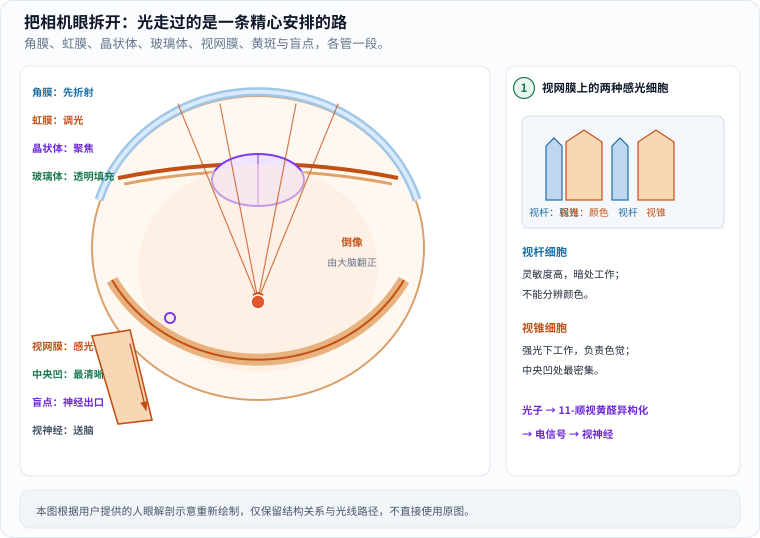

中文维基百科"眼"条目里那段话，把成品写得很清楚：最早演化出眼睛的动物约在 **6 亿年前**；在脊椎动物与一些软体动物中，光进入眼睛后投影到视网膜，视锥辨色、视杆辨亮，信号经视神经送往大脑；眼前还有虹膜调光、晶状体对焦 [[5]](#ref-5)。

可它把最要命的问题留给了读者。把这台"相机"摊开，会撞上一串算不通的账：

1. **一颗视杆细胞能检测单个光子。** 它外段里塞着约 $$10^8$$ 个视紫红质分子、$$10^7$$ 个转导蛋白、$$10^6$$ 个 PDE——这么多"零件"在黑暗里自己就会乱响，细胞凭什么还能分辨出"真的来了一个光子"和"噪声" [[10]](#ref-10)？
2. **"半个晶状体没用。"** 真没用吗？一团感光斑能告诉涡虫"阴影扫过来了，快逃"——这已经是实打实的生存优势。**演化筛选的从来不是完美，是"比昨天好用一点"。**
3. **只许每次改 1%，从一块感光平斑改到相机眼要多久？** 直觉说"天文数字"，Nilsson 与 Pelger 1994 年算出来的答案却只有 **36.4 万代、约 50 万年** [[2]](#ref-2)——在地质年代里只是一眨眼。
4. **人和章鱼的相机眼几乎一模一样，可它们的共同祖先根本没有眼睛。** 同样一套精密结构，被各自"发明"了至少约 **40 次** [[1]](#ref-1)[[8]](#ref-8)。
5. **人有盲点，章鱼没有。** 差别不在"谁设计得更好"，而在**视网膜布线方向**——一个是旧房子改造，一个是新图纸施工 [[4]](#ref-4)。

这五笔账，正好把"眼睛能否渐变"这个达尔文亲手挑出的最难案例，拆成一步步能跟读的台阶。

---

## 一、先把时间说准：眼睛比寒武纪大爆发更早露面

常听到的说法是"眼睛出现在约 6 亿年前的寒武纪大爆发"。这句话把两件事揉在了一起。

眼科学者 Ivan Schwab 2018 年的综述写得很细：已知最早的**化石眼**属于三叶虫 *Olenellus fowleri*，约 **6 亿–5.5 亿年前**；而寒武纪大爆发通常定在 **5.43 亿–5.05 亿年前** [[1]](#ref-1)。也就是说，眼睛的化石记录可能在大爆发之前就已出现；大爆发不是眼睛的起点，而是眼睛**开始大规模改写生态**的时期。

我国云南澄江动物群距今 5 亿多年，出土的奇虾复眼直径可达 3 厘米、由 **16000 多个小眼**组成；三叶虫的复眼则由**方解石晶体**构成 [[7]](#ref-7)——这是生物界少有的"用矿物当透镜"的方案。这些眼睛一出土就是"成品"，说明更早的软体阶段没留下多少化石。但现生动物把这中间过程保留了下来，就像一条活着的演化时间线。

### 一次发明，还是四十次？

把动物界摊开看，视觉器官分布得极不均匀。Schwab 综述给的统计是：约 36 个动物门里，只有 7 个门有眼、其中 4 个门能成像，但这 4 个门却占了全部动物物种的约 **96%** [[1]](#ref-1)。也就是说——**绝大多数动物没有眼睛，但"有眼"的那几支一旦出现就辐射爆发**。

更惊人的是起源次数：Salvini-Plawen 与 Mayr 1977 年的经典普查得出结论：光感受器和眼睛至少独立起源 **40 次**、可能多达 **65 次** [[11]](#ref-11)。同为"相机眼"，脊椎动物和头足类各自造了一遍；同为"复眼"，昆虫和甲壳类也各来一遍。**眼睛是自然界被独立发明次数最多的复杂器官之一。**

把这条时间线与起源次数摊成一张图，后面五节都从它展开。

> **图 1 怎么看（上排读时间，下排读次数）**：
> 1. **先看上排四个时间锚点**：埃迪卡拉纪开始（650 Ma）→ 最早化石眼（600 Ma）→ 寒武纪开始（543 Ma）→ 大爆发末（505 Ma）。Ma 是"百万年前"，注意最早化石眼落在大爆发**之前**。
> 2. **再看下排左边的三条条形图**：讲"有多少门有眼、有多少门能成像"，以及这少数几门为什么占了 96% 的物种。
> 3. **最后看右边列表**：同一件事被独立做了多少次——40 次起步，最多可能 65 次。
>
> 注意口径差异：维基百科给出 39/6/96%，Schwab 综述给出约 36/7/4/96% [[1]](#ref-1)[[5]](#ref-5)。[单独打开图片](/assets/images/eye-evolution/eye-origin-diversity.svg)

---

## 二、五级台阶：每一级都能单独"上岗"

演化不是一次性把相机装齐，而是先有能用的零件，再逐步升级。现生动物恰好把这五级台阶摆成了一个活的展厅 [[1]](#ref-1)[[5]](#ref-5)：

1. **眼点**：一团感光细胞加色素，只能分辨明暗。眼虫、涡虫就已经有这种装置。
2. **色素杯**：细胞层向内凹陷，色素挡住侧向光。虽然还看不清形状，但**能判断光从哪边来**——这对躲避捕食者已经值钱。
3. **针孔眼**：杯口进一步收窄，形成小孔。不同方向的光落到感光层的不同位置，粗糙的空间图像出现了。今天的鹦鹉螺还用着这套方案。
4. **晶状体**：杯口被透明组织封住并逐渐变厚，折射把更多光聚到感光层上。弱光下也能看清，分辨率随之跃升。
5. **相机眼**：虹膜控制进光量，晶状体/角膜协同对焦，视网膜负责成像，视神经把信号送到大脑。

`Britannica` 用现生软体动物把这五级摆成一条完整的实体链：帽贝（*Patella*）只有裸露的色素斑 → 钥孔䗩（*Pleurotomaria*）凹陷成色素杯 → 鹦鹉螺（*Nautilus*）是针孔眼 → 海螺（*Murex*）有了原始晶状体 → 头足类最终停在完整相机眼 [[12]](#ref-12)。**你不需要跨动物门类去找证据，光软体动物这一支就把全套台阶摆齐了。**

> **图 2 怎么看（从左到右，每框两步）**：
> 1. **先看每框上方**的结构示意：橙色箭头是入射光，看它从"照到一片"逐渐变成"聚到一个点"。
> 2. **再看每框下方**的"这一步新增了什么本事"——这是理解演化的关键：**不是看结构多复杂，是看它多做了一个什么功能**。
> 3. **最后注意杯状眼的凹陷动画**：只播放一次并停在终态，关闭动态效果时直接显示完整静态图。
>
> 整条链条的关键不是"最终多精妙"，而是**每一级都比上一级好用一点**。[单独打开图片（刷新可重播）](/assets/images/eye-evolution/eye-evolution-staircase.svg)

这里有个反直觉但重要的判断标准：**"不完善"不等于"没用"**。半个晶状体不能把像聚得多清晰，但一片感光斑已经能告诉生物"阴影扫过来了，快逃"。演化筛选的从来不是完美，而是**当下的相对优势**——这就是"半个眼睛"悖论的解答。

---

## 三、达尔文的最难案例，被算成 1% 的小步

达尔文在《物种起源》第六章"器官的极度完善与复杂"开头写道：想到眼睛"为适应不同距离调焦、调节进入的不同光量、校正球差与色差"的精巧构造，竟能由自然选择形成，"我坦白承认，这似乎荒谬到极点"。可他紧接着就写出了一整条渐进路线 [[9]](#ref-9)。

### 1. Nilsson–Pelger 模型：一台故意"悲观"的计算机

真正把这段话变成数字的是瑞典生物学家 Dan-Eric Nilsson 与 Susanne Pelger。1994 年，他们做了一个故意往保守里算的模型 [[2]](#ref-2)：

- 用三层细胞模拟原始感光区：半透明层、感光层、色素层；
- 每一轮只允许形状、厚度、折射率等参数发生约 **1%** 的随机改变；
- 只保留让**可探测空间信息增加**的那一轮；
- 一路从平斑筛到凹陷、小孔、晶状体，直到相机眼。

关键在"1%"这个约束：**每一步的改动小到肉眼几乎看不出来，根本不需要"一次跳到成品"**。W. W. Norton 的教材把过程拆得更细：先后经历 **176 次** 1% 的形变形成凹杯，再经 **362 次** 1% 的形变完成到相机眼的改造，合计 **538 次** 1% 的改变 [[13]](#ref-13)。

### 2. 一笔"代数账"：36.4 万代换算成多久？

Nilsson–Pelger 的估算是约 **36.4 万代**；按小动物的世代长度折算，约 **50 万年**。另一项综述把"眼点→色素杯"单独估为约 **3.5 万代** [[1]](#ref-1)。做一笔除法就明白这有多快：

$$
\frac{50\ \text{万年}}{538\ \text{步}}\approx 930\ \text{年/步}
$$

**平均每步不到一千年的"1% 微调"，就能累积出一台相机眼。** 而地球有 45 亿年历史——50 万年只占其中约 **0.01%**。演化有足够的时间，把无数个"好用一点"慢慢叠成"极其精妙"。

必须诚实补一句：这是**思想实验**，不是某一具体物种的真实年表。它的作用是证明"逐级改良在数学上足够快"，而不是给出演化时间表。它的值在于**把"不可能"的直觉，变成"算得过来"的数字**。

> **图 3 怎么看（左看规则，右看数量级）**：
> 1. **左栏是"三明治"模型**：半透明层、感光层、色素层三层细胞，以及三条迭代规则（只改 1%、只留变好的、反复来）。
> 2. **右栏是两组数量级**：36.4 万代、约 50 万年；再对照本文那笔 $$50\text{万}/538\approx930$$ 年/步的除法。
> 3. **底部那句提醒别漏**：这是思想实验，不是真实年表——它证明的是"数学上够快"，不是"某物种真走了这条路"。
>
> [单独打开图片](/assets/images/eye-evolution/nilsson-pelger-model.svg)

---

## 四、把成品拆开：你眼睛里的光路与单光子放大器

### 1. 光路：角膜 → 瞳孔 → 晶状体 → 视网膜

按你提供的解剖示意重绘（不直接复用原图），光路是这样的 [[5]](#ref-5)[[6]](#ref-6)：角膜先折射一次 → 穿过虹膜中央的瞳孔 → 晶状体再聚焦 → 穿过玻璃体 → 落在视网膜上形成一个**倒像**，最后由大脑"翻正"。虹膜周围的肌肉改变瞳孔大小：强光下缩小以减少像差、弱光下放大以收集更多光子。

还有一个细节常被忽略：**调焦方式不止一种**。人等灵长类靠睫状肌改变晶状体形状；很多鱼类、两栖类、蛇以及头足类的晶状体形状较固定，靠前后移动晶状体来对焦，像相机移动镜片组一样 [[5]](#ref-5)。同一目标，不同机械方案——这正是演化的常态。

> **图 4 怎么看（先跟光路，再看盲点，最后比细胞）**：
> 1. **跟橙色光线走一遍**：角膜折射 → 瞳孔 → 晶状体聚焦 → 玻璃体 → 视网膜成**倒像** → 大脑翻正。
> 2. **找左下方紫色小圈**：那是盲点——视神经穿出视网膜的地方，这里没有感光细胞。
> 3. **看右栏视杆 vs 视锥**：视杆灵敏度高、辨不出颜色；视锥负责色觉，中央凹处最密集。
>
> [单独打开图片](/assets/images/eye-evolution/camera-eye-anatomy.svg)

### 2. 单光子检测：一台惜售到极致的生物放大器

开头第一笔账——视杆凭什么能测到单个光子——答案藏在一条 G 蛋白级联放大链里 [[10]](#ref-10)。

一颗小鼠视杆外段里，约有多少分子？

$$
\sim10^8\ \text{视紫红质},\qquad \sim10^7\ \text{转导蛋白},\qquad \sim10^6\ \text{PDE}
$$

这正是开头那个"噪声难题"：这么多信号蛋白在暗中难免偶尔自己活化，产生假信号。视杆的解决办法是一套层层放大的开关：

1. **一个光子**让一个 11-顺视黄醛异构为全反式，活化**一个**视紫红质；
2. 这一个视紫红质在寿命内激活**数十到上百个**转导蛋白（G 蛋白）；
3. 每个转导蛋白激活一个 PDE，每个 PDE 每秒水解**上千个** cGMP 分子；
4. cGMP 浓度骤降，CNG 阳离子通道关闭，视杆膜电位从约 $$-40\,\mathrm{mV}$$ 超极化到 $$-70\,\mathrm{mV}$$ [[10]](#ref-10)。

$$
1\ \text{光子}\ \to\ 1\ \text{视紫红质}\ \to\ 10^2\ \text{转导蛋白}\ \to\ 10^5\ \text{cGMP}\ \to\ \text{电信号}
$$

**一个光子被放大了十万倍才变成神经信号**——这就是"物理探测极限"级别的表现。光化学的起点是视紫红质中的 **11-顺视黄醛**吸光子后异构为全反式，乔治·沃尔德（George Wald）因这条感光化学的发现拿到 1967 年诺贝尔奖 [[6]](#ref-6)。

> 顺带说一句反直觉的：光让视杆**超极化**（膜电位更负、信号"变少"），而不是像多数受体那样去极化"放电"。在黑暗里视杆反而在持续释放谷氨酸，光照只是把这个"暗电流"按下暂停——**你的视觉系统告诉大脑"有光"的方式，是"闭嘴"** [[10]](#ref-10)。

---

## 五、共用一把钥匙，却画出不同图纸

### 1. Pax6：一个古老的"开关"，不是一份零件清单

20 世纪 90 年代，发育遗传学给这场讨论补了关键一块。果蝇的 `eyeless` 基因一旦失效，复眼就长不出来；1995 年 Halder、Callaerts 与 Gehring 把小鼠的同源基因放入果蝇胚胎，果蝇**多长出的仍是果蝇式的复眼** [[3]](#ref-3)。

这说明什么？说明深层工具箱是古老的：Pax6 这类"主控基因"更像**开关**，负责在正确位置启动造眼程序，而不是一份详细零件清单。开关可以共用，下游怎么造眼，各支谱系自己决定 [[3]](#ref-3)[[8]](#ref-8)。**把小鼠的开关装到果蝇身上，造出来的还是果蝇的眼——因为图纸是果蝇自己的。**

### 2. 趋同与路径依赖：为什么人有盲点、章鱼没有

于是就出现两种极端：

- **趋同**：脊椎动物与头足类各自演化出高性能相机眼，零件相似、来源不同。已知动物眼睛至少被独立"发明"约 **40 次** [[1]](#ref-1)[[8]](#ref-8)。
- **路径依赖**：脊椎动物的视网膜是"倒置"的——神经纤维铺在感光细胞**前面**，视神经还要穿出视网膜，于是留下盲点；头足类的视网膜是"正置"的，光先到感光细胞，神经从后方走线，没有盲点 [[4]](#ref-4)[[8]](#ref-8)。

为什么脊椎动物会"装反"？演化不是从零画图，而是在旧结构上改。早期脊索动物的感光细胞面向脑侧（本来用于感知脑脊液的光），后来这个结构被征用来看外界，布线方向就这么被历史锁死了。**不是"设计缺陷"，是"旧建筑改造的指纹"**——你无法推倒重建，只能在此刻可用的结构上继续改。

> **图 5 怎么看（两栏对比光与神经的先后）**：
> 1. **橙色弧线**都是视网膜，**蓝色/橙色竖线**代表光与神经纤维的相对位置。
> 2. **左栏脊椎动物**：光先穿过神经纤维层才到感光细胞，视神经在下方穿出形成盲点——旧房子改造。
> 3. **右栏头足类**：光直接打到感光细胞，神经从后方出线，没有盲点——新图纸施工。
>
> 两者都"看得很好"，只是历史包袱不同。所谓"设计缺陷"，恰恰是演化修修补补留下的证据。[单独打开图片](/assets/images/eye-evolution/retina-wiring-comparison.svg)

---

## 六、一张总表与五个常见误区

| 你看到的现象 | 真正的原因 | 关键证据／数值 |
| :--- | :--- | :--- |
| 眼睛能成像 | 多级结构逐级累加，每级都有即时用途 | 眼点→色素杯→针孔→晶状体→相机眼 |
| "半个眼睛没用" | 对比的是相对优势，不是完美 | 眼点能辨明暗与阴影方向 |
| 眼睛"太快，来不及演化" | 1% 小步＋持续选择 | 538 次 1% 改变、约 36.4 万代、约 50 万年（模型估算） |
| 视杆能测到单光子 | G 蛋白级联放大 | 1 光子 → 10⁵ cGMP → 电信号 |
| 人和章鱼眼睛很像 | 趋同演化，不是近亲继承 | 眼睛至少独立起源约 40 次 |
| 人有盲点、章鱼没有 | 视网膜布线方式不同 | 脊椎动物倒置、头足类正置 |

五个常见误区，逐条拆：

1. **"寒武纪大爆发才突然出现眼睛。"** 已知最早化石眼约 6 亿–5.5 亿年前，可能早于寒武纪；大爆发只是让眼睛成为生态主角。
2. **"不完整的眼睛毫无用处。"** 眼点能辨明暗、色素杯能辨方向，都是实打实的生存优势。
3. **"人和章鱼眼睛一样，说明亲缘很近。"** 恰恰相反，这是趋同演化的教科书案例。
4. **"找到 Pax6 就等于找到了'造眼基因'。"** Pax6 是古老的调控开关；具体造什么眼，取决于下游网络与谱系历史。
5. **"视杆是被光'点亮'的。"** 反了：光让视杆超极化、减少谷氨酸释放——视觉系统用"闭嘴"来报告"有光"。

从一团会感光的细胞，到能读出这段文字的你眼底那层视网膜，中间没有奇迹般的"一次性设计"，只有无数次"比昨天好用一点点"的积累。演化不画新图纸，它只改旧房子——而旧房子住久了，照样能看见星空。

---

## 参考资料与核查来源

1. **I. R. Schwab (2018)**, *The evolution of eyes: major steps. The Keeler lecture 2017*, *Eye* 32:302–313（[PubMed Central 全文](https://pmc.ncbi.nlm.nih.gov/articles/PMC5811732)）—— 支持最早化石眼 *Olenellus fowleri* 约 600–550 Ma、寒武纪 543–505 Ma、约 36 个门中 7 个有眼／4 个成像／3 个占 96% 物种、眼睛可能独立起源约 40 次，以及"眼点→色素杯约 3.5 万代、到相机眼约 36.4 万代／约 50 万年"等数字。
2. **D.-E. Nilsson & S. Pelger (1994)**, *A pessimistic estimate of the time required for an eye to evolve*, *Proc. R. Soc. B* 256:53–58（[PubMed 记录](https://pubmed.ncbi.nlm.nih.gov/8008757)，DOI: 10.1098/rspb.1994.0048）—— 支持 1% 逐步改良的计算模型框架与"悲观估算"思路。
3. **G. Halder, P. Callaerts & W. J. Gehring (1995)**, *Induction of ectopic eyes by targeted expression of the eyeless gene in Drosophila*, *Science* 267:1788–1792（[期刊页面](https://aaas-stag.literatumonline.com/doi/10.1126/science.7892602)）—— 支持 Pax6/eyeless 作为保守主控基因、跨物种异位表达诱导复眼的实验结论。
4. **Encyclopaedia Britannica**, *Why do octopus eyes lack the blind spot found in vertebrate eyes?*（[官方页面](https://www.britannica.com/science/Why-do-octopus-eyes-lack-the-blind-spot-found-in-vertebrate-eyes)）—— 支持脊椎动物倒置视网膜、神经纤维位于感光层前方、视神经穿出造成盲点的解释。
5. **Encyclopaedia Britannica**, *eye, human*（[page](https://www.britannica.com/science/eye/Parts-of-the-eye)）—— adult human eye structure, retina with rods and cones, iris and ciliary muscle focusing, optic nerve to brain; **Wikipedia (English)**, *Eye*（[page](https://en.wikipedia.org/wiki/Eye)）—— the ~600-million-year origin statement and the 39/6/96% phyla statistics quoted in the opening.
6. **Nobel Prize**, *George Wald – Facts*（[official page](https://www.nobelprize.org/laureate/387)）—— 1967 Nobel Prize in Physiology or Medicine "for discoveries concerning the primary physiological and chemical visual processes in the eye"; **NCBI Bookshelf**, *Visual Phototransduction*（[chapter](https://www.ncbi.nlm.nih.gov/books/NBK537129/)）—— 11-cis to all-trans retinal isomerization of rhodopsin.
7. **科技日报 (2020)**, *是谁，拥有了第一双眼睛？*（[报道](https://digitalpaper.stdaily.com/http_www.kjrb.com/kjwzb/html/2020-03/06/content_440959.htm?div=7)）—— 支持澄江动物群 5 亿多年前已有真眼、三叶虫方解石复眼、奇虾复眼约 16000 小眼等中文科普材料。
8. **Britannica**, *eye, human* and *photoreception – evolution of eyes*（[page](https://www.britannica.com/science/photoreception/Evolution-of-eyes)）—— vertebrate inverted retina and cephalopod non-inverted retina with no blind spot; **Salvini-Plawen & Mayr (1977)**, cited in Britannica, for independent eye origins.
9. **Charles Darwin**, *On the Origin of Species*, Chapter VI — *Organs of Extreme Perfection and Complication*（[Darwin Online 原文](https://darwin-online.org.uk/content/frameset?itemID=F373&viewtype=text&pageseq=1)）—— 支持正文引用：眼睛的精巧构造看似荒谬，但达尔文随后给出渐进演化路径。
10. **PMC**, *How rods respond to single photons: Key adaptations of a G-protein cascade that enable vision at the physical limit of perception*（[全文](https://pmc.ncbi.nlm.nih.gov/articles/PMC4629483)）—— 支持视杆外段约 $$10^8$$ 视紫红质、$$10^7$$ 转导蛋白、$$10^6$$ PDE 的分子数、G 蛋白级联放大、cGMP 水解与 CNG 通道关闭、暗电位约 −40 mV 到 −70 mV 超极化，以及"光使视杆超极化"的反直觉机制。
11. **Salvini-Plawen & Mayr (1977)** 经典普查，经 Bynumpedia《Evolution of the eye》与 Wiley-Blackwell《Adaptive explanation》转述（[页面](https://www.blackwellpublishing.com/ridley/tutorials/Adaptive_explanation7.asp)）—— 支持光感受器与眼睛至少独立起源 40 次、可能多达 65 次的统计。
12. **Encyclopaedia Britannica**, *Evolution of eyes*（[页面](https://www.britannica.com/science/photoreception/Evolution-of-eyes)）—— 支持现生软体动物从色素斑（帽贝）、色素杯（钥孔䗩）、针孔眼（鹦鹉螺）、原始晶状体（海螺）到完整相机眼的五级实体链。
13. **W. W. Norton**, *How Humans Evolved*, "Rates of Evolutionary Change"（[教材页面](https://nerd.wwnorton.com/ebooks/epub/howhumans10/EPUB/content/1.1.4-chapter01.xhtml)）—— 支持 Nilsson–Pelger 模型中"176 次 + 362 次 = 538 次 1% 改变"的细分过程。
14. **原创图解说明**：图 1 至图 5 均由本站 `tools/visuals.py build eye-evolution` 生成，含地质年代、门的统计、模型世代与 11-顺视黄醛等断言，以及 XML、宽高比、字号审计；图 2 的杯状眼动画只播放一次并响应系统"减少动态效果"设置。图 4 根据用户提供的解剖示意**重新绘制**，未直接使用原图。
