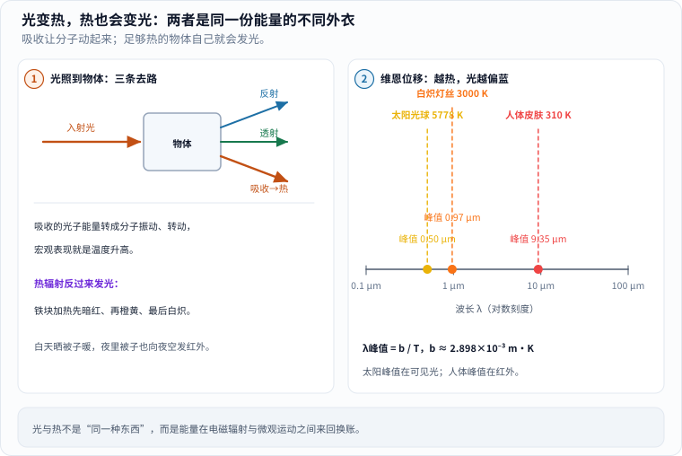

你给的定义很标准：

> **能量**是物体或系统具有的**做功或产生热的能力**。能量不能被创造或破坏，只能从一种形式转化为另一种形式。

可这句定义一落地，就会撞上几笔算不通的账：

1. **既然能量守恒，"节能"到底在节什么？** 能量一分都不会少，为什么我们还天天喊节约能源？难道物理定律和最常识的生活经验在打架？
2. **1 焦耳 80 °C 的热水，和 1 焦耳电能，真的等价吗？** 第一定律说等价——都是 1 J；第二定律却说"没那么快"：电能可以几乎 100% 变成热，热水却没法 100% 变回电 [[9]](#ref-9)。差的那一截叫什么？
3. **太阳常数是 $$1361\,\mathrm{W/m^2}$$，为什么地球平均只拿到 $$340\,\mathrm{W/m^2}$$？** 平白少掉四分之三，是大气层"吃掉"了吗？
4. **人体静息代谢约 $$100\,\mathrm{W}$$，和一只白炽灯泡差不多。** 为什么灯泡烫手、人体却摸着温凉 [[8]](#ref-8)？
5. **光合作用明明能吸收蓝紫光、绿光，为什么真正用来裂解水的，只有"红光那一份"？** 高能量蓝光子多出来的能量去哪了？

这五笔账，正好把能量从机械能一路算到叶绿体。顺着它们走完，你会发现"能量守恒"只是上半本账，下半本叫**能量品质**。

顺便先纠正两个常见小误差：

- **"温度高的物体热能更高"不严谨。** 热能还取决于物质量：一根烧红的针温度几百度，总热能远小于一湖 10 °C 的水。
- **"地热能来自地球内部的热核反应"不对。** 地球内部热量主要来自铀、钍、钾等**天然放射性元素衰变**和地球形成时残留的**原始热** [[5]](#ref-5)，不是太阳那种核聚变。

---

## 一、六种常见形式：名字不同，单位都是焦耳

教材常把能量分成几类 [[1]](#ref-1)[[2]](#ref-2)：

- **动能**：因运动而具有，经典表达式 $$E_k=\frac12mv^2$$；
- **势能**：因位置或状态而具有，重力势能 $$mgh$$、弹性势能 $$\frac12kx^2$$、化学势能（化学键）；
- **热能**：微观粒子无规则运动的能量，既看温度也看物质量；
- **电能**：与电荷量和电势差有关，$$E=qV$$；
- **光能（辐射能）**：电磁波的能量，$$E=h\nu=hc/\lambda$$；
- **核能**：原子核结合能变化，$$\Delta E=\Delta m\,c^2$$。

六种形式名字不同，但都能换成同一个单位——焦耳。先把这张"地图"摊开看一眼，后面每一节其实都是在这张图上画箭头。

---

## 二、能量守恒：总量不变，但"能用多少"会变

能量守恒定律说：在孤立系统里，动能、势能和其他形式能量可以互换，但**总量恒定** [[2]](#ref-2)。

拿一个最简单的例子：1 kg 小球从 5 m 高处由静止落下。

$$
E_p = mgh = 1\times9.8\times5 = \mathbf{49\ J}
$$

落地前由 $$v=\sqrt{2gh}\approx9.9\ \mathrm{m/s}$$ 得：

$$
E_k = \frac12mv^2 \approx \mathbf{49\ J}
$$

势能少了多少，动能就多多少。撞地之后，这 49 J 变成热、声和形变——能量一分没少，但已经不能像高处那块势能一样再拿去做功。这就是"守恒"和"可用"的区别。

_图 1 怎么看：先看左栏算式，再看右栏柱状图。左栏算两遍：先算初始势能 49 J，再用 $$v=\sqrt{2gh}$$ 算落地动能，两个数字应该严丝合缝地对上。右栏柱状图：橙色是势能、蓝色是动能，三行总长度都是 49 J——变的是配比，不变的是总长。最后一行别漏：撞地后 49 J 变成热与声，总长还是 49 J，但已经"不好用了"。这个"不好用"，下一节有名字。_

我们以前聊过[刹车时动能去哪了]()和[火为什么往上蹿]()：前者是机械能转热，后者是化学势能转热与光，底层都是这本账。

### 效率：守恒定律给不出的那个分数

把 1 J 电能送进电阻丝，你能拿到接近 1 J 的热；想把 1 J 室温下的废热变回 1 J 电，物理定律却说不行。定义效率：

$$
\eta = \frac{\text{有用输出}}{\text{总输入}} < 1
$$

为什么严格小于 1？第一定律管不着这件事——它只管账目平衡。真正划这条线的是**热力学第二定律**，以及它引出的"能量品质"概念。

---

## 三、能量也有"含金量"：㶲与第二定律

### 1. 一焦耳不等于一焦耳

第一定律是个勤恳的记账员：1 J 就是 1 J，管它是 $$500^\circ\mathrm{C}$$ 的蒸汽还是 $$40^\circ\mathrm{C}$$ 的温水 [[9]](#ref-9)。可第二定律插进来说：**自发过程会让总熵增加，能量的"品质"只会下降。**

衡量品质的标尺叫**㶲（exergy）**：能量里能转化为有用功的最大那部分。它的关键结论是——

- **电能、机械能是高品质能量**：㶲值几乎等于它的能量值，可以近乎 100% 转成其他形式；
- **热能的品质取决于温度**：相对于环境温度 $$T_0$$、温度为 $$T$$ 的热源，其热量的㶲由卡诺因子给出 [[9]](#ref-9)：

$$
\text{㶲} = Q\left(1-\frac{T_0}{T}\right)
$$

把数字代进去看差别。设环境温度 $$T_0=293\,\mathrm{K}$$（20 °C）：

$$
\begin{aligned}
80^\circ\mathrm{C}\ (353\,\mathrm{K}):&\quad 1-\frac{293}{353}\approx 0.17
\quad\Rightarrow\ 1\ \mathrm{J}\ \text{热里只有}\ 0.17\ \mathrm{J}\ \text{能变成功}\\
500^\circ\mathrm{C}\ (773\,\mathrm{K}):&\quad 1-\frac{293}{773}\approx 0.62
\quad\Rightarrow\ 1\ \mathrm{J}\ \text{热里有}\ 0.62\ \mathrm{J}\ \text{能变成功}
\end{aligned}
$$

**同样 1 J，500 °C 蒸汽的"含金量"是 80 °C 热水的三倍多。** 这就是"节能"的真正含义：节约的不是焦耳（数量守恒、无从节约），而是㶲（品质会在每次转化中不可逆地贬值）[[9]](#ref-9)。

### 2. 人体与灯泡：为什么功率相同、体感不同？

开头第四笔账在这里结清。人体静息代谢约 $$100\,\mathrm{W}$$、白炽灯泡也约 $$100\,\mathrm{W}$$ [[8]](#ref-8)，功率相当。可灯泡灯丝温度约 $$3000\,\mathrm{K}$$、表面积很小，靠热辐射把能量高密度地甩出去，摸上去烫手；人体皮肤约 $$310\,\mathrm{K}$$、表面积大得多，同样的 $$100\,\mathrm{W}$$ 摊薄到很大的面积上，再加上出汗蒸发带走热，摸起来就只是温凉。

**功率相同，散热温度和面积不同，体感就天差地别。** 这也是维恩位移那条曲线在生活中的投影——温度决定辐射的波长分布，下一节细算。

_图 2 怎么看：先看六种形式，再看每格右下角的品质标注。六张卡片各自给出"谁在动／什么状态"、公式和例子：别把分类当成物理壁垒——电池里存的是化学势能，点亮灯泡后变成光能与热能，太阳内部则是核能变光能。再看每格右下角：机械能、电能标"高品质"，低温热能标"低品质"——单位都是焦耳，含金量不同。最后看底部那句话：第一定律管数量守恒，第二定律管品质贬值，两本账要一起看。_

---

## 四、地球这本账：来的太阳光，走的是红外光

地球上几乎所有能量都来自太阳。太阳内部核聚变释放的能量以电磁辐射形式飞向地球（更详细的聚变机制见[《太阳的光是怎么来的》](））。

### 1. 为什么 1361 会变成 340？——一笔几何平均账

太阳常数约 $$1361\,\mathrm{W/m^2}$$。关键不在大气"吃掉"了多少，而在**几何**：地球截获阳光的面积是圆盘 $$\pi R^2$$，但要把这些能量摊到整个球面 $$4\pi R^2$$ 上。比值恰好是 1/4：

$$
\frac{\pi R^2}{4\pi R^2}=\frac14
\quad\Rightarrow\quad
\frac{1361}{4}\approx \mathbf{340\ W/m^2}
$$

**少掉的四分之三，不是被损耗，是摊薄了**——因为地球只有一面朝太阳，却要把热量从整个球面散出去。这是理解地球能量收支的第一把钥匙。

其中约 29% 被云层、气溶胶、冰雪反射回太空，剩下约 71% 被地球系统吸收：

$$
340\times0.71\approx \mathbf{240\ W/m^2}
$$

_图 3 怎么看：左看几何，右看四条长度条。左栏用 $$\pi R^2$$ 与 $$4\pi R^2$$ 解释"除以四"：地球用圆盘面积接光、用整个球面散热，两个面积差 4 倍。右栏四条长度条依次是 340（入射）、约 100（反射）、约 240（吸收）、约 240（向外红外）——最后两条必须差不多长，否则地球持续升温或降温。底部别漏：长期平均下收支必须平衡，这是气候系统的硬约束。_

### 2. 255 K 与 288 K：33 度的温差从哪来？

把吸收的 $$240\,\mathrm{W/m^2}$$ 当成黑体辐射出去，用斯特藩—玻尔兹曼定律反推地球该有的温度：

$$
\sigma T_e^4 = 240\ \mathrm{W/m^2},\qquad \sigma=5.67\times10^{-8}\ \mathrm{W\,m^{-2}K^{-4}}
$$

$$
T_e=\left(\frac{240}{5.67\times10^{-8}}\right)^{1/4}\approx \mathbf{255\ K}\ (-18^\circ\mathrm{C})
$$

可实测地表均温约 **$$288\,\mathrm{K}$$（15 °C）**，对应地表向外辐射约 **$$390\,\mathrm{W/m^2}$$** [[3]](#ref-3)[[4]](#ref-4)。差了整整 **$$33\,\mathrm{K}$$**。

$$\frac{390}{240}\approx1.63$$

地表辐射比"向太空净输出"多出六成——多出来的部分被大气中的水汽、二氧化碳、云吸收后又辐射回地面。**这 33 度就是自然温室效应**；没有它，地球平均气温是 $$-18^\circ\mathrm{C}$$，海洋大部结冰，你现在读到的这句对话根本不会发生。注意温室效应本身是好事，人类活动**增强**它才成为问题。

### 3. 地热能和潮汐能：不是太阳给的零头

你原文提到地热能和核能，方向对，但成因要改：**地热主要是放射性衰变热 + 地球形成时的原始热** [[5]](#ref-5)；此外还有潮汐能，来自地球—月球—太阳的引力与轨道机械能，也不属于太阳能。它们不参与上面那本 340/240 的账，是独立的"小额进账"。

---

## 五、光变热，热变光：同一份能量的两次换装

### 1. 光被吸收，就成了热

光是电磁辐射，携带能量 $$E=h\nu$$。照到物体上有三条路：反射、透射、吸收。被吸收的那部分会加剧分子振动与转动，宏观表现就是温度升高——这就是**光热转换**。阳光晒热地面、黑色衣服比白色更烫，都是这个机制。这里转出来的热是**低品质能量**，摊在常温附近，㶲值很低。

### 2. 热到一定程度，物体自己发光

反过来，任何温度高于绝对零度的物体都在发射**热辐射**。温度越高，辐射峰值波长越短，这就是**维恩位移定律**：

$$
\lambda_{\max} = \frac{b}{T},\qquad b\approx2.898\times10^{-3}\ \mathrm{m\cdot K}
$$

代入几个温度 [[6]](#ref-6)：

$$
\begin{aligned}
\text{太阳光球 }5778\,\mathrm{K}:&\quad \lambda_{\max}\approx0.50\ \mu\mathrm{m}\quad(\text{可见光中段})\\
\text{白炽灯丝 }3000\,\mathrm{K}:&\quad \lambda_{\max}\approx0.97\ \mu\mathrm{m}\quad(\text{大半在红外，所以低效烫手})\\
\text{人体皮肤 }310\,\mathrm{K}:&\quad \lambda_{\max}\approx9.35\ \mu\mathrm{m}\quad(\text{红外，测温枪与夜视仪靠这个})
\end{aligned}
$$

**同是"发出来的光"，太阳发的是可见光，人体发的是红外**——差别只在温度。这也回答了上一节人体与灯泡的体感差异：人体辐射的峰值波长在 $$9.35\,\mu\mathrm{m}$$，是低温、低能量密度的长波红外。

_图 4 怎么看：左看三种去向，右看对数波长轴。左栏看光被反射、透射、吸收三种去向，只有"吸收"那一路变成热。右栏是对数波长轴，三条虚线标出 5778 K、3000 K、310 K 的峰值位置——温度越高，峰越靠左（波长越短）。横轴是对数刻度：别把"0.1→1"和"10→100"的像素距离误当成等能量。_

---

## 六、光合作用：不是把光烧成热，而是抢走光子的电子

你原文里最关键的一句完全正确：**光合作用利用的是光能，不是光先变成的热能。**

### 1. 一颗 680 nm 红光到底值多少？

$$
E=\frac{hc}{\lambda}
=\frac{6.626\times10^{-34}\times2.998\times10^8}{680\times10^{-9}}
\approx 2.92\times10^{-19}\ \mathrm{J}
\approx \mathbf{1.82\ eV}
$$

这个能量刚好能把叶绿素中的电子抬到激发态——**光子的能量直接变成电子的能级**，中间不经过"热"这一步。短波蓝光光子能量更高，多出来的部分会在色素内部**先降级成热**，真正用于水裂解与固碳的只有"红光那一份" [[7]](#ref-7)。开头第五笔账在这里结清。

### 2. 五站接力：从光子到糖

整条链可以拆成五站：

1. **捕光**：叶绿素与辅助色素吸收光子，激发能传到反应中心；
2. **光系统 II（PSII）**：反应中心 P680 失去电子，水被裂解释放 $$\mathrm{O_2}$$、$$\mathrm{H^+}$$ 与电子，补上这个空缺；
3. **电子传递链**：电子经质体醌、细胞色素复合体等逐级传递，能量用于把 $$\mathrm{H^+}$$ 泵入类囊体腔，形成质子梯度；
4. **ATP 与 NADPH**：质子回流驱动 ATP 合酶合成 ATP；光系统 I 再抬升电子能级，最终把 $$\mathrm{NADP^+}$$ 还原成 NADPH；
5. **Calvin 循环**：在基质里用 ATP 与 NADPH 把 $$\mathrm{CO_2}$$ 固定成糖。

> 更精确的说法：并不是"激发态电子最终到达光系统 II"，而是**天线色素把激发能传给 PSII 的反应中心**；水裂解产生的电子用来补位。

### 3. 一笔"效率账"：30% 怎么一路掉到 1%？

每释放 1 个 $$\mathrm{O_2}$$ 至少需要 **8 个红光光子**，合成 1 个葡萄糖约需 **48 个** [[7]](#ref-7)。按此计算的短期理论上限约 **30%**；把全光谱和生理成本算进去后，最大约 **4.5%**；全球尺度实际常年只有 **0.2%–1%**。每次折扣都有物理原因：

$$
\underbrace{30\%}_{\text{红光理论上限}}
\to\underbrace{4.5\%}_{\text{全光谱＋生理成本}}
\to\underbrace{0.2\%\text{–}1\%}_{\text{全球常年实际}}
$$

没变成糖的能量大多成了热，这并不违反守恒——只是从"高品质光能"贬值成了"低品质热能"，㶲被消耗掉了。

_图 5 怎么看：上排读流程，下排读两条账。上排五个方框按顺序列出捕光 → PSII → 水裂解 → ATP/NADPH → Calvin 循环，箭头方向就是能量与电子的流向。左下是一颗 680 nm 红光的能量账：1.82 eV 恰好够把电子送上激发态。右下是效率的多重折扣：30% → 4.5% → 1%，每一级都有物理原因，别把它读成"植物浪费"。本站另有[《可视化理解光合作用》]()可对照看完整生化路径。_

---

## 七、总表与五个常见误区

| 问题 | 答案 | 关键数字 |
| :--- | :--- | :--- |
| 动能怎么算 | $$E_k=\frac12mv^2$$ | 1 kg 从 5 m 落下得 49 J |
| 能量会消失吗 | 不会，只会转移或转化 | 守恒管数量，效率管可用部分 |
| 1 J 热 = 1 J 电吗 | 数量相等，品质不同 | 80 °C 热水㶲仅约 0.17 J/J |
| 地球平均入射太阳能 | 太阳常数按球面分摊 | 1361 ÷ 4 ≈ 340 W/m² |
| 地球实际吸收 | 扣除约 29% 反射 | ≈ 240 W/m² |
| 温室效应温差 | 地表与有效辐射温度之差 | 288 − 255 = 33 K |
| 热物体发什么光 | 热辐射，峰值随温度升高而变短 | 人体 ≈ 9.35 µm |
| 光合作用用的光 | 光子能量，不是光热 | 680 nm ≈ 1.82 eV |

五个误区，逐条拆：

1. **"温度高热能一定多。"** 还要看物质量；一锅 60 °C 的水比一根 300 °C 的针热能多得多。
2. **"既然能量守恒，节能没意义。"**  conserve 的是焦耳（数量），稀缺的是㶲（品质）；每次转化都有不可逆的品质贬值 [[9]](#ref-9)。
3. **"地热来自热核反应。"** 主要是放射性衰变与原始热，不是核聚变。
4. **"1361 变成 340 是被大气吃掉。"** 主要是几何摊薄：圆盘接光、球面散热，比值 1/4。
5. **"光合作用把光先变成热再变成糖。"** 不是；它抢的是光子的电子能量，热只是短波光子降级与效率折损的副产品。

从一块滚下斜坡的石头，到照进叶绿体的那颗 1.82 eV 红光，能量始终在同一本账上换位置。理解了"守恒 + 品质 + 转化 + 效率"，你就拿到了物理、化学、生物和工程共用的一把钥匙。

---

## 参考资料与核查来源

1. **OpenStax Biology**, *6.2 Potential, Kinetic, Free, and Activation Energy*（[章节](https://openstax.org/books/biology/pages/6-2-potential-kinetic-free-and-activation-energy)）—— 支持"能量是做功能力"、动能与势能的定义，以及分子热运动、电磁辐射都属于能量形式的表述。
2. **OpenStax College Physics for AP® Courses 2e**, *7.6 Conservation of Energy*（[章节](https://openstax.org/books/college-physics-ap-courses-2e/pages/7-6-conservation-of-energy)）—— 支持能量守恒定律、常见能量形式清单与效率定义 $$\eta=W_{\text{out}}/E_{\text{in}}$$。
3. **NASA Earth Observatory**, *Climate and Earth's Energy Budget*（[官方页面](https://science.nasa.gov/earth/earth-observatory/climate-and-earths-energy-budget)）—— 支持入射约 340 W/m²、反射约 29%、吸收约 71%、向外红外约 240 W/m²、地表约 15 °C、从太空看约 −20 °C 的表述。
4. **NASA GISS / A. A. Lacis (2018)**, *Explaining climate*（[摘要页](https://www.giss.nasa.gov/pubs/abs/la00500y.html)）—— 支持 340/100/240 W/m²、255 K 有效温度、288 K 地表温度与 390 W/m² 地表辐射的精确表述。
5. **美国地质调查局 USGS**, *Tapping the Earth's natural heat*（[官方页面](https://www.usgs.gov/node/146277)）—— 支持地球内部热量主要来自铀、钍、钾等天然放射性元素衰变，纠正"热核反应"说法。
6. **NASA**, *Wien's displacement law*（[page](https://science.nasa.gov/ems/02_waves/)）—— peak-wavelength relation for blackbody radiation; the three peak wavelengths in the text are computed from $$\lambda_{\max}T=b$$ with $$b=2.898\times10^{-3}\,\mathrm{m\cdot K}$$, a standard physical constant.
7. **J. Barber & P. D. Tran (2013)**, *From natural to artificial photosynthesis*, *J. R. Soc. Interface* 10:20120984（[PMC 全文](https://pmc.ncbi.nlm.nih.gov/articles/PMC3627107/)）—— 支持 680 nm 红光约 1.8 eV、每 O₂ 至少 8 个红光光子、每葡萄糖约 48 个、短波光子降级成热、理论 30% 与实际低于 1% 等效率数字。
8. **Energy and Human Ambitions on a Finite Planet**, Box 1.4 "万物均辐射"（[在线教材](http://energy-and-human-ambitions-on-a-finite-planet.readthedocs.io/zh-cn/latest/Part1/ch1.html)）—— 支持人体约 100 W 与白炽灯泡功率相当、但表面积不同导致温度悬殊的说明。
9. **Energy Academy**, *The Quality of Energy: An Introduction to Exergy*（[课程页](https://energyacademyuk.org/courses/mass-and-energy-balances/quality-of-energy)）与玻尔科学百科《储热》"并非所有焦耳都生而平等"章节（[页面](https://scipedia.bohrium.com/sciencepedia/feynman/keyword/thermal_storage)）—— 支持热力学第二定律引入能量品质/㶲、高温热㶲高、卡诺因子 $$(1-T_0/T)$$、电能㶲等于其能量值、80 °C 热水做功潜力有限等结论；文中 0.17 与 0.62 为由该因子代入 $$T_0=293\,\mathrm{K}$$ 的计算结果。
10. **原创图解说明**：图 1 至图 5 由本站 `tools/visuals.py build energy-concept` 生成，含机械能守恒、地球收支、有效温度、维恩峰值与 680 nm 光子能量等断言，以及 XML、宽高比、字号审计。
