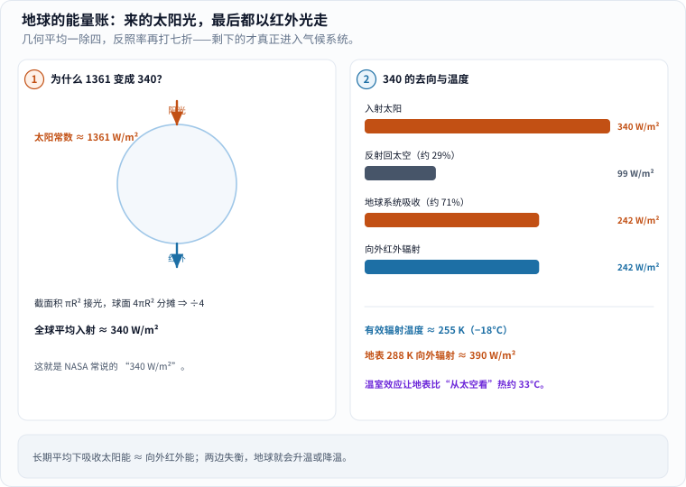

你给的定义很标准：

> **能量**是物体或系统具有的**做功或产生热的能力**。能量不能被创造或破坏，只能从一种形式转化为另一种形式。

这句话有两个关键词：**做功能力**和**转化**。接下来我们顺着这两条线，把动能、势能、热能、电能、光能、核能，以及太阳能、地球和光合作用放进同一本账里。

顺便先纠正两个常见小误差：

- **“温度高的物体热能更高”不严谨。** 热能还取决于物质量：一根烧红的针温度几百度，总热能远小于一湖 10 °C 的水。
- **“地热能来自地球内部的热核反应”不对。** 地球内部热量主要来自铀、钍、钾等**天然放射性元素衰变**和地球形成时残留的**原始热** [[5]](#ref-5)，不是太阳那种核聚变。

---

## 一、六种常见形式：名字不同，单位都是焦耳

教材常把能量分成几类 [[1]](#ref-1)[[2]](#ref-2)：

- **动能**：因运动而具有，经典表达式 $$E_k=\frac12mv^2$$；
- **势能**：因位置或状态而具有，重力势能 $$mgh$$、弹性势能 $$\frac12kx^2$$、化学势能（化学键）；
- **热能**：微观粒子无规则运动的能量，既看温度也看物质量；
- **电能**：与电荷量和电势差有关，$$E=qV$$；
- **光能（辐射能）**：电磁波的能量，$$E=h\nu=hc/\lambda$$；
- **核能**：原子核结合能变化，$$\Delta E=\Delta m\,c^2$$。

_图 1：怎么看这张图？六张卡片各自给出“谁在动/什么状态”“公式”“例子”。别把分类当成物理壁垒：电池里存的是化学势能，点亮灯泡后变成光能与热能；太阳内部则是核能变光能。[单独打开图片](/assets/images/energy-concept/energy-forms-map.svg)_

这里有个更深的统一：**做功是能量转移的方式**。你推箱子、电流驱动电机、光子撞出电子，都是在把能量从一个系统搬到另一个系统。

---

## 二、能量守恒：总量不变，但“能用多少”会变

能量守恒定律说：在孤立系统里，动能、势能和其他形式能量可以互换，但**总量恒定** [[2]](#ref-2)。

拿一个最简单的例子：1 kg 小球从 5 m 高处由静止落下。

$$
E_p = mgh = 1\times9.8\times5 = \mathbf{49\ J}
$$

落地前由 $$v=\sqrt{2gh}\approx9.9\ \mathrm{m/s}$$ 得：

$$
E_k = \frac12mv^2 \approx \mathbf{49\ J}
$$

势能少了多少，动能就多多少。撞地之后，这 49 J 变成热、声和形变——能量一分没少，但已经不能像高处那块势能一样再拿去做功。这就是**效率**概念：

$$
\eta = \frac{\text{有用输出}}{\text{总输入}} < 1
$$

我们以前聊过[刹车时动能去哪了]()和[火为什么往上蹿]()：前者是机械能转热，后者是化学势能转热与光，底层都是这本账。

_图 2：怎么看这张图？右栏柱状图里橙色是势能、蓝色是动能，三行总长度都是 49 J；左栏算出落地速度约 9.9 m/s。最后一行提醒：**守恒 ≠ 全部可用**。[单独打开图片](/assets/images/energy-concept/energy-conservation-erg.svg)_

---

## 三、地球这本账：来的太阳光，走的是红外光

地球上几乎所有能量都来自太阳。太阳内部核聚变释放的能量以电磁辐射形式飞向地球（更详细的聚变机制见[《太阳的光是怎么来的》]()）。

### 1. 为什么 1361 会变成 340？

太阳常数约 $$1361\ \mathrm{W/m^2}$$。地球截获阳光的面积是 $$\pi R^2$$，但要把这些能量摊到整个球面 $$4\pi R^2$$ 上，所以全球平均入射只有：

$$
\frac{1361}{4}\approx \mathbf{340\ W/m^2}
$$

其中约 29% 被云层、气溶胶、冰雪反射回太空，剩下约 71% 被地球系统吸收：

$$
340\times0.71\approx \mathbf{240\ W/m^2}
$$

NASA GISS 的表述是：全球平均太阳照射约 340 W/m²，约 100 W/m² 反射，吸收 240 W/m²，恰能支撑约 **255 K（−18 °C）** 的有效辐射温度；而实测地表均温约 **288 K（15 °C）**，对应地表向外辐射约 **390 W/m²** [[3]](#ref-3)[[4]](#ref-4)。多出来的那三十几度，就是**自然温室效应**。

_图 3：怎么看这张图？左栏用 $$\pi R^2$$ 与 $$4\pi R^2$$ 解释“除以四”；右栏四条长度条依次是 340、99、242、242 W/m²。长期平均下，吸收的太阳能和向太空辐射的红外能必须大致相等，否则地球就会持续升温或降温。[单独打开图片](/assets/images/energy-concept/earth-energy-budget.svg)_

### 2. 地热能和潮汐能：不是太阳给的零头

你的原文提到地热能和核能，方向对，但成因要改：**地热主要是放射性衰变热 + 地球形成时的原始热** [[5]](#ref-5)；此外还有潮汐能，来自地球—月球—太阳的引力与轨道机械能，也不属于太阳能。

---

## 四、光变热，热变光：同一份能量的两次换装

### 1. 光被吸收，就成了热

光是电磁辐射，携带能量 $$E=h\nu$$。照到物体上有三条路：反射、透射、吸收。被吸收的那部分会加剧分子振动与转动，宏观表现就是温度升高——这就是**光热转换**。阳光晒热地面、黑色衣服比白色更烫，都是这个机制。

### 2. 热到一定程度，物体自己发光

反过来，任何温度高于绝对零度的物体都在发射**热辐射**。温度越高，辐射峰值波长越短，这就是**维恩位移定律**：

$$
\lambda_{\max} = \frac{b}{T},\qquad b\approx2.898\times10^{-3}\ \mathrm{m\cdot K}
$$

代入几个温度 [[6]](#ref-6)：

- 太阳光球约 5778 K：峰值约 **0.50 µm**，正好在可见光中段；
- 白炽灯丝约 3000 K：峰值约 **0.97 µm**，大部分能量落在红外，所以白炽灯效率低、烫手；
- 人体皮肤约 310 K：峰值约 **9.35 µm**，属于红外波段，红外测温枪和夜视仪就靠这个波段。

_图 4：怎么看这张图？左栏看光被反射、透射、吸收三种去向；右栏是对数波长轴，三条虚线标出三个温度下的峰值位置。横轴是对数刻度，别把“0.1→1”和“10→100”的像素距离误当成等能量。[单独打开图片](/assets/images/energy-concept/light-heat-wien-shift.svg)_

---

## 五、光合作用：不是把光烧成热，而是抢走光子的电子

你原文里最关键的一句完全正确：**光合作用利用的是光能，不是光先变成的热能。**

以 680 nm 红光为例，单个光子的能量：

$$
E=\frac{hc}{\lambda}
=\frac{6.626\times10^{-34}\times2.998\times10^8}{680\times10^{-9}}
\approx 2.92\times10^{-19}\ \mathrm{J}
\approx \mathbf{1.82\ eV}
$$

这个能量刚好能把叶绿素中的电子抬到激发态。短波蓝光光子能量更高，多出来的部分会在色素内部**先降级成热**，真正用于水裂解与固碳的只有“红光那一份” [[7]](#ref-7)。

整条链可以拆成五站：

1. **捕光**：叶绿素与辅助色素吸收光子，激发能传到反应中心；
2. **光系统 II（PSII）**：反应中心 P680 失去电子，水被裂解释放 $$\mathrm{O_2}$$、$$\mathrm{H^+}$$ 与电子，补上这个空缺；
3. **电子传递链**：电子经质体醌、细胞色素复合体等逐级传递，能量用于把 $$\mathrm{H^+}$$ 泵入类囊体腔，形成质子梯度；
4. **ATP 与 NADPH**：质子回流驱动 ATP 合酶合成 ATP；光系统 I 再抬升电子能级，最终把 $$\mathrm{NADP^+}$$ 还原成 NADPH；
5. **Calvin 循环**：在基质里用 ATP 与 NADPH 把 $$\mathrm{CO_2}$$ 固定成糖。

> 更精确的说法：并不是“激发态电子最终到达光系统 II”，而是**天线色素把激发能传给 PSII 的反应中心**；水裂解产生的电子用来补位。

效率方面：每释放 1 个 $$\mathrm{O_2}$$ 至少需要 8 个红光光子，合成 1 个葡萄糖约需 48 个；按此计算的短期理论上限约 30%，把全光谱和生理成本算进去后，最大约 4.5%，全球尺度实际常年只有 0.2%–1% [[7]](#ref-7)。没变成糖的能量大多成了热，这并不违反守恒。

_图 5：怎么看这张图？上排五个方框按顺序列出捕光、PSII、水裂解、ATP/NADPH、Calvin 循环；左下是一颗 680 nm 红光的能量账，右下是效率的多重折扣。本站另有[《可视化理解光合作用》]()可对照看完整生化路径。[单独打开图片](/assets/images/energy-concept/photosynthesis-energy-chain.svg)_

---

## 六、总表与四个常见误区

| 问题 | 答案 | 关键数字 |
| :--- | :--- | :--- |
| 动能怎么算 | $$E_k=\frac12mv^2$$ | 1 kg 从 5 m 落下得 49 J |
| 能量会消失吗 | 不会，只会转移或转化 | $$\eta<1$$ 说的是“可用部分” |
| 地球平均入射太阳能 | 太阳常数按球面分摊 | 1361 ÷ 4 ≈ 340 W/m² |
| 地球实际吸收 | 扣除约 29% 反射 | ≈ 240 W/m² |
| 热物体发什么光 | 热辐射，峰值随温度升高而变短 | 人体 ≈ 9.35 µm |
| 光合作用用的光 | 光子能量，不是光热 | 680 nm ≈ 1.82 eV |

四个误区：

1. **“温度高热能一定多。”** 还要看物质量；一锅 60 °C 的水比一根 300 °C 的针热能多得多。
2. **“地热来自热核反应。”** 主要是放射性衰变与原始热，不是核聚变。
3. **“白炽灯发热是浪费，能量不守恒。”** 守恒照样成立，浪费的是**可用性**：大部分变成了红外热。
4. **“光合作用把光先变成热再变成糖。”** 不是；它抢的是光子的电子能量，热只是副产品。

从一块滚下斜坡的石头，到照进叶绿体的那颗 1.82 eV 红光，能量始终在同一本账上换位置。理解了“守恒 + 转化 + 效率”，你就拿到了物理、化学、生物和工程共用的一把钥匙。

---

## 参考资料与核查来源

1. **OpenStax Biology**, *6.2 Potential, Kinetic, Free, and Activation Energy*（[章节](https://openstax.org/books/biology/pages/6-2-potential-kinetic-free-and-activation-energy)）—— 支持“能量是做功能力”、动能与势能的定义，以及分子热运动、电磁辐射都属于能量形式的表述。
2. **OpenStax College Physics for AP® Courses 2e**, *7.6 Conservation of Energy*（[章节](https://openstax.org/books/college-physics-ap-courses-2e/pages/7-6-conservation-of-energy)）—— 支持能量守恒定律、常见能量形式清单与效率定义 $$\eta=W_{\text{out}}/E_{\text{in}}$$。
3. **NASA Earth Observatory**, *Climate and Earth’s Energy Budget*（[官方页面](https://science.nasa.gov/earth/earth-observatory/climate-and-earths-energy-budget)）—— 支持入射约 340 W/m²、反射约 29%、吸收约 71%、向外红外约 240 W/m²、地表约 15 °C、从太空看约 −20 °C 的表述。
4. **NASA GISS / A. A. Lacis (2018)**, *Explaining climate*（[摘要页](https://www.giss.nasa.gov/pubs/abs/la00500y.html)）—— 支持 340/100/240 W/m²、255 K 有效温度、288 K 地表温度与 390 W/m² 地表辐射的精确表述。
5. **美国地质调查局 USGS**, *Tapping the Earth’s natural heat*（[官方页面](https://www.usgs.gov/node/146277)）—— 支持地球内部热量主要来自铀、钍、钾等天然放射性元素衰变，纠正“热核反应”说法。
6. **维基百科 / Wikiwand**, *Wien’s displacement law*（[条目](https://wikiwand.com/en/Wien's_displacement_law)）—— 支持 $$\lambda_{\max}T=b$$ 及 $$b\approx2.898\times10^{-3}\ \mathrm{m\cdot K}$$；文中三个峰值波长由该公式计算得出。
7. **J. Barber & P. D. Tran (2013)**, *From natural to artificial photosynthesis*, *J. R. Soc. Interface* 10:20120984（[PMC 全文](https://pmc.ncbi.nlm.nih.gov/articles/PMC3627107/)）—— 支持 680 nm 红光约 1.8 eV、每 O₂ 至少 8 个红光光子、每葡萄糖约 48 个、短波光子降级成热、理论 30% 与实际常低于 1% 等效率数字。
8. **原创图解说明**：图 1 至图 5 由本站 `tools/visuals.py build energy-concept` 生成，含机械能守恒、地球收支、有效温度、维恩峰值与 680 nm 光子能量等断言，以及 XML、宽高比、字号审计。
