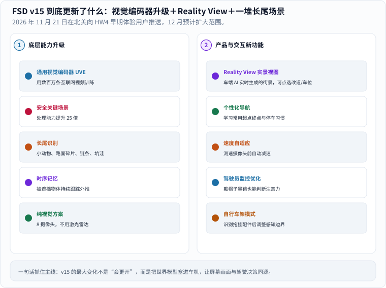
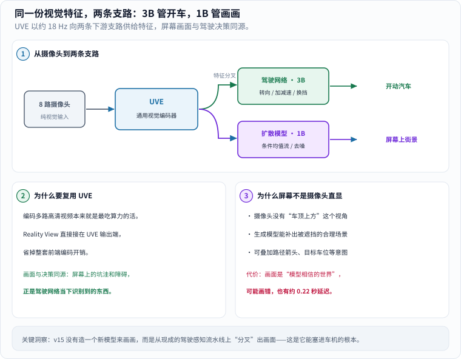
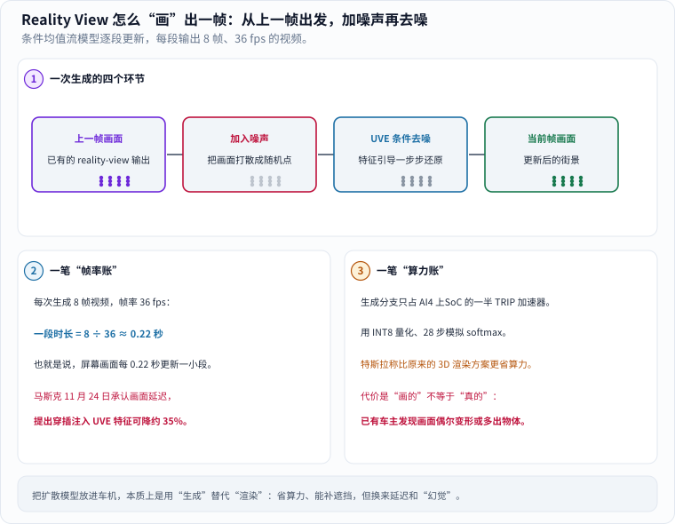
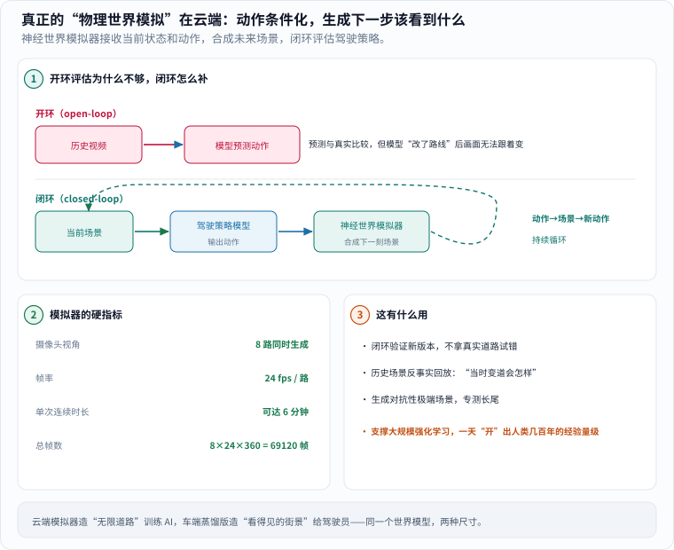
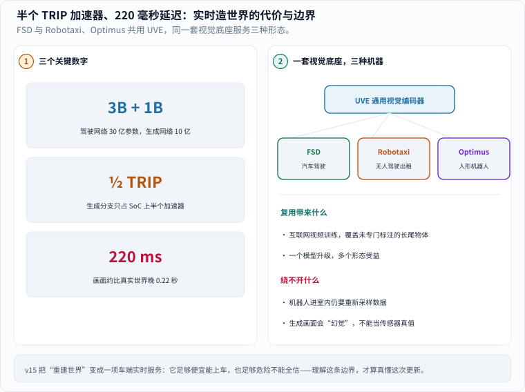

2026 年 11 月 21 日，特斯拉开始向北美 HW4 早期体验用户推送 **FSD v15.0.1**。最出圈的不是它会不会开车，而是中控屏上那个叫 **Reality View** 的新界面：旧金山夜里的红砖楼、斑马线、树影和迎面车灯都被实时"画"了出来，接近 3A 游戏的画面 [[1]](#ref-1)[[2]](#ref-2)。

马斯克一句话把它推上热搜：**"FSD 就是现实版《GTA》"**，并且明确说——**没有游戏引擎，是纯 AI 实时生成的视频** [[2]](#ref-2)。

把这件事摊开，会撞上一串算不通的账：

1. **车上没有"车顶上方"这个摄像头，屏幕那个俯视街景是哪来的？** 生成模型凭什么知道被货车挡住的行人长什么样？
2. **一个 10 亿参数的扩散模型，凭什么塞得进一台成本几百美元的车载电脑？** 它和真正开车的那套模型是什么关系？
3. **8 帧、36 fps、半颗 TRIP 加速器**——这几个数字凑在一起，屏幕上一段画面到底能撑多久 [[3]](#ref-3)？
4. **车主发现画面偶尔"变形"、比真实世界慢半秒。** 马斯克 11 月 24 日承认延迟，说有办法降 35% [[4]](#ref-4)。如果屏幕会画错，它还能信吗？
5. **云端那个"世界模拟器"能一次生成 8 路摄像头、24 fps、连续 6 分钟的虚拟驾驶** [[5]](#ref-5)——这和车机上画街景的是同一个模型吗？

这五笔账，正好把 v15 最核心的技术逻辑——**一份特征、两个出口、云端车端两个尺寸的世界模型**——彻底拆开。

---

## 一、先把版本说准：v15 更新了什么

网上关于 v15 的传言很多，先把确凿的部分列出来。首波是 **v15.0.1**，对应车辆软件 2026.38.6.11，2026 年 11 月 21 日起在美国向部分 HW4（AI4）早期体验车辆推送，马斯克说 12 月会扩大范围 [[1]](#ref-1)[[6]](#ref-6)。HW3 车辆目前走的是模型蒸馏版 **FSD v14 Lite**，不在这次的名单里 [[6]](#ref-6)。

### 1. 底层能力：换的是"眼睛"，不是"脑子"的架构

v15 官方更新清单里最关键的一条是**升级视觉编码器**——特斯拉称它用**数百万条互联网视频**训练，由 FSD、Robotaxi 和 Optimus 人形机器人共用 [[7]](#ref-7)[[8]](#ref-8)。特斯拉报告的关键安全干预率改善约 **25 倍**，长尾识别（小动物、路面碎片、防滑链、坑洼、积水）也归功于它 [[7]](#ref-7)。

注意这里的措辞："关键干预率改善 25 倍"来自特斯拉自己的百万英里级统计 [[8]](#ref-8)，不是独立机构的验证结果——引用时得标清口径。

### 2. 产品层：Reality View 是最大变化

- **Reality View 实景视图**：从车辆上方的虚拟视角看周围道路，叠加蓝色行驶路径箭头与目标车位图钉，点一下图钉就能改道或改停车位 [[1]](#ref-1)[[9]](#ref-9)；
- **个性化导航**：学习常用起终点与停车习惯（首波只覆盖行程两端）[[1]](#ref-1)；
- **速度自适应**：测速摄像头前减速、学校区域与坑洼的精细控速 [[1]](#ref-1)[[7]](#ref-7)；
- **驾驶员监控优化**：戴帽子、墨镜时也能判断注意力状态 [[1]](#ref-1)；
- **自行车架模式**：识别拖挂配件后调整感知边界，不用手动关辅助驾驶 [[1]](#ref-1)。

_图 1 怎么看：左看底层，右看产品。左栏五条底层能力：UVE、25 倍安全改善、长尾识别、时序记忆、纯视觉——这是"眼睛"的升级。右栏五条产品功能：Reality View、个性化导航、速度自适应、驾驶员监控、自行车架模式——这是用户能摸到的东西。最后读底栏：v15 的最大变化不是"会更开"，而是把世界模型塞进车机——全篇都围绕这句话展开。_

---

## 二、UVE 分叉：一份特征，两个出口

### 1. 过去十年，车机界面是怎么画的

从 2020 年起，智能驾驶的环境可视化 SR 大体沿用一套分工：**智驾模型输出目标框、类别、车道线等结构化结果 → 座舱芯片上的 3D 图形引擎调用预设资产拼出虚拟场景**。特斯拉此前用的是 Godot，行业里常见 Unity 或 Unreal Engine [[2]](#ref-2)。

这套做法的毛病很明显：屏幕上的"车"是个盒模型，不是真的那辆车；被挡住的东西根本画不出来；画面与模型的真实理解之间是**两套系统**。

### 2. v15 换了什么：从 UVE 输出端直接分叉

v15 的做法是——把多路摄像头画面先经过 **UVE（Universal Vision Encoder，通用视觉编码器）** 整理成共享的时序特征，然后**在特征层一分为二** [[2]](#ref-2)[[3]](#ref-3)：

$$
\text{摄像头}\ \to\ \text{UVE}\ \begin{cases}
\to\ 3\ \text{B 参数驾驶网络}\ \to\ \text{转向 / 加减速 / 换挡}\\
\to\ 1\ \text{B 参数扩散网络}\ \to\ \text{中控屏街景}
\end{cases}
$$

- **主路**：约 **30 亿参数**的驾驶模型，输出实际驾驶动作 [[3]](#ref-3)；
- **旁路**：约 **10 亿参数**的扩散模型，专门生成屏幕画面 [[3]](#ref-3)。

UVE 以约 **18 Hz** 向两条支路供给特征 [[8]](#ref-8)。关键在于**旁路接在 UVE 输出端**——编码多路高清视频本来就是车端最吃算力的活，Reality View 复用现成特征，省掉了整套前端编码开销；而且**屏幕画面与驾驶决策同源**：你看到的坑洼和障碍，正是驾驶网络当下识别到的东西 [[2]](#ref-2)。

_图 2 怎么看：先看上，再看下。上方流程图：8 路摄像头 → UVE → 分叉：绿支进 3B 驾驶网络去"开动汽车"，紫支进 1B 扩散网络去"屏幕上街景"。左下"为什么复用 UVE"：省掉前端编码开销，画面与决策同源。右下"为什么不是摄像头直显"：车顶视角不存在、生成模型能补遮挡、可叠加路径意图——代价是模型"相信的世界"可能画错，还有约 0.22 秒延迟。_

### 3. "时序记忆"：被挡住的人还在那儿

UVE 输出的是**时序特征**，带着一小段历史的上下文。多个信源提到 v15 的编码器能对被遮挡物体维持"信念"：行人被货车挡住后，系统仍按其最后观测位置和估计速度持续跟踪，并预判他从车尾另一侧出现的时刻 [[10]](#ref-10)。这是早年"物体永久性（object permanence）"研究的工程化落地。

**必须划清边界**：现有可靠证据只支持这种**秒级时序记忆**。没有任何证据表明 v15 在神经网络层面拥有"认识这条路"的导航级场景记忆——泊车历史、测速摄像头位置是**产品功能层**的数据，不是网络权重里的记忆 [[10]](#ref-10)。把"它能记住常去的停车场"说成"它有长期记忆"，是两种完全不同的东西。

---

## 三、扩散去噪：一帧街景是怎么"画"出来的

### 1. 一笔"帧率账"：8 帧 ÷ 36 fps ≈ 0.22 秒

马斯克在推送次日公开了架构：车端跑的是云端世界模型的一个**小得多的蒸馏版**，采用**条件均值流模型（conditional mean-flow model）**，输入 UVE 最近一段时间的特征序列；从这些特征分出一条独立分支，运行约 **10 亿参数的扩散模型**；以上一次生成的 reality-view 画面为输入，**先加噪声、再去噪**，更新为当前时刻的画面，随后生成**一段 8 帧、36 fps 的视频** [[3]](#ref-3)。

算一下这段视频的时间跨度：

$$
\Delta t=\frac{8\ \text{帧}}{36\ \text{fps}}\approx 0.222\ \text{s}
$$

**屏幕每约 0.22 秒吐出一小段新画面**——不是逐帧从零重画，而是每次生成一小段连续视频 [[3]](#ref-3)。

### 2. 一笔"算力账"：半颗 TRIP 与 INT8

这套生成分支只占用 AI4 上 **SoC B 的一半 TRIP 加速器**，用 INT8 量化、约 28 步模拟 softmax；特斯拉 AI 软件副总裁 Ashok Elluswamy 补充说，它消耗的总算力甚至**低于原来的 3D 渲染方案** [[2]](#ref-2)[[3]](#ref-3)。

为什么能这么省？回到上一节：**编码已经由 UVE 做完了，扩散模型要做的只是"条件改画"**。这就像画家不必自己先去拍照——别人把照片整理成素描，他只负责把素描上色。

### 3. 代价：幻觉与延迟

车主很快发现，拖动视角切换时画面有输入延迟，渲染的街景比真实世界慢约**半秒**；还有人看到画面里某些东西突然"变形"或出现不该有的物体 [[4]](#ref-4)[[9]](#ref-9)。

马斯克 11 月 24 日回应确认了延迟，给出的方案是：**把更新的 UVE 特征穿插注入扩散 Transformer 的各个层**，在去噪的每一步都引入新信息，预计可把延迟**降低约 35%** [[4]](#ref-4)。

> 这里要建立一个正确的心智模型：**Reality View 是"模型相信的世界"，不是传感器直读的真实世界**。它能补出被遮挡的合理场景，也可能补出一个并不存在的东西。它适合给驾驶员当"意图可视化"，不能当感知真值用。

_图 3 怎么看：上流程，下两笔账。上方四环节：上一帧画面 → 加噪声 → UVE 条件去噪 → 当前帧画面，点阵小图示意"清晰→打散→逐步还原"。左下帧率账：8 ÷ 36 ≈ 0.22 秒一段；马斯克承认延迟，穿插注入 UVE 特征可降约 35%。右下算力账：半颗 TRIP、INT8、28 步 softmax，比 3D 渲染省——但画面会"幻觉"。_

---

## 四、云端神经世界模拟器：真正的"物理世界"在这里

车机上那个 1B 生成模型只是小蒸馏版。真正接近"模拟物理世界"的是云端的 **Neural World Simulator（神经世界模拟器）**，由 Ashok Elluswamy 在 ICCV 2025 上披露 [[5]](#ref-5)[[11]](#ref-11)。

### 1. 为什么开环评估不够

传统评估是**开环（open-loop）**：拿一段历史视频喂给模型，让它预测"当时人类司机会怎么开"，再和真实动作比损失。问题在于——**模型一旦选择提前变道，它接下来该看到画面就变了**，而历史视频给不了这条新路线上的画面 [[5]](#ref-5)[[11]](#ref-11)。

$$
\text{开环：历史视频}\to\text{预测动作}\to\text{与真实比较（路线变了，画面跟不上）}
$$

所以开环损失低，不代表实车表现好。特斯拉的原话是：评估需要**多样化、覆盖多种模式（mode covering）**，才能支持快速迭代，而这靠开环指标很难做到 [[11]](#ref-11)。

### 2. 闭环：给动作，还你下一个世界

神经世界模拟器反着来：**不是"给定状态预测动作"，而是"给定当前状态 + 一个动作，合成未来的场景状态"** [[5]](#ref-5)[[11]](#ref-11)。

$$
\text{闭环：当前场景}\xrightarrow{\text{驾驶策略}}\text{动作}\xrightarrow{\text{世界模拟器}}\text{下一刻场景}\xrightarrow{\text{再决策}}\cdots
$$

把它和驾驶策略模型接起来，就能在虚拟世界里**闭环跑完整段行程**。同一个初始视频片段出发，喂不同的动作序列，模拟会**发散出不同的未来**——这就是"反事实回放"：*"当时如果变道，会发生什么？"* [[5]](#ref-5)[[11]](#ref-11)。

### 3. 一笔"数据量账"：8×24×360

演示中，这套模拟器能同时生成 **8 路摄像头画面、每路 24 fps、连续 6 分钟以上** [[5]](#ref-5)[[12]](#ref-12)。乘一下：

$$
8\ \text{路}\times24\ \text{fps}\times 360\ \text{s}=69120\ \text{帧}
$$

单次演示就是近 **7 万帧**连贯的虚拟传感器数据，而且**动作条件化**——虚拟世界随自车动作演化、符合因果律 [[11]](#ref-11)。用途包括：

- **闭环验证新版本**，不拿真实道路试错；
- **对抗性极端场景生成**，专测长尾；
- **支撑大规模强化学习**，媒体转述的说法是"一天蒸馏出人类几百年的驾驶经验" [[12]](#ref-12)——这是形象化比喻，不是精确统计，看的时候别当数字。

这也是开头第五个问题的答案：**车端画街景的和云端造世界的是同源技术，只是尺寸差了好几个数量级**——云端近乎像素级精准的世界模型负责造合成训练数据，车端跑它蒸馏后的小版本 [[3]](#ref-3)[[13]](#ref-13)。

_图 4 怎么看：上闭环，下指标。上半对比：开环拿历史视频预测动作，路线一改画面没法跟；闭环把动作送进神经世界模拟器，合成下一刻场景再回灌，形成"动作→场景→新动作"的循环。左下硬指标：8 路、24 fps、6 分钟，8×24×360＝69120 帧。右下用途：闭环验证、反事实回放、对抗场景、强化学习。_

---

## 五、一套底座，三种机器：复用的甜头与代价

### 1. FSD、Robotaxi、Optimus 共用 UVE

v15 的升级日志明确写了：**新的视觉编码器由 FSD、Robotaxi 和 Optimus 共用，用数百万条互联网视频训练** [[7]](#ref-7)[[8]](#ref-8)。这不是突然发生的：早在 2022 年 AI Day，Optimus 负责人就展示过把 Autopilot 的占用网络移植到机器人上；2025 年中 FSD 负责人 Ashok Elluswamy 接管 Optimus 后，又展示了用神经模拟器同时生成道路视频与机器人在工厂行走的画面 [[14]](#ref-14)。

复用的甜头很直接：

- 互联网视频训练，覆盖**未专门标注的长尾物体**——这是 v15 发布说明里小动物、链条、碎片识别提升的原因 [[7]](#ref-7)；
- 一个模型升级，**多种形态同时受益**。

### 2. 但复用不是万能的

得把边界说清：

- 机器人进入**室内**后能看到什么，仍需重新采样数据 [[14]](#ref-14)；
- 车端的生成画面**会幻觉**，不能当传感器真值；
- 现有的"记忆"只是秒级时序外推，**不是导航级长期记忆** [[10]](#ref-10)。

**同一套底座省的是"重造感知网络和仿真工具"的工作，不是"所有场景都不用再采数据"。** 把"复用"吹成"一个模型打通一切"，就跨过了事实的边界。

_图 5 怎么看：左数字，右关系。左栏三个大数字：3B+1B 参数、半颗 TRIP、220 ms 延迟——这是"实时造世界"的价格标签。右栏上半：UVE 连到 FSD（汽车驾驶）、Robotaxi（无人驾驶出租）、Optimus（人形机器人）三种形态。右栏下半：复用带来互联网视频训练与一处升级多处受益；绕不开的是室内要重采样、生成画面会幻觉。_

---

## 六、一张总表与五个常见误区

| 你听到的说法 | 实际情况 | 关键数字／机制 |
| :--- | :--- | :--- |
| 屏幕是摄像头直显 | 车端生成模型实时画的视频 | 1B 扩散网络，8 帧@36 fps [[3]](#ref-3) |
| 用了 Unreal 游戏引擎 | 没有游戏引擎，纯 AI 生成 | 半颗 TRIP，比 3D 渲染更省算力 [[2]](#ref-2) |
| 开车和画画是两个模型 | UVE 特征分叉，同源 | 3B 驾驶 + 1B 生成 [[3]](#ref-3) |
| 屏幕画面绝对可信 | 是"模型相信的世界"，会幻觉、有延迟 | 约 220 ms，穿插注入可降约 35% [[4]](#ref-4) |
| 世界模型只是画界面 | 云端版做动作条件化闭环训练 | 8 路@24 fps，6 分钟，69120 帧 [[5]](#ref-5) |

五个误区，逐条拆：

1. **"v15 换了一套全新的自动驾驶架构。"** 没有。端到端架构从 v12 就开始了，v15 主要是**视觉编码器升级 + 世界模型上车** [[6]](#ref-6)[[15]](#ref-15)。
2. **"Reality View 就是环视摄像头拼接。"** 不是。摄像头没有"车顶上方"视角，那是生成出来的 [[2]](#ref-2)。
3. **"25 倍安全提升是独立测试结论。"** 是特斯拉自己的统计口径，引用要标注来源 [[7]](#ref-7)。
4. **"车端那个 1B 就是云端世界模型。"** 只是它的小型蒸馏版，云端版规模与精度都高得多 [[3]](#ref-3)[[13]](#ref-13)。
5. **"模型能记住常去的停车场，说明有长期记忆。"** 那是产品功能层的数据；网络层面目前只证实秒级时序外推 [[10]](#ref-10)。

回到开头那句"FSD 就是现实版 GTA"：更准确的说法是——**特斯拉把"渲染现实"换成了"生成现实"**。前者靠游戏引擎和预设资产，后者靠神经网络和海量视频；前者画的是"世界长什么样"，后者画的是"模型相信世界长什么样"。这个差别，正是 v15 最值得理解、也最容易被忽略的地方。

---

## 参考资料与核查来源

1. **Tesla**, *Full Self-Driving (Supervised)* — official product page（[tesla.com/fsd](https://www.tesla.com/fsd)）—— primary source for the v15 feature list: Reality View, Pothole Detection, Personalized Navigation, Speed Reactivity, driver monitoring and Bike Rack Mode.
2. **FSD Update**, *FSD 15.0.1 — Release Notes*（[fsdupdate.com/version/fsd-15-0-1](https://www.fsdupdate.com/version/fsd-15-0-1)）—— verbatim official release notes (firmware 2026.38.6.11, rollout Nov 21 2026): upgraded vision encoder shared with Robotaxi and Optimus trained on millions of internet videos, 25x critical intervention rate, Reality View replacing explicit model signals with a single end-to-end visualization using less total compute, navigation and parking improvements, bike rack mode.
3. **Elon Musk (@elonmusk)**, technical thread on X explaining Reality View（Nov 22 2026）—— primary source for the conditional mean-flow model, the 3B driving branch and 1B diffusion branch split from UVE features, 8-frame / 36 fps video chunks, half a TRIP accelerator on AI4, INT8 quantization and 28-step softmax. Archived and transcribed in English at [autosignal.cc](https://autosignal.cc/p/258bb0a536022652) ("Tesla Rolls Out Reality View in FSD v15, a Live-Generated Driving Display on HW4").
4. **Elon Musk (@elonmusk)**, follow-up post on X（Nov 24 2026）—— primary source for acknowledging Reality View latency and the proposed fix of interleaving updated UVE features into every layer of the diffusion Transformer to cut latency by about 35%.
5. **Ashok Elluswamy (Tesla AI)**, *Building an Autonomous Future* — ICCV 2025 workshop talk（video: [youtube.com/watch?v=IRu-cPkpiFk](https://www.youtube.com/watch?v=IRu-cPkpiFk)）—— primary source for the Neural World Simulator: action-conditioned future-scene synthesis, closed-loop evaluation, open-loop limitations, counterfactual replay and adversarial scenario generation.
6. **FSD Update**, *FSD 15.0.1 Release Notes*（same as [2]）—— primary source for version 15.0.1, firmware 2026.38.6.11, HW4-first staged rollout and the complete feature list. HW3 running the distilled FSD v14 Lite branch is documented in Tesla's earlier release notes archive on the same site.
7. **Tesla / FSD Update**, official release notes（same as [2]）—— the "25x critical intervention rate" and the long-tail detection list (road signs, small animals, road debris, chains, potholes, deep standing water) are stated verbatim by Tesla; note this is Tesla's own fleet statistic, not an independent measurement.
8. **Elon Musk (@elonmusk)** on X and **Ashok Elluswamy** at ICCV 2025（[3] and [5]）—— the Universal Vision Encoder (UVE) feeding both the driving policy and the generator, and the fleet-wide mile-scale statistics behind the safety claim.
9. **Elon Musk (@elonmusk)**, "It's like GTA" reply on X（Nov 2026）—— quoted in English-language coverage such as [autosignal.cc](https://autosignal.cc/p/258bb0a536022652). Tesla's own release notes [2] describe the virtual-camera-above-vehicle view, fullscreen/map/split/quiet modes and navigation arrows overlaid on the generated visualization.
10. **Ashok Elluswamy**, *Building an Autonomous Future*, ICCV 2025（[5]）—— the talk distinguishes short-horizon temporal tracking of occluded objects from navigation-level scene memory; the latter is a product feature (personalized parking history in [2]), not a network-level capability.
11. **Ashok Elluswamy**, ICCV 2025 talk（[5]）—— primary source for the closed-loop simulator definition ("given current state and next action, synthesize the future state") and its use for closed-loop policy evaluation and adversarial scenarios.
12. **Tesla AI**, neural world simulator demonstration shown at ICCV 2025（[5]）—— the eight-camera, 24 fps, six-minute continuous generation demo; the "one day of simulated driving equals 500 human years" phrasing is a media metaphor, not a figure stated in the talk.
13. **Elon Musk (@elonmusk)** technical thread（[3]）—— primary source for the cloud-scale pixel-perfect world model used for synthetic training data and the much smaller distilled version running in the car on the same UVE features.
14. **Tesla AI Day 2022** — occupancy network ported to the Optimus prototype（[Tesla AI Day 2022, official video](https://www.youtube.com/watch?v=j0z4FweCy4M)）—— primary source for the shared perception stack; **Ashok Elluswamy**, ICCV 2025（[5]）for reusing the neural simulator with Optimus. Indoor scenes still require fresh robot-specific data sampling.
15. **Tesla**, *FSD v12 "Photon In, Control Out"* end-to-end architecture, described in Tesla's AI Day and driver's release notes archive ([fsdupdate.com](https://www.fsdupdate.com/)) —— background showing v15 is an evolution of the end-to-end stack introduced at v12, not a new architecture.
16. **原创图解说明**：图 1 至图 5 由本站 `tools/visuals.py build fsd-v15` 生成，含 3B/1B 比例、8 帧@36 fps 的 0.22 秒时长、8×24×360＝69120 帧、18<24<36 频率关系等数值断言，以及 XML、宽高比、字号审计。
