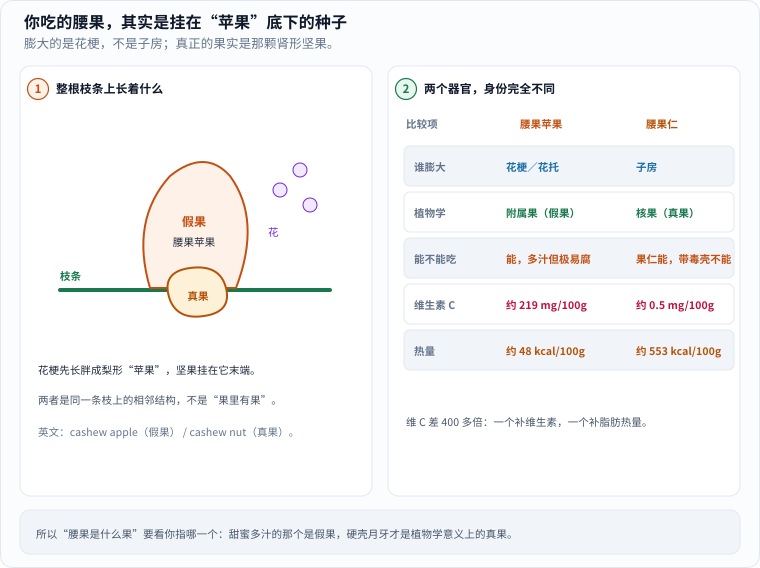
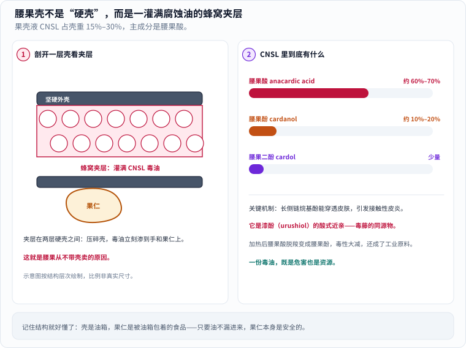
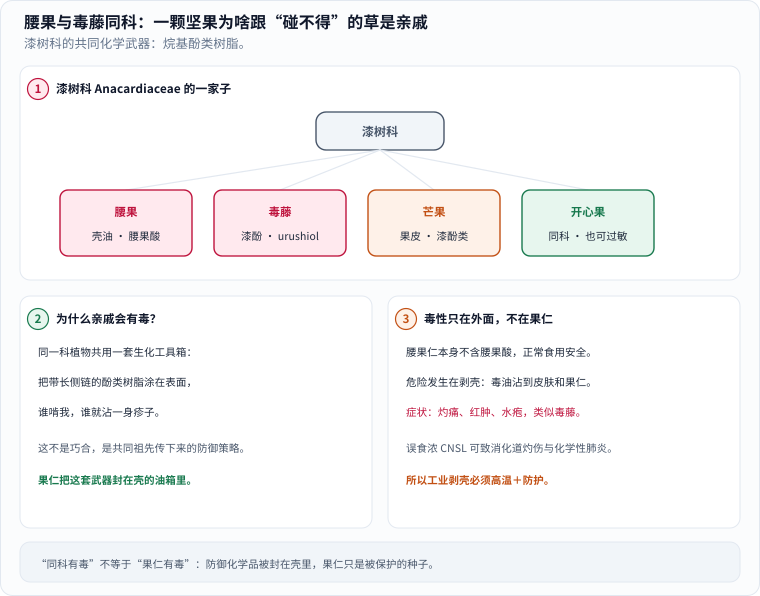
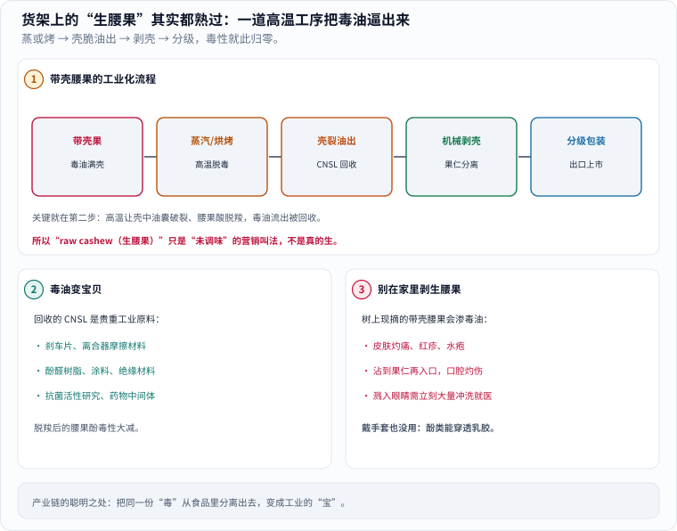
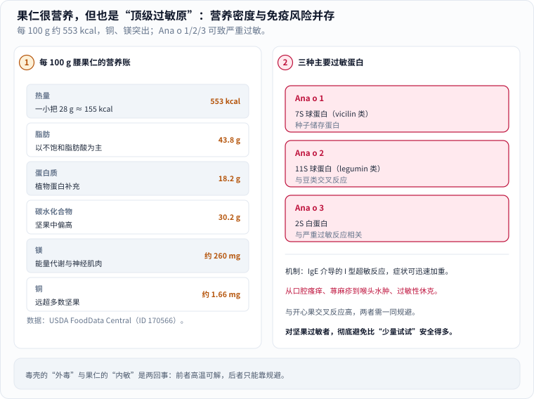

抓一把腰果放进嘴里，很难想象：这东西在树上时，外面裹着一层**能把手烧出水疱的油**。

先把几个反直觉的事实摆出来：

1. **你吃的“腰果”，根本不是果实。** 植物学上，真正的果实是那层硬壳和里面的种子；你咬的月牙是**种子**。而挂在它上方那个梨形、多汁、维生素 C 爆表的“腰果苹果”，才是膨大的花梗——一个**假果** [[1]](#ref-1)。
2. **果壳不是“壳”，是油箱。** 壳里有蜂窝状夹层，灌满**腰果壳油（CNSL）**，占壳重 **15%–30%**，主成分是**腰果酸**，一种能穿透皮肤的烷基酚 [[2]](#ref-2)[[3]](#ref-3)。
3. **它和毒藤是亲戚。** 腰果属于**漆树科**，和毒藤、芒果、开心果同科。壳油里的腰果酸，正是毒藤那个"碰一下就起疹"的**漆酚（urushiol）**的酸式近亲 [[4]](#ref-4)。
4. **你在货架上买的"生腰果"，全都熟过。** 树上现摘的带壳腰果从不上市——因为不先蒸熟或烤熟，剥壳的人会被毒油烧伤。所谓 raw 只是"未调味"，不是"未加热" [[5]](#ref-5)。
5. **同一棵树上有两个极端**：果仁每 100 g 约 **553 kcal**、脂肪 43.8 g；腰果苹果每 100 g 只有约 48 kcal，维 C 却约 **219 mg**，是橙子的 4–5 倍 [[6]](#ref-6)[[7]](#ref-7)。可后者因为太易腐烂，大多数产区直接扔掉。

这五条凑在一起，腰果就不是一包零食，而是一堂关于**植物防御化学、人类加工智慧与食物浪费**的课。今天一条条拆开。

---

## 一、先纠正身份：腰果到底"是不是果"

### 1. 花梗先长胖，坚果挂在它底下

腰果树（*Anacardium occidentale*）开花后，花梗开始膨大，长成梨形、5–11 cm、黄红相间的多汁结构——这就是**腰果苹果（cashew apple）**。而真正的果实一开始就在花梗末端发育，是一枚肾形的核果，里面包着种子 [[1]](#ref-1)[[8]](#ref-8)。

关键的发育顺序是：**坚果先长到接近成熟，花梗才跟着膨大** [[8]](#ref-8)。所以你在树上看到的是"一个胖梨下面挂一颗月牙"，两者是同一条花梗上的相邻结构，不是"果里有果"。

| 比较项 | 腰果苹果（假果） | 腰果仁（真果里的种子） |
| :--- | :--- | :--- |
| 植物学身份 | 膨大的花梗/花托，附属果 | 核果里的种子 |
| 维生素 C | 约 **219 mg/100g** [[7]](#ref-7) | 约 0.5 mg/100g [[6]](#ref-6) |
| 热量 | 约 48 kcal/100g [[7]](#ref-7) | 约 **553 kcal/100g** [[6]](#ref-6) |
| 口感 | 多汁、酸甜、略涩 | 细腻松脆、脂肪香 |
| 商业命运 | 大多被丢弃或做果汁 | 全球交易的大宗坚果 |

> **为什么"假果"不算果？** 因为果实定义上是**子房发育而来的结构**。腰果苹果来自花梗，不是子房；真正的子房发育成了那颗带硬壳的核果。换句话说，你吃腰果仁时吃的是**种子**，喝腰果苹果汁时喝的是**花梗**——两边都不是严格意义上的"果肉"。

### 2. 一笔"维C账"：被扔掉的才是维生素之王

橙子的维 C 约 **53 mg/100g**，腰果苹果约 **219 mg/100g**：

$$
\frac{219}{53}\approx 4.1
$$

文献里常说"5 倍" [[8]](#ref-8)，按具体品种和测法在 4–6 倍之间波动。一个腰果苹果的维 C，顶得上四五个橙子。可它**采后极易腐烂**——果汁厂用防腐剂也仅能把货架期延到约 20 天 [[9]](#ref-9)。热带产区往往"摘了果仁、丢了苹果"，这是典型的"副产物浪费"。

把这张结构图摊开看一眼，后面所有章节都从它展开。

_图 1 怎么看：先左后右。先看左栏的枝条：绿色是枝条，橙色梨形是膨大的花梗（腰果苹果），下面挂着的月牙才是真果——注意两者的位置关系是"上假下真"。再看右栏五行对比：维 C 219 对 0.5 mg、热量 48 对 553 kcal，两条数字线一个向左一个向右——这说明两种"腰果"根本是两类食物。最后看底栏：你平时吃的是种子，不是果实；喝果汁时喝的是花梗。_

---

## 二、毒壳：一座灌满腐蚀性油的蜂窝

### 1. 一笔"含量账"：壳重的 15%–30% 是油

把一颗带壳腰果剖开，从外到里是：**坚硬外壳 → 蜂窝夹层 → 内壳 → 果仁**。夹层里灌满深褐色黏稠液体，就是**腰果壳油（cashew nut shell liquid, CNSL）**，占壳重约 **15%–30%** [[2]](#ref-2)。

这油不是普通油脂，而是**长链酚类混合物** [[3]](#ref-3)：

- **腰果酸（anacardic acid）**：天然 CNSL 的 **60%–70%**，一个水杨酸骨架挂 15 碳侧链；
- **腰果酚（cardanol）**：约 10%–20%，加热后腰果酸**脱羧**就变成它；
- **腰果二酚（cardol）**等少量成分。

### 2. 为什么毒？——长侧链能穿透皮肤

腰果酸的分子结构有个关键特征：一端是**酚环**（带 —OH），另一端是 **C15 的疏水长链**。这种"一头亲水、一头亲脂"的结构，正好能插进皮肤角质层的脂质双层，把活性基团送进去，引发**接触性皮炎（contact dermatitis）** [[3]](#ref-3)。

这就是为什么它和毒藤的漆酚是"同一类武器"：两者都是**烷基酚**，都由长疏水链 + 儿茶酚/酚环构成。漆酚让人"碰过就起线状水疱"，腰果酸的刺激性同样强烈 [[4]](#ref-4)。医学文献还记录了**误服 CNSL 导致消化道灼伤**的病例：症状包括烧灼感、吞咽困难、剧烈口渴，误吸可造成化学性肺炎 [[10]](#ref-10)。

> **一个常见误解**：有人以为"腰果仁也有毒，必须煮很久"。其实毒性几乎全在壳油里。果仁本身不含腰果酸，正常食用是安全的。危险发生在**剥壳那一刻**——毒油渗到果仁表面和剥壳人的手上。

### 3. 毒油其实是宝贝：加热一变，身价翻倍

这里有个漂亮的化学转折：把腰果酸加热，它会**脱掉一个 $$\mathrm{CO_2}$$**：

$$
\text{腰果酸} \xrightarrow{\Delta} \text{腰果酚(cardanol)} + \mathrm{CO_2}\uparrow
$$

脱羧产物**腰果酚毒性大减**，却保留了酚环的反应活性，于是成了贵重工业原料：**汽车刹车片、离合器摩擦材料、酚醛树脂、涂料、绝缘材料**，甚至有抗菌活性研究 [[11]](#ref-11)。

**同一份"毒"，在食品链里是必须除掉的危害，在工业链里是抢手的资源。** 人类找到的解决办法不是"消灭"它，而是"分开"它。

_图 2 怎么看：左剖面，右成分。左栏从外往里数三层：深灰外壳 → 粉色蜂窝夹层（灌满 CNSL）→ 内壳 → 金色果仁——毒油被物理封在夹层里。右栏三条横条：腰果酸约 60%–70%、腰果酚约 10%–20%、腰果二酚少量——天然 CNSL 以腰果酸为主。最后看右栏底部那句：加热让腰果酸脱羧变成腰果酚，毒性大减还成了工业原料——一笔"毒"变"宝"的账。_

---

## 三、亲缘关系：为什么坚果和毒藤是一家

### 1. 漆树科的统一"化学武器库"

腰果属于**漆树科（Anacardiaceae）**。这个科里你大概都听过：

- **毒藤 / 毒葛**（*Toxicodendron*）：漆酚，最著名的接触性过敏原之一；
- **芒果**（*Mangifera indica*）：果皮和汁液里也有漆酚类物质，有些人吃芒果会"烂嘴角"；
- **开心果**（*Pistacia vera*）：同科，也是常见树坚果过敏原；
- **腰果**：壳油里的腰果酸。

它们共用一套生化工具箱——**在表面涂一层带长侧链的酚类树脂**。对植物来说这是低成本高效益的防御：昆虫咬一口，口器沾上树脂就起疹、发苦，下次不来了 [[4]](#ref-4)。

### 2. 但"同科有毒"不等于"果仁有毒"

这是最容易滑向误读的地方。腰果的化学防御集中在**壳**里，果仁是被保护的种子，不含腰果酸 [[5]](#ref-5)。植物把武器做在"包装层"而不是"食物层"——**壳替种子挡住啃咬者，种子负责被动物吃下传播**。

这种"分区存放"在自然界很常见：苹果籽含氰苷但果肉无毒，蓖麻种子含蓖麻毒蛋白但油可食用。腰果的策略是：**毒在外壳、营养在内仁**，中间用两层硬壳加一层油囊彻底隔开。

_图 3 怎么看：先看树状图，再看下面两栏。上方树状图：漆树科分出腰果、毒藤、芒果、开心果四支，每支标注它的酚类武器——同科不同"毒法"，但化学骨架相似。左下栏：解释这套武器是共同祖先传下来的防御策略，果仁把武器封在壳的油箱里。右下栏：毒性只在外面——果仁本身不含腰果酸，危险全在剥壳时沾油，误食浓 CNSL 才需就医。_

---

## 四、加工去毒：为什么没有带壳腰果卖

### 1. 一笔"工序账"：五步把毒果变零食

你永远在超市看不到带壳腰果像花生那样卖，原因就在这里。工业化流程是 [[12]](#ref-12)：

1. **带壳果**：毒油满壳；
2. **蒸汽或烘烤**：高温让油囊破裂、腰果酸脱羧；
3. **壳裂油出**：CNSL 流出被回收（就是上一节的工业原料）；
4. **机械剥壳**：果仁分离；
5. **分级包装**：出口上市。

关键在第二步。高温同时干了两件事：**破坏油囊结构** + **腰果酸脱羧成低毒腰果酚** [[11]](#ref-11)。只有经过这一步，工人才徒手剥壳、消费者才安全食用。

### 2. "生腰果"的营销悖论

货架上写着 **raw cashews** 的产品，几乎全都经过蒸或烤 [[5]](#ref-5)[[13]](#ref-13)。这里的 raw 指的是**没有加盐、没有调味、没有深度烘焙上色**，不是"从未加热"。真正的"树上现摘、完全未处理"的腰果，因为壳油剧毒，根本不可能出现在食品货架上。

> **一句话记住**：所谓“生腰果”，是“熟过的、没调味的腰果”。这个命名是行业惯例，不是物理事实。

### 3. 为什么别自己在家剥

有人好奇买"带壳生腰果"回来剥。风险有三 [[10]](#ref-10)[[12]](#ref-12)：

- 毒油沾皮肤 → 灼痛、红疹、水疱；
- 沾到果仁再入口 → 口腔黏膜灼伤；
- 溅入眼睛 → 需立刻大量冲洗并就医。

而**戴普通乳胶手套没用**——酚类小分子能穿透乳胶 [[3]](#ref-3)。处理 CNSL 的工人需要丁腈或更厚的防护，并且要在通风、有回收设备的工厂环境中操作。

_图 4 怎么看：上流程，下两栏。上方五步流水线：带壳果 → 蒸汽/烘烤 → 壳裂油出 → 机械剥壳 → 分级包装——高温是唯一的分水岭。左下"毒油变宝贝"：回收 CNSL 做刹车片、树脂、涂料、药物中间体。右下"别在家剥"：皮肤水疱、口腔灼伤、眼睛刺激，乳胶手套挡不住——这不是居家 DIY 项目。_

---

## 五、营养与过敏：一把腰果的两张面孔

### 1. 一笔"营养账"：553 kcal 与铜的富矿

按 USDA FoodData Central，每 100 g 生腰果仁约含 [[6]](#ref-6)：

$$
\underbrace{43.8\ \mathrm{g}}_{\text{脂肪}}\ +\ \underbrace{18.2\ \mathrm{g}}_{\text{蛋白质}}\ +\ \underbrace{30.2\ \mathrm{g}}_{\text{碳水}}
$$

热量约 **553 kcal**。用 Atwater 系数粗算：

$$
43.8\times9 + 18.2\times4 + 30.2\times4 \approx 394+73+121 = \mathbf{588\ kcal}
$$

与 553 的差值来自水分、纤维与消化率的折减。一小把 28 g 约 **155 kcal**，铜含量超过欧盟参考摄入量的一半 [[7]](#ref-7)。镁约 260 mg、锌约 5.8 mg，在坚果中都属较高水平。

### 2. 过敏：比壳油更该警惕的东西

真正需要长期警惕的不是壳油（高温已解决），而是**果仁蛋白过敏**。腰果有 **三种主要过敏原** [[14]](#ref-14)[[15]](#ref-15)：

| 蛋白 | 类别 | 特点 |
| :--- | :--- | :--- |
| **Ana o 1** | 7S 球蛋白（vicilin 类） | 种子储存蛋白，稳定、耐消化 |
| **Ana o 2** | 11S 球蛋白（legumin 类） | 与豆类过敏原有交叉反应 |
| **Ana o 3** | 2S 白蛋白 | 与严重过敏反应（过敏性休克）关系密切 |

它们都是种子储存蛋白，耐高温、耐消化酶——**这也是为什么"煮熟"不能消除腰果过敏**。机制是 IgE 介导的 I 型超敏反应：免疫系统误把这些蛋白当威胁，肥大细胞释放组胺等介质，症状从口腔瘙痒、荨麻疹，到喉头水肿、血压骤降，严重时可致命 [[15]](#ref-15)。

腰果与**开心果交叉反应率高**，对一种过敏的人往往要同时规避另一种 [[14]](#ref-14)。对坚果过敏者，"少量试试"从来不是好主意——**彻底避免才是唯一可靠的策略**。

_图 5 怎么看：左营养，右过敏。左栏六行：553 kcal、脂肪 43.8 g、蛋白 18.2 g、碳水 30.2 g、镁约 260 mg、铜约 1.66 mg——铜是腰果的隐藏强项。右栏三张红卡：Ana o 1（7S 球蛋白）、Ana o 2（11S 球蛋白）、Ana o 3（2S 白蛋白）——都是稳定的种子储存蛋白，煮不坏。最后看底部：壳的"外毒"高温可解，果仁的"内敏"只能靠规避——这是两种完全不同的风险。_

---

## 六、总表与五个常见误区

| 你以为的 | 实际是 | 关键数字／机制 |
| :--- | :--- | :--- |
| 腰果是果实 | 果仁是种子，苹果是膨大花梗（假果） | 真果是带壳核果 [[1]](#ref-1) |
| 果壳只是硬保护 | 蜂窝夹层灌满 CNSL 毒油 | 占壳重 15%–30% [[2]](#ref-2) |
| 毒性在果仁 | 毒性几乎全在壳油 | 腰果酸 60%–70% [[3]](#ref-3) |
| 和毒藤没关系 | 同属漆树科，同源烷基酚 | 腰果酸是漆酚酸式近亲 [[4]](#ref-4) |
| "生腰果"没加热 | 已蒸/烤去毒，只是没调味 | 树上现摘的从不上市 [[5]](#ref-5) |
| 腰果苹果是废料 | 维 C 是橙子的 4–5 倍 | 约 219 mg/100g [[7]](#ref-7) |

五个误区，逐条拆：

1. **"腰果长在果壳里。"** 果仁是种子，外面那层硬壳才是植物学果实；上方的"苹果"是假果。
2. **"带壳腰果晒干就能吃。"** 晒不掉毒油，必须高温蒸烤使腰果酸脱羧 [[11]](#ref-11)。
3. **"腰果和毒藤只是长得像。"** 同科，共用烷基酚防御化学 [[4]](#ref-4)。
4. **"腰果苹果不能吃。"** 能吃，维 C 爆表，只是极易腐烂、不便运输 [[7]](#ref-7)[[9]](#ref-9)。
5. **"煮熟就不过敏了。"** 过敏原是稳定的储存蛋白 Ana o 1/2/3，高温不破坏 [[14]](#ref-14)。

一颗腰果，把"植物防御化学、工业回收、食品营销、营养免疫"全串在了一起。你下次咬开那片月牙时，会知道它刚刚跨越的，不只是一层壳，而是一整条从毒藤亲戚到零食货架的漫长路径。

---

## 参考资料与核查来源

1. **Akyereko Y.G. et al. (2023)**, *Nutritional value and health benefits of cashew apple*, JSFA Reports（DOI: 10.1002/jsf2.107，[PDF](http://www.growables.org/information/TropicalFruit/documents2/Cashew%20Nutrient.pdf)）—— peer-reviewed review on *Anacardium occidentale*: the cashew apple as an accessory fruit, its vitamin C content relative to citrus, and post-harvest perishability. Tropical Fruit and Veg（[page](https://tropicalfruitandveg.com/showdetail.php?srcname=Cashew+Apple)）describes the peduncle swelling into a 5–11 cm pear-shaped apple while the true fruit (the drupe) develops at its tip.
2. **SVC Group / CNSL Vietnam**, *Composition of CNSL*（[页面](https://cnslvietnam.com/en/thanh-phan-cua-dau-vo-hat-dieu-cnsl)）与 SVC Group《What is CNSL?》（[页面](https://svc.vn/?p=1372/)）—— 支持 CNSL 占果壳 15%–30%、来自壳的蜂窝结构、腰果酸 60%–70%、腰果酚 10%–20% 等成分比例。
3. **PubChem (NIH)**, *Anacardic Acid*（[CID 167551](https://pubchem.ncbi.nlm.nih.gov/compound/Anacardic-acid)）—— primary compound record: molecular formula C₂₂H₃₆O₃, 6-(pentadecyl)salicylic acid, a phenolic lipid with a C15 alkyl side chain; **Tyman & Kiong (1978)**, *Long chain phenols XI: composition of natural cashew nut shell liquid*, Lipids 13(8):525–532（[PubMed 27520537](https://pubmed.ncbi.nlm.nih.gov/27520537/)）—— primary paper on CNSL composition across sources; decarboxylation to cardanol on heating is documented in **PMC4425097**, *Potential Biological Applications of Bio-Based Anacardic Acids*（[paper](https://pmc.ncbi.nlm.nih.gov/articles/PMC4425097/)）.
4. **Britannica**, *What common food is related to poison ivy?*（[页面](https://www.britannica.com/one-good-fact/what-common-food-is-related-to-poison-ivy)）—— 支持腰果与毒藤同科、生腰果含 urushiol、市售"生腰果"已经烘焙以消除暴露风险；Major Food Allergens（[页面](https://majorfoodallergens.com/cashew-anacardium-occidentale/)）补充同科包括芒果与开心果。
5. **Healthline**, *Are Cashews Poisonous?*（[页面](https://www.healthline.com/nutrition/are-cashews-poisonous)）—— 支持"市售腰果即使标 raw 也已高温蒸/烤去毒、树上现摘的生腰果从不销售、果仁本身不含腰果酸"等结论。
6. **USDA FoodData Central**（经 [Cashew Index](https://cashewindex.com/cashew-nutrition)、[Macadamia.com.tw](https://www.macadamia.com.tw/cashew) 转录）—— 生腰果仁每 100 g：553 kcal、脂肪 43.8 g、蛋白 18.2 g、碳水 30.2 g、镁约 260 mg、铜约 1.66 mg、锌约 5.78 mg；数据 ID 170566。
7. **Tropical Brazil**, *Cashew Fruit*（[页面](https://tropicalbrazil.com.au/?p=16448)）与 Nutrivida（[页面](https://nutriveda.eu/?p=2212)）—— 支持腰果苹果维 C 约 219 mg/100g、热量约 48 kcal/100g，以及 28 g 腰果仁约 155 kcal、铜超过欧盟参考摄入量一半。
8. **Tropical Fruit and Veg**, *Cashew Apple (Anacardium occidentale)*（[页面](https://tropicalfruitandveg.com/showdetail.php?srcname=Cashew+Apple)）—— 支持花梗先长胖成 5–11 cm 梨形多汁假果、坚果先成熟、维 C 为橙子 5 倍、钙铁与 B1 高于柑橘鳄梨香蕉等表述。
9. **The Pharma Innovation Journal (2017)**, *Cashew apple therapeutic benefits, processing and product development*（[PDF](http://www.thepharmajournal.com/archives/2017/vol6issue7/PartD/6-7-53-698.pdf)）—— 支持防腐剂组合可将腰果苹果汁货架期延长至约 20 天。
10. **NBE Journal of Medical Sciences (2024)**, *Corrosive Burns From Cashew Nut Shell Liquid (CNSL)*（[PDF](https://natboard.edu.in/ejournal/article/publish/3524080579.pdf?891645069)）—— 支持 CNSL 误服导致烧灼感、吞咽困难、剧烈口渴、里急后重等消化道腐蚀症状，误吸可致化学性肺炎；并指出腰果酸是主要成分。
11. **SVC Group**, *CNSL: Properties and Applications*（[页面](https://svc.vn/?p=1372/)）与 toxikologie.de《Cashew – raw, delightfully tricky》（[PDF](https://toxikologie.de/wp-content/uploads/2025/05/2025-03_Cashew_UH_en.pdf)）—— 支持 CNSL 用于刹车片、树脂、涂料、绝缘材料，腰果酸具抗菌活性，以及传统医学用途。
12. **ScienceInsights**, *What Nut Is Poisonous Until Roasted? Cashews*（[页面](https://scienceinsights.org/what-nut-is-poisonous-until-roasted-cashews)）与 cashew-machine.org《Cashew In Shell》（[页面](https://cashew-machine.org/the-benefits-of-cashew-in-shell)）—— 支持带壳生腰果需先蒸或烤使壳裂、毒油流出回收再机械剥壳，以及市售腰果均经此流程。
13. **Nut Cravings**, *Are Raw Cashews Safe to Eat?*（[页面](https://www.nutcravings.com/blogs/news/are-raw-cashews-safe-to-eat)）—— 支持市售 raw 与 roasted 腰果的区别在于调味与口感、两者都安全，真正树上现摘的生腰果不在商店销售。
14. **Allergy Resources**, *Cashew Allergy*（[页面](http://www.allergyresources.co.uk/Cashew.php)）—— 支持 Ana o 1（7S vicilin 类储存球蛋白）、Ana o 2（11S legumin 类）、Ana o 3（2S 白蛋白）三类主要过敏原及腰果与开心果的交叉反应。
15. **Radauer C. et al. (2022)**, *Co-sensitization to the three non-homologous major cashew allergens Ana o 1, Ana o 2 and Ana o 3 is caused by IgE cross-reactivity*, Journal of Investigational Allergology and Clinical Immunology（[record](https://www.aminer.org/pub/634ed7d090e50fcafdff4715/co-sensitization-to-the-three-non-homologous-major-cashew-allergens-ana-o)）—— Ana o 1 (7S vicilin-like globulin), Ana o 2 (11S legumin-like globulin) and Ana o 3 (2S albumin) as the three major storage-protein allergens, their IgE cross-reactivity and association with severe reactions; **Allergy Resources**, *Cashew Allergy*（[page](http://www.allergyresources.co.uk/Cashew.php)）supports the-analyte classification and symptom spectrum.
16. **原创图解说明**：图 1 至图 5 由本站 `tools/visuals.py build cashew` 生成，含 CNSL 成分比例、维 C 倍数、营养热量换算、产量排序与过敏原数量等数值断言，以及 XML、宽高比、字号审计。
