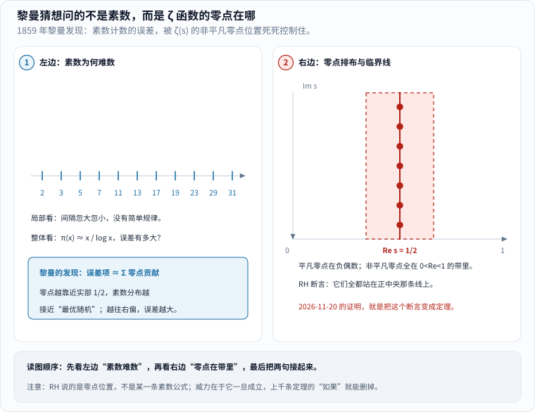
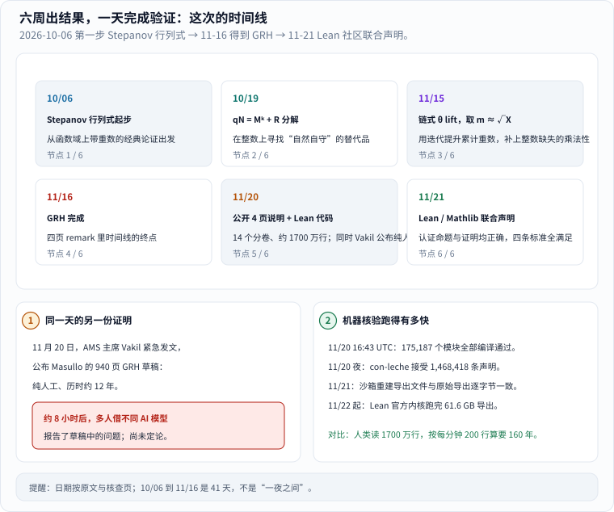
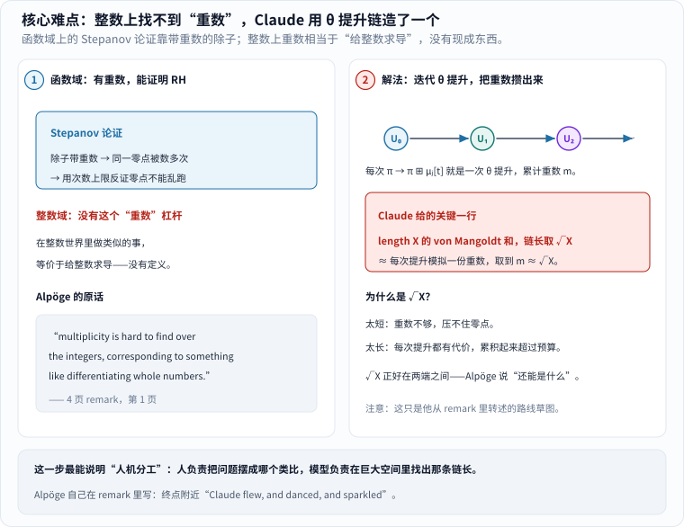
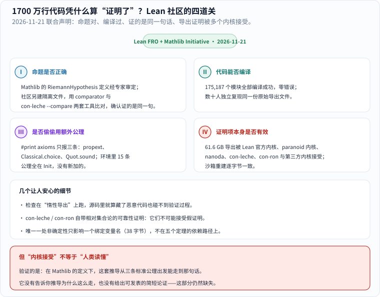
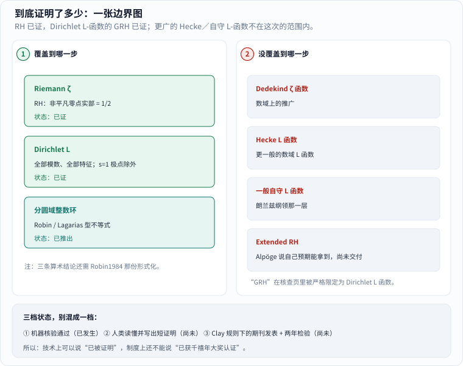

2026 年 11 月 20 日，Anthropic 的数学家 **Levent Alpöge** 在个人网站贴出一份只有 **4 页**的 PDF，第一句话是：

> I believe I have, working with Claude, discovered a proof of the Riemann Hypothesis.

接着他说：这个方法"轻松扩展"到**广义黎曼猜想**，他还预期能拿到更广的 **Extended Riemann Hypothesis**；并且**已经把论证形式化，没有额外假设** [[1]](#ref-1)。

没有论文，没有新闻稿，附的是 **14 个压缩包**、约 **1700 万行** Lean 代码。

第二天，Lean FRO 与 Mathlib Initiative 发布联合声明，措辞极重：

> We hereby certify that both the statement and the proof of the Riemann Hypothesis are correct.

——我们在此证明，黎曼猜想的**命题和证明都正确** [[2]](#ref-2)。

同一天，美国数学学会主席 Ravi Vakil 在博客上发了一篇题为《Hurried Announcement》的紧急公告，公布了另一份 **940 页、完全由人完成**的广义黎曼猜想证明草稿 [[4]](#ref-4)。约 8 小时后，他更新说：有人借不同 AI 模型发现了草稿里的问题。

这件事的信息量太大，也太容易被讲歪。先拆成五个问题：

1. **黎曼猜想到底问的是什么？** 为什么一个"零点在哪"的问题，能决定素数怎么分布？
2. **这次真的证明了 RH 吗？** 还是只是 10 月 OpenAI 那个"准黎曼猜想"的续集？
3. **1700 万行代码凭什么叫"证明"？** 谁验的？验了什么？
4. **那个 √X 的 θ 提升链是什么？** 为什么这是整条路线最关键的一行？
5. **为什么数学界还在争论？** "机器核验通过"离"数学界接受"到底差几步？

---

## 一、先把事情说准：公布了什么，谁公布了

先把可核查的事实列清楚，不加修饰 [[1]](#ref-1)[[2]](#ref-2)[[3]](#ref-3)：

- **人**：Levent Alpöge，Anthropic 数学研究员。4 页说明的作者栏只有他，他在文中明确写"与 Claude 合作"。
- **时间**：2026 年 11 月 20 日。从 10 月 6 日的第一步算起，到 11 月 16 日写下"GRH"，一共 **41 天**。
- **声称的结论**：RH 已证；同一方法扩展到 Dirichlet L-函数的广义黎曼猜想；Extended RH 预期可达但尚未交付。
- **公开的材料**：4 页英文说明 + 14 个 Lean 源码分卷，**175,187 个模块**，约 1700 万行代码；没有传统数学论文。
- **未公开的材料**：Claude 生成的自然语言草稿超过 **25 万页**。Alpöge 在脚注里自嘲"我把自己逗乐了，跑了 25 万页以上"，并明确称其为不可读的 "slop"，拒绝公开。
- **验证**：11 月 21 日 Lean FRO 与 Mathlib Initiative 联合声明认证；MIT 的 Andrew Sutherland 维护了逐项核查页，最后更新到 11 月 25 日。

这里必须和另一件事分开：**2026 年 10 月 6 日 OpenAI 那批成果里的"准黎曼猜想"**，证明的是 ζ(s) 在 $\operatorname{Re}s>7/8$ 的半平面无零点——那是一块**无零点区域**，离"所有零点都在 1/2 上"还差得远。11 月这次是直接把临界线钉死。两者不是一回事。

Alpöge 在说明里对时间点的坦白也值得记下来：

> The precise timing is horrible.

他承认发布卡在 Anthropic 上市次日，外界会有"犬儒的解释"，但他坚持自己"无法再等下去"。这份坦白，比任何公关稿都更能说明当时的状态。

> **图 1 怎么看（左边数素数，右边看零点）**：
> 1. **左栏**：素数在数轴上忽密忽疏；$\pi(x)\approx x/\log x$ 只给了平均，误差项由 ζ 函数的零点位置控制。
> 2. **右栏**：复平面里 $0<\operatorname{Re}s<1$ 的临界带，正中是 $\operatorname{Re}s=1/2$ 的临界线；非平凡零点全在带里，RH 断言它们全站在线上。
> 3. **底栏**：RH 说的是零点位置，不是某一条素数公式；威力在于它一旦成立，上千条定理前面的"如果"就能删掉。
>
> [单独打开图片](/assets/images/riemann-proof/riemann-critical-line.svg)

---

## 二、RH 到底问了什么：从素数误差到临界线

黎曼 1859 年那篇不到十页的论文里，干了一件很暴力的事：把整数世界的素数，接到了复变函数上。

当 $\operatorname{Re}s>1$ 时，

$$
\zeta(s)=\sum_{n=1}^{\infty}\frac{1}{n^{s}}=\prod_{p\ \text{prime}}\frac{1}{1-p^{-s}}
$$

右边那个乘积叫 Euler 乘积，它把 ζ 函数和每一个素数 $p$ 直接绑在一起。黎曼证明了 $\zeta(s)$ 可以解析延拓到整个复平面（$s=1$ 处有个极点），并且发现：素数计数函数 $\pi(x)$ 与 $\operatorname{Li}(x)$ 之间的误差，主项来自 ζ 函数零点的贡献：

$$
\pi(x)-\operatorname{Li}(x)\ \sim\ -\sum_{\rho}\operatorname{Li}(x^{\rho})
$$

这里的 $\rho$ 就是 ζ 的非平凡零点。**零点越靠右，$\operatorname{Re}\rho$ 越大，$x^{\rho}$ 的模越大，误差项就越嚣张。**

零点在哪？它们全落在 $0<\operatorname{Re}s<1$ 的临界带里。实轴上的负偶数 $-2,-4,-6,\dots$ 也有零点，但那些是"平凡零点"，不携带素数信息。真正重要是非平凡零点。

**黎曼猜想**：所有非平凡零点都满足 $\operatorname{Re}\rho=1/2$。

为什么这条线这么神？因为它等价于说：素数的分布误差被压到 $\sqrt x\log x$ 量级——这是随机性允许的最优量级。它也意味着上千条以"假设 RH 成立"开头的定理，可以正式升级为定理。这也是为什么 Clay 数学研究所在 2000 年把它列为七大千禧年难题之一，悬赏 100 万美元 [[6]](#ref-6)。

---

## 三、六周与一天：这次的时间线

> **图 2 怎么看（上时间线，下两栏）**：
> 1. **上方六个节点**：10/06 Stepanov 行列式 → 10/19 分解 → 11/15 链式 θ 提升 → 11/16 GRH → 11/20 公开 → 11/21 联合声明。
> 2. **左下**：同一天 Vakil 公布的 940 页纯人工草稿，约 8 小时后被不同 AI 模型辅助发现问题，尚未定论。
> 3. **右下**：机器核验速度——11/20 16:43 UTC 全部模块编译完成；沙箱重建逐字节一致；61.6 GB 导出交给多个内核跑。右侧那句换算最扎心：人类按每分钟 200 行读 1700 万行，要 160 年。
>
> [单独打开图片](/assets/images/riemann-proof/riemann-timeline.svg)

时间线本身就是这篇文章最值得记住的数字之一：**6 周产生证明，1 天完成机器核验，几年才能完成人类理解**。这三个时间尺度完全不同，把它们混在一起，就会得出"AI 一天干掉数学家"或者"这不算证明"两种都错的结论。

---

## 四、核心技术：整数上找不到"重数"，就用 θ 提升链造一个

Alpöge 在 4 页说明里给了一段罕见的技术自述，最关键的矛盾是这样的 [[1]](#ref-1)：

函数域上的 RH（比如曲线上的 zeta 函数）早就被证明了，靠的是 **Stepanov 方法**。这个方法的杠杆是**带重数的除子**：同一个零点可以被数多次，于是"用次数上限反证零点不能乱跑"能奏效。

但搬到整数上就卡住了。Alpöge 的原话：

> multiplicity is hard to find over the integers, corresponding to something like differentiating whole numbers.

整数上的"重数"，类似于给整数求导——没有现成的东西。

他们找到一个玩具模型：用**链式 θ 提升**（iterated theta lifts）在自守形式的框架里模拟重数。每一次提升 $\pi\mapsto\pi\boxplus\mu_j[t]$ 就多攒一份重数，提升链的**长度** $m$ 就是重数的数量。

然后 Alpöge 写下了他认为是全程最让人"从椅子上掉下来"的那一行：**对长度 $X$ 的 von Mangoldt 和，Claude 建议的 θ 提升链长是 $\sqrt X$。**

> **图 3 怎么看（左难题，右解法）**：
> 1. **左栏**：Stepanov 在函数域靠重数，整数上重数相当于"给整数求导"；下面附的是 remark 原文引句。
> 2. **右栏**：$U_0\to U_1\to U_2\to\cdots$ 的迭代提升链，每次 $\pi\mapsto\pi\boxplus\mu_j[t]$ 累计一份重数；红框里是 Claude 给出的 $\sqrt X$。
> 3. **为什么是 $\sqrt X$**：太短重数不够，太长提升的代价累积起来超预算，$\sqrt X$ 正好卡在中间。Alpöge 的反问是"And yet, what else could it be?"
> 4. **底栏**：这一幅最能说明人机分工——人负责选类比，模型负责在巨大的空间里找出那条链长。
>
> [单独打开图片](/assets/images/riemann-proof/riemann-stepanov.svg)

注意 Alpöge 自己反复强调：这只是他从 remark 里转述的**路线草图**，论证本身"极其长"，他预期会被大幅简化，但还没时间去找短证明。他在备注里也承认，有些关于模型工作的描述是自己转述的 "slop summary"，"可能完全说不通"。这种坦白，反而让材料更可信。

---

## 五、1700 万行为什么能算证明：Lean 的四道关

机器证明的信任问题，不是"代码跑通了没"，而是四件完全不同的事。Lean 社区 11 月 21 日的联合声明，正是按这四条逐项认证 [[2]](#ref-2)：

> **图 4 怎么看（四关 + 两个边界）**：
> 1. **Ⅰ 命题是否正确**：Mathlib 里的 `RiemannHypothesis` 定义经专家审定；社区另建隔离文件，用 `comparator` 和 `con-leche --compare` 两套工具比对，确认代码证的就是这句话。
> 2. **Ⅱ 代码能否编译**：175,187 个模块零错误编译通过，数十人独立复现同一份原始导出。
> 3. **Ⅲ 有没有偷加公理**：`#print axioms` 只报三条——`propext`、`Classical.choice`、`Quot.sound`；环境里 15 条公理全在 `Init`。
> 4. **Ⅳ 证明项是否有效**：61.6 GB 导出被 Lean 官方内核、paranoid 内核、`nanoda`、`con-leche`、`con-ron` 和第三方内核接受；沙箱重建的导出逐字节一致。
> 5. **下方红框**是全文最重要的限定：内核接受 ≠ 人类读懂。
>
> [单独打开图片](/assets/images/riemann-proof/riemann-verification.svg)

MIT 的 Andrew Sutherland 把核查做成了工程级耗材：源码归档 239,275,554 字节；导出文件 61,570,595,788 字节（约 61.6 GB）；`con-leche` 接受 1,468,418 条声明；Lean 官方内核跑完整个导出花了 **48 小时 3 分钟**，峰值内存 **82.6 GiB**；paranoid 内核则跑了 **72 小时 20 分钟** [[3]](#ref-3)。

几个容易被忽略、但很让人安心的细节 [[2]](#ref-2)[[3]](#ref-3)：

- **检查跑在"惰性导出"上**，源码里就算藏了恶意代码也碰不到验证过程；
- `con-leche` 和 `con-ron` 自带**相对集合论的可靠性证明**：它们不可能接受假证明；
- 编译产物里唯一一处非确定性，只改变了某个自动生成引理里一个绑定变量的名字（**38 字节**），且不在五个定理的依赖路径上；Lean v4.36.0 已修掉这个行为。

所以，从形式化角度说：**这份证明通过了目前能动用的几乎所有机械检查**。这不是"大概对"，是"在可以机械检查的层面，已经做到极致"。

---

## 六、到底证明了多少：一张边界图

> **图 5 怎么看（左已证，右未证）**：
> 1. **左栏**：Riemann ζ 的 RH 已证；**全部模数、全部 Dirichlet 特征**的 L 函数已证（$s=1$ 的极点除外）；分圆域上的 Robin / Lagarias 型不等式也已推出。
> 2. **右栏**：Dedekind ζ 函数、Hecke L 函数、一般自守 L 函数都**不在范围内**；Extended RH 只是 Alpöge 说"预期能拿到"，尚未交付。
> 3. **底栏三档状态**：① 机器核验通过（已发生）② 人类读懂并写出短证明（尚未）③ Clay 规则下的期刊发表 + 两年检验（尚未）。
>
> [单独打开图片](/assets/images/riemann-proof/riemann-scope.svg)

这里有个非常容易踩的坑：**新闻里说的"广义黎曼猜想"，在这份核查里被严格限定为 Dirichlet L 函数**。MIT 核查页明确排除了 Dedekind ζ、Hecke L 和一般自守 L 函数 [[3]](#ref-3)。也就是说，朗兰兹纲领那一整层并没有被这次结果覆盖。

另外，三条"不含 ζ 函数"的算术结论（Robin 不等式、Lagarias 不等式、分圆域修正 Robin 不等式）依赖另一个独立的形式化项目 `Robin1984`，Sutherland 也把它送过了同样的检查流程 [[3]](#ref-3)。

---

## 七、一张总表与五个别踩的坑

| 你听到的说法 | 实际情况 | 关键依据 |
| :--- | :--- | :--- |
| "AI 独立证明了黎曼猜想" | 数学家 + Claude 合作；作者本人强调是协作 | 4 页 remark 第一句 [[1]](#ref-1) |
| "这是 OpenAI 那个准黎曼猜想的后续" | 两回事：10 月是 $\operatorname{Re}s>7/8$ 无零点带，11 月是临界线 | 两次发布彼此独立 |
| "GRH 全部解决了" | 只到 Dirichlet L 函数；Hecke／自守 L 函数未覆盖 | MIT 核查页的范围限定 [[3]](#ref-3) |
| "同行评议已经通过" | 通过的是 Lean 社区的形式化认证；Clay 要求期刊发表 + 两年检验 | Lean 联合声明 [[2]](#ref-2)、AFP 报道 [[5]](#ref-5) |
| "人类证明已死" | 同日还有一份 940 页纯人工 GRH 草稿；8 小时后被 AI 辅助发现问题 | Vakil 博客 [[4]](#ref-4) |

五个坑，逐条说：

1. **"机器核验 = 数学界接受"？** 不是。Conrey 称这是"人类历史上的里程碑时刻"，但他当时还没看到文稿；Nuño Guillén 特意表扬 Alpöge 坦承自己没完全读懂，说这更像"工具"而不是"机器神" [[5]](#ref-5)。形式和实质，仍有距离。
2. **"没有论文就不算证明"？** 太绝对。Clay 的规则要求期刊发表并经过两年检验，所以**现在还不能领奖**；但形式化社群的认证是另一种强度极高的证据。两种制度在撞车。
3. **"1700 万行是噱头"？** 恰恰相反，这是**可读性的失败，不是验证的失败**。25 万页自然语言草稿被作者自己判为 slop；公开 Lean，反而让全世界能在一天内独立复现。
4. **"同日出现纯人工证明，说明 AI 不重要"？** Vakil 的公告本身就写了另一半故事：那份 940 页草稿约 8 小时后被不同 AI 模型辅助发现问题，而 AI 协作的那份拿到了机器认证 [[4]](#ref-4)。AI 既参与证明，也参与证伪。
5. **"√X 那条链是 Claude 灵光一现"？** 不能这么讲。Alpöge 的时间线显示，从 10 月 6 日到 11 月 15 日有十几步铺垫，人负责把问题摆进正确的类比（"natively automorphic"的行列式、qN=Mᵏ+R、Iwasawa 塔等），模型负责在局部把技术走完 [[1]](#ref-1)。

---

## 八、结语：我们到底在见证什么

把这件事压成一句话：

> **11 月 20 日，一个 167 年的问题第一次同时收到了两份证明——一份是人机合作、机器可逐行核验的 1700 万行代码；一份是人工写了 12 年的 940 页草稿。前者一天拿到形式化认证，后者八小时后被 AI 挑出疑点。**

这个对比本身就是答案。它不是"AI 取代数学家"，也不是"机器证明不算数"，而是**证明的生产方式和验证方式同时换了**——英文报道也把这一刻称作数学的"新纪元" [[7]](#ref-7)。

Alpöge 在说明的最后写，他希望自己只是"最早看到这一幕的人之一"，将来所有热爱数学的人都能享受这种超越感。这句话比任何"数学已死"的标题都更接近实质：**问题解开了，理解才刚开始。**

至于那 100 万美元——按 Clay 的规则，还得等期刊发表和两年检验 [[6]](#ref-6)。技术上的定理，和制度上的定理，中间还隔着一段时间。

---

## 参考资料与核查来源

1. **Levent Alpöge**, *Remark* — 4-page announcement, November 20, 2026（[alpo.ge/remark.pdf](https://alpo.ge/remark.pdf)）—— primary source for the exact claim ("I believe I have, working with Claude, discovered a proof..."), the extension to GRH and expectation for Extended RH, the 14-part Lean archive, the 250,000+ page "slop" footnote, the Stepanov/multiplicity passage, the $\sqrt X$ theta-lift chain, the 41-day timeline, and the author's own caveats about timing and not yet mastering the surrounding mathematics.
2. **Lean FRO and Mathlib Initiative**, *Lean Verification of the Riemann Hypothesis* — joint statement, published 2026-11-21 13:55（[leanprover-community.github.io/blog/posts/riemann-hypothesis/](https://leanprover-community.github.io/blog/posts/riemann-hypothesis/)）—— primary source for the four certification criteria: correct Mathlib `RiemannHypothesis` statement, error-free compilation by dozens of people, statement comparison via `comparator` and `con-leche --compare`, and acceptance of the exported proof by Lean's kernel, `con-leche`, `con-ron` and third-party checkers, plus the "inert export" safeguard and relative-set-theory soundness of the independent checkers.
3. **Andrew Sutherland (MIT)**, *RH Lean proof: verification files* — last updated 2026-11-25 22:05 UTC（[math.mit.edu/~drew/grh/](https://math.mit.edu/~drew/grh/)）—— primary technical source for the five theorem statements in `Main.lean`, the exact Lean definition of `RiemannHypothesis`, the Dirichlet-L scope limitation, the three axioms (`propext`, `Classical.choice`, `Quot.sound`), 175,187 compiled modules, 1,468,418 accepted declarations, the 61,570,595,788-byte export, checker runtimes and memory use, the sandboxed byte-identical rebuild, the 38-byte nondeterministic bound-variable name, and the `Robin1984` arithmetic consequences.
4. **Ravi Vakil**, *Hurried Announcement: Alessandro Masullo GRH* — November 20, 2026, updated November 22（[math216.wordpress.com/2026/11/20/hurried-announcement-alessandro-masullo-grh/](https://math216.wordpress.com/2026/11/20/hurried-announcement-alessandro-masullo-grh/)）—— primary source for the parallel human-only GRH draft, Brian Conrad's months of feedback, the original plan to polish for a year, and the ~8-hour update reporting problems identified with the assistance of different AI models.
5. **Alex Pigman with Thomas Urbain (AFP/Phys.org)**, *Anthropic researcher says he and Claude proved the Riemann hypothesis, first posed in 1859* — November 20, 2026（[phys.org/news/2026-11-anthropic-claude-math-greatest-riddle.html](https://phys.org/news/2026-11-anthropic-claude-math-greatest-riddle.html)）—— English-language reporting for the Clay prize rules (peer-reviewed publication plus two years of scrutiny), direct quotes from Brian Conrey ("monumental moment in human history") and Nestor Guillén on AI as "more like a tool" rather than a "machine god", and the timing controversy around Anthropic's market debut.
6. **Clay Mathematics Institute**, *Riemann Hypothesis* — official Millennium Prize problem page（[claymath.org/millennium-problems/riemann-hypothesis/](https://www.claymath.org/millennium-problems/riemann-hypothesis/)）—— authoritative source for the problem's status as one of the seven Millennium Prize Problems and the one-million-dollar prize.
7. **The Innovation Insights**, *AI-assisted proof of Riemann Hypothesis passes independent verification* — November 23, 2026（[doi.org/10.59717/j.tiis.2026.100023](https://doi.org/10.59717/j.tiis.2026.100023)）—— English-language cross-check of the verification timeline and the "new era for mathematics" framing; references Nature DOI 10.1038/d41586-026-03812-7.
8. **原创图解说明**：图 1 至图 5 由本站 `tools/visuals.py build riemann-proof` 生成。数值断言包括 10/06 至 11/16 共 41 天、$\sqrt{10000}=100$、导出文件 61,570,595,788 字节落在 60–63 GB（十进制）区间、三条标准公理计数、$\operatorname{Re}s=1/2$ 等；全部 SVG 通过 XML、宽高比、title/desc 标签与渲染字号审计，并在浏览器中逐张检查。
