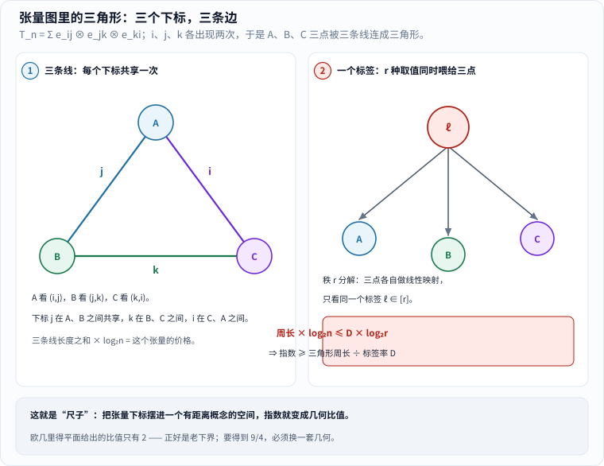
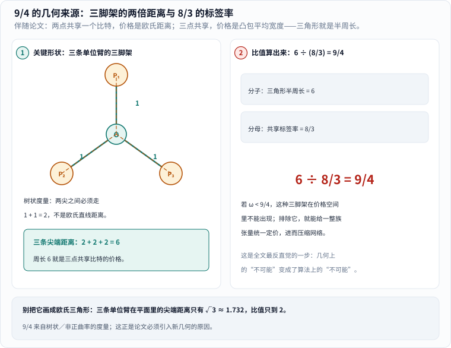

2026 年 11 月 24 日，OpenAI 维护的 GitHub 数学仓库里多了一个目录：`The-matrix-multiplication-exponent-is-nine-fourths-November-24-2026`。里面是一份 **111 页**的预印本，标题就叫**《矩阵乘法指数是四分之九》**，作者栏只写了 **OpenAI**，没有人类学者署名 [[1]](#ref-1)。

摘要第一句话很硬：

> We prove that the exponent of square matrix multiplication is 9/4 over every field. The upper bound was known.

翻译过来：**在任意域上，方阵乘法指数恰好是 9/4。上界早就有了，我们证明的是匹配的下界。** [[1]](#ref-1)

这不是又刷了一次纪录。刷上界只是"我找到更快的算法"，补下界却是"**不管谁、用什么办法，都不可能更快**"。两头顶到同一个数，才算把一个困扰算法界 57 年的问题钉死。

但先别急着 reshare。这件事至少有五个地方让人犯嘀咕：

1. **ω 到底是个什么数？** 为什么输出本身就有 $n^2$ 项，人们还相信它能一直逼近 2？
2. **1969 年 Strassen 的"7 次乘法"，凭什么省掉整整一个 $n$ 的幂？** 后面 57 年为什么每次只能挤一点点？
3. **证明"不存在更快算法"为什么这么难？** 以前的下界为什么只能到 $n^2$ 级别，拿根号一开就全没了？
4. **9/4 这个奇怪的数从哪冒出来的？** 跟一张三角形、一把"几何尺子"有什么关系？
5. **这是不是意味着大模型训练马上快 178 倍？** Lean 形式化到底覆盖了多大范围？预印本过了同行评议吗？

这五笔账算完，你就知道该激动哪一半、该保留哪一半。

---

## 一、先把结论说准：定理到底证明了什么

论文的核心是一句话（Theorem 1.1）[[1]](#ref-1)：

> Over every field F, the exponent of square matrix multiplication is ω_F = 9/4.

这里的 $\omega_F$ 定义为：使得两个 $n \times n$ 矩阵能在 $O_{F,s}(n^s)$ 次标量运算内相乘的所有实数 $s$ 的**下确界**。注意三个限定词：

- **"任意域 F"**：包括复数域、有限域、任意特征，不只是 $\mathbb{C}$；
- **"形式算术电路"**：输入是独立变量，常数在 $F$ 里，门可以做加减、乘、以及除以非零有理函数；
- **"作为有理函数恒等式相等"**：每个输出必须恒等于矩阵乘积的对应元素，不是近似、不是只在若干输入上成立。有限域上也按这个约定。

下界的具体形式比指数本身还狠（Corollary 1.2）[[1]](#ref-1)：

$$
\text{对任意 } n \ge 2,\quad \text{任何电路至少需要 } \left\lceil \frac{n^{9/4}}{2} \right\rceil \text{ 个非标量乘法／除法门}
$$

即使把线性运算全部算作免费，这个下界也成立。对**精确双线性算法**（秩分解）则是至少 $\lceil n^{9/4} \rceil$ 个乘积——那个 2 倍的差距，来自"一个通用电路门最多能拆出两个线性形式乘积"（Lemma 2.4）。

顺带还钉死了几个 corollary：方阵乘法张量 $T_n$ 的**几何 border rank 至少 $n^{9/4}$**，任意域上的**渐近秩恰好等于 $n^{9/4}$**；矩形版本给出 $\max\{ab, bc, ca, (abc)^{3/4}\}$，由此 $\alpha_F \in [1/2,\,2/3]$ [[1]](#ref-1)。论文甚至顺手推翻了 Strassen 1994 年关于 tight tensor 的一个猜想：那个猜想预测 $T_n$ 的渐近秩是 $n^2$，实际是 $n^{9/4}$。

> **图 1 怎么看（先看左，再看右）**：
> 1. **左栏**是结论和规模账。$\omega=2.25$ 不是"快了多少倍"的实测值，而是 $n\to\infty$ 时的指数。$n=1000$ 时 $n^3=10^9$ 对 $n^{2.25}\approx 5.6\times10^6$，约 178 倍；$n=10^6$ 时差约 3.2 万倍。
> 2. **右栏**按时间读：3 → 2.8074 → 2.376 → 2.371055 → 2.25 → 2.25 钉死。注意 2026 年的三步：9 月交错抽取、10 月上界、11 月下界。
> 3. **底栏**提醒：上界说"存在这么快的算法"，下界说"不可能更快"，两头合拢才叫确定。
>
> [单独打开图片](/assets/images/matrix-exponent/matrix-exponent-timeline.svg)

---

## 二、ω 是什么：给"算得快"定一个只跟 n 有关的数

把两个 $n\times n$ 矩阵相乘，输出有 $n^2$ 个数；逐个点积要 $n^3$ 次乘法。于是自然的问法是：**当 $n$ 越来越大，最优算法的运算次数按 $n$ 的几次幂增长？**

$$
\omega_F=\inf\{\,s:\ \text{两个 } n\times n \text{ 矩阵可在 } O(n^s) \text{ 次运算内相乘}\,\}
$$

为什么用下确界而不是"某个算法"？因为这类算法往往是**一族**：对每个 $s>\omega$，存在一个常数 $C_s$ 和一套算法，对充分大的 $n$ 做到 $C_s n^s$ 次运算。把 $s$ 往下压，算法和常数都在变。所以 $\omega$ 描述的是一条渐近的天花板，不是某一行代码。

下限很朴素：光把 $n^2$ 个输出写下来就要 $n^2$ 次操作，所以 $\omega \ge 2$。**"$\omega=2$ 猜想"** 问的就是：能不能无限逼近这个地板，对每个 $\varepsilon>0$ 做到 $O(n^{2+\varepsilon})$？

大半个小节之所以敢把 2.25 写成"钉死"，正是因为这次证明**否定了** $\omega=2$：指数与输出规模的指数之间，恰好差四分之一。

这里必须立刻加一句防止误读：$\omega$ 是**纯渐近量**。它不管常数因子、内存访问、并行通信、缓存命中、数值稳定性，也不管你的 GPU 架构。178 倍那个数字是"运算次数指数"的比值，不是任何真实程序的加速比。把 $\omega$ 当成发动机参数，是对这类结果最常见的误用。

---

## 三、1969：Strassen 怎么从 8 次乘法抠出一次

先看朴素分块。把 $A$、$B$ 各切成四块：

$$
C_{11}=A_{11}B_{11}+A_{12}B_{21},\quad
C_{12}=A_{11}B_{12}+A_{12}B_{22}
$$
$$
C_{21}=A_{21}B_{11}+A_{22}B_{21},\quad
C_{22}=A_{21}B_{12}+A_{22}B_{22}
$$

四个输出块，八个块乘法。

1969 年 Volker Strassen 在 *Numerische Mathematik* 上发表了一篇只有三页的论文，标题叫《Gaussian elimination is not optimal》[[6]](#ref-6)。他构造了七个乘积 $M_1,\dots,M_7$，然后用加减法拼出四个输出块。块乘法从 8 次降到 7 次，代价是块加减从 4 次涨到 18 次。

> **图 2 怎么看（左对比，右看递归）**：
> 1. **左栏**：朴素分块要 8 次块乘法，递归式 $T(n)=8T(n/2)+O(n^2)$，解出 $T(n)=O(n^3)$——指数还是 3。
> 2. **右栏**：Strassen 的 7 个乘积式，用 18 次块加减换掉 1 次块乘法，递归式变成 $T(n)=7T(n/2)+O(n^2)$。
> 3. **底栏的递归树**是关键：第 $k$ 层有 $7^k$ 个规模 $n/2^k$ 的子问题；到 $k=\log_2 n$ 时叶子数 $7^{\log_2 n}=n^{\log_2 7}\approx n^{2.8074}$。朴素算法同样位置是 $8^k=n^3$。
>
> [单独打开图片](/assets/images/matrix-exponent/matrix-exponent-strassen.svg)

**为什么少一次乘法就能掉一整个幂？** 因为递归把这一次节省反复套用了 $\log_2 n$ 层。指数从 3 变成 $\log_2 7$，差 0.19 看着小，乘到 $n$ 的幂上就是巨大的渐近差距。

此后 57 年，全世界都在做同一件事：把 $\log_2 7$ 继续往下挤。路线大致是——Pan 聚合三线性形式、Bini 用插值把近似双线性恒等式变成精确算法、Schönhage 的渐近和不等式把直接和变成一个乘积的上界、Coppersmith–Winograd 研究递归抽取不相交乘积并用算术级数构造辅助张量（1990 年得到 2.376）[[7]](#ref-7)、Strassen 的 laser method、非对称 hashing、数值优化，以及 2026 年的 AlphaEvolve 优化 [[1]](#ref-1)。按论文自己的引用，交错抽取在任意域上做到 $\omega_F < 2.371055$ [[1]](#ref-1)，而 9/4 上界来自多项式乘法的渐近谱分析：OpenAI 2026 年 10 月 2 日在 $\mathbb{C}$ 上证明 [[3]](#ref-3)，Amanov、van den Berg 与 Zuiddam 在 Lü 的特征推广之后补到任意域 [[4]](#ref-4)[[5]](#ref-5)；这个上界随后被独立综述整理为"半直和张量的 untwisting 引理" [[13]](#ref-13)。

**上界到 2.25 之后，擂台其实已经空了。** 剩下的问题只有一个：能不能再低一点？这次的答案是不能。

---

## 四、下界为什么难：不仅要赢，还要证明没人能赢

上界和下界是完全不同的物种。

给上界，你只需要**拿出一个算法**：写七个乘积、验证恒等式、算递归式，完事。给下界，你要对**所有可能的算法**说话——包括还没被发明出来的、用了奇怪中间张量的、跨多个矩阵乘积一起算的。

以前不是没有下界。Bläser 证明 $T_n$ 的普通秩至少 $\frac52 n^2-3n$ [[12]](#ref-12)；Landsberg 与 Michałek 在 $\mathbb{C}$ 上给出 border rank $\ge 2n^2-\lceil\log_2 n\rceil-1$ [[1]](#ref-1)。这些结果都很漂亮，但**取 $n$ 次方根再让 $j\to\infty$ 之后，前面的常数因子 2 或 5/2 会消失**——因为 $T_n^{\otimes j}\simeq T_{n^j}$，根号一开，$(c n^2)^{1/j}$ 里的 $c$ 就没了。所以这些下界只能得到 $\omega\ge 2$，正好是那个平凡的地板。

要证明 $\omega\ge 2.25$，必须拿到 **$n^{2+\varepsilon}$ 量级**的下界，而且是**对任意算法**成立。这需要一个全新的"守恒量"：某种算法无论怎么绕都绕不过去的代价。

论文的做法很迂回，也很漂亮：**不去直接分析矩阵乘法，而是把它接到一个完全不同的问题上——判断一列字符串是否两两不同（element distinctness）**。思路是反证：

> 如果矩阵乘法真能快到 $\omega<9/4$，那么就能把一批"独立列表去重"的张量网络**压缩**得异常便宜；
> 但列表去重有一个与矩阵乘法无关的体积下界，便宜不到那个程度。
>
> 两条估计撞在一起，矛盾。

这就是全文的骨架。下面两节分别讲"尺子"和"碰撞"。

---

## 五、张量视角：三条线和一个共享标签

先把矩阵乘法写成张量：

$$
T_n=\sum_{i,j,k=1}^{n} e_{ij}\otimes e_{jk}\otimes e_{ki}
$$

三个因子分别对应第一份输入、第二份输入、以及和输出配对的第三份矩阵。注意下标出现的规律：$i$ 出现在第 1、3 个因子，$j$ 出现在第 1、2 个，$k$ 出现在第 2、3 个。**每个下标恰好出现两次**，于是三个站点 $A$、$B$、$C$ 被三条线连成一个三角形：$A$ 看 $(i,j)$，$B$ 看 $(j,k)$，$C$ 看 $(k,i)$；$j$ 在 $A$、$B$ 之间共享，$k$ 在 $B$、$C$ 之间，$i$ 在 $C$、$A$ 之间 [[1]](#ref-1)。

> **图 3 怎么看（左三条线，右一个标签）**：
> 1. **左栏**是原始张量：三条边分别送下标 $j$、$k$、$i$，每条线传 $\log_2 n$ 位信息；三条线长度之和乘以 $\log_2 n$ 就是这个张量的"价格"。
> 2. **右栏**是秩 $r$ 分解：三点各自做线性映射，但只看同一个标签 $\ell\in[r]$。标签只有 $\log_2 r$ 位，价格上界是 $D\log_2 r$。
> 3. **中间的红色不等式**是核心：既然两边算的是同一个张量，就有 $\text{周长}\times\log_2 n \le D\log_2 r$，于是**指数 ≥ 周长 ÷ 标签率**。指数问题被翻译成几何比值问题。
>
> [单独打开图片](/assets/images/matrix-exponent/matrix-exponent-tensor-triangle.svg)

这里用的是 Strassen 1988 年提出的**渐近谱**框架 [[11]](#ref-11)：给张量赋一个"谱点" $\varphi$，满足对直和相加、对张量积相乘、在线性映射下单调。取对数就成了**价格** $H=D\log\varphi$。把价格定义到一条"线"上，这条线的价格就是两个站点之间共享一位的成本——也就是**距离**。

于是有了一把尺子：**把张量下标摆进一个有距离概念的空间，指数就变成三角形的周长与共享标签率的比值。**

坏消息是，在普通的欧几里得平面里，这把尺子量出来的比值只有 2——正好对应大家早就知道的 $\omega\ge2$。要量出 9/4，必须换几何。

---

## 六、9/4 从哪来：三脚架、半周长与 8/3

11 月 24 日同一天，OpenAI 还发了伴随论文《张量渐近谱中的欧几里得几何》[[2]](#ref-2)。它给出的定价规则是：

> 把张量的指标放进一个实希尔伯特空间；两个站点之间共享一个比特，价格就是它们的欧氏距离。对任意有限站点集，共享一个比特的价格是这些点凸包的**平均宽度**（normalized mean width），标准化到线段就是它的长度。**三个站点时，价格等于三角形周长的一半。**

随后论文锁定了一个极其特殊的形状：**三条单位臂的三脚架**。中心 $O$ 到三个尖端 $P_1,P_2,P_3$ 各长 1；由于度量是树状的，两个尖端之间必须走 $1+1=2$。三个两两距离都是 2，周长 $2+2+2=6$。

而其共享标签率被确定为 $8/3$。于是：

$$
\frac{\text{周长}}{\text{标签率}}=\frac{6}{8/3}=\frac{9}{4}
$$

> **图 4 怎么看（左形状，右除法）**：
> 1. **左栏**：中心三条单位臂，尖端两两距离 2，周长 6。注意图上特意画了虚线路径——**这不是欧氏直线距离**，而是"经中心绕过去"的树状距离。
> 2. **右栏**：分子是半周长 6，分母是共享标签率 $8/3$，一除就是 9/4。
> 3. **底栏是最容易画错的地方**：如果你把三脚架画成欧氏平面里的三叉星，三条单位臂的尖端距离只有 $\sqrt3\approx1.732$，比值只到 2。$9/4$ 来自树状／非正曲率的度量，这正是必须引入新几何的原因。
>
> [单独打开图片](/assets/images/matrix-exponent/matrix-exponent-geometry.svg)

关键逻辑是**反着用**这个形状：论文证明，**如果 $\omega<9/4$，这样的三脚架在价格空间里根本不可能出现**。因为张量参数的变化会让"偏好站点"移动，移动就会产生齐次三脚架；而多项式乘法的刚性会把长臂情形的等式传递到三条等臂上（Proposition 8.1）。排除这种移动后，就能给一整族**球面张量**统一定价——这是把网络压下去的几何输入 [[1]](#ref-1)。

换句话说：**几何上的一个"不可能存在"，变成了算法上的"不可能更快"**。这是整篇论文最反直觉、也最值得回味的一步。

---

## 七、反证法的四步链条：压缩撞上去重下界

现在把两条线接起来。假设在某个有限域 $k$ 上 $\omega_k<9/4$。

**第一步，排序与批量查表。** $D_w$ 是一个零一张量：输入 $2w$ 个词、每个词 $2w$ 位，全部两两不同则输出 1，否则输出 0。Batcher 1968 年的排序网络用 $O(2^w w^2)$ 次比较就能做到 [[8]](#ref-8)，每次比较两个 $2^w$ 位词约 $O(w)$ 个布尔门，因此存在一个规模 $m_0=O(n_w w^2)$ 的三价张量网络。

**第二步，关联位集中。** 球面张量给出关联不等式，让记录沿网络的站点集中；排序查询与表项一起批处理，把"查一张有 $u$ 个关联位的表可能要花 $2u$"摊薄到每记录 $O(u^p)$，其中 $p<2$。这个 $p<2$ 的严格不等式至关重要，因为碰撞控制的量正比于臂宽的**平方** [[1]](#ref-1)。

**第三步，定理 2.1（张量幂压缩）。** 若 $\omega_k<9/4$，对一个规模 $m\le n^{1.05}$、外部位 $e\ge n$ 的三价网络，存在复制次数 $d\le n^{o(1)}$，使 $V^{\otimes d}$ 有外部位 $de$、规模不超过

$$
d\left(m h^{-\gamma}+e h^{\eta}\right),\qquad h=\lceil\log_2 n\rceil
$$

其中 $\gamma>0$ 来自 strict saving，$\eta>0$ 可以任意取小 [[1]](#ref-1)。记每位成本 $x_j=m_j/(t_j n)$，递推就是 $x_{j+1}\le h^{-\gamma}x_j+h^\eta$。

**第四步，定理 2.2（列表去重下界）。** 存在只依赖 $k$ 的 $\sigma>0$，对所有充分大的 $w$、所有 $1\le t\le 2^w$：

$$
\operatorname{vol}_k\left(D_w^{\otimes t}\right)>t\,n_w\,w^{\sigma}
$$

即哪怕 $t$ 张独立列表允许跨网络连线，每位输入仍要付 $w^\sigma$ [[1]](#ref-1)。

> **图 5 怎么看（上四步，下两条估计）**：
> 1. **上半部**是四个部件：稳定排序与批量查表 → 关联位集中 → 张量幂压缩 → 撞上去重下界。
> 2. **左下定理 2.1**：每位成本按 $h^{-\gamma}$ 缩小，每轮只收 $h^\eta$ 的小税，重复固定 $J>2/\gamma$ 轮后 $x_J=O(w^\eta)$。
> 3. **右下定理 2.2**：同一个网络同时在测 $t$ 张列表，体积必须大于 $t n_w w^\sigma$。
> 4. **红条是终点**：取 $\eta<\sigma$，则 $O(w^\eta)<\Omega(w^\sigma)$——同一网络的体积被同时压低和托高，矛盾。故 $\omega_k\ge 9/4$。
> 5. **灰条是边界**：再用 Lemma 2.4 的双线性化和 Lemma 2.5 的有限化推广到任意域；但 Lean 只形式化了**无除法电路**版本，预印本尚未同行评议。
>
> [单独打开图片](/assets/images/matrix-exponent/matrix-exponent-contradiction.svg)

从有限域回到任意域还差两步，都很有意思。Lemma 2.4 用 $A+uX$、$B+vY$（$u^2=v^2=0$）代入电路，证明 $q$ 个非线性门最多产生 $2q$ 个线性形式乘积——这就是下界里那个 $1/2$ 的来源。Lemma 2.5 则把秩分解的系数生成一个有限生成环，取极大理想得到剩余域，再用 Zariski 引理论证它必然是**有限域**（否则特征零情形会要求域里含全部 $\mathbb{Q}$，与有限生成性矛盾）[[1]](#ref-1)。于是"任意域"被稳稳地送回"某个有限域"。

---

## 八、这张"地图"不是"发动机"：五个别踩的坑

| 你听到的说法 | 实际情况 | 关键数字／机制 |
| :--- | :--- | :--- |
| "矩阵乘法瞬间快 178 倍" | 只是渐近运算次数的指数比 | $n=1000$：$10^9$ 对 $5.6\times10^6$；不含常数、内存、通信 [[1]](#ref-1) |
| "$\omega=2$ 猜想被正式推翻" | 若预印本成立，才是这样 | 目前是**未经同行评议的预印本** [[1]](#ref-1)[[9]](#ref-9) |
| "Lean 已经完整验证了定理" | 只形式化了**无除法电路**版本 | 覆盖任意域上的形式多项式恒等式 [[10]](#ref-10) |
| "上界 9/4 也是这次新证明的" | 上界 2026-10-02 已有，本次补的是下界 | OpenAI 在 $\mathbb{C}$ 上先证 [[3]](#ref-3)，任意域由 [[4]](#ref-4) 完成 |
| "这是人类数学家和 OpenAI 联合署名" | 作者栏只有 OpenAI；内部模型未公开 | 仓库称结果为 "raw research data" [[9]](#ref-9) |

再看 OpenAI 自己在仓库 README 里给的口径：这批手稿主要由一个**未公开的内部模型**产生，向它提了约 **4000 个问题**，每项结果平均消耗约 **三小时 ChatGPT Pro 思考算力**；不同结果处于不同验证阶段，约 **42% 的顶层结果已完成形式化**；未形式化的结果**可能有问题**；在署名、优先权和平行工作上，OpenAI 表示**听从数学共同体** [[9]](#ref-9)。

所以更准确的表述是：**这是一份极高强度、部分可机检、但尚未经过传统同行评议的数学预印本**。它值得认真读，也值得等独立复核。

论文里还有一个很具体的"压力测试"点：Sun 预印本第一版提出的 dyadic border rank 上界，在 $n=2^8=256$ 时给出 $2^{17}$，而本文下界给出 $2^{18}$——两篇预印本在有限规模上直接冲突 [[1]](#ref-1)。这类冲突正是同行评议最有价值的地方。

---

## 九、总结：为什么值得认真对待

把这篇论文压缩成一句话：

> **它用"张量定价 → 三脚架不可能 → 网络压缩 → 撞上去重下界"这条链，第一次把矩阵乘法指数从上面和下面同时夹到 9/4。**

三条线值得单独记住：

1. **思路上**，它证明上界和下界的方式不对称却互补：上界靠多项式乘法的渐近谱分析，下界靠一个**外部问题**（列表去重）的体积障碍。把"算得快"翻译成"网络能被压得多小"，是复杂度理论里非常有力的一招。
2. **工具上**，平均宽度、球面张量、非正曲率空间这些看似遥远的几何概念，被做成了可计算的尺子。即使最终定理被挑出漏洞，这套技术大概率还会留下。
3. **态度上**，$\omega$ 是渐近量，不是工程加速比；预印本不是定理，形式化也不是全部。读这类结果，最忌讳把"证明了一个数"直接翻译成"明天显卡快一百倍"。

57 年的"挤牙膏"，如果这次真的到头了，终点不是 2，而是 $9/4$。这个结果本身就够反直觉：**人们猜了半个世纪的下限，最后被证明是错的；而真正的答案，藏在一张三角形和一个三脚架里。**

---

## 参考资料与核查来源

1. **OpenAI**, *The matrix multiplication exponent is nine fourths* — preprint, November 24, 2026（[paper.pdf](https://github.com/openai/math/blob/main/preprints/The-matrix-multiplication-exponent-is-nine-fourths-November-24-2026/paper.pdf) · [README](https://github.com/openai/math/blob/main/preprints/The-matrix-multiplication-exponent-is-nine-fourths-November-24-2026/README.md)）—— primary source for Theorem 1.1 ($\omega_F=9/4$ over every field), Corollary 1.2 ($\lceil n^{9/4}/2\rceil$ nonscalar gates, border/asymptotic rank $n^{9/4}$), Corollary 1.3, Theorem 2.1 (compression), Theorem 2.2 (list distinctness volume), Proposition 2.3, Lemma 2.4–2.5, and the 111-page proof structure. Quotations and theorem numbers in this article are taken from the PDF text itself.
2. **OpenAI**, *Euclidean geometry in the asymptotic spectrum of tensors* — preprint, November 24, 2026（[README](https://github.com/openai/math/blob/main/preprints/Euclidean-geometry-in-the-asymptotic-spectrum-of-tensors-November-24-2026/README.md) · [paper.pdf](https://github.com/openai/math/blob/main/preprints/Euclidean-geometry-in-the-asymptotic-spectrum-of-tensors-November-24-2026/paper.pdf)）—— primary source for the pricing rule: a shared bit between two sites costs their Euclidean distance, the price for a finite set is the normalized mean width of the convex hull, and for three sites it is half the triangle perimeter.
3. **OpenAI**, *An Upper Bound of 9/4 for the Matrix Multiplication Exponent* — OpenAI Math Release preprint OAI:Matrix-Multiplication-Nine-Fourths-October-2-2026, 2026 —— cited as reference [41] in [1]; the $\omega\le 9/4$ upper bound over $\mathbb{C}$.
4. **Alimzhan Amanov, Maxim van den Berg, Jeroen Zuiddam**, *Multiplying matrices via polynomials: exposition and barriers*（[arXiv:2610.30054v1](https://arxiv.org/abs/2610.30054)）—— cited as [5] in [1]; extends the 9/4 upper bound to every field.
5. **Houxi Lü**, *Polynomial separation of a shared tensor leg and matrix multiplication in arbitrary characteristic*（[arXiv:2610.18914](https://arxiv.org/abs/2610.18914)）—— cited as [39] in [1]; the arbitrary-characteristic separation step.
6. **Volker Strassen**, *Gaussian elimination is not optimal*, Numerische Mathematik 13:354–356, 1969 —— cited as [50] in [1]; the original seven-product $2\times2$ identity giving $\omega\le\log_2 7$.
7. **Don Coppersmith, Shmuel Winograd**, *Matrix multiplication via arithmetic progressions*, Journal of Symbolic Computation 9:251–280, 1990 —— cited as [24] in [1]; the 2.376 bound and the auxiliary tensor powering route. See also their *On the asymptotic complexity of matrix multiplication*, SIAM Journal on Computing 11(3):472–492, 1982 [23].
8. **Kenneth E. Batcher**, *Sorting networks and their applications*, Proceedings of the 1968 Spring Joint Computer Conference, AFIPS 32:307–314, 1968 —— cited as [8] in [1]; the $O(2^w w^2)$ sorting network used in Proposition 2.3.
9. **OpenAI Math repository**, *README*（[github.com/openai/math](https://github.com/openai/math)）—— primary source for provenance and caveats: unreleased internal model, about 4,000 attempted problems, roughly three hours of ChatGPT Pro compute per result, about 42% of top-line results formalized, unformalized results may have issues, manuscripts treated as "raw research data", and deference to the mathematics community on credit and precedence.
10. **OpenAI**, *Lean formalization scope*（[lean/docs/107.md](https://github.com/openai/math/blob/main/lean/docs/107.md) · [ExactExponent.lean](https://github.com/openai/math/blob/main/lean/OAI/LinearAlgebra/SpectralBooks/ExactExponent.lean)）—— scope document for the Lean proof of the 9/4 square exponent for **division-free** circuits computing formal polynomial identities over every field.
11. **Volker Strassen**, *The asymptotic spectrum of tensors*, Journal für die reine und angewandte Mathematik 384:102–152, 1988 —— cited as [52] in [1]; the spectral-point framework underlying tensor prices and wire distances.
12. **Markus Bläser**, *Lower bounds for the bilinear complexity of associative algebras*, Computational Complexity 9:73–112, 2000 —— cited as [11] in [1]; the $\frac52 n^2-3n$ rank lower bound whose constant factor vanishes under asymptotic roots.
13. **Baitian Li**, *Semidirect sums of tensors and the matrix multiplication exponent*（[arXiv:2611.04175](https://arxiv.org/abs/2611.04175), submitted 3 Nov 2026）—— independent exposition of OpenAI's $\omega\le9/4$ preprints, formulating the "untwisting lemma for semidirect sums of tensors"; useful cross-check that the upper bound was established before the November lower-bound preprint.
14. **原创图解说明**：图 1 至图 5 由本站 `tools/visuals.py build matrix-exponent` 生成。数值断言包括 $\log_2 7\approx2.8074$、$n^3/n^{2.25}$ 在 $n=1000$ 与 $10^6$ 的比值、三脚架周长 $6/(8/3)=9/4$、欧氏单位臂尖端距离 $\sqrt3$，以及历史指数严格递减；全部 SVG 通过 XML、宽高比、title/desc 标签与渲染字号审计。
