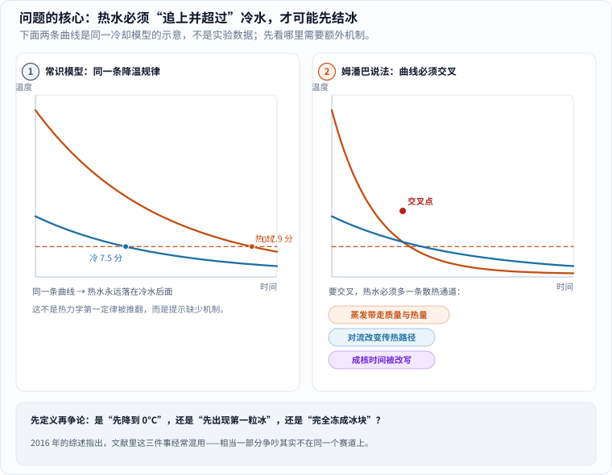
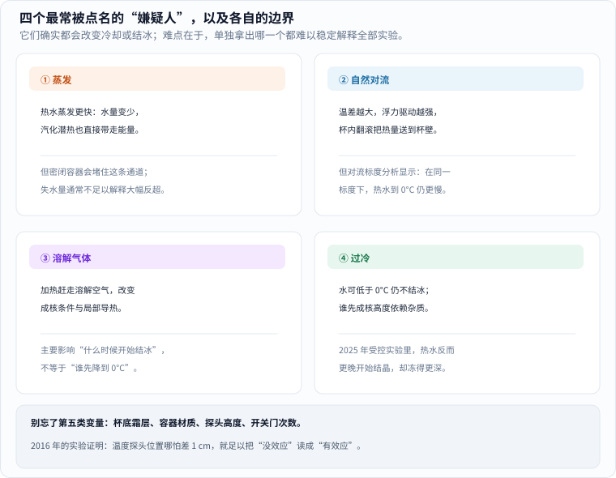
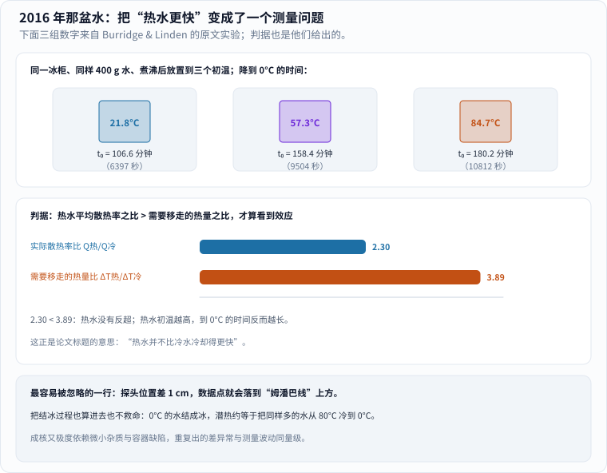
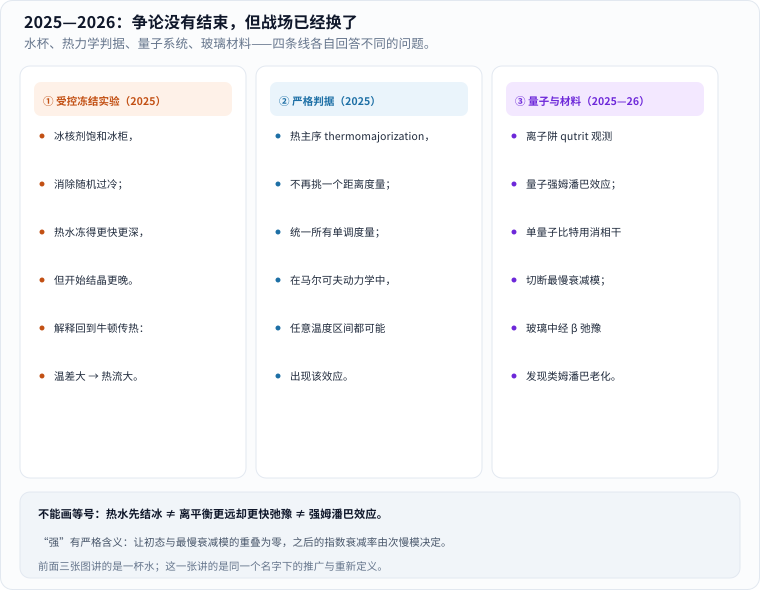

1963 年，坦桑尼亚一所中学的厨房里，一个叫埃拉斯托·姆潘巴（Erasto Mpemba）的学生正在做冰淇淋。按流程，牛奶加糖煮开后要先放凉，再倒进模具冷冻。那天冰箱位置不够，他索性把滚烫的混合物直接塞了进去。一个半小时后，他发现自己的冰淇淋已经冻好了，而另一位没有先煮牛奶的同学，拿出来的还是黏稠的奶浆。

这个偶然发现后来变成了一个著名的名字：**姆潘巴效应（Mpemba effect）**——在看起来“其他条件都相同”的情况下，初始温度更高的水，反而比初始温度更低的水更快结冰。

但在讲“为什么”之前，必须先问一句：**这件事到底是在说什么？**因为过去六十多年的大量争吵，有一半都来自这个问题没说清楚。

---

## 一、先别争：你说的“先结冰”，是哪一种“结冰”？

现代文献里至少混着三个不同的终点：

1. **先降到 0°C**：从初温冷却到冰点，完全不涉及相变；
2. **先出现第一粒冰**：也就是开始成核，可能被过冷严重影响；
3. **先完全冻成冰块**：除了降到 0°C，还要移走凝固潜热。

2016 年，剑桥大学的亨利·伯里奇（Henry Burridge）和帝国理工的保罗·林登（Paul Linden）在 *Scientific Reports* 上写了一篇篇幅很长的“清算文章”。他们指出，姆潘巴与奥斯本 1969 年那篇原始论文记录的是“开始冻结的时间”，而后来很多人把“冷却到 0°C”和“完全冻结”也算了进去，定义从来不统一 [[1]](#ref-1)[[2]](#ref-2)。

_图 1 怎么看：左右对照。左栏用同一条指数冷却规律示意：90°C 热水降到 0°C 约需 17.9 分钟，20°C 冷水约需 7.5 分钟。若两杯水遵循同一条曲线，热水永远落在冷水后面。右栏画出姆潘巴说法要求的情况：两条曲线必须交叉。要让交叉发生，热水就得比冷水多一条散热通道，或多一个改变成核的因素。底栏提醒：先定义终点再争论。两栏曲线都是模型示意，不是实验数据。_

这不是抬杠。定义一个现象时如果把终点写模糊，实验结果就会像“随便挑对自己有利的终点”——这正是接下来整场争论的缩影。

---

## 二、直觉为什么会反对这件事

直觉其实很有道理：热水要结冰，总得先经过冷水出发的那个温度。假设环境恒定在 $$T_f=-18^\circ\mathrm{C}$$，水服从牛顿冷却定律，那么温度随时间大致按指数衰减：

$$T(t)=T_f+(T_0-T_f)e^{-t/\tau}$$

解出降到 $$0^\circ\mathrm{C}$$ 的时间：

$$t_0=\tau\ln\frac{T_0-T_f}{0-T_f}$$

把图 1 的数字代进去：20°C 的水需要 $$\tau\ln(38/18)\approx0.75\tau$$；90°C 的水需要 $$\tau\ln(108/18)\approx1.79\tau$$。热水要多花约 2.4 倍时间。

所以姆潘巴效应并不违反热力学第一定律。它真正要求的是：**热水和冷水并没有遵循同一条冷却曲线**。温度更高这件事本身，必须同时改变散热条件、质量、流动状态或成核过程。

早在亚里士多德那里，就有类似记录。他在《气象学》里写到，本都的渔民在冰上扎营时，会把温水浇在芦苇周围让它更快冻住，好把芦苇固定在冰里；他还说，“先前被加热过的水有助于它更快结冰”。弗兰西斯·培根说“微温的水比完全冷的水更容易结冰”。笛卡尔则给出一个机制解释：长时间加热的水，那些“最不容易改变状态”的微粒蒸发掉了，所以剩下部分冷却得更快 [[1]](#ref-1)。

有意思的是，两千年过去了，我们今天列出的“嫌疑人”里仍然有蒸发——只是它到底够不够用，至今仍是问题。

---

## 三、四个嫌疑人：谁在帮热水“作弊”

_图 2 怎么看：四张卡片。蒸发：水少了、汽化潜热带走热量；但密闭杯会堵住这条路，失水量通常也不够大。对流：温差大，浮力驱动强，杯内翻滚把热量送到壁面；但标度分析显示热水到 0°C 仍更慢。溶解气体：加热赶走空气，改变成核条件；它主要影响“何时开始结冰”。过冷：水可低于 0°C 仍不结冰；2025 年受控实验中，热水反而更晚开始结晶。_

### 1. 蒸发：最直观，也最容易被高估

热水蒸发更快，这没问题。蒸发同时干两件事：一是**减少待冻结的水量**，二是通过汽化潜热直接带走能量。所以它是所有解释里实验支持最多的一个。

但它的边界也很清楚：如果把杯子密封，蒸发通道被堵住，效应应当消失或大幅减弱；而不少实验测到的失水量很小，难以解释大幅反超。2016 年的综述也把蒸发列为四个候选因素之一，同时强调这四个因素**强耦合**：蒸发会改变溶解气体，溶解气体会影响成核，成核又会改变对流看到的温度场 [[1]](#ref-1)。

### 2. 对流：改的是“热的运输路线”

热水与冷环境之间的温差更大，浮力驱动更强，杯内更容易形成自然对流。对流的本领不是让水“凭空少掉热量”，而是把杯心的高温更快送到杯壁和表面。

伯里奇和林登把已有实验数据按无量纲的瑞利数（Rayleigh number）重新整理，发现冷却时间大体服从高瑞利数对流标度；在这条共同的标度曲线上，**初始温度越高，降到 0°C 的时间越长** [[1]](#ref-1)。换句话说，对流确实改变速率，但按现有数据，它自己不足以让热水反超。

### 3. 溶解气体：更像“开关”，不是“发动机”

温度越高，气体在水中的溶解度越低。加热过的水溶解空气更少，这可能改变水的导热、对流与成核行为；一些实验也发现脱气水结冰更快。

但这个机制主要作用在**成核阶段**：它更擅长解释“什么时候开始长出第一粒冰”，不太擅长解释“谁先降到 0°C”。把两个终点混在一起，就会出现“看起来验证了、其实换了题目”的情况。

### 4. 过冷：最容易被误判的嫌疑人

水不是到 0°C 就必然结冰。没有合适的成核中心时，它可以保持液态到 0°C 以下——这就是过冷。谁先成核，往往取决于肉眼看不见的杂质、容器壁缺陷、甚至上一轮实验留下的痕迹。

2010 年前后，詹姆斯·布朗里奇（James Brownridge）提出，杂乱杂质导致的过冷差异才是关键：如果冷水过冷得更深，热水就可能更早开始结冰 [[1]](#ref-1)。听起来很合理。但 2025 年他的团队做了一组更严格的实验，结果出现了一个反转——我们下一节再讲。

### 还有分子层面的猜想

2013—2015 年间，有研究组用氢键记忆、水皮层“超固态”模型、分子动力学模拟来解释姆潘巴效应。伯里奇和林登对此很谨慎：这类微观机制要真正解释宏观现象，必须证明**水的整体热学或流体性质会因为初始温度不同而发生迟滞**；否则分子层面的有趣结果，只是被参数化进了我们已经知道的物性里 [[1]](#ref-1)。

---

## 四、2016 年：一场把“效应”判成“测量误差”的清算

伯里奇和林登没有只做文献综述。他们做了两类实验，其中第一类刻意模仿姆潘巴与奥斯本当年的 setup：三份 400 克水，煮沸后放置到不同初温，同时放进 $$−18^\circ\mathrm{C}$$ 冰柜，热电偶固定在样品中心，每秒记录一次。

_图 3 怎么看：三块内容。上排是原文数据：初温 21.8°C、57.3°C、84.7°C 的水，降到 0°C 分别用了 6397、9504、10812 秒——初温越高，耗时越长。中部是他们给出的判据：热水平均散热率之比 $$Q_H/Q_C$$ 必须大于需要移走的热量之比 $$\Delta T_H/\Delta T_C$$。84.7°C 与 21.8°C 这一对算出来是 2.30 对 3.89，没有反超。底部是全篇最锋利的一刀：热电偶位置只要差 1 cm，数据点就会跑到“姆潘巴线”上方，从而被误读成观察到效应。_

这个“1 厘米”不是修辞。水在快速冷却时内部温度分层明显，不同高度的热电偶读到的温度并不一样。论文用自己精确控制的数据模拟了“探头高度偏差 1 cm”的情形，发现这样读出的数据足以覆盖文献中大量“观察到姆潘巴效应”的区域，而且研究者往往根本没有报告测量高度 [[1]](#ref-1)。

他们的结论相当不客气：

> “没有证据支持有意义的姆潘巴效应观测。”

他们还指出，姆潘巴与奥斯本 1969 年报告过“90°C 水 freezing 只要 30 分钟，20°C 水要 100 分钟”这种巨大差异；如果属实，意味着仅靠提高初温就让平均传热率提高约 15 倍，对换热器工业会有重大意义。但在此后近半个世纪里，没有人能在同等量级上重复出来 [[1]](#ref-1)。

不过，这篇论文自己也在定义上留下了争议：它主要考察“冷却到 0°C”，而批评者会说姆潘巴讲的是“结冰”。这件事到今天仍没有被一句判决终结——2025 年的新实验，恰恰是从“把结冰过程认真算进去”这个方向回来的。

---

## 五、2025 年：当过冷被消掉，热水真的冻得更快

2025 年，布朗里奇与法国团队在 *Journal of Physical Chemistry B* 发表了一项设计得很干净的实验（arXiv:2503.18820）[[3]](#ref-3)。

他们做的改动是：**把冰箱内部用冰核剂饱和，让过冷基本消失，并且精确控制温度记录**。这样就把“谁运气好先成核”这个随机因素压到最低，剩下的差异主要来自传热本身。

结果很微妙，也很关键：

- 热水样品**冻结得更快、冻结得更深**；初始温差越大，差别越明显；
- 但热水样品**开始结晶的时间总是更晚**——这一点和很多民间解释正好相反；
- 无论是热水对室温水，还是室温水对冷水，趋势都一样；
- 作者用传热差异解释结果，认为它符合牛顿传热定律：热水与环境温差更大，热流更大，成核之后冰层推进更快。

请把这句话读两遍：**热水不是因为更早结冰才赢，而是因为一旦开始结冰，它冻得更快、更深。**

这并没有“证明 2016 年错了”。两项研究回答的不是同一个问题：2016 年看的是“降到 0°C”，2025 年看的是“在受控成核条件下的冻结过程”。它们合在一起反而说明了一件事：姆潘巴效应不是一个可以在厨房里随口断言的普遍规律，而是一组**对边界条件极度敏感**的现象。

---

## 六、2025—2026 年，它已经不只是“一杯水”了

_图 4 怎么看：三栏。受控冻结实验（2025）：冰核剂消除过冷后，热水冻得更快更深，但开始结晶更晚。严格判据（2025）：热主序（thermomajorization）让“谁更接近平衡”不再依赖挑一个距离度量，并证明在马尔可夫动力学中任意温度区间都可能发生。量子与材料（2025—2026）：离子阱 qutrit、单量子比特消相干、玻璃的 β 弛豫，都出现了同一族反常弛豫。底栏：热水先结冰、离平衡更远却更快弛豫、强姆潘巴效应，三者不能画等号。_

### 1. 先把“谁更接近平衡”说严格

传统理论常用某个距离函数（比如 KL 散度或迹距离）衡量系统离平衡有多远。问题是，换个距离函数，结论可能就变了：到底算不算“更快”，取决于你用哪把尺子。

2025 年 3 月，京都大学的 Tan Van Vu 与 Hisao Hayakawa 在 *Physical Review Letters* 发表了 *Thermomajorization Mpemba Effect* [[4]](#ref-4)。他们用**热主序**取代任意选定的距离：如果分布 $$p'$$ 相对参考热态 $$p$$ 热主序化 $$p$$，那么对所有关于热主序单调的“良态”度量，$$p'$$ 都不比 $$p$$ 更远离平衡。作者由此推导了有限时间内发生效应的普适条件，并证明在能级固定的马尔可夫动力学中，它可以出现在任意温度区间。

这件事的意义不是“热水先结冰被证明了”，而是把一个模糊口号变成了一个**可判定的数学关系**。

### 2. 量子世界里的“强”版本

最强版本的姆潘巴效应有一个很干净的定义：让初态与系统演化中**最慢衰减模**的重叠为零。这样，长时演化不再被最慢的那一项拖住，而是由次慢模主导，弛豫获得指数级加速。

2025 年 1 月，国防科技大学等团队在 *Nature Communications* 报告：在单个俘获的 $$^{40}\mathrm{Ca}^+$$ 离子构成的三能级系统里，制备了与最慢衰减模零重叠的初态 $$|\mathrm{sME}\rangle$$，观察到它虽然离稳态更远，却比普通初态更快到达稳态 [[5]](#ref-5)。

2026 年 11 月，东南大学薛鹏团队在 *Physical Review Letters* 更进一步：在单量子比特中利用 Davies 映射的一个特点——简并的最慢衰减模在能量表象里是**纯相干模**——通过**消除初态中的相干性**切断最慢衰减模，观测到真量子强姆潘巴效应 [[6]](#ref-6)。

请注意这里的“温度”已经是类比意义上的“逆温度”和“非平衡自由能”，不是冰箱里的 90°C 与 20°C。它们是同一个数学结构在不同物理系统里的显影，不是“热水先结冰”在量子世界的直译。

### 3. 玻璃里也有“类姆潘巴”

2026 年 5 月，中国科学院宁波材料技术与工程研究所团队与合作者在 *Physical Review Letters* 报告：在非晶合金、高分子玻璃和小分子玻璃的能量老化过程中，也发现了类姆潘巴效应——先经过高温预退火的样品初始能量更高，却能量降低得更快，甚至追上初始能量更低的样品 [[7]](#ref-7)。

机制指向双步退火重新激活了势垒更低的 $$\beta$$ 弛豫：$$\beta$$ 弛豫的焓变越高，能量老化越快。这个系统没有水结冰那种一级相变和随机成核，因此反而成了研究“效应本身”的更干净模型。

---

## 七、如果你真想在家试：先写协议，再开冰箱

_图 5 怎么看：左右两栏。左栏是四步协议：定义终点、控制变量、连续记录、看波动。右栏区分三种“结冰”：开始成核、降到 0°C、完全冻结；并给出实用制冰建议。底栏给出最低标准：稳定、显著、能被别人重复。否则就老实写“这次没看到”。_

具体到操作，我建议这样写你的“实验记录表”：

| 项目 | 该怎么写 |
| :--- | :--- |
| 终点 | 例如“热电偶读数首次达到 0°C”，不要写“结冰了” |
| 样品 | 同体积、同质量、同水源；记录初温到 0.1°C |
| 容器 | 同材质、同形状、同水位；杯底是否结霜要写清楚 |
| 放置 | 同时放入、同一层、全程不挪动；记录冰柜温度 |
| 测量 | 探头固定同一高度；有条件的用多个探头取平均 |
| 重复 | 至少十几轮，报告平均值和离散度，不只报最好看的那一轮 |

还有两个常见混淆值得单独说：

- **“泼水成冰”不是姆潘巴效应的直接证据。** 热水被泼出去后雾化成大量小液滴，比表面积暴增，蒸发与换热条件都和杯子里那一整杯水完全不同。它很有观赏性，但不是同一个实验。
- **想快点得到冰块，靠的是工程，不是这个悖论。** 浅金属盘、小水量、贴紧冷板、减少开门，这些都比“先把水烧热”可靠得多；后者既不稳定，也更费电。

---

## 八、八个常见误读，逐条拆掉

| 说法 | 更准确的说法 | 依据 |
| :--- | :--- | :--- |
| “热水一定比冷水先结冰” | 只在某些边界条件下被报告过；不是普遍规律 | 2016 综述 [[1]](#ref-1)、2025 受控实验 [[3]](#ref-3) |
| “姆潘巴效应违反热力学第一定律” | 不违反；它要求的是两条冷却曲线不同 | 冷却方程与 2016 分析 [[1]](#ref-1) |
| “蒸发就够了” | 蒸发是真实通道，但密闭后消失，量级常不足 | 2016 综述 [[1]](#ref-1) |
| “2016 年已经证明这是骗局” | 那篇论文否定的是其定义下的效应；结冰过程与成核仍可讨论 | 论文结论 [[1]](#ref-1)、2025 实验 [[3]](#ref-3) |
| “2025 年证明热水更早成核” | 恰恰相反：热水更晚开始结晶，却冻得更快更深 | Brownridge 等 [[3]](#ref-3) |
| “量子姆潘巴效应就是热水先结冰的量子版” | 它是“离平衡更远却更快弛豫”的推广；强版本还要求切断最慢衰减模 | Nature Communications [[5]](#ref-5)、PRL [[6]](#ref-6) |
| “只要重复次数够多就一定能看到” | 对边界条件极度敏感；探头高度差 1 cm 就能翻转结论 | 2016 实验 [[1]](#ref-1) |
| “这是厨房小技巧，烧热水再冻更省事” | 科学问题和工程问题不同；实用制冰靠浅盘、小水量、好接触 | 本文第七节 |

---

## 九、结语：一个反直觉现象教给我们的东西

姆潘巴效应最有价值的地方，也许不是“热水到底会不会先结冰”这个答案，而是它把科学里最容易被跳过的一步摆到了台面上：**先把问题定义清楚，再谈机制。**

一杯水看起来简单得不能再简单，但一旦认真追问，就会遇到：

- 终点定义：降到 0°C、开始成核、完全冻结，是三件事；
- 测量位置：差 1 cm 就能改变结论；
- 边界条件：蒸发、对流、溶解气体、冰核、容器、霜层全都在动；
- 推广之后：同一个名字下，热力学、量子信息和材料老化各自讲着不同的故事。

1963 年那个赶时间的中学生大概没想到，他为了抢冰箱位置做的一次尝试，会在六十多年后把物理学家带到离子阱和玻璃材料面前。这不是因为厨房里藏着什么魔法，而是因为**一个看似简单的问题，只要不肯放过细节，就会一直长出新问题**。

下次有人跟你说“热水先结冰”，你不妨先问一句：**你说的“先结冰”，到底是哪一种？**

---

## 参考资料与核查来源

1. **Henry C. Burridge & Paul F. Linden**, *Questioning the Mpemba effect: hot water does not cool more quickly than cold* — *Scientific Reports* **6**, 37665 (2016)（[nature.com/articles/srep37665](https://www.nature.com/articles/srep37665)）。本文核查了全文：亚里士多德、培根、笛卡尔的原始引文，姆潘巴故事的复述，1969 年论文关于 90°C 用 30 分钟、20°C 用 100 分钟的报告，三组冷却时间与 1 cm 探头偏差分析，以及作者的定义与结论。
2. **E. B. Mpemba & D. G. Osborne**, *Cool?* — *Physics Education* **4**(3), 172–175 (1969)（[DOI 页面](https://doi.org/10.1088/0031-9120/4/3/172)；RSC 扫描页需 JavaScript 验证，本文对原始数据的转述来自文献 [[1]](#ref-1) 的复核）。这是姆潘巴效应得名的原始论文，记录的是“开始冻结的时间”。
3. **James D. Brownridge, Matthieu Zinet, Paul Sotta & Francois Ganachaud**, *Unraveling Specific Conditions for a Repeatable Mpemba Effect* — *J. Phys. Chem. B* **129**, 13277–13288 (2025)；arXiv:2503.18820（[arxiv.org/abs/2503.18820](https://arxiv.org/abs/2503.18820)）。冰核剂饱和、消除过冷、热水冻结更快更深但结晶更晚，以及作者用传热差异解释结果。
4. **Tan Van Vu & Hisao Hayakawa**, *Thermomajorization Mpemba Effect* — *Phys. Rev. Lett.* **134**, 107101 (2025)；arXiv:2410.06686（[arxiv.org/abs/2410.06686](https://arxiv.org/abs/2410.06686)）。热主序判据、所有单调度量的统一，以及马尔可夫动力学中任意温度区间均可发生。
5. **Jie Zhang 等**, *Observation of quantum strong Mpemba effect* — *Nature Communications* **16**, 301 (2025)，2025-01-06（[nature.com/articles/s41467-024-54303-0](https://www.nature.com/articles/s41467-024-54303-0)）。单个俘获 $$^{40}\mathrm{Ca}^+$$ 离子三能级系统，最慢衰减模零重叠的初态，以及 Liouvillian exceptional point 的边界。
6. **Xiang Zhan, Huixia Gao, Lei Xiao & Peng Xue**, *Genuine Quantum Strong Mpemba Effect by Eliminating Coherence* — *Physical Review Letters* (2026)（[DOI](https://doi.org/10.1103/z9t9-mwgv)；中文介绍见[东南大学科学技术处](https://kjc.seu.edu.cn/2026/1104/c29280a588582/page.psp)）。单量子比特线性光学平台，Davies 映射，消相干切断简并最慢衰减模。
7. **Lijian Song, Juntao Huo 等**, 玻璃材料中的类姆潘巴效应 — *Physical Review Letters* (2026)（[DOI](https://doi.org/10.1103/znc5-brc6)；中文介绍见[中国科学院宁波材料技术与工程研究所](https://nimte.cas.cn/news/media/202605/t20260527_8209770.html)）。Flash DSC 测量非晶合金、高分子玻璃与小分子玻璃的双步退火老化，$$\beta$$ 弛豫机制。
8. **原创图解说明**：图 1 至图 5 由本文用 `tools/visuals.py build mpemba` 生成。数值断言包括指数冷却模型的 $$17.9/7.5\approx2.4$$ 倍、交叉时刻约 5.9 分钟、2016 年实验的 $$2.30<3.89$$ 判据与三组原文时间；图 1 两条曲线为模型示意，已明确标注“非实验数据”。五幅 SVG 均通过 XML、宽高比、title/desc 标签与渲染字号审计，并在浏览器中逐张检查。
