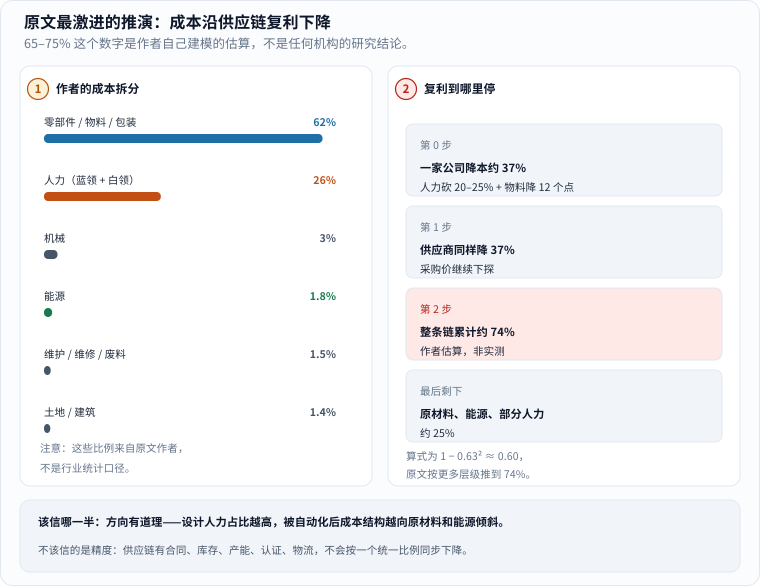
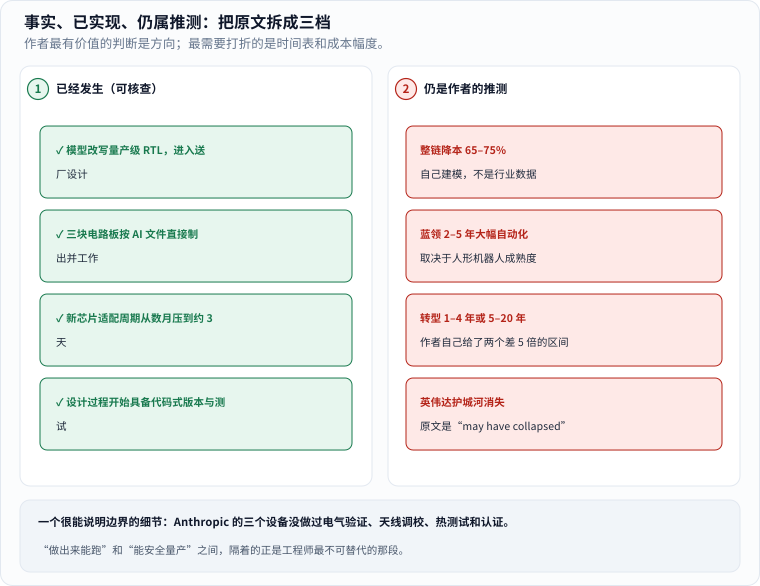

2026 年 11 月 18 日，Tomas Pueyo 在 Uncharted Territories 发了一篇文章，标题只有四个词：**《Hardware Is Software》** [[1]](#ref-1)。

它传播得很快，因为里面塞满了听起来很炸的数字：制造业整条链成本降 **65–75%**、蓝领岗位 **2–5 年**大幅自动化、英伟达的 CUDA 护城河"可能已经崩塌"。

先别急着信，也别急着反驳。这篇文章里其实混着三样东西：

1. 一个**很有洞察力**的观察：很多硬件工程确实是伪装成软件工程的；
2. 几条**可核查**的 2026 年最新进展；
3. 一大堆**作者自己建模**的估算，被写成了近乎确定的预言。

这篇解读要做的，就是把这三样分开，然后回答一个更实际的问题：**程序员该怎么办。**

---

## 一、原文章到底说了什么

Pueyo 的核心论点来自 Boom Supersonic 创始人 Blake Scholl 的一句话：

> Most hardware engineering is actually software engineering in disguise.
>
> 大多数硬件工程，其实是伪装成软件的软件工程。

Scholl 的建议更狠：**不要设计硬件，要设计"设计硬件的算法"** [[1]](#ref-1)。

Pueyo 由此推出一整条链：

- 传统硬件工程大量发生在 Excel 表格里——复杂公式、VBScript、邮件传来传去、没有版本控制、没有自动化测试；
- 如果把这套流程真正当成软件来做（架构、测试、API、版本控制），AI 才有下手的地方；
- 一旦设计过程被软件化，研发、文档、实验、认证这些成本会大幅塌缩；
- 于是制造业成本下降、产品价格下降、需求上升，但**岗位被大量摧毁**；
- 最后，成本结构里人和设计的占比变小，**原材料、能源、矿业**变得更重要 [[1]](#ref-1)。

_图 1 怎么看：左右对照。左栏是传统现场：Excel 表格、邮件交接、没有版本控制、迭代很贵。右栏是软件化之后：设计即代码、秒级反馈、可自动再设计、软件工程师搭架构而领域工程师写自己的模块。底栏点出关键：不是"AI 会画图"，而是把设计过程变成可计算、可回放、可复用的对象。这一步没做完，AI 面对的只是一堆没人读得懂的邮件附件。_

这个观察我认为是对的，而且比"AI 能设计芯片"这种标题有价值得多。它指出真正的瓶颈不是算力，而是**工程过程的可计算化**。

---

## 二、三条最硬的证据（都是 2026 年 11 月的）

Pueyo 的文章引了不少案例，其中有几个二手数字我没能在原始来源核实（比如他引用的 NASA "便宜 40%、轻 66%、设计快 85%"）。但**另外三条有一手来源，而且都发生在 2026 年 11 月**。

_图 2 怎么看：三张卡片从上到下。Boom：1 名工程师实时改叶片几何 ≈ 过去 100 人做 6 个月；整机结构 65% 自动生成；50 人造出 XB-1。数字来自创始人自述，非独立审计。OpenAI × AMD：旗舰 GPU IP 最高 14% PPA 提升；Jalapeño 向量单元面积 −13%、矩阵单元 −10%；9,881 次计分测试；AMD 已把部分改动纳入送厂设计。Anthropic × Diode：三款设备从提示词到规格、原理图、PCB、外壳、固件；Diode PCB Gym 69%（前代 25%），BenchCAD 2.1 83.5%。底栏：证据强度从上到下递增，但三条都不是"量产"。_

### 1. Boom：把飞机设计变成软件

Blake Scholl 讲得很具体：早年 Boom 想雇够软件工程师都做不到，现在换了模型——**软件工程师创建架构，硬件工程师对自己负责的部件做 vibe coding**。涡轮叶片原来一个工程师要算一天冷热态再做结构转换，而一台发动机有上千片叶片；现在改几何可以实时看到结果 [[1]](#ref-1)[[2]](#ref-2)。

要注意：这是创始人的公开叙述，数字未经独立审计。它的价值在于展示**方法论**，不在于精确性。

### 2. OpenAI × AMD：模型改写 RTL，已经进流片设计

2026 年 11 月 18 日，OpenAI 发布《Advancing chip design with OpenAI models》[[3]](#ref-3)。这是三条里证据最硬的一条，因为数字、方法和局限都写得清清楚楚：

- **Jalapeño**（OpenAI 自研推理芯片）：向量单元标准单元面积减约 **13%**，矩阵单元减约 **10%**；其中一个乘法器重设计后综合面积少约 15%、延迟从两周期变一周期。这些改动在硅片 bring-up 阶段**已经过硅验证**。
- **AMD 旗舰 GPU IP**：相对高度优化的基线，最高 **14% PPA** 改进；OpenAI 称相当于"不到 5 个月完成约一年的进展"。AMD 已把部分改动纳入**近期送厂制造的设计**，另一些进入生产设计文件供后续版本使用。
- **评测规模**：两款开源 32 位 RISC-V 核（PicoRV32、Ibex），两类任务，**9,881 次计分测试**；单次约 11.2 万 token 预算；用仿真检查正确性，用 Yosys 估频率，失败或面积超 16 倍记零分。

这条最值得学的是**它怎么把"设计"变成一个可打分的问题**：明确输入、明确约束、明确判据、可重复计分。没有这套东西，模型再强也只能"生成看起来像 RTL 的文本"。

### 3. Anthropic × Diode：一句话到可工作原型

2026 年 11 月 9 日，Anthropic 发布《Testing Claude on Real-World Electronics Design》[[4]](#ref-4)。Claude Fable 5.2 从简短提示出发，做了三款设备：USB-C 免提电话、家庭语音助手中枢、手持电子宠物。

它写了规格、原理图、选型、PCB 摆放与走线、3D 打印外壳、固件、BOM 和 DFM 检查；合作方 Diode 直接按文件制板，**没有修改电路**，三块板都工作，其中免提电话用了几周仍正常。

报告里最像工程师的细节有两个 [[4]](#ref-4)：

- 扬声器发现免提电话的板子竖直放不进外壳（静音开关会撞后墙），在 3D 模型里试出**倾斜约 25 度再放平**的安装顺序，并写进装配说明；
- 它嫌 KiCad 自动布线跑长线太慢，**自己写了个网格寻路路由器**，开发约半小时，每条长线约一秒；发现音频时钟线离以太网线太近，又改了路由器给敏感信号留间距。

**但官方的限制写得很明白**：三个都还是原型，没做电气验证、天线调校、热测试、认证，也不是为量产设计的；Claude 没连接测试设备和贴片机，实物由 Diode 工程师制作和测试。Anthropic 还披露与 Diode 存在商业关系 [[4]](#ref-4)。

---

## 三、最新动态：CUDA 护城河真的塌了吗

Pueyo 文章里最刺激的一句，是引用 Casey Handmer 的预测：英伟达的 GPU 与 CUDA 护城河"可能已经崩塌"，因为一个 Fable 级模型可以用不到 100 万美元的 token 花费重建二者 [[1]](#ref-1)。

这是**个人预测，不是事实**。但 2026 年 11 月确实发生了一件相关的事，值得认真看。

11 月 10 日，Anthropic 在 IPO 路演材料中披露：**Claude Mythos Preview** 用约 **3 天**、"基本没有人工干预"，完成了让自家一个模型在 **AMD Instinct MI355X** 上做提示处理（prefill）所需的软件适配，移植或编写了近 100% 的 kernel；按 Anthropic 的历史经验，这过去要几十名工程师做 **6–12 个月** [[5]](#ref-5)。

Tom's Hardware 的报道把边界划得很清楚 [[5]](#ref-5)：

- 只覆盖**一个模型的提示处理**，没说 decode 是否包含；
- 只针对 **MI355X** 一个平台；
- "有用性能水平"没有量化；
- **没有公布 AMD 与英伟达的性能对比**；
- "近 100%"不是 100%，"基本没有人工干预"不是零人工。

同一篇报道还给了几条反向证据：CUDA 已近 20 年成熟度；黄仁勋说英伟达自己也大量用 AI 写 kernel，并称 Anthropic 是"独特案例，不是趋势"；SemiAnalysis 提醒 agent 写的代码仍需要 GPU 来测；而 Anthropic 自己说算力池是"可互换的"，报道则指出芯片并不完全可互换 [[5]](#ref-5)。

所以正确结论不是"护城河没了"，而是 Tom's Hardware 那句：**护城河在变窄，但没有消失。**

对程序员来说，这条动态的含义比"英伟达股价"重要得多：**软件迁移成本正在被压缩**。以前选芯片先看硬件，再算迁移代价；以后会更像"这个模型迁过去要多久、性能损失多少、工具链能不能上生产"。这类问题，正是新型岗位出现的地方。

---

## 四、原文最激进的推演：成本沿供应链复利下降

Pueyo 做了一个成本模型：他估计零部件、物料、包装占制造业成本约 **62%**，人力约 **26%**，机械 3%、能源 1.8%、维护 1.5%、土地建筑 1.4%。假设每家公司在人力和物料上省下一部分，单家公司降本约 **37%**；供应商同样降 37%，沿着链条复利，最后整条链累计降 **65–75%** [[1]](#ref-1)。

_图 3 怎么看：左拆分，右复利。左栏是作者的成本拆分条形图，注意这些比例来自原文作者，不是行业统计口径。右栏四步：单公司约 37% → 供应商再 37% → 整链累计约 74% → 最后剩原材料、能源和部分人力约 25%。底栏是关键判断：方向有道理，精度不可信。供应链有合同、库存、产能、认证、物流，不会按一个统一比例同步下降。_

该信哪一半？

**方向是对的**：如果设计人力在成本里占比高，而 AI 把它大幅压缩，成本结构确实会向原材料和能源倾斜。"Idiot Index"（原材料只占火箭报价 2%）这类例子也说明，很多高成本来自设计和组织的低效，而不是物理下限。

**精度不该信**：原文自己给了两个差 5 倍的时间表——快则 **1–4 年**，慢则 **5–20 年**或一两十年 [[1]](#ref-1)。一个作者自己给出 5 倍区间的模型，不该被当成路线图。

---

## 五、把文章拆成三档：事实、已实现、仍属推测

_图 4 怎么看：左栏·已经发生：模型改写量产级 RTL 进入送厂设计、三块电路板按 AI 文件制出并工作、新芯片适配从数月压到约 3 天、设计过程开始具备代码式版本与测试。右栏·仍是推测：整链降本 65–75%、蓝领 2–5 年大幅自动化、转型 1–4 年或 5–20 年、CUDA 护城河消失。底栏：Anthropic 三个设备没做过电气验证、天线调校、热测试和认证——"做出来能跑"和"能安全量产"之间，隔着的正是工程师最不可替代的那段。_

除了这三档，还有几个容易被忽略的限定：

- **14% 是最高值，不是平均值**，而且基线是已经打磨多年的 AMD 旗舰 GPU IP [[3]](#ref-3)；
- OpenAI 自己承认，从规格从零设计芯片时模型会**丢掉性能计数器等特性**，这可能抬高分数；更真实的测试应该要求保留全部功能、收紧面积，并做物理综合后的时序检查 [[3]](#ref-3)；
- Anthropic 明确说设备是原型，且与合作方有商业关系 [[4]](#ref-4)；
- Boom 的数字是创始人自述 [[1]](#ref-1)。

这些限定不是要否定进展，而是让你知道**该在什么范围内相信它**。

---

## 六、程序员应该怎么转：别去抢画图，去占"可验证的边界"

这是你最关心的部分。我的结论来自上面两份报告的同一个细节：

**在 OpenAI 和 Anthropic 的工作里，人和传统 EDA 工具守住的是验证、评测、采纳和生产决策；模型做的是在明确边界内反复 proposals。**

OpenAI 用 Synopsys 工具验证每次 RTL 改写保持行为等价；AMD 决定哪些改动进流片文件；Anthropic 的 Claude 没接测试设备，实物由 Diode 工程师做。岗位不是消失了，而是**重心从"生成"移到了"判据"**。

_图 5 怎么看：左技能，右路线。三层技能栈：数据层（Python 脚本化 EDA：KiCad / Yosys / Verilator / Synopsys 接口）→ 模型层（Agent 工具调用、上下文工程、评测集与回归测试）→ 领域层（RTL / PCB / DFM / PPA / 热与认证的判据）。90 天路线：第 1–2 周用 Python 脚本生成简单 KiCad 板并跑通 DRC；第 3–6 周复现 OpenAI 的 RISC-V 思路，让模型改 RTL、用仿真判分；第 7–10 周搭"设计—验证"闭环；第 11–13 周做一个可演示的垂直场景。底栏：把"我会写代码"升级成"我能定义一个机器可检验的问题，并让模型反复求解"。OpenAI 用 9,881 次计分测试做的事，本质就是这个能力的高配版。_

### 具体学什么（按优先级）

1. **Python 脚本化工具链**。先选一条能本地跑通的路径：KiCad（PCB）、Yosys + Verilator（开源 RTL 综合与仿真）、或厂商 EDA 的脚本接口。目标不是成为版图专家，而是让**设计产物能被程序读取、修改、比较**。
2. **评测工程**。这是最被低估的能力。学会写：判据（什么叫"功能等价"）、计分函数（面积、时序、功耗怎么算）、回归集（哪些失败必须记零）、以及失败样本的分析流程。OpenAI 那 9,881 次打分，价值不只在模型，更在那套判据。
3. **Agent 工程**。工具调用、上下文管理、可回放的轨迹、失败回滚。Anthropic 的 Claude 自己写路由器这件事，本质是"模型 + 可执行工具 + 验证反馈"的闭环，不是聊天。
4. **一个领域判据**。选一个足够窄的垂直点钻进去：电源板、传感器板、RISC-V 子模块、高速信号走线、DFM 规则。**你要能一眼看出模型给的结果哪里不对**——这个能力短期替代不了。
5. **物理世界的约束常识**。电气验证、天线调校、热测试、EMC、认证。这些不在 AI 报告里闪亮，但恰恰是"原型到产品"的门槛，也是岗位迁移的方向。

### 哪些人最危险，哪些人最稳

- **最危险**：只做"把需求翻译成一段代码"、且没有判据能力的纯应用层工作。如果产出只能靠人眼判断好不好，它最容易被模型 + 自动评测覆盖。
- **最稳**：能定义问题边界、能建可检验判据、能承担生产决策责任的人。OpenAI 报告里 AMD 决定改动是否进流片，Anthropic 报告里 Diode 工程师做实物测试——这两个动作都没被自动化。
- **新机会**：硬件 agent 的评测平台、EDA 工具的脚本化接口、跨芯片迁移工具链、AI 生成设计的可信度审计。这些岗位今天还没有成熟的名字，但报告里已经能看出需求。

### 一个务实提醒

不要辞职去"学造芯片"。更稳的路径是**在现有职业上叠加一层**：你原本会 Python，就往 EDA 脚本和评测走；你原本做后端，就往 agent 工具链和可观测性走；你原本就是硬件工程师，就尽快补上软件工程那套——版本控制、自动化测试、可重复构建。Pueyo 文章最有价值的一句话，对所有人都适用：**先让过程可计算，AI 才有下手的地方；也只有这样，你才知道自己该站在过程的哪一段。**

---

## 七、一张总表与六个常见误读

| 说法 | 实际情况 | 依据 |
| :--- | :--- | :--- |
| "硬件工程都是软件" | 设计流程大量是软件，但物理验证、认证、量产不是 | Anthropic 原型限制 [[4]](#ref-4) |
| "AI 已能让硬件工程师失业" | 生成环节被压缩，判据与生产决策仍由人把守 | OpenAI 的 Synopsys 验证与 AMD 采纳 [[3]](#ref-3) |
| "14% 是普遍提升" | 最高值，基线是高度优化的旗舰 IP | OpenAI 报告 [[3]](#ref-3) |
| "CUDA 护城河没了" | 在变窄；缺口是没做 AMD vs 英伟达性能对比 | Tom's Hardware [[5]](#ref-5) |
| "成本会降 65–75%" | 作者自建模型，非研究结论；时间表自己差 5 倍 | 原文 [[1]](#ref-1) |
| "NASA 证明 AI 设计件便宜 40%、轻 66%、快 85%" | 原文引用，我未能在原始报告核实，故不作为本文论据 | 原文 [[1]](#ref-1) |

六个误读，逐条讲：

1. **把"设计过程软件化"等同于"硬件是软件"**。前者是方法论，后者是修辞。芯片要流片、板子要贴片、设备要过认证，这些不会因为你写了 Python 就消失。
2. **把最高值当平均值**。14% PPA 是在已优化基线上拿到的最高改进，OpenAI 自己也说这是"前沿前所未有"，不是随手可得。
3. **把原型当产品**。三块电路板能跑很了不起，但没做电气验证、天线调校、热测试和认证 [[4]](#ref-4)。
4. **把一家公司的特例当行业趋势**。黄仁勋称 Anthropic 是"独特案例，不是趋势"；即便如此，迁移成本下降这个方向是真实的 [[5]](#ref-5)。
5. **把自己的模型当行业数据**。65–75% 和 1–4 年都是作者的推演，不是任何机构的研究结论 [[1]](#ref-1)。
6. **把没核实的引用当证据**。原文引用的 NASA 数字我查到了同名报告入口，但没能拿到原始数据核实那三个百分比，所以本文不把它当论据。

---

## 八、结语：这篇文章真正值得带走的东西

把这篇长文压成一句话：

> **Pueyo 说对了一件事：硬件工程里最值钱的部分，正在从"亲手算"变成"定义可计算的设计过程"。他说过头的是把这件事的加速度，直接换算成了岗位消失和成本崩塌的时间表。**

2008 年前后，很多人对"软件定义一切"也是这种感觉：方向对，节奏错。真正改变世界的不是口号，而是那些把过程变得可重复、可验证、可打分的人。

今天这种人更难找了——他们既要懂一点物理约束，又要懂软件工程，还要能给 AI 的输出建立判据。这恰好是程序员最容易切入、也最不容易被替代的位置。

---

## 参考资料与核查来源

1. **Tomas Pueyo**, *Hardware Is Software* — Uncharted Territories, November 18, 2026（[unchartedterritories.tomaspueyo.com/p/hardware-is-software](https://unchartedterritories.tomaspueyo.com/p/hardware-is-software)）—— the article under review: Blake Scholl's "software engineering in disguise" quote and "design the algorithm for designing the hardware," the 100 engineers/6 months vs one engineer, 65% aircraft structure, Boom team sizes, the NASA 40%/66%/85% claim (quoted by the author, not independently verified here), Casey Handmer's radar PCB and Nvidia prediction, the 62%/26%/3%/1.8%/1.5%/1.4% cost breakdown, the 37%→74% compounding model, and the 1–4 year vs 5–20 year timelines. All cost and timeline figures are the author's own estimates.
2. **Blake Scholl**, *Move fast and don't break safety-critical things*（[bscholl.substack.com/p/move-fast-and-dont-break-safety-critical](https://bscholl.substack.com/p/move-fast-and-dont-break-safety-critical)）—— primary source for Boom's approach: hardware workflows as isolated spreadsheets without source control or automated testing, internal engineering software (mkBoom), embedding software engineers in hardware teams, and the shift to software engineers creating architecture while hardware engineers code their own components.
3. **OpenAI**, *Advancing chip design with OpenAI models* — November 18, 2026（[openai.com/index/advancing-chip-design-with-our-models/](https://openai.com/index/advancing-chip-design-with-our-models/)）—— primary source for Jalapeño vector unit −13% and matrix unit −10% standard-cell area, the multiplier redesign (15% less area, two cycles to one), silicon-proven status, up to 14% PPA on AMD flagship GPU IP, some changes sent to manufacturing, the 9,881 scored runs on PicoRV32 and Ibex, ~112k token budgets, Synopsys behavioral-equivalence checks, and the authors' admitted limitations (omitted features, 16× area allowance, Yosys-estimated frequency, need for physical-synthesis timing checks).
4. **Anthropic**, *Testing Claude on Real-World Electronics Design* — November 9, 2026（[anthropic.com/research/claude-electronics-design](https://www.anthropic.com/research/claude-electronics-design)）—— primary source for the three devices, end-to-end design scope, Diode PCB Gym 69% (vs 25%) and BenchCAD 2.1 83.5%, the 25-degree board insertion, the 25 mm→10 mm acoustic port redesign (3.4 kHz→8.9 kHz), Claude writing its own grid-based router, and the explicit limitations: prototypes only, no electrical validation/antenna tuning/thermal testing/certification, not designed for mass production, commercial relationship with Diode.
5. **Shane Downing (Tom's Hardware)**, *Anthropic says Claude Mythos slashed software work to onboard AMD GPUs from up to 12 months to around three days* — November 16, 2026（[tomshardware.com](https://www.tomshardware.com/tech-industry/artificial-intelligence/anthropic-says-claude-mythos-slashed-software-work-to-onboard-amd-gpus-from-up-to-12-months-to-around-three-days-writing-almost-100-percent-of-kernels-autonomously-chips-away-at-nvidias-cuda-moat)）—— English source for the three-day claim and its scope limits (one model, prompt processing only, MI355X only, undefined "useful performance," no Nvidia performance comparison), plus counterpoints: CUDA's near-two-decade maturity, Jensen Huang's "unique instance, not a trend," SemiAnalysis on GPUs still being needed to test generated code, and the conclusion "the moat is narrowing, but is not gone."
6. **原创图解说明**：图 1 至图 5 由本站 `tools/visuals.py build hardware-is-software` 生成。数值断言包括 65+35=100、13%>10%、9,881 次测试、69%>25%、83.5%>69%、25 mm→10 mm、3.4 kHz→8.9 kHz、1−0.63²≈0.60 等；全部 SVG 通过 XML、宽高比、title/desc 标签与渲染字号审计，并在浏览器中逐张检查。图 3 的成本比例与图 4 的降本推演均来自原文作者的估算，已在图中明确标注。
